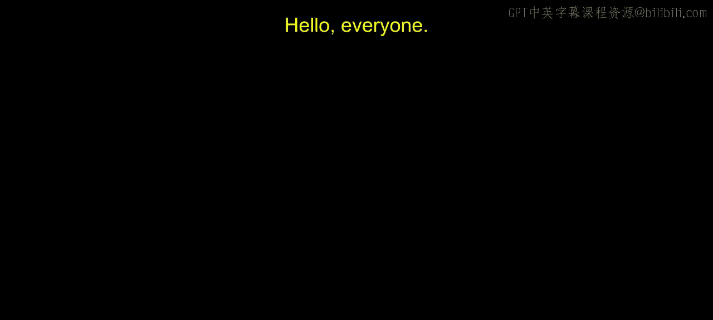
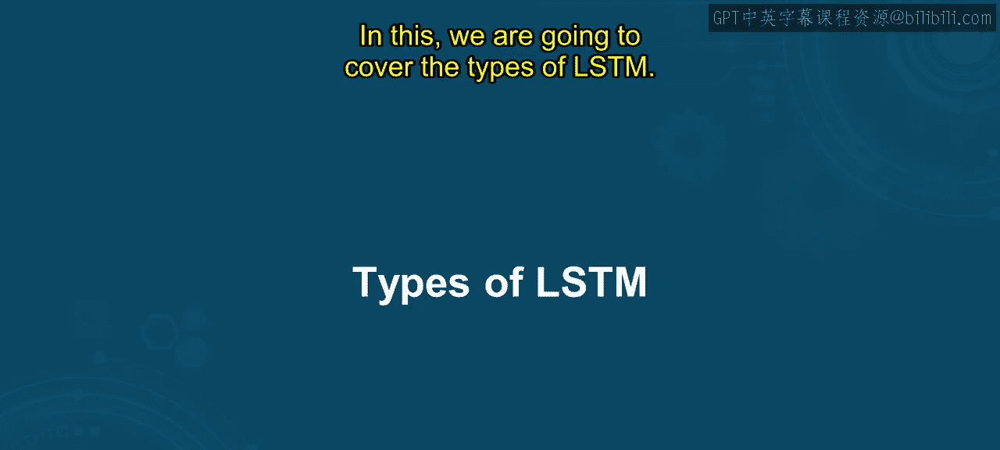
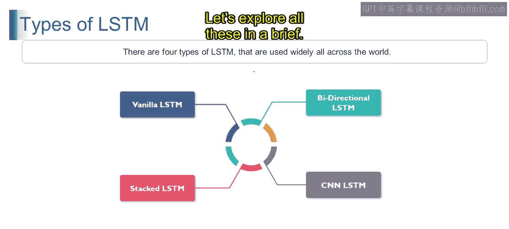
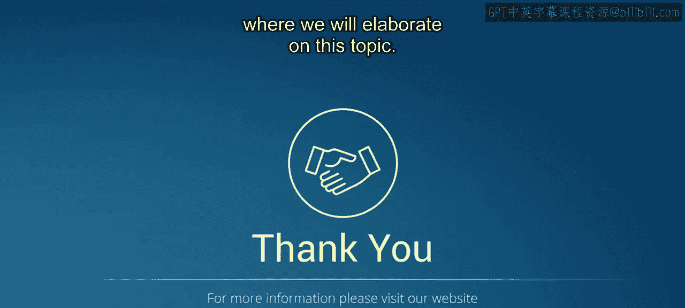

# Edureka《通过LLMs学习生成式人工智能（机器学习和NLP基础，第1课／共4课）｜Learn Generative AI with LLMs》中英字幕 - P95：94_LSTM的类型.zh_en - GPT中英字幕课程资源 - BV1q4421Q7qh

Hello everyone welcome back to machine learning and NLP basics so now let's understand the different types of LSTM in this we are going to cover the types of LSTM by the end of the session you will be able to identify and describe various LSTM architectures and their applications。

😊。

So let's get started the types of LSTM。So there are four different types of Lstium that are used widely across the world。

 There are vanilla stagged LSTM pidirectional LSTM and CNN LSTM so let's understand all this。

 So when we say vanilla vanilla LSTM is a basic form of long short term memory networks it consists of single LSTM layer。

 for example， imagine predicting the next word in a sequence。

 a vanilla LSTM would take the sequence of words as an input and predict the probability distribution of the next word that is about vanilla means technically vanilla LSTM consists of single LsTM layer。

😊，It consists of single LSTM layer that process the input sequence and maintains a cell state to capture long term dependencies。

 it has input for gate and output gates to regulate the flow of information and then the next one is of stagged LSTM stagged LSTM involves stacking multiple LSTM layers on top of each other。

 for example， continuing with our previous example。

 a stackgged LSTM might consist of multiple LSTM layers with each layer capturing increasingly abstract representation of the input sequence means technically stagged LLTM comprises multiple LSTM layers。

😊，Stacked on top of each other， each layer receives input from the previous layer and passes its output to the next layer。

 allowing the model to learn hierarchical representation of the input data。

 then the next one is of bidirectional Lstium。 so the bidirectional Lstium processes input sequence in both forward and backward directions。

😊，For example， suppose you are analyzing a piece of text to determine the sentiment a bidirectional LSTM would consider both past and future words to understand the context surrounding the each word means technically bidirectional LSTM consists of two LSTM layers here it consists of two LSTM layers。

😊，The name itself is indicating two LSTM layers， one processes the input sequence in the forward direction while the other processes it in the backward direction。

 this allows the model to capture contextual information from both past and future inputs CNN LSTM combines the convolutional neural networks with LSTM network leveraging CNNs for feature extraction and LSTM's first sequential modeling。

 for example， in video classification a CNN LSTM model might use CNN layers to extract spatial features from each frame and LSTM layers to capture temporal dependencies better the frames。

😊，Means。Technically， CNN LSTM integrates CNN layers for spatial feature extraction with the LSTM layers for sequential modeling。

 it processes input sequence through CNN layers to extract features and then feeds these features to LSTM layers to capture the temporal dependencies means the four different types of LSTM architecture like vanilla tagged and bydirectal and CNN LSTM offer different ways to model sequential data with each with its own strengths and applications these architectures provide flexibility and scalability for various tasks requiring sequential data analysis let's explore all these in a brief。

😊。

So stay tuned for the next video where we will elaborate on this topic。😊。

