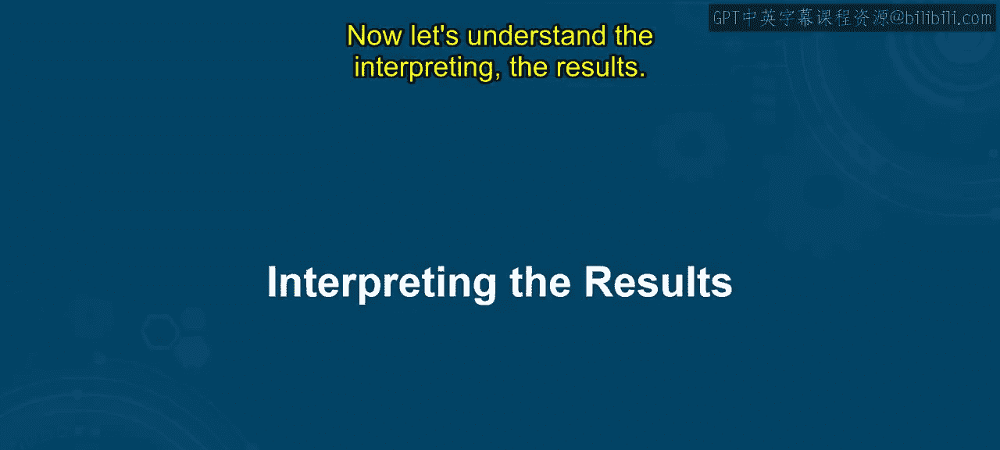
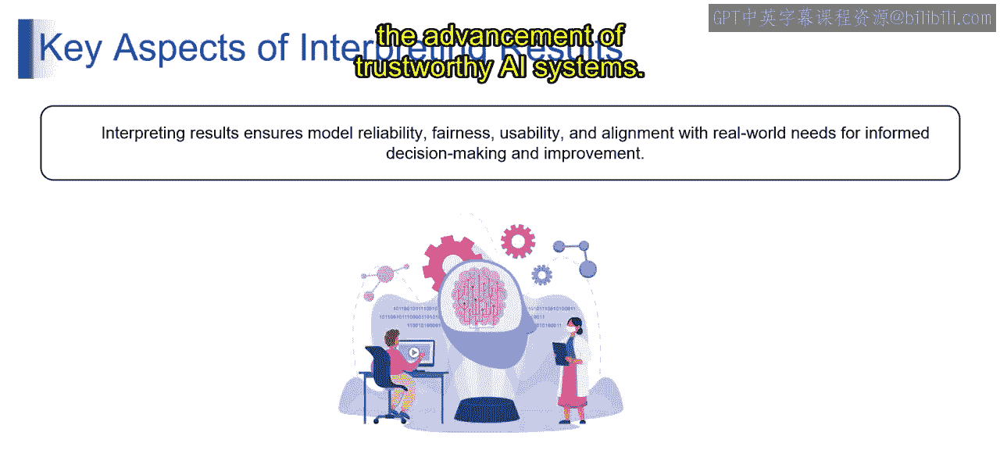

# Edureka《通过LLMs学习生成式AI（基础、应用开发、流行工具，第2、3、4课／共4课）｜Learn Generative AI with LLMs》中英 - P96：59_解释结果.zh_en - GPT中英字幕课程资源 - BV1ym421V7gx

Hello everyone， welcome back to Geneative AI Architecture and applications development。😊。

So now let's understand the interpreting the results in this。

 we are going to understand what are the key aspects of interpreting the results。

 So by the end of the session you are able to comprehend the key aspects of interpreting the results in the language model。

 So let's get started。 first of all， let's understand what exactly the interpreting the results。

 So interpreting the results involve analyzing the outcomes of the language model evaluations to gain insights into the performance and effectiveness。

 So it entails understanding the implications of various metrics assessing strengths and weaknesses。

 So identifying areas for improvement and making informed decisions based on the evaluation findings。

😊。

So。😊，Effective interpretation of results allows researchers and practitioners to refine the language models。

 optimize their performance and address specific challenges or the definitions or the deficis so but why it is required so interpreting the results of the elements evaluation is very。

 very important for several reasons。 Firstly， it will help the developers to understand the model strength and weaknesses。

 enabling targeted improvements and refinements by assessing the aspects such as generalization。

 Robness and bias stakeholders can ensure that the model performs reliably across the diverse context and the user demographics So moreover。

 interpreting results foster transparency and accountabilityability by providing clear explanations。

😊，The models predictions， which enhances trust among the users and the regulators。

 so incorporating user feedback and considering the real world applications ensures that the model meets the practical needs effectively so additionally evaluating the long-term impacts and interdisciplinary perspective help anticipate and mitigate the potential ethical societal and economical implications of widespread model deployment means in interpreting the LLM results facilitates informed decision making responsible development practices and the advancement of trustworthy AI systems。

😊。

So stay tuned for the next video where we will elaborate on this topic， Thank you。😊。

