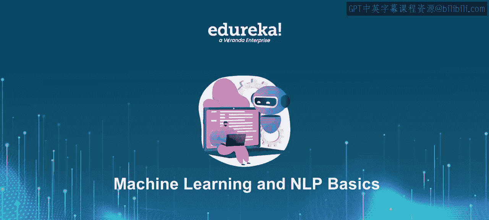
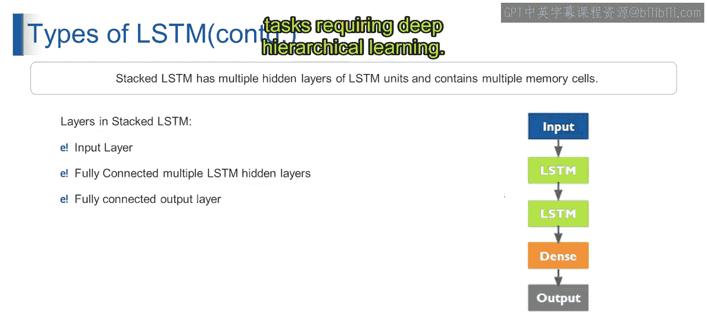

# Edureka《通过LLMs学习生成式人工智能（机器学习和NLP基础，第1课／共4课）｜Learn Generative AI with LLMs》中英字幕 - P96：95_普通LSTM和堆叠LSTM.zh_en - GPT中英字幕课程资源 - BV1q4421Q7qh

So let's now explore the progression from our previous discussion。 The first one is of vanilla LSTM。

 So in this， the first one is of input layer。 here that is going to be the input。

 So the input layer of vanilla LSTM receives the input data。

 which is typically represented as sequence data。 For example。

 a sequence of words in the NLP task or time series sequence。😊。

For example， in text classification task the input layer receives encoded representation of the words in a sentence。

 then fully connected LSTM hidden layer so what exactly it will do the fully connected LSTM hidden layer is the core component of the vanilla LSTM it consists of LSTM units arranged in a sequential manner each LSTM unit is in this layer processes the input sequence updates its internal state that is nothing but the cell state and the hidden state。

😊，And passes the information to the next time step， for example。

 in sentiment analysis each LSTM unit might analyze a word in a sentence and update its internal state based on the context of the words seen so far then the next one is of fully connected layer output that is represented as fully connected layer output the fully connected layer output layer takes the output of the LSTM hidden layer and produces final output depending on the task the output layer might have different configurations including the du。

😊，So what this dense layer will do here， this dense layer。😮，It will aggregate the features。😊。

Learned by the hidden state LSTM layer and produces the final predictions or output。

 Finally the output layer where the vanilla LSTM consists of input layer that receives sequential data the dense layer will aggregate。

😊，The dense layer will aggregate the features learned by the LSTM hidden layer and produces the final prediction or output means the fully connected output layer takes the output from the LSTM hidden layer of the dense layer and produces the final prediction depending on the task the output layer might have different configurations。

 for example， in the classification task it might consist of soft match activation unit for multiclass classification or a single sigmoid unit for binary class classification。

😊，Means technically， vanilla LSTM consists of an input layer that receives the sequential data。

 a fully connected LSTM hidden layer comprising LSTM units to process the sequence of the update internal state and then it passed the dense layer to aggregate the features from the hidden layer and then a fully connected output layer to produce the final prediction based on the learned features。

 This architecture is suitable for various sequential data task and form the basis for more complex LSTM architecture。

 Then the next one is going to be the stack LSTM。😊。

So imagine you are trying to predict the next word in a sequence instead of just considering the sequence of words once stagged LSTM allows you to analyze the sentence in multiple levels of abstraction for instance。

 the first layer might capture the basic word association while the second layer learns more complex patterns across the sequence of the words。

 so now let's understand the layers in this LSTM stagged LSTM the first one is of input layer So what happens here exactly similar to vanilla LSTM。

 the input layer receives the sequential data such as a sequence of words or time series data for example in our text prediction task the input layer receives encoded representation of the words in a sentence then the next layer is going to be the fully connected。

😊，Multiple Lstium hidden layers These are multiple more than one or two means stacked LSTM comprises multiple hidden layers of LSTM units where each layer processes the input sequences and pass its output to the next layer each hidden layer captures increasingly abstract representation of the input sequence。

 allowing the model to learn hierarchical features。 for example。

 continuing with the text prediction example， each LSTM layer in the stack might focus on different aspects of the language such as grammar semantics or the context then it can be sent to the dense layer to perform the aggregation of all the features from the multiple LsTM layers。

 then it can be send to the output layer similar to vanilla L。😊。

The output layer takes the output from the last LSTM layer of the dense layer and produces the final output In our text prediction task。

 the output layer generates the probability distribution over the vocabulary to predict the next word in a sequence means stacked LSTM layers consists of multiple layers of LSTM units stacked on top of each other。

 Each layer processes。 the input sequence captures the hierarchical representation and passes it its output to the next layer。

 The final output layer produces the predictions based on the learned features。

 This architecture allows the model to learn complex patterns and dependencies within the sequential data making it suitable for tasks requiring。

Deep hierarchical learning。 Then the next one is going to be the。

So stay tuned for the next video where we will elaborate on this topic。😊。

