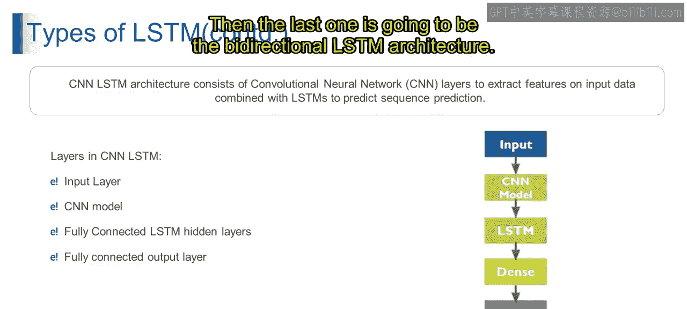

# Edureka《通过LLMs学习生成式人工智能（机器学习和NLP基础，第1课／共4课）｜Learn Generative AI with LLMs》中英字幕 - P97：96_卷积神经网络LSTM.zh_en - GPT中英字幕课程资源 - BV1q4421Q7qh

So let's now explore the progression from our previous discussion， CNN LSTM architecture。😊。

So what happens in this case， consider a video classification task where you want to predict the actions in a sequence of frames。

 a CNN LSTM model would first extract spatial features from each frame using the CNN layers and then analyze the temporal dependencies better in the frames using the LSTM layers so layers in the CNN LSTM R the first one is going to be the input layer so what exactly happens here the input layer receives the sequence data which in this case could be a sequence of images or frames from the video for example in our video classification task the input layer take in a sequence of frames representing different timestamps。

😊，Then we are having the CNN model。😊，What this layer will do。

 the CNN layers are responsible for extracting spatial features from each input frame。

 These layers apply convolutional operations to capture patterns such as edges textures and object shapes。

 For example， in our video classification tasks。 the CNN layer analyze each frame to identify important visual features like objects。

 movements and the backgrounds。 then it can be sent to the denses again。

 it will aggregate the features from all the abovebo layers After CNN we are having the LSTM This is fully connected LSTM hidden layers After extracting spatial features using the CNN layer。

 the output is passed to the LSTM layers these layers analyze the temporal dependence。😊。

between the frames and capture the long termm relationships in the sequence means in our video classification task the LSTM layers analyze the sequence of spatial features to understand sequence of actions and movements over the time then the dense layer as usual dense layer is used to aggregate the features and then the fully connected output layer。

😊，This， the output from the LSTM layers from the dense layer is passed to a fully connected output layer。

😊，This layer produces the final prediction based on the learned features and temporal dependencies in our video classification task。

 the output layer predicts the action or category associated with the input video sequence means technically CNN LSTM architecture combines the CNN layers for spatial feature extraction with the LSTM layers for sequential modeling the CNN layers extract spatial features from the input data which are then analyzed by the LSTM layers to predict。

😊，Sequential output， this architecture is well suited for the tasks involving sequential data with spatial and temporal dependencies such as video classification action recognition and gesture recognition then the last one is going to be the bidirectional LSTM architecture so stay tuned for the next video where we will elaborate on this topic。

😊。

