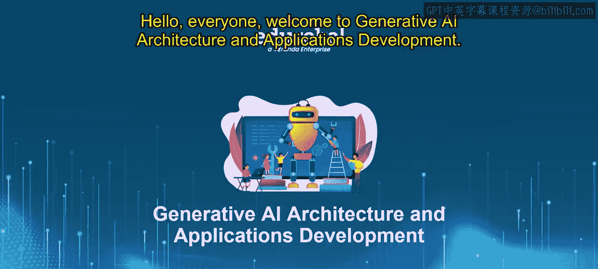
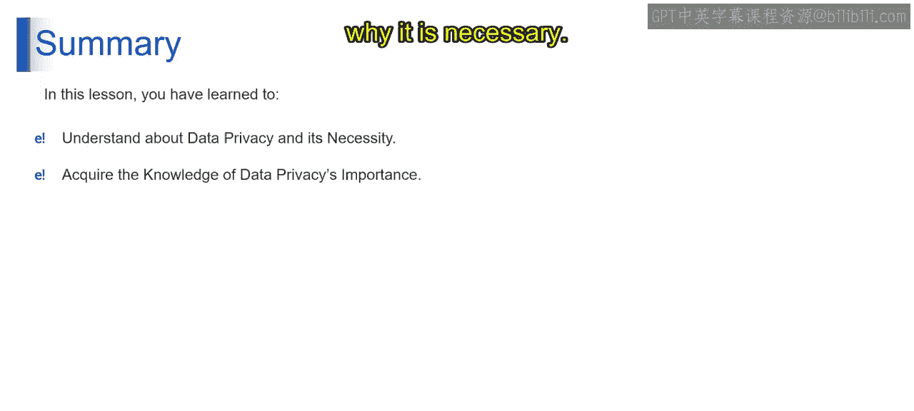
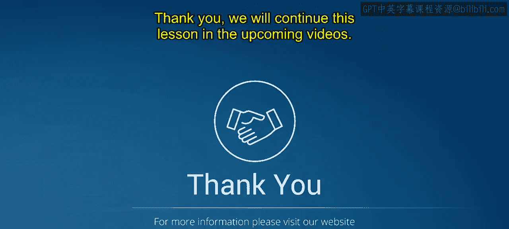

# Edureka《通过LLMs学习生成式AI（基础、应用开发、流行工具，第2、3、4课／共4课）｜Learn Generative AI with LLMs》中英 - P98：61_数据隐私概述.zh_en - GPT中英字幕课程资源 - BV1ym421V7gx

Hello， everyone。 Welcome to generative AI Archural and applications development In this lesson。

 we are delving into the realm of data privacy。 A concept integral to our online existence。

 In an age where a personal information is as valuable as currency Under data privacy is not just important。

 It's essential Inuction to data privacy。 Let's start by understanding what we are protecting。

 Personal information includes identityentifiers like your name， address or phone number。

 Sen personal information goes a step further and comparisoning details like your health history。

 racial or ethnic origin or sexual orientation。 These aren't just bits of data。

 They pieces of our identity in the digital world。 So why should you care about data privacy。

 It's simple。 our personal information is a gateway to our lives。 Without our privacy safeguards。

 We are exposed to risks ranging from identity。😊。

To discrimination， data privacy ensures that our information stays just that U it's about keeping control in our hands and out of those who might use it irresponsibly moving ahead。

 we have core principles of data privacy。 So these four concepts that is data confidentiality。

 data protection， Trans in data usage and compliance form the cornerstone of responsible and ethical data management in our increasingly digital world。

 Each of these aspects play a crucial role in ensuring that data is handled appropriately。

 respecting the privacy and rights of individuals and organizations。

 Let's delve into each one in detail。 data confidentiality。

 data confidentiality is analogous to keeping a secret between trusted friends in the context of data management。

 it involves ensuring that sensitive information is accessible only to those with the necessary。

izationThis concept is vital in many fields， such as healthcare。

 finance and legal services where personal or sensitive data needs to be guarded against unauthorized disclosure to maintain data confidentiality。

 various strategies can be employed access controls。

 I strict access controls ensures that only authorized personnel can view or manipulate sensitive data encryptryion encryptrying data。

 both in transit and addressed makes it unreadable to unauthorized users training and awareness regularly trained staff to recognize and avoid potential breaches of confidentiality。

 Second， data protection， So data protection is about building digital fortresses to safeguard data。

 This involves implementing measures to secure data against unauthorized access， theft。

 damage or alteration。 So data protection is not just about keeping data confidential。

But also ensuring its integrity and availability。 So key elements of data protection include physical and network security。

 protecting physical servers and using firewalls and intrusion detection systems to secure networks。

 regular backups， ensuring that data is regularly backed up to prevent laws in case of hardware failure。

 natural disasters or cyber attacks。 antimalware tools。

 using up to date antivirus and anti malware software to protect data from malious attacks。 Third。

 is transparency in data usage。 Transpar in data usage means being clear and open about how data is being used。

 This is crucial in building trust with users and customers。

 Transpar involves inform forming individuals about what data is collected。

 how it's being processed and for what purposes， to achieve transparency， clear privacy。😊。

Po that is organizations should have clear understandable privacy policies that inform users about data usage user consent obtaining explicit consent from users before collecting or using their data。

 especially for purposes not originally agreed upon open communication regularly communicating with users about any changes in data usage policies or practices fourth one is compliance complianceance refers to othering to laws and regulations governing data protection and privacy so this varies across different regions and industries。

 but it is universally critical compliance ensures that organizations are respecting the legal boundaries set for data usage and handling so compliance involves staying informed keeping up to date with relevant data protection laws and regulations such as GDPR and Europe or the CCPA in California regular audits。

regular audits to ensure compliance with these laws and internal policies。

 implementing legal frameworks， developing and implementing policies and procedures that align with legal requirements。

 So each of these four aspects is interdependent and crucial for the responsible management of data in today's digital environment。

 Together， they form a comprehensive approach to handling data that respects individual privacy ensures data security maintains transparency and others to legal and ethical standards。

As technology and data usage continue to evolve， the importance of these principles is only likely to increase。

 Underscoring the need for ongoing vigilance and adaptation in data management practices。

 So do you know what happens when data privacy isnt taken seriously。

 The consequences can range from personal harm to societal mistrust。

 Business and governments that neglect data privacy can misuse information leading to loss of credibility and legal ramifications。

 In our connected words， data privacy isn't just a technical issue。 It's a personal one。

 Each of us has a role to play in safeguarding our digital cells。

 whether you tech enthusiast a casual internet user or a business leader Understanding and advocating for data privacy is key to ensuring a safe。

 secure and trust worthyy digital future。Here comes the end of this lesson where we learned about data privacy and why it is necessary。

 We also understood its importance in our day to day lives。 Thank you。

 We will continue this lesson in the upcoming videos。😊。

