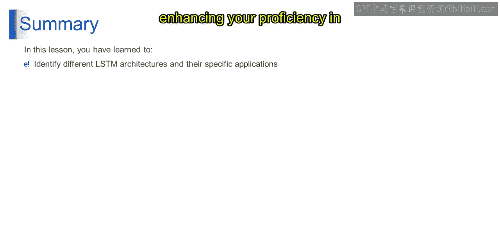

# Edureka《通过LLMs学习生成式人工智能（机器学习和NLP基础，第1课／共4课）｜Learn Generative AI with LLMs》中英字幕 - P98：97_双向LSTM.zh_en - GPT中英字幕课程资源 - BV1q4421Q7qh

So let's now explore the progression from our previous discussion。

 So the name itself is indicating bidirectional。😊。

So imagine you are reading a sentence understanding the context not just from the left to right。

 but also from the right to left， this is similar to what a bidirectional LSTM does it processes the input sequence both forward and backward to capture the contextual information from both the directions。

 So the layers in the bidirectional LSTM are input layer first to forth。

 the input layer receives the sequential data such as sequence of words in the sentence。

 for example in our text comprehension task the input layer takes in a sequence of words。

 then the forward LSTM So what it will do the forward LSTM processes the input sequence from the left to right。

😊，Capturing the information about the context in the forward direction in the example of text comprehension tasks。

 the forward LSTM analyze the sequence of words in the sentence from the beginning to end。

 then the backward LSTM as the name itself is indicating the backward LSTM processes the input sequence from the right to left。

 capturing information about the context in the backward direction。😊。

So let's consider the example of the CA sat on the mat so as we discussed the forward LSTM read from left to right capturing the contextual information as it progress through each word mean the backward LSTM would analyze the sentence from the right tool left capturing the contextual information in the reverse order starting from mat then the and on sat CA the and this is how the forward and backward LSTM will work and then the next one is of dense layer so the dense layer in the bidirectional LSTM network it does the same like it integrates or merges the transforms the combined output from both forward and backward LSTM into the desired output。

😊，Format， that is nothing but the output layer。The output from both the networks then passed to the dense and then it is passed to the output layer in our text comprehension task or the output layer combines the information from the both the directions to make predictions or extract features relevant to the task such as identifying the sentiment of this provided sentence and many more means technically by directional LSTM consists of two LSTM layer one processes the information input sequence in the forward direction that is left to right。

😊，And then。Right to lift。This architecture allows the model to capture the contextual information from both the directions。

 enhancing its ability to understand and analyze the sequential data。

 the output from both the directions is typically combined and past from the dense layer to fully connected output layer for further processing or the prediction so bidirectional LSTs are commonly used in tasks where understanding the context from both past and the future inputs is essential such as machine learning translation sentiment analysis and named entity recognition so that's about the bidirectional LSTM。

😊，So now the summary， in this lesson， you have gained the ability to recognize various LSTM architectures。

 including vanilla LSTM， Sta LSTM bidirectional LSTM and CNN LSTM and understand their unique applications in the sequential data tasks this knowledge equips you to select and apply the most appropriate LLM architecture for specific tasks enhancing your proficiency in sequential data analysis。

😊。

Thank you。