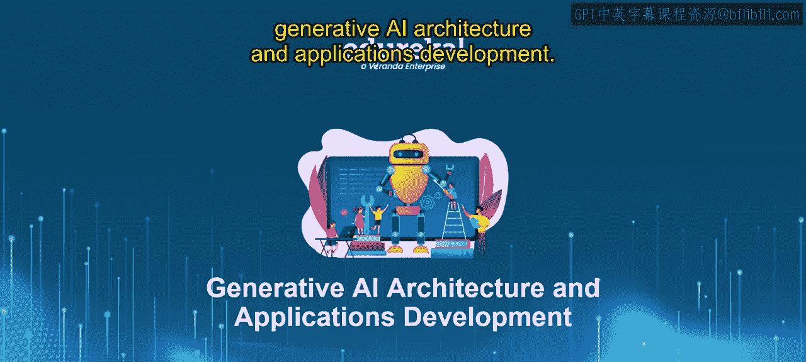
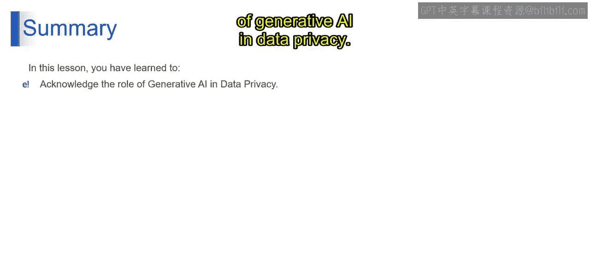

# Edureka《通过LLMs学习生成式AI（基础、应用开发、流行工具，第2、3、4课／共4课）｜Learn Generative AI with LLMs》中英 - P99：62_理解生成式AI在数据隐私中的角色.zh_en - GPT中英字幕课程资源 - BV1ym421V7gx

Hello， everyone。 Welcome to Generative AI Archural and applications development。

 Let's dive into how this technology is revolutionizing our approach to keeping data safe。

 By the end of this video， you will be able to understand the role of generative AI in data privacy。

 So let's start understanding each points in brief。 En detection capabilities。 generative AI models。

 much like advanced radar systems in the cyber world are capable of detecting not just known threads。

 but also anticipating potential ones。 This is achieved through sophisticated analysis of patterns and behaviors within worst amounts of data。

 Unlike traditional signature based methods which rely on known thread databases AI driven solutions employ machine learning algorithms to identify anomalies that could signify new unknown threats。

 this predictive capability allows。😊。

Early intervention， potentially stopping cyber attackers before they can execute their plants。

 Suppose a cyber security system uses AI to monitor network traffic。

 It detects in unusual pattern of data transfer occurring at an oddR。

 which deviates from the company's typical data usage profile。

 This system alerts the security team who then discovers an attempted data breach in progress and towards it This early detection was possible because the AI learns the normal data patterns and could identify anomalies。

 malware detection in the case of malware generative AI transforms antivirus solutions from reactive to proactive tools。

Traditional antivirus software depends on a database of known malware signatures to identify threats。

 However， generative AI can analyze the characteristics of code and predict whether it's malicious even if it's a new strain never seen before。

 supposeuppose an AI drivenven antivirus programs scans a new software application before installation。

 while the software is not in any malware database。

 the AI identifies suspicious characteristics in the code that resemble malware behavior such as attempts to access and encrypt files。

 The antivirus flags the software as potentially malicious， preventing a potential ransomware attack。

 Third， phishing prevention phishing attacks are notoriously deceptive and constantly evolving。

 generative AI enhances email security systems by analyzing not just the content and attachments of emails for malicious's intent。

But also the behavior and patterns of the send， this comprehensive scrutiny makes it much harder for phishing attempts to slip through undetected。

 I hope this is clear to you。 So next we have incident response。 When a security breach occurs。

 the speed of response is crucial。 generated AI aids in automating the early stages of incident response。

 This includes isolating affected systems to prevent further spread of the breach。

 collecting and analyzing forensic data to understand the nature of the attack。

 and promptly notifying security teams。 security orchestration。

 So AI driven security orchestration platforms are designed to integrate various security tools and systems enabling them to work in concert。

 This orchestration ensures that responses to security incidents and not only faster but also more comprehensive and coordinated across the entire I T environment。

😊，Automation and cybersecurity tasks， generative AI is instrumental in automating routine but essential cybersecurity tasks。

 such as regular security checks， vulnerability assessments and system updates。

 This automation free security professionals to focus on more complex and strategic tasks。

 patch management in the area of patch management， AI's role is pivotal。

 It can prioritize software patches based on the severity of the threat and the specifics of the organization's I environment。

 This intelligent prioritization ensures that the most critical vulnerabilities are addressed first。

 reducing the risk of exploitation， zero day vulnerabilities， zero day vulnerabilities。

 which are previously unknown security flowaws represents a significant challenge。

 generative AI acts like a tireless detective constantly scrutinizing code and system behaviors to identify。

😊，Un patterns of vulnerabilities by proactively seeking out these potential threats。

 AI helps mitigate the risks posed by zero day exploits before cybercris can use them。 In summary。

 generative AI is not just a tool but a dynamic， adaptive shield in the realm of data privacy and security It ability to predict。

 detect， respond and automate transforms how we approach data security， making it more robust。

 intelligent and efficient as we continue to integrate generative AI into our cyber security strategies be move towards a future where our data and systems are safeguarded by advanced proactive defenses。

 making them more resilient against the ever evolving landscape of cyber threats。

 Here comes the end of this video。 Thank you for joining me in exploring the role of generative AI in data privacy。

 We will continue the session in the next lesson。

