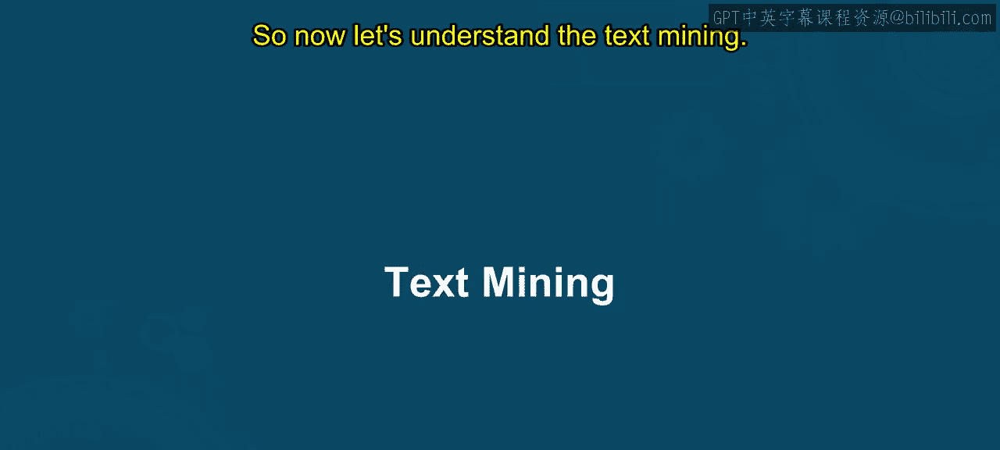
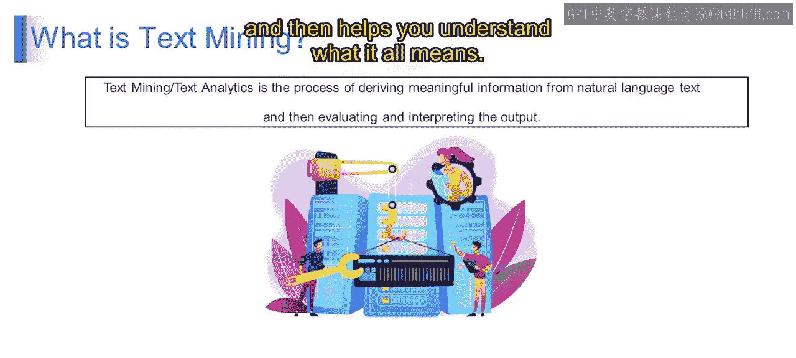
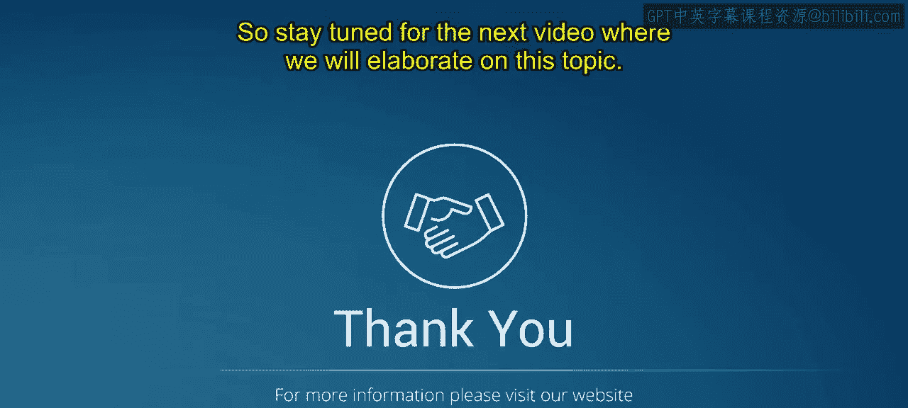

# Edureka《通过LLMs学习生成式人工智能（机器学习和NLP基础，第1课／共4课）｜Learn Generative AI with LLMs》中英字幕 - P99：98_文本挖掘.zh_en - GPT中英字幕课程资源 - BV1q4421Q7qh

Hello everyone welcome back to machine learning and NLP basics so now let's understand the text mining in this we are going to cover what is text mining an introduction to NLP so by the end of this session you will be able to analyze the fundamentals of text mining concept and also able to extract information about NLP supports。

Text mining so let's get started so what exactly is a text mining let's understand it with an easy example。

 so imagine you have a huge pile of documents like articles books or even social media posts now you want to sift。

Through all this text to find useful information， that's where text mining comes in。

 So text mining is like having a super smart assistant who can read and understand all of this text for you。

😊，Its process of analyzing and extracting valuable information from unstructured text data。

So I will provide you a simple example to illustrate it Okay so imagine you have a bunch of customer reviews about a product some say it's great and some say it's okay and some say it's terrible so in this case。

Text mining helps you go through all these reviews。

 understand what people are saying and even categorize them into positive。

 neutral and or even negative sentiment。 Now， let's dive into a bit more technical explanation。😊。

Text mining is the process of extracting meaningful information and insights from large volumes of unstructured text data。

 it involves using computer algorithms and techniques from natural language processing to analyze text and uncover the patterns。

 trends and valuable knowledge。😊，Let's say again， you have。A bunch of text data like emails。

 articles or social media post， text mining or text analytics is like having a super smart tool that helps you make senses of all this text First it reads through the text and picks out the important bits like identifying keywords phrases。

😊，All patterns， then it analyzes all this information to understand what it means， for example。

 let's say you have a collection of product reviews again。

 so text mining would go through each review and pick out all the details like whether the people liked or disliked right that is what is we discussed once it's done analyzing the text text mining tools help you interpret the results this means making a sense of what the data is telling you is like figuring out the trends identifying common themes or even predicting the future outcomes based on the parameters it finds so in simple terms text mining is like having a smart assistant that reads through a bunch of text。

😊，Figures out what is important and then helps you understand what it all means。

 so stay tuned for the next video where we will elaborate on this topic。😊。

