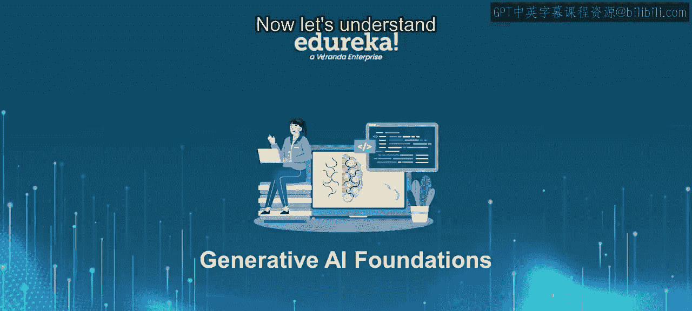
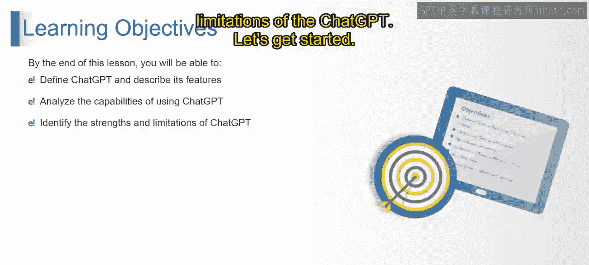
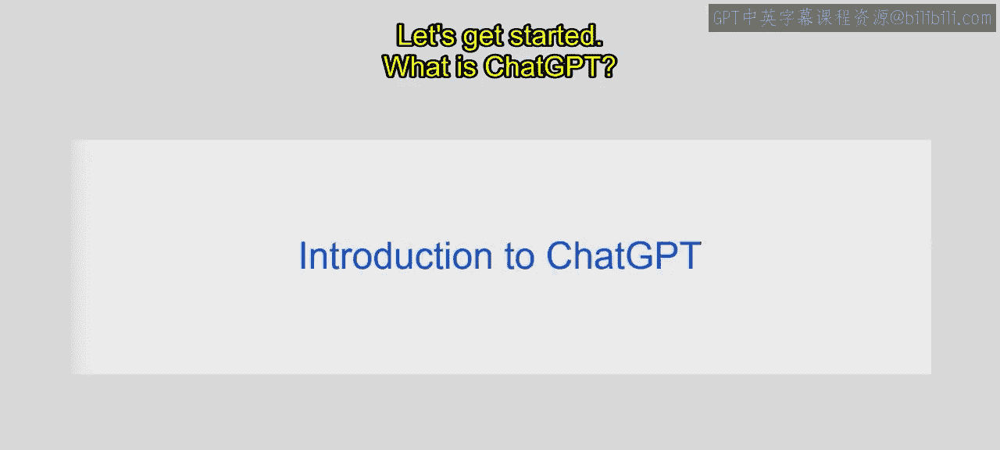
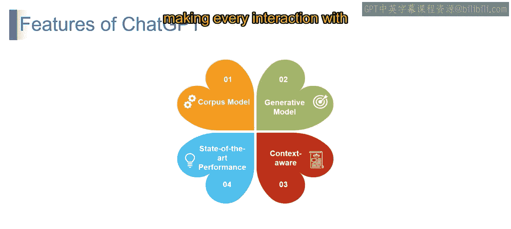
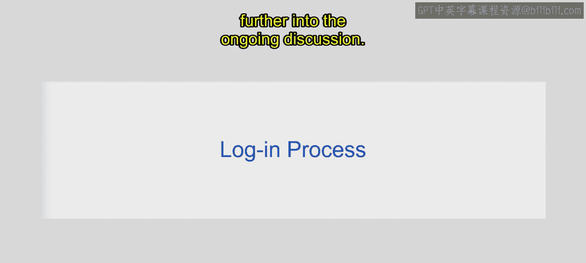

# Edureka《通过LLMs学习生成式AI（基础、应用开发、流行工具，第2、3、4课／共4课）｜Learn Generative AI with LLMs》中英 - P9：8_ChatGPT介绍.zh_en - GPT中英字幕课程资源 - BV1ym421V7gx

Hello everyone， welcome to Generative AI Foundations。

So now let's understand the next module getting started with Chad Gpiy so in this we are going to cover the introduction to Chad Gpiy and then the login process and the capabilities of Chad Gy and then strengths and limitations of the Chad Gpiy by the end of the session you are able to define Chad Gy and describe its features and then you are able to analyze the capabilities of Chad Gpiy and then identify the strengths and limitations of the Cha Gpi so let's get started so get ready to step into the extraordinary world of Chad Gpi where AI mades conversation in your mind blowing terms of language mastery Chad Gp has become a sensation captivating users globally with its ability to understand engage and even surprised with its responses so discover why people are buzzing apart this linguistic marvel and prepared。

😊。

To unlock the potential of interactive and intelligent conversations with Chad Gy。

 So let's get started。 What is Chad Gp。 So make the Chad Gpi。

 Your digital conversation champion developed by open AI。

 It's like having a chad bud powered by deep learning magic trained on tons of text from the internet Chad Gp becomes a virtual wordsmouth drafting humanlike responses to whatever you throw its way。

 So get ready to drive into the world of seamless and engaging conversations with the Chad G where every interaction feels like chatting with a smart friend。

 smart and intelligent front。 So now let's understand the features of the Chad Gp。

 The first one is of Carbu model。 So the carbu model in Chad Gpiy refers to its ability to draw upon a diverse range of text data enriching its conversational prowess with a wealth of linguistic。

😊。

geThen the next one is of generative model so as generative model Chad GPT goes beyond memorization using its training to generate novel responses。

 ensuring dynamic and interactive conversations then the next one is of context aware so being context aware means that Cha GT pay attention to the conversation context responding intelligently to ensure meaningful and contextually relevant interactions Then the last one is of state of the art performance with state of art performance Cha GT stands at the forefront of language models offering exceptional capabilities in understanding and generating text that set it apart in the realm of conversational AI means this GT features make it interesting and drawing from diverse knowledge base generating creative responses。

😊，Remaining context ava and delivering state of the art performance。 It's not just a chatbo。

 It's your intelligent conversation companion making every interaction with Chad Gpi as engaging and delightful experience。

 So now let's understand the login process。 Start by visitinging Cha Gput OpenaiIs website。

 So open the Google and start typing openaiI dot com。

 So the upcoming video will delve further into the ongoing discussion。😊。

