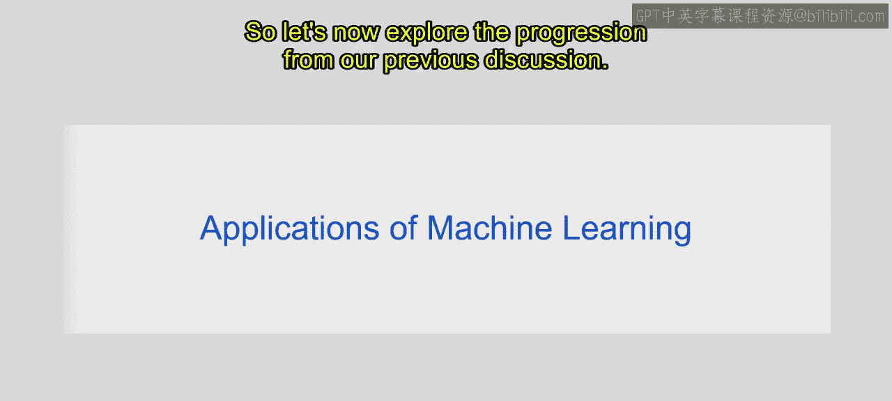
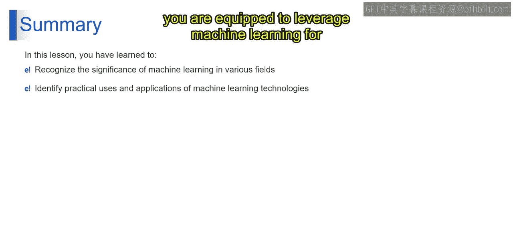
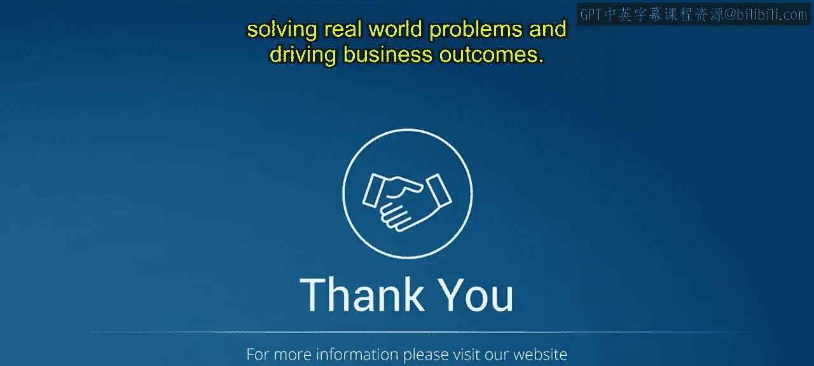

# Edureka《通过LLMs学习生成式人工智能（机器学习和NLP基础，第1课／共4课）｜Learn Generative AI with LLMs》中英字幕 - P9：8_机器学习的应用.zh_en - GPT中英字幕课程资源 - BV1q4421Q7qh

So let's now explore the progression from our previous discussion now let's understand the applications of the machine learning first of all the travel the dynamic pricing。

 machine learning algorithms analyze historical data user behavior and market trends to adjust the pricess dynamically optimizing revenue for airlines hotels and online travel agencies。

 then predicting flight delays by analyzing the factors such as weather conditions aid traffic and historical flight data。

 machine learning models can predict the likelihood of flight delays allowing airlines and passengers to make the informed decisions then the next one is of marketing in this predicting lifetime value of customers machine learning algorithms analyze the customer data to predict the future value of each customer helping businesses tailor their market。

😊。

Strategies and customer retention efforts and cross sellingelling and upseelling by analyzing the purchase history and customer preferences。

 machine learning models identify the opportunities for crosssing complementary products or upseeling premium services to existing customers then the churn prediction machine learning algorithms analyze customer behavior to identify the signs of potential shown enabling businesses to proactively address customer dissatisfaction and reduce the customer attrition。

 then coming to the healthcare department， This is prediction medication effectiveness let's understand This is prediction machine learning model analyze the medical records and genetic data and diagnostic images to predict the risk of diseases such as cancer diabetes and cardiovascular conditions facilitating early intervention and personal。

😊，Trement plans then coming to the medication effectiveness machine learning algorithms analyze the patient data to predict the effectiveness of different medications and treatments。

 enabling healthcare providers to prescribe the most suitable treatment for individual patients。😊。

Then social media in this sentiment analysis， machine learning algorithms analyze the social media posts reviews and comments to understand the public sentiment towards products。

 brands or even events helping business gauge customer satisfaction and brand reputation。

 then digital marketing So machine learning models， optimize digital advertising campaigns。

 by targeting relevant audience， optimizing advertisements， and predicting the user engagement。

 maximizing the effectiveness of marketing efforts。

 then coming to the sales So discount offering M algorithms analyze the customer behavior and purchase history to personalize discount offers and promotions。

 increasing sales and customer loyalty and demand forecasting these models analyze historical sales data。

 market trends and external factors to predict the。😊。

Future demand of a product and services enabling business to optimize inventory management and supply chain operations。

 then coming to the automation self-driving cars This M algorithms process sensor data from cameras radars and lid to interpret road conditions detect obstacles and make driving decisions in real time enabling autonomous vehicles to navigate safely and effectively and pilotless aircrafts and drones this M algorithms enable pilotless aircraft and drones to autonomously navigate airspace avoid collisionition and perform tasks such as surveillance inspection and package delivery Then the next one is credit and insurance so M models analyze the historical claims data and risk factors to predict the likelihood of。

😊，Future insurance claims， helping insurance companies assess risk and set premiums and fraud and risk destruction these ML models or algorithms analyze the transactional data and user behavior to detect the patterns indicative of fraudulent activity or credit risk enabling financial institutions to prevent the fraud and mitigate the risk exposure so these are about the applications of the m algorithms so now the summary in this lesson you have gained an understanding of the fundamentals of the machine learning and its significance across diverse fields you have also explored practical applications of machine learning technologies recognizing their role in driving innovation and efficiency in various domains by appreciating these fundamentals and applications you are equipped to leverage machine learning。

😊，For solving real world problems and driving business outcomes。 Thank you。

