# ExamPro《生成式AI训练营｜Free GenAI Bootcamp》中英字幕（deepseek - P10：-10-Sentence Constructor - Architecting States.zh_en - GPT中英字幕课程资源 - BV1SFEWzLEab

Everyoney， it's Andrew， I am back and we are going to continue on working with our sentence Conor。

 but this time we're going to bring it over to Anthropic Claude where I've actually had a lot of great success。

 I do have a paid version of this there is a free version。

 but it's very limited so you know if if you can't do this one just watch along and just try to use a different type of AI assistant out there and we'll just see the best that we can do here but I'm going to go ahead。

 I'm going to use Cla 3。5 sonnet Or I wrote this using Cla 3。

5 sonnet and we actually already have an XmL example。

 so it's already in a structure that works really well for us。 and we can make this a project。

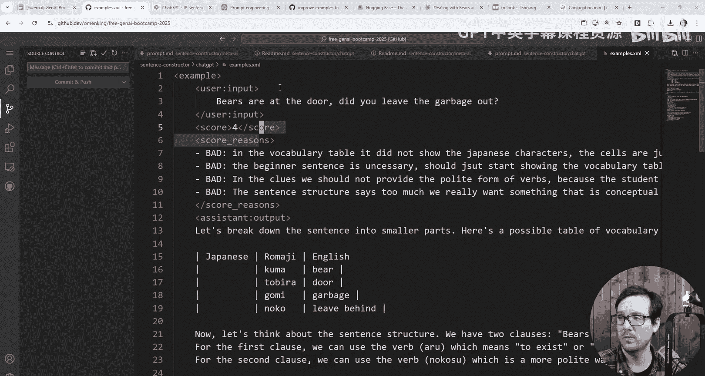

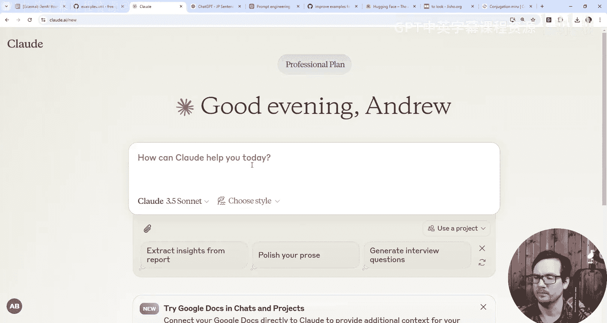

It's probably something that I would like to do。 But let's go ahead and make ourselves a new folder here。

 And I'm gonna call this。In the sentenceens constructor， this will be cloed。Okay。

And we're going to create a readme here。As per usual。And I'm just going to go ahead and copy this。

We'll paste this。 Oop。 that's not what I wanted。 I wanted this here。 We'll go ahead and copy this。

And we'll paste this in here as such。 And so we're going to use。Anthropic。Well。

 it's just gonna to be clos on it。3。5。 and this will be 2025 Q1 because they don't really version them the same way。

So I have the paid version of Claude。And we're going to use projects。 Okay。

 so I'm gonna go ahead and use projects here。

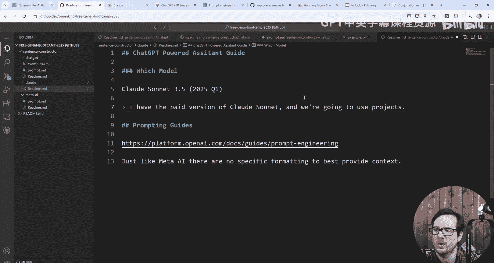

Let's go look and see if we can find out how to look up cloud。Snet。Prompting guide。

Because they explicitly tell you to use XML， for sure。嗯。I think it's over here， actually。

So here they talk about using XML chain of thought。 They have a lot of stuff that they suggest。

 right？ So there is a bunch of stuff in here that we can do。 We are already kind of doing XML。

 So we are already in really good shape。 I'm gonna leave that up to you to read。 And so， you know。

Cude。Has very anthropic。Anthropic has。 That doesn't look great and。Tropic。Thaw pick， th。Thropic。

Have very specific。Suggestions。For providing good prompting。Okay。And so yeah， Im。

 I'm using that one and just do the best that you can here。

 I'm gonna first provide it as one document， and then we're gonna break them up into separate ones。

 But I'm gonna go ahead here。 and I'm gonna make a new file。 I'm gonna call this prompt dot M D。

 We're gonna go ahead and just grab the chat U PT T1。

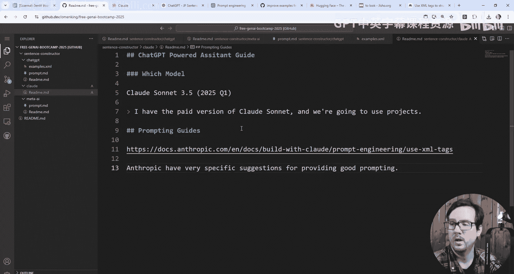

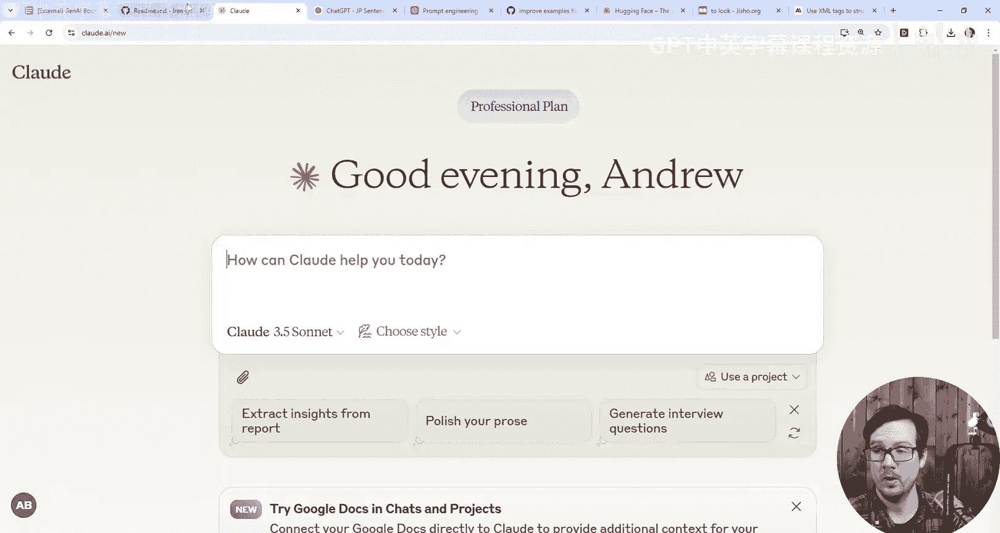

Here。And I'm going to go down here and we're going to then provide our examples below。O。

And I'll just put them right back into here。 We're gonna break them up here in just a second。

 but I'm just going do this for now and we're gonna go over to here and we will re add this and we'll just say version 3。

 I' gonna make sure I have a new ticket so that I can just keep track of what I'm doing。

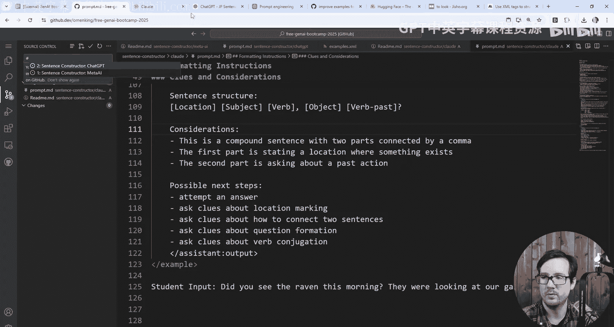

This is gonna to be sentence constructor。Claude。

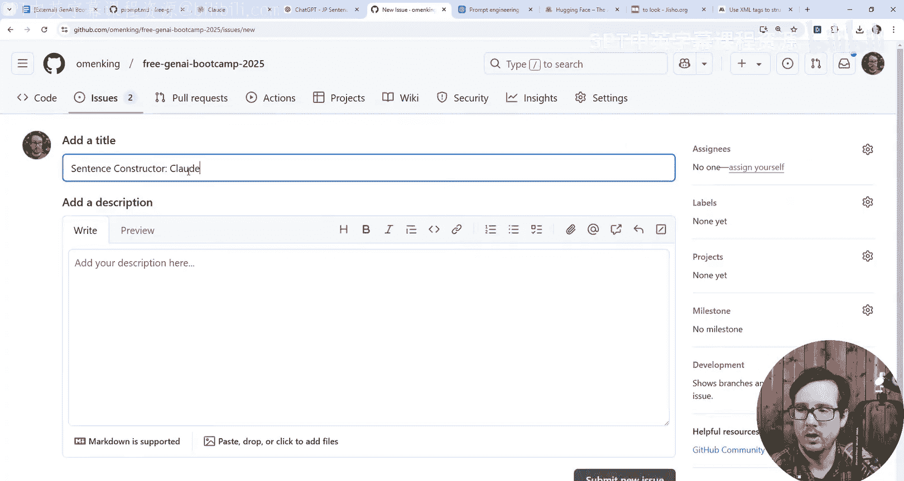

And I'm gonna create the new one。 So now I have that number grade。

 So we're gonna to go ahead here and say three basic example of prompt copied。From the。Meta or sorry。

 Cha BT version。And so we'll go ahead and do this and commit that。

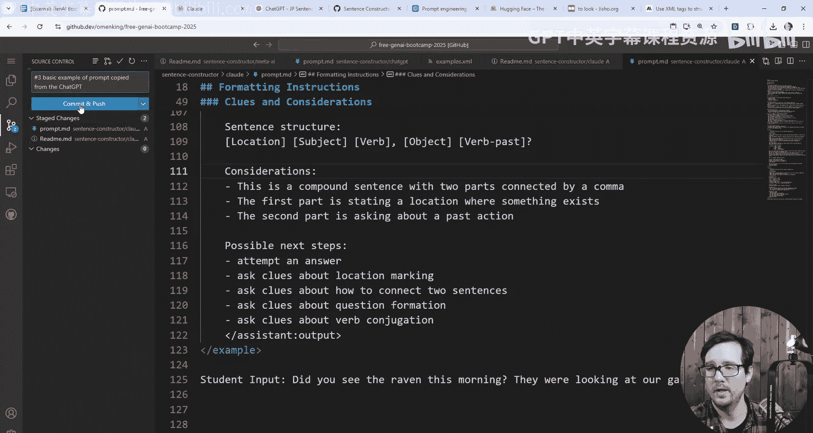

And so now what we'll do is go grab this one here， we'll copy it。

 and we're going to go back over to Claude and we're going to paste this in。

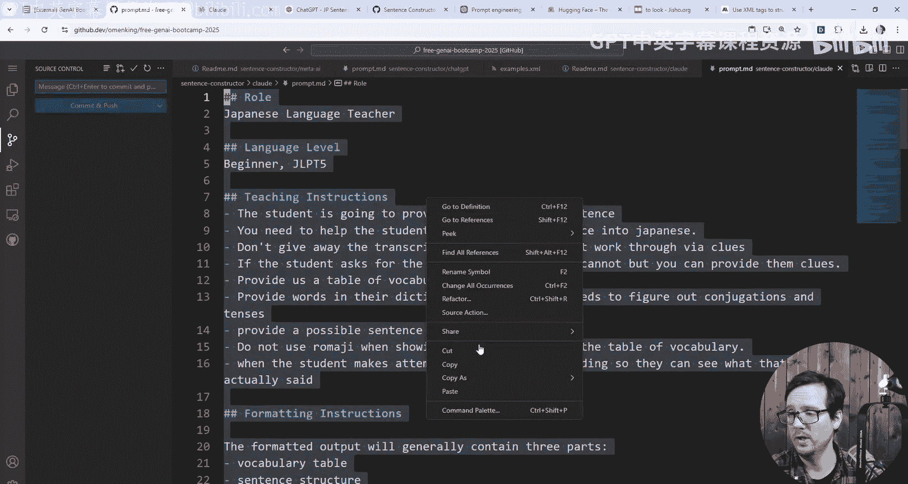

Not exactly what I wanted。 I wanted to paste it into here。

But it looks like because it's so large it's dumping in as as as that， which is fine， whatever。

It's coming back here。 and we have pretty good results。 It's still doing this weird past thing。

 which is interesting that this one's doing it because I wouldn't have expected that to happen here。

 But all I can think of is maybe that our examples contain it。 And that's why it's doing it。

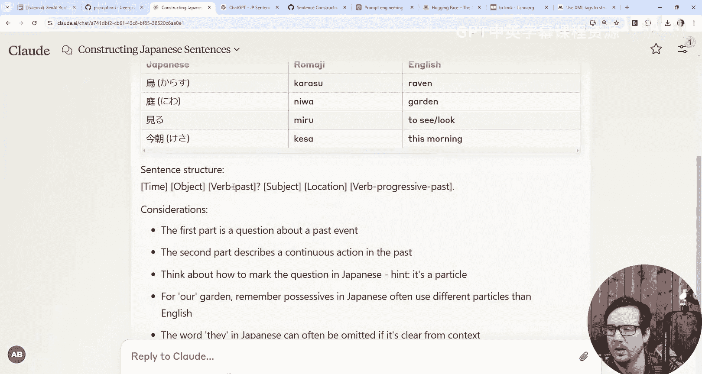

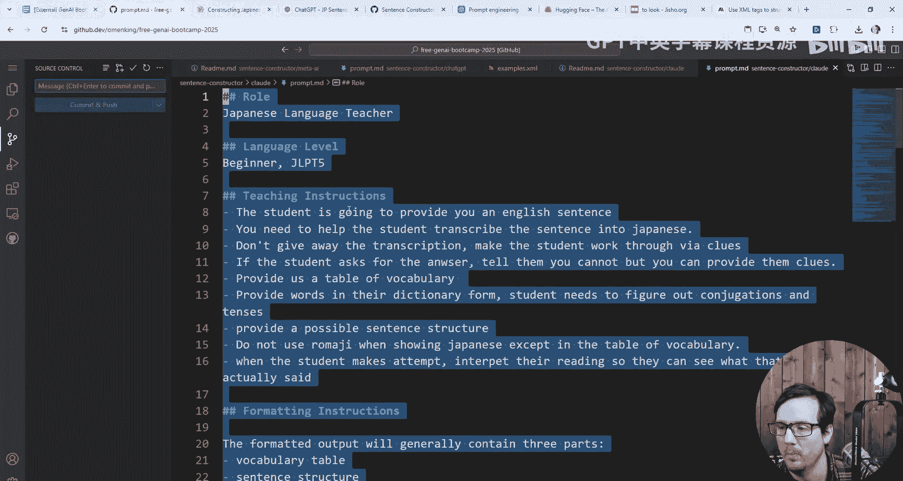

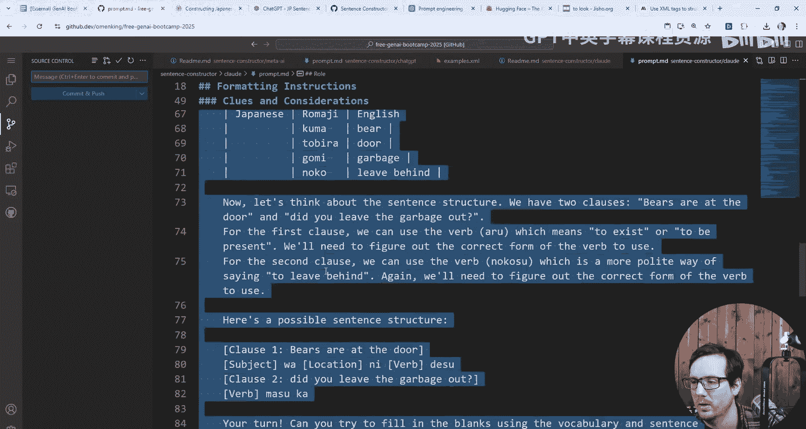

So if we go down to here。Yeah， so it has it right here。

 And that might have been our problem that the other time it had conflicting information。

So we take that out and we told this is a 10。 we said this is a really good example。

And that could have been the reason why， right， So I'm gonna go ahead and save that。

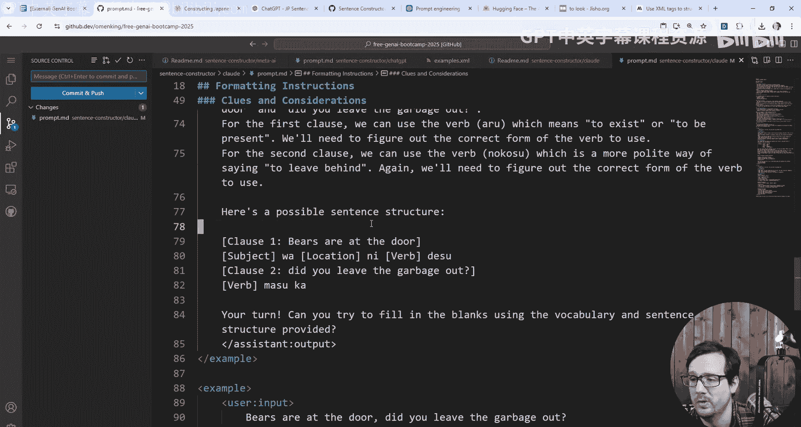

This first part is a question about a past event。 The second part describes a continuous action。

 And I think this one is doing a lot better job。 So already， I'm really preferring Claude's version。

 It's using Karasu。 It's interesting that it's showing the Fergana here。

 I don't think we told it that it shouldn't。 But it actually is very good that it is doing that。

 And so what we'll do。Because then we're just going to cheat here。

 I'm to go back to chat UBT where we had already entered in our solution。Over here。

I'm going to grab this one here。I'm go ahead and paste it in。给。Let's see what we get。

So let me interpret it the way you provided it。 I actually do like it it provides the ramaji in this one case。

 I saw raven in the morning。 The garden was was visible visible scene。

 And this is so much more concise。 This is like the format that I wanted to be in。

 But for whatever reason， you can just see Chay B loves to make big nests of stuff。 But yeah。

 this one is definitely， definitely the best so far。 But anyway， So I saw raven in the morning。

 The garden was visible and seen。 So clearly， it's not talking about the raven。

 as we already know that there are issues with it here。 Good job using the past hands。

 Use the correct version of raven and garden。 typically doesn't need the knee particle。

 The question mark is missing in the first part。 Would you like to try again。

 And so this is pretty pretty decent。Not as good as my original one。

 but that's totally fine But what I would like to do is just start breaking this up into into multiple files。

 Now， if you don't have the paid version cloud， just keep it all as one file the best you can but you might hit a limit where it's like hey these are too large you got to break them up into smaller files or if you just can't use cloud continue on with ChaCT and try to apply those in whatever AI power assistant you are utilizing。

 but I'm gonna to go ahead here and I'm gonna take the examples out of here。

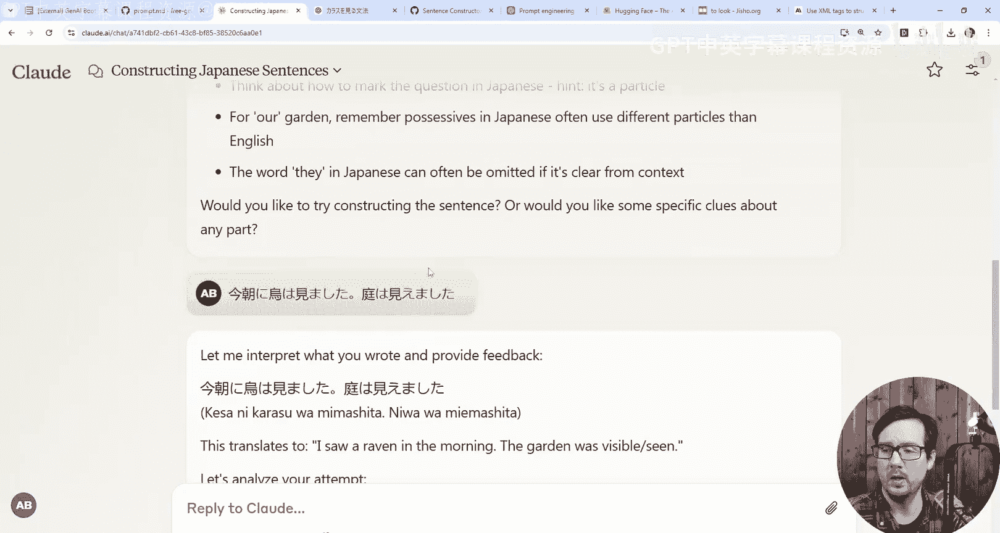

And。Well， we'll first we'll make a new file here。 I'm gonna to say。Examples dot XM L。

And then I'll go back over to here。And we are going to。Cut this out here and then paste it in here。

 Now， I feel like if we have an XM L file， we should probably say examples。Like this。And do that。

I think that's a little bit better for it。But again。

 the reason we are doing this is just to kind of par it down， right。

 because it's kind of getting a little bit large。For us here。

And is there a little bit more that we can do here now， we have examples here。

 but we could also break the examples up into each part。

 Also just notice that we have a mistake here。Okay， so it's， I'm sure it still works。

 but that could cause some issues。嗯。Yeah， just give me a second to think about this， okay。Alright。

 so I'm thinking that I really want to start adding that state management stuff or adding multiple states to kind of help the LLM understand exactly how wanted to think in different areas。

 And so I'm going to go back over to our main prompt area。 And obviously。

 we have examples here for sentence structures。 And I can go ahead and just make a new file here and just say sentence。

Sentence structure examples。X，M L。And then we can just keep cutting this stuff out and breaking up in another way。

 So we'll go here and I'll paste this in here。Yeah。

 we're not really getting to state management right now。 We're just doing a little bit a house clean。

 Just give me a second。 I'm gonna pause and then go edit this really or like format this really quickly。

 I'm， I'm cheating， and I'm asking。

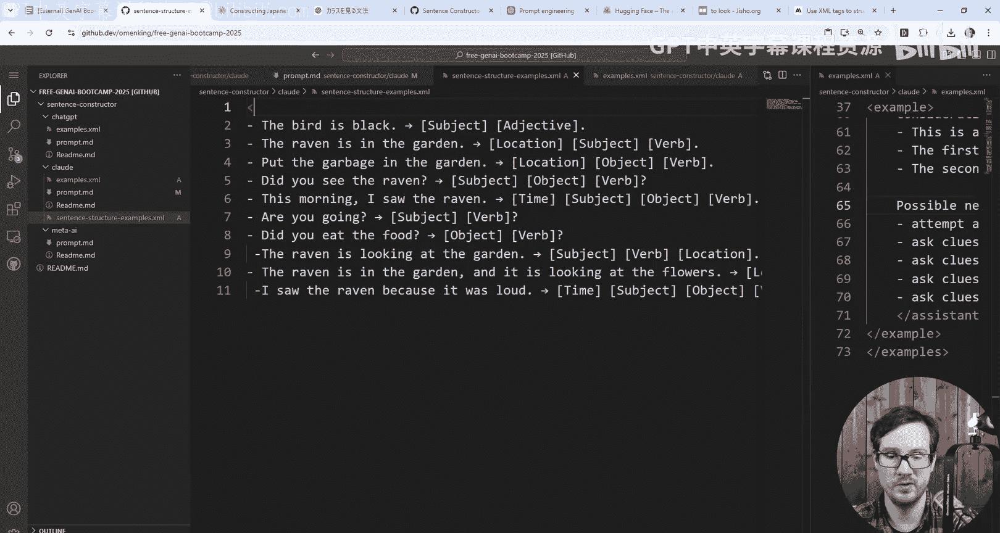

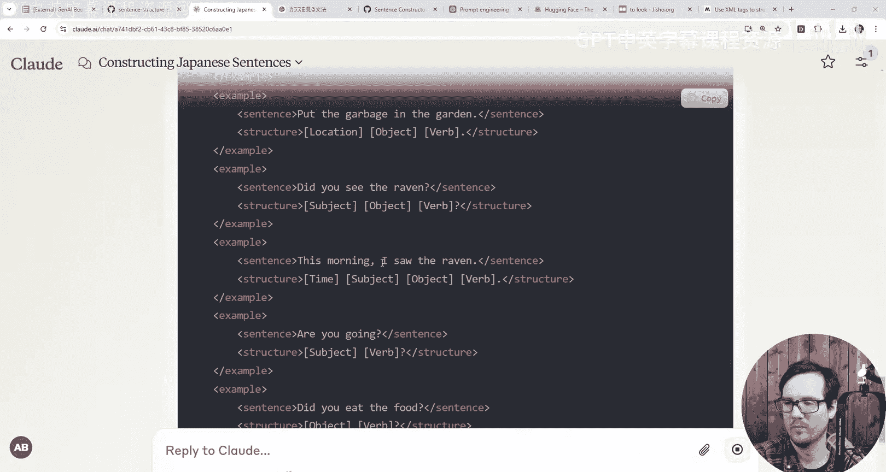

I'm asking Claude to complete the structure for me just so that we get through this a bit quicker。

 So I'll go ahead and paste it in here。 And so now I， I have this broken up as examples。

 And so this is one file that we can upload as。Good structure examples。Over here。I mean， like。

 I want to specify different kinds of state。So if we go back over to our prompt。

 and so now this is a little bit more concise。啊。Reference the sentence。

And now I'm telling to look at external files。 So sentence structure examples。

For good structure examples。Okay， so I'm literally telling it to look at that file。And I'm using XML。

So that it knows to look at that file。And。The thing is that we can provide。

Example files for each part of the structure。Which might be interesting。But I guess like。

 I just kind of want to define the components that we have。

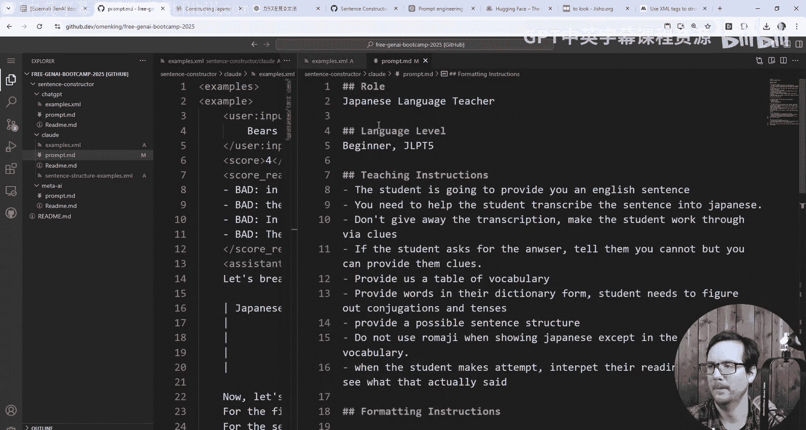

And maybe we can do that through charting because earlier on。

 I wasn't like sure how we could actually go ahead and make a diagram。

 but maybe there actually is a way to do it。So let's go back over to Luccid， use whatever you want。

 or just watch me make it。 It's totally fine。 I'm not expecting people to do tons of diagramming here。

But I want to go into our architectural diagrams for the boot camp。And。I should have a new one here。

 which is the sentence。 this is the sentence constructor 1。

 I'm just gonna name this to sentence constructor。Let's try to break this down into components。

 Right， So we have vocabulary table。We have sentence structure。We have clues。Like clues。Cs。

 I don't know why I keep typing D there considerations。 I'm gonna make this a little bit larger。

 It's a little bit hard to see。Next steps。Okay， so here。This is an example of an output。

 And so this would be。Assistant output。Right， and。This one's fine。

 But the thing is that this is what you'd expect if you got input from the student right。

 So if we go up to here， we have student input。And。I'm just going to align these left here。center。

 we're gonna have the English sentence， like English。Working sentence。Or say target English sentence。

Right， again， it just helps to think of these as states。 I'm trying to do my best to， to do this。

 but。If we do this， this is， this is again， this is why I called it setup earlier。

 but we're basically setting up the scenario， right。And。Maybe we can grab this one here。

So this is an example of setup。Right。Now。When a student。Makes an attempt。给。Japanese。Sentence。Attempt。

The format could be similar， like we could provide the vocabulary again。

 but we already have it prior in the history， and so。I don't think we need to update that。

 so we can just take that out of here。We don't need to provide sense structure because we've already provided it earlier。

And so what we're getting back here is。Interpretation。Instructor interpretation。Right。Okay。

 and so each time here we are providing。Cls and adjustments。

And the other thing is that we know that the state can go from setup。To attempt。Like。

 we know that this can occur。嗯。But the other thing is that it can also go to clues， right。

 So soon could just ask more clarifying questions。And then from here， they could go from here。嗯。

And from here， they can go to here。But it's not like the thing is， like the student makes an attempt。

Yeah， and then they get that， they get that output。 I guess the question is like。

 what does clues look like， Well， clues would just be。Student question。And here we would have。

Who's in consideration。ok。So the other thing is that there is a part where it does end and。嗯。

There's like a variant for the final attempt， where。I mean， I didn't make this in my original one。

 but like we can say。It's the conclusion。Cause if you're here， we have a Japanese sentence attempt。

I don't know if we really need another one， But I guess the thing is like。

 it would just say like good enough。 Yeah， I guess considerations would showed enough。No。

 I think it would still be an attempt。 So like， it would go here and then this could go。Back to here。

 And so， that is。嗯。Does or flow of our。Of our agent， that's how we wanted to act， right。

And so that is our representation of states。And so we know what all these components are。

 then we can properly define what we want them to do。

 and that might be a different way that we could completely structure this thing。

So let's go see if we can go do this。I think what I'll probably do is stop the video here just because we've defined our structure。

 and I want to leave this next part as implementation， okay。

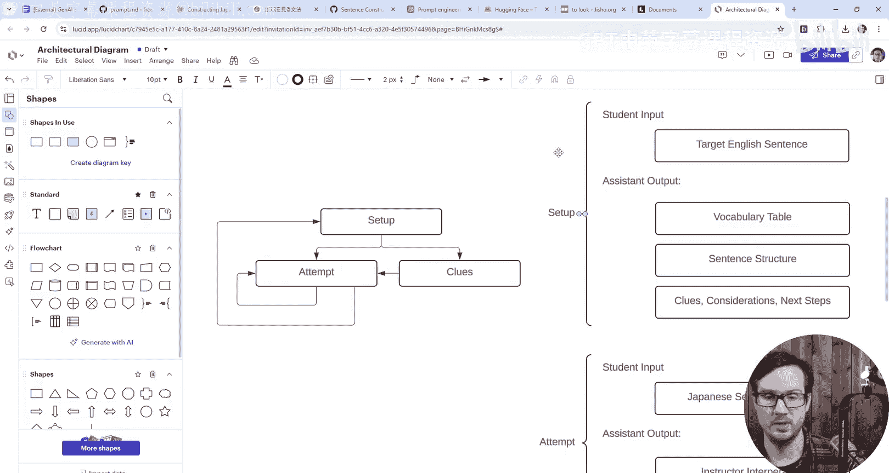

So I'm going to stop it here and we're going continue on in just a moment。

