# ExamPro《生成式AI训练营｜Free GenAI Bootcamp》中英字幕（deepseek - P11：-11-Sentence Constructor - Anthropic Claude.zh_en - GPT中英字幕课程资源 - BV1SFEWzLEab

Allright， I am back and。Now， let's think about how we're going to write up all these parts。 Okay。

 so I'm going to just pull this off screen。 I can obviously still see it。 You cannot。

And I'm just gonna keep referencing it。 I'm gonna put it up， actually， up here。

As it's a little bit hard to put it to the left of the screen here。

 I'm going to go back over to our document here。

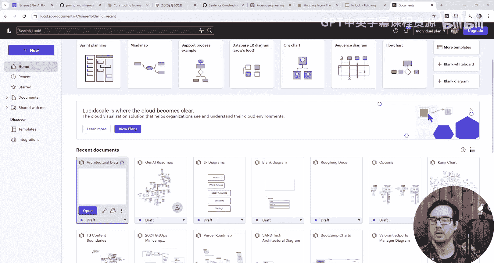

And I just want to have a think of how this is going so。

Let's go over here and just start defining our component。嗯。Call this like states。Or。Agent flow。

The following agent。Has。The following agent has the following states。We have here set up。We have。

I'm just looking here off screen， attempts， attempt。En clue。Okay。Each state expects。The following。

Kinds of inputs and outputs。So for state。For setup state。We expect student input。For input。

 we for input， we expect。嗯。Target English sentence。We have。For output。Vocabulary table。

Sentence structure。Cs considerations。Next steps， right。And， I mean， we didn't really even call that。

 We should really be more concise in terms of what those are。嗯。But yeah， so that's for that state。

 And then we'll continue on to our next one。 again。

 I'm just looking at this off screen of exactly what it is。

RightAnd then bringing those words over here。So we'll go here and say attempt。

So our input here is going to be。Japanese sentence。Attempt。And then， our output。Is going to be。

And we could also be very particular in say， like student input。Or we'll say user input。Assistant。

Output。User input。Assistant output。嗯。And I'm just going to copy paste these here。

 My hands are getting really cold in the office here。 and it's really affecting my typing。

And so we'll go ahead and copy this。And then we have clues。And we have our user inputs。Just a second。

Okay， so I just warming up my hands。 There's a heater right beside me。 but we're gonna go here and。

These are going to be indented like this。This， oh， that's the assistant up here there we go。 Okay。

 And so we have those there。 I'm pretty sure clues just have that。 And then we have， yeah。

 we bring the assistant over here。 It's crazy how much your hands will slow down if your hands are cold。

I always forget that。 That's the biggest。 Like I would say I don't mind the coal other than it just slows my hands down。

 So now we have our clue section。 And so we've defined our the components that we expect to be there。

 So each state expects the following kinds of inputs and outputs and。

Expects the kinds of inputs and outputs。And so we might even wantan to say like those are components of it。

 So each state expects kinds of inputs and outputs。 inputs and outputs contain expected。Component。

 components of text。Okay。And so hopefully that is clear enough for Claude。

 but now we can kind of define those down below so we have formatting instructions about these components。

 and instead of saying formatting instructions， we could just talk about those components。

And so now we can just go here and just say components。Right， and。We have our vocabulary table。

 we have our sentence structure， which is somewhere here。

 we have clues considerations and next steps。Which I've pretty much renamed。Okay。

 and then we also have。We have Japanese sentence attempt。We have the target English sentence。We have。

Herear the student question。We can tell that it is a question。

When the input input sounds like a question。About language learning。Then， we should。Assume。

That we are in this state Oh actually， well， I mean。

 like when the input sounds like a question about language learning。

Then we can assume we are the user。Is prompting。To enter the clues。State。except。

If we are already in anyway， we have that there， right。

 And so here we have the Japanese sentence attempt。So when the input is Japanese text。Then。

The student。Is making a Japanese an attempt at the answer。

And then here we have when the input is English text。嗯。Then it's possible the student is setting up。

The lesson。The trascribe， the transcribing， the transcription to be round。This text of English。

The other thing is that we can also define the states of flow。 So set up states， Age flow。

 the following agent states， each states contains the following。And I would say states。

Can has the fault have the following transitions。Set up， which is the start setup。

And we had a visual here so we can kind of see it here， right？And so， we have。Set up。To attempt。

Or set up。To question， or we have。Cs。To attempt。

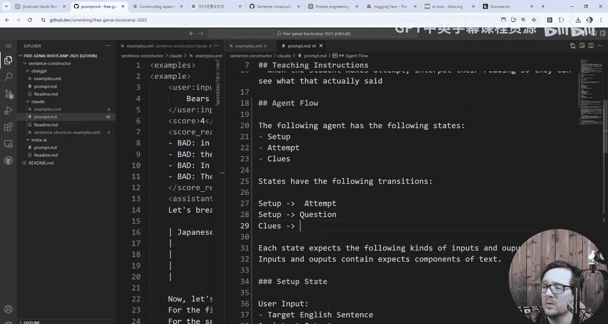

And technicalically， we can go the other way as well， right， we can go here， and we can say。

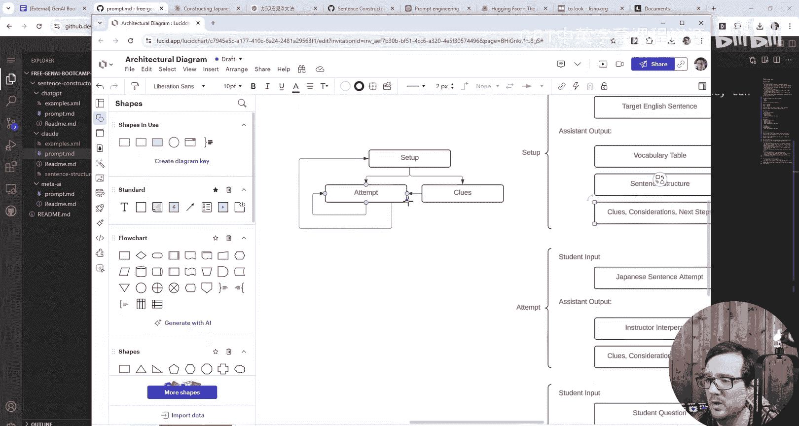

Attempt to clue。To clues。And we have attempt back to set up。Okay。The agent has the following states。

 the the starting state。Is。Is always set up。O。And so now we are being very explicit about our state management for our stuff。

And。I mean， something that we could just do like we have like rules here。

 but the more examples we provide。I would say the more that we can take out of here， assuming like。

 that's what I'm assuming here。So。Another thing that we could do is we could also tell it to make more examples for us。

 and then we could tweak them from there。So yeah， I'm just trying to think about that。

Becauseuse again， we have sentence construct sentence。Structure examples， which are good。I mean。

 yeah， we can provide full examples or structures， examples。 I don't know。

 But this is a good start for， for this。 So I want to go ahead and just see if it can do state management。

 The other thing is that we need to tell it。

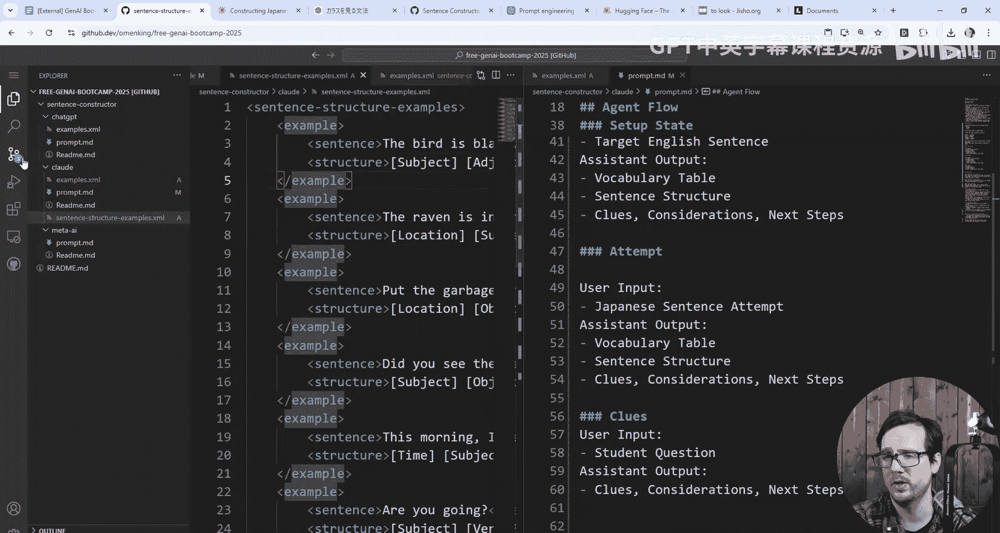

You know。Tell us at the start of each output what state we are in。Okay。

 and it doesn't know about states until later on。 So it might be better to。

 for us to tell that later'cause the order of the stuff does kind of matter。

But I'm gonna go over here to。Here， and I just want to see what ticket number number 3。 So just say。

Set up state management。Okay， I'm go gonna go ahead here and commit this。

And I'm gonna make my way over here and make a new project。

 I'm gonna to say this JP sentence constructor。new。It's better。

And these don't do anything to the project。 But the nice thing about the project is you can upload files。

 And if your files get too large， then you kind of have to。

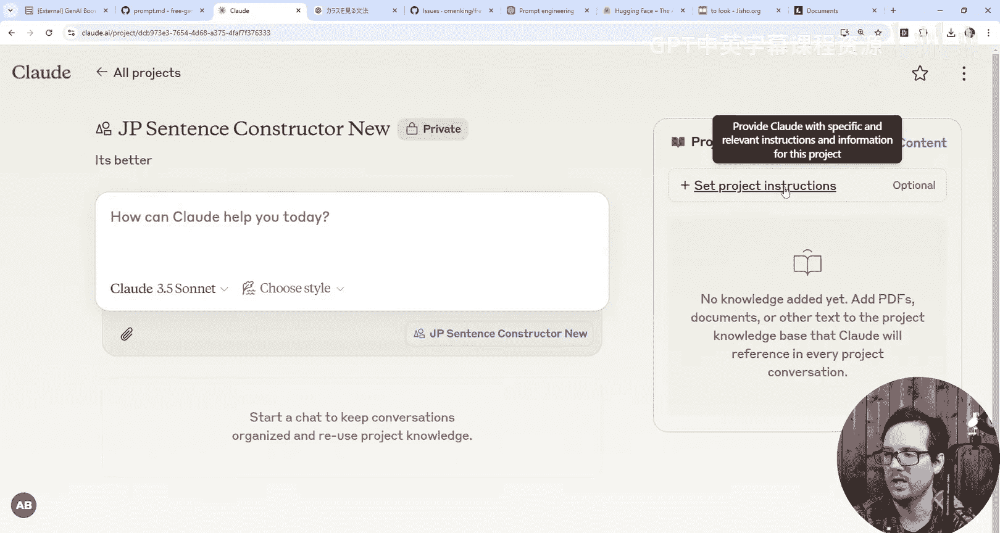

Start using projects。But we'll go over to here， and I'm just going to go grab this。

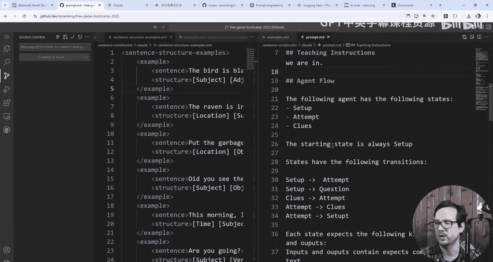

And I'm going to copy it here。And we'll go paste。

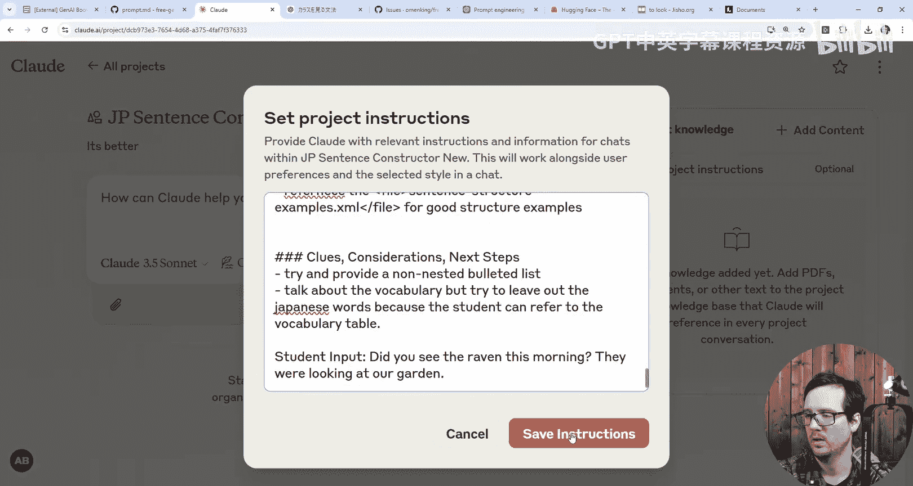

And save the instructions。And so now I have my examples file over actually have two example files。

And。I'm going to go ahead and download this one。And I'm going to download this one。Here。

This is probably be a little bit more useful to be working locally because I don't have to rename the files constantly。

 but I'm gonna go over to here。 I'm gonna to upload these new files。

 So we'll go ahead and bring these on over。And so now we are set up。

I noticed we only have 1% of our knowledge capacity。 So we could provide a lot of examples here。

 And so I'm going just say。An example sentence， it's like it's very cold in the office。

 So it's hard for me to type on my computer。 We'll go ahead and see what we get back。

And told us what state we are in。And we have an example。 and it's fine。 Like。

 I'm not sure why it's says difficult here， but we never said that we couldn't。

We couldn't do things like that。 and we'd have to think a bit more about it。

And so here we have considerations。 We have two separate thoughts。 The first thought has two parts。

 The first part asks about seeing something specific。

 The second part thought to describe each verb will need different conjugations based on their stuff。

Try constructing just the first question about seeing the raven ask about the expression expression patterns in Japanese。

Okay， so we have this。 and we could attempt each of those things as it's telling us to do。

It's a very cold office， so it's hard for me to type up my computer。 And we do have some examples。So。

It's very cold in the office。So there's no particular time。We are in our， Why is it showing raven。We。

Why。Why did you show Raven。In the table of contents， in the in the vocabulary。Okay。

It wasn't there right， Raven yeah。Looking the state of English was not directly reserved。

 I made the assumption there。 Okay， but， why， but but why do you think。Thank you includedlude it。

What was the teaching mistake。 So looking at the examples that X M L。

 you provided one of the core feedback points was not。

 was about not providing a necessary vocabulary。 I copy one of the examples since Did you see the raven from the sentence structure unconsciously included in the vocabulary。

 So that's kind of interesting。 So I think what we'd have to do to fix that。

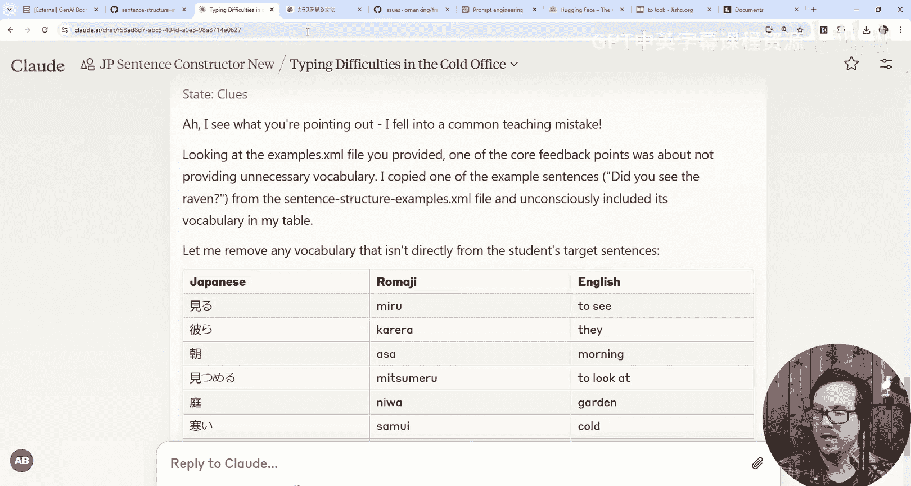

So we have to go back to our examples right here。And we needed to vary the example。 So could you。

 actually we just say like。

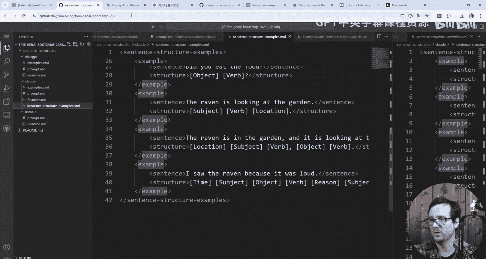

Can you fix the examples file？So that that doesn't happen again。

Cause I would think that we would have to do is vary the file， right， And that's what am I try to do。

Okay。Looking the sentence structure， I can identify that having examples using specific nouns like ran could。

 Well， I mean， is， is that the problem or， or was it because。Ravn。

 because Raven was because Raven was repeated so times。Alright， And so it doesn't even know itself。

 And so it's gonna copy and make us a new one。Okay， can you can you format that as an XML file。

'Cause it is a bit of a mess that it's providing it to us that way。No。

 it's not going to do a better job。 Okay， so。Not really what I want， but we'll go back over to here。

And I have a feeling if I paste it in here。Oh， no， that wasn't fine。 Okay， it did， right， No， no。

 it didn't。 It has both of them。 Let's go ahead here， try this again。我 pay时的。

AndSo now we have one that is more varied。 So maybe this will give us less problems。

 I'm going to go ahead and delete， delete this here。And let's go ahead and download this。

 But this is where， you know， you might have to tell it like， hey。

 do not use the exact examples and make sure you're being conscious about what you're putting in here。

 So I'm going to go back over to here。 And so I'm going to go delete this example out。

 I'm gonna bring in my new example。Right， and I'm gonna to say the office。Is cold。Therefore。

 I cannot type fast on my computer。Okay。And now we have broken。 Okay， so why is the table broken。

Why are you mentioning。Ravven and garden。And so I think the problem here now is we don't have enough examples。

 right。Oh， you know what。 I think maybe the reason we're having another problem is that when we keep copying the prompt。

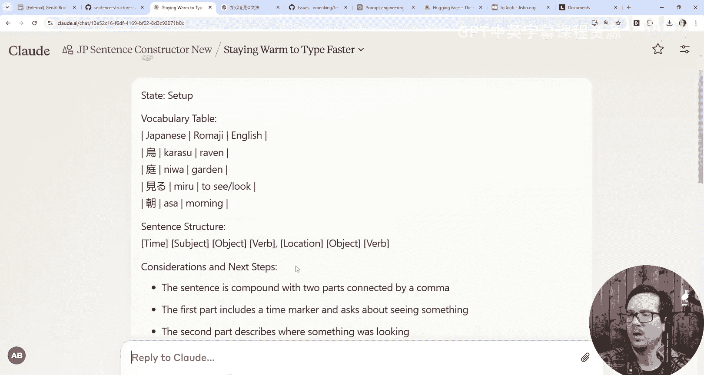

It has this thing at the bottom。 Okay， so maybe that wasn't our problem Here was our prompt this entire time。

 So's go ahead and save this。 I'm gonna go over to here。 This is an easy fix。

 So's gotta be really careful with this stuff。 And we'll go all the way down to the bottom。

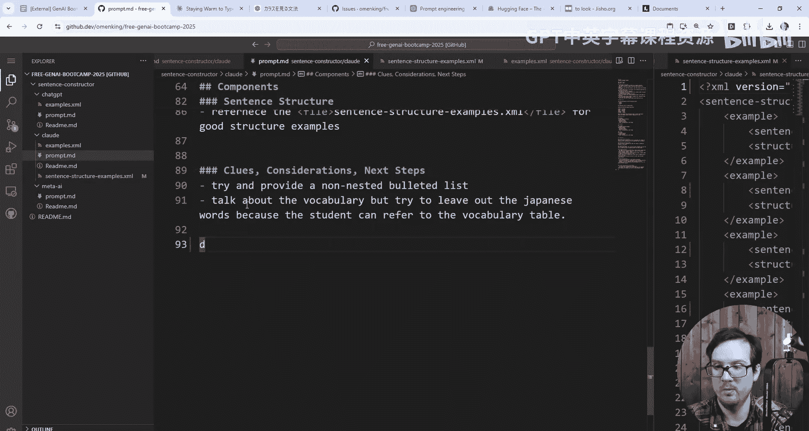

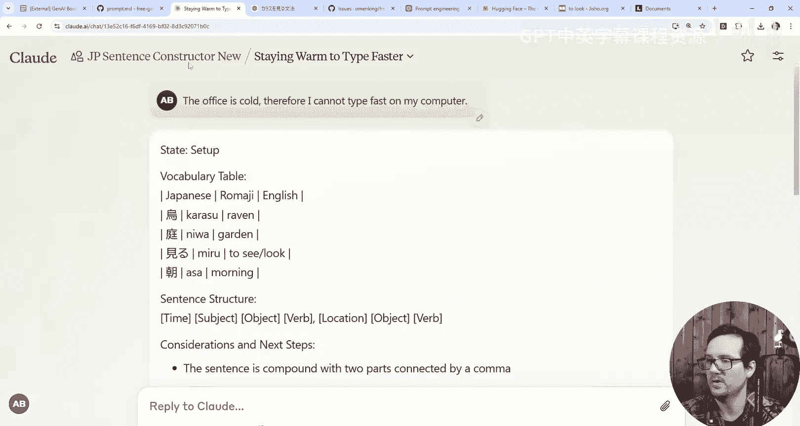

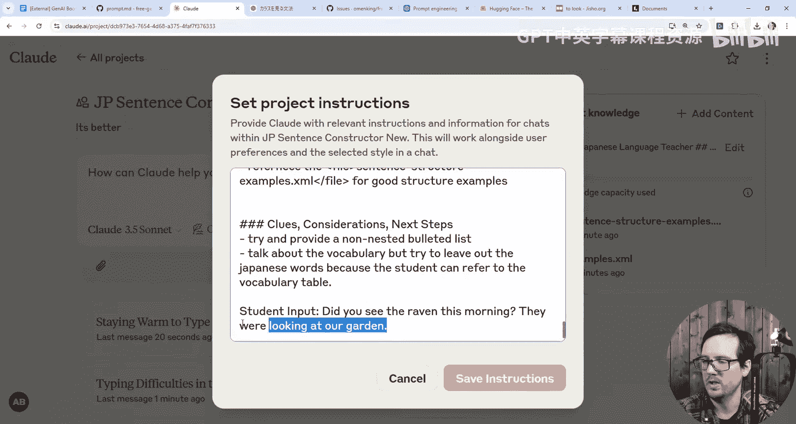

And we'll save the instructions。 We'll try this again。 So it is cold in my office。 therefore， I。

 therefore。I need to turn on the heater。Okay， so we'll do that。Okay。

 so now we're having less of an issue。 So I think that's where the confusion came from。

 And that other examples might have not been an issue。But the thing is。

 is that we probably want to vary things anyway， because if we provide too many of the same examples。

 it might start leaning that way。 But notice here， we now have our setup。

 so we can see exactly what state it's thinking in。

 And that's really good because now we can expand a lot more examples and information for that。

 But yeah， we have this。 There's a lot。 There's just like too much text here。嗯。You're providing。

Way too much tax for consideration。 for consideration。For。Can you can you summarize this more。Okay。

 so。

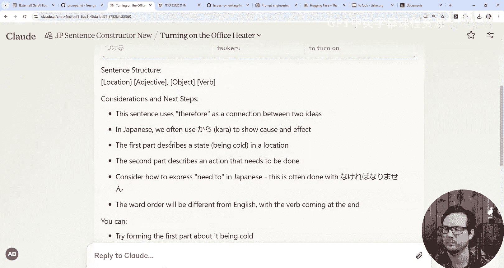

Here's where we， again， we could provide another example。 And this is where we could say。

 like considerations， example， considerations。Examples。XML。

And I'm going to go here and just say examples。Examples。Example。Example。

And then we'll go here and give it a score。And we will say like， this is。6。Another one's a 10。

And I'll say， reason。Like score reason。 So it knows score reason。 we can also do it that way。

 You'll see I'm like I'm varying， I'm not being very consistent here。We could also do score。

 and then we can put value here， but concise。This example scores 10， because。The because。第异议。

Returned information。 Return information is concise。Okay。And then we'll go up to this one。

Because there're。The returned。Information is too verbose。Okay， and then we'll go here and just say。

 we have example example。And then， actual text。For output。Output scores this。

 This output scores that。

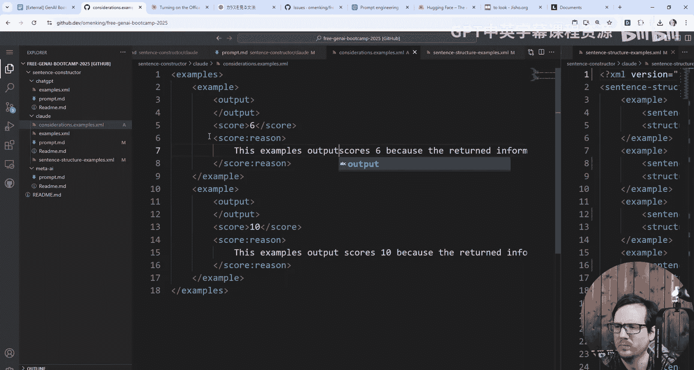

And now what we can do is go ahead and grab those two examples。 So I'm gonna grab this one。

And this one is really good。 I like this one。

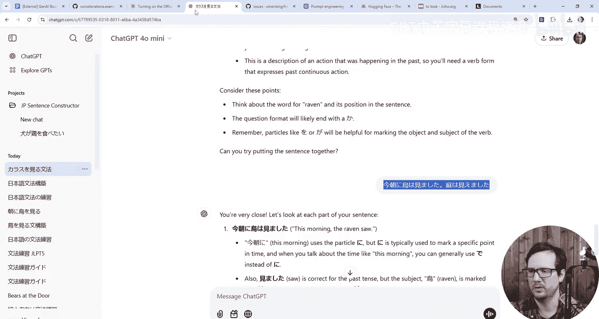

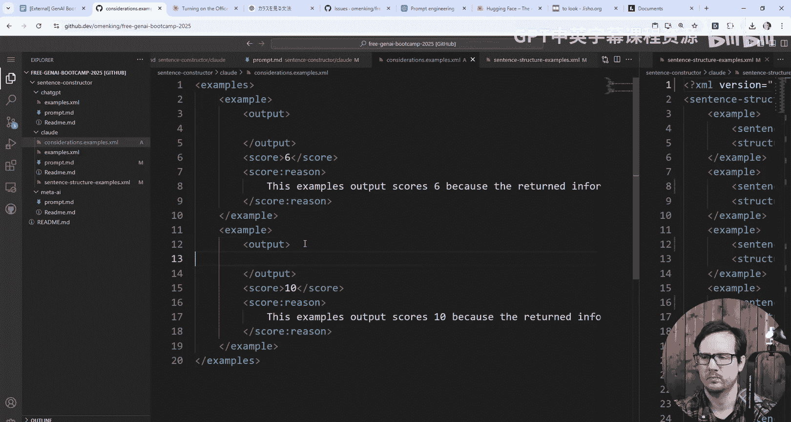

Okay， and then we go up to here。

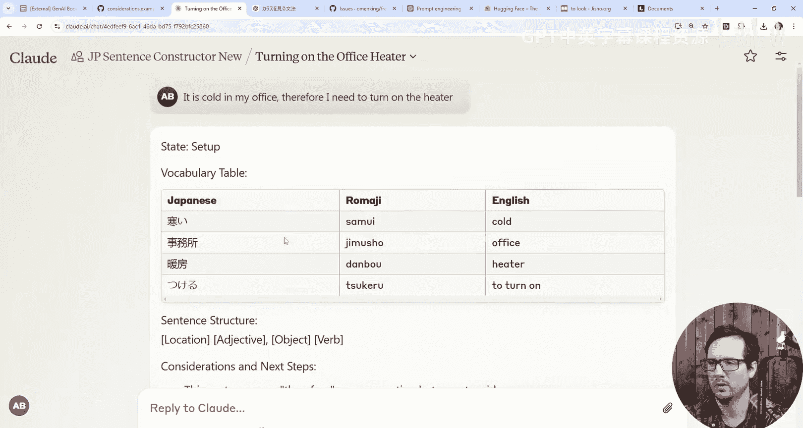

This one is， as's way too much stuff going on there。 I don't have time to read that。

 And we're beginners。 we don't need that much information， right。And yeah， these are set up as。认识。😔。

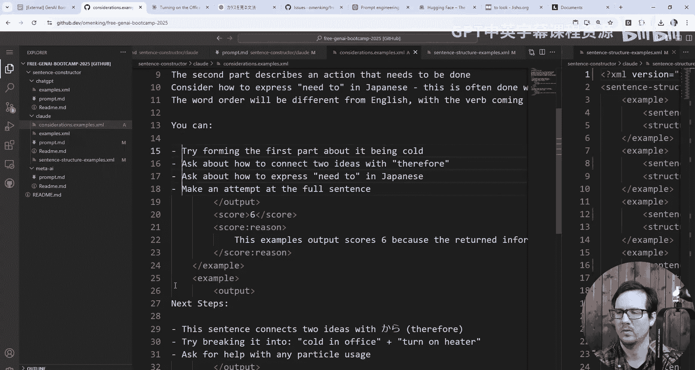

There we go。 Okay， so now we have that example。I'm not sure why there's a period in between that。

I'm gonna go ahead and while I'm gonna just try to be a bit consistent here。

 We'll see considerations as example。And I'm going to have to update my。My prompt document here。

 And if we go under to our。

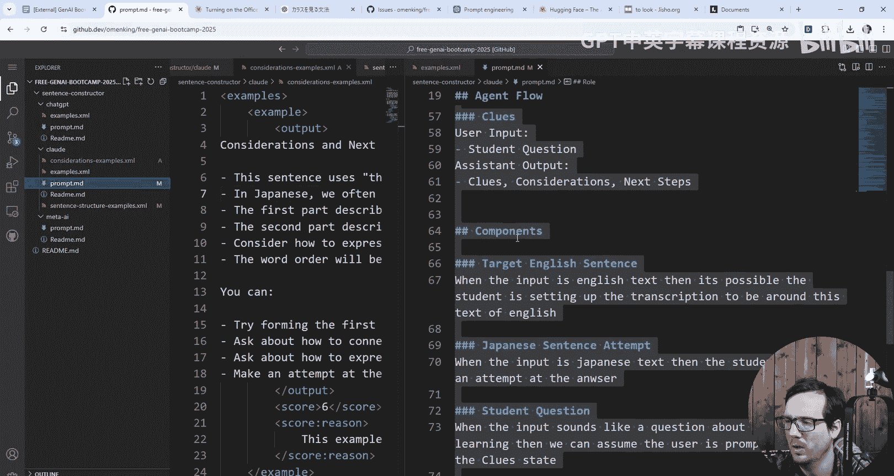

Here we can copy this。And we'll say， oops， that's not what I wanted。 I just wanted this line。

Reference the file sentence in structure example， so this one is considerations。Examples。For good。

Terms of conciseness。Okay， and so we have that。 I'm gonna need to get my new prompts。

 So we'll go ahead and copy this one。 I'm gonna save this here。This will be three。

 and we'll just say。Provide。More isolate examples。For consideration。Fix issues with。呃。Un unnecessary。

Vocabulary， what's interesting is like， if we are successful at this level。

 then we could possibly take this down to haiku。 and then we might get okay performance。

But we'll go ahead and copy this here。I wouldn't really call knowledge transfer as it's not really the same thing。

 but。We'll go back over to here。 I'm going to go ahead and update this here。

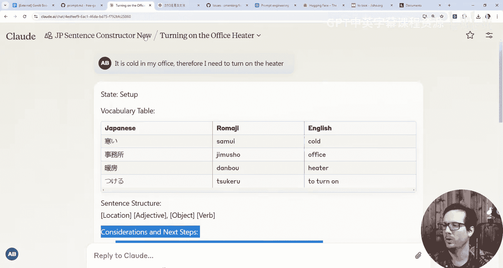

And we'll pace this in as such。 and I will。

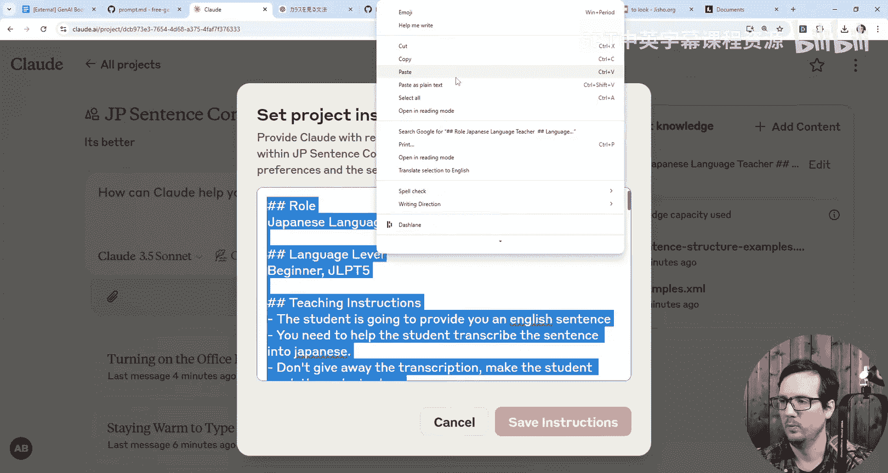

Fix this here。We'll save that。 It's still gonna know what I mean。 S instructions examples is fine。

 but we need to go ahead and download this one here， which is our。Considerations， example。Yeah。

 considerations， considerations， example。And。We'll bring in this text。So now we have， oh。

 we actually have two in here。 That's not good， which is the old one， which is the new one。 Oh。

 this one just came in here。 So I don't need that。This one came in 8 seconds ago。

 I must have copied two by accident。 It's not a big deal。 And so I'm going to say。

It is cold in my office。 Therefore， I am going to stop working and go back into my warm house。

Can you tell there， there's forced。 Theres forced is not a word。 But Samui。

 that's definitely what it's getting in here。 G Muho， G Mu show is office。

 Shigoto E Ata At Atta Taka。Nobody wants to hear me try to speak Japanese。

But now we're getting a concise example。 So you can see how。

We can be keep breaking them up like that and get better and better results。 The question is。

 could this model perform well。If we went over to haiku， I'm sure it would。

 let's go ahead and try this。 So I am hungry because I haven't eaten in5 hours。

 Let's go ahead and give that a go。 It's not true。 I've， I've eaten。 Well。

 maybe it actually' has been five hours。 I'm not sure， but。I mean， this is performing just as good。

 The only thing is that it's now producing type。 And we never told it to do that。

 and we're getting word。 and we never told it to do that。 it is doing ch sheet。

 which is kind of interesting。 So it's following more strictly to the convention that we produce there。

 It's saying reason ver reason。 So it's interesting that haik's not performing as well。 But yeah。

 maybe it just takes a lot more effort to get haiku to work the way the way we want。

 but we would really need to increase our examples。

 there are ways that we could just create more examples。

 we could just keep feeding it in and saying likey like at the smarter model and say give me 10 or 20 examples of more variants of these and maybe that would help ground it a lot better because it has more examples。

 but that's an experiment that we would have to do。

 I'm pretty happy with the result that we're getting here。 But notice it's still giving us the state。

 But yeah， notice that we aren't getting the best results with these smaller models。 And by smaller。

😊，These models are still really， really， really large。

 We could go back to meta AI and try to feed in these documents and stitch them all into one and see how they perform。

 But yeah， there's just a challenge where。You get these models and these models are just too small to really get the result。

 And that's where you might need fine tuning or some other kind of result。

 But or what you need to do is break the task down to be even smaller。

 So we have it doing quite a bit。 I know it's just doing sentence construction。

 but there are a lot of moving parts there。 And so there could be a way that we could slice up the learning task in different ways。

 but like maybe just focus on particles。 So like you give it get you produce a sentence and then you just have to figure what particle goes in the right slot that might be easier for a smaller model whereas this one's getting a much broader or general task。

 The other question is like how do we know that this is well tested right Like obviously we're just using it here。

 But what could we do to make this thing better。 So you know how can I make。My like。

 I'm gonna go over just a regular clo。 Let's go ask Claude。 clod's pretty good， so。

If I design a prompt。With examples， how am I how can I。Mass test or like， how can I。

 let's go back here。ok啊。I want you to help me make the prompt。Document。Better， how can I what， Well。

 like， what things can I do。To test my。Document in multiple ways。Right， it's like。

 it's probably the thing I want to do a translation。

And notice it didn't actually follow along with it， which is fine。 So here it says。

 I hope you analyze improve your pro document through various So test different sentence complexityities。

 So simple sentences， compound sentences， negative sentences， test edge cases for vocabulary tables。

I mean， test state transitions， test teaching scenarios an example of common student mistakes include scenarios where the students use incorrect particles。

 So I was kind wonder， like， could we generate all this stuff， could like。

Could you generate all this stuff。The only problem is like even if it generates it enough for you。

 you still have to， as a person， go through all of it and comb through it。

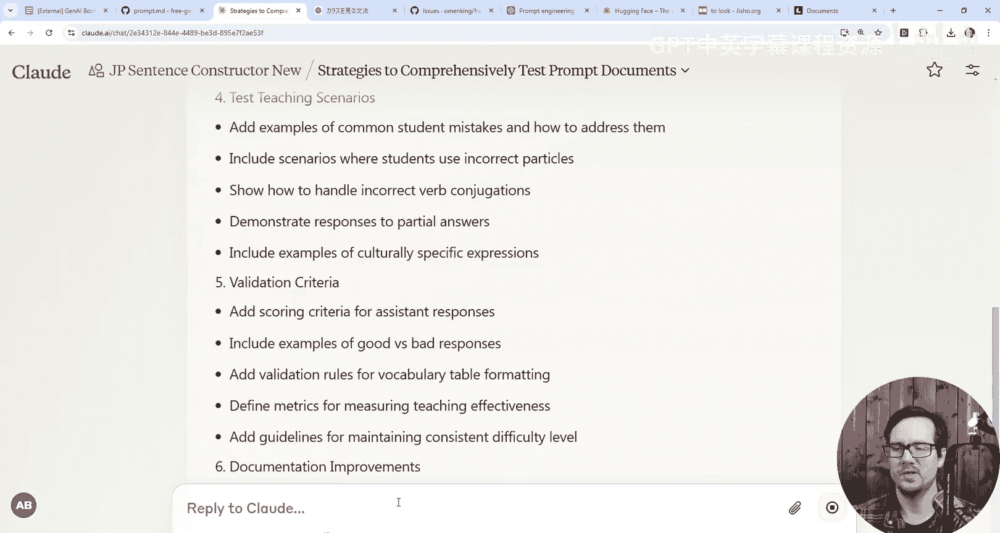

But I I was thinking more just like ways where people might try to break， break the document。

 So here we're getting examples。Yeah， I guess it's fine。 It's giving us all in in this thing。

 I actually， this is， I actually kind of like this quite a bit。 the structure。But yeah。

 I guess the thing is like， could we copy， paste it。 And then what if we took these。

 and then we brought it over to haiku， would it perform a lot better。But that we go here。

 and it's still producing a lot of the stuff。嗯。So let's go ahead and yeah， I you know。

 I'm just gonna go ahead and download this file。

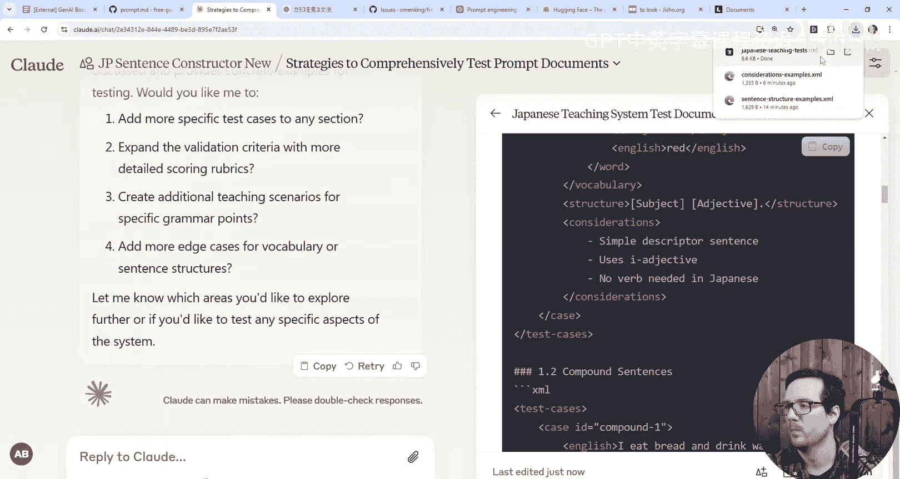

And I'm gonna go over back to here。 I'm gonna bring it on in here because I'm really curious to see if what it might do is。

 is if we use haiku， like， would it make it work a bit better。

And I think this is actually an XML file。 I'm not sure why it's， it's saying M。

ButWe'll go over to here。Oh， I guess it is。 It's this。 And so。

I'm going to go put the top of the the prompt file here。maybe down here。嗯。I'll do it to the bottom。

 It sometimes matters where you put it。 But I'm just gonna go here and say， like。So what I want。

 I want this。Please read this file， and。So you can see more examples。嗯。To better provide。

A prepareified。Pro better out provide to provide better output， provide better output。

 And so this one is called。It's been a little bit silly here。 Let me go over to here。Oh。

 this is been kind of a pain。 Okay， we'll say file。File。And this one is called。Japanese。Tiqing。

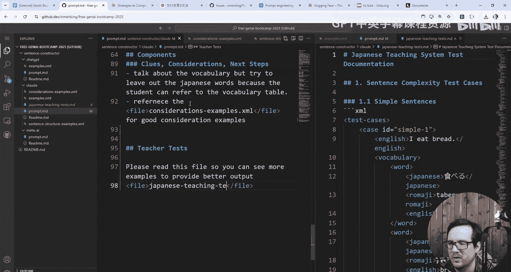

Test on M。 So it's， it's a markdown file， which is fine。 And I'm going to go ahead and copy this now。

And we'll go back over to here。And I'm going edit this here。And we'll save that there。

 And now I just need to upload this new one。So I' gonna upload that there。

 And so now we're gonna choose Haiku。I say it's cold in my office。I need to go inside。But， it is。

Dark out， I hope I don't see any bearers， though， since its's winter， the bears are sleeping。And。

It's still。Bbos。Okay， did you。Read the example files。It's almost like it didn't do that。Okay。

 but okay， so no they told to read it， okay。Okay， but the vocab。Table is not right。嗯。Vocab table。

Is still not right。Okay， like。How many columns。Are supposed to be。In the in the vocab table。

There we go。 Okay， And so I don't know。 There's something that can be done here。But like。

 if we know that it's always messing up on the same mistakes， we could just tell it like， hey。

 at the end of it， like read this and make sure you don't make these mistakes because it's consumed all this knowledge。

 And then when it gets to the end of it， it's like confused。

 And so that could be something that we do where。

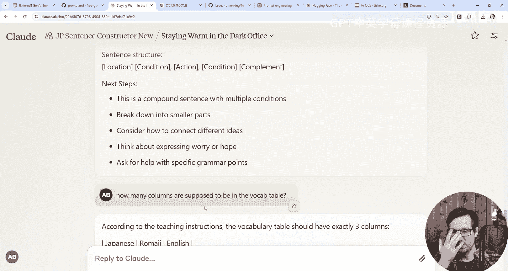

呃。We go all the way down the bottom here， and just。Make sure。You read all the example files。

 tell me that you have。Make sure you check how many columns。There are。In the vocab。Table。

 so it's almost kind of like a checklist of like， hey， check these things over last minute。

 which seems a really silly， but this might get us closer to what we want。

 And sometimes you can front load that stuff So it becomes more important。

 But we're gonna go back over here。 I'm gonna try this one more time。

 We're going to paste it in here。 I'm gonna hit save。

 I want to go to sleep because it is getting late。

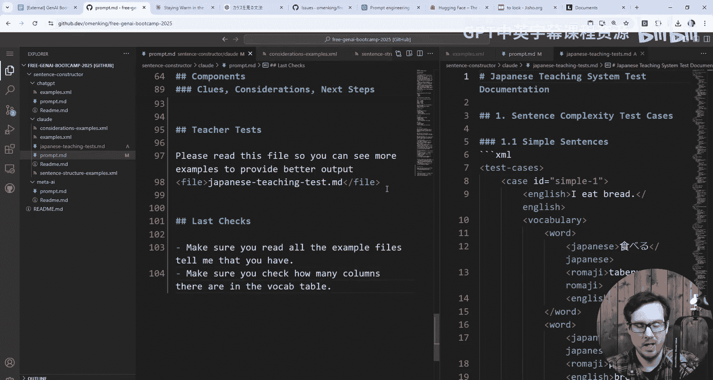

We'll go ahead and give that a go。Okay。It's sounds that it read it。

 And so now we're actually getting good results。 And now it's concise。 Okay。

 so we have tricked Haiku to work how we want to work。

 So we can definitely get these smaller models to do what we want。

 But this one's actually really simple。 It's this reason， not exactly that。 But so we have。😊。

And like here we might say like， hey， go read。Go read these。

 Did you I would say like did you read the sentence structure。W。

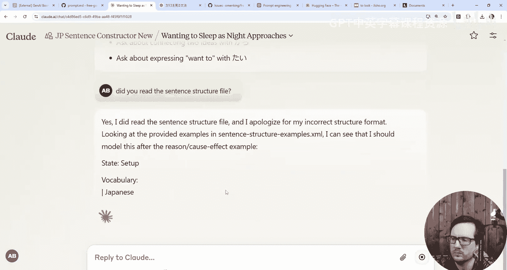

Okay， so that one's getting better， right， And so I can go back here I'm just like。Make sure。

Make sure you read the sentence。Structure。Examples file。

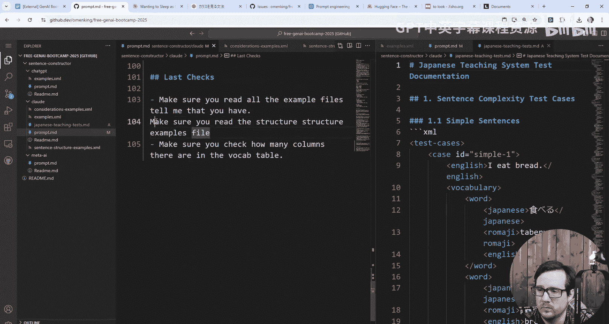

Okay， and I'm going go ahead and try this again。But that's what I。

 this is what I kind of remember the old model doing， where I would have to tell it to do that。

 It was very annoying。 but I eventually got it to work。

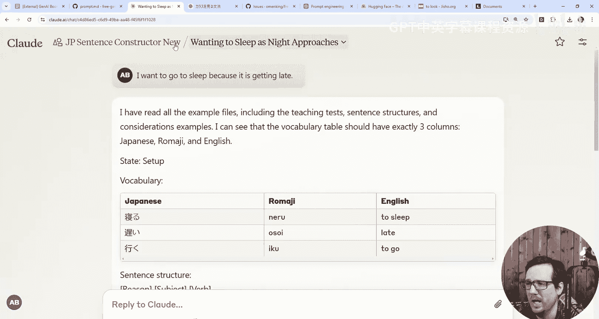

And so we'll go here， whoops。We want the whole file here。

 This will be like the last change we make and then we'll just we'll call this call the squs here。

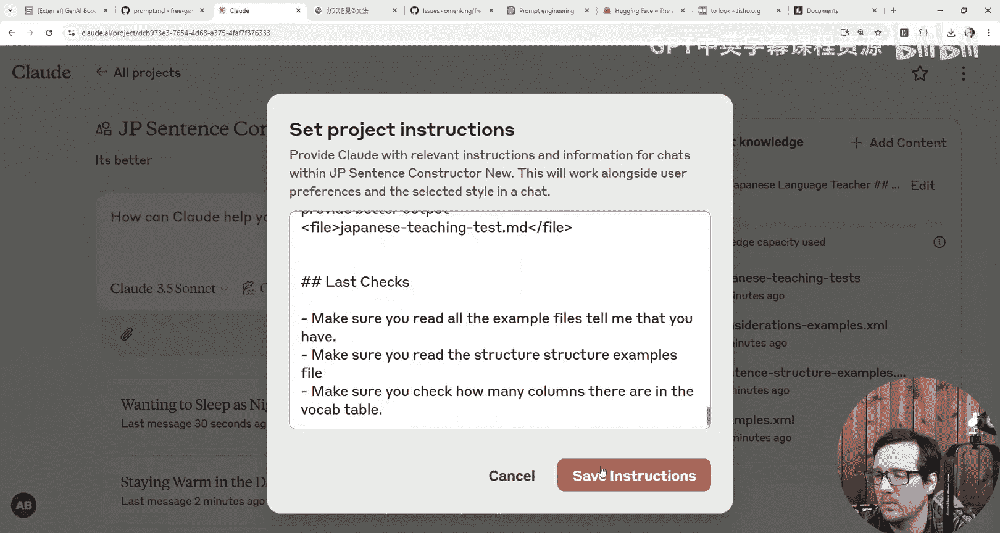

So， I am tired。Because it is late。So I want to go to bed。Okay。

 and so I I need to make sure I switch this over to Haiku。Maybe the last one did really well。

 because it was。It wasn't Haiku。Sject reason verb。 Okay， did you read。Reason subject for， I mean。

 kind of moved it around。 I guess it's fine。 But maybe this is where we need to provide more bad examples of things we don't like。

 And I think there' the thing is that if we only have good examples， we don't have bad examples。

 I the smaller model can't do as well。 But we're gonna call this done。

 And then after this will do probably have another video here of a postmtem。

 I know that we're supposed to have other guest instructors do other variants of this。

 So it would be interesting to see what their outcomes are。 And I will be hanging out with them。

 We'll go ahead here and just say， more examples files。 Okay， for this thing here。

 I'm gonna go ahead， commit it， push it。

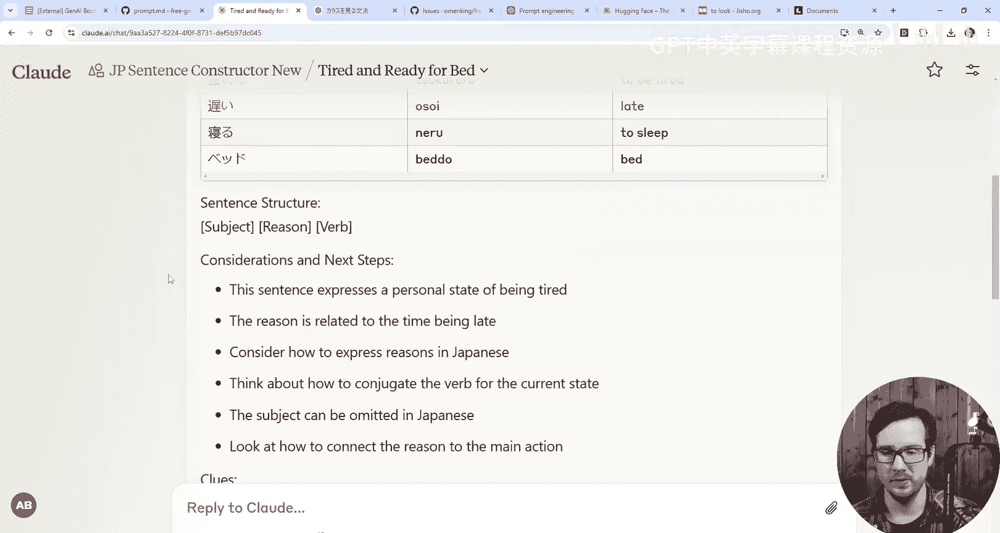

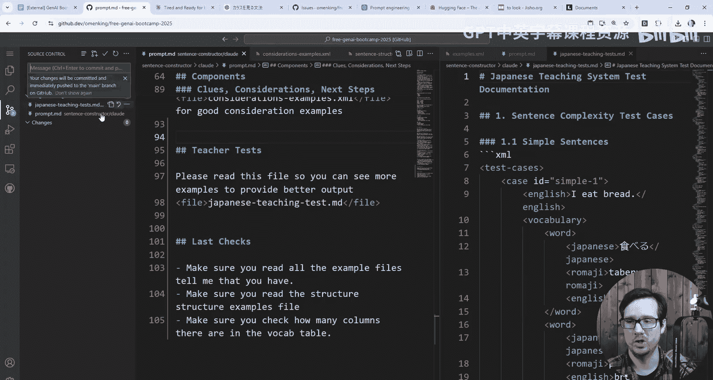

That's all good。 And I will see you in the next one， Okay， Co。

