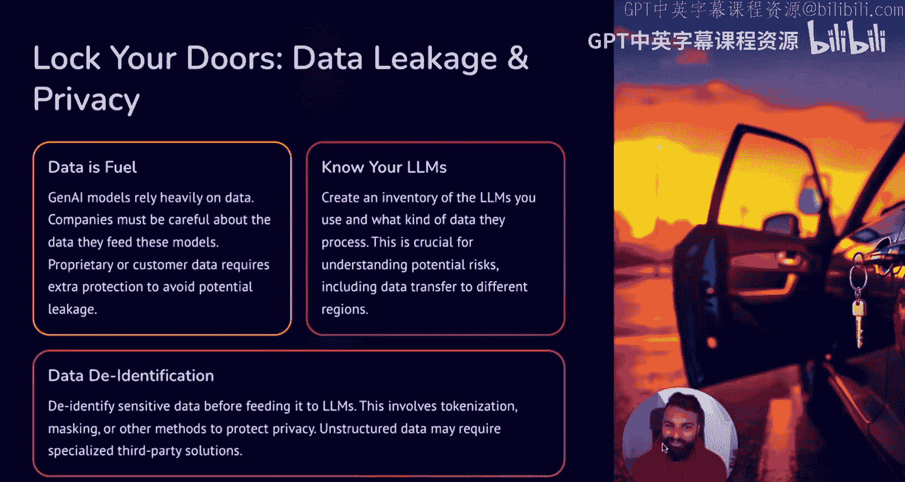
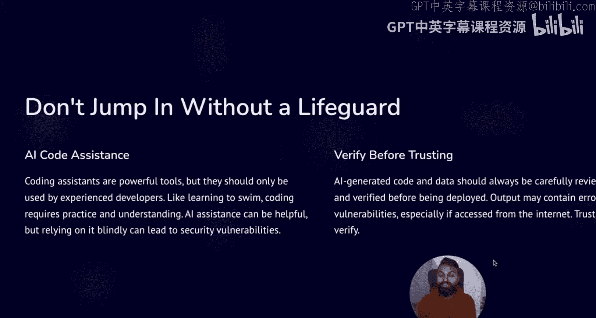
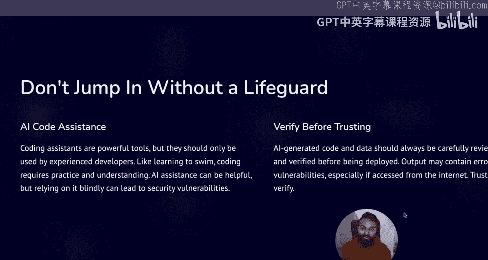

# ExamPro《生成式AI训练营｜Free GenAI Bootcamp》中英字幕（deepseek - P16：-16-Generative AI Security Secrets BUSY Tech People Need to Know - GPT中英字幕课程资源 - BV1SFEWzLEab

If you work as a product manager developer or any other role in a tech company。

 you're probably already using Gen Ai apps or considering using one very soon because of the hyp around it。

 This video is about the three security weaknesses in Gen AI applications these days that makes most companies nerve especially tech companies who deal with the lower data。

 First one and probably the most important one don't leave your keys at the door。

 If AI is a vehicle that's going skyrocket your business。

 then data is the fuel that's gonna push it forward。

 number one worry that most companies especially tech companies have is the data leakage because data is at the heart of what these companies have established。

 you take Facebook， LinkedIn Airbn any big tech company out there they all rely on data as their way of standing out in the crowd。

 So make sure you're conscious about what kind of data you're putting into these L models。

 which also means you need to understand the L model being used we saw this deep recently that it was actually sending data back to a data center in China。

 which may or may not be complying to the legal requirements you have for the data that you're working with So make sure you don't put the data that。

😊，Sensitive in these LLM models。 If you have to consider some kind of masking to organization。

 so the actual data has been deidentified， it cannot recognize that there's actually a driving license number in there。

 which you should not have put into it。 Second one is don't jump any the ocean without a lifeguard in the vicinity Now the coding AI assistant models have been really popular it's an ocean out there and you have to pick the right one that works for you you probably have team members and developers who are actively using one or more these coding assistants out there。

 Now the reality of this is that as much as we are in this text to something error and more on that in another video。

 it is still not at that stage where you can trust the data that comes with it。

 you have to verify it， which means that if you have developers who are junior or probably don't have a lot of experience。

 I would not give the coding assistant to them because relying on the code that is being produced by a coding assistant at this point in time is not at the level that you would want from your organization Also depending on what kind of language you're using in your organization they might not even be a coding assistant。

 So if you find an open source version for someone who claims can do it。

You probably want to go back to step number one and verify the LLM model behind it。 My advice。

 if you're using something like a coding AI system。

 make sure you limit access of that only to senior developers who have done this hardard before who have been a lifeguard before and who can actually verify that the code being produced is not exposing them to any weaknesses especially the application is going be on the Internet verify the code output being produced by the coding assistant before you copy paste it into your production pipeline。

 number three， secure your studio chances are if you are building an AI application。

 whether its to produce code or to crunch data you use some kind of an AI studio or AI building software。

 which means you want to make sure that what you're using is not vulnerable。

 There are two examples recently， one was around lightning AI。

 which is a very popular tools for data scientists about 50 million people use it that had a vulnerability that was resolved recently Now there might be a lot more deepse。

 which is another open source LLM model that has the R1 model identified with some security vulnerabil as well。

 So knowing security weakness。😊。

The tool that you' using in to build AI， the actual LM model that you're using would be would be the right thing to do before you start diving into the AI check。

 Now， using all this information， you can be building a security AI foundation for all the amazing work you're gonna do in the tech companies you're working for just as simple as educating the team about what kind of data to put in and what kind of L models are there that should be able to use and should not be using implementing security controls to make sure you're aware of security vulnerabil that may be there in the LM model or the AI story that you're using Thirdly。

 and its probably most important one， Keep an eye out， theres a lot happening in AI。

 keep an eye for what are some of the security announcements coming out from these companies。

 My hope is after watching this video youre able to use benefits of AI without worrying about security。

 Now， if you want to continue making smarter decisions with AI so you can brief all the benefits of Gen AI has to offer even on the video over here for you to become more AI native if you're not already。

😊。