# ExamPro《生成式AI训练营｜Free GenAI Bootcamp》中英字幕（deepseek - P17：-17-Free GenAI Bootcamp - Week 1.zh_en - GPT中英字幕课程资源 - BV1SFEWzLEab

Hey everyone， it's Andrew Brown and welcome to the free JenI Bo camp as we're entering into week one or week two。

 depending if you like to count from zero， but I know since we're all developers。

 we all start at zero but just before I introduce my guest instructor here Ryan I just want to point out one slide in particular for those that are trying to listen to us here and I'm just going to switch over whoops that's too big that's too big there we go So if you are deaf or here impaired the best way to watch this live stream is on LinkedIn and if you're on YouTube we'll drop the LinkedIn link in the comments it's actually in the description So I'm going to just go ahead and update this in the description I'm telling you this is all live。

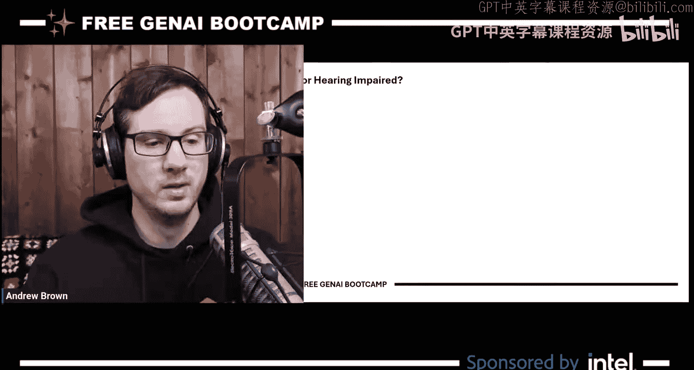

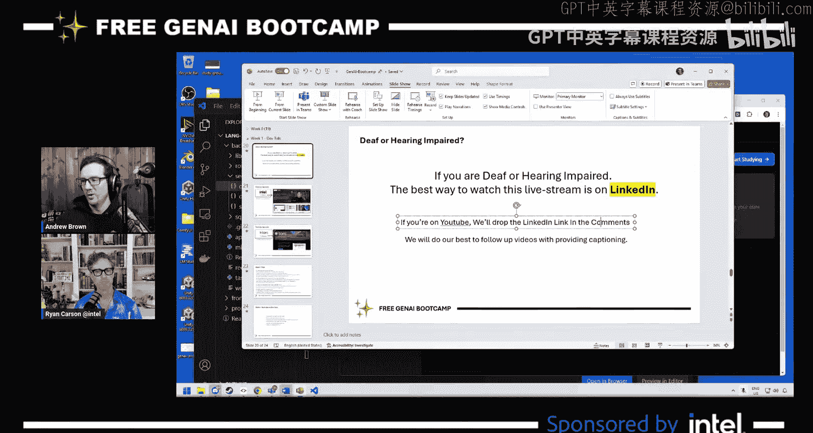

And it Saturday， when it live Saturday to your earlier SNL， but S。Noon。

 I don't know so we'll do our best of follow videos with providing captioning。

 but if you're looking for it， look for it in I'll get my nice pen tool out here in the description okay but now that I have that one slide of the way I'm gonna get back over to here and I'd like to introduce you to this week's guest instructor Ryan if you don't know Ryan is famous for me because I know Ryan from from the very famous Carsonaified blog and and the tech education service called Treehouse。

 but I'll let Ryan do his introduction here and then we'll jump right into our boot camp。

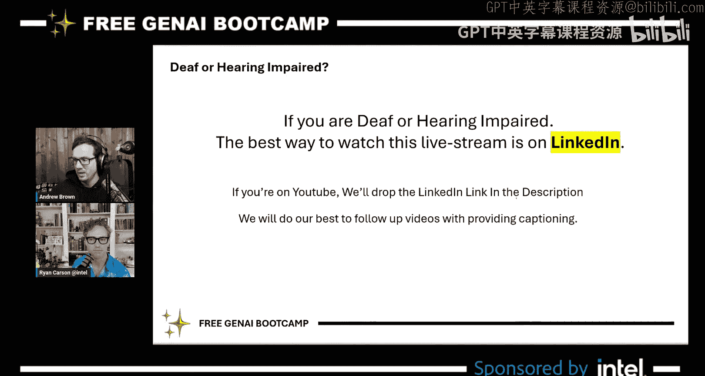

Thanks， Andrew， hey， good to see everybody already see some people in the crowd crowd talking about the Super Bowl。

So let's stay focused。 Okay， Super Bowls tomorrow。 good to see everybody。 My name is Ryan Carson。

 As Andrew said， really excited to be here。 I started off coding when my dad brought home an Apple 2 E computer in like 1987。

 And I was like， what is that？ And I was lucky enough to study computer science。 And honestly。

 I was kind of a mid computer science student。 So I the first thing I think Andrew and I want you to remember is。

😊，You do not have to be some computer science whiz here。

Those days are long gone actually were never real anyway， anybody can learn how to do this stuff。

 especially with AI so I was kind of a mid CS student and managed to graduate and then really found my love helping people learn how to code so built several businesses to try to help people learn how to code and the last business was required took a couple years off and then chat GPT happen and then I was like wow。

 okay， neural networks are a little different than they were in 97。

And fell back in love and joined Intel because I thought。

 you know compute matters so let' let's join a company that is all about silicon and I'm excited to be here today with you all and we're gonna learn together there are no dumb questions there are no bad ideas we're not have a lot of fun so back to you Andrew。

Well I think you're mututed Andrew I probably should unmute myself so people can hear me， but yeah。

 we're just going proceed here through some slides， answer some FAQs。

 but before we do I'd love to thank our sponsors starting with Intel， if you don't know Intel。

 I hear theyre a a teeny tiny company that's a joke because they are they're very well known but。

Intel Intel is one of our primary sponsors and if you have an opportunity check out their virtual booth。

 we are covering technology of Intel in this course but this is my personal pick of selections such as OPA AIPCs and Openveno in fact this week we will be working with OPA is actually pronounced OPA but anyway the point is that we're going to start ramping up with that we'll talk a little bit more about it there and I also threw in the Apple2E there to see if brings it back any nostalgia there for Ryan my first computer Oarus。

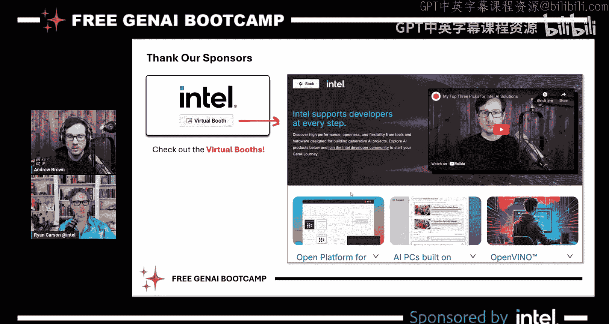

I miss that thing Its beautiful one of the earliest computers I use I used to go to piano lessons。

 but the thing that I really wanted to do is to go on the Apple 2 E that they had there so I wasn't interested in piano I was interested in playing on that machine but unfortunately I have too much piano skills now but I'd like to thank our other sponsors torque so for those who don't know Torque they are basically a developer profile and the reason I'm really excited about torque is that this could be an opportunity for us to connect boot campers with jobs and roles I've been specifically trying to bring in recruitment companies to try help and align our badges so that they're recognized by companies and we're gonna have Ken Collins possibly this week talking about this stuff but I'm going to be encouraging you folks to make your developer profile bringing you some career advice specifically for AI engineer roles but this will be good for any kind of stuff there。

So watch out for that later this week I have some FAQs I want to try to answer some of the most commonly answered questions that I've been seeing this week a lot of it's been around homework and specifically when to submit your homework and so I just want to make a crystal clear for folks so that you know they have a relax and easy time and they're not overloading themselves with too much work so how late can I submit my work well just do your best to be on time by the start of next class and when I say that this isn't like if you submit one two minutes late you get do lots of points what we're looking for is that if you just generally submit around that time could be the day before the day after on the day of then you're going to be okay if you are submitting weeks late and that's a consistent thing then we're going to factor that in I know some folks like to minm their approach by saying well what if I submit a week late but I put a lot of extra work into that or I want to go back and submit。

I'm telling you you've got so much in front of you。

 just do what you can and ship it and you'll be surprised at well you do。

I can't keep up with every instruction should I drop out in the last boot camp the people that earned the best badges weren't the people that did every little thing。

 it was the ones that were consistent， shipped what they could and they were so surprised that they you know they made it to the end and they got their badges the people that did make the end tried to do everything and and in this course or sorry this boot camp you have to practice time management。

 you have to reduce your scope and just accept what it is that you can do and do your best and we will recognize that and again I think itll surprise yourself if you just do the best that you can I can't do X because they don't have Y so we all have different hardwares。

 different technical backgrounds different access to services based on geographical locations or just costs if there's something you cannot do there's always opportunities to go work on something else like a previous assignment or things like that and just be clear。

In your submissions that hey， I wasn't able to do X because you know let's say metaAI is not available in my country or you know all I have is my 2019 computer and it doesn't have any GPUs just do your best and try to find workarounds and document them and and try to exemplify the stuff that you're good at if you want to make it to Redquad Redquad is our highest grading tier what I care about is you showing creativity and exceeding expectations and in this bootc we are building a series of learning applications that go into Ling portal just consider if you can think out of the box and build something that's in business scope but a really interesting project think of it like a hackathon that will that will have so much more weight then all the other work possible so just consider that there are very specific things that I will give you a bonuses on I want people to develop their DevO skills so I'm going to press people to do as much as they can with O。

A or or other kind of。LLM ops because I think that is a very necessary skill but you know just look out for that stuff I'm not sure if I have one more slide yes I do and I just want to talk about the purpose of this week this week is GenI dev and dev tools as Ryan said early earlier you don't need to be an expert developer but you're going to have to just work your way through it the best you can but the focus here will be writing frontend code with GenI writing backend code with JenI which is what we're doing in this live stream today。

 analyzing exploring code where there's a lack of documentation which we're going kind of do that here as well today generating test code to gain test coverage which we'll do in a separate video rapidly prototyping apps using GenI and learning some devOs LLM skills or GenIOs or whatever ops you want to call it MLOs to show you how to get these things into production so that you have the most technical flexibility when choosing what kind of Jeni solution you want to use。

Before we jump into some code， I want to just see how everybody is doing can I get a score between zero and 10。

 how are you feeling do you feel that you are on track or do you feel that you are behind and scrambling to keep pace love to see the numbers here in the comments and I'm watching here we got9。

6，7，10，6， zero somebody somebody's just showed up this week10 one。

 etc ce so yeah we have a good mix of everything， but the numbers are good and high so you know I'm hoping that。

11， wow。So I'm thinking that people are in good shape here today。

 but yeah hopefully that really clears up the homework there。

 but let's go jump into it so I'm going to take down the slides and let's talk about what we are working on today so I apparently I don't have the article pulled up that's okay I'm going to go to the Jennyi website and by the way if you're ever looking to try to find where that big big document is almost all the links go there if we scroll on down here into CFL curriculum。

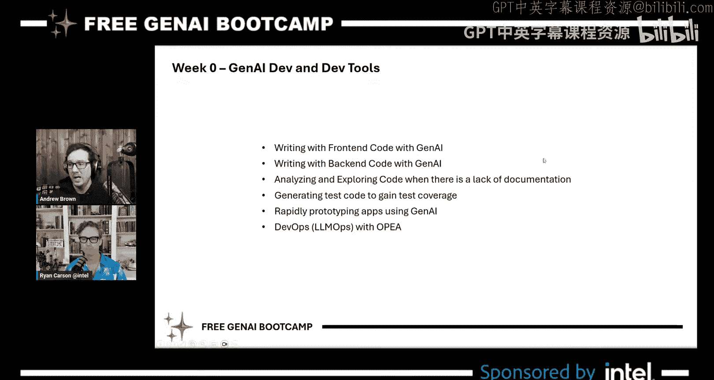

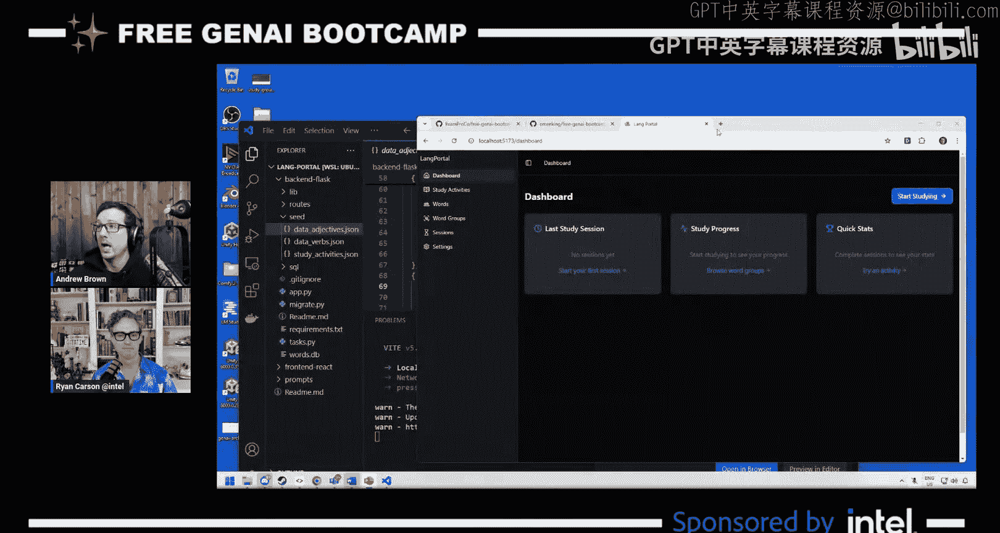

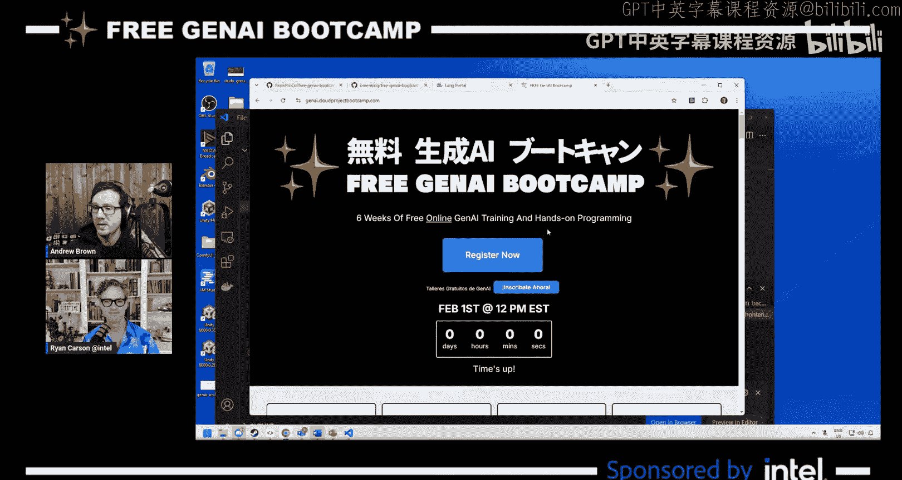

Right this will bring us on into here and these are the projects that we're building you're going to constantly see me writing new ones。

 not all of these are going to get implemented， but it's just you can see I'm working with guest instructors in real time to try to figure out how to fit projects in here。

 but what we're going to be focusing on here today is the backend Lng portal Ryan。

 how's your backend skills。Mid。This this is why it's going to be so valuable because I'm going to show everybody anybody can do this so there we go。

 but I guess I guess my question is when when you're when you're parent recursor that then what is your skill level oh man I mean you can。

Y'all， you're gonna to see you can basically do anything eventually like with with cursor or Windsor for any or copit。

 if you just have the patience to ask and work， you can now you can build anything。 It's super。

 super cool。And as the comments say， you're building the course right before our eyes。

 this is back to our week1 presentation that we're building the bridge as we cross it。

 whether it will be stable， I do not know， but we will get to the other side but yeah so you the goal for today is that and we'll read it out here but the language or the business goal I'm going to make that font a little bit larger here but as a language learning school wants to build a prototype of a learning portal which will act as three things it will have an inventory of possible vocabulary that can be learned act as a record store providing correct and wrong scores on practice vocabulary。

 a unified launchpa to launch different learning apps now what's really interesting is Ryan has the background in Edtech so Ryan can you tell me a little bit more about building learning management systems or things on that nature。

Well， you know， basically when folks want to learn things， you have to go through curriculum。

 you have to practice skills， you have to have tests on those skills。

 it's a good sort of typical app to build， so I'm excited to dig in。And yeah。

 that that's the exact initial initialization there as LMS for those that have not never heard of a。

 I don't know if I wrote it in here， but a learning record store。

 oh I call it as a record a learning record store， this is we're always making up new terms here but this means just to store your progress or history So any kind of interaction a student's going to have in the app it's going to store it back here and this allows us to monitor what they're doing but in this application it's very simple it's just you've got a word right or wrong let's keep reading through the restrictions here so you've been tasked with creating a backend API application it's going to use esquiL3 as a database。

 you can use any language or framework that you want。

 it does not require authentication authorization and you can leverage any AI coding assistant here to write your backend code so I want to ask the audience do you have your AI coding assistant ready and which one are you going to use here today so I'll give a moment for those folks to tell us what they are utilizing and as they do I'm going to go ahead and see if we have the app。

Lo running here so I can kind of give a quick demo of what this thing is so i'm going to go ahead and pull up I think it's running a local port5173 and so this is this application I built this。

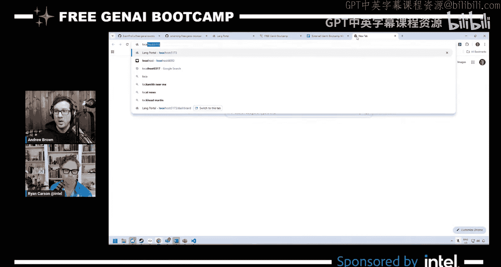

Half by myself and then I picked up windsurf and then windsurf just surfed me all the way to the end。

 and so I was incredibly impressed by it。And so I would say that it didn't take me it wasn't something that I coded faster。

 but I would say that it required way less mental energy and so I was able to get to the end of the day and then sleep at the end of the day I'm not sure how it is for some folks but when you're racking your brain all day it really it really messes up with my sleep and so I'm getting sleep days back here with these Jenny I tools and we're seeing the comments here we got cursor co-pilot GiHub some people are saying Amazon developer Q windsurve with codedium so we got a good mix of people that are ready if you're not ready。

 this is your opportunity to go grab one but let's go take a look at the app so this is something that we architectally diagrammed last week and so what it is is we have this dashboard and it shows us how we're doing then we have our study activity。

 this one's the typing tutor game， which I built by hand have you ever played typing tutor how do you learn how to type。

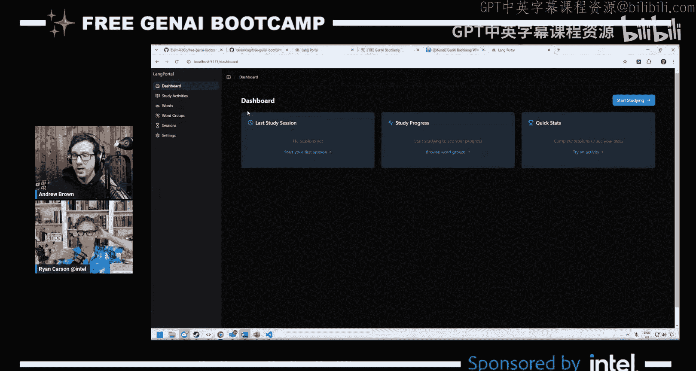

Oh back in the day I forgot about that I did。 Yeah。

 I used to use typing tutor and like there was there was a game too as well。 but yeah， good fun。

 So it people are always in the camp of typing Tutor or Mavis Beacon。

 which are both both really good sorry。😊，I was made of Beacon， that's the one。

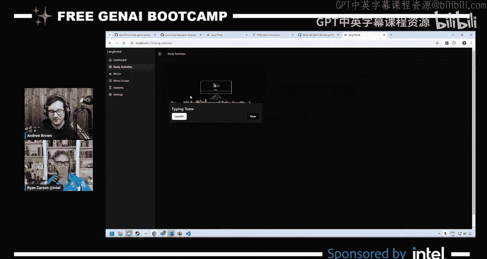

both both really good programs so I emulated that for Japanese language learning。

 but we have our words and we have our word groups right and then we have sessions so this is kind of how the app works might help to just show a really quick session so people can get an idea of exactly how this is work in implementation so there's just one more thing and folks don't worry about trying to get this to run right now because I'm just demonstrating this to you but I'm going to go into a secret folder that nobody has。

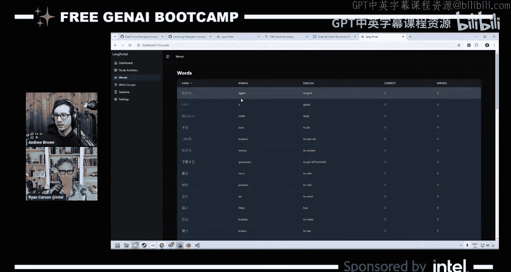

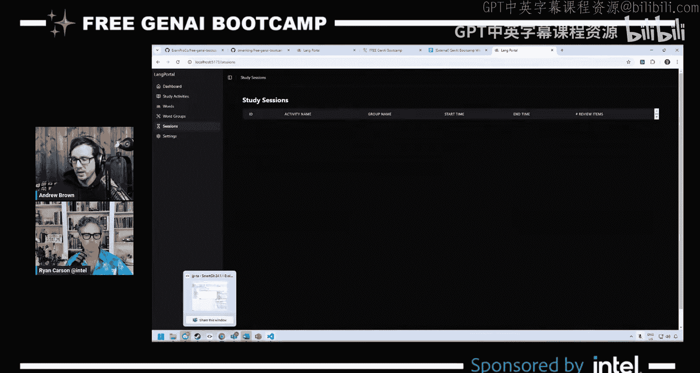

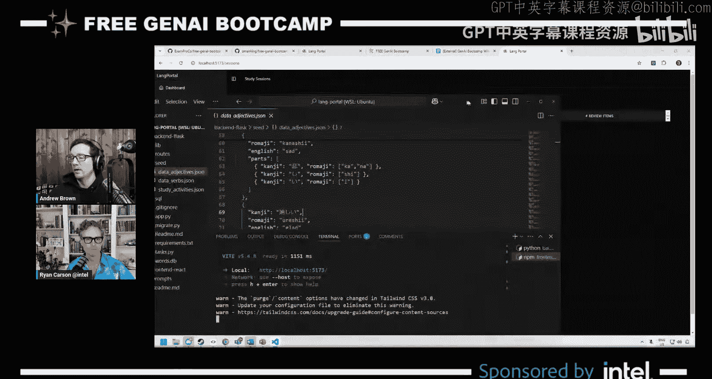

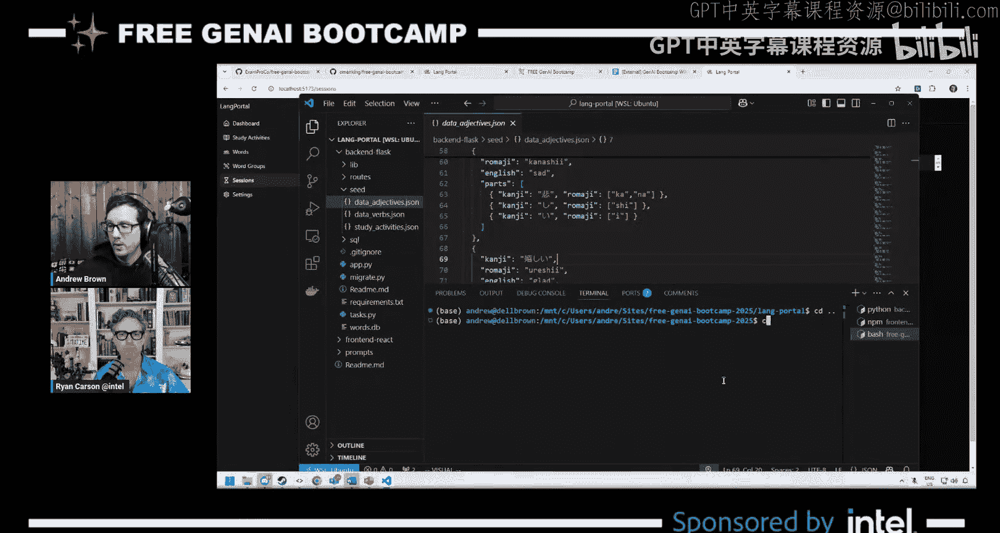

And I'm going to open up our typing tutor game， so we have an exact idea how this works and so I think I go HTB server here。

And we serve it， this is on port 8080， which is good and so I'll go back over to here to our study activities。

 we're going to launch and we'll drop down， we can choose between verbs or adjectives。

 I think I know my verbs and we'll launch this up right now you're not going to be able to hear it but when these words fall and when I type them they will actually say the word in Japanese this word here looks to me like Kayu which it's not so maybe it's neu nope I know is Kau Kaiu which means to return we have au。

 which means to meet。

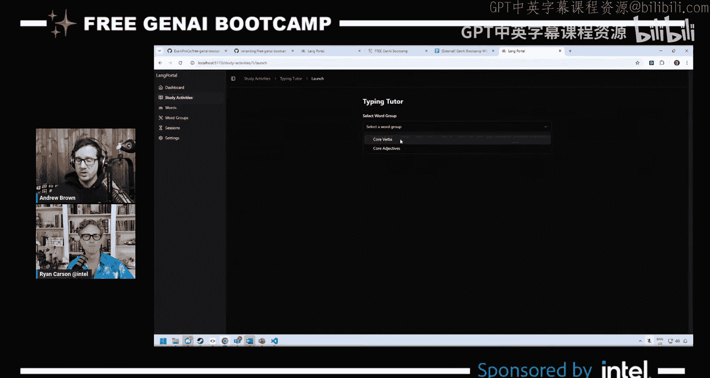

So I'm doing really good here。 I'll get it do， But let's say I get one to let it fall the way down。

 and it's really fun to wait 100 years for this to fall down。

 I like Ethan's kind of giving me all the answers here。😊，Maybe that's why I'm getting them all right。

Um。But we'll wait for one to fall here because I just want to see one that gets wrong。

suspense is killing me。 Yeah， it's a little bit too slow。 But if we go back over to here。

 this actually created a session。 and if we refresh it， it's story it's our learning record store。

 our history。 if we go back over the dashboard， we got our stuff and。😊。

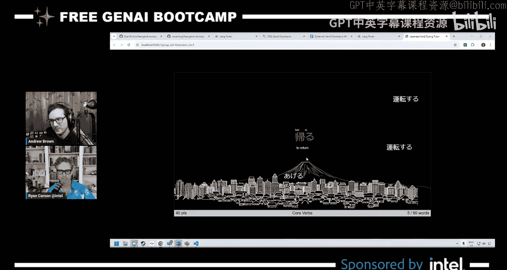

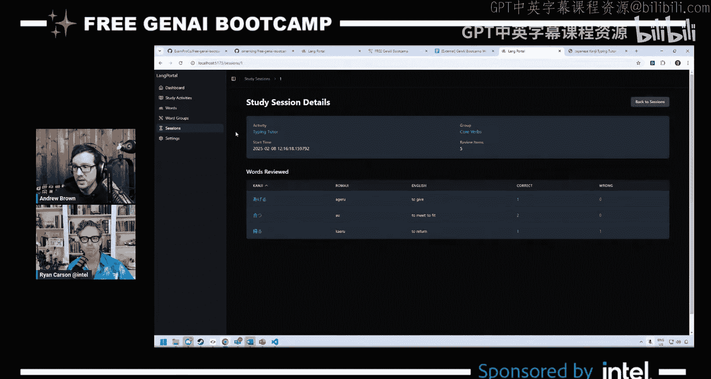

I love that it wrote Rasql and I did not have to use any brain power to get what I wanted。

 all I had to do was review it and it was just super super nice and Ethan is again just nailing all the un1 Suu so that is what the app is now we already have the app built and I'm gonna to be honest with you when I wrote this I really did want everyone to build it themselves from scratch but after you're doing grading for the first week I'm trying to make it a little bit easier for boot campers and so I'm going go all the way down here and I'm just gonna add a homework section here we'll say homework homework challenge。

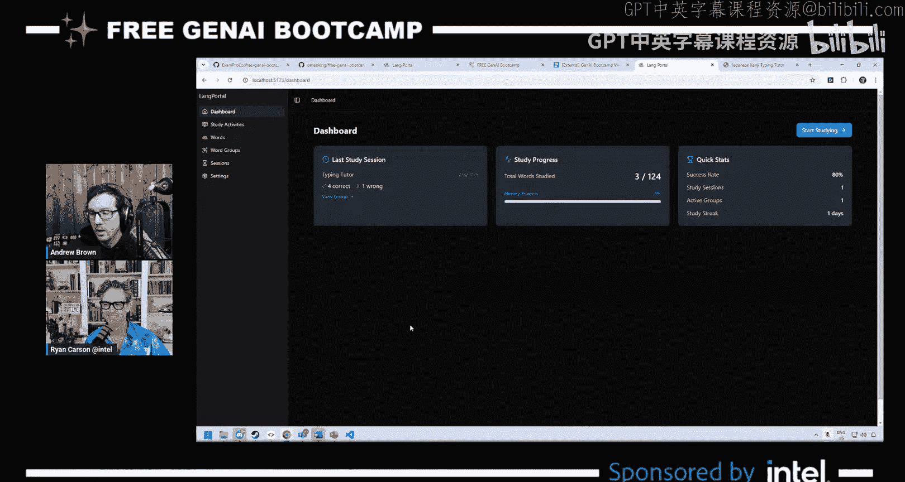

And it's going to be reimple。We'll say。We'll say level one， which would be。Reimplement。

The missing API endpoints。And then let's say level level five， I don't have any levels in between。

 but it would be like， you know， rebuild， rebuild the entire thing， u entire thing from scratch。

 you know， with whatever you want。So it's up to you what you want to do。

 You can take the this route or this or this route。

 But today we're going to be doing like a level 100 in the level 200 implementation here if that makes sense。

 So how do you get set up here。 So what I want folks to do is get set up with some kind of。

AI coding assistant， so I have a bunch installed， but let's say I don't have one installed。

 I'm gonna go get cursor， which is what Ryan is using here today。 We can go to cursor co。

 I'm going download it for my target operating system。

 it's going to go through here and download it once it's downloaded I let's see if I even have it installed。

 I do not have it installed。 So once that's downloaded you launch it up， it looks just like VS code。

 but the key difference is that it starts helping you out quite a bit。

 Now for you Ryan are using the paid version free version。

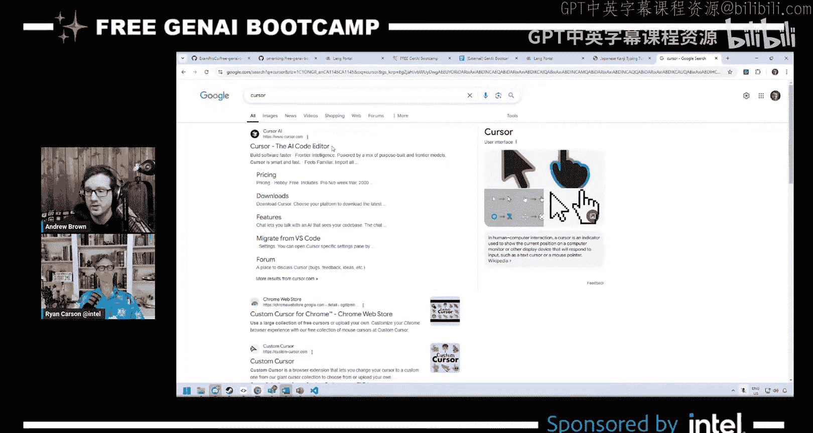

No well I use the pay version for a long time and everybody here can use that just fine eventually you'll probably want to pay the 20 bucks a month because you just get more AI completions。

 but everybody can do this for free today and follow along almost exactly so。And I'm not like。

 I'm not funded by cursor to anybody else。 This is， I'm just a huge fan because it's so good。😊。

And so in terms of like why do you like cursor in particular versus the other providers？

Well I think the proof will be in the pudding i'll show everybody there's just a lot of things about it that are great and easy to do and fun and i'll kind of walk you through the whole thing and it's going to be messy i'm going to be real about the way it works I haven't practiced this I literally looked at the code the first time this morning you also you know I haven't。

😊。

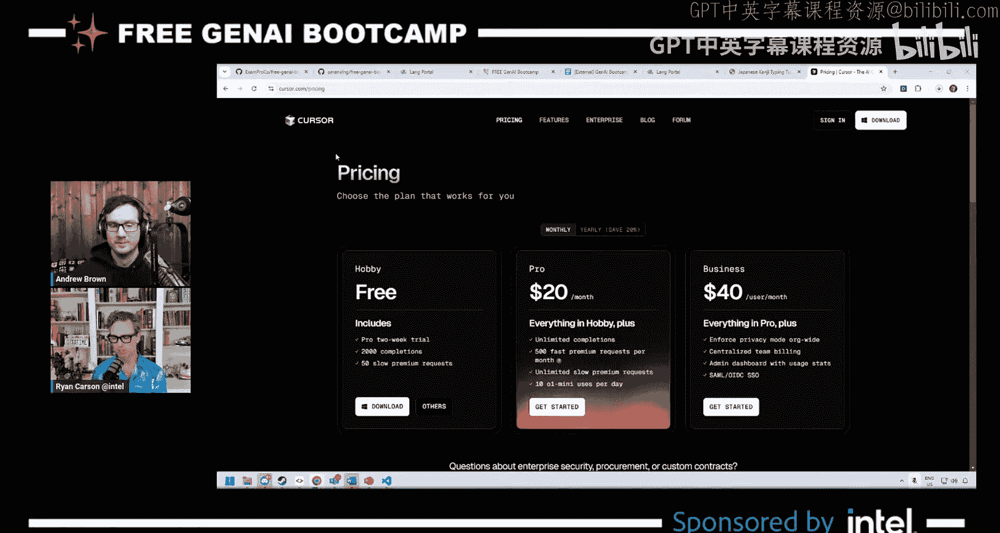

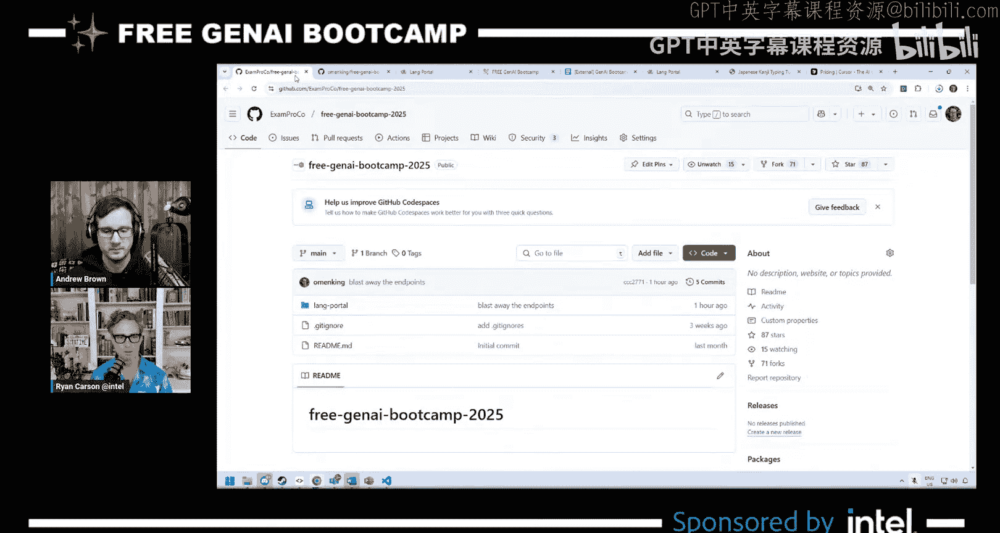

just a perfectly you know formed coding session here， it's going to be really real。

I'm not familiar with continue， but if someone's comparing cursor versus VS code with Copilot so VS code is really。

 really working in Copile like I just noticed as of recent like I didn't install this it was just up here now so it seems like at least for me they really want to be more tightly integrated to be a competitor with cursor I actually I have a course on Gitthub Copit like a very complete course at the time of right now。

 I would say that Github Copilot technically has all the same features but technically having all the features and having a good developer experience is completely different and whereas cursor or Winsurf are really making sure that not only do they have the features but they're really smooth and easy to use but again。

 I'm not trying to not Github Copi they have a very generous free tier so those that can utilize it you can go ahead and do that but you have to understand what your spend is and and what tradeoffs you want to make here So use whatever it is that you want to use to get your。

Through it， but I'm over here on the exam Pro website or sorry the GiHub repo Ex Pro code for Reggen bootc 2025 and I was saying to boot campers that this repo here。

 you aren't supposed to fork it， you aren't supposed to clone it but it does have some code in here and we're going to manually copy it and paste it into our our local repo okay and this morning I actually ripped out some API endpoints and so if you have copied or gone it ahead to yourself。

 you're gonna to have to delete that folder because that one is no longer valid and we're going bring this code on down So there's a few different ways that we can bring it on down。

 probably the easiest ways to go here on the right hand side and download it as a zip and that's what I'm going to do here today we don't need all the code I just really want the backend code。

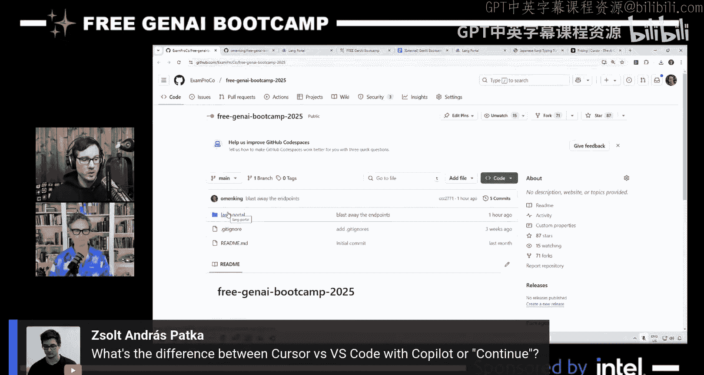

And so I have this folder here off screen I'm going to open up the zip and I'm going to open that up again so here it is right so I have the L portal and so what I want to do。

😊。

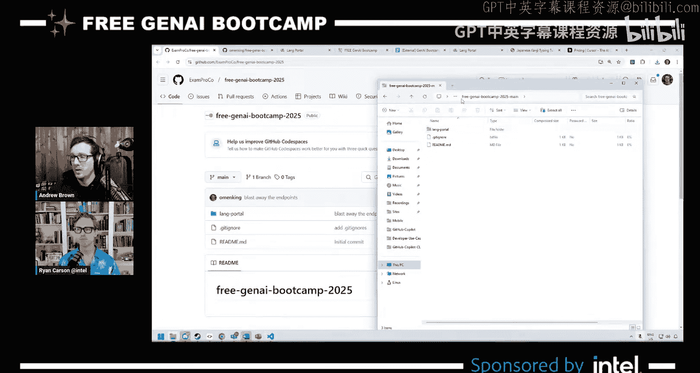

As I want to find my local repo， I'm just going to do in VS code right now。

But it depends on you can store wherever you want， of course。

 but where I like to store my stuff is a folder called sitess and so I have。

 I'm going to stop these other ones here。I have。This is my local one right。

 This is what everyone should have right so if you were trying to match up what I'm doing here。

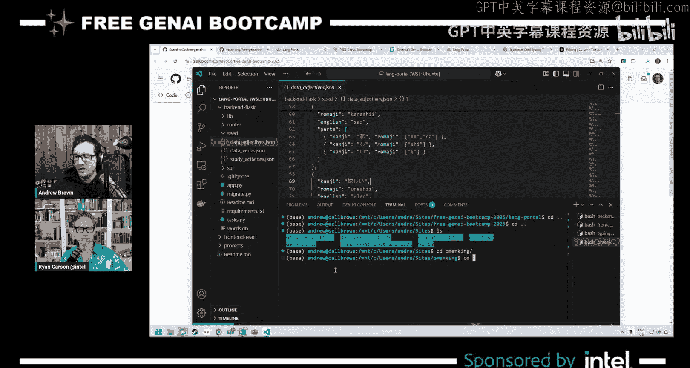

This is my personal one knows it doesn't even have Lng portal in it， right。

 And so I need to get some of the code of Lng portal in here right now。

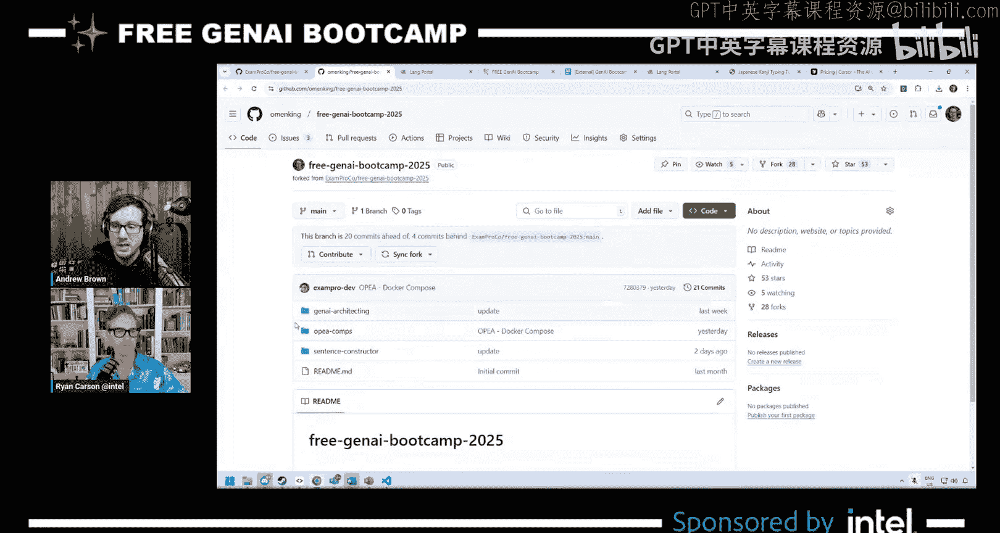

So what we're going to do。

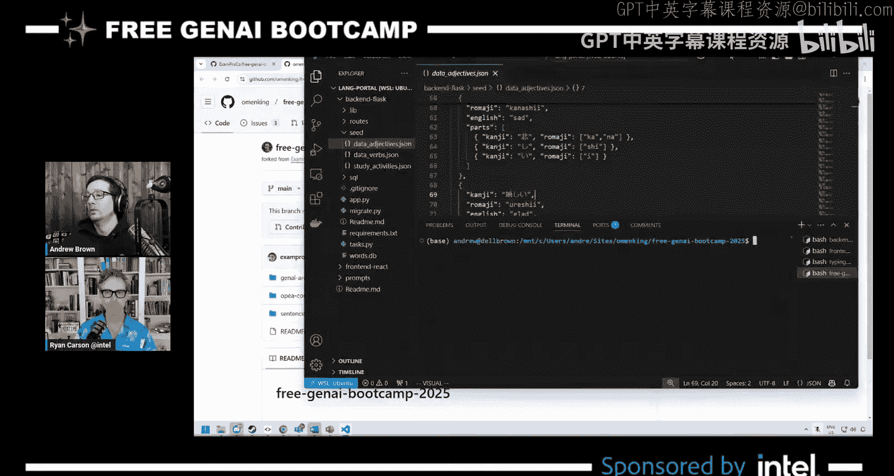

Is this is this repo downloaded here， but I'm gonna open up this folder。 I think it's open period。

 I that how we do it， Nope， but I can manually open I think it's code code period usually but well。

 that will open it up in code editor， but I'm trying to get it to open up in a folder so I can drop it in。

 but on Mac if you do open period it works。 But I think there's another trick we can do you know what。

 you're probably right， let's do code period because if I do code period。

 then I can write this is probably what you're thinking。 You can just right click。

 I can go reveal if I'll Explorer。😊。

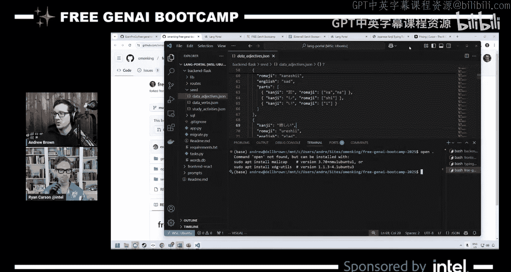

There we go。 And so now I have this folder here。 This is the local repo。

 and then I have this one here with Lng Port。 And I'm going to bring in just the back end。

 So I'm going to make a new folder here。

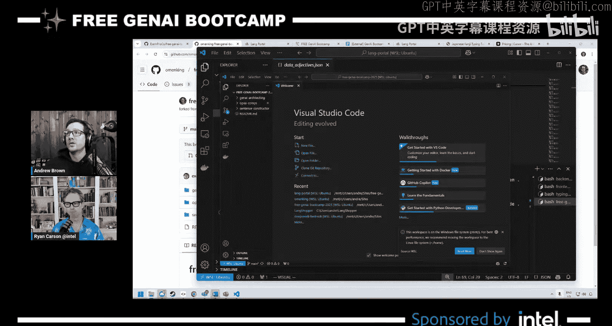

Lang portal。And then all I'm going to do is copy this one over。

Right and the reason I'm doing this this way， like we did download the zip， but you know。

 you don't want to bring in the dock get， the dock gett ignore other things that are conflict with your current repo and we can bring in the front end later。

 but for now all I want is this backend flask and this one has some things that are a little bit implemented there but what I'm going to do just to help some folks out。

Is I'm going to just provide the link here in the chat。

 So I'm going to go ahead and grab this one here， and I'm going to go back to the chat here。

And let's see if people can see it。So that's my repo， oh sorry， that's the wrong link this， this。

 this link here。Okay。So I'm just going to ask， how are people following along does anybody。

 does anybody have this complete， give me a plus one if you were able to download it or a negative one if you are trying to keep up here。

we wait and while we wait we've got a couple questions。

 so Sarah FM code says anyone know how to use cursor with WSL I'll be showing that to you today。

 that's what Andrew is doing it's pretty easy to actually get WSL spun up and installed if you're used to you know Linux Abutu so。

And also I just want to encourage people。You're probably feeling overwhelmed right there's just this is the way learning coding always is right but the beauty is in cursor or course windsurf now you've got this little tutor on the right that you can always ask questions and so I'll show you how to especially use that when you feel like oh my gosh。

 I have no idea what's going on feeling。So for those that are catching up。

 I'm just going to remind the steps again， you should be on the exam Pro code free GenI bootcamp 2025。

 you're going to download the zip。You're going to open up the zip， and then you're going to bring in。

Just the back end Lng portal into here Okay folks and again， you know， if if this is going too fast。

 it's okay because this is recorded and you can have a second watch here to catch up but anyway。

 so now I have。

This down here， and there are some things that I have removed out of this code base and I'm going to pull up our Lucci chart so we can see exactly what it is that I've removed。

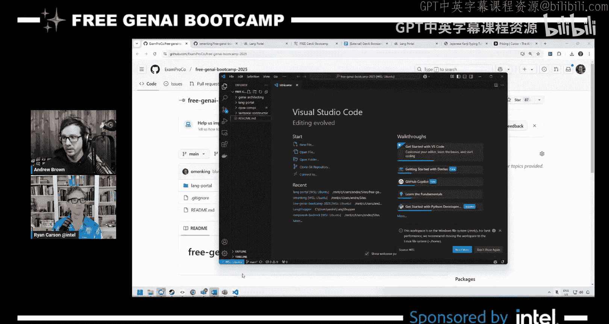

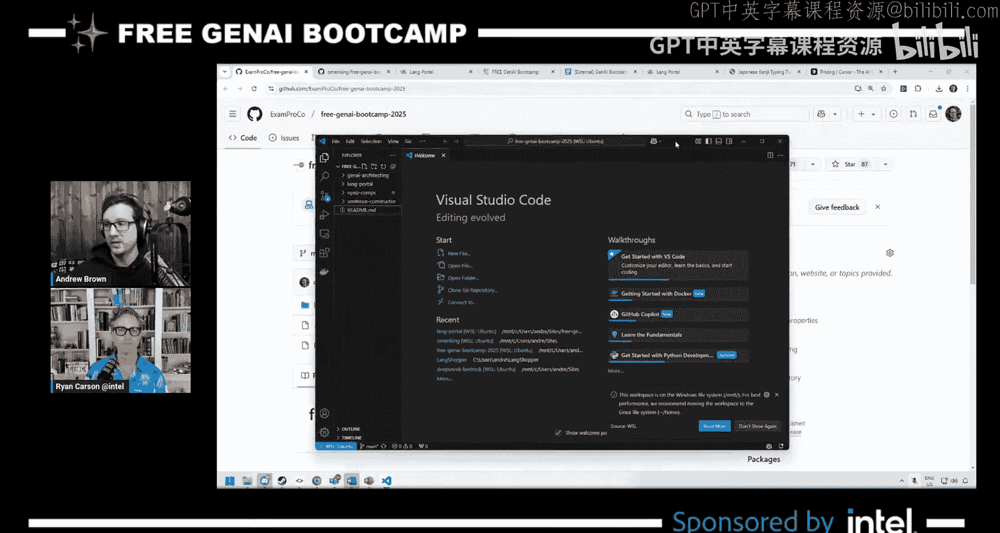

So I'm going to pull this up here。And we'll give it a moment here。

 plus two running the app wall climber。 Some people are just really going ahead there。 that's good。

 And so I believe it's our JP architectural diagraming。😊，And I'm going to go over here。Yeah。

We'll give it a moment here。Or oh， sorry， it's already loaded。 There we go。 It's just where。

 wherever it's centered onto。Did not know。 So the next time I'll drag this over here so I don't have to look for it。

 But if we look at this chart here。The back end has a bunch of these APIs right oh I think I dragged a bit of it away。

 let's go back over here。Oh， we lost。We lost some of our rendering。That's okay， but anyway。

 they're supposed to be here。Our actual backend application here， so I'll just fix that real quick。

Right， and so this is our back end。Right。And then over here we have our front end。

 I'm not sure what happened there folks， if you do have editor access。

 just be careful in the chart there， but for the most part， we are not granting people access。

And if anybody feels like it， you can start a Congo line with cursors in。In the Luccid chart。

 but the idea is that we have this this Python back end here。And if we take a look here。

 these are all the endpoints that are implemented here in the routes folder and there are some very specific key ones that I have removed。

 the ones I have removed is the raw endpoint， the study sessions endpoint and the study sessions review endpoint。

 So this this endpoint here， the raw one it is responsible for providing a payload to the language apps that we're using。

 So this is the language app and it needs to know what vocabulary has to be used in this current session So all this endpoint does is return a very specific JSON structure of raw JSsonN data and that data looks like good question。

 what does it look like。

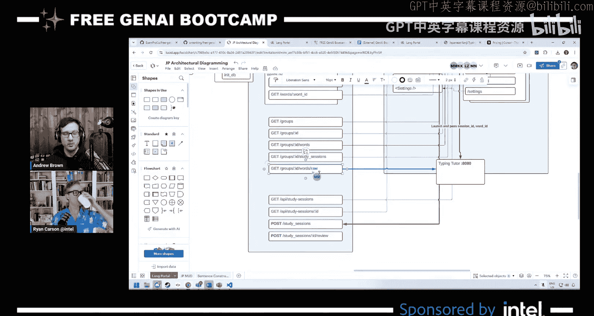

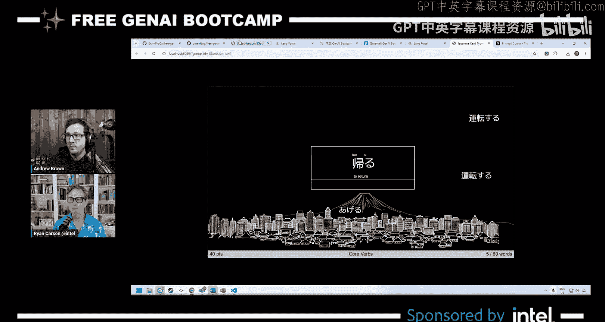

So。I think the way it looks， if we go into our routes here。

The problem is the endpoint is deleted so we can't see it。

But I believe that the endpoint is supposed to be， well。

 here's the thing is that because if we bring in the front end。

 we could probably figure out what it wants。 So maybe what we should do is bring in the current front end that I have and then we can figure out exactly what API or API is expecting。

 Brian， do you think Ksta could do that。I cur can do almost anything so probably let's let's ask it I mean it's one of these things I always just cut into that chat and start talking to Okay so so I'm going make a suggestion here and what we're gonna to do is actually bring in the front end not because we're going to be working in it right now but because we can then reference it in our portal I'm going to go ahead and copy this one as well so now this one is in here as well because the front end knows what it expects and so maybe we can make it work but anyway this is just a list of raw words the other two endpoints we have the study session this will actually create a study session in the database so that it can track the current review words that are happening and then we have this endpoint here which is what the language learning app reports back to to submit whether an answer got right or wrong so it's a little bit of a mess but that's okay and so I think we have a little bit of the lay the land there one other thing I'd like to look at here is if we。

Take a look at our diagram。 Now， this diagram I actually。

I don't know if I told Win Server was I told some kind of Gennyi thing and it produced it produced a mermaid file which allowed me to visualize this。

 and so this will kind of give us an idea of what our structure is。And then Gloria is asking。

 where are the prere fris in the new repo structure， which is what Gloria is asking for？

The pre week or week week zero Gloria， talking are we talking about this week or last week？But yeah。

 if we're looking for prewe content and if it's not clear I'll make sure to oh week zero。

 you'll have to specify exactly what you're looking for。

 but if it's not clear what we can do on the exam Pro platform in week preweek we can make a material and make it very clear where those resources are。

 but anyway， so coming back to our database schema。

The idea is that we have words and the words table is there storing our word data and so obviously I'm focusing on Japanese and in this database I have to store the the Kanji。

 the Ramaji， the English and the parts of the sentences for this game to work and then what we do is we take a bunch of words and we store them in word groups so that we can launch study activities based on those word groups。

Okay， so actually this is a join table here， I can't drag it up。

 but the idea is that we have word groups， which is a join table between groups and words。

Then from over here we have our study activities， this is just a representation of what activity we're utilizing so when we actually launch an activity all it's doing is pointing to an existing app that is running on an endpoint so that's what that URL is storing there。

😡，And then here we have our study sessions so when we actually go and launch the app it creates a study session and that study session belongs to a study activity。

 the thing that we're doing and it has a group ID that it's associated with it and so that's how we're going to know what we're currently focused on then we have word review items this is storing the individual whether you got a word right or wrong so it has a reference to the word the study session whether it was correct or wrong and when that happened so that gives kind of a bit of an overview there any does anyone have any questions about the architecture Ryan how does this look。

I think it's awesome and I think it's super cool that AI produced the mermaid chart。

 I actually use mermaid for flow charts in addition to database schema。对对。I think it again。

 I want everyone to just think about this。You everybody， you now have a PhD level intelligence。

 like begging to help you like you have this person that has their hand up like me， me， me， me。

 and you just anytime you think this seems hard， I'm not sure that's when you should start talking AI。

And actually through this boot campamp was the first time I actually used a mermaid file I didn't even know it existed。

 but I just asked I was like Claude， can you make me a flow turns like here's a mermaid file and I'll render for you I was like this is amazing so it was just like passive learning which I really really enjoyed there but now。

But now that we have I didn't know about Meriddy。So yeah the same experience。

 but now that we have some of the structure understood。

 we're going to mu our way through this and so I'm going to take my screen off here。

 I'm going to bring up Ryan as Ryan is as if what my dad would do is he would take take you if you want to learn to swim he throws you right into the into the lake but I'm going to pull up here Ryan's screen and I'm just going to make this a little bit bigger so I can see what's going on and we are in what looks looks like VSco but we're in cursor right now。

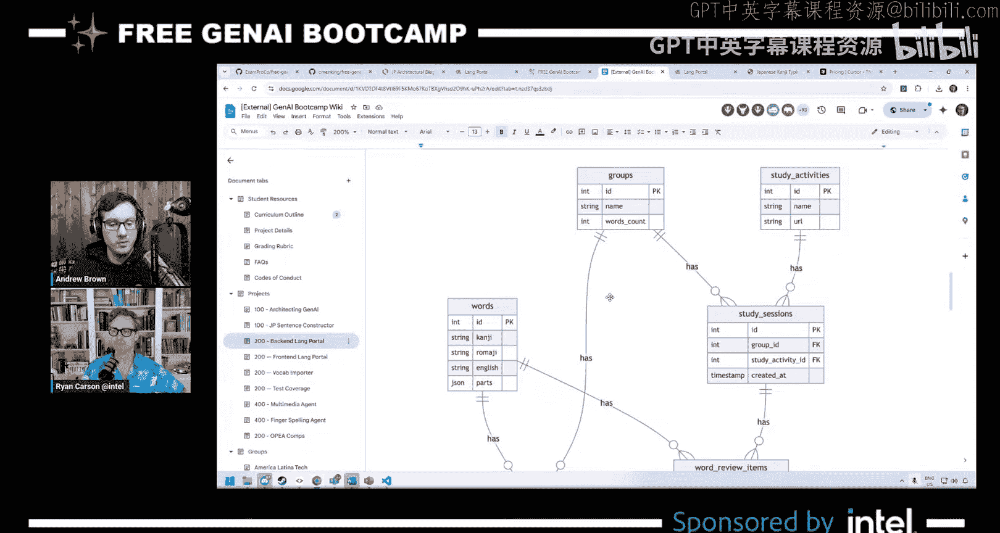

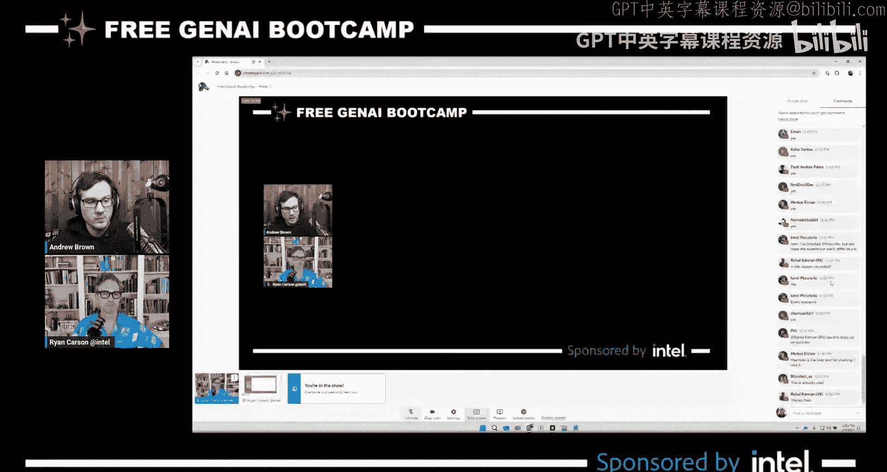

그。그。Yeah。All Ryan， your  Mike。I'm muted， I was talking and I was having a good time and no one could hear that I was saying。

 okay， yeah， we're Ray rock and roll here we are in cursor Should I take it away。😊，Yeah。

 go for it Okay， so the reason why I asked you all in the chat if you had installed cursor yet is because I think you're going to get the most value out of the session by using cursor because I think more than anything。

Today is not going to be about getting a lot of code written。

 it's going to be about how to use the tool to multiply your output by you know 10 to 100 x so I' I'm going show you around how I use the tool。

 how I'm going to use it to figure out what is happening in this code and what I'm supposed to do and the more you all can interact in the comments the better you know tell me if you have questions or if you're confused or if you have opinions that would be great。

Okay， so we had a couple friends in the audience ask about WSL so i'm on a Windows machine obviously here and you can see down here on the left I'm using a botu so i'm actually using WSL too and the way the way I did that was actually。

I went up here and。You know， actually this when he I'm let's do something。

 so I'm going to hit control L。Which brings up on the right。Chat composer bugfinder， right。

 So this is kind of where you're going to interact with AI。

You can think of this as like the chat window right so here on the right now chat is when you want to have a conversation with just one file or a couple files and you don't really want the AI to change anything。

Composer is really an AI so think I'm sorry an agent。

 so this is something that will start changing multiple files for you。And start doing things。

And so let's first， let's just ask a question， actually， you know， how do I。Use WSL。

And I'm going to say VS code， so cursor is a fork a VS code and a fork just means they took VS code and then they grabbed it and they modified it so that's why cursor looks so much like VS code so I'm just going to ask it。

U。And this is a good example， all right， we've basically got instructions here for how to use WSL。

 I could follow through on this and start working on it if I wanted to。

 but again as soon as you don't know how to do something just ask the AI。

The other thing to note here， actually I'm going to go into the settings。Okay， so。In cursor。

 you have a couple settings， the way you do that is you click on the your icon the top right。

Now there's a couple things to note here if you click in models。

These are all the different models you can use right you've got sonnet 3。5。

 which is the one that I tend to use the most， I believe Andrew uses this the most as well a lot of choices here。

I think it was Thursday Google over these Gemini 2。

0 flash this is one of their best and cheapest models， I haven't tried this a whole lot。

 but I hear it's quite good and then we've got various reasoning models down here as well that you can use some of these some of the reasoning models don't work in cursor yet。

So that's how you choose the model。Let me me me ask in the comments， so why doesn't everybody？

Everyone who has used an AI for coding。You know which model is your favorite， do you like cloud 3。

5 sonnet， do you like 40， do you like Gemini 2。01。5。

 throw it in the comments and we'll read out a couple of those favorite models。I'm currently using 3。

5 Okay， so I see Cla 3。5 when I look down， I'm looking in the comments， so IB I'm granted3。Yeah。

 yeah， look at that， a kufe Claude， a lot of cloudude。At of cloud 40。01。Allright， good， got a lot。

 lot of， lot of opinions。 I love it。 haven't used it yet。 Okay， today is going to be your day。 Okay。

 so let's keep going。 There's a couple other things about cursor I want to show you。

 which are super cool。😊，This is kind of detailed， we're not going to worry too much about that。

All right。I'm going to show you one other。Thing that's super helpful。 Okay， now when you're using。

 you know， windsurf or V S code with Co pilot or using cursor， you have to。

Sort of imagine that you're working with a junior developer， right， someone who。

Doesn't know exactly what you want。 And you got to be really specific。

 So one of the first things you're going want to do is create a what's called a cursor rule。

So let's go into back into our settings。And under general。We're going to go down the project rules。

So it says project specific rules that help the AI understand your code base and follow your project's conventions。

 they can be automatically included or fetched by an agent， these are synced with your code base。

You know， what we're doing is we're working with flask， right， So we're going to add a rule。

And I'm going to call it flask。That can be lowercase。Okay。

So what I've done now is we've got a rule it says description so what I want the AI to do is just make sure that it's using proper flask code。

Let's see， you know， before I do that， I'm actually going to go into， let's open back composer。

And I'm going to say。With my code base， So if I tag my entire code base。

 this is like one of these really cool things。I'm going to say， look at my entire code base。

 tell me what core technologies。Are being used in this repo。As I don't really know， right？

So it's going to look through the repo。And it's going to tell me in a second what's being used。

 All right， so we've got。On the back end， we've got a flash PI。We're using SQL light3， okay。

 last core is interesting。And we've got a front end of react app project structure。Okay。

 now given the fact that today Andrew has asked us to work on the back end。

 I'm going to focus on this and I'm going to say okay。我。Are three important。

Rules that a junior devb should follow when using a。12th SQL light， was it SQL L 3？

Is there two Ls in the SQ light I'm not sure， but yeah， there's a three on the end。

 but I think three is the default these days for many years。Okay， all right。

 so what I'm doing here is I want to create a basic rule for the AI to follow so that when whenever it。

Tries to write code that's going to interact with our database that it does it correctly right because you have to remember the AI can't read your mind。

 It doesn't know exactly what you want to do。 It doesn't know what your coding standards are。

 So what I'm going to do is I'm going say。Create a file with those rules。그。

I'll create a markdown file， Okay， cool。interestinging， so this is a good little bug。

 sometimes when it outputs marked down， it， it looks like gobbledy go。

This is a good little gotcha that happens sometimes。

 So Ryan right now with the rules are like you're creating a rule then you're testing whether the rule is doing what you want。

What I'm trying to do is。Is I don't actually know what the good rules should be for SQL light three instance right you know。

 I haven't really used it very much， I don't know a lot about it so it's like well let's just have the AI write the rule that we want to create for SQL light three。

Now。This didn't really work， right， So let's say。喂。Three simple rules。Or a junior dev。To follow。

When you's just saying flask So Marcus what you're seeing right now is that Ryan is trying to generate out to create a rule and cursor on the left hand side you'll see period cursor。

 which is a hidden folder with with another folder within it called rules And I believe what we're doing is we're prepping that flask MDc file So once we figure out a good rule like a rule prompt document or whatever we call it here we're going bring it in here and' see how it performs is that is that a correct description Ryan That's exactly correct So so what I've done Andrew called out。

 So over here you have a cursor cursor folder， you have a rule subfold and then you have a flask MDc file。

 Now this is just gonna make our life a lot easier if we do this right so I'm going switch So composer is an agent and it's trying to write code I'm gonna switch it back to chat。

And let's try to， let's see if this works a little better。 So add3。

Rules for a junior dev to follow whenever using flask。And it should。There we go。

This is hard of doing this y'all I mean this would' have worked perfectly if I was showing you the the perfect scenario。

 but this is most of what we all do every day is is hack around and try to make things work so what it's done is it's create I'm going to go and click copy。

I could click apply， but I think it's Ba you're letting all the heat up。Sorry， sorry， sorry。

 I got there's an no of Bacos putting more wood in my wood stove and I was like put some put some wood in my wood stove so I don't get too cool he's like okay the doors wide open I'm just like getting to zero and I got my granny blanket coming up。

And lives in very apologize sorry no problem and I was like wildly sick this week y'all so if I cough that's what's going on okay so I'm gonna recap what am I doing like because this is a little bit down a rabbit hole but this is important so whenever you're using cursor or a tailwinds or sorry windsurf or or a copi you really have to tell the AI how to code otherwise it's going to do some wild things so what we're doing is we're creating one simple rule to show you how to create rules for the AI and since we're using flask we're going make a rule for flask so I opened up the chat window over here and I said okay what are three rules for a junior dev to follow and it wrote this code for me right。

It's interesting so I'm going to click apply and it's going it's interesting I thought it was good it should apply it to app PI。

 which is not what we want we want it to apply to this file。Which it tried to do。 and it didn't work。

 So we're just going to copy it and we're going to paste it。Okay。

So now that probably seemed like a lot of work， which it was。

 but let's go up here description now the description the agent will choose the rule to use based off of this description。

 so I'm going to say something like。U。Rules for flask code。And I'm going to say， now。

 which files do I want this to use on？U。You know， I don't know， so I'm going to ask。Trying to think。

 well where would those flask rules be probably in this probably I want the AI to only use them when we're in our backend flask folder right because we have a front end react app I don't want it to be using flask rules then so I could put this right I just want it to be used in the back end。

Lastask directory。That probably makes the most sense。Okay， so I'm going to click save on this。

 I'm also going to do just to show you。How this works， I'm going to say。Always say。

I Gen AI boot camp。Before you start Ryan， do you remember a cursor had an extension or is it because I only know it as it as a downloadable like its own forked ID right it did it started it started off as a I think as an extension but I've never used it as that so。

For those so sorry for those that are listening， the windsurf is its own ID as well。

 but originally it actually has a plugin called codedium so that is a way。

 but I'm finding with these tools the best way to utilize their full functionality is getting the the forked VS code and like like Ryan you'd never go back to VS code now would you？

Never。No， I would not。All right everybody， so what I've shown you is just a quick little side quest on cursor rules and how。

They work， I was trying to see if I could get it to always do。All right， we'll say rule zero。

She says kind of。그。Okay， I'm going to save that， let's see if we can use it to get it to apply。嗯。

Backend flask， star。Okay， so that's saved so what I'm trying to do is show you this is how you create a rule and that should make the the AI smarter so let's give this a try I'm going pick any file here。

 migrate and then let's ask a quick question how does this file work。Oh， all right。 it's not。

 it's not picking up my rule for some reason。 So I have to dig into that， figure out why。No big deal。

 But trust me， long term， these rules are important。

 I'm not sure why it's not listening to my rule numbers well Ryan， if you could。

 could you just up the font a bit with the the control plus one or plus one or I always forget which one it is。

 Oh yeah， it's good。 So I guess my thoughts It's like， how many。

 could you write as many rules as you want。 And then it will try to pick up Its best best use case。

Yes， exactly so the idea is you create as you know， you could create a rule for flask。

 you create a rule for Typescript， you could create a rule for python SqL light three because the the。

So you have to remember just like a quick step back， like how does a large language model work well？

You put a bunch of text in as as context and it starts predicting tokens right and so these rules are being loaded into the context window for every single query and so you want them to be as short as possible and you want them to be as relevant as possible right you don't want stuff about you know you know you don't want information in your context that shouldn't be there so that is the purpose of a rule but we're going down a rabbit hole I think so we're going kind of pull out。

And continue if that sounds good folks are asking like how do I do this in Winsurf the approach that Winsurf takes is completely different。

 Their idea is that it's just you just type stuff and it works so it really depends on like what you want your workflow to be for me I'm more of a just let's get it working but I could see how cursor like if you are working on a really big project and you just want to have it to work a very particular way I could see writing a bunch of rules being very useful。

 there's another product out there called tab9 which these are all coding systems but their approach is more like they'll reference a large knowledge base of your code and try to best again just work it but you're referencing it so three different tools three different approach you have to figure out what works best for you but if you're really good at writing your subtask and you' sorry your subpro documents to route where you want you could see how cursor could be very powerful in that regard if that's just one of its features that。

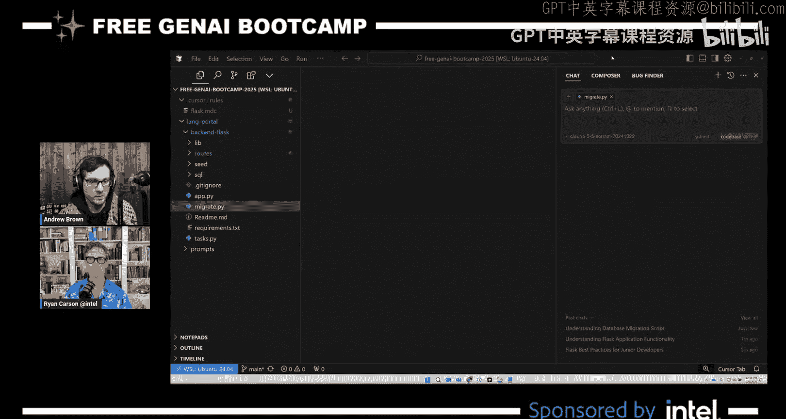

That's Ryan showing us。Okay， so the I'm trying to figure out if I want show you anything else about cursor before we sort of dig into the product requirement that we're trying to change we obviously I've shown you chat window composer window let me go back to full screen real quick。

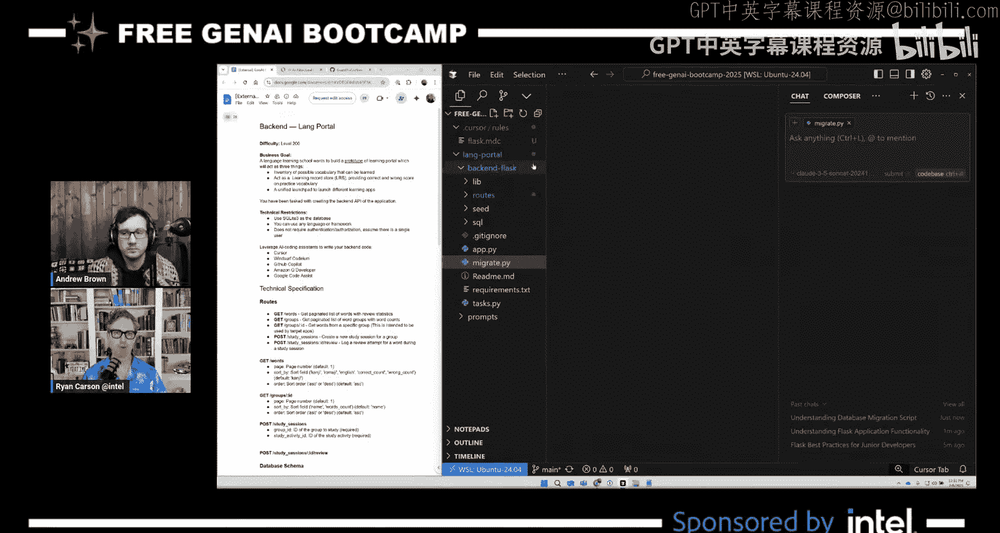

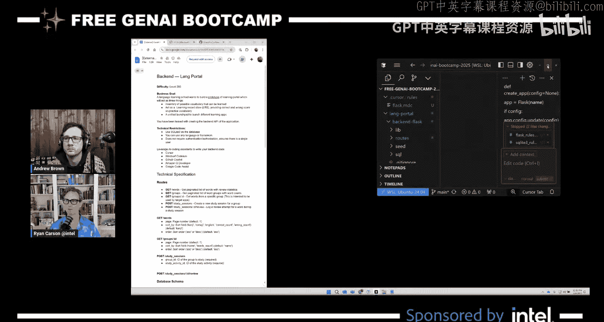

D do just like VS code， you have your standard terminal window。Down here now， oh。

 this is something really cool。 So say you have a question about the terminal right。

 So what you do is you hit control K。

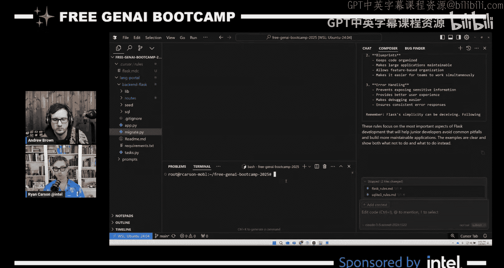

And then you'll notice that you can start to ask questions down here， so I might say like， you know。

 how do I create。

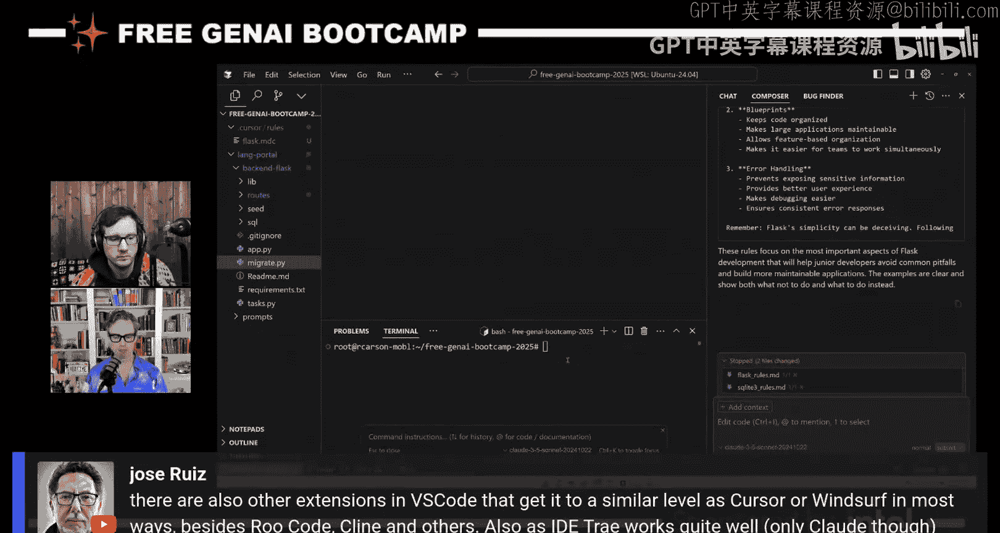

Aves。You know，Maybe you forgot how to do that。So oh sorry。

 so Ryan people people already want your rules file and I just thought of a new a small side hustle that you could sell。

 you could sell your you could sell。Yeah， absolutely good。

 So as kind of a fun side quest if if I know some of you said you feel 11， you are a two。

 you are feeling like you're crushing it。 why don't you spend a little bit of time while we're doing this today write a couple cursor rule files and then share it with us I would love to actually give them a try and then throw them in live So if you do that。

 I bet Andrew will give you like extra bonus points or something or maybe it will help you get into the red squad faster。

 So little side quest。 All right so this control K is somebody use all the time so let me just recap what happened here。

 So if you have any questions about the terminal you just hit control K and you ask anything like I said。

 how to create how to create a or what's know actually I even do something simple like start。ADB。😔。

I don't not see。Yeah it's going to try some stuff I mean you'll never have to look up any terminal command ever again and so I use that all the time you can also under composer you could also go also say things like you know how do I create a them。

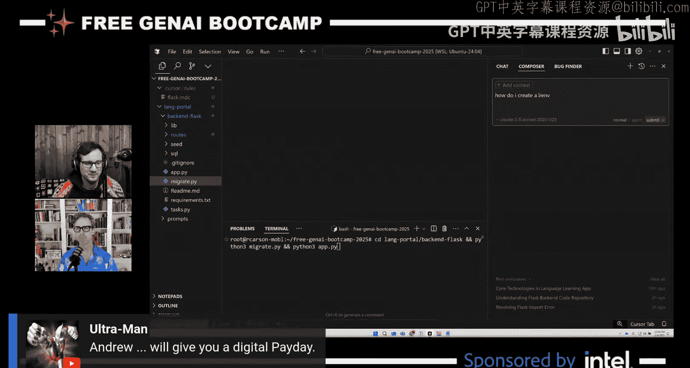

嗯。And it's going to pump out some stuff。And then you can actually run this， so see it says run。

 and so this would actually run this code if you wanted， you click run and it will run the terminal。

 so this is why you just have to code with AI now it's so much faster。

RightWhere you just don't have to remember all this stuff。

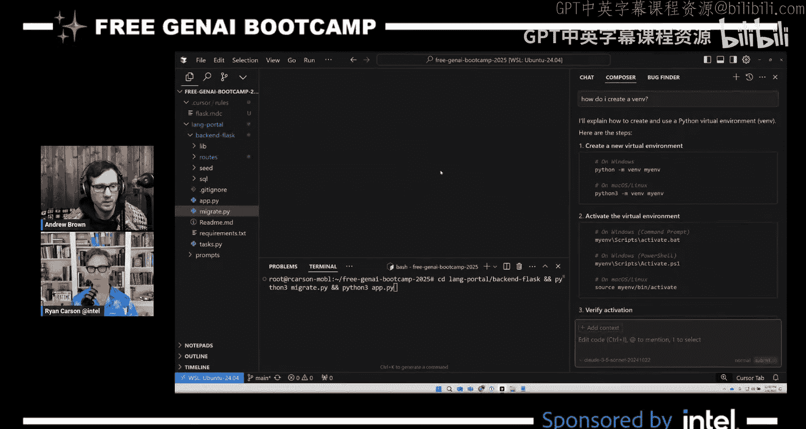

All right， I think we're ready to look in the product spec， Andrew， what do you think Sure。

 I just want to answer this one question here So Ramsey is asking is there a prompt structure we should be following like Costar or something Costar for those that don't know that's a type of structure that we talked about the Jen essentials there's so many ways of doing prompt document out here if you know Ryan was actually asking it how should I make my prompt document So often you can just ask it saying like hey what kind of structure I think that's what we did earlier but what kind of structure might look good as a prompt document that's a tip that Duan had given me he's a guest instructor I think next week for our main live stream there but you know there are some some really serious deep thinking about how to make prompt document and then there's just right whatever you want if it works the works kind of thing what's your approach Ryan whatever works works or you do you a lot of research in and。

On that part， no， so I use so for the Mac， there's a tool called repo prompt。

 that's very good if you're on a Mac， so I have a hair in my mouth。Now what it does。

 I can't show you because I'm not using my Mac right now， but。Now， okay。

 so let me let me show you a little little thing that I think is quite helpful。

 so I'm going to go over to。

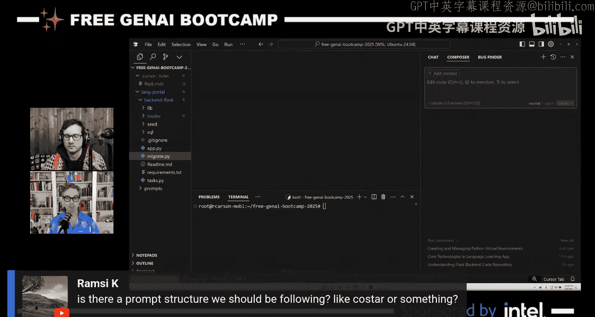

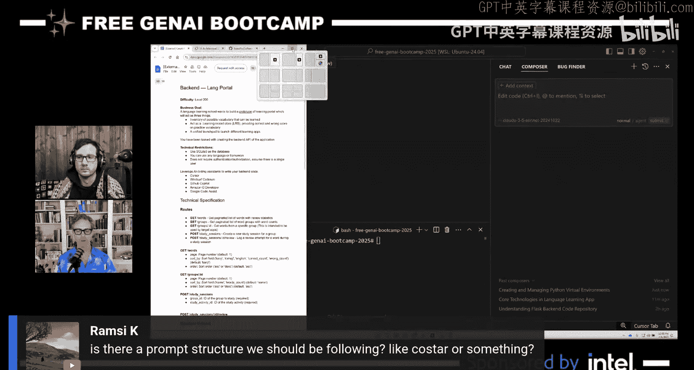

All right， so I use。嗯。Chat GT a lot right now， what do I use this for。

So I'm actually going to show you sometimes what I do before I go into cursor。

 so let's go to I'm going to make this larger。All right， so this is Andrew's specification， right。

 so I'm going to copy this。And I'm going to take it over here。

 now I've decided to pay for01 pro it's 200 bucks a month。 Most people don't do that。

 so i'm not going to show you01 pro， but I think。Pretty soon。

 I think 03 mini high or03 mini is going to be available for free。

 So let's go to03 mini high as a reasoning model right and and here's when when youre when I'm pasting code。

 I do use XML， so I might say spec。

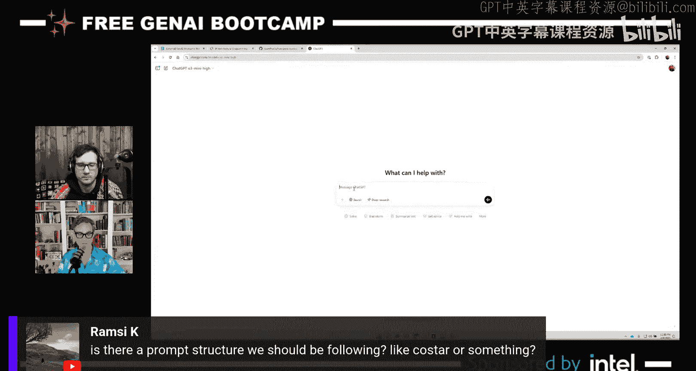

Start。I'm going to paste it in。And obviously Intel is saying。

 be careful you're not sharing our secrets with everybody。And then I'm going to say spec end。Now。

 this is just a way to make sure。That the AI understands better when this is like what things are。

 and then I'm going to say， can you please give me a step by step plan for a junior dev。

To follow to implement。The following。So Andrew， what should we be telling it to do here？

So I guess the first thing is that well， we have multiple endpoints that we need to implement and one of the endpoints that we need to implement is。

The creating a new study session。Okay， creating a new study session。Right？嗯。😊，Okay， so。

Let's let this crank away。嗯。You to you have to bump up the font like thats any juice。DoOkay。

There we go。So here we have post study session that was good group group ID and study activity was getting it right。

Didn't think they。Okay， reasons for six seconds。And then we have basically some sort of a requirements do。

 endpoint， request payload， database action and certain new record， how does this look to you？😊。

That looks good so far like at the top level it looks like I talked about Ruby there for a second we go up there did it talk about Sinatra I was just saying like what you could use right so now now it's being very generic in terms of its implementation but the most important stuff at the top was that endpoint so I know that I made some comments where we could implement it so if we go back over to a cursor maybe I could provide a little bit of guidance of this stuff。

 but normally like for these technical docs I'm not sure how well I wrote in detail。

 but often before I even start coding anything I will literally think about every single API endpoint I want and I will write it out and I remember doing this for I know I did in the boot camp I'm just trying to remember if I did it in this project or another one but anyway that's okay so let's go over to the routes directory。

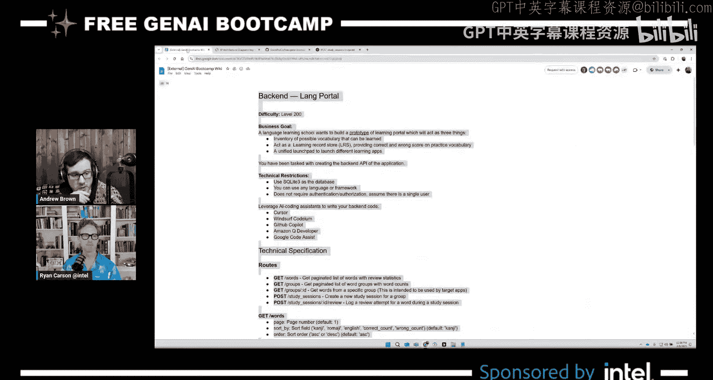

Sure， and we're actually， how about this， can cursor tell us if it can find the to dos that I marked in in the code base to see where we can start coding？

I assume so let's see so and so composer is one it's an actual agent so will it actually try to make changes or is it more just a conversation I have a trick i'll show you so are there any to use。

And the the routes， actually， I'll just include the whole code base。Cause okay。

 so I'll say are there。Any to dos and。The routes， right， it's called routes。Yep， there it is。

Fileles don't change any code。That's the key。Let's see and so would you say that the agent is more intelligent than chat so that's why you like to go on the agent side for a commission or because same leads you into your activities of what you might change sorry yeah same exact intelligence it's just that sometimes I want to start doing things and that's。

Probably one of the biggest lessons that I want you to walk away from here。

 like if you're going to use AI。You have to think of it as a junior dev like you cannot just say。

 hey， add this endpoint。Because it's going it's going to start changing code it's going to do the best it can what you always want to do first to say make a plan and then you save that plan as a markdown file and then you tell the AI to look at that markdown file and start executing step by step so we're actually going to do this right so yes I found three to dos in the routes files one in groups one study sessions great well let's actually let's check this out。

One other question I have is you have composer in chat， if you were to switch over to chat。

 would it carry that same conversation or are those things completely isolate？

They share memory somehow， let's actually check。Let's try it，So for those that are watching。

 if you're using Winsurf， if you if you go between Cascade。

 like sorry Cascade is the way that you use it， but if it's right in chat。

 you can switch at any time and it willll continue on for where it is all you're doing when you're using Winsurf is saying whether it's going to manipulate the document or you're just going to chat with it which was really interesting。

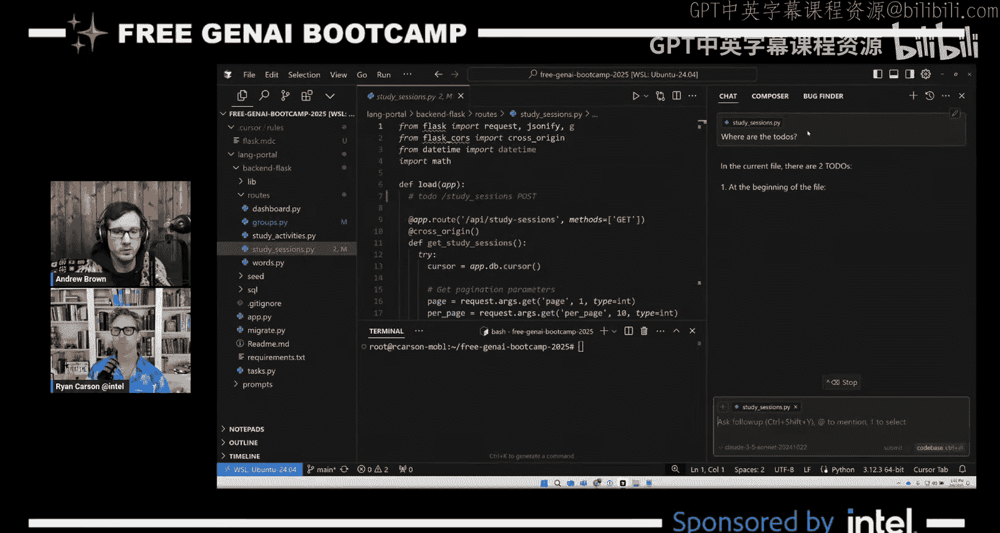

But sometimes you might want to have conversations in isolate， so again。

 it's pros and cons depending on what you like as your workflow。

That's a good point it's usually I will use composer most of the time but when I want to have a very specific isolated conversation about a piece of code's I use chat it's almost like if I want fine grained control over what the AI does I I use chat if I want to more you know step back and really manage the AI as a junior developer and let it code and then stop it and start it and give it feedback I use composer。

So there's that in terms of all the endpoints we could probably implement。

 I think that it probably would be able to figure out study sessions post because we have the database。

 like the other ones like the words raw we need to know what we want as our output to the front end app which this thing might not know of because unless we have it in our documentation or we have the frontend app code it's not going to know。

 but should I delete code。No because that one's that's a get one right so the one that we're focusing on is study sessions post to create one so for the study sessions post I have a feeling that because we have the the schema。

 which is written in our SQl files and we have。I think it should be able to figure that out。

 so maybe what we should try to figure out is can we ask it to implement the second endpoint and see what it can come up with。

Let's do it So first of all though there's obviously a couple li errors right it's like oh why is this underlined and usually what I do is just say。

 okay， fix it in composer So let's just see we can fix those I always see them in Python I just go I don't know what to do about those and I just have to like turn my brain off on those squigggles is like this and what's insane is is in composer it actually auto fixes L errors as it's editing It's just so cool right So you probably saw that I mouseed over this and said fixing composer It says for the code present we get this error in port flask can I resolve how can I resolve this you need to install flask。

Obviously， but you know， maybe that's not obvious right so now。😊，This is going to be interesting。

 so I'm actually going to click run。And it's going to say， oh， you can't do that， Brian。And now this。

This is something that's specific this machine。 I'm on my Intel machine and it's like whoa。

 you can't just install stuff here so。I might， I do know how to fix this， I could say， you know。

 I'm not control K， like how do I get around this error。

I know how to get around and I'll show you in a second， but oh。

 that's pretty cool it' saying let's do ave。Let's try it。 So I'm gonna hit control enter。Yes。

 I do wanna do AI。 so cool。Look about。So I so I actually knew the right answer was I had to create a V。

 but it knew it it just blows my mind Okay， so what it did there。

 it figured out it piped together a bunch of commands all right。It created a vm。And it activated it。

 And then it did Pip install， which is exactly what it what I knew it needed to do。

 So sorry sometimes just say I delight me。 Okay， and now， what， what do you know。

 Our li errors are gone。 Okay， let's get back to work。All right， so now we need to do this now。

There's there's a couple ways we can do this， so you have to think about。

What level of intelligence do you need to create a plan to tackle this， right？

And so if you have a highly complex feature that you're trying to implement。

 you probably want to use a reasoning model to create the plan if it's pretty straightforward like this might be straightforward enough that we don't need a reasoning model like a cloud 3。

5。Then we may not， so let's let's try this， so here's ourmaou。I'm going to going to chat。

 create a new chat。And I'm going to ask it to create a plan。Can you please create a plan？😔。

Or a junior dadb。To follow。To implement。呃。We the study sessions post route。嗯。Let's see。

 create a markdown file for the plan。Add check boxes。For each step。Keep steps atomic。And simple。

Add testing。Code， if you can。Okay。Let's see what happens， y'all。Oh， see， this is frustrating。

And this doesn't happen on。This this doesn't really happen very much on on when I'm doing this on my Mac。

 So I don't know if this is specific。Problem with the Windows version of cursor。

 but you can see this is markeddown， but it's getting sort of gobbly goed。In yeah。

 so you get some of the markdown but not all of it so we're going to have to figure out a different way around this here's what i'm going to do。

Let's。I am going to go back over to treat treat your junior depth good。All right， so let's go。😊，Okay。

 so let's go back to chatt EBT， let's use03 minii high and what I'm going to do is copy and paste this code。

And I'm going to cheat a little bit by just using three backtics that's kind of the same as using XML。

To start， and then I'm going to go to the bottom of the file。Didnt that copy correctly？You did yep。

Alright， and then I'm going to put three tick， I'm sorry， three back ticks at the end。 Okay。

 so I basically copied in this file。And then I'm going to say I'm going to go back over here。

 grab my prompts。All right I'm going to do a quick check in with the comments。

 if you're tracking with me， you don't feel super lost， give me a one。If you're like。

 what the hell's happening， give me a zero。So I going to do a vibe check。See how everybody's doing。

咩咩嗯。Ones are coming in ones ones a 0。5， hey， there we go， okay。Go a couple zeros， you know。

 hang in there if you're on the zero side。The biggest thing if you're feeling zero。

 get cursor and just start talking to chat。Start talking it to composer and just。Try to。

 try to get to that  point5 super loss， but great content。 sorry， Rick， we're trying。And folks。

 we just remember that no matter what we do here， I'll be shooting videos afterwards that are more prescriptive and straight at the point。

 what we're trying to do is extract Ryan's knowledge on his workflows so that we can discover new stuff like the rules which I never even knew about。

 but sorry。Okay， so let's go back so we have our plan it thought about it for five seconds and here's our markdown plan plan for implementing the API study post route this plan outline step by step instructions for creating a new study session via post so this is what you might tell a junior developer to do so we're going to do is go back to to cursor I'm going to create a new folder here。

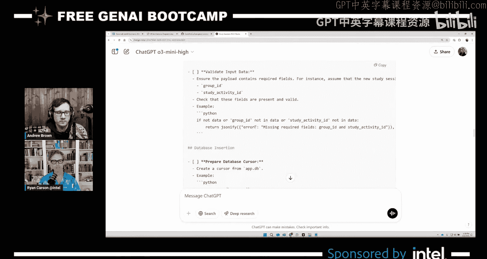

Called plans。And I'm gonna create a new file。Clled。我 call this。Study sessions。MD I'm no paste to it。

Okay。By following these steps， okay。All right。This is how we're going to actually get the code written now I could have just jumped straight in and said do it right but what you'll find if you code with AI is that that will tend to be frustrating because you'll probably go down a lot of。

Loops， you'll probably end up changing code that doesn't quite right there's a lot of things that't go wrong whereas this is just going to be a better way forward it。

 So let's start fresh here Al right， we're going to open up our study session sorry our study sessions MD file。

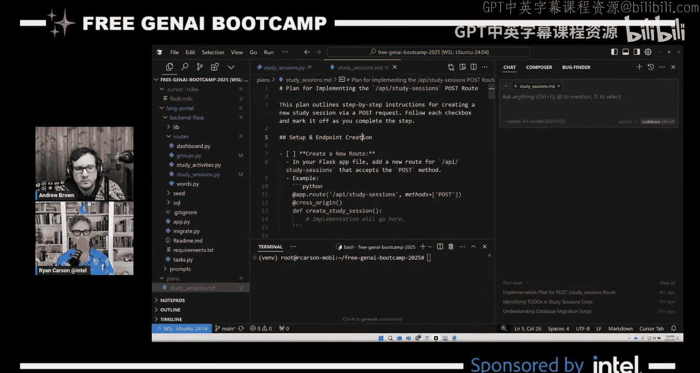

And I'm going to go over to composer。Create a new composer。

 and this is where we're actually going to start implementing some code。 All right。

 so i'm going to add I'm going to say the file that we want to edit is。Actually， I going to say。

 please start implementing。Implementing this。Only do step one。Work on this file， it is study session。

 stop PY。Okay。So we've got our plan。It's interesting it didn't create numbers on them， but。

I'll say only do the first step。Okay。Let's do it。Yeah。Okay， so let's go back over to our file。Yeah。

All right， we got real code let's。Let we get rid of our。Yeah。嗯。All right。

 so it's deleted our comment。It's added in For s API， study dash sessions， post， cross origin。

 create study session。It's going to get Json。Let me wrapped a code for a I'm sorry。

I just hit it control Z。OkaySo I think Cedric was saying like so it has since you jump back and forth between cursor and chatTT for revising your code I mean。

 I think it's just use whatever you want kind of thing like I think as you're working through the flow you will find that sometimes you get I found this one I used to use GitHub Copit but I would I didn't like its output I would just go directly to Cla for some things or Id go to v0 for some things and I'm not sure like Ryan do you think too hard like not too hard but like how hard do you think about when to deviate from cursor to other tools or or you just just naturally you just flow to other I mean so you saw the reason why I ended up going over to chat GT is because I was getting weird markdown output from cursor so normally I do most everything in cursor。

Occasionally if I want a really detailed plan， I'll actually use01 pro and have it create a really detailed implementation plan then I'll copy that into a markdown file like could just showed you a plan markdown file and then I'll have composer execute that plan so that's most of the time when I do。

 I think what you all need to realize is that this is like the messy process of working with an AI you just always have this super helpful PhD student all the time to help you you just have to learn how to work with it。

So let's look at the code it wrote。So if not data or group ID， not in data。Study activity ID。

 not in data。Okay。Let's accept it。Now。Now we need to continue。 So we've got ton of steps。

 I'm gonna say， you know， check off。Off a step and continue。continuetin。So。Yep。

 it's going to check off that step。And now it's going to continue to extract Jason payload。

 so let's see what's doing over here。Sorry， y'all。Okay。So I'm like looking over this now， you know。

 it looks sort of correct to me， honestly I don't really know。

That looks reasonable Well let me take a look here So if well first of all。

 the return looks good it's giving the group and study activity ID so that looks correct if we go up a little bit more to the start of the function and the reason because I'm just so familiar with what it did before but anyway so we have our study sessions post that's good it's getting the JON that's fine validate required field so if not data group I then throw an error because if it doesn't have a group I wouldn't be able to do it so that's some good error handling that's good the cursor part that looks normal that's how you interact with S quo light 3 again not an expert Python but because I got this working hand to remember what I'm looking at writing Rosql that's what I would like it to do app Db commit that looks fine get the last session I I don't think it would be an issue there so yeah that looks at least at a glance it looks perfect to me but cool I think that's the issue is that just because it looks good there's another layer to testing that。

Yeah， yeah， which I'm also realizing I'm not sure if it has been。

I'm not sure how aware of it is the of the schema， right， so I'm curious。Because in our。

I guess my question is on the right hand side， when you're talking to。

 it does it tell you it's reasoning， Like， do you have like little boxes。

 You can open the right hand side being like， oh， I looked at this。 I looked at that。 Does it。

 Does it say that in there。No， okay， for those that are watching again， again， different tools。

 different things， but in Winsurf， I believe I think it provides reasoning like， oh。

 I'm looking at this file and so I looked at the schema and therefore I did this and that just again。

 a comparison different of different tools， sorry。Yeah， it was inching， it is inching。

So cursor is an SQl light。Function because it's funny that's called cursor。I don't know。

 don't think it's esQ light well it is a it is a function by that library。

 but I don't if sure it's a generic library not like if we go to our all the way to the top there to the we could also just ask as well。

 if we go all the way to the top there。It is coming in from， oh。

 it's actually even from the apps is app。db。cursor。Oh， interesting。 Okay， so I app is part of flask。

So when we installed our requirements， this is SsQL light three right there's no like flashask hyphen esQL light3 can we check our requirements I T exam is really curious。

Um， if there's like an intermediate library。No， so I guess it's just built in to Python here's the question。

 Can we ask cursor what's going cursor his agent what's going on here。That's do。Sure， sorry what is。

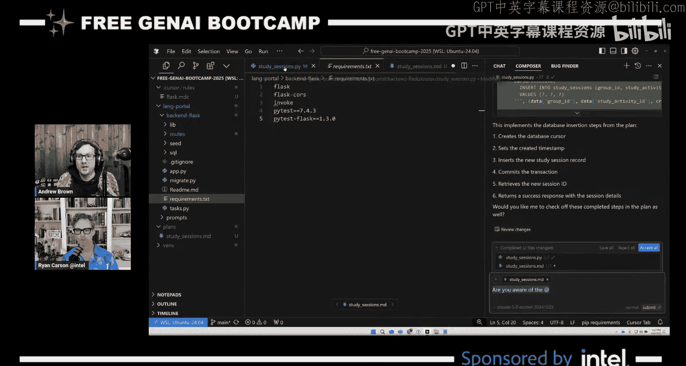

What is cursor。How does it work with the DB。Let me explain， I love that。

A cursor is like a pointer connection versus cursor the app dot DB is or database connection。

 and maintains the actual connection， a cursor is created from this connection to execute queries and batch results。

Okay。😊，Sosor cursor is a very specific Yeah， cursor is a very specific term when we're talking about SQL to like move where you are within I think within the terms of your connection so it's something that appears at a lower level。

 but I'm just surprised that it's showing it there so again the question is like is this someone saying like maybe there's a database builder or what's it's not an OM but a query builder so。

Anyway， I'm not sure， but there's clearly some kind of adapter there in Flask， but again。

 not an expert in flask。And I don't think Ryan is an expert ask either。

 So I mean it's like I used to write gosh I used to write Python a long time ago。 loved flask。

 It's been a while。 This is the great thing is like you can quickly get spun back up on stuff。

 Oh I see Josh is here Good to see Thanks stopping by Djago Ethan St Djago R interesting Okay。

 so we're gonna keep going So what are we doing quick refresh right So Andrew tasked us with creating this create study session route and so I went out to let's go over to I went over to chat G and said create me specific step by step task for a junior dev to follow I took those I took that markdown。

 I copied it into a study sessions M file just so we could remember it And then I'm asking composer to walk through that and do it step by step。

😊，So we just finished step two， I'm going to accept all those changes。And then I'm going to say。

 please。😔，That's a really interesting approach because by generating a high level reasoning。

 you can even see exactly its' reasoning before you even run it， whereas when I use windsurf。

 I'm giving it more vague instructions and then I'm watching to see what decisions it made。

 but again it's similar but one's more front loadeded and one's more like one's more proactive。

 one's more reactive and I think that's kind of interesting that to that coding approach。

Or a prompting approach。it's checkboxing them off， that's really cool too。It is。

 but it just started doing something I didn't want to do so I said please check off the completed step and it started it looked like it was going to check off a bunch of them。

And this is a commonnafu where。It just starts moving faster than it should have So I stopped it and this is the other beauty。

 So it's is hard to see but see how it says restore So I'm going to say go back whatever you did。

 undo it。And now whatever changes it made to the code， it's now back at this step。

 and I'm going to say， please check off the one completed step and can continue to the next step。

 which。I believe is validate input data。We'll see。Now。

 what I normally do over here when I create the plan， as I say。Number each step。

 I'm actually going to do that now because so please number each step。Like 1。1，1。2，2。1， etc cetera。

Now， I think a lot of this developer experience is going to get ironed out like I think probably in。

 you know， six months cursor windsurf， all of them will create these plans automatically have them numbered You won't have to kind of handhold these tools as much but right now you have to do this Okay。

 so we're gonna copy this I'm going go back over here。

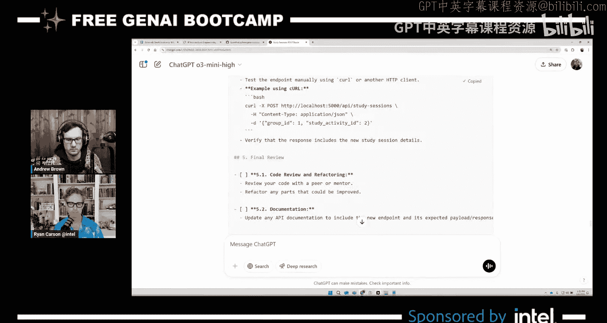

I'm going to update my MD file。And I'm going check off that first step。

There there actually was a JenI tool specifically that was intended to generate out plans I can't remember what was called but I was being a bit uncooperative on Twitter I was just saying I don't know I feel like humans can write the plans up but they did have a tool which what it would do is like it would break up all the tasks and so you would review it before you would feed it into it but I was I was just finding that we had way too many tools and end and I wanted some humans to be left in there so。

Yeahep， yeah， human loop is still nice， okay， so it checked off that step。Oh。

 it's interesting we've already implemented step 1。3 validation as well。

 but let me check if we want to make it more robust。 Currently we have。

 let's go see let's do it over here。It's making it more robust， Andrew。How do you feel about this？

I mean we see more code， this is not necessarily a good thing。

 but we have we have this is one thing is the one thing it's like when you ask to change one thing it might add more stuff you didn't ask for。

 but here it says add type validation validate the group it's fine it is getting a bit messy this is where this is as a developer。

 I would just start to say like hey start refactoring this and don't make these things so big but maybe that's where you could be writing a rule again wouldn' I'm not suggesting us to sidebar here but you know what your cursor rules you could say when writing when writing APIN points try to abstract the code into common modules like validation and stuff like that or if it's using validation I'm not sure if pedantic is used for that because it's a data validation library but maybe it's like when validating stuff use pedantic or。

Anyway whatever the validation library is for Python。Genius， yeah。

 there is this a tendency for it to to want to please and do too much， so you'll notice I said。

So I just kind of laugh because it's kind of delightful so we don't need that extra validation but thanks anybody smiley face and said a you're right let's keep it simple and stick to the plan so it removed that extra sort of I agree with Andrew it felt like this is getting a bit bloy and it deleted it so it said let me check off step 1。

3 and in the plan since we've completed the basic validation great would you like me to continue with implementation next section database insertion let's see。

😊，Let's accept the file。Yeah， we want to do 2。1， so yes。Please proceed with 2。1。All right。

 let's see what happens， y'all。I'll at that。Interesting， so it says looking at our code。

 we've already implemented all of section 2。Is that true？Yeah。Yeah。We've got created timestamp。

 new study session， commit the transaction， retrieve the new。 I did it。 do all that。

 Let's have a look。Insert， yeah， commit。Return。Yeah， okay。It did more than we thought y'all。

 all right， so we're going to accept all those changes。I save it。Okay， so。I think。You know， you。

 everybody watching this， you're probably thinking， wow， I mean。

 it kind of feels like the AI is doing all the coding and we're just kind of watching。

Yeah sort of I mean this is the reality now of coding quickly with AI that a lot of this is going to feel more almost like project manager and I think that's okay now the problem is you do need to understand the code at some level right otherwise you just literally have no idea what's happening but I find that this is the way I code a lot now and it's a lot of fun so。

All right， How are the questions doing， Andrew， anything that we could answer Chi chat about， Sure。

 yeah， do you notice any performance issues of of using cursor with WSL versus cursor natively on Windows。

 What is your reasoning for using WSL。So notice no performance hits at all and I use WL just because I've always。

 you know used Linux boone2， so it's just more。Comful to me， I think the dev tooling is also better。

 so that's why I like to do it。right so oh sorry for boot campers here。

 I want you to use WSL if you can in Windows because it's very。

 very hard to support the native Windows flow and it does throw a lot of weird errors so like people like I can't get the project working I say did you use WSL and they're like everything works so if you can try to use it but if you want to go super hard mode just understand you're going to be on your own but if you get through it。

Document it because that'd be pretty cool sorry Yeah and I I think that the the the more comfortable you get with Linux。

 the more you're going to find the entire development process easier right whether you're on a Mac or a PC or wherever you're at。

You're going to be using Linux so all right， so just to recap what we're doing here。

 composer said you want us to continue and I said yes， let's do 3。1。

 which is the step return to success response。So let's go over here and see what code it wrote。

I think it already did this our current invitation matches is exactly， yes， so we're going to say。

 yep， keep going。Okay。Yes， tackle 3。2。 All right， so in the audience。

 let's let's check in with everybody oh O， O genie says， could you do a tutorial on the bugfinder。

 I haven't use the bugfinder yet Andrew， you're not a current cursor user right so you have to use bugfiner。

I'll open it and then 10 minutes later， I'll close it。

 but like I got dumb fingers so anything that has extra steps to it I just I needed to be as dumb as possible for me but I didn't even know it had a bugfinder what is that does it try to find your bugs for you like it's it oh okay experimental and it just combs your entire code base and tries it for bugs What if you what if you hit new run。

Do it， let's try it。

it's going to be the next 30 minutes and it's going to be 30 minutes of regret right now？

well who knows， let's do it live bugf analyzes coaching in your current branch and the main branch。

 sure。

Should we do it。Yeah， it's going to cost me$2 an idiot。American， right？Yeah yeah。Is that。

 is that a good thing for you， It's like。That's like a big family meal right there in Canadian dollarll？

嗯。Okay， wellow， so we're going to let that。うん。Okay， folks。Ohh， sorry， still coughffin okay。Wow。

 it's cranking。 What it what do。 All right， Look in your code。

 We've already implemented the exception handling as well， look at this。 We're just。

Did we handle the exception handle it？Yeah， I think we did。Yep， we got a 400 up there， okay。

Would you like to move on to section4， yes， let's do。4。1。Now。

I don't know how this feels to everybody， you know if it feels a bit sort of piecemeal。

If it's completely different than way you coded before。

 but I find that this kind of collaboration of creating a plan following it step by step。

Checking each step and kind of controlling the AI to not do too much， really。

Unlocks a lot of productivity， and it's great。A $3 super sticker， Tyler。Yeah。

 Tyler just covered the costs of bothfiners for us。哦。Oh， you're amazing。

Like I feel like I wanna help you back。 Okay， so let's see， well， let's check in with our。

 let's check in with our our。Bgfinder。O five potential issues found。That's it。

 I did pretty good then。That's okay， with our new C study function no longer validates the existence of group ID。

Database integrity errors。Re the code to verify the provided ID existed in the groups。

Because this is checking the code that you've already written。

In the what is it the previous version of the repo？Well， what， what yeah， whatever exists there。

 Yeah， some of it。 Yeah， So sessions review endpoint has been removed and replaced that。 Oh。

 it's noticing that I remove the code。Right， it's actually going through the history of it。

 I didn't know it commits， that's interesting。Wow， okay， it definitely is gone。Yeah。

's's it's actually hitting all the ones that we removed day Endpoint has been removed and replaced with a to do comment。

 okay？2。That's kind of fun。Like that was worth $2。88。Yeah， I is it a bug。

 but it's not necessarily a bug， but it is a change right。

 but if you if you did change it that it could cause a bug right to see those missing。

 especially if it just says to do so the reasoning kind of makes sense。Yeah， cool。 Alright。

 that was kinda that's， that's the first time I' ever use bugfinder。 So thanks everybody and。😊。

And thank you， Tyler， making that possible。That was great， okay， we're going to。

We're going to head back over to our session and see how our friendly junior developer is doing。

All right。Ryan， do you have any history in radio？Um，I've always people always sad about me， no。

So Andrew， should we start a late night DJ show？Sure， yeah。

 We' just got to figure out if anyone can think of a name there。 But you know。

 people just need to give us a playlist and we'll give them。I love it。 Very good。 Okay， couple thing。

 Is it me， is it just me or I try to serve every time I change everything anything。

 I'm not sure I follow that comment。 A meal would be better spent the bugfinder， come on。

 I don't know。 All right， interesting， Bager Dean says actually like the approach and makes a lot since as it gives you more time to focus。

 like it。 All right， Well， let's keep going。 We've got。😊，It has completed， I believe， 4。1。Josh。

 what's your go to80s hairband？Oh， interesting。 Alright， So let's created a test file。

So we've got a new test directory over here on the left with a test study session PUI file。Cool。Okay。

 to test this file， create a test client for a flashask gap。

 it creates a test client for a Flask app sets up a clean test environment， test the post endpoint。

Do you think we should on that？UYeah， let's do it。Okay。So。I am say， how do I run the test。

IF dumb asking， but。Here we go。To run the test， you can use Python's unit test command。

 make sure you're in the backend F directory and run。Okay， well。Let's I think I'm not there。

CD L portal。CD back and flask， okay。Or if you want to more vote， let's try this。

 I think it's going to run over here。Failed。不。Let's see。Well， let's add a composer and ask。呃， me。

Pix this。Let'sSee what happens。See if I was in the vm， yeah， I was in the vm。You sound。

 is that the name of our new。You just show okay。So it found us says， a。

 we need to set up the application context for our tests so it's gone in and it。

Let me make this smaller。All right， so it's made some updates to our testing file。

 so we're going to accept that。And we're going to try to again。Alright。

 I think we got some more errors。Unit test， test grade session。Let's try to right。

 add the composer say。Still not working。Please help。嗯。Alright。

 people talking about Down Nabbey now in the comments。 So that's you。Oh。

 are you it's a favorite for you， Ryan。Down to Na， I love Down Nabbby， but what was the question？

His favorite show。Oh no， they were coming up with names， I think Josh suggested Browntown Abbey。

But we I don't know， I think my favorite name for a late night Jenny I show so far is deep sound。

 I think that's pretty good。O， there you go。 Okay， so interesting。 It's noticing， oh， well。

 the test database doesn't have the tables created yet， which makes sense like I never did that。

 we didn't set up the database。 so it's。Having starting actually doing anything with it。

 so it is modifying the setup to include that。WShe is cool。

So we'll say accept all and then we're going to try to run it again。Okay。Look at that。

Our test passed。 So so far， things are working。 again。

 that's just a good example like kind of iterating through like， I don't know why this isn't working。

 Okay， oh， the database and up Okay， well， let's do that。 And now we're done and we pass the test。

 So let's carry on with the steps。Could you show how you added the command line as context for the composer？

I think。Yes， so what I did is this。 I went on。 so on this error。If you mouse over it。Yeah。

See how it says add a composer， that is how you do it。So you basically find any error down here。

And then you pause， I actually had to click。And then I clicked Add composer， and then it does that。

I use that all the time。Let's keep cranking。We're getting closer to y'all。Let you know。

 I'll say where are we and our plan？Yeah。Okay。Yeah。Only got about 20 minutes left， y'all。All right。

 things we've completed we're doing pretty well currently we're working on 4。

2 manual testing still to do final review I think we're basically。Please check off。

Check off the completed sanctions。그。그。Yeah。Alright， so it's updating that。

Sraram says well it's kind of slow are we just going to work on Lng portal for the homework。

 do we need to do like all three level 200 projects for Red Squad law as a question for you Andrew Sure so folks I actually do have a bunch of videos from guest instructors for frontend code test code。

 all sorts of things and I need to just get them into the portal while all my guest instructors ship their code and we recorded them earlier we have just a few defects we need to solve after this video I might show I haven't decided yet but I might go and do the level 5001 because folks are asking how would I actually do this some scratch with different with a different framework I can knock that out very quickly for folks so understand that lots of content is coming right after this live stream okay。

 okay， everybody I just for a quick recap， I asked the AI to tell us where're at in the plan and to check off the steps it had completed。

We are all the way， you'll see。Testing the new endpoint we did。

And we're about to do manual testing with curl and it said， do you want me to continue and I said。

 yep， let's do it。嗯。It's probably going to show us the commands to use nice yeah right here。

Let's actually try this， this should be fun。So。We can actually run this command right here。

 So it's saying， here's the curl commands。Curious this is going to work。No such table。Study sessions。

Let's make that well， let's pop this wait， no， I'm sorry， last girl。啊。Couldn't connect to the server。

Wonder why？W， terminal where to go。그。Did I make I just make my terminal really big what happens。没有。

Yeah。Hello， I think it's getting really big now， okay。Just a second。Good， the API sta。

Check check what is I'm just going to put a new terminal here， not sure what happened there。

All right， let's try this again。Probably going have to go to the backend folder。Where are youla？

Let's go Lang Port。Okay。To to， let's try to run that command again。Run。

Now we can add that to composer， please help。Yeah。Yeah。Yeah。Obviously makes sense。嗯。

We are not running a flash application， so we probably should be doing that。

It's funny it like obvious things。One thing I know Rola had pointed out about LLMs is that unlike other AI or ML models which will give you a confidence score。

 LLMs do not provide that because they can do a bunch of stuff and so evaluating how well something does is hard to do I haven't seen any AI power assistant that gives you a confidence score or talking about how accurate it thinks that its result is I don't think cursor has that Ryan have you ever seen a confidence score or any kind of scoring yeah that would really nice though if there was。

So now that we've got our flask server up and running。Now we should be able to kill out。

Its open up a new one。And I'm going see it to my。😔，Al last say yeah， see Lang。그。Okay。

 now we should be able to run this。Look at that。 so cool。 Okay， so what happened here。😊。

So we wanted to test is the endpoint working right and we went through a couple iterations we have a test file that we can run great now can we use a curl command well it turned out well number one the database wasn't created correctly or configured correctly。

 we fixed that。Then we realized， okay， well， the Fl server is not running， okay。

 fix that and then we ran the command and sure enough we got back and J。Created at group ID1， ID1。

 study activity， ID2。Andrew， what do you make of that？Let me see here。I mean， that looks， yeah。

 that looks exactly what we wanted to do。 Yep， that looks correct。 Yep， that's exactly what we want。

 So my， my CTtoO， hopefully we are。You have approved of our rather circuit circuititous route that we are almost complete。

I'm a fractional CTO， so I'm just happy if the client's happy and I'm gone by the time this goes into production。

I love it sorry， my road it's beginning to go so Andrew。

 what should we tackle nextum in our we've only got about 15 minutes left。Well。

 I mean we got one of the hardest endpoints implemented and we had an opportunity to see exactly what the flow is if you want and you want to rest your voice can I can do a bit of driving here and we could maybe take a step back and look at you know how we look at the documentation side of stuff like building a dock Does that sound fun That's good that sounds cool I will pass I'm gonna do Oh share it sounds good So what I'm gonna to do is go ahead and get my screen up here and I actually have windsurf open here what I want to do is get the same project that is open and so I'm gonna go over to my folder here and I believe that I have copied it over some mines in my Omen King free Jen boot camp folks I'm gonna go really quick here but I'm just just watch and just kind of absorb the process that I'm going through here while we're documenting so in here we have the L portal I have the backend the front end so I brought in the front end in case I need to reference code to the backend but what's really important for us to figure out is like how do you write。

That you want and if you want to have a good output having a strong technical stack is really really useful so I just want to show before we jump into that I want to show another project that I was working on and I believe it's over here and this is one that I might not publish but I had to build this other app called Progress learner and the idea behind this app is that I want to be able to start with a single word and I want to keep progressively adding words to this thing so that I start with a very simple one word and then end up with a complex sentence in my target language and so I said okay I got to build this app so I'm going to tell what my technical stack is and then I'm going to define each of my API endpoints and so I wrote all this stuff by hand and then after I figured out what my APIMpoint are I thought about what my schema was I wrote up what my schema was and based on this information you are creating your core information in order to work with it so if we go back over to here and into our backend flask。

Right， probably what I should have done when I did this project because I should have made a file in here called technical specs。

And let's see if we can try to generate out this stuff as well like imagine we're building this from scratch so something that we might do here again is the first thing about the APM points。

 what is it that we want to do so we have our business use case right and I believe yeah business requirements this will help us type it as we go but you know I want like I want to build a language learning not a language learning app but a language learning portal that will store the the vocab of a language in a database。

Right？And then sometimes I might structure this and say， okay， maybe we should just make a list。

 So if you're having a hard time structing your data as a sentence， another way is to bullet points。

 So what do we want this thing to do， We want it to have an inventory of words。And yep。

 in the target language。We want to have have a group of words to thematically。

To create thematic categories， there we go， we want to store study sessions。呃。Kind of like that。

 so EG words right and wrong。Okay， and so we're starting to kind of define what it is。 So， you know。

 we are building a language portal that acts as a launchpa for。For study activities。

But also lets us browse our vocabulary。Our vocabulary library so we've kind of defined that now so the next step would we we would define our endpoints I'm going to say API endpoints。

Again， you can see it's doing a lot of work for it， But the question is as I'm typing this。

 is it referencing this doc here or not， But imagine that you are a developer coming in and you're like。

 cool， some other developer build this thing， I don't know how it works。

 I don't know if I trust the code， but I want to write it in whatever language that I want to write who doesn't come in and say this is great and all。

 but I would like to change this over to next J or I would like to change this over to Ras every developer tries to do this but anyway。

 even this， I think it's referencing the code over here。

 So I would think about what endpoints I want。 okay I know that I want to have this thing I'm trying to visualize what it is that I want this thing to do So I know that I want to get some words from a words API I might want to describe what a word looks like。

 So that's a good one I might want to update a word， I actually don't want to update a words。

 I'm gonna take that one out maybe I want to focus on groups so I'm gonna to go here and we'll say get API and we'll say groups so I might want to see a list of groups。

😊，Then we might want to look at an individual group。Then so we have this。

 so we have our words in our group solve。 Those are two things。

 We know we want to have study activities so we know we'll have to create a study activity So I'm gonna to say post API study sessions well sorry a study session could be something that we are using to perform and then there's a study activity which is something separate but we know that we need to create one so a post will create one and so you can see I'm starting to define my API endpoints once I have my API endpoints。

 I have to think about like okay what exactly is this endpoint supposed to do like visually think about what we want the data to become back as returned。

 So something that we might think about is like， okay I have this。

 I'm actually just going to take this to another level。

 say this is two and this is three and now I'm going to strive what this endpoint is well I know that I want to return a list of words but how many words do I want to see we'll say 10 words at a time。

At a time， and I'd say， you know， it should have pagination。Right。

You might even say like what kind of data you want to see in here。

 So maybe I might say I want to say like I want to show the schema。

 So let's take a look at response a Json and maybe it'll suggest it for us So I'm going here and then we have one here right sorry yes。

Just， you know， everyone loves your blanket。Oh， yeah。Um but Ken Collins。

 who is another guest instructor later this week， he actually has his own， and I I don't know。

 but I think his grandma might have knitted it， but I know I serious。That's amazing。

This one probably came from my grandparents house， but I'm not sure if they they probably just bought it。

 but you can see here as we're developing。 we're really defining exactly what we want。

 so there's multiple approaches that we do。 but the point is once we have this reference。

 what I will do is I'll just go back and say go references doc thats what I do I just keep saying go references doc go references doc and I keep looking at the code until I like it but if you have those two components。

 your API endpoints and your SQl that's another way for you to drive it。

 but the point is that you have to figure out what works for you this works for me because I built so many MVP applications for so many startups that it's become a routine for me but you saw Ryan's approach was completely different。

 And I would have never thought about doing it that way。

 which was really really interesting So you know I don't want to be too prescriptive in terms of how to do this but I just want to point out that Ryan had a way I had a way and you might come up with a really interesting way and I would love to see how you approach that So I will in a follow video rebuild this from scratch maybe in another。

Gett a framework language， but I want to stress it。

 you don't have to do it the way that I do it if it doesn't work for you。

 figure out what works for you and do that okay and so hopefully that is good。

 but does anybody have any question or says？Well， and on that front it's interesting because you know watching you。

 Andrew and thinking about the way you're presenting。

 it's kind of interesting because you're a developer。

 you know to type out a list of get and posts right like these are the things I want to accomplish and you you've already translated a lot of what you know needs to be done into you know pseudocode or code itself。

And I just want to encourage everybody that's going through this if you start to feel like you're confused or you're just thinking I'm not even I wouldn't even know to say that like that should be a get versus a post or to even what to put in that list that's where you need to start leaning on AI to help you do that because there's a lot of code that I write now where I end up learning oh okay so this is this is the way the machine thinks about it and then I start thinking about it that way but I didn't know to do that at the beginning so。

We just live in this new magical world where you have this tutor that literally is there all day every day that's a PhD level student that wants to help you figure this stuff out so。

For boot campers you probably remember in preweek when we were just you know I think a boot campers wiped away my architectural diagram but we had before here a a conceptual a logical and a physical diagram and when we had Chris Williams the thing that he said is like Andrew that's great that you made this like low levell architect diagram but I would have started on this side of the spectrum right I would have been on the other side conceptual and so you have to think about the way that you want to translate those over and there's different approaches to take to it but again I can only think the way that I think because I'm so developer focused and you know everything is a hammer like I got a hammer right here but everything is a hammer hammer to me so that's the approach I'm going to take again I just don't want to be overly prescriptive I know we only have five more minutes I just want to say a few things that people need to know what we're doing post this event right after this we have after class。

Q&A in the Discord that is a 30 minute conversation similar to this。

 but you can actually come on stage and ask questions for those that are wondering about Discord Discord is currently closed we are at capacity for our Discord I'm not sure if we will find a different way for people to get in but if you got in you're in if you're not you can still continue on the bootc showing up to these live streams and be in the Expro platform but there are certain interactions that you will miss out on but we will do our best to really that stuff I know some boot campers never join the discord and we've had some that never joined the Discord and made Redsqua so you know just do the best you can with what you have and and that will be good a series of videos will be following later today we have an interview with a fireside chat with Simonone about Govtech and Jeni which is really interesting we prototype an app out with Brian using next J us and I actually got to learn about。

Replelet as a lot of people seem to like that piece of hardware we have a video from Christie and Matt who completely rebuildbuilt the frontend using I actually don't know what they use but I think they use bolt dot new and a mix of lovable I got to watch the full video there but all those videos are coming out here so just look for the stuff on this weekend and we have four minutes left there so i'm just taking a look here at some other questions how do we submit the homework to submit homework isn't example of platform at the end of every week the last material is the submission material so please look out for that I know that i'm going to make a revision for a grading or sorry the submission form and we're bringing back consideration so for those that have to submit late for whatever reason or they're having disruptions in there in their life we'll put that considerations box there so that you can describe that stuff so that you're less stressed about the fact if you are laid or you're missing things again we want to see as many people get through this as much。

As possible and provide you the tools and we'll make the tweaks as possible we did recently add a hack and tell channels to the Discord so you know I encourage you to not just do your work in your reos but share them in the Discord in those channels and if you do have something that is very creative and interesting please make post on LinkedIn on Twitter on wherever tag me or show me so I can see it because we want to see your work and I want to see who we can get into RedSquaat what is late where are due dates you know we actually have two due dates for the final submission and then we have the final final submission because we know we know that people are going to be late and they're going to ask to be what it like go yes and then you know what there's even a secret due date that you can submit after the final final due date so folks we have built in as much as much final secret secret final final and if you submit with。

The next five years， you you can make by the way， Tristam says back to your blanket。

 my mom is threatening to crochet you a hat。

Okay， well I'm looking for it why I need one because it's it's a little bit cold in here。

 but we'll talk about that behind the scenes and the Apple class Q& A sorry you want one I want a hat。

 but because you don't have to make it don't worry so all right and to being here。

And Bo campers just watch out for Ryan Ryan and I's a new new late night Jen AI podcast called Deep Sound and yeah we'll let you go there so yeahep thanks everyone for showing up and we'll see you again right in the afterclass Q&A Discord Cha Chao。

In the alarms your bath stars， hints and farm builds share religious I in sand wax the last on my wife。

These farm flu cause flying in。🎼Ss of vis and all pot be one that ever I out。

A leading in friends from distance on。She re has a lot with bro。Aid the hum of the shs。

 the glance with jewels do so sp death thenly cast luweidowos， a tree floged over favorless intotes。

Healy you and I that dance life to。

🎼Together we sway strands in our eyes across galous wide。

 not whole skies left the echo in the emptyI。😊。

A clip by ch and a million andrye， a across assumedumed the first off sky。

🎼Could your sandwich curl suffice。To break the barrier it does now the ice。

Once pastize us often bias a smile co we gently ex faint for just a little one。

dirty lights in this humble place。

How might probes and send the time the space。In its s， do not I was the。

sight even she side by st from the young of stars with her。🎼Com。

🎼You fall peace with the now and the home。🎼The clip。

🎼这我们生。Master you know in diocil sky， for you is some which could suffice to break the various melt the arts。

