# ExamPro《生成式AI训练营｜Free GenAI Bootcamp》中英字幕（deepseek - P19：-19-Data Primer with Kierra.zh_en - GPT中英字幕课程资源 - BV1SFEWzLEab

Hey everyone， it's Andrew Brown and welcome to the Free Jenny Ibu camp I'm here with Kira and she's going to be helping us with the data side of it。

 I'm gonna to be honest with you， I'm really really awful at data and so I need this primer really bad and Kera was very generous to break it down for us here and so I'm going to just before we look at the slides I like Kira to introduce herself we'll get to it。

Okay sure hi everybody I'm Kirara Dotson， I am the founder and CEO of the data B which is a data career coaching and then also consulting company and I also do Kubernetes in data contracts on the side but yeah thanks for inviting me and and thanks for having us here our being here and I'm going to bring up well that's not right that's not right I'll get it right here there we go and now we。

😊。

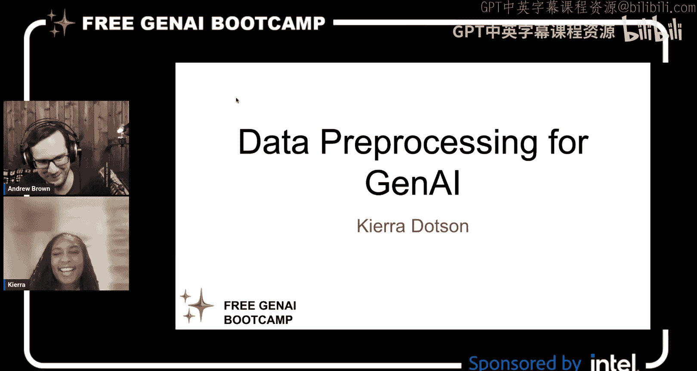

Data prepro for Gen AI and all that all that stuff is just me that's not AI itself。

 but we'll jump into it here So data preprocessing for GennyI and you know before we even jump into this。

 I guess my question is， is data processing really different for GenI or is it the same thing but slightly applied a bit differently？

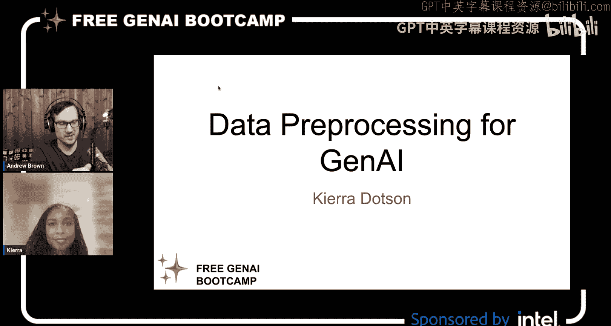

So it was generally the same thing across all the data different data realms。

 it just slightly differs depending on the small individual steps， for instance。

 like fine tuning and things of that nature and data analyst might not have to do that。

 they'll just have to pool in and do some data quality checks and things of that nature for their for their data。

 so data preprocessing very important happens across all levels of data in AI what your skill set just might vary on what your particular goal is or whatever it is that you do in your role。

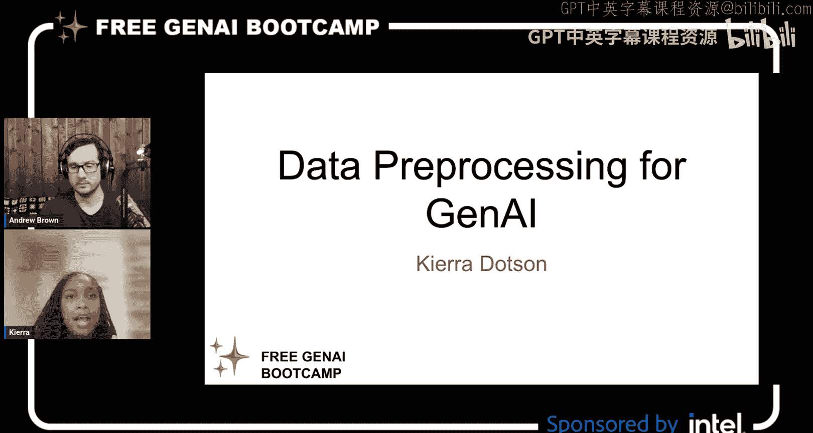

Cool， all right， well let's jump into it and let how let's see how hard this gets。

All right let's get started so again we're talking about data preprocessing for Gen AI。

 which is very crucial and often overlooked in AI at the moment。

 while large language models are incredibly powerful they are not magical and they're not allknow software so I'll keep saying this repeating this a million times you're going to probably get tired of it it is so important the quality of the model's output depends heavily on how the data is prepared。

😊。

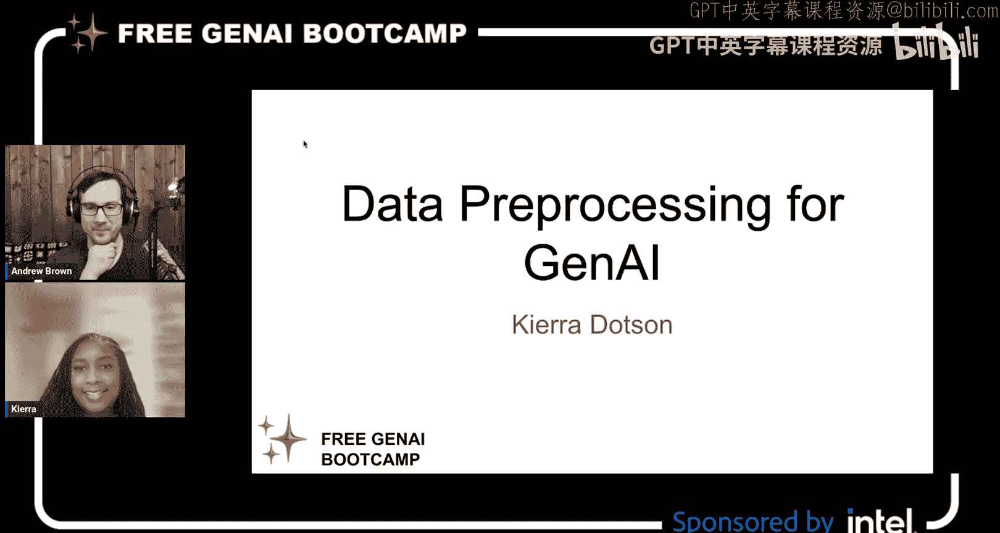

If the model is biased it's not the model it's the data if the model gives wrong information it's not the model it's the data oh sorry so is that does that go along with the the the popular slogan garbage in garbage out exactly and that's also going to be featured in the slice as well。

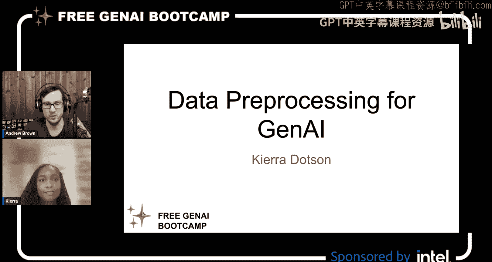

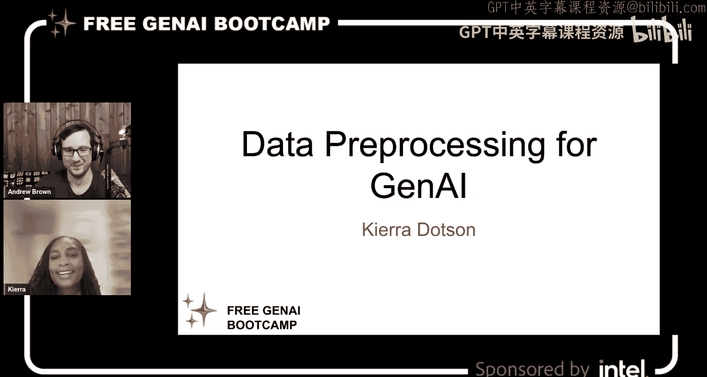

But a good example of this is let's say that a customer service company they're implementing their own chat GT and they feed it their own customer service transcripts that some of their customer service agents might use so a lot of times those transcripts are filled with some inconsistencies like maybe the date format is different also you know addressing different customers might be different that might be a mis misses the way those things are spelled also mislanguages if you know some of the representatives are bilingual or even just talking to different customers in different regions or countries so without proper processing or preprocessing。

 the AI might generate inconsistent or incorrect responses。

 if that data is not standardized across all those different agents that have that data。

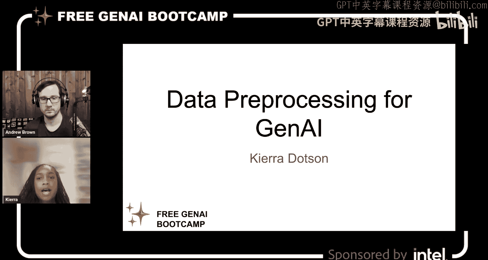

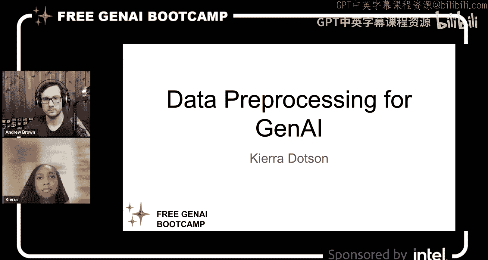

嗯。That's my primary so let's get started with the agenda we're going to talk about why preprocessing matters just so you get a better understanding of's what it does。

 some G AI misconceptions， we'll also talk about some G AI examples that have gone wrong at popular companies we'll talk about some data quality。

 my favorite topic， we'll also talk about some best practices and then I'll leave you all with some key takeaways to you know keep in mind as you're continuing to go throughout the boot camp。

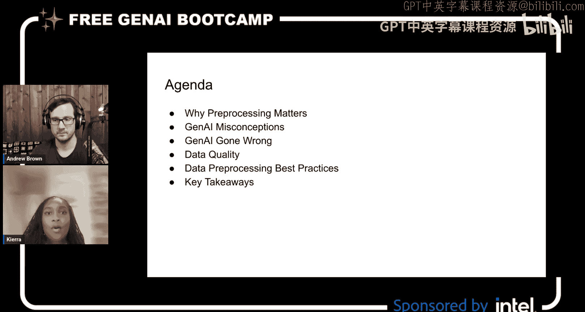

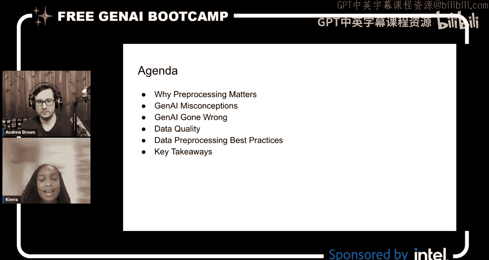

All right， so why does preprocessing matter for GenAI so data processing is preprocessing is the process of transforming raw data into a format that can be efficiently and effectively used for model training the most important part of that is raw data because that's typically where data starts at before it is used by anyone when it's analyst or it's about to be used in the pipeline for data engineers a lot of times that data is transform to make sense to the business or whatever customers that will be using it。

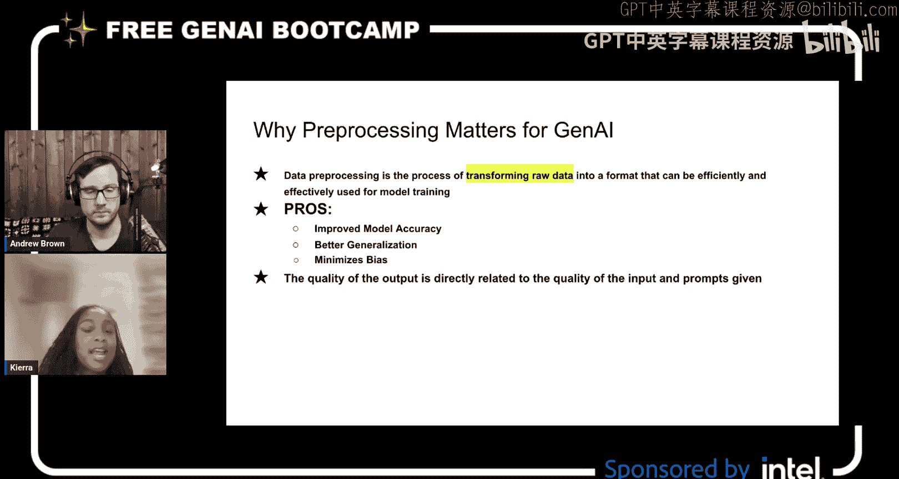

And again， you want that input data to be as aligned with the requirements for the model you're using to ensure that the outputs or the response of the model makes sense and is valuable for the users。

 so the better the data is prepared the less likely you'll happen an overfitting model and by the way overfitting is just when a model is so fine tuned to the training data that it performs poorly on new unseen data。

 so you just want to make sure that the data is as close to grade as you can get it you know the first few times because also overfitting means that as you continue to fine tune your model it gets more and more expensive to do as well。

So let's talk about some pros of preprocessing so one of course is your improved model accuracy so your models are basically responding with an output that's based on patterns and relationships is picked up in the data a lot of that's what that is especially like when you look at chatGT as you heard it's scraped all the data in the internet when you ask the question' it'll easily go and retrieve all some of that data that it might have seen that matches closely to the prompt that you give it same thing with all the other GenI models whether it is text or imagebased or videobased as well too it just finds different ways to make sense of that training data and then give that output to you but properly processed data will help the model to learn those patterns and relationships faster and easier so the response will be even cleaner and better for you to understand there's also better generalization so clean standardized data helps in building models that generalize well to new unseen data improving the robustness and reliability and then lastly minimizing bias。

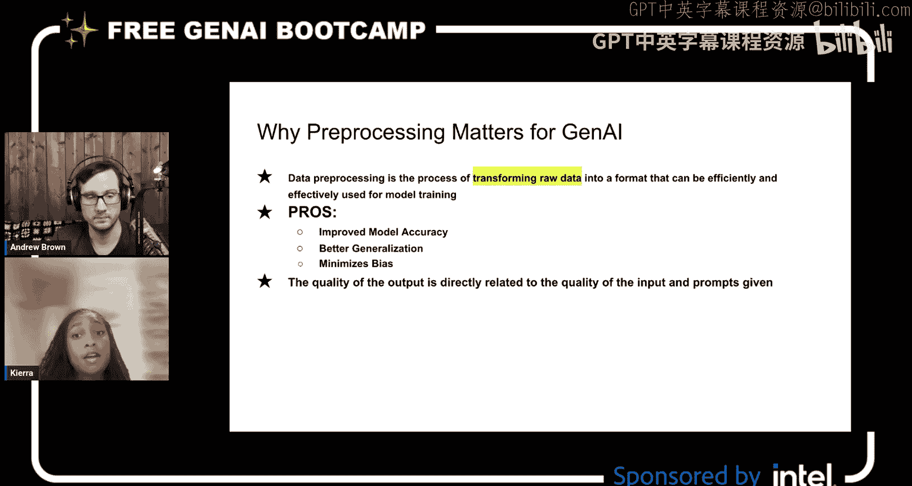

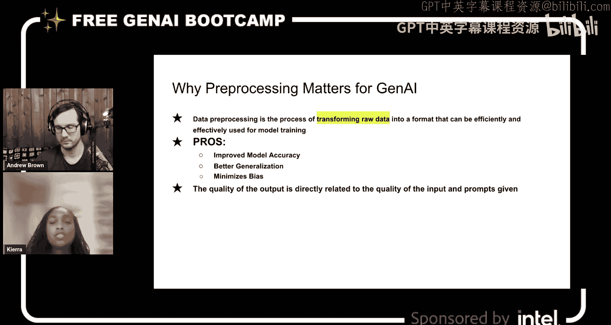

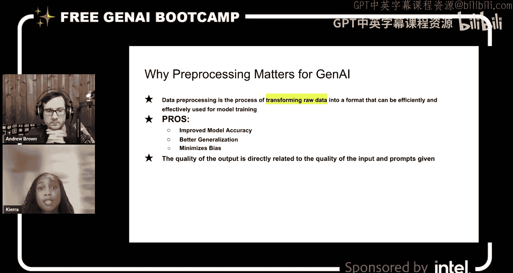

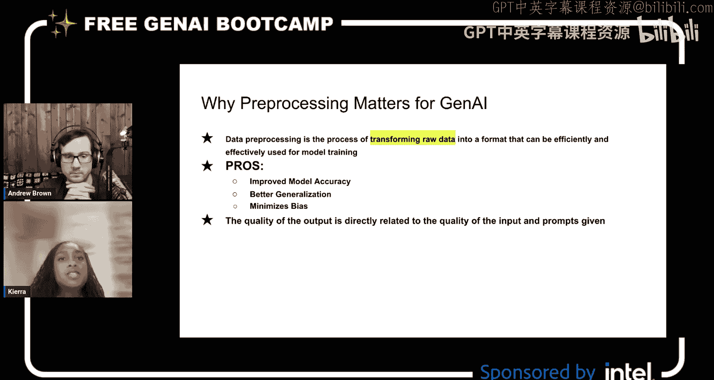

Tecns like dealing with the missing values effectively they ensure that the model training is not biased or akewed or even inappropriate for the pump that was given it's really interesting because I think Roa was telling us that a lot of the models out there are trained on all of the data on the internet。

 which is a bit disconcerting because。

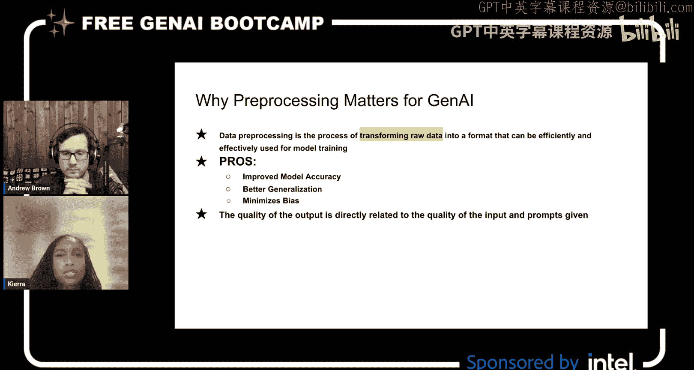

You know， like if anyone's been on the internet before it's a wild wild place and so I almost kind of wonder what they're doing under the hood to make these things not spit out crazy。

 but you know just coming to the word preprocessing。

 I understand that in a data pipeline there's a bunch of steps and I've heard of this preprocessing stuff is that like a big category of things is it like one really specific thing like like how big and big or small is it in our pipeline。

It's a big category of things again it just depends on what the use case is for the data and then how messy the data is and also the data types so processing I would say structured data probably is I would say more of like the easiest because there's already a consistent format to begin with maybe it's as simple as you just having to remove any duplicates from your data that you see whether it's just some text data or even anything such as also removing some films or something of some missing columns or there are some missing rows are but of course you know then it comes to dealing with images or JSON and anything else that's unstructured if there are some broken JSON brackets or something like that that's a lot to have to deal with and parse through especially you know as engineers it's already hard to figure out what's going on like you're missing a comma in your code so imagine an AI software having to do that and it hasn't been trained on how to do that already it's flying blind so。

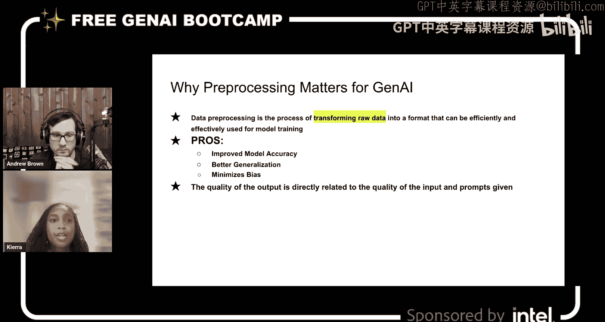

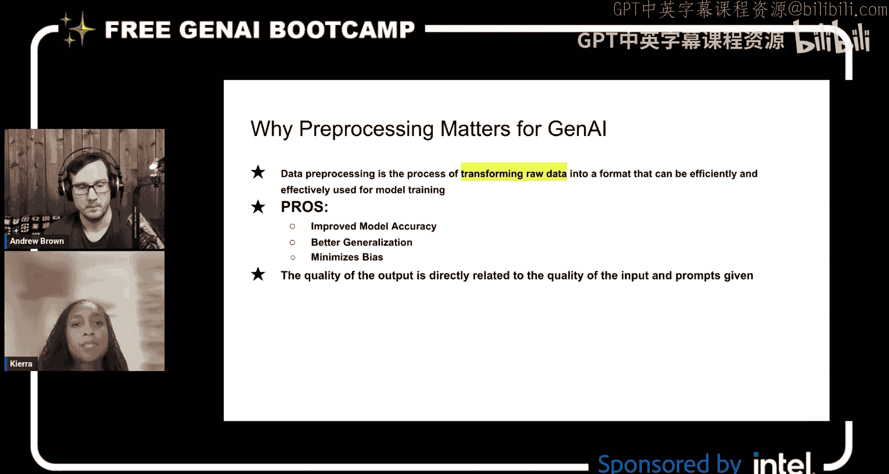

That's why preprocessing matters for sure， especially in the context where when you're serving data to people like say like you're serving it to any analyst or something they might not understand the technicalities behind how that data is processed and it might also not understand the context behind that data they've just received it so that's why preprocessing matters because you're trying to make the data as formatted as possible to match the end users needs and so you know like if one example and I want to know if this is preprocessing but like one example in the bootcamp is that I want to take a movie and I have it subtitles and so it has all these time codes in there and I end up removing them out because I just want the raw language text is that preprocessing Yep absolutely and that actually falls under the data quality category with the up standardizing your data making sure it's formatted you know without the that's the time codes。

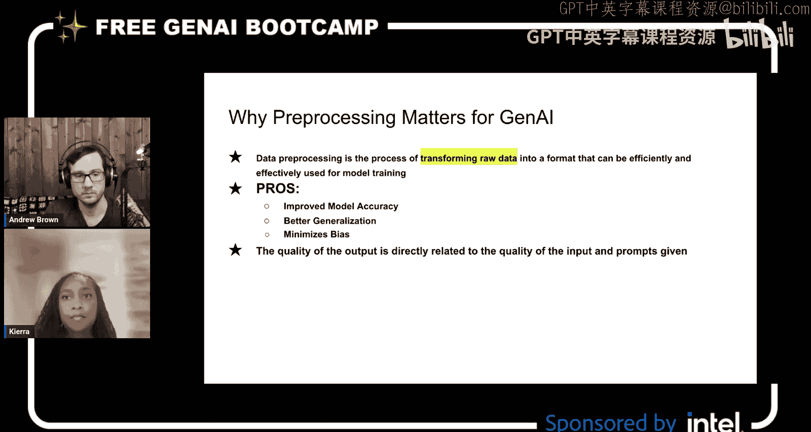

Cool so yeah next slide so let's talk about some G AI misconceptions yeah some myths and then i'll give you the truth about it so the first one is one LLms can understand any data format no it cannot so let's say for instance streaming video was not something that's very popular right now with a lot of LLms that's something that's starting to emerge and I can't even begin to think about what other types of data formats that might come out that we that we haven't handled yet a lot of times we're just seeing text and images and maybe any already preexisting video that is fed into the AI models or LLms to interpret and spit out information for us。

😊。

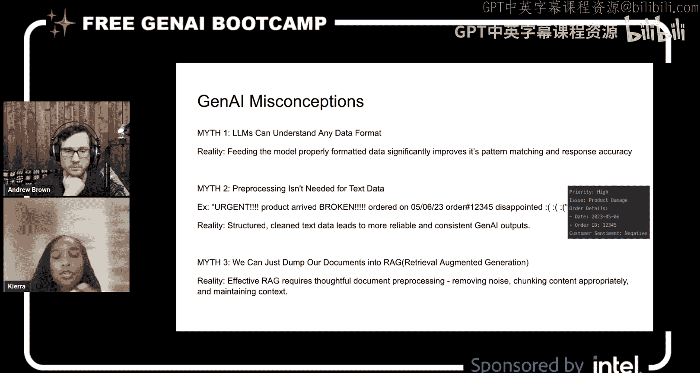

And then also another important thing is that feeding the model properly or properly formatted data significantly improves this pattern matching and response accuracy a good example of this is JSON which is basically it's almost like a documented way to send out large amounts of data that can be attributes of something so let's say you have a messy JSON document and it has missing brackets。

 there's inconsistent culttation marks around some of the fields that's going to be hard for the average normal human to understand so of course it's also going to be really difficult for a model to understand as well too because it also has to parse through and sort and understand information just like humans do but if you give it a clean properly formatted JSON document with proper spaces brackets and quotations it will digest that information much easily and then so they'll speed up the time for the training and then also。

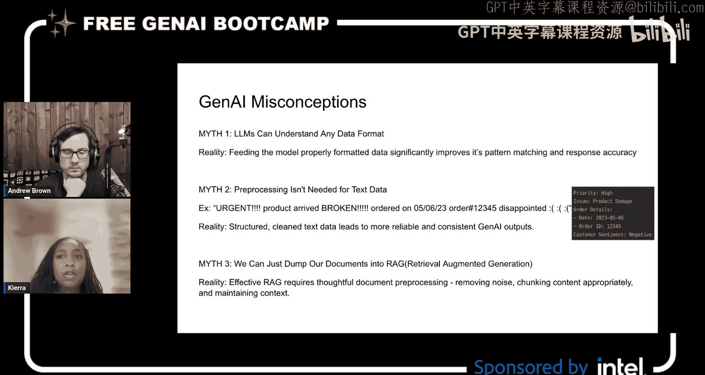

Cost effective to you're not using as many resources to parse head data and then third it reduces probably the amount of hallucinations or having to think twice about oh was this formatted properly oh was this formatted properly with this document wasn't like this one because the quotations were gone they get confused just as we do I would say that Lms will have a really hard time for me because I'm always spelling everything wrong and one thing that I think that might be making people believe that Lms can handle anything is because of these AI powered assistance because I'm thinking that they are doing preprocessing so like if you give it a PDF it's running a preprocessing step extracting out the information or doing something to it now again I'm not sure exactly because we don't really know the interior there but sometimes there's magic happening like you had mentioned about video like we know that chattBT whatever the latest version 1 has video but like how is it doing video streaming because yes。

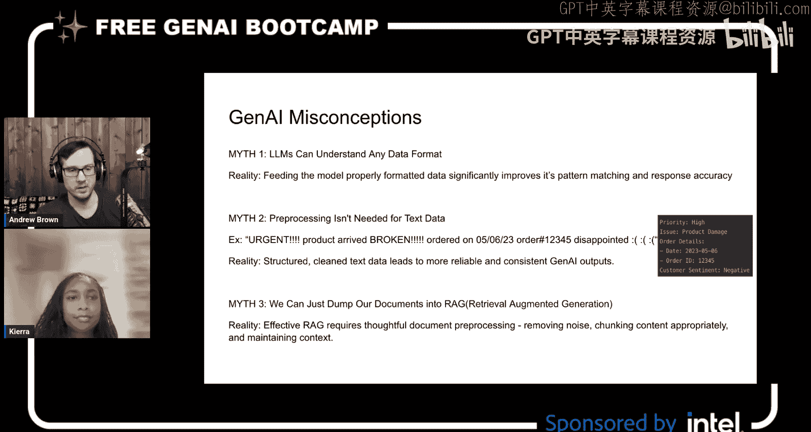

There are technologies out there， but I can't find any open source ones so if they've solved it they' they're not sharing it with everybody else yeah I definitely agree with that it would be really cool to see the code behind that but you know of course they wouldn't want the competition to know what's going on I do hope that as time goes by more open source。

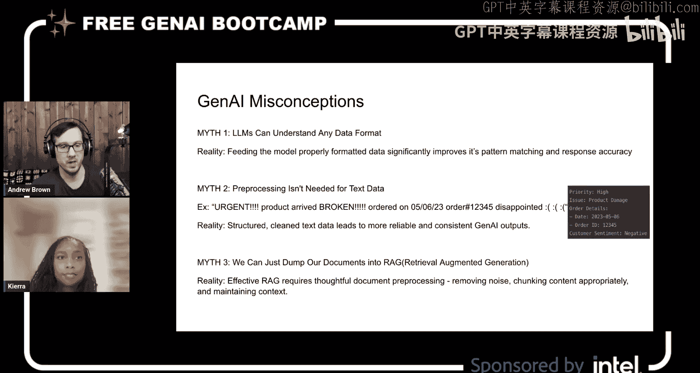

Es are shown or just a code behind all of that。 And I think it will as the technology advances。

 it'll become less of a who look at this new thing and it'll just be oh this is standard。

 So of course I'll share with everybody else。 but that's sometimes there is a there is a model called IBM granted out there that is 100 open source And they say where all the data comes from。

 but I couldn't tell you what that looks like I don't know where to find that。

 So they said it and it must be true， but I'm not sure。

I'm not even sure where to look to understand it or to replicate it。

 so it's got to be made easier and we we need more of these examples。

I 100% agree with that and I think that's actually a really good thing that they did sometimes I also get a little skeptical because I'm like okay how can we confirm for sure that it's all of the data that that you're really showing it's all of the data you can say that you probably have a bunch of data that you can show us but what's also going on especially because IBM the government contractor so you know they use AI then there's probably some type of contracts to have in place to where they can't show some of the things that they're using under the hood or maybe they have their own specialized platform that they get to use for IBM granted or something like that maybe。

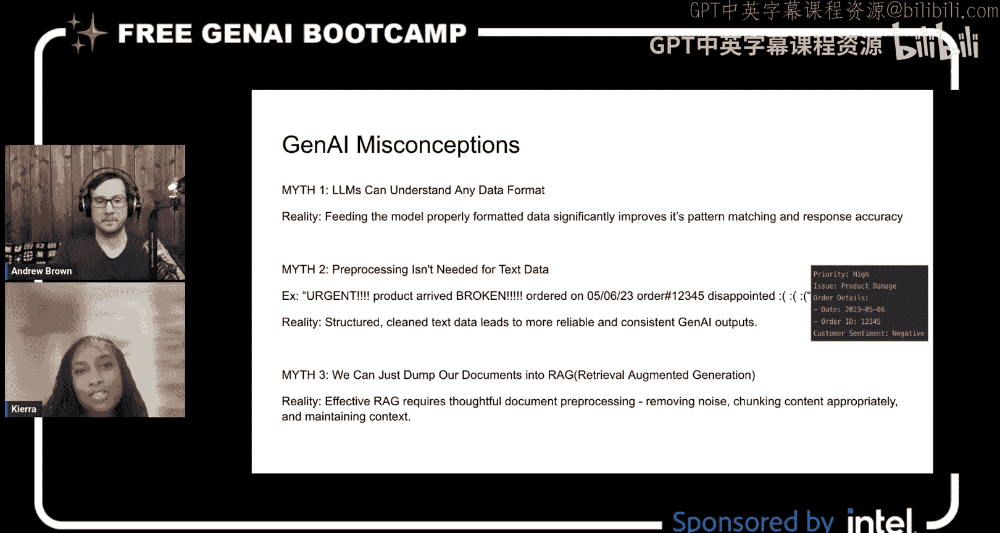

Yeah so and then the second myth is preprocess is it needed for text data I have a really cool example here basically just showing like let's say again customer support chatbot it pulls in some information from the database and that's literally the text string this random piece urgent product arrived broken ordered on this date in 2023 and here's the order number disappointed sad face sad face。

 sad face that's very confusing。😊。

You know， for the AI there's a lot to go on oh sorry I remember what the opposite of the smile is the sad faces they're not they don't provide sentiment analysis it may or may not depending on that that's what's hooked up they have like a library import it for that code for all it knows it could just be like oh you know this is just a random like what is it called well it was parentheses this looks like character mistakes random characters how am I supposed to read this in is this actually a date here that says ordered on blah blah blah。

 blah， or is this just a bunch of numbers and characters thrown together you really don't know how these the code behind the AI model or the AI is parsing any of this stuff whereas if you look to the right it's a little tiny you'll see a better way that the customer the customer data is formatted of course you have your filled and then you also have。

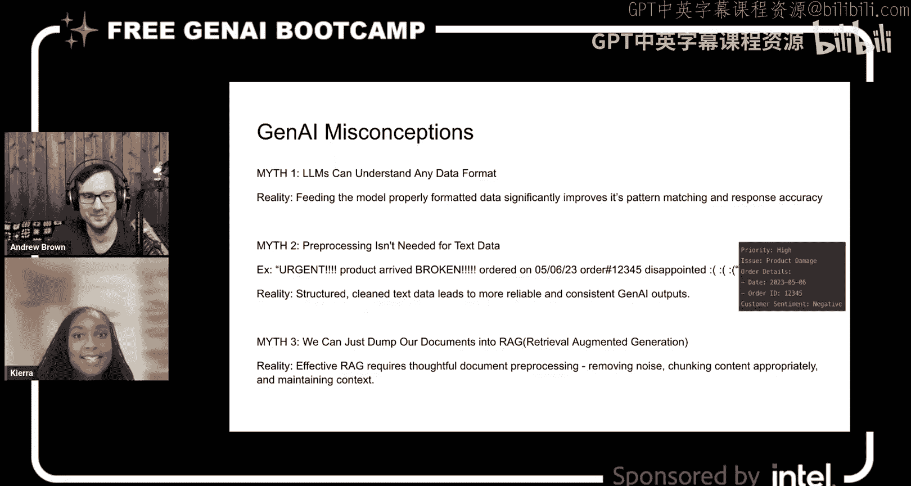

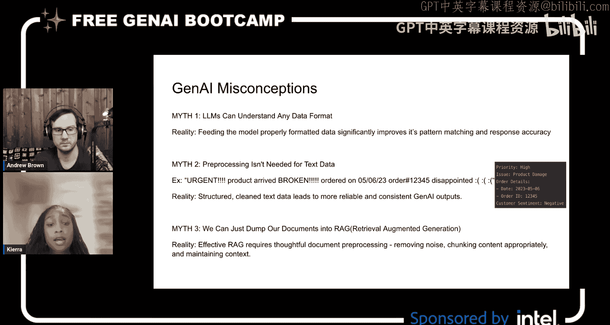

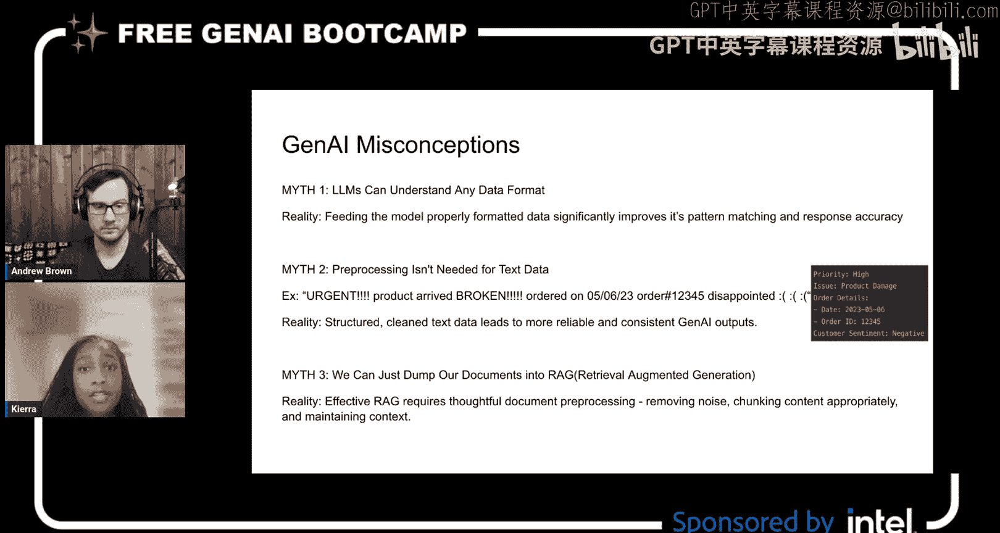

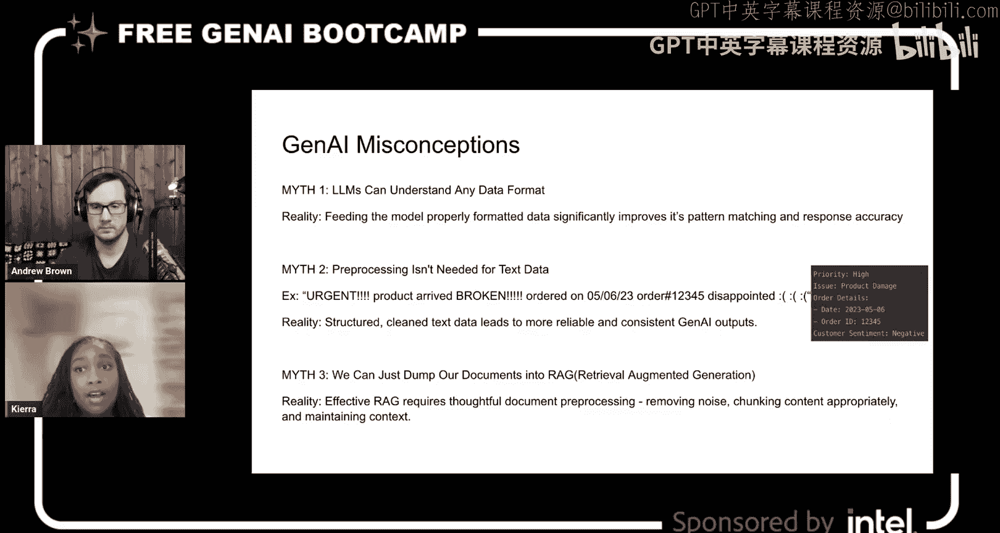

Um， whatever the value is on the opposite side， much more easier for the model to break down and understand and interpret。

So the reality is structured clean text data leads to more reliable and consistent gene AI outputs again it's not as confused's able to make better sense of the data so it's able to have a higher chance of returning something back to you that makes sense or is also isn't hallucininated because it might just say。

 oh yeah sure this person was happy because it doesn't know what to do but maybe the AI was trained not to tell you that it doesn't know what to do so it'll just respond with anything because it has to respond so yeah。

 the third myth is we can just dump our documents into RAG。

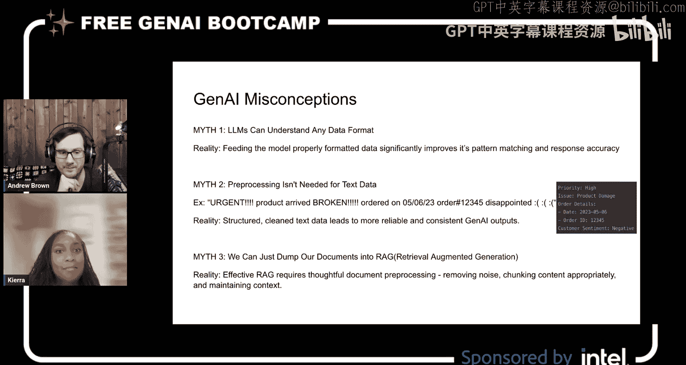

And many people think they can do that in a work perfectly but you need proper preprocessing for that so let's say you need to remove some relevant headers。

 maybe centralize some of the formatting and structuring the content otherwise to retrieval quality suffers greatly and by the way if you don't know what ragged is which is retrieval augmented generation it's basically hooking up a database to an LLm so that it can reference the database for any specialized information that the model might need it's a cost effectiveffect way to feed the model more data without having to finet it because fine tuning actually is quite expensive it's also a really good way to customize your model without with customer specific information you might see a lot of companies creating their own internal chat GPSptTs and that's so the employees can feed in company data and use it themselves and it keeps the model up to date as well to like for instance if you have certain policies that you might have you know let's say you have HR policies from 2025 but you train the data。

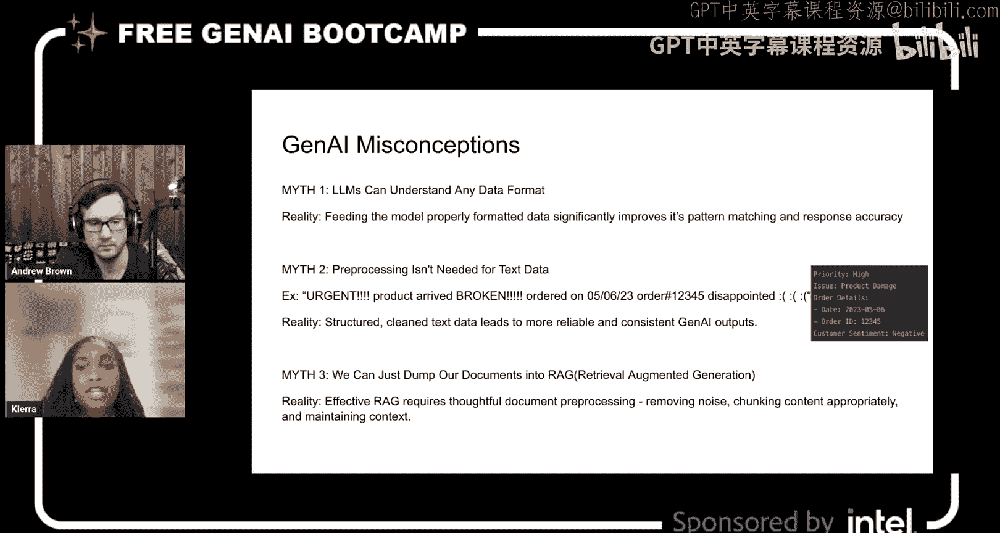

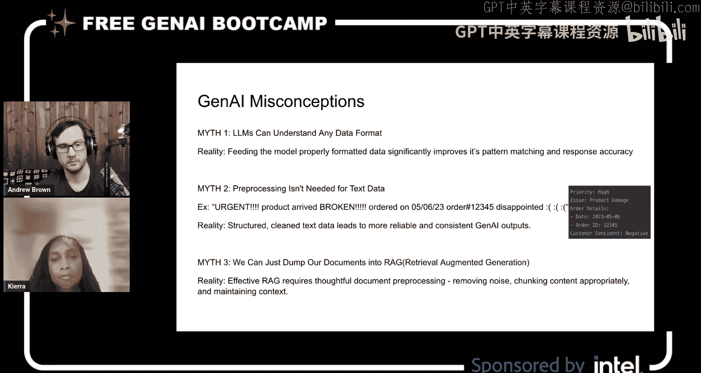

Tra the model on data from 2020 the it wouldn't be a good bet to just leave that data from 2020 especially if the HR department needs it because that could be a compliance issue if things go wrong because of the old information so you know you could put some updated policies or updated information into that vector database and then that that LLM now has relevant information to pull and output to the user。

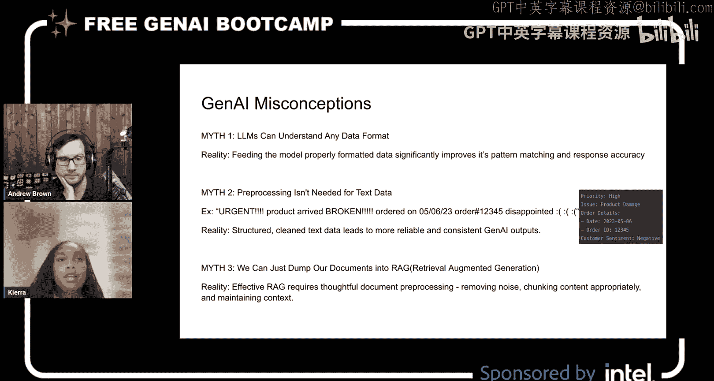

And then once again the principle of garbage in garbage out is especially relevant。

 a good example that is also is copit its ability to suggest code it just depends on not on having access to the code repositories that's great but the data that it was trained on and had to be clean and had to be well document it and properly formatted code examples to understand how to help people with fixing or structuring their code or commenting or fixing spacing and things of that nature and then just jump out the boxes as a perfect AI product the data behind the AI model made coppit what it is today we're having our office hours earlier today and in the upcoming week we are looking at well when this video comes out it will be that week but working with AI coding assistance and I was saying that with GitHub copilot that it's referencing all this material raw material from the reos and sometimes you just get really。

Bazar code whereas other providers， they're not just dumping at all in a rag。

 you know what I mean's there's some there's more careful thought in terms of how they work withstructured data。

 some of them will actually go in and as opposed to just referencing code they will reference technical docs about the specification。

So it's more intelligent in terms of it generates out and so structured data even in a vector database。

 which I guess like when we think of structured data we think of a relational database。

 but like vector is a little bit unusual because it really does feel like a dumping grounds for data and it will just kind of work。

 but I imagine there has to be some work to be done to reduce the noise or yeah。

 as you say removing noise here before you place it into that vector database or whichever source you want。

 sorry。

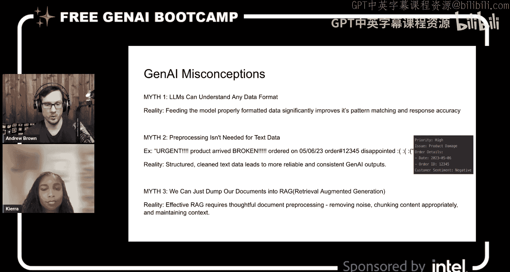

That's actually a really good point that you brought up so because it reminds me of data lakehouses。

 which is what a lot of companies use to just dump random data into when they're not sure of what they want to use it for and a huge issue with those lake houses is that no one understands what the data is in there or even how to sort through and filter through all of it because it basically just became like they call it a data swamp or so sorry the data lakehouse that's a retreat for the data team。

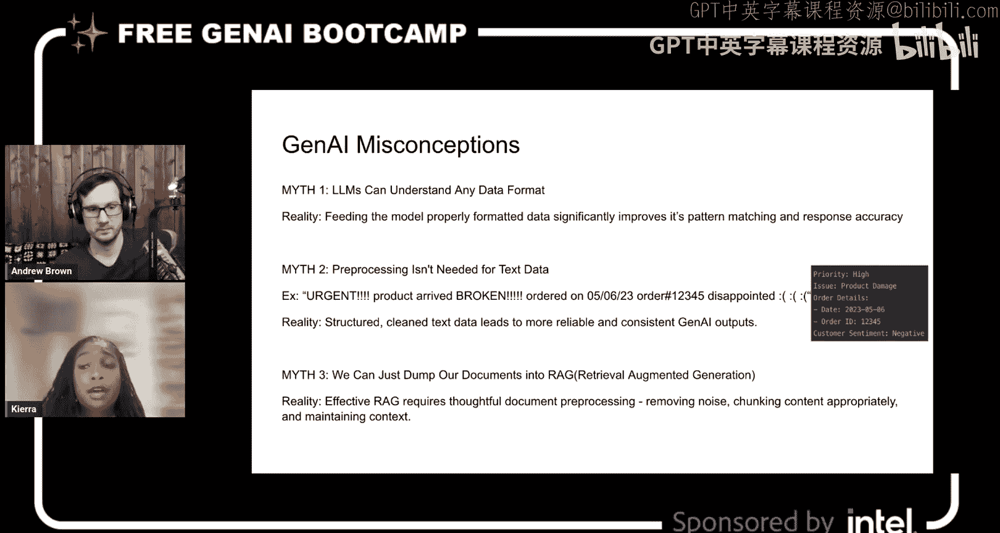

Exactly， it feels that way， but I was like at it。

It feels that way， but not the funest one especially when you have to when you actually have to go in and pull and retrieve stuff so that's actually really good point to write about the vector databases。

 there's something called a data catalog basically where people it's basically like a data dictionary for all the data that exists within the data warehouse or a data lake or a database。

😊。

It'd be really cool to actually see if there are some vector data catalogs that do exist that way people can make sense or keep track of the data that they have Data catalog that's it's a mapping of the schema you think I would know because I recorded it for A A glue and you define a schema was something called open tables or something。

 It's weird I know all these technical terms but that doesn't mean I know what's going on So because I didn't I didn't finish the data engineering certification for As So I don't I don't know just yet but is it is it supposed to be like a schema mapping to your data Data catalog just holds a reference of schema Yeah。

 references the schema and just also in a way for you just understand and see what's in your database。

 on a schema level， a high level overview of what's in there。

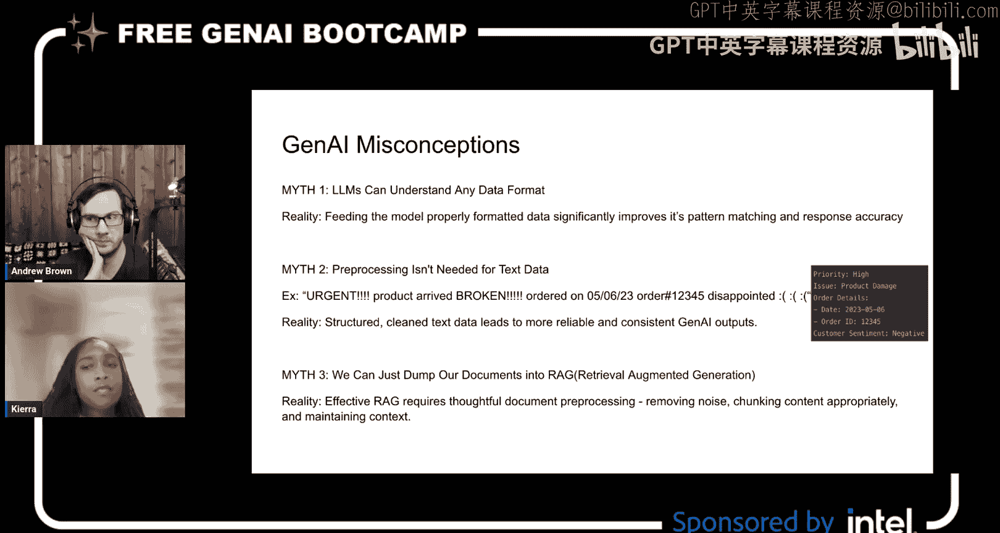

So yeah， just that would be that just for vector databases。

And then let's give let's talk about some real world examples where insufficient data preprocessing led to some Gen AI failures so these weren't just technical glitches they had real business and social impacts down the line so for instance 2014 Amazon created a AI recruitment tool that was basically supposed to help screen applicant's resumes and rate them so they had to actually really big issue because it started to discriminate against women the root cause of that was the model was trained on a data set and that data set consisted of resumes submitted by men over a period of 10 years so the training data wasn't preprocesed to remove any gender indicators or address any historical hiring biases so if someone had something like oh they weren' like the women' volleyball team or the women in tech committee or something like that it flagged or deemeded as something that was bad just because they hadn't seen that women's keyword pop up。

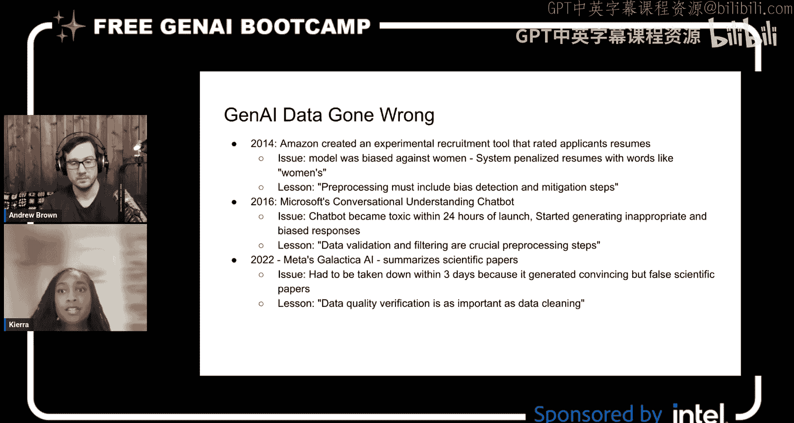

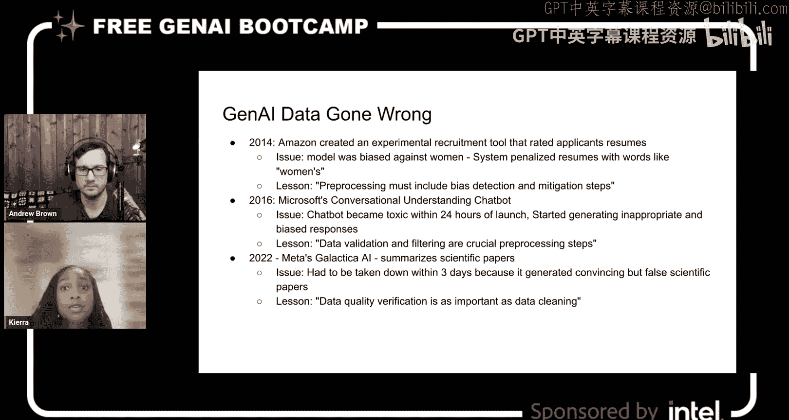

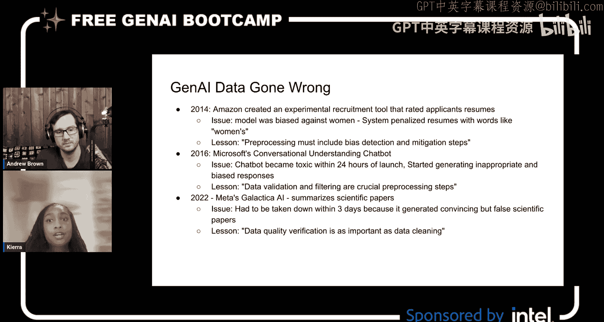

accross all the years of that training data from the previous resumes so the system basically learned from past hiring decisions that were themselves biased and it created a selfreinforcing cycle well so oh sorry and so this is from 2014 and this is before LLM so like and that's really interesting because now it's like imagine people just took 10 years of resumes and dumped it into a rag and said or did fine to me said you know go figure this out it would probably it would probably mess up just as bad as this thing but people are faster to make mistakes sorry yep exactly 100 facilities what you said you know the same date over time if they haven't you know handled for those biases or tried to look at the data and inspectant more did some like explorers were analysis they won't catch things like that and that's also why I said it's not just about you know just a technical mishap or something now Amazon in that moment they looked as if they were not。

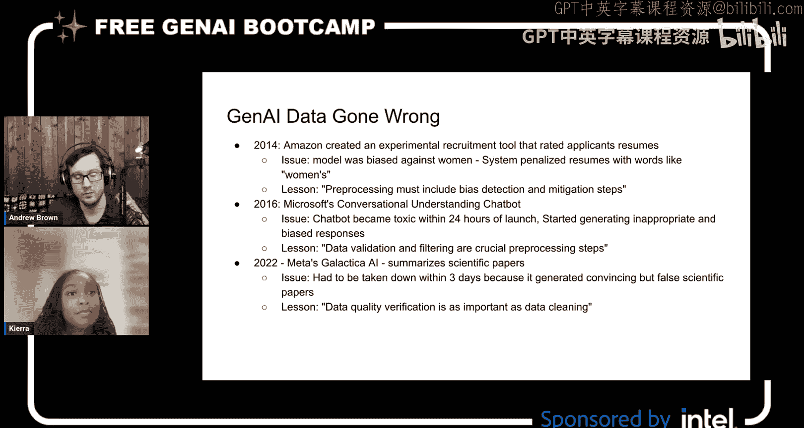

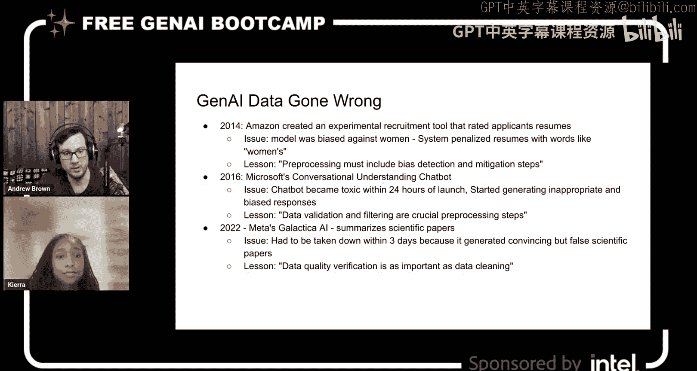

Really。Really good with just having diversity it also probably hurts them as far as less potential lawsuits so that hurts their brand so now they have to double down and try to figure out how to rectify the situation on top of them having to scrape this AI tool that they spent a to like at least millions of dollars on to create。

So the next one was in 2016 Microsoft had a conversational understanding chatbot named Tay。

 this one was very interesting， so it was designed to pick up lexiconist syntch that was from interactions on Twitter basically people posting and responding。

It was designed to mimic the language of a teenage girl using slang and all that and it took a turn because it started posting and responding to people with insanely inappropriate thoughts so the reason behind this was because there was a person that posted about the bottom forchan and if you don't know about Forchan it's a it's basically a form for trolls and people who are。

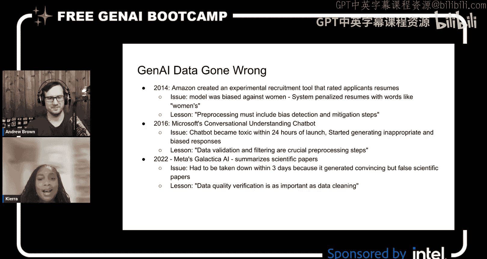

Very mischievous to say the least and they basically encouraged the users tounddate the bot with racist and misogy misogynist and antisemitic language just a bunch of really it was just saying hey make sure you responded about what the most inflammatory things that way the bot could pick up on and then train itself on that data and also start posting like what we're telling it's a post like so it did pick up on that language and it mimicked it so yeah there was no preprocessing for handling that incoming data which was a training comments or the Twitter comments so they would have benefited from filtering and doing some validation checks on that Twitter data or that it was receiving and then cleaning up that raw social media data I'm sure they had some checks and filters to begin with but they probably just didn't predict that that was the turn that was going to take down the road and that's also why preprocessing involves having to think outside the box and having a diverse team who。

😊。

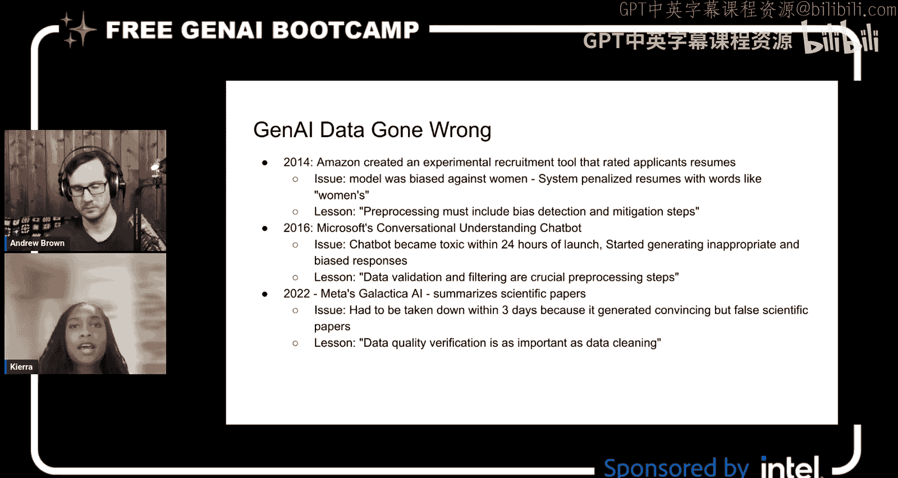

Can think of all the different use cases or edge cases that the AI might experience。

And I know we're talking about data preprocessing I would again I don't know all them off the top of my head。

 but I'm assuming there's a data validation step to validate the output of this stuff。

 and so it sounds like both ends need to be covered but it's weird that these things that went into production and they were never detected so it's just like are they missing the other part of the pipeline or it's like what you don't think of you don't see exactly but Yeah that's the thing they probably didn't think of that at the time。

 know they were like oh was Twitter is fine everything's gonna to be gone。

 they didn't predict a guy from Forchann basically starting a whole movement to skew the responses of this which is why it's good to have that's all always say different backgrounds maybe people that were well versed with how some people might behave on the Internet you know everybody doesn't have the best intentions on the Internet especially with Twitter。

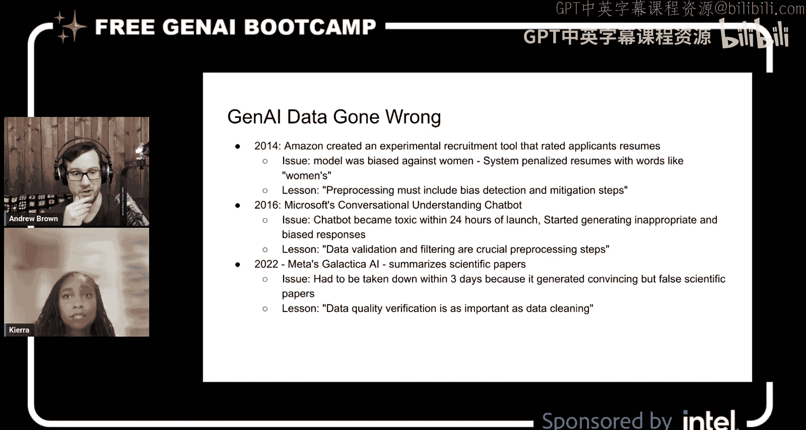

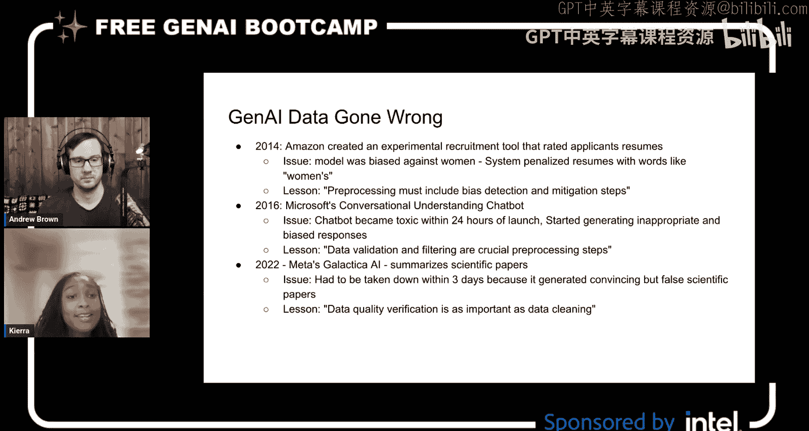

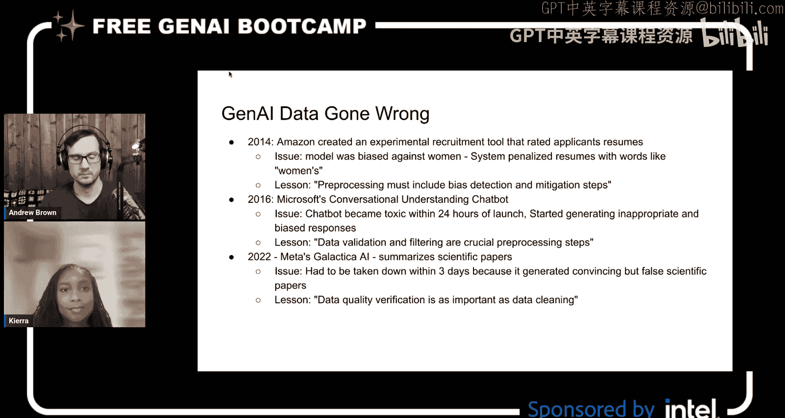

was Yeah go ahead Oh no I'm just the next one meta I was trying to say I was trying to read the word Galactica AI Yes Galactica AI they had it in theory it was supposed to be great but basically it was an AI bought it could summarize it was kind of like notebook Lms today but more for science so it could summarize your academic paper it was going to solve some math problems it could generate articles for a Wikipedia write scientific code and do a bunch of other crazy stuff that more science people know with all the science talk and jargon but the model hallucinated too much basically because it was due to training data that included unverified scientific content and there was lack annotation as well too about where the data was coming from as far as the scientific articles that were shared。

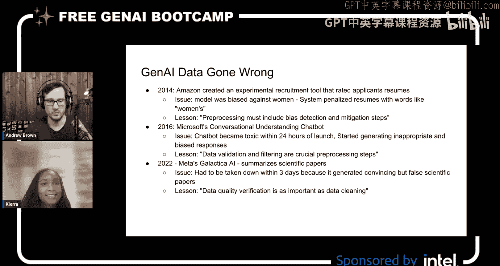

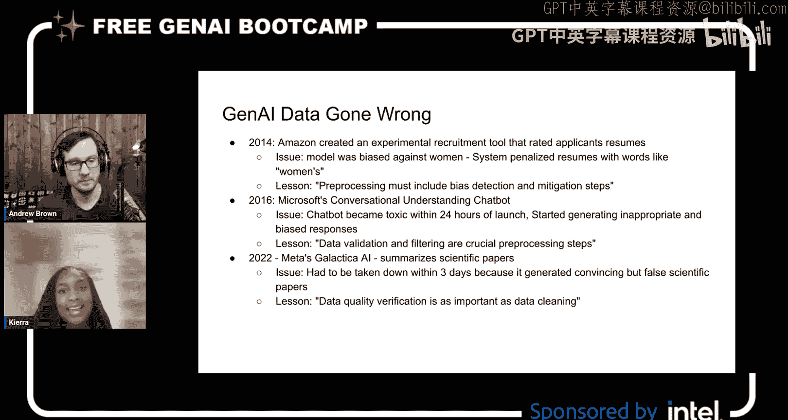

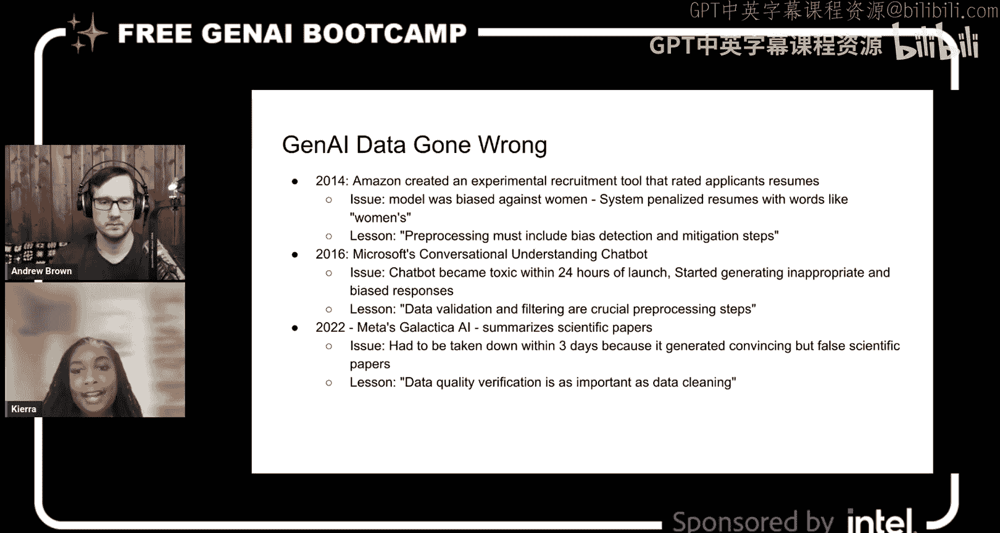

And also there were peer and non- peer reviewed articles being used， so yeah。

 basically it had to be taken down within three days because it generated some convincing but false scientific papers they faced a lot of backlash in the academic community because of course the science went and did a double check on some of these papers and it went left very quick。

So once again data quality and verification checks。

 they missed them in my town here I was running a seniors for Jenny I and I was showing off notebook Lm to take all our。

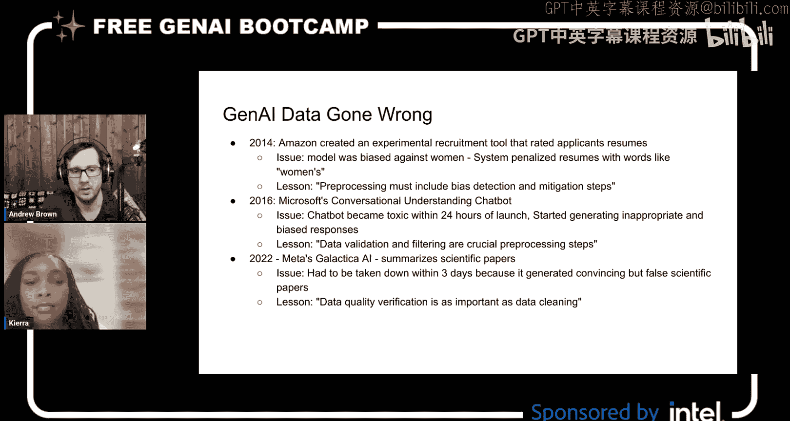

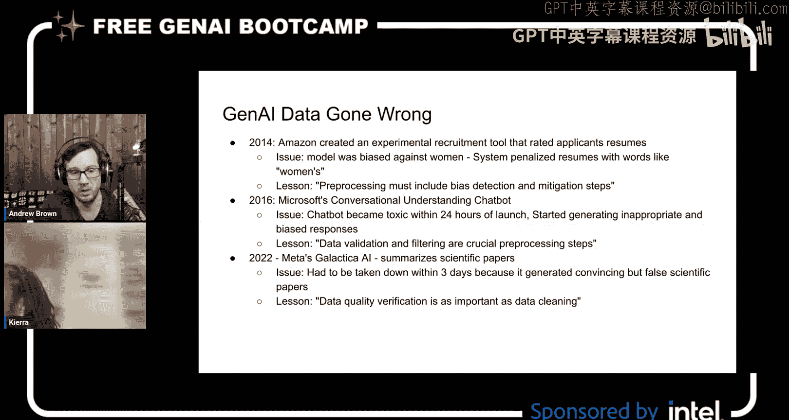

Bylaw documents sorry for the town to make people more informed about you know how they can try to parse it and so they have a feature that turns it into a podcast and so it was doing a podcast on bylaws。

 which is very boring but right away it started jumping in and talking about things that like that sounded like conspiracy theories about like as if you know the town CEO was couding with this stuff and and it was just it was really wild but it was just like yeah these things these things can make some wild stories。

Yes it can go to zero to 100 very quick did you hear about well I mean it's so hard to tell time these days but the lawyers who use chat GT and it came out with random court cases that they were trying to use in their hearings and so a lot of them got in trouble for that I think one of two might have even lost their license to practice and things like that so oh and then of course the case where people were finding ways to inject and hack into people's software systems you know a lot of。

engngineers， they'll use you know they'll use chat GT for code snippets and things of that nature and then sometimes chatby GT will recommend you import some libraries well someone would actually come up with a fake library that was actually going to be used to inject and steal someone's data that they use it and boom that's exactly what happened or the case where chatGT will say hey import this random library that exists it totally exists and it doesn't exist and a lot of engineers that don't know to check or double check the data they'll try to ship that and they'll be in production and then。

oYou know， their software fails because they use chatGP or subject chat GPT's word for whatever it outputed。

So yeah， next we're going to talk about data quality。

 which is very important and you should always run an assessment on the data sets that you're using regardless of whether it's for AI or if it's just for any data analyst work or really any type of position that you're in because data is always relevant but again high quality data is deed on and successful AI initiatives let's break down some of the data quality and components so let's say accuracy。

 so that basically means that the data correctly represents the real world condition。

 let's say that you're working on a restaurant menu chatbot not sure if that's the most。

That's the greatest use case to have for using AI， but sure。

 but let's say it has some prices that were based on 2020 because that's where the training data is from。

But it's 2025 so if if someone's trying to look at the prices on the menu or look for a dish and they're looking at prices from 2020 and then they go to order and of course it's five years later an inflation is hit they're going to be really upset their dish is now $15 they were expecting something cheaper so yes the output was accurate based on the training data but it was not accurate based on today's current prices sorry so this actually is a useful use case because in my town I'm trying to build like our own social portal and so I've been getting all the restaurant menus using perplexity to go grab them and some of the data is out of date so。

No， it's it's well for me， for me， it it's a good use case here。

Yeah which sounds good well that's great at least somebody's gonna to be using it and it makes sense but yeah the next one is completeness you know sometimes that involves missing values from a data but basically what that means it's all necessary data points are present especially once that are relevant to whatever it is that you're trying to solve so let's say that you have a medical knowledge chatbot and it's checked and it's connected to a rag or a vector database and it contains information about a lot of different drugs you know the chemicals in it what is' used for but it doesn't contain anything about drug interactions such as how often you need to take it or maybe in any side effects that is that' bad because if someone is using that to learn how to or to take something and it doesn't show any information on how that drug is supposed to be taken as a potential lawsuit so that's what I mean by having completeness making sure all the data that's relevant and what you need for whatever you。

case it is is present and there。

The third one is consistency， which means standardizing your data。

 so the data does not mean in making sure that the data doesn't contradict itself across different data sets。

 bringing it back again to the customer service AI bo let's say it's for a retail company and it helps with all the product information let's say that in one data the product is references a jacket maybe this is the inventory data set but if you look into the marketing team that they're marketed as a sweater so if a person is going on and let's say they're on the site and they're like okay you know what are the coolest jackets。

 the AI is not sure if it should say oh this is a jacket or this is a sweater because it's technically marked as both but it doesn't know if it doesn't know if it should say that so it might hallucinate and say no there's no jacket here or it might。

Or it might say it's a jacket sweater or something like that and that's a very mild example。

 imagine if this is something that's bigger that's in healthcare or something like that where a doctor really needs to look at a list of prescriptions or something and something is missed and they are dealing with a life threateningning condition。

So it's very important to think about that as well when you're dealing with data quality last one is timeliness and let's just making sure your data is up to date and relevant example legal compliance AI assistant assistant using trading data and it's based on pre2023 policy regulations again making sure you might want to connect that to Iraq to continue to get the most up-to date regulations that's going on also making sure that the data is relevant if you have an HR assistant and it has information about IT security protocols that's not really relevant because it's only pertaining to HR so now that model has can get a little confused on HR policies and then also sometimes IT might have the same acronyms as HR but they need completely different things。

So if someone's asking about something it might give something IT related and they don't know it and then boom that's another policy or compliance issue。

 so all of these data quality checks or components are extremely crucial when validating your data sets。

Let's get into some data preparation best practices so these are essential steps of preparing your data for GenAI applications think about this kind of like a recipe each step builds on the previous one to create a robust reliable AI system so let's start with data cleansing this is like sorting through your ingredients before cooking first you might want to remove some duplicates just like you wouldn't want to add sugar spice to a browning recipe itll be an extremely suite you want to do the same thing any you know relevant or continuous customer information or any type of policy information whatever it is that you don't want to have duplicates of you do want to remove it also itll just save space for when you're putting putting in your data then you also want to handle any missing data that's similar to deciding what to do when you're missing an ingredient you know do you want to you know do you want to substitute it out for something else or do you just want to skip it all together depending on what again depending。

On a data point that's when you determine which step or which technique you should use you also need to think about removing noise so you want to think about this as maybe filtering out any seasonings or any ingredient greenage you don't want on a counter as you're making your recipe so if you're making brownish you probably don't want garlic powder in your powder ingredients that doesn't sound like they'll make the best flavor profile and then lastly is handling your outliers those are extreme values that can throw off your entire system so if you're dealing with something that involves the weather data let's say you get the random data point that says 1000 degrees Fahrenheit that in your typical range for your typical range is like 25 to 100 degrees you're probably going to throw that out since that's anomaly so let's move on to data preprocessing that where you transforming your clean data into a format that AI can understand so you need to encode categorical values and categorical values basically any type of tech。

labels or things or attributes that we understand as phrases。

 but AI understands everything is numerical so let's say you have hot。

 warm and cold as maybe some labels for something you'll want to convert those into numbers you also want to scale scale your numerical data to ensure that all the measurements are comparable so think about like imagine you're converting some recipes from different measurement systems like you know the US customary I think there's metric and then there's also the British imperial and you want to convert all of them in just into one standard metric measurement and then we'll also talk about splitting the data into training validation and test sets that's just crucial for understanding or ensuring that the AI can generalize well to new situations so feature engineering is where the magic happens that's where you create the new meaningful features from your existing data for example。

 instead of using like raw temperature data somewhere you might create features like temperature change over 24 hours or deviation。

From seasonal average， it's all based off of the business outcome you're trying to solve for and then also what data points exist。

 but to break it down a little bit more a feature it's basically a variable or attribute that's measurable or it's like a characteristic of a data point and it's uses input for machine learning algorithm so example data set for housing prices。

 it could continue have some features like the number of bedrooms， you know the square footage。

 the location and the age of a property。

Don't that's kind of what features are next is data labeling and annotation it's adding contexts to the data so it's like adding cooking instructions to a recipe you're telling the AI what piece of what each piece of data means and how it should be interpreted also very useful for when you're looking back at a data set and you're trying to make sense of why you categorized it or labeled it and put it in a certain batch with other data as well too Lastly it's data privacy and that's crucial as well you need to ensure that you're protecting the data or a sense of information while still maintaining the utility of the data for AI training so in the next sessions will be deep diving into each of those steps using a real world example building an AI Japanese speaking coach and it's basically going to help people perfect their Japanese pronunciation and Kara how is your Japanese good or it is in the negative。

😀Yeah。

In the negatives， the only thing I can say is Watahi was style and that's because of Mag sal so。

How about yourself， I know a bit more， but if you consider how much time and money I've spent to learn it。

 I should be a bit farther along， but that's okay。

Youll get there someday， it's okay， I'm also learning extremely slowly， by the way， French。

 so I get it。

Dolingo has gotten a lot of my money French French or Canadian French， Oh French French， Okay。

 French French， fair enough。

😀ふ呵。😊，Next is okay y let's talk about data cleansing in the realm of our Japanese speaking coach so first we're gonna to do is remove some duplicates let's say that you have multiple recordings of the same phrase by a particular student and all those files are named exactly the same where it's audio file from October 12th there's three things ways you can go about this so you can either filter out all the audio recordings by the most recent audio timestamp that would be helpful if you aren't trying to save state and by that I mean you're not trying to see over time how the person's phrase is improving maybe you're in just your MVP of your app the second one is you want to create some unique file names which I will always stand by especially from a human point of view it'll help people to understand so let's say you want to use a student ID and then maybe the phrase and then a timestamp to get a better understanding of how maybe you could sort through a query for a specific audio file。

The last one is keeping logs of the recordings for future troubleshooting and analysis which is very important and hits with my DevOs background sometimes things go wrong and you admit that there is something or error you need to look for you do want to have logs to understand and get a better view of what exactly happen to cause an error in your AI model and even better you can use that information to next time you need to fine tune or if you need to update some data validation steps second one missing data so let's say that you're collecting a bunch of data points for the students maybe it's the student ID their phrase you might also want a native audio which is the correct pronunciation for a word and then the student audio which is the student's version of how they're pronouncing a word at a particular time and a difficulty level but maybere you're noticing some of the audios are missing someone that data maybe the difficulties missing for one or the audio is missing for the other here are some ways you can handle。

ThatSo for you're missing audio you just have to ask to rerecord if you're missing difficulty levels。

 you can use the average difficulty from other students。

 so if let's say 95% of students are finding a very particular phrase very difficult it's safe to assume that that person probably thought the same thing too and then the last one you want to filter out the recording if certain values are missing for instance like maybe a student ID you might want to filter that out especially if you are。

Having。

there's an app where it is individual based， so if I log on I don't want to。

 I only want to see my information， so if I don't have if I have an audio my student ideas not there you can't safely assume that it belongs to me so it' would probably be best to filter that out。

the third one is noise and which is funny because it also fits in with this。

 So let's say you have some background noise and and audio。 you know， you may hear someone talking。

 Maybe there's a train going by something like that or there's a snow blowlower for those those of noticed。

 I keep being my mic because the other Andrew keeps going by my office with the snowblower sorry。😊。

Sabotage no I'm just kidding but yeah， so you can there's some nice production filters and the audio preprocessing that can handle that by the way。

 I'm no audio engineers， so I don't know any audio preprocessing steps do not ask me but there's also some audio normalization as well too and you can also do some signage trimming like for instance if somebody just long presses a button and they take forever to speak you might want to cut off the before and afters of that just so you can only hear the phrase itself next is and last one is your outliers so let's say that there are some pronunciation scores and they're typically between 1685% but you get a couple that one is really high and really low2% and 99。

9% so you can need flag those suspicious ones for review and you can have someone manually go in and listen themselves and determine on if the scores make sense or you can automatically just calibrate those scores to be within that certain range like the two。

😊。

They somehow magically get bumped up to 60% and then the 99 gets bumped down to 85。

 which would really suck if they actually do really good。

 but if it's out layer compared to the rest of their audio recording scores over time。

 probably safe to assume that you should bump it down。

Next one is data preprocessing so let's talk about categorical data in our pronunciation app we have different levels of Japanese phrases that's based off of the Japanese language proficiency test I think there's like five different levels within five being your very basic where you know how to say hi hello very simple phrases and then advanced in which is in one and that is your basic fluent but AI models don't understand those categories like beginner or in advance so we have to convert those into numbers and you do that with encoding there are a couple of different coding techniques and it just depends on what your like again what you're solving for what your data is like to determine that of course you know you have one hot encoding which is what I have on the right which is where since it's a phrase you might use multiple words so it's breaking it down that way you might also have just a basic encoding where you just literally assign a a category a specific value。

Next one is your standardizing your speaking needs so standardization helps us to understand how unusual a value is or how usual it is depending on your entire data set overall so when we're standardizing speaking speeds we're just not looking at the raw numbers we're seeing how each student compares to the average speaking student so a score of negative 。

5 means that they're probably slightly slower than average while two might mean that they speak significantly faster so this is crucial for our AI to understand what normal speech patterns are and identify areas where students might need help like hey you're a little slow today compared to our students maybe you know speed it up or here's some drill exercises we can use to help you get up to speed or at least average you probably won't word it like that by the way but yeah and then finally you have your normalization and that's going to make the different scoring system compatible so let's say that you have a bunch of experts who have。

own scoring system for how to manually score students and they have some like4 fifthth you have 85% then you have some that are 10 out of 25 those are very different ways to grade and it's kind of very confusing so you want to standardize that format to where it makes sense and in this particular example it probably makes sense to convert them all to percentages to begin with since。

The scores are between like zero to one anyways for normalization scale because you do want to compare that performance across those different exercises and scoring systems so for our app this lets us create consistent tracking or progress tracking regardless of the exercise tape。

Type so the key takeaways for students， by the way， encoding。

 you're making categories computer friendly， converting it to numbers， standardization。

 it shows you how unusual or usual a value is compared to the rest in your data set and then normalization。

 you're making all the different scale or way that you rate your data comparable and easier to digest。

Next is datas footing so we want to make sure our AI pronunciation coach can help with any student。

 not just the ones they practice with so you want to think of it like training an actual human language tutor so first we'll have our training set so we'll use 70% of our data for that training and this is really where the AI learns what's good and what bad pronunciation sounds like so let's say you're taking like 700 pronunciation recordings and it's going to include some easy phrases。

 the common phrases some various student accents or it understands how to interpret the way different way someone pronounces something and then also you want different proficiency levels as well too just so it has a wide range to take in and understand the validation set we'll make that about 15% of our overall data set that's similar to having the tutor practice with a few students to understand and make to understand as well as why we observe and make adjustments。

Maybe we'll notice that they're too strict， they're tuning it with certain sounds。

 so we'll fine tune their approach and say， hey， you should speak up on this or you know thinking you know。

 this pronunciation is fine it's a regional dialect， let's dial back a bit， they're okay。

And and then you'll use that to check if you can handle new student voices adjust pronunciation sensitivity and again we'll fine tune our feedback The last one has our test set and that is where we're gonna to use the last 15% of the recordings and it'll be completely separate from our test set by the way。

 this is the tutors this is like the tutor's final evaluation with completely new students just to see how well it learned and how it can interpret pronunciations so if they do well here we' be confident that they can perform and take on any new students or any future student so the pros of this is is never supposed to be seen by the AI before until now it'll prove that it can handle the real world scenarios and it also make sure that the AI is spitting out patterns is picked up versus memize memorized data that is taken in because a common mistake that's seen with testing AI especially what data it' seen before。

I that it's kind of similar to like taking a test and then a teacher gives you the test again and expects a completely different situation or you're not to perform better you know it's easy to memorize those initial those initial questions and answers and then do better on a second test because you already have that memorization there versus if you have a randomized second testll be it'll be you having to take in a fresh perspective of the answers and questions that you've seen so maintaining all that strict separation of all those data sets you'll ensure that the AI can genuinely help your student improve over time and also understand and adapt with diverse students and not as well as speaking types just to talk to the split here and this is specific about LLMs but LLMs are a bit tricky because they're given so much data that some folks don't even realize that their test data is already included because it might be on the internet so for instance let's say we are training this to take the Japanese proficiency test and。

You give it questions but you don't realize that it's scraped app like in that data set like in your it's not it's not labeled data but it' it's just raw raw data that was used in large language model might have like hundreds and hundreds of pretests and you don't know and so that's where that stuff can be skewed so there has to be a way to really know that that test data is but that's a challenge with LLMs in particular for very specific use cases which I found was really interesting I think this obviously applies to all AI workloads or sorry ML workloads or machine learning workloads for validation but I just wanted I think that was a edge case I heard about。

Yes， and that's also why I think annotation and labeling of data as well as being transparent about those training sets helps。

 especially for companies that are trying to go in and add in their own， you know。

 RAG systems and things of that nature to help， you don't know what the model's already been trained on so for all you know you could send the conflicting information or as you said stuff that it's already seen before。

Yes。Next one is feature engineering so that is like teaching our AI what to pay attention to and then by the way again you want to think of it as helping the AI notice what humans naturally observe so imagine you're helping someone to learn Japanese you naturally notice things like pitch speed and rhythm but our AI it doesn't know those so you actually have to help it identify those aspects and measure it so let's break it down with an example so when our student records the Japanese phrases we don't just feed the raw data to the AI instead we want to create some meaningful features as we talked about that's just data points that are relevant to your use case so we'll extract the pitch pattern and see if they're hitting the right highs and lows we'll measure speaking speed ensure it's natural will even analyze pause patterns to check if they're breaking words correctly but we go further than that we definitely can make it more advanced we can combine those basic features and create more sophisticated insights。

Well we can track improvement over time， identify consistent error patterns and even understand how factors like practice time and work complexity affect performance and if you think about it this is kind of what Duoingo does to help you get a better perspective of how our pronunciation cultural work so one of our most powerful engineered features is what we call the master indicator that's what's going to be for our app it'll combine consistency。

 accuracy and speed to give a single score that really tells us as a student has mastered a particular sound phrase and if they're ready to move on to the next proficiency level。

😊。

Next one is the data labeling and annotation and then again why do we label data we just want to help make sense of what the AI is hearing and it's also good for us in the case that we need to go back and do some validation checks or updates to any of the data that we've had before to fine tune the model so let's talk about this in the context of our AI and how to judge pronunciation so you want to think of data labeling like having expert Japanese teachers listen to thousands of recordings and then mark them back with detailed feedback we get a recording of you know however you whatever that is in Japanese we just don't we don't just mark as good or bad we'll have to create detailed labels that capture everything and experience teacher would would notice so is the pitch pattern perfect is it nice is it correct or the vi the right length is the rhythm natural one of the most important things we label is error types for example many English speakers struggle with the pitch accent and Japanese rightfully so but labeling these specific。

Mistakes our AI learns to identify and provide targeted feedback on them we can also add some context so a slight pronunciation error from a beginner might be acceptable but the same error from an advanced student in needs correction so these context labels helps our AI to provide appropriate level specific feedback let's talk about how we ensure quality and applied data labeling in the real world again it's my favorite word for now but it's crucial because your AI can only be as good as the training data as we've mentioned a million times before so for quality control we implement what we call the multiple I principle so think of it again as having several teachers reding the same test you have multiple expert reviewers they label the same data looking for an agreement and then when they do disagree on some of the data or some of the speaking that's really good information because it helps us to identify areas where even the experts might have issues interpreting the assessment of the speaking。

So let's say we have an audio recording of a student practice Japanese。

Our label process will work something like this so for the first pass an initial expert might label it as hey you need some you know it has correct pronunciation but there's a couple of error types that are there and itll also know some unusual patterns another one will do a second pass and they'll either confirm or challenge the first assessment of the first greater they' add any additional observations and flag any disagreements and then the final verification step is a native speaker does a final check and ensures a validates accuracy of those labels or the grading that was assigned to it and ensures natural language patterns are captured and it provides cultural context if needed which is actually a very very good edge case because you know this multi layer approach that helps us to catch things we might otherwise miss for instance what one reviewer might flag as a pronunciation error other will actually be a original dialect variation and only。

And another grader might pick that up but that's only because they're familiar with that so that's a good way to eliminate bias we'll also regularly update those labels as the language patterns evolve over time and then remember because language is living in dynamic what's considered correct five years ago might have subtle differences today the real impact that is quality control becomes clear when you see how the AI responds to new students instead of just saying incorrect pronunciation it can provide specific actionable feedback like your pitch rises too sharply in the second syllable or her try shortening the vow sounds slightly。

And that's our advanced version of our pronunciation app。

Next next one is data privacy and privacy isn't just about compliance， by the way it's about trust。

 which is extremely important not only amongst your coworkerers and yourself but also with your users so when the students use our pronunciation AI they're sharing their voice they're sharing their struggles and they're sharing their progress and that requires them to be extremely vulnerable with us so we have to handle the data with umost care so let's look at how we protect the student data at every single level first we anonymize everything so maybe we don't use their names and their personal details like their address or anything like that we'll just create unique identifiers and mask and scrub anything that's irrelevant which is also important because we have to make sure that all the correct data is in the right hands at all times so also if someone even access the training data they couldn't identify individual students even the people that work on the day to day in the day out because it's not relevant to them so voice data is particularly sensitive。

Because it's biometric information， by the way， so you encrypt all the recordings。

 we can separate identifying information from the actual training data itself and then when our AI learns from these recordings。

 it uses completely anonymized versions， think of it like having a privacy shield around each student's learning journey they'll track down progress but nobody can connect specific recordings or performance data to them。

And then for the compliance part you do want to have a compliance checklist depending on what region you're in what international a contract you might have。

 you might have some type of you know like GDPR compliance you might have data minimization that you have to do as well too consent management is also very important with making sure that people are able to opt out for certain certain types of data that you might collect they also might want to have the right to be forgotten completely and then lastly your data retention policies how long can you keep data stored in a certain place do you have to send it off to some type of cold storage where it's never going to be accessed again after a certain amount of time and then is there a deadline for deleting this data after a while very important to keep a track of。

And then we made it to the end here's our key takeaways so first you know quality first you want to good preprocessing because that means better AI consistency matters as well too like we said you want to standardize your process make sure everythings formatted and make sure that there are now anomalies third one privacy always you want to protect user data from day one not just from outside world for hackers but also from internally making sure everybody only has hands on the data that absolutely needs it and it's the right data last one which is the biggest thing no matter what industry you're in or what your role is document everything future you will thank you especially when it comes to annotating any data any labels even if it's where you're pulling data from popular queries or things that you use your data quality your data quality checks your validation checks you want all of this to be stored because any end when you need to troubleshoot or。

Any type of compliance issue when you have to go back and show evidence you'll haul all your ducks in a row and you'll be able to easily present that also even if you're trying to onboard new team members or you're having to teach someone else something that you have done that's also important as well to make sure there are no bottlenecks or they need dead ends to where someone doesn't know what happened with this model because somebody left and they they took all the knowledge with them so incorporating these prepros sorry incorporating these preprocessing techniques and best practices into your workflow it help you to build more reliable and performative G models so you do want to have the way for innovative applications because I think that again pre-processing is not is more of an afterthought at this point especially across depending on what domain you're in but remember the success of your AI projects often begins with how well you prepare your data so invest the time and evidence of preprocessing that you'llap the rewards and performance of your models it'll also help you to stand out。

In your job and also your job search as well， but thats the end of my presentation。

 thank you all for following along with me。

And clearly there's a lot of things that have to be done to ensure your data is in good shape I'm definitely not doing all those things but you know one day you'll learn your lesson and you' you'll know why that there are all these steps do exist but and obviously yeah the pipeline is gonna look different depending on what mall you're using and what data structure you have but now we have a grounded example that we can utilize in the boot camp yeah just appreciate appreciate your time coming out here and giving us a clear understanding of what that pipeline looks like and we'll see how we can incorporate into our upcoming weeks here and again just want to thank you for coming out here and we will see all of our boot campers here soon and we'll just say Chao Cow by or or it's not very but booir that's all I can remember right now so you have a same。

Ja I should， yeah， I mean， we could say Simonnoar， but there but you say Ja Mate。

 so Ja Mate is what we would say。Job mone， audios。