# ExamPro《生成式AI训练营｜Free GenAI Bootcamp》中英字幕（deepseek - P1：-01-How To Register For Free GenAI Bootcamp.zh_en - GPT中英字幕课程资源 - BV1SFEWzLEab

Hey， this is Angie Brown。 And in this video， I'm going to show you how to register for the free Jennyi bootc。

 I at Jennyi cloud project bootc com， which is the official domain for this event and you can click this link。

 and it will take you to the exam pro page for a sign up。

 You can also go to the main website and register if you already have an exam pro account。

 you can log in that way， But what I'm gonna do is I'm gonna make a new account from scratch to show you the end to end process。

 So whether you click here or you click here。 It's gonna to take you the same place。

 So let's go ahead ahead and hit register now。 And all it's doing up here。

 you know that it's gonna put you in the right place if the plan is set to EXP Jennyi at the top here。

 I'm gonna make a new account。 I'm going use my personal email， which I really ever use。

 So anybody sends me emails， I'm not gonna to see it。

 I'm gonna go ahead here and make myself a new account。😊。

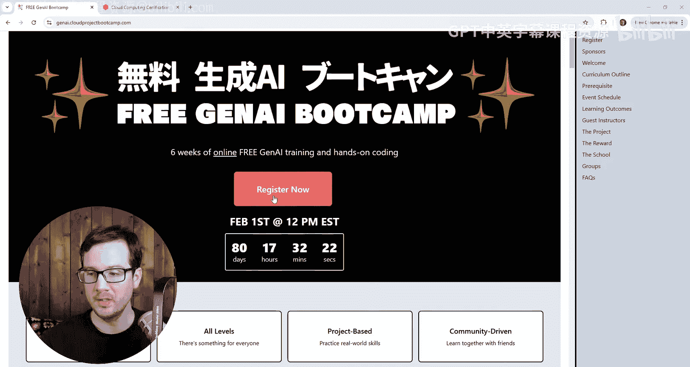

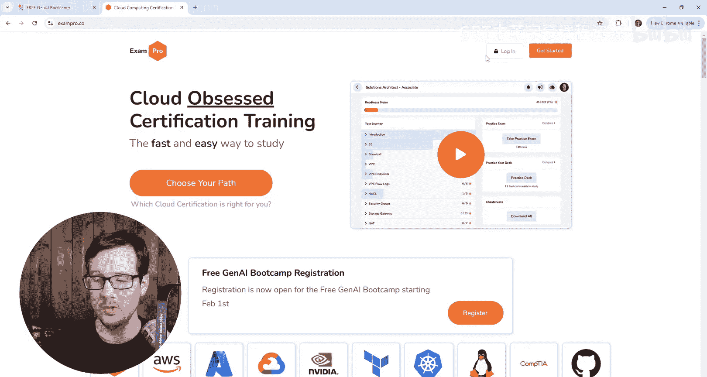

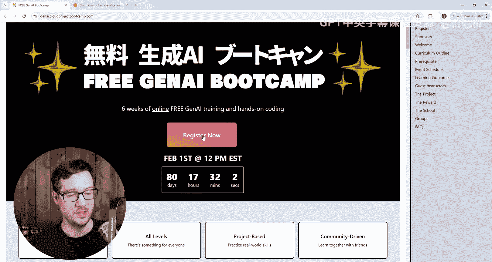

And I'm just putting in a password。 Here we go。 We'll go ahead and sign up。And it does not match。

 So give me one moment to make sure that matches。Okay。

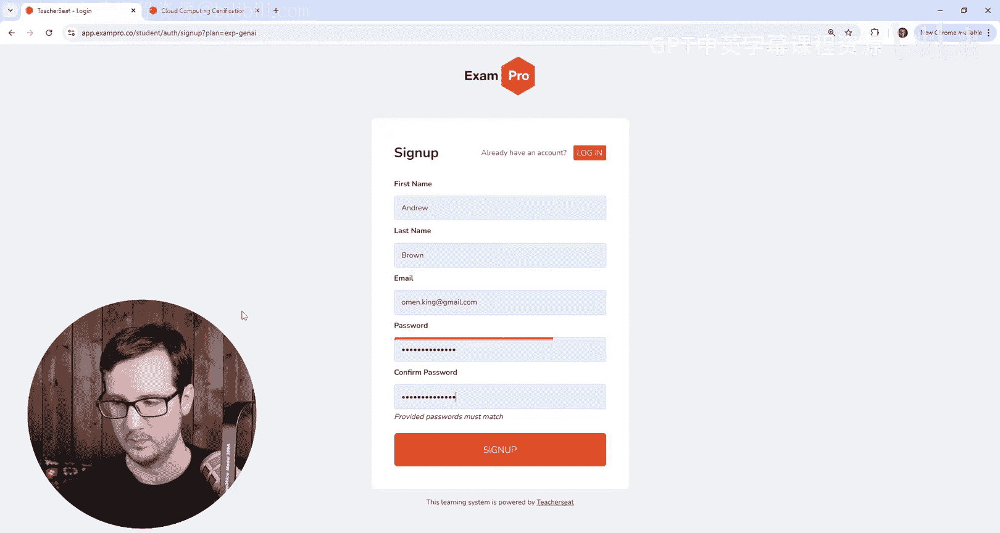

They match up。 And so now I'm going to get a pin。 So I'm going to go over to my email。And over here。

 I have a pin to sign up。 So I'm gonna enter that pin number in。

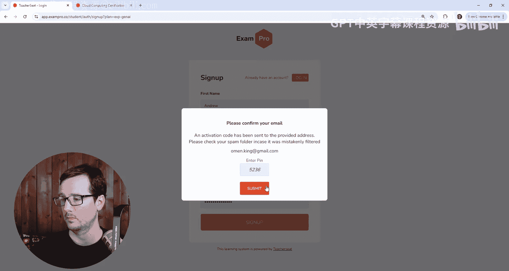

And we'll hit submit。 We'll give it a moment。It says thanks for confirming， proceed。

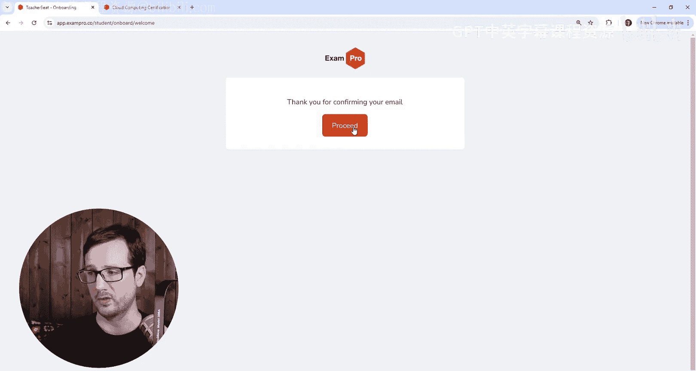

I'm going to choose dark Mo because I like it。

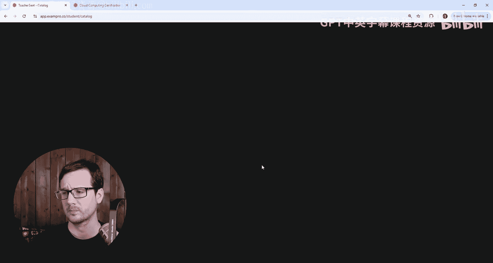

And so I didn't directly take us to that plan， but it's totally fine because it's right here。

 I put it nice and obvious in here。 If it's not here， it'll be under example under bootc。

 we'll go ahead and click it to here。

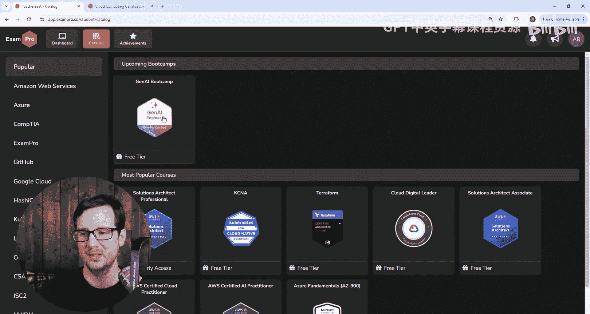

And here it is free for you。 So you have to go here and just accept the 0 do00 amount there。

 you didn't have to enter a credit card or anything。

 And then we can continue on to the Jenny Ibu camp。 And so from here we have our welcome message。

 But what you'll need to do is get set up for registration。

 So I have some information in here in the introduction。

 which is just going to tell you some thingss going to move ahead out of the way。

 But all I'm talking about here is about saving the date and you really should add go to one of these here。

 and。

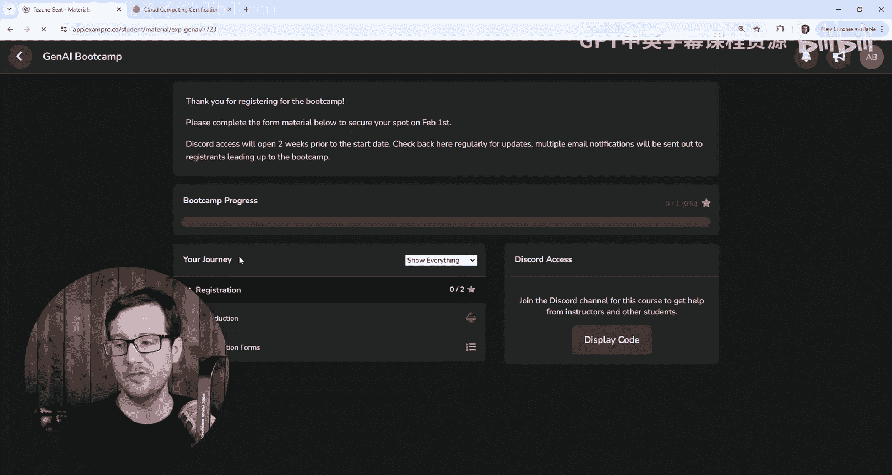

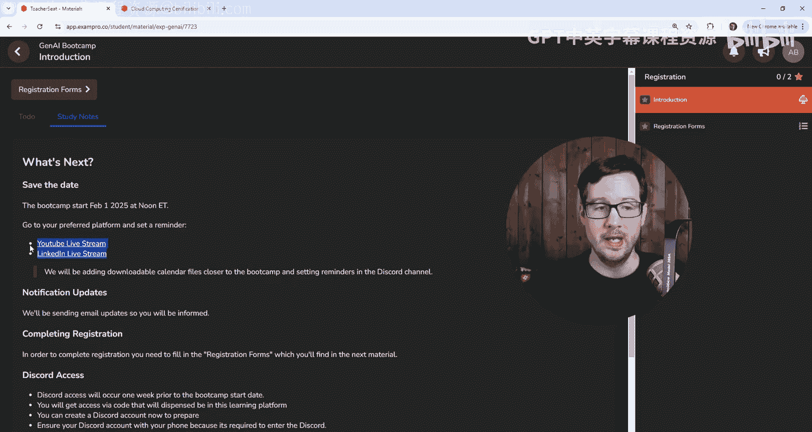

Add your。

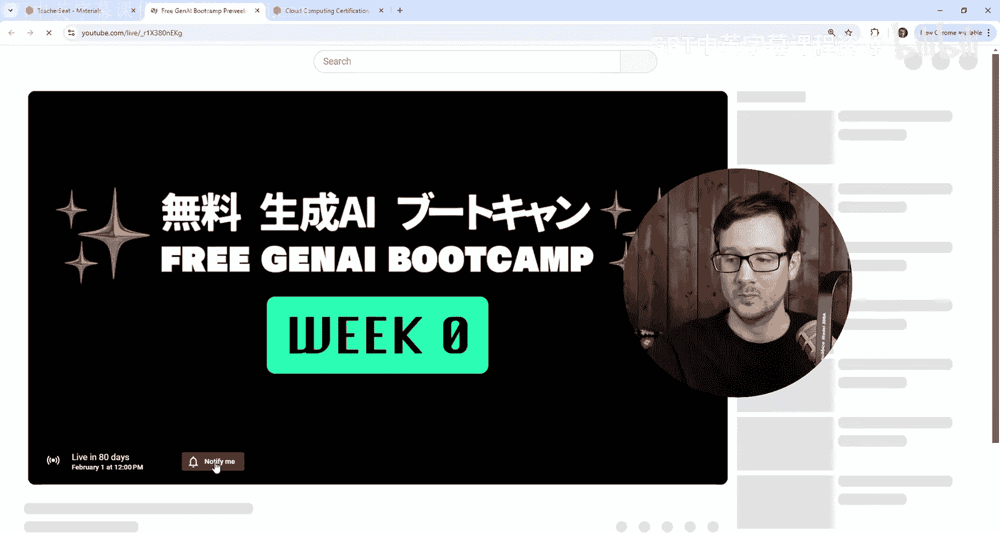

To notify you here。Or if you're on LinkedIn， you can do the same as well and download it at some point。

 I will create calendar events that you can mass download for the entire schedule。

 We'll have the schedule in the system here as well。 It is on the marketing website。

 Okay to complete your registration。 you do need to complete the registration forms over here。

 So this is what you'll want to do next。 So I'm just gonna click into them and show you them。

 So I'm going to go ahead and fill them in really quickly just to make sure that they are working。

 So I'm gonna to go here and say exam pro training innc。 I am the CEO。

 I would be described at this level here。 And just pick the best that you can in here。

 It's not a big deal if it's not a perfect match。 but we used to have it open。

 And then I'd have so many different types。 choose your time zone。 So I am in a negative5。

 So just focus on that time。 not necessarily the name but the time。 I'm in Canada。

And this is the list of countries that Canada recognizes。 So I do apologize if for whatever reason。

 you know it's misnamed or whatever， but just do your best to guess there。

 We ask for the language just because we are building a language learning app。

 And so we'll say little I know a little bit Japanese but this way we'll just be able to No because it'd be cool to know what language everybody speaks。

 you don't have to do this， but we do want you to put in at least one social profile。

 The reason we we do this is mostly for trust and safety for attendees。

 we want to make sure that accounts are linked back to some social account that is accountable and verifiable。

 So I'm going go ahead and just add my LinkedIn my LinkedIn profile here。But also， you know。

 if I do talk to you， I really do like having these because I look them up before I talk to you so I can have context whenever I'm doing grading or stuff like that。

 So if you can fill it in， I know everyone's not using not everyone's using Twitter these days。

 But if you use something like blue sky or something else。 or maybe in your region the world。

 you don't use LinkedIn or Twitter It's something else。

 Just do your best to fill one of the three in here。

 if you've ever attended another event like one of these checkbox them。 that'd be great。

 we'll go ahead and submit this。 And so now that's submiting the ideas you want to go through all these four forms。

 They're not hard， as you can see， I'm filling them in pretty quick。

 let's look at the assessment form。 This one's about assessing your skill level。

 So how are you with containers， I'd say I'm pretty good。 What's your level8 of us。 I'm good。

 I'm really good with this。 I'd say I'm pretty advanced for GCP or Python。

 I'm never been really good with Python myself。 But again。

 you're filling in whatever it is that you would have for your skill level。 I'd say I'm advance。

 I don't want to say'm an expert， but I know quite a bit。 I mean， I'm putting on a bootc， but。😊。

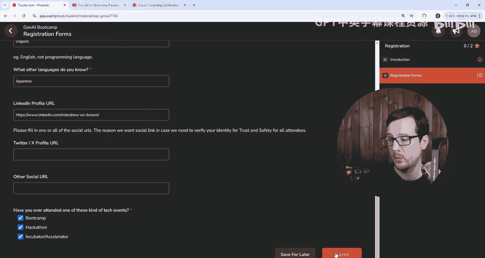

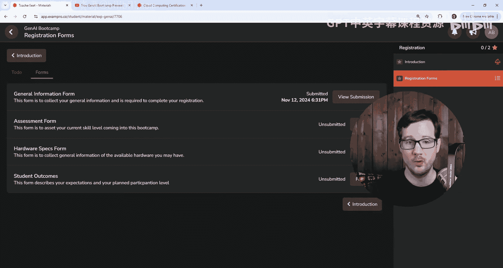

We have experts come in to help me out here。 My skill level with hardware is intermediate。

 Sam thing with M L。 I'm really good with front end。 I'm really good with back end。

 And here you can put whatever you want。 So if you have the AI practitioner。

 like it was say a practitioner。😊，You could do that。 I think I say to use the code。

 So this would be the AI F C 1， A Z 900。 And again， just do your best to help us out。

 I'm not sure why this one's required。 So I will change that。 So that's not a hard requirement。

Let's go ahead and look at hardware respects。 The reason I want to know your hard respects is because。

 you know， we're not just teaching Jennyi on the cloud， but also on local machines。

 And if I know what everyone's using， then I can try to best help people where they are or see where they're at。

 But like for me， I have all three systems， I do actually have any IPC。

 And then here you'd want to provide your spec。 So if you're on your like your Windows machine here I'd open system requirements system information。

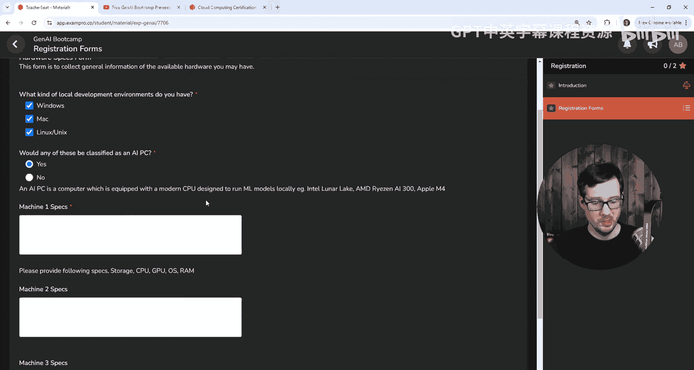

O。

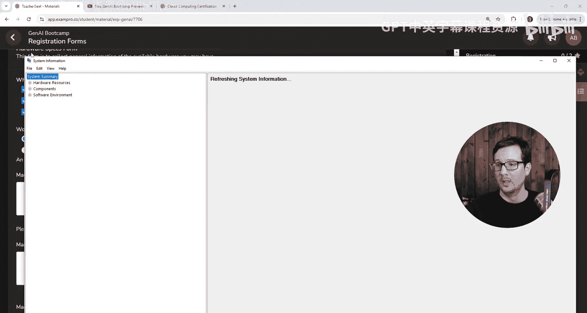

And just do your best to fill it in。 I need you to fill in at least one here。So I'm on Windows 10。

 and this is。

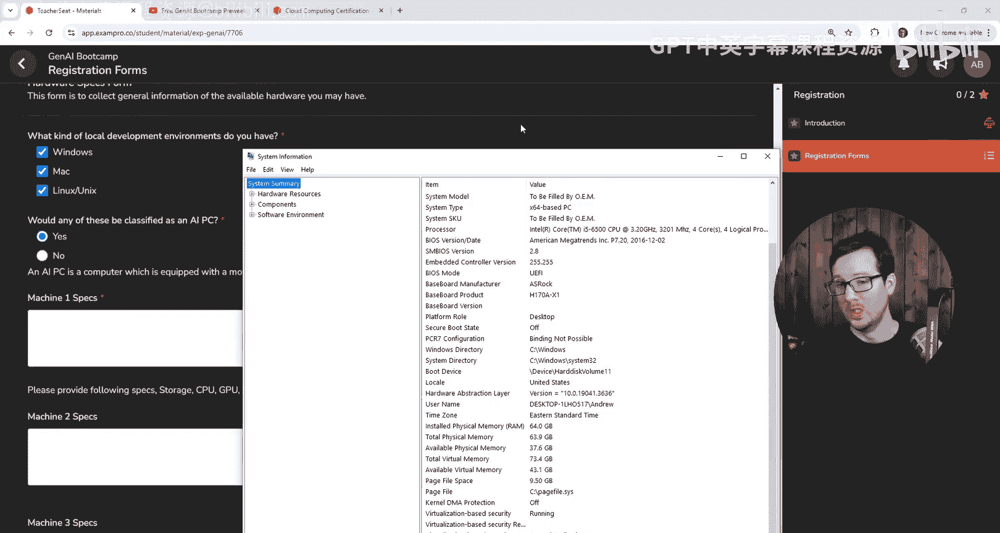

I don't know， but I know this is， it'll say Windows 10。And。The graphics card here is。

 this is what I have on this one。So， I have a。G4s。rRT X。3600。

And here it might tell me the generation of chip I have。 So I'm looking here。 This is a I 5，65000。

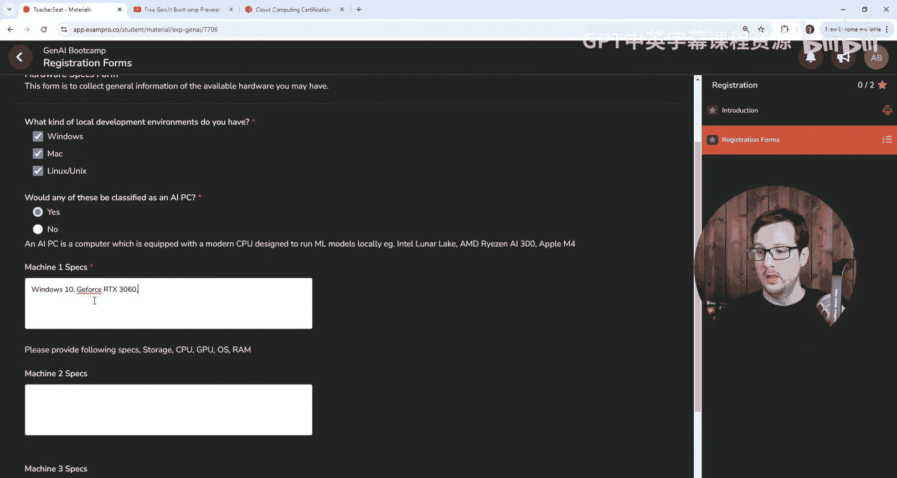

So I believe that would tell me everything know。 we'll go I 5。

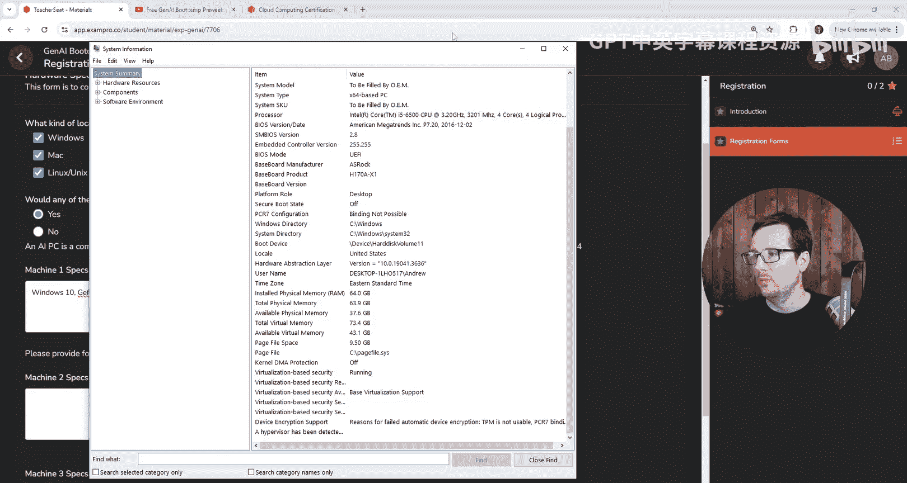

65000。And that's an Intel core。And for Ram， what do I have for Ram， I think I a lot。

 I have 64 GBs of Ram。Okay， so that is good enough for us to get information here。And， and， you know。

 it just really depends on what you have because if you have a lot of RA。

 you're going to be able to do other stuff。 But if you have a last generation chip。

 then you're going to have some limitations if you decide to fall through this stuff。

 but just do your best to help us out here。The last one is student outcomes comes so you know what do you plan on participating in so I'm doing everything do you plan on joining the Discord Are you planning on putting this project on your resume do you want to be graded to receive a badden certificate certificate of completion and there we go and so I'm fully registered and that's all it takes and I'll see you the next one Okay Co。

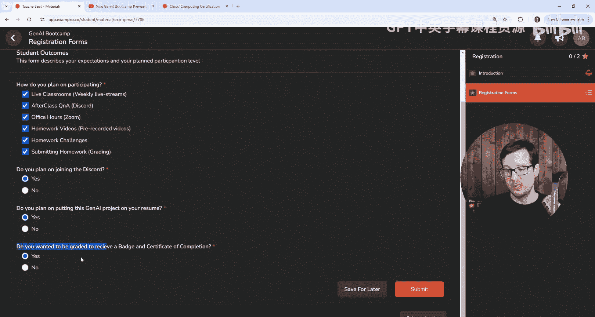

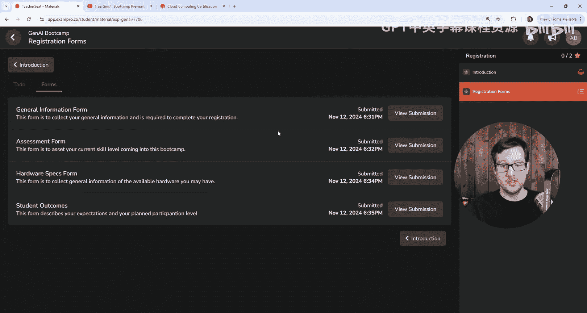