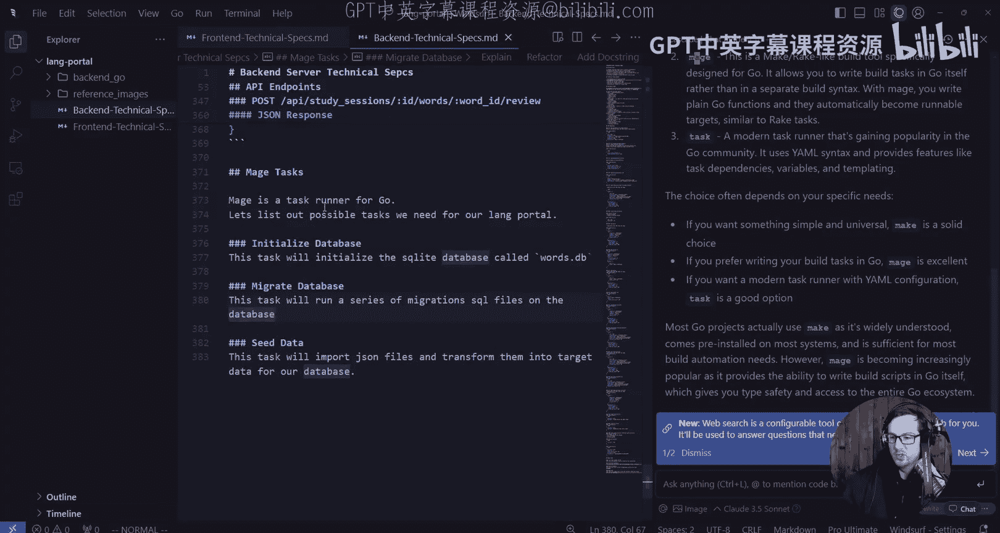
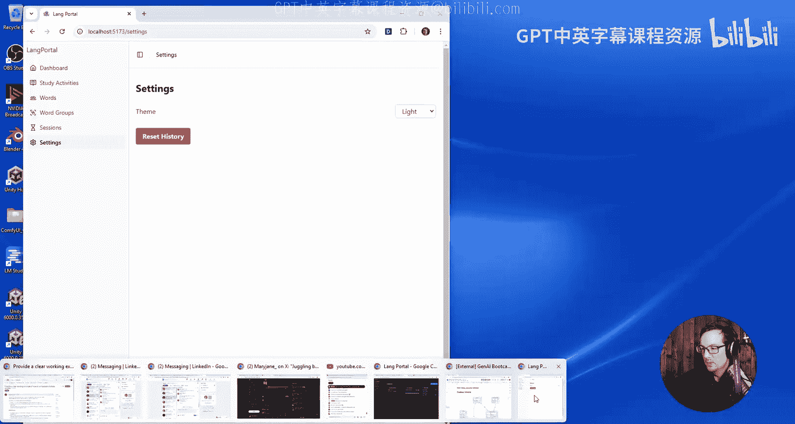
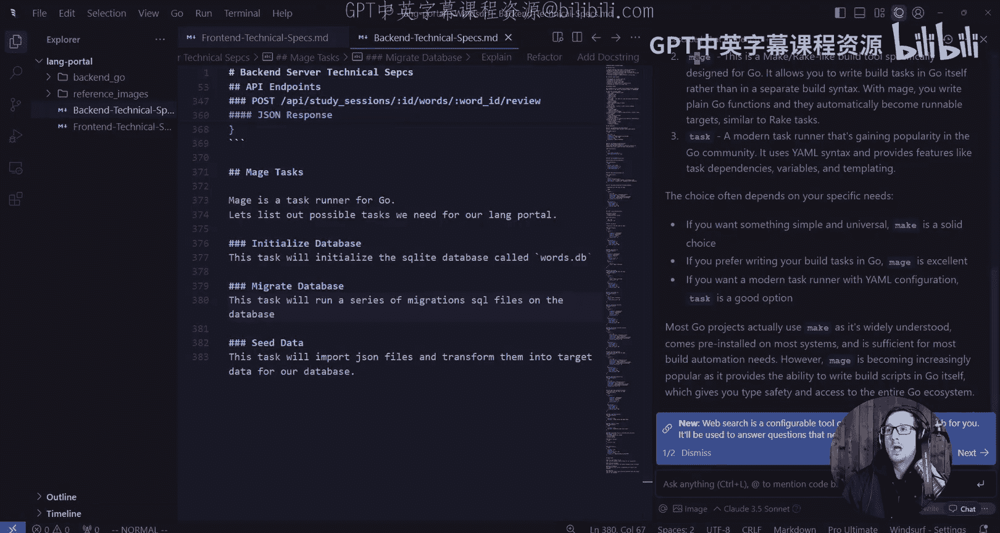
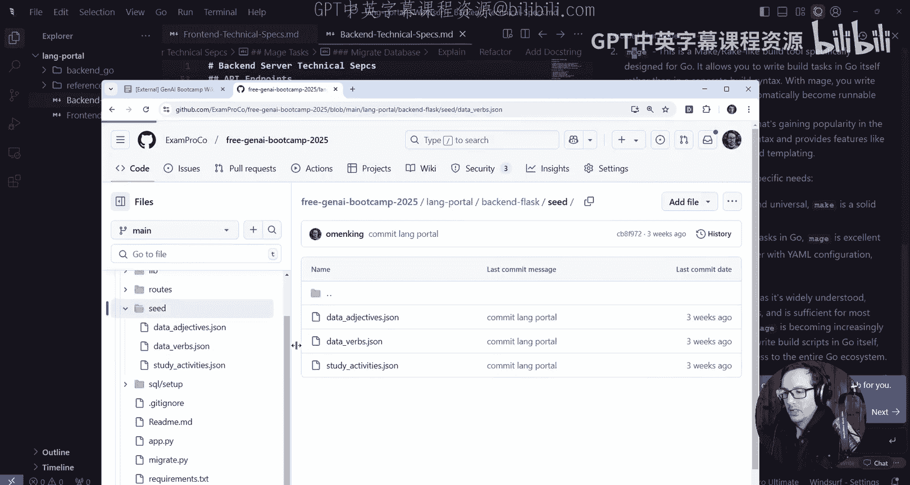
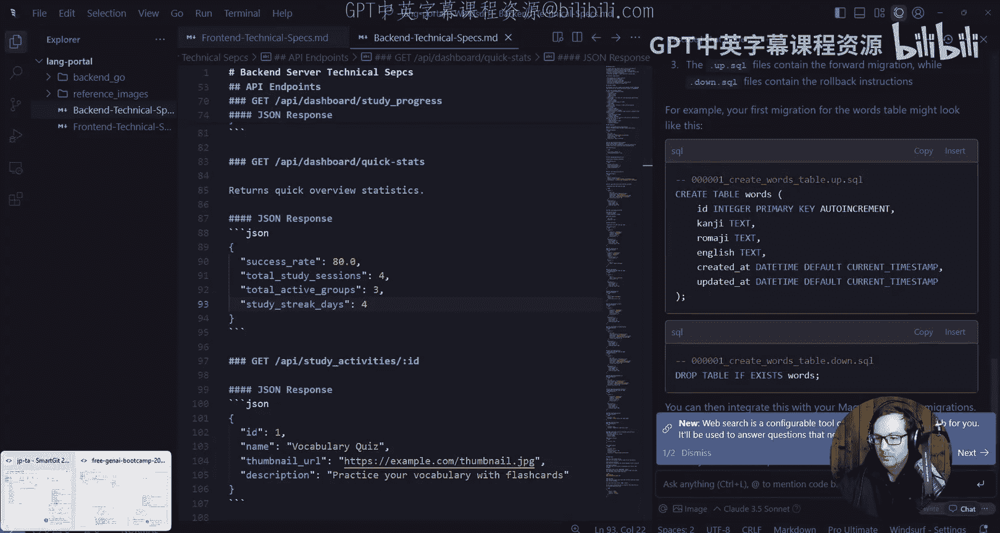
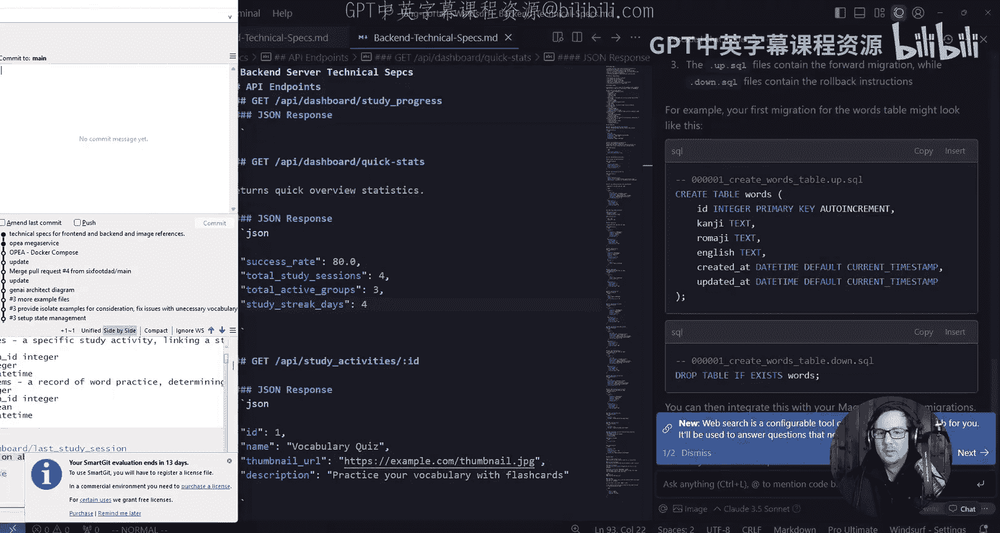
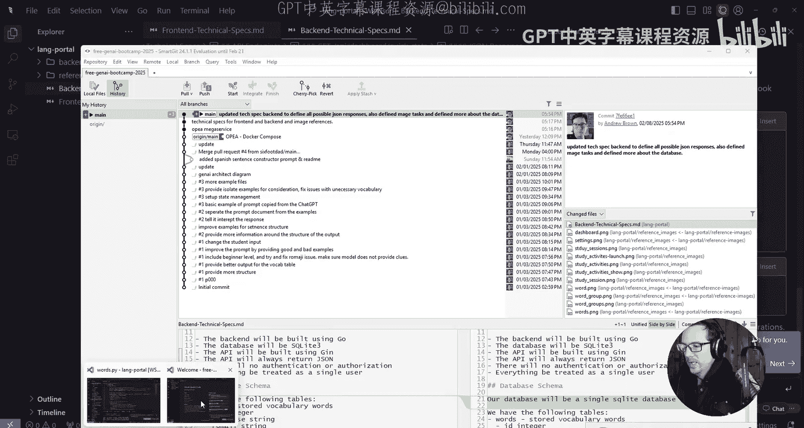
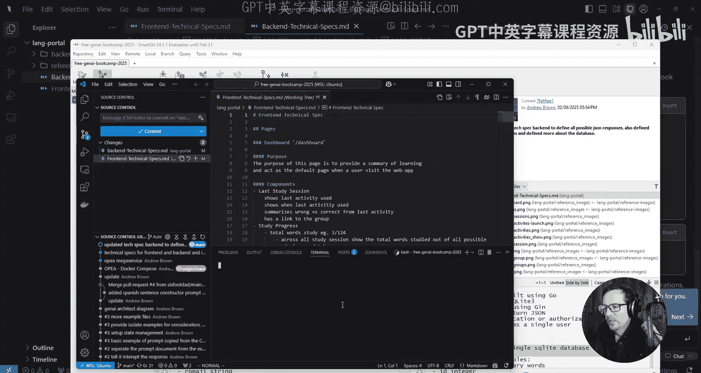
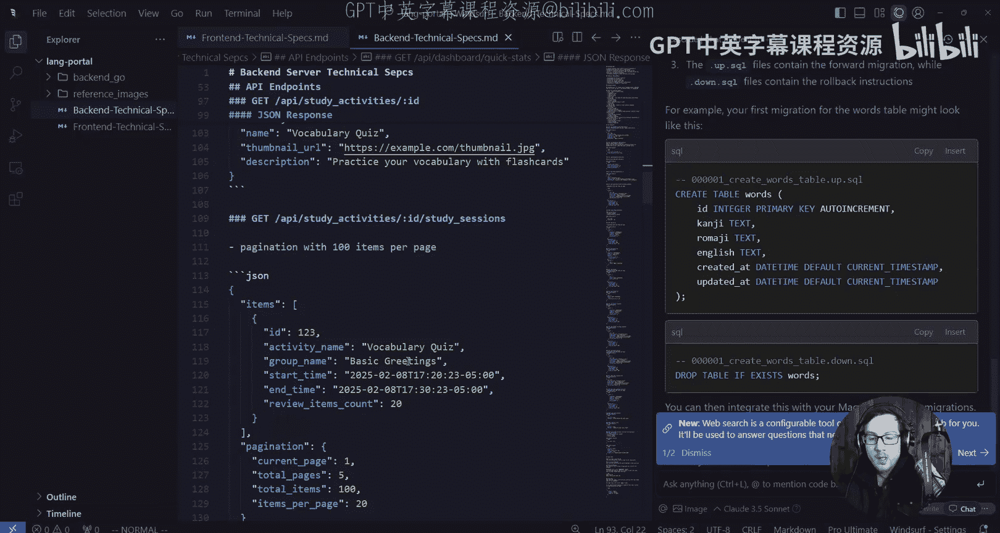

# ExamPro《生成式AI训练营｜Free GenAI Bootcamp》中英字幕（deepseek - P21：-21-Backend API Defining JSON Repsonses and Tasks.zh_en - GPT中英字幕课程资源 - BV1SFEWzLEab

Al right， I'm back。 And so we wrote both our front end back end。

 and we wrote our front end so we could figure out our back end。

 And we could have just focused on back end， but。I think that that's where we would have ran into。

 I mean， we would just would have done it in a different order。

 But I'm just trying to get everything dotted so that we have everything up front。

 One thing that I think that we should do before we start implementing our backend is making sure we really define what these Jason schemas are for our endpoints。

 That's that's the database schema。 But this stuff here。 right And so that's what I want to do。

 And so I have cascade here on the right hand side。 you open it with that button there。

 and we have chat and write， I want to stick with chat here。 And what I want to do is say， like。

 I need to expand。My API endpoint documentation。So I can exactly know what the Jason response will be back。

 will be returned。For each of these endpoints。Can we。Step。Through each endpoint。In the。

I'm just going to do add sign here and just sell the backend text spec。Okay。

 so I'm just helping it know where that file is。 We could use a different one。

 Im gonna use clouds on itcause I'm having good results with that。

 And so it's analyzing the back end file。I found Gitthub compilepi terrible working with Cude。

 It was better with open AIs， touchtBT。But it's going to go here and analyze the API end pointss。

 And so that's what。We have it doing here。 I'm hoping that it will step step by step go through each one and give us an examples and that I can just approve each one。

It's taking a few seconds I'm going to pause here and wait till it's ready， okay？It's back。

 it took a little bit of time， but now it has some information here。And it has a lot。

 So I guess the it was worth the wait。So here it's just talking about what changes it could make。

 but I want to walk through each one。呃。So we go back here， we have the study session。

You just see here。Okay， so this is each one， right， so I could review this and say， okay。

 do I like the Jason returned。So maybe what we'll do here is of having it like this。

We're going to go through each one of these here。And do this。So I'm going to grab this code here。

I mean， I kind of like， I kind of like what it's producing。Oh。

 it actually did kind of what I asked it to do。嗯。I mean， I like the changes。

Maybe we should just tell it to apply it。 Hol on here。Can we， can we do that from here。

 Let's see what happens。 Let's say， apply， apply。I don't like that。Reject， I don't like that。

 That's just confusing。 So， I mean， if we did it right。

 we could probably get it to to work correctly。 But I just want this to not mess anything up。

Cause when you have this much stuff， it might get a little bit confusing。 So I'm just gonna。

 we got to go through each of these anyway。 So we're gonna just review them individually， okay。

So I'm going to go here。 It's just interesting that started structuring the way that I would have structured it。

Okay， so we have this here。We have study session， I D group I D created at study activity group。

That looks good。 Yeah， and we want to have those I in there just in case I don't know if we need to wrap it in study session。

As that endpoint's going know already what it wants。

 And so I'm going to go ahead here and just take out one layer as that seems a little bit superfluous to me。

So that's good。 We could also do group I D and group name and keep it really。

 really flat if we wanted to。So I might just do it that。 again， it's up to your preference。

Cause we're not gonna bring in more information， but there's nothing wrong with the way it's being displayed。

But I'm just trying to flatten it out。 so things are just less confusing。

Because then you also have to think about like the Esquel query。

 because it doesn't have J functions like Postgress。

 And so doing those nest stuff might be a little bit of a pain。

 So I'm just trying to make it easier for it。 We're gonna go to the next one。

 which is study progress。This is fun doing this one by one。 It's super， super fun， isn't it。

 And so now we have return study progress。 We'll copy this。😊。

The other thing is that we probably have to reference and keep reading Otherwise we have total words reviewed。

 study， correct words， incorrect words， accuracy rate， study rate。 that doesn't look correct to me。

That doesn't look correct。 So I'm going to go ahead and select this， this text here。

And I'm gonna go here to chat。This does not look correct， based on our front end。Tecectical specs。

It's not， It's not cross referencing it。 So that's kind of annoying。

 Now'm gonna scroll up and go find that other section， but it's gonna analyze that。Its。

 I don't want it to edit it。Let save this here。 It's getting confused。

And so this is actually what we want。 We don't need mastery progress。

We don't need that there because that can be inferred from the other two values， right。

 So it's a bit confused。We don't need master progress。I'm go here to say Jason's response。

So it knows exactly what it's supposed to return， Jason's response。嗯。2， to。I think like this is2，2，2。

 I think our， our levels are a bit messed up here。 I'm just trying to make it a little bit easier。

 So I'm just going to adjust that there。That way， we don't have 5 going on in there。 So right away。

 you saw that that one was not accurate。嗯。I don't really know we need the descriptions in here。

 but we can bring them in if we want。 So I'm going to go back the way to the top here。

So he says returns information about the most recent study sessions。 Sure。

 we'll bring in the human text， just in case。Okay， and then we'll go to the next one。

Return study progress。Please note that。The front， that， the front end。Will determine。

 will determine study progress based on。Progress bar， based on total words。And available words。

I think these are a little bit too wordy。 I would probably like reduce them， but it's okay。 We'll。

 we'll leave it alone for now。 So we have this one。 study progress。 The next one here is quick stats。

 total， total words， total groups， master words， recent accuracy。 It's again， it's。

 this is not correct。 So I'm gonna grab this one here。You just tell by looking at it。 It's not right。

嗯。This is quick stats， right。One thing I should have told it is like cross reference your。

 your stuff with each one。 But we're gonna go through each one anyway， so。I'm going to。 Yeah。

 we want that to be Jason's response。 That's right。This is not correct。If you were to cross。

Check the front end。To cross reference。What should be here。ok。Total， total master count。Yeah。

 I could just tell that these are wrong， so。It's a little bit frustrating becauseuse now we'd have to go across reference them。

 but。What I'm going to do is say。And it's also， we gave it so much to do that maybe that's where it ran into an issue。

 But you， you know， you keep forgetting to like。So sorry， your API endpoints。Have not been。

Properly cross referencing。What is needed for Jason。Can you， please。Redo these ones。We do。

The expected Jason response。For these endpoint。While cross referencing。Okay， we'll do that。

 And so now we're telling， I'm just gonna see if we can do in bulk。 But again。

 the more information information you give it， the harder it can be。

 it's nice when it thinks about each part individually。 I know when we're on right。

 it usually does that'll tell us each step because it has to do something。 But if it doesn't。

 that's totally fine。 We'll give it a moment here， it does take a bit of time to run， okay。Alright。

 so it's back and it's produced a little sorry， A have not been properly cost referencing to sure what's needed。

 Can you please redo the expected。 That's what I wrote。

I I I'll help you understand all these endpoints by cross referencing them based on the stuff。

 cannot edit the files。Okay， you didn't。 You didn't show me。The changes and you are in chat。

You can't edit files。Okay， sometimes it gets confused。

 I think it's cause it's both the right and the， the chat one。

 But the trade off here is I can switch between them very quickly。 So go back to the top。

 So we have study activities， I D。嗯。That does look correct。Okay， so we'll grab this one here。卡比。

Copy this。我 pay this。So that one looks good to me。Jason response。 We， again。

 we will still have to double a triple quadruple check these because you never know until you do them。

 But we will go here。 I'm just gonna again， make this a little bit easier。

And we're doing this all manual， bit sometimes manual is the best way。

And so we have study activities， we have study sessions。We can do the pagination that way。

 I suppose that is one way to do it。That's fine。 Yeah， we could do it that way。

That looks like what I wanted。 So that's good。Then we have。Study activities。啊。Oh， right， right。

 right。 That's the request。Okay， but that's just saying what the required parameters are， right。

 So required parameters， that's already clear。 So there is no， there's no response to have here。

 right。Request。For Rams。So you have a group I here。These are both integers， integer。Integer。

 there we go。So that one's a little bit different。 That makes sense。And then we have the response。

 response， Jason。Just in response。Again， it's getting a little bit too excited。We don't really need。

Yeah， what it's providing， we don't really need to know when it started。We just need。Actually。

 we just need the I returned。Because we need the I to pass the other one， and。

We can return the group I D。 It's not really necessary。 We don't really need the group I D。

 but we can。 Let's just maybe we should do that group I D。Because we might。

 we might want that to pass on， but that's really all we need is the study activity I and the group I。

The next thing is we have API words。Bring this indentation back to this level here。

And we didn't write it up here， but this one would also have the same thing where it's like 20 per page。

So now we're on to API words。Japanese ramaji， English correct part， so what it doesn't have here。

Is the parts。Which is what it will need。So in order for， I mean。

 I'm gonna to leave out parts for now， but if you want to use the typing tutor thing。

 you actually do have to have the parts and that has to be solved。

Parts makes it a lot more complicated， but maybe that should be handled by the typing tutor app。

 and that could be a separate thing that we solve。 So I'm gonna to leave it alone for now。

 But I just want you to know that if we don't implement it in here and you end up using this and not the the Python app that I built。

 is's just not gonna to work， okay。So we have get API words， Japanese Kichia Ramaji。

 Kichia looks good。Crerack count。 That's right。 Pagination is fine。 Okay， that's good。

 We'll go on to。Just say what this is， this is。Sponse Jason， good。Fun stuff。

I'm just gonna change these out for now， so I just gonna get to it here quicker。嗯。

And the other thing is the Jasonson response。 Let's just copy this。That's going to speed us。

Much farther along。 And then also just get this in really quickly。Work smarter， not harder。Okay。

 great。 So we have those。 And let's go up to here。 I don't have it for this one。

 I'm gonna grab this one here。And we're going to go ahead and grab。Grab this。

Wellll actually know what。 Can we just hit the insert button that'd be a lot easier to insert right here。

Oh my goodness。 That's so much easier。 That's so much easier。 You know what， It's not it's hard。

 It's just the fact that like that this editor is like constantly trying to insert things。

 It's kind of annoying。 So we have。😊，AI words。That one's correct， okay。Again， it has groups here。

Do we not define our front end that end point if we go over here。We go to here into our words。No。

 I guess it's all part of the same one。 I don't remember defining like a word groups。

So that would be how we would have to do。 We'd have to display like that。 That totally makes sense。

 okay。Going on to our groups。Here。I guess I missed this one here。This is API groups。Yep。

 that's correct。So let's say insert。We'll go into this one here。We have I D name， stats。Yeah。

 there's only really one stat， so we'll do that， but we'll say insert。That's totally fine。

We are on this page here。 This is group I D words。I don't think we need the group I name here。

 That's kind of redundant。So I'm gonna insert that here， because it already knows。

From another endpoint， what it is。 So we're gonna take that part out。

I kind of wish it is just said instead of words， it's just as items。

Because then we know in a more concise way， like what's expected here for anything that has pagination。

 Im just can call this items。And that's one little consistency thing that we're going to make easier on the front end。

Same thing with this one， items。Okay， good。So go back down to here。Now we're into study sessions。

Activity name， group name， start。 That looks correct to me。 I'm going to insert this。

 I'm going take out。The group。And we'll put in items here。We will go to our next one。And this is。

The study sessions itself， reviewing it looks correct to me。 We'll go ahead and say items。

Well go down to the next part here。And。We have this one I D activity name， group name， start。

 start time， end time review items。That's correct， y， we'll go ahead and insert that one。

there's like a little stats section， and we could have broke it off into its own JO 1。

 like Json object in there。 I don't care。We'll just leave it like that。 We have words。

That looks correct to me， so I'll go ahead and bring that in。

You have to be really good at remembering what it is that you want。But I seem to be doing， okay。

 so far。This is words。 This is words。 Doub checking， good。It doesn't say here， but like。

 it is pagination with 100 items per page。 We could probably just say like somewhere， like。

 it's always that。 But it might not actually always be that， so。Let's go ahead and do that。

Now we have reset history。This is the。I mean， we should always define like what's happening here。

 So yeah， we can absolutely do that。That seems fine to me。Insert。There's no。

 there's no anything to do。 It's just literally that。 It's just you do that。

We'll go here and say insert。That's good。Now we have our request technicalically。

 it requires more than just that so。We'll say request parameters。We have correct。Word Id。I D。

 which is our。Study session， I D。This integer。Integer。B and yet。AndI mean， technically。

 this is the payload because it's in the URL。 So we don't， I guess it is correct， in that sense。

 request。Request payload。Request parameters or request payloads a little bit different。 I。

 I probably should have called it payload in other places。 I think it'll still be fine。

And here returns back whatever we want here。 It doesn't matter to me。Well。

 actually know this one actually might， No， I'm not sure if it matters because。

I haven't built any apps yet that it does matter。 So maybe it will matter at some point。

 but right now。It does not。So go here and say have success。Word I D session。 Sure， Why not？

 That seems fine。 And so basically， we've gone through here， it looks good in terms of it。

 Let's see how this looks。 So if we click on this little key button here， we can kind of see our API。

And by the way， just so you know， this is my fourth time writing this all out。 and this。

 and this is not a big deal。 Like for me， it's just when you build app after app after app after app for like 20 years。

 You get used to just rewriting the same thing。 Even our architectural diagram that's all messed up because somehow there's a student that got edit access。

 and they just kind of blew it away and made a big mess of it。 I'm gonna just make it again。

 And it's not a big deal， you know， and we might even update this API based on， the。Cause I。

 you know we， we made make an architectural diagram of this afterwards for fun。But anyway。

 now we have our full technical specs laid out。 And so now that we have that。

We are ready to go and implement the stuff。 The thing that's missing from here is that there is some stuff that's not related to the API。

 but it's like stuff that。Has to be done to get data into the database， right。

 So maybe that's something we should talk about here。 So if we go over to this one here for a second。

It looks pretty good。Words regroup study sessions。嗯。Oh， did we miss study sessions。

 Are we not fill in what goes into study sessions here？Words， word groups。

 I think we might be missing。I they're。 Okay， it's just a bit hard to see。

 but we have our API endpoints。Right， but we might want to have some like background tasks。

So I'm gonna go here， and。呃。Background， or its just like。Scrips。

I'm not sure like what they call these like， but like。We got scripts。 Anyway。

 the point is theyre like called tasks， like tasks， like scripts， like tasks。

So one thing that we might want to have here is。嗯。Initializing the database。Yeah。

 basically like that。I'm not sure what does。We'll go over to chat here， I'm to make a new chat。

And we'll say， I just again， just talking to it。 but like if we are， so Ruby has rake。

And Python has invoke。What does Go use。I just don't know。Mae。So the traditional tool is make。

 this is a make Rake build tool specifically designed for go。 I like that。

It uses the aml syntax provides dependencies。I think I want to use mage。say mag。Tasks。This is a。

Mage is a task runner for go。Let's list。Out possible。Tasks we need， we need。To， in order to。

For our lang portal。So we have initialized database。Will'll initialize。Ss schoololite database。

The data and actually， one thing I should go up here back up to our data schema here， so。

Our database will be an called words。 No， I'm gonna call words D B。That will be in the root。

Of the project project。Folder of back and go。And I don't know this will cause this issues。

 but I'm gonna rename。 I don't think it matters。 No， I'm gonna namename it to underscore。

 sometimes these。Hyhens give us trouble with folder names。I know I did the other one with hyphens。

 but I just wanna not have pain here。 And so I'm gonna rename these to have underscore instead。

We'll go down here。 So this task will initialize the SQ I database called。Words。TB。

 I don't have to tell it twice。We'll run a series of migrations。SQL files on the database。

Then we have。I don't need a run server， but I need one for seed data。This task will。

Import Jason files。And transform them。Into。Target data for our database。

So we might need to describe these a little bit more。

 I do have a very specific structure that I want for importing data。

 Im gonna have to go to the Internet for this， because we have it。

Some we're here in our GitHub project。So I know I've already defined this here and I'm just doing this off screen。

 I'm going to grab it very quickly。

It should actually show up in the exam Pro one， So if we go over here。Exam pro quo。

And we'll go into the repository here and we're looking for the free GenI boot camp at the exam pro Co。

 if I go into Lng Port in here。Into our backend flask， we have in here C data。

And so here's an example of C data， right？

So're to copy this one。And I'm just going to simplify it， right， So I'm going just do this here。决son。

I'm not gonna worry about the parts right now， because that's something that the other like apps that need it should。

 should actually have it， right， So we have this。As an example。

So the task will import JSson files and transfer them into a target data for our database。

 All seed files live。In the seeds folder。All seed files。Should be loaded。ok。嗯。There's that。

So there's that， right？In our task， we should。Directly， we should have a DSL。To specify。Each。

Seed file and its expected group。Word name。Okay， so。I'm actually kind of changing that one。

DSL is a domain specific language。 We'll see if that works there。

 This task will run a series of migration files on， on the database， right， I don't know。

 Like does Ma， I don't sure if Mage has or sorry， not Mge。

 but does Gin have a migration framework built into it， I don't know。

So I'm going to go ahead and ask that when new search can figure I don't want this pop up here。

Does Gojin have a way of handling。Migration files。Like rails。We're using esqueal light。

And for the Python when we wrote it by hand， we didn't use anything special。

So they do have some stuff here。I mean， this is what we're gonna probably do。

 So for this one for the， the mag tasks， we'll say that。

Migrations will live in the migrations folder， the migration files。

Will be run in order of their file name， the file names。Should look。Like this。That's right。 yep， yep。

Exactly， so it knows exactly what order to run it in。

 And so that would be sufficient enough for that to work， right？ So now we have that one described。

 this one's pretty straightforward。 I don't think it needs a description for it。

 So now we've described our image tasks。 I'm just trying to think there's anything else that we haven't described yet。

 We're not talking about deployment or packaging， things like that。

 I don't really want to think about that。 But you can see that we have a lot of moving parts to our application。

 But I feel that we are now in a really good spot to actually start building it。

 So I think this is where， again， we're going stop。 And I'm going to， well， first going do my commit。

😊，But we'll stop， and then we'll actually get to implementation， okay。

So we'll go back over to here。

And it'sca I renamed the the file folder， which is not the best。

 I should have done this in separate commits， but I'm gonna go back here。

And we're going to go ahead and。嗯。Just check them a lot here。 I'm going to go ahead here。

 and stage these。And we'll say updated text spec backend to define all。Possible Jason responses。Also。

 defined major tasks and defined more about the database。 So now we have that there。

 We're gonna go ahead and commit this。 So we'll go ahead and hit commit。And we really should push。

 I'm going to push this here。Oh， it's being really silly。 I't w want to do it that way。

 But maybe what I can do。

I have it open here。This is the new one。 I know I'm kind using a mix of things as a little bit of a mess。

 but I， I work on a Mac。 I usually I don't work on a Windows。But what I wan to do。呃。

I don't know why these two are here and here。But I'm gonna go ahead。

 maybe because that's what we were doing earlier in class。 That's probably why。I'm not sure。

 but I just want to open up terminal here。 I's getting terminal。

 I'm just going try to get a terminal。 and it's a get good push。

Okay， so yeah， it's a mess。 If we have Getmart we have this with that， Getmars not fully configured。

 But if I do get it configure， it'd be a lot easier。But you can see I' I'm a little bit messy。

I apologize。 by way， we're gonna stop the video here。 And so we now have full back and text back。

 right， It's fully detailed， at least at this point。 And so now the next thing we need to do。

Is get our implementation going again。 I don't know anything about go。 Like I know what go Jin is。

 Obviously， we figured out what Ma is。 I've worked with lots of web frameworks。

 I know that these things are really good at producing go。

 but go is a hard language to work with because it doesn't use classes uses interfaces and it's statically type。

 But let's see if we can figure it out together。 and I'll see the next one， okay。

