# ExamPro《生成式AI训练营｜Free GenAI Bootcamp》中英字幕（deepseek - P22：-22-Backend API Implement Backend with Windsurf.zh_en - GPT中英字幕课程资源 - BV1SFEWzLEab

Hey， folks， we are continuing on here。 We have our full back end technical spec completely written out。

 And so I'm hoping with that that we can write our back end go code。 Now， by the way。

 we could use this to write any kind of back end code。 All we'd have to change out is the word go。

 And maybe we did have one part part that was specifically about。呃， what do you call it。

The rake tasks。But we just say。We just say， like， tasks here。Task， runner tasks。

And if we want to extract this out a little bit different， then we go to the top here and。

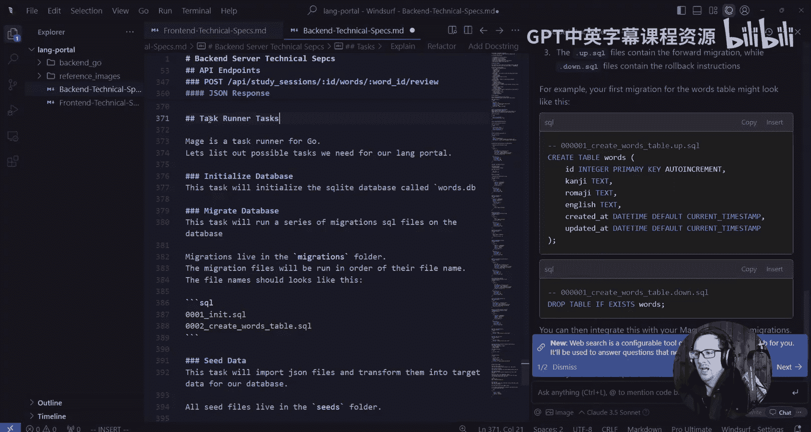

We would just say built using go。Mage is the task runner。

 And so now all we have to do is change the technical requirements if we wanted to get exactly what we want for our stuff。

 right， So this should be pretty straightforward。 But now that we have this， I'm gonna hit new。

 I'm gonna go over to right。 We haven't been using this so far。

 But now it's now we're ready to get going here。 So， you know， I have defined find a an。

Technical spec。So you know， I need to build a back end go Lng app or sorry。

 I need to build a API backend for our Lng portal app。All required tech specs。Are in the。Back end。

 technical spec。 Now， what we could do is we could tell it to like。

 tell us what you're gonna to do before you do。 like， give me a summary。Of what you plan to do。

And then， then when we agree。You can go ahead and execute it。Execute the commands。

To create the project。So go ahead and do that。So it's gonna look。

 take a look there because sometimes you really need to tell it a little bit more， you know。

 like to get on top of it based on the technical specs， I'll。

 I summarize the plan for building the API backend， create a new go app， set up a gin。

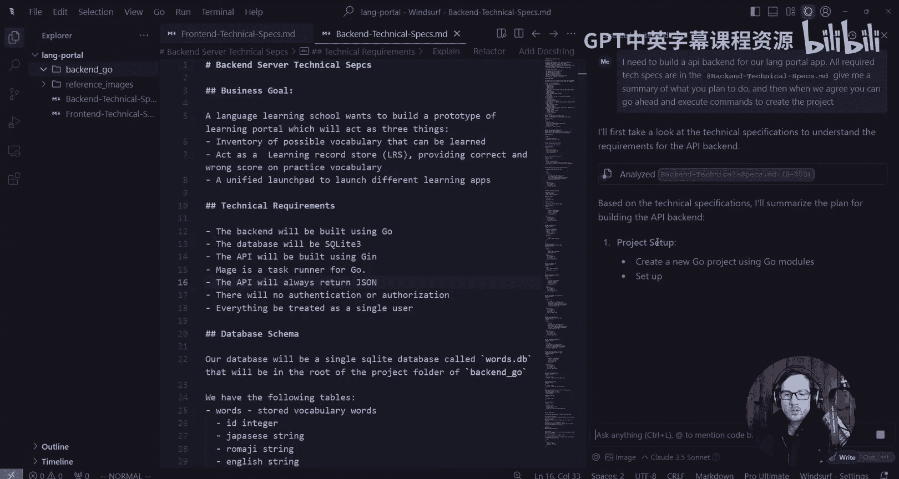

Database create called words， implement six tables， implement restful API。

 Here it's showing the backend go。 So we have the server internals， migrations， Mage Go。

 go mod words。So one thing I don't notice here。

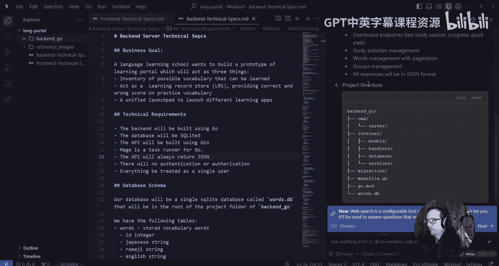

I don't see。The seeds。Folder。Where is it。Okay， so it's missing that。AndSo now we have this。 And。

 you know， it's cool。 We could actually bring this over to here。 So we say our， I'll say。😊。

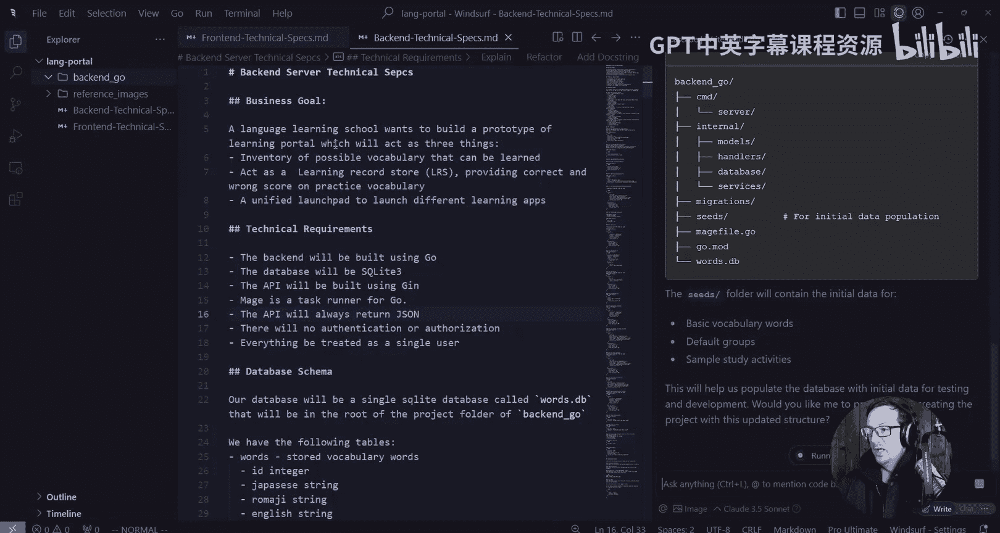

Diy structure， right？

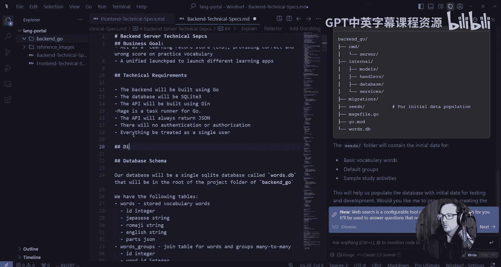

And so we could actually bring this in over here now。

We might not want to be as prescriptive to do that， but I'm going to do it anyway， so。

Cause I'm saying， like， maybe we might not wantan to specify if we want to give it flexibility to do things outside of this。

So I would just like， you know， can we group the migrations and seeds？Directories together。

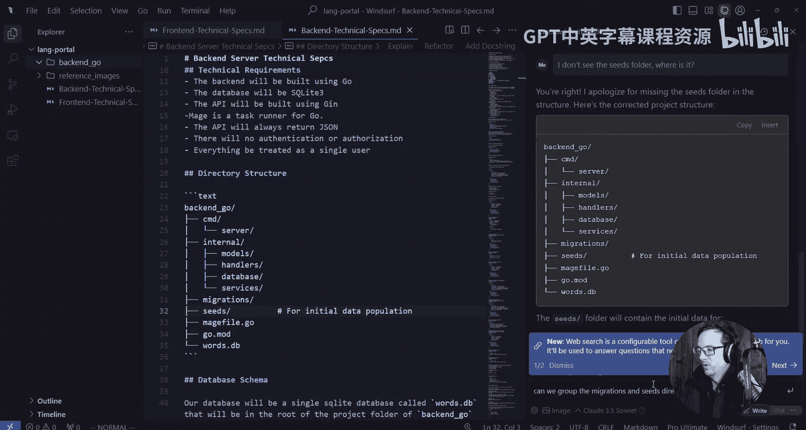

In a folder called D B。Right。

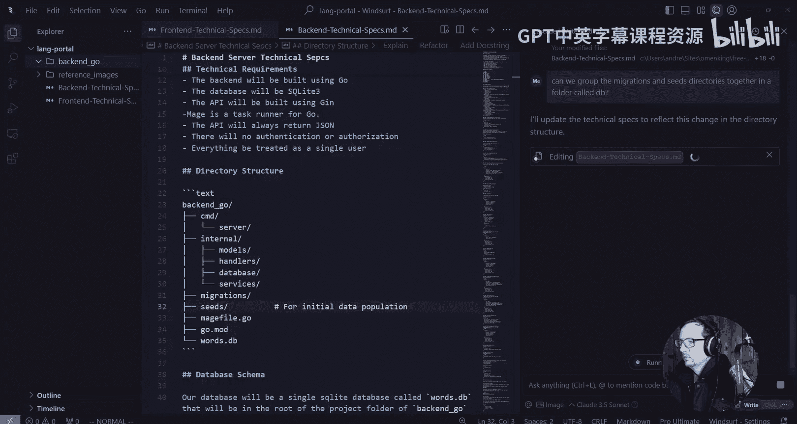

Okay， that's fine。Great。This internal because I'm not familiar with this， but this internal folder。

 is that a gin directory structure？So I I know other apps like Rails uses app。And， but。

What's going on here。For the internals。Could， could。

Is a go specific convention and is not specific to G， it's a special directory。

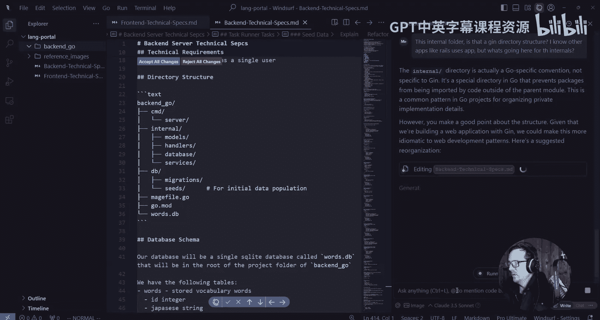

That go prevents taxes from being imported。However you make a good point about structure。

 given that we're building a web application with Jim。

 we can make some more item to web development patterns。 So seemingly contains the main entry point。

 reasonable package that could be potentiallyiously shared with other services app。

 the main application code。 I don't know。 That seems like a lot。 I don't know。 Re it reject it。

 I think that's too much。 So we do have some stuff here。 It has database and services。

 I don't really know what these things do。What。For internal。Do we need models， handlers。Daabase。

And services。Holders。I know what models are， but what are handlers。Oh， these are GP requests。 Okay。

 so that's why database contains connection， setup configuration。 However。

 since reason is collected could be pinch simplified services。

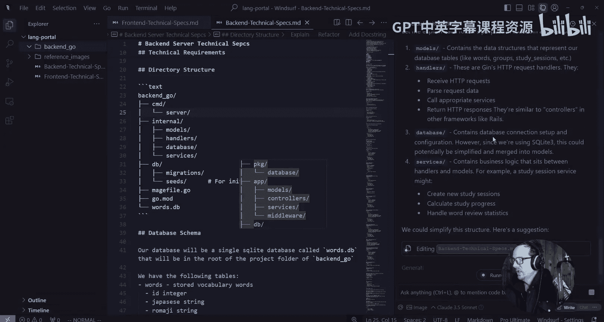

嗯。Sure， okay， so now this is a little bit simpler。But what happened to handlers。

 why did we get rid of handlers？Oh， did。Did we want to get rid of handlers？Like if you build g appss。

AM points cause I don't know， right。

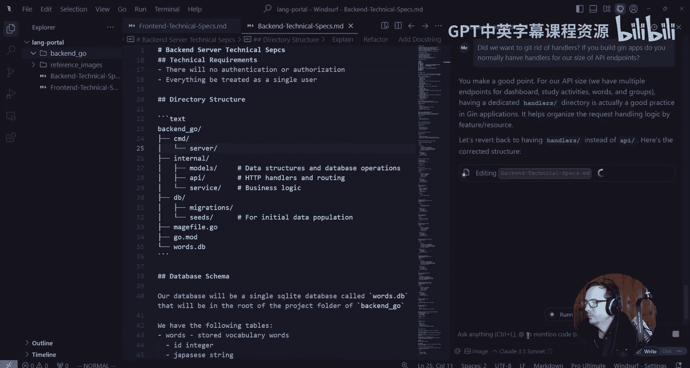

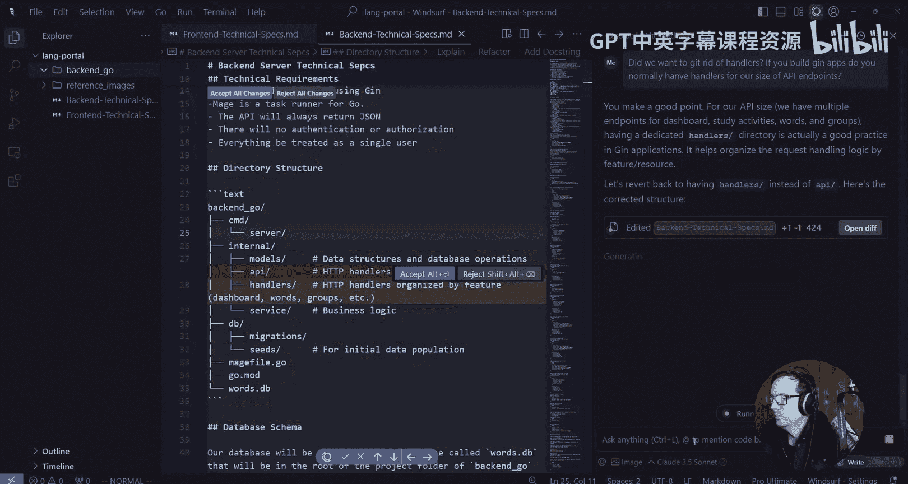

Okay， so all it did was change API to handlers。Whatever。

 but it's doing a few other weird things here handlers featured by dashboard groups words。

I don't know if we need all that description here。Anyway， we'll leave it in。 It， it's already here。

 Okay， so in this a pie end end point。 So it's getting a little bit confused here。

 I don't wantanna confuse it anymore。 So alright， let's， okay， so yeah， please proceed。

To build the app。In the back end， go。In the back end。So files。Back and go， it's actually directory。

 directory。That and go。It's not selected。 So I's just say back end go directory。

And we'll go ahead and ask her to do that now。So now here we're going to see， So we have this。

We'll run this here。Except。Okay， here we go。ItSeems like I' getting confused a bit here。Well。

 go isn't installed， right？I apologize。 if it seems goes not installed and not in the path。

We do want the go extension installed。 So we'll go ahead and do that。

 I actually haven't installed go on this machine at all。 I don't think。

 So it might be the first time it's doing this。

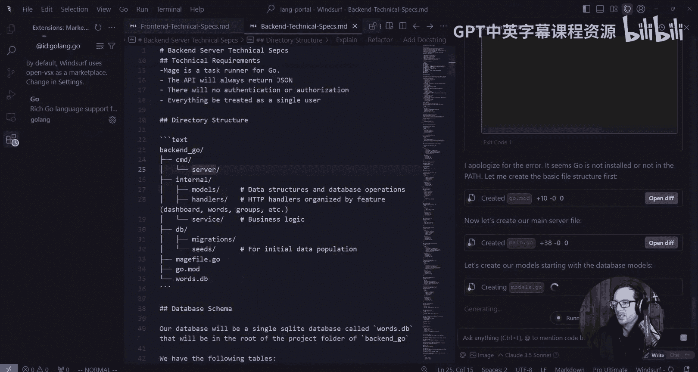

SoSo far， these files look really good。 I don't know if this is if it's using WSL or not here。 So。

 if I go here。

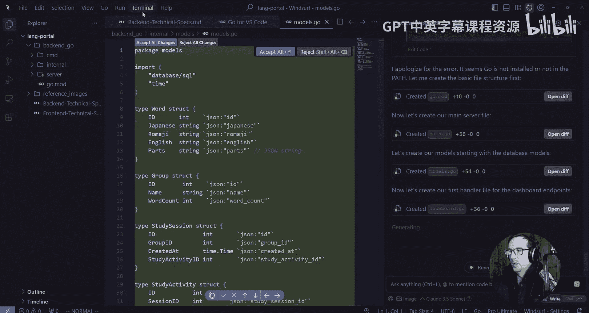

It's opening in Powerhell。And that might be a a bit of an issue because we really do want to use WSL here。

 right。

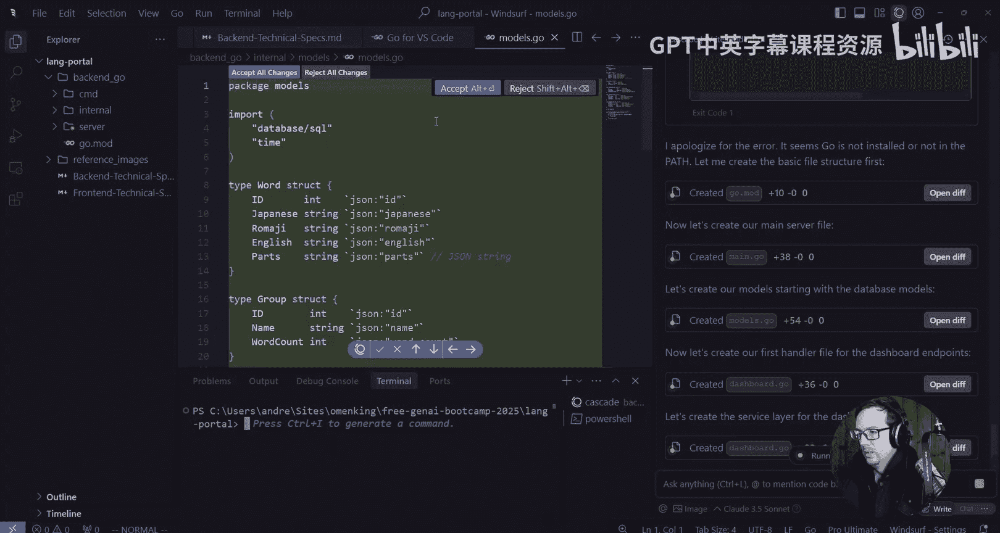

But we'll give it a moment here。 and then maybe we'll fix WSL。 while let's go。

 I'm gonna go take a look at extensions。

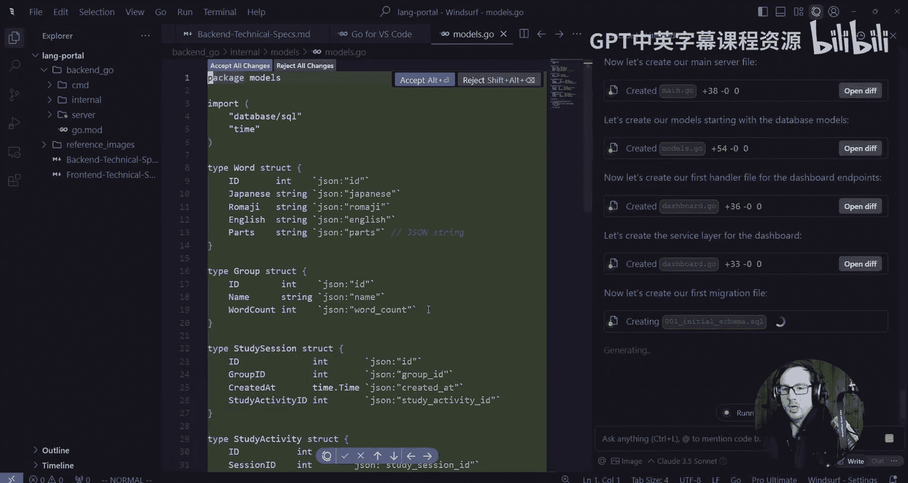

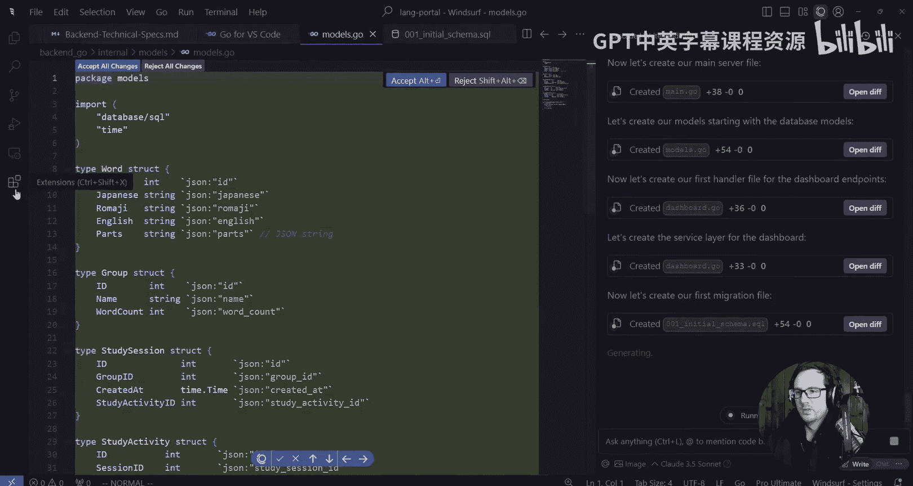

You type in WSL。I'm going go ahead and install the open remote WSL here。

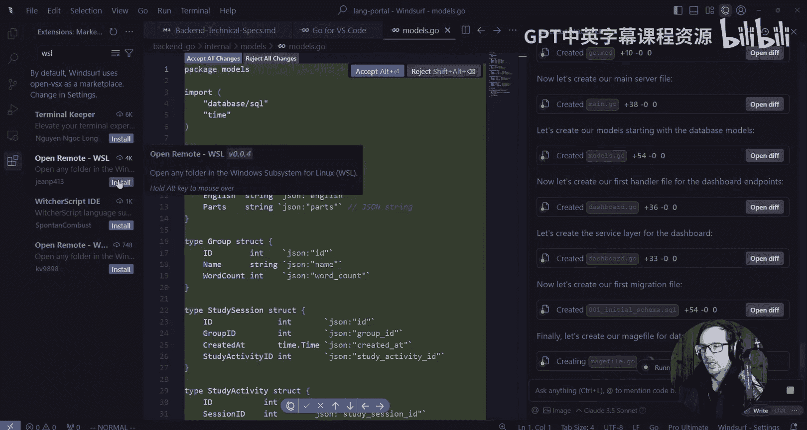

So one thing I would say is like， are you using WSL on my machine？Or， or the host。Windows。

 P and B environment。6la。

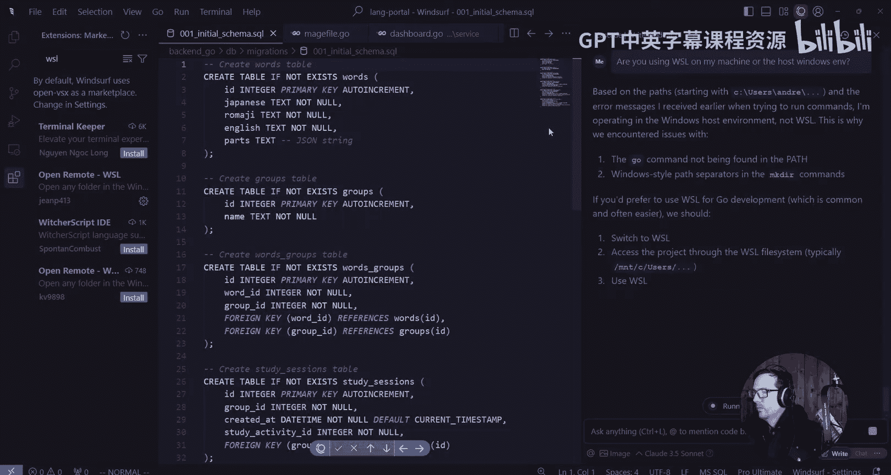

I do switch to WSL。 So access the project to the WSF file system and use that。

 So that's what it's suggesting to do。 So what I'm gonna to do is gonna reopen this folder。

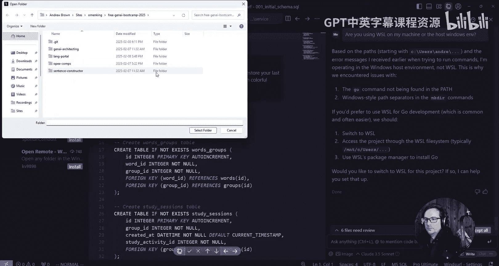

Maybe not that way。 but I'm gonna reopen this with WSL。 Normally。

 there's like a WSL icon somewhere here。Let's go back over to here for a second。

 I'm not sure if WL is here。Terminal， WL。嗯哼。This is something I found out earlier。 but you。

 if we go here and what we're seeing here is Powerhell。 we actually want WSL， which is。

 if we drop it down， is here。We bun to， but we need this project。To open in WSL。

 So wonder if I can type windsurf here， windsurf period。Ands what I'm hoping that happens here。

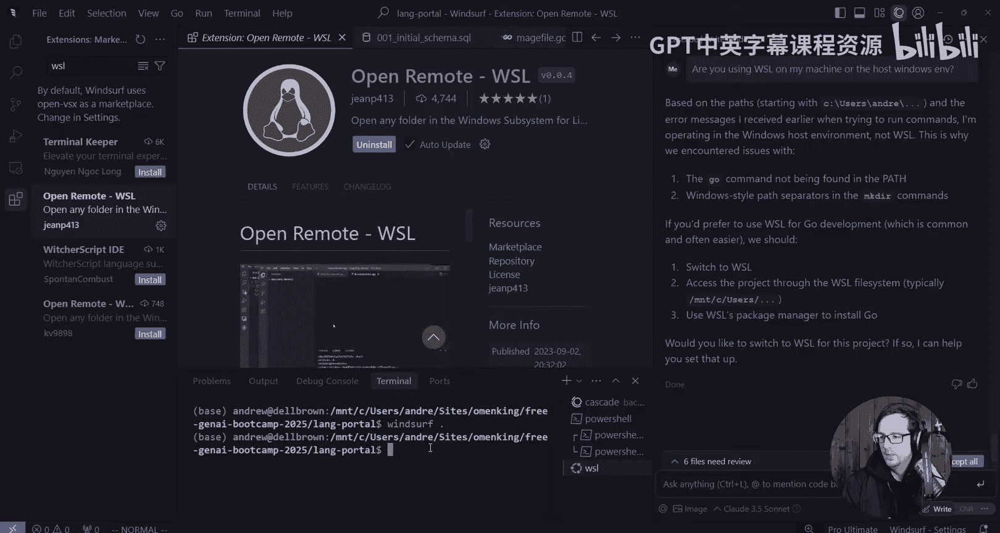

Okay， so I gotta go to the Internet herecause we don't know here， but。How do I open windsurf。

The the current folder。And windsurf。From the terminal。Just a second here。

 I'm just gonna move my desk into sitting position， okay。How about this。

 How do I open folder in WSL in windsurf。Go to any directory in WSL。 I mean， that's not。

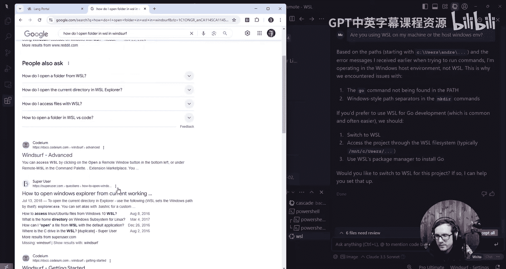

Exactly what I want。Oh， what a pain。 What a pain。I mean， it's not exactly WSL's fault。

 but like if we are windsurf， but if we had a way， we could type windsurf in this thing。

 that we would have less of an issue here。嗯。Because here this is what the directory looks like。

 right？Open。嗯哼哼哼哼。Open folder。No， that's not what I want。Okay， I'm going to go over to here。

How do i open the folder in the w s l as opposed。Foror wind serve。Like if I can't figure that out。

 it's going to be big pain in the blood。

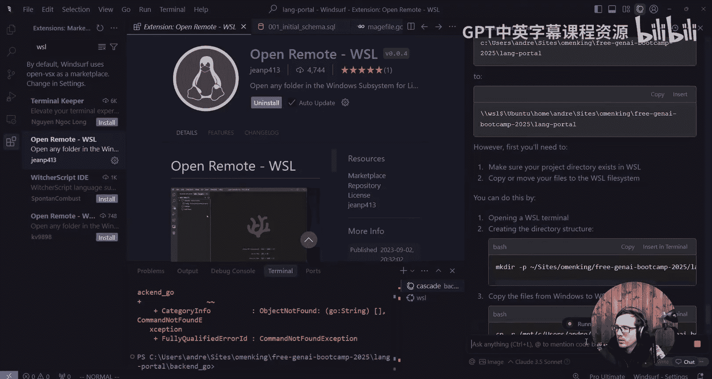

Okay， interesting。 Let's try that。 I don't know you can do that。 So we go open folder。

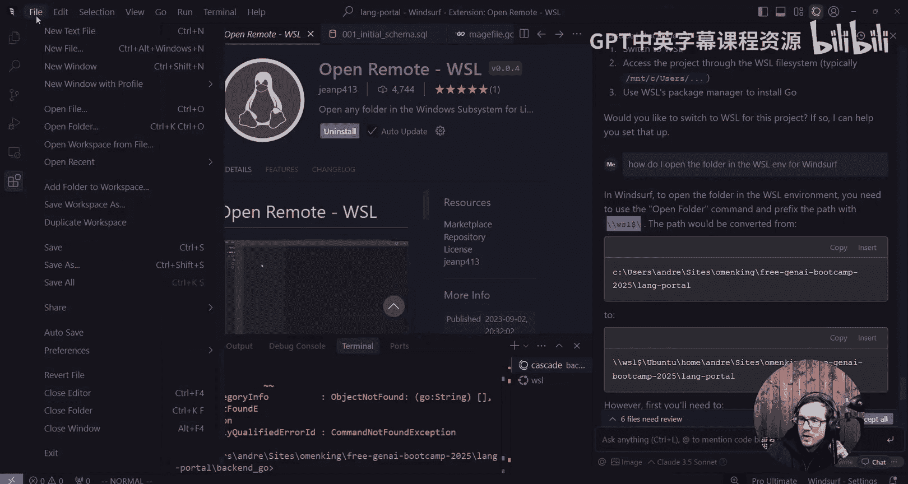

on2。Oh， did not know that。So we're going to mount C， whoops。诶。What is it normally。Mount Sea users。

 I'm doing this kind of a wonky way。Oh， I can do it。 I know I can do it。So what I'm going to do。

 I'm going to try to cheat here。This is specific to me because I don't have it in WSL。

 I wanted in my。Because I do this， is that。I want it into my local computer so I can easily find it。

 even though it's more optimal we'll put it in WL。 And if WSL gets blown away。

 don't to any of my code getting it blown away。So what happens if I do this。Cancel。

 we'll do this here。Oh， okay， what， what do we do。What annoying。

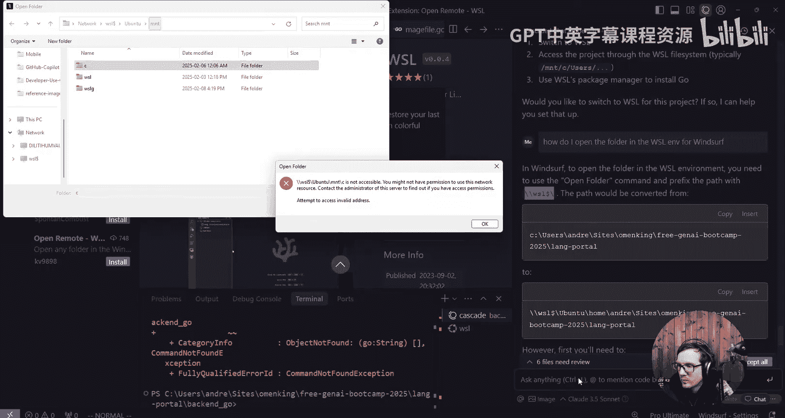

So。C is not accessible。

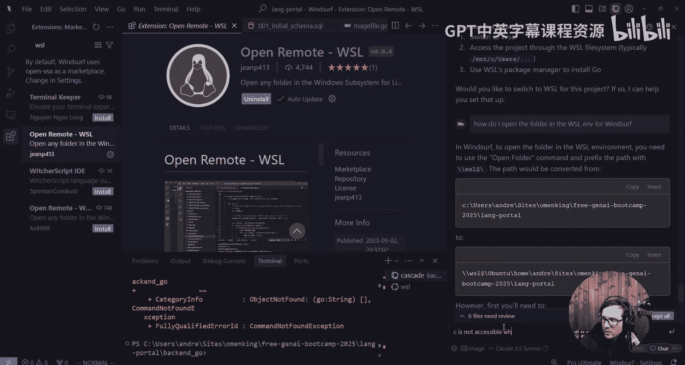

When trying to use backslash WSL。First check。 I mean， it is， it's installed properly。

 I already know it is。Sure， why not Powerhell。It's there。 It's already there。

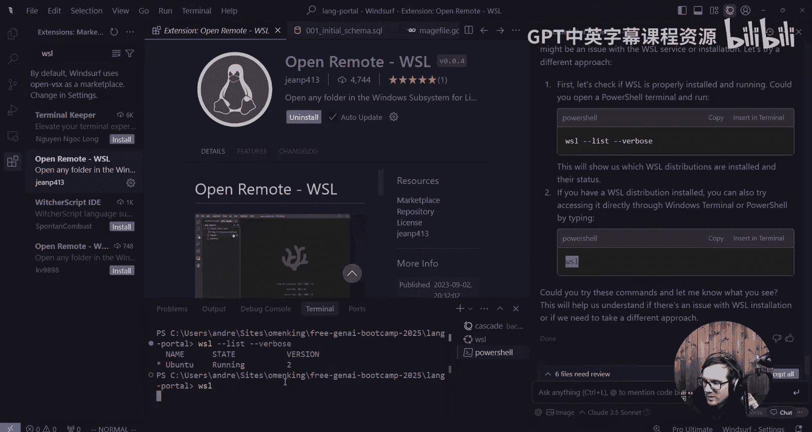

It works。 It's there。Okay， look， I want to leave the directory。In the the sea， direct。

 in the Mount Sea。Okay。In V S code， I can do this， so I should be able。To do this here。Oh。

 that is not useful whatsoever。 Okay， so this is where we kind of ran into a tiny bit of an issue。

 We have connected to WSL。Open folder container。

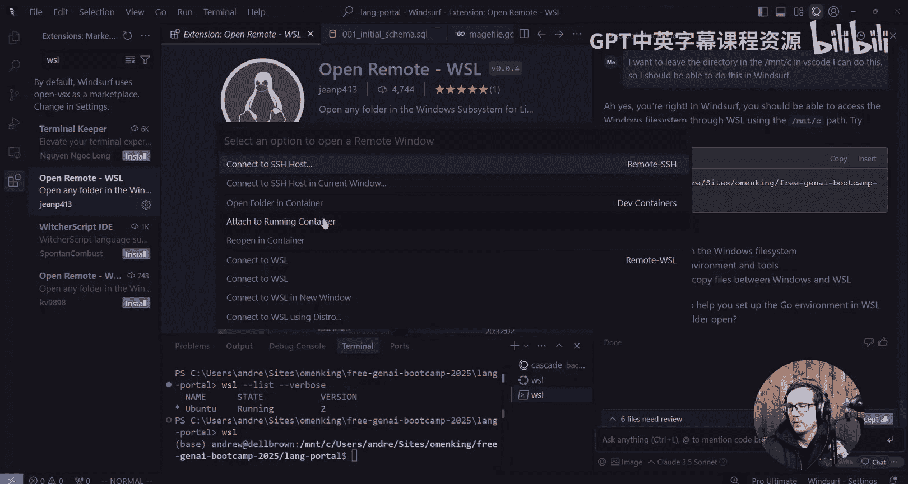

Open folder。 Can we do it this way。Oh， here we go。 Maybe this is another。 I don't know what I did。

 but I， if it works， I don't care。 see， there we go。 Okay， and so now we got sites。 No， no， no。

 it's users。AndAnd， missed my。They missed my W。 It's kind of frustrating sights。

And here we have Oman King。Regenina essentials。There we go。 What did I do。 I click， I， I connected。

 I did something。 So yeah， do whatever I did。 I don't know what it was。 But I got it to open。

 And sometimes that's just how it is， right， So now we're getting the whole repo。

 I don't really want the whole repo。 It's fine。😊。

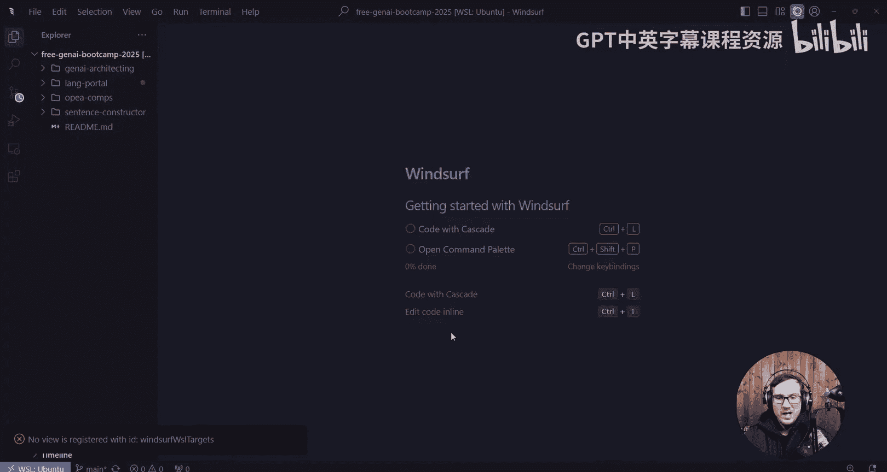

It's kind of annoying because I really hope it doesn't try to pick up any of this other stuff。

But it was so hard to open it to begin with。 I mean， we could go back and try that again。

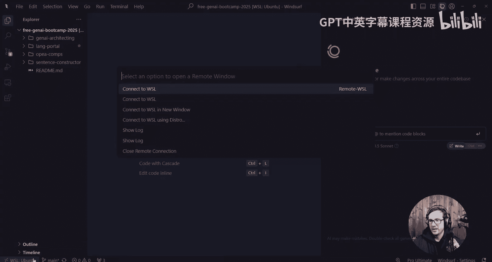

Open folder。

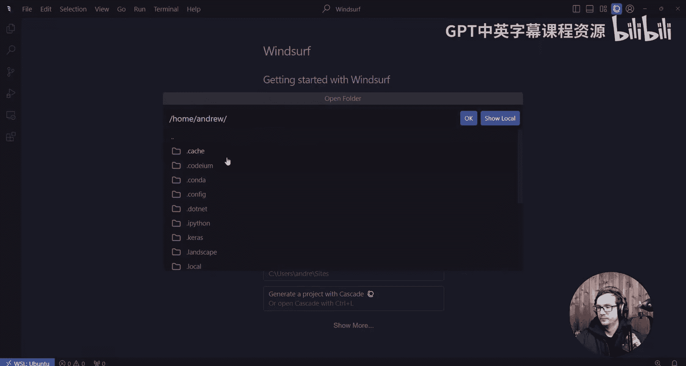

Mount sea。Users。Andrew without a w。Sites。我们 king。This one here。

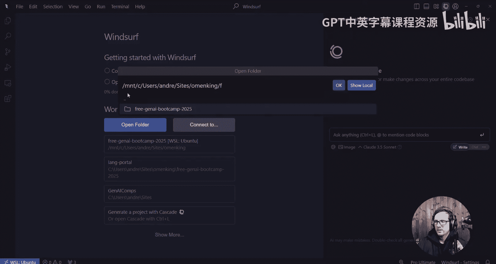

And then I want the lang portal。 There we go。 So now all we have is this folder perfect。 Okay。

 and so windurf will be able to concentrate。 I don't care about the get thing。 will' ignore it。

 I'm gonna go back here and say。😊，I mean， it has some stuff in here。

 I'm gonna clear this out because I don't know what any of this stuff is。

And I didn't get to confirm it all。 So please， like， we want to to implement。I need to implement。

And API back end， I have a detailed。Back end。Text back here。Sa file。Backend。Technical respect。

Can you please read it？And tell me。And tell me。Plan to do。 And then we can proceed。

To build the app in the back end。Go folder。Okay， so now we're on right， it's gonna read that。

 Well I I really important to tell it to read it first because even like Cla's terrible at just doing stuff that you didn't ask it for。

 And so this is gonna help it out a little bit。Okay， great。 okay， great。Start implementing。

We'll go let that do that there。So let's say except hopefully this time it has less of an issue。

 and it looks like it does。Is this working， Let's refresh。 It is okay， great。We'll add the go in it。

Go cannot be found。 So I see you haven't installed it。 So here's suggesting us to install it。

We'll insert this into terminal。Is that the way want to install it， sure？It's probably fine。Right。

I hope so。So go ahead and do that。 We'll say yes。We'll give it a moment here to go。

And it is installing。Very good。Okay， go should be installed。 Let's continue。I mean。

 I don't really know if it's installed， but。Who thinks it's installed。Okay， we'll do that。

It's kind of a annoying that's calling Lang Port as that's up here and this is in here。

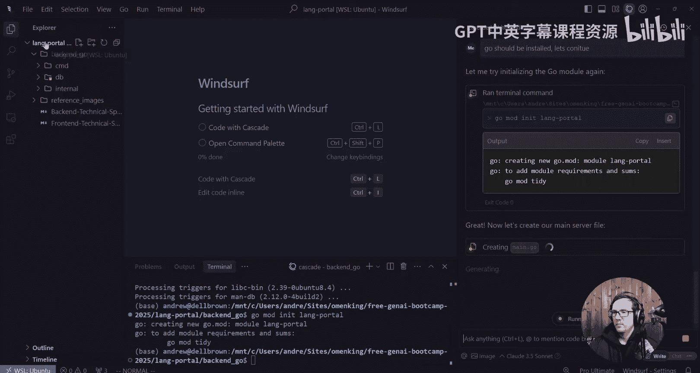

I'm not sure if that hyphen is going to cause any issues。So it's creating the main。go， the Mfilile。

go， the models。go Yeah， and I don't know go that well and it's going。But go is like highly。

 highly proficient， more proficient than Python。 So if it does work and we want to， you know。

 launch this scale， that's gonna be really interesting。

 It Looks like it's also trying to take care of cores here， too。 So that's really useful。😊。

But I'm pretty much in the same boat as you， if you didn't know Python or all this other stuff。

 I'm going to be really reliant on this doing all the work for us。Do you want to run this command。

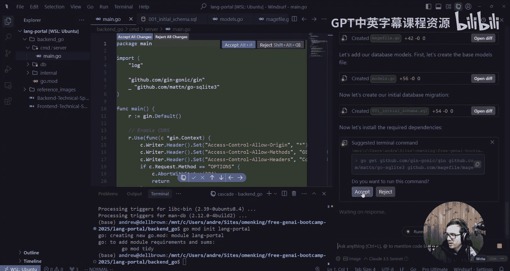

Yeah， sure。 sounds good。So it looks like it's setting up gommage now or whatever the thing is called。

Just age， maybe。Except all。 so now we have code， Let's go take a look at what we have。

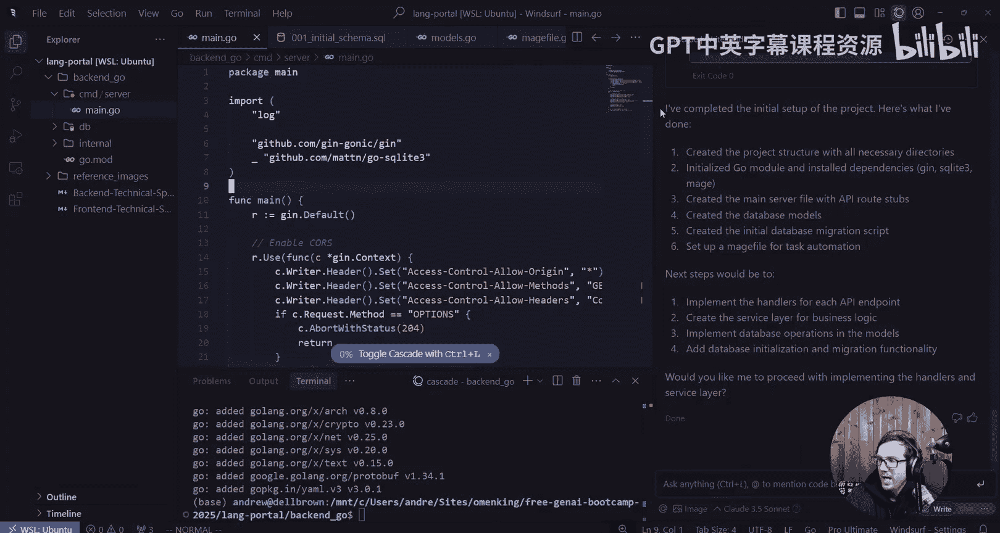

So we have our go dot mod。 That is our entry point in here。

 And you can see that there's a lot of requirements。 Go is very verbose。So that's no surprise。

 So that's gonna have everything we're using。 So we have。Snic from Bite dance。 What the heck is that。

Do we want to be using byte dance code in here， Is that good or bad。Let's go over to here。Bite。

 dance， sonic。Okay， so that's a serializing database。

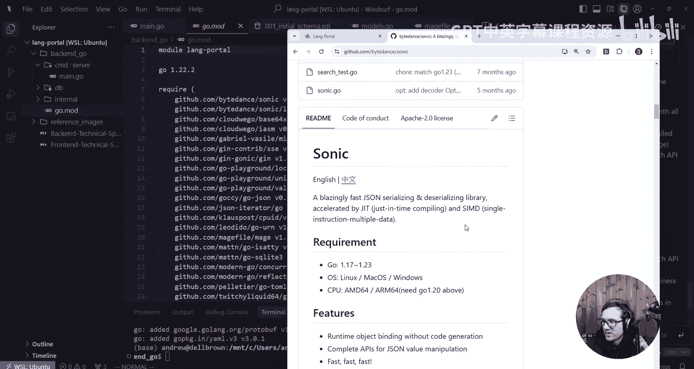

For those don't know， Bte Dance makes TikTo and the state's almost bad TikTok。It's a Chinese company。

 too。 So， you know， you there might be bad code injecting there。 I don't think there is。

 but I'm just saying like if， if you're into conspiracy theory， that's what you might think here。

Although this other stuff looks fine。that's not crypto like as in crypto coinin。

 that's probably crypt graphics， something， something。So we have go some。

 which is a check some file for what is actually installed。 We have our image file dot go here。

 This is going to， we have the install。 So install the project dependencies。

 So it looks like it has more than just the ones that we gave it。 run the server， build the server。

Okay， but it doesn't look like it implemented everything just yet。I complete the initial setup。

 create the project structure。Initialize the go modules， C the main server files。

 create the database modules， create the initial database migration， set up M file。

 implementment the handlers of each API endpoint， create the service letter。

 implement the databases and stuff like that。 It doesn't look like it completed all the ma file go stuff。

We don't have anything in our seeds。We have some migrations。This。Looks correct so far。 So I D。

 Japanese Ramaji， English app groups。 That's right。 We're groups。

 the app is a relationship between the two study sessions。That was correct。Study activities。

 it belongs to study session， group I D， etc cetera。 That's good。 Word review items， correct。

 references all over the place here。 I think that's right。 All those references reviewed items。

 It belongs to a word I D。 y， It belong， belongs to a session I D。 So that should be fine。

 we could have it generate some C data for us。嗯。Let's look at our main dotgo。

So our main application here is GoSQL light and Gin。 It's bringing in cores， which is good。

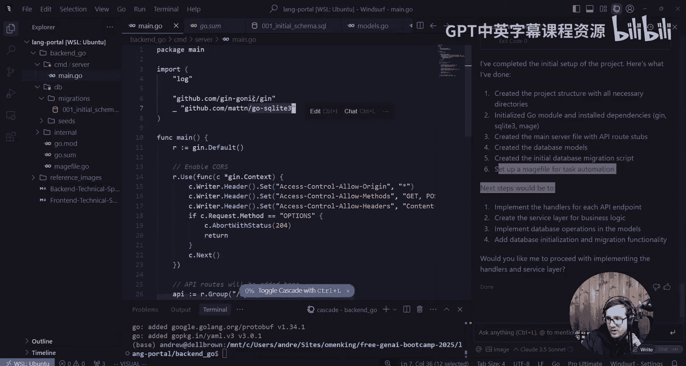

Its saying a loud origin all for for now。 so I'm not sure if that's going to be a problem。

 but right now it's saying all for everywhere for all directions。

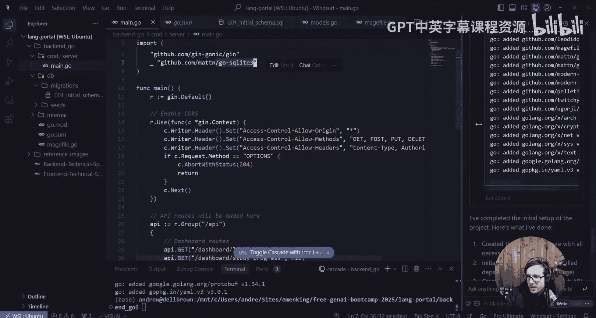

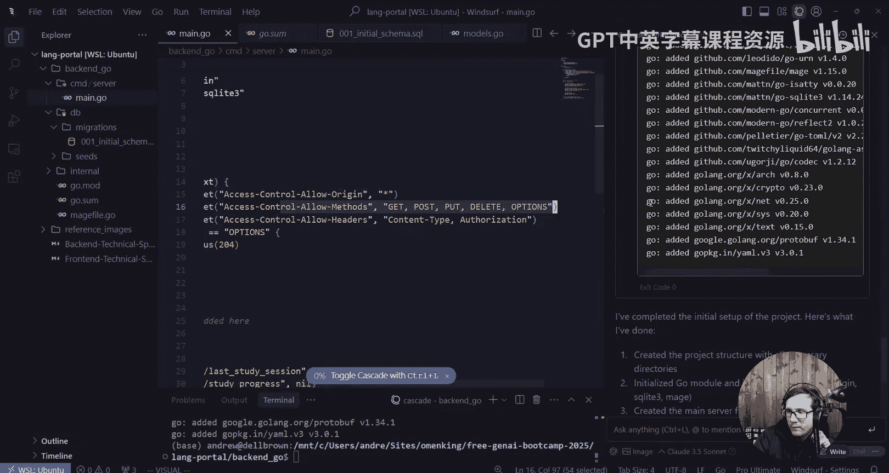

But normally you want to lock this down to exactly what you want to have。

 So this might be like local host， not local host， but where we deploy to。

 That might be something we might want to change later on Here we have our API here。

 It's talking about where to route these APIs。 I don't know the second parameters for。

 but we could ask it。But we can see that we have all these routes， right？嗯。1，2，3，4，5，6，7。

 Does't look like it finished all the routes。Okay， it willll go into the internals here。

Nothing in handlers。We have our go models。This is basically to map up， like。

 to provide the structure of the objects coming from the database。 that makes sense。

Nothing under service。 Okay， so we're gonna go back here and I'm gonna tell a few things。 So。

 so next steps would be implement the handlers。 Okay， so let's。It says create the service layer。

 implement the database logic， add initialization。 Okay， so sounds good。 Sounds good。 Let's continue。

 Let's keep going。Okay， so the things that are missing is what it says that it's missing。

 So that's fair。So it created a dashboard go file。

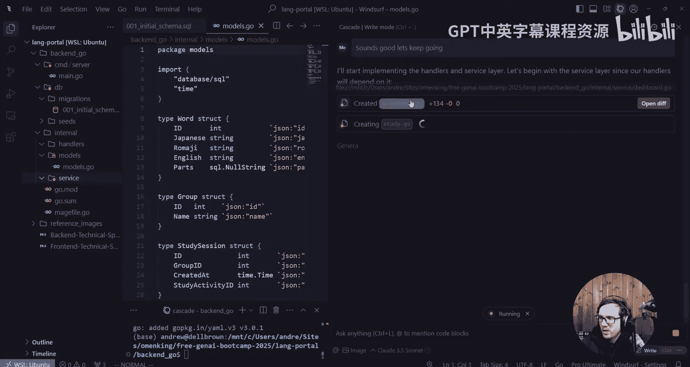

While this a generator， we can take a look at them。

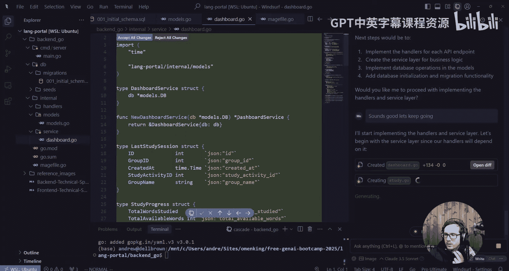

So， we have our。So we're defining these type structures， okay？Dblo， we have our query。

And we have functions。 Go is really flat。 It'll have like a bunch of functions。 Again。

 they're not gonna roll these up into classes。So looks good to me。But yeah， it's just going。

 So I'll be back here when this is done。 I'm gonna pause here so you don't have to wait forever。

 There's nothing exciting going on here right now。

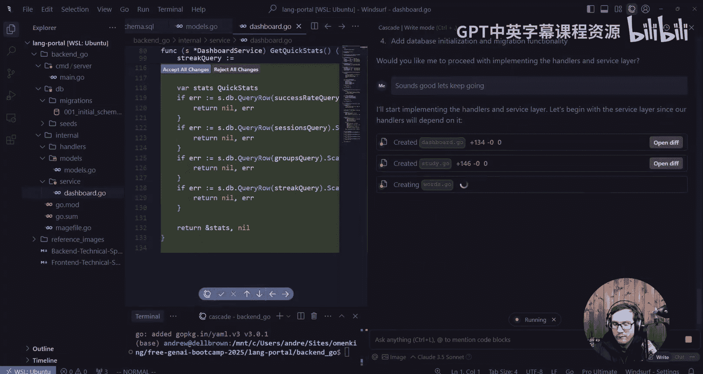

Alright， so looks like it finished our next task。 So it created the dashboard， the study， the words。

 the dashboard， the study。 Okay， so it says created them， and then they implemented them。

And then it update our main goal。 Let's take a look at our main go and see what was changed。

So now here， okay， so now it's actually passing those implementations。

 you can see that it's not fully done。 It's just doing some of them right now。嗯。

We would have to go to each one and just really carefully read it。 So this is the dashboard go files。

 go here。Those are the handlers。 Do they not contain the SQL。I guess they don't。

So new dashboard handler get studied last session。Okay。

 so these handlers then just refer to where the sessions goes。 or sorry， the services。

 So here you can see it's internally calling the service。'm sorry here。 So this is good。

 So that that's the handler。 And then the handlers pass to the go file kind like feels like a completely useless intermediate file。

 But if that's what it needs， that's what it needs。

But then it will call the files here So really the meat of it is going to be the handle is to be boring it's going to be these files that we're going to care about。

 but obviously since we know what our JO is， we can just let it go all the way the end and then tell it to test our make test code to make sure that it's correct。

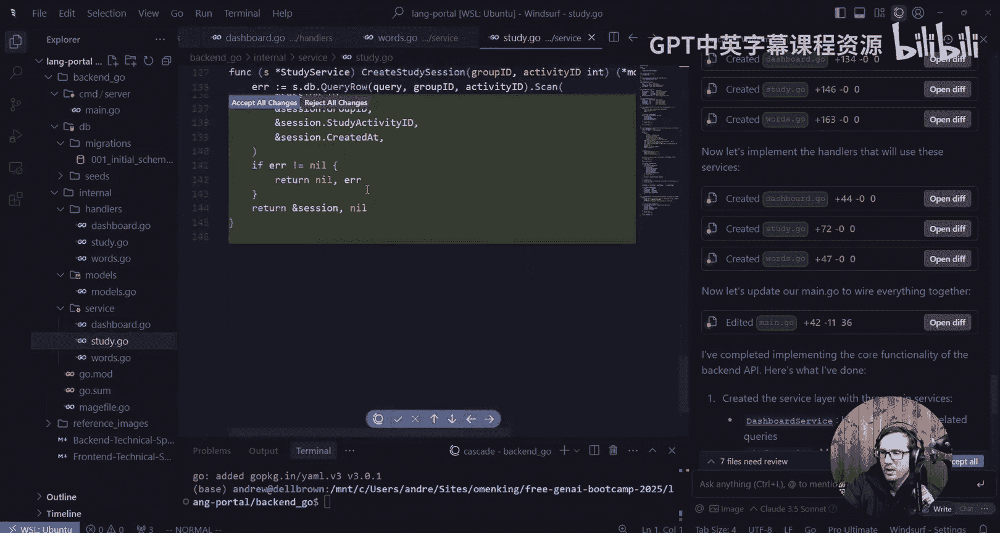

嗯。So that's fine。 I to say I keep going。 able to say， accept all， you know， keep going。Yeah。

Let's just keep doing all the work。And I'll pause here be back in a moment。Alright。

 so the next little round of changes are done。 Let's go take a look here。 So say， keep going。

 So I'm gonna implement the database migrations and adding seed data。 So take a look here。

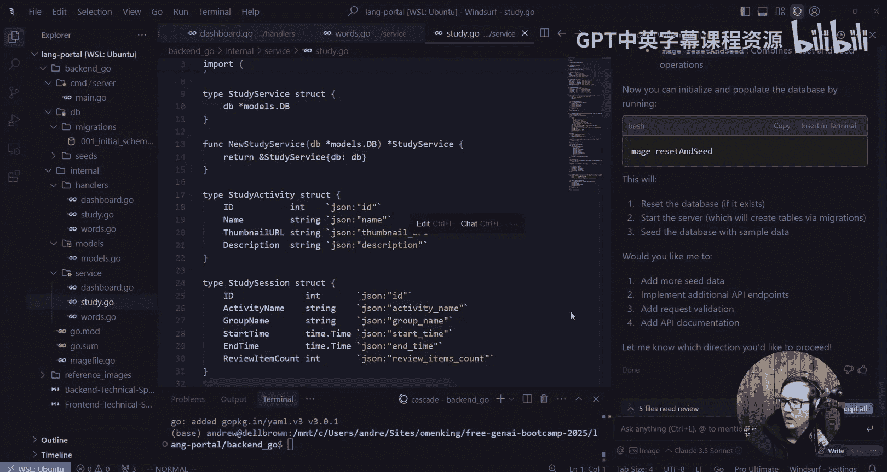

So this is a way so that it can actually run migrations。Alright。

 we don't really need something super complicated， but that seems fine。

seems like it's even going manage a migrations table that again， is a little bit overkill。

 but if it works， I don't care， here we have some basic data to be populated。

I don't want it to insert data here。We have Ergo， maingo。Mage file， that's fine。

I would say in the migrations。Don't load any data。We're going to do that。

The adjacent file as described in the tech tech spec do tech spec do I I I has asked you to read。

Okay， so I have that revise that because I don't want it to do that。

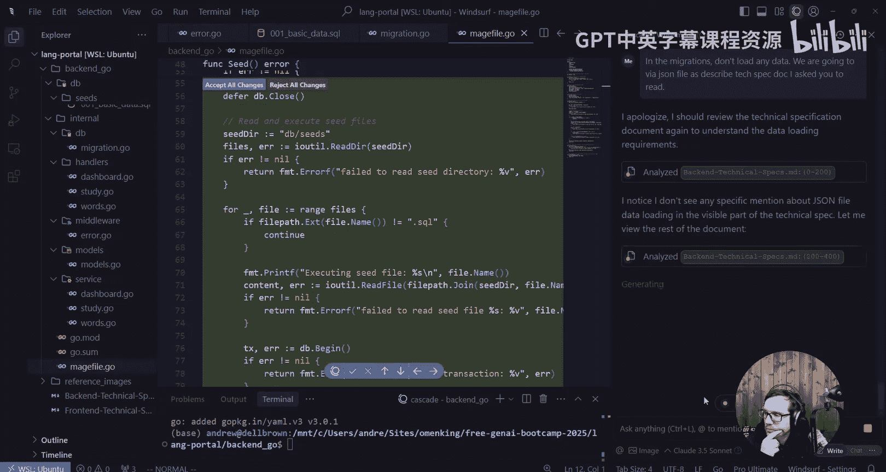

没有。Becauseuse that's all it's supposed to do is is run the the schema， right？

I don't know why it has parts of language。 I guess it's confused。

Because we don't need that right now。Wass doing pretty well。

 Like it's getting through a lot of the code。 So I'm really hoping what we do is we get something。

 And then after that， we just， it runs。 And then we say， hey。

 we need to now test it and write test code to make sure all of our endpoints actually return what we want。

And that might be the best way to do this here。

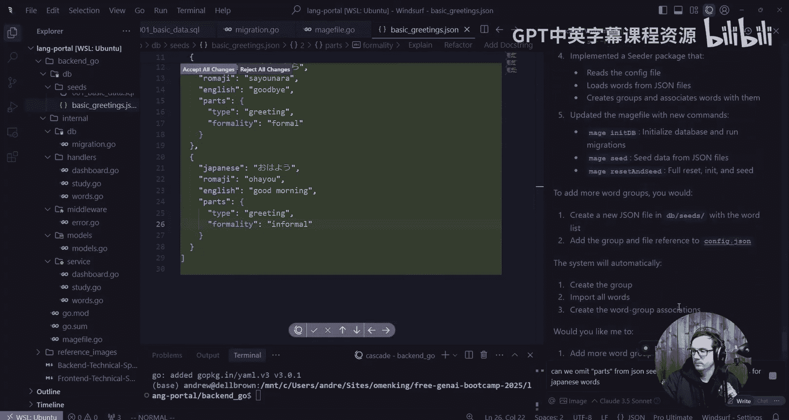

So I'm going to accept this。 I'm going to put this in here。Let me take a look and see what we have。

 So in ourm dot go。We have our nitTP。We have our C B。 We have our reset。

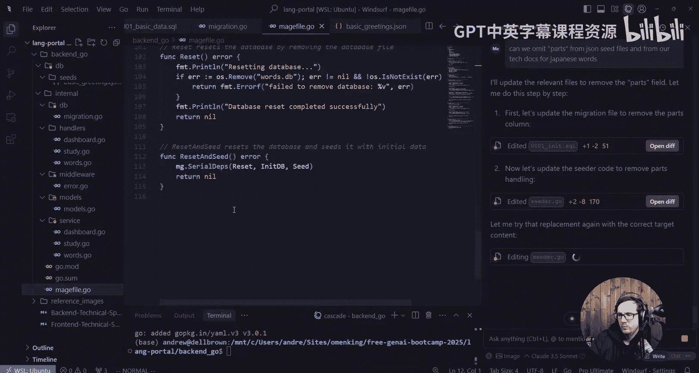

We have our reset and C， which are completely separate。Let's， it's coming along。

 Let's go over into our main。Go file wherever that is。Maindago。

And I want to know is like all them implemented now。They look like they。 Well， no。

 they don't all look like they're implemented。Okay， let'll just let it do what it's doing here。

It's getting really confused here。But I'd say one thing it hasn't done is implemented all the endpoints。

So it's implemented some of them， but it can only do so much in a one go A。Okay， good， so。

There appears to be。Many API endpoints missing。Can you continue to implement the rest。That are。

 that are documented in the。Tch。Here。And so if we get them all in。

 then the next thing will just be to write the code。

 So I'll be back here when this is done generating。

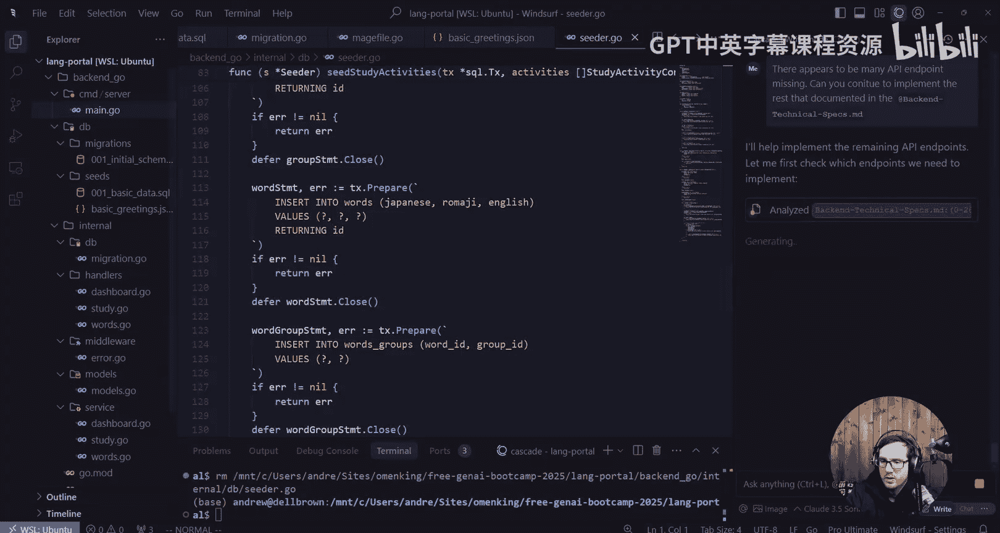

Alright， actually， I had dinner。 now I'm back。 So let's go back and take a look at what it did。

 So it says， I've now completed implementing the remaining API points for the language learning portal。

 Here's the summary of what I did。 So we did the groups do co。

And this is really the trick because you just got to read it all and check it all。 That's。

 that's the big challenge here is that people don't read it。

But we say implemented methods for managing word groups， implemented methods for studying sessions。

 implemented the headers。We have the dashboard endpoints， the word endpoints。The groups。

 study activities， et cetera。Do you want to run this command？Sure。Oh。

 it's actually going to start it， cool。嗯。So here we have this。

About a bunch of stuff that's not being used。 The server should now be running in local hosts。

 You can test the API end points with curl or whatever， all endpoints。

Are supported proper error handling。 So I guess the question is， I mean， that's cool。

 It says it's running。 That doesn't mean anything。 But you can see there's a bunch of warnings here。

 I would like to， owe， it it timed out。It stopped。So we have these here。So， we have。

The we'll just say except all。 So I' gonna say the go server。Ran for a while， then stopped。

Before I had a chance。To curl it。Also。Getting the following。Worardnings or errors。

Ca it doesn't use those things。 Let's go ahead and put that in there。 Maybe you can correct that。

Because it probably just put in a bunch of code that it didn't need。Now。

 normally Go is really good at ripping things out that aren't being used that are imported， but。

We'll run this again。Okay just we'll keep suggesting here。Oh， it's fixing it right now， good。

And we'll go ahead and do this。Now it has an issue undeing time。Itll say accept。Wow。

 there few quite a few issues。 But， you know， again， I don't have to do anything。

 I just gotta watch this here， but。At some point， we should become an expert。

 like if this is something that you would be running in production。

 I would ask it to like break down the code and I would go through and comb all of it to understand it and try to get up to parity in terms of the knowledge to maintain it myself。

 But as an MVP that I'm not deciding to put in production is' totally fine。And again。

 it's just going and going here。We'll say， except。And here， oh， here we go。 So now， oh。

 we're getting good output now。 So here it's running it。And it's starting it。

 We're seeing all these endpoints and showing you all the handlers it's starting。

 And now it looks like it is running and saying， open the browser。 So that means that it's running。

 We get a page 44， which is totally fine And notice we， we get that end point there as it's hit it。

 with that get。 So we actually get some good logging， which is really nice。 So now I'm going to， oh。

 now it's gonna to curl it for us。 let's go ahead and do that。😊。

It says no such word such table words。It didn't run the cedar。 I'm not whether they call it seed。

 And I， I was wondering if it did that or not。 it's gonna do it。 So it's doing pretty good so far。

 let's run the cedar again。 We'll go ahead and try this again。

We did have this no such file directory here。So I said it's fixing its mistakes， but yeah。

And we'll go ahead and run this again。Faiil to the database。 It's still going。

Unknown driver Esqui light。So now our current output here is this， and looks up these changes。

And at least the server is running。 But now we can see that we're getting。

 now it's trying to hit the API and it's getting a 500 error， right。

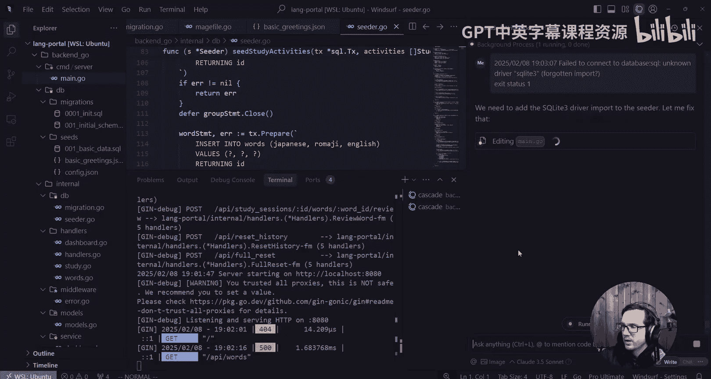

Is Albertber needs to go to the cedar or is is it it just in general？

I want to see what is's changing here now。 Okay， so just adding it as a requirement。

 This is just in the main dot co。I would assume the seed would run the migration first。

 Let's let me create a migration file。 Why is it creating a migration file。Hold on。

 Did you need to create a migration file。Or did we already have code for this。In our。Task runner。

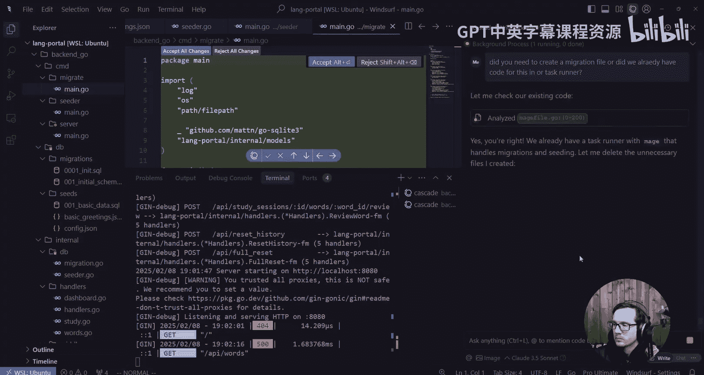

Yeah， causeuse I didn't think I needed to do that。 You really have to pay attention here。

 And I am like， it might not seem like it， but I'm really paying attention to what it's generating out here。

And so we have main。go because that's what it should run。 Well。

 it shouldn't it shouldn't have added that file to begin with， right？Okay， so there we have Mage。

go reset and seed。Do you want to run that command sure？Mage not found。 I thought an important Ma。

So it's adding it if， in case it's not there。 I thought it was already added。 I。

 I could have swore I saw it before in our。It was like in the go mod， but maybe it wasn't in there。

 like I saw a age。And we'll accept that again。But yeah， like as a separate thing， you know。

 if we really wanted to work with this， we would， we could use this as a way of documenting explaining how the code works and walking through it in various ways。

 But I'm confident enough that like with my general knowledges， we web frameworks that。

I don't need to do that。Still attempting to try to run it。

 import it and no not used path file path page。 And it's I guess if you have things that it's not using。

 it needs to remove those out and fix those issues。cept accept that again。

And so now it seems like it's running。 So now we created it we we need to create the tables。So okay。

 so it's resetting in C。 But wouldn't the seed need the tables for us creating errors， no seed。

 no seed for tables such as that。It seems like it should have been running the the init and then the database。

 It seems like it's confused。So now it's trying to run the knit D B。

 and then it's going to do the seed data。We accept that again。So now it's res the database。

 initializing the database and the database is now seeed。 Now we'll run the main go application。

 It's starting up the server。 We're seeing the endpoints， no errors。 Well。

 we do have that error where it says error Listen to 80，80 already in use。

So it looks like the previous one is running because it didn't stop it so now it killed it manually and it's starting it up again。

 I believe。A 8080， still completing。It's still trying to terminate the last one。

 It's weird that actually gives you termination commands。 That seems a bit risky， but。啊。Down here。

 we'll just type it in。I'm not sure where the other one was running， maybe it was on the other tab。

Hold on one second。Yeah， so。I mean， I really shouldn't use 8080 because。

I'm actually using that port for the other application。 It's in the other one。

 It's the typing typing tutor。 So it's gonna use 8081， which is totally fine。

 We'll go ahead and do this。And now we're getting back result。 So now what we have。In theory。

Is a working API。Okay， but we need to know that it actually works。

 And the way that we're gonna actually know that it works is we need to now have a test suite to run against it to make sure that all of our endpoint do as expected。

 So I'm gonna stop this video in the next video。 We're going to use this again to validate that we have the test code we need。

 So I'll see the next one， okay。