# ExamPro《生成式AI训练营｜Free GenAI Bootcamp》中英字幕（deepseek - P23：-23-Backend API Test Code.zh_en - GPT中英字幕课程资源 - BV1SFEWzLEab

We are back。 I forgot to commit the code。 So that's something I'm gonna want to do here。

 just before we continue on。 And I'm just gonna double click here。 But I have to do this， hit stage。

 I'm going to go here and just say， implement back end code。

 I wonder if there's anything like in the before I do this if there's anything I should be ottting sometimes what you do is is you o something。

 So is there anything in like can we， can we add a。

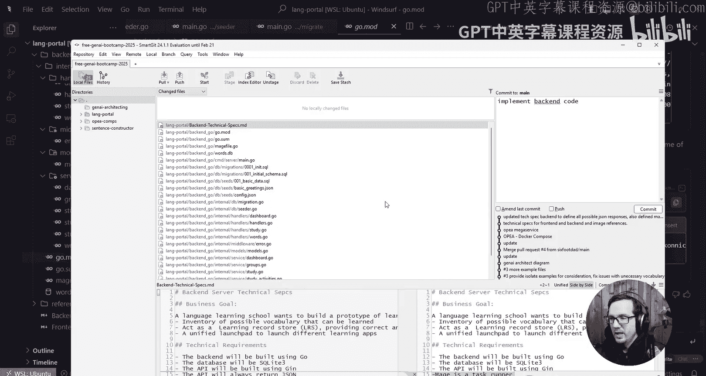

Get ignore。Into the back end go4 go。We could just go to Github and grab the one from there。

 but I'm just going let it generate here， and then we'll just take a look at what it has。

So if there is anything in particular that we need to exclude， that will be it。

 So that should be good。 Where did it create it。I just wantna make sure that this is the right correct right place there it is。

 And So now I'll go ahead and stage that as well。

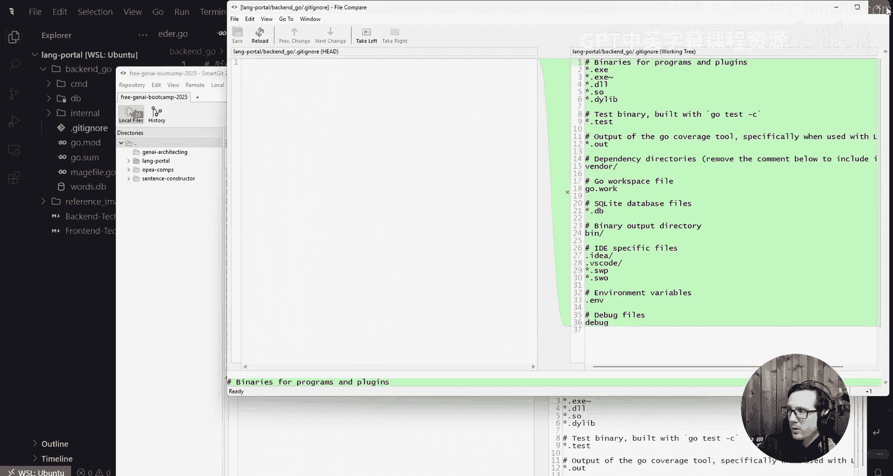

Stage。And so now we are in good good shape。 So say implement back end code in go la。

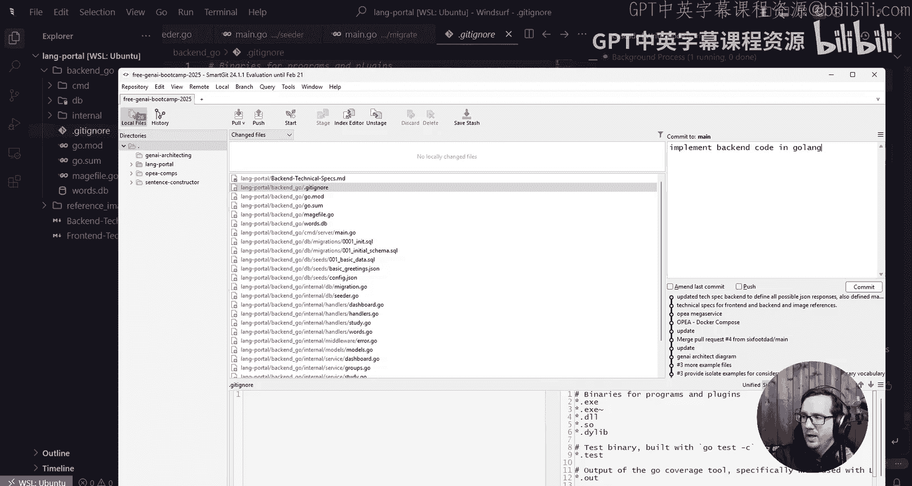

And we're going to go ahead and commit that。So now what we need to do。

Is we need to make sure that our API is actually working。So our next task task is like， okay。

 so we have we have implemented all the API endpoints。We need to ensure。That all the endpoints。Work。

Re， the expected。Jason or expected response。You know， like。Good or bad responses like。Okay， like O。

500， etc cetera。 What would be。An easy way。 What would be。A way we could。Write test code for this。

And like， do we want to use go for this。I mean， if it works， it's fine。 Like， I don't。

 there's nothing wrong with using。Go。The other thing is that generally。

 because go is is so statically typed， it doesn't require as much test code。

 I don't believe What I'm gonna to do is I'm gonna go over here and just ask， Cla this thing。

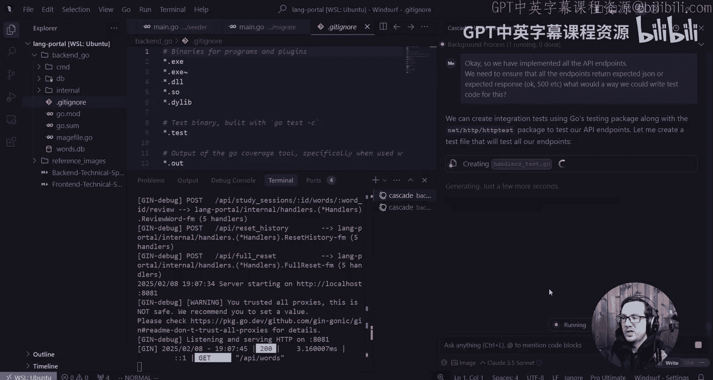

Does Golang need as much test code as other programming languages？Or。Or does the nature。

Of go make it。 so you don't need。As much。Task code。it needs as much as other ones here。

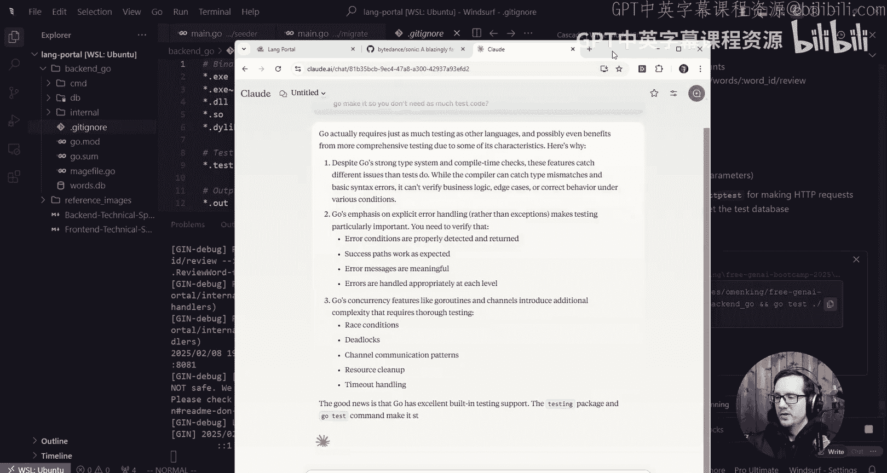

Okay， fair enough。I was hoping that it would it would do something bit different there。 So here。

 what it's doing is it's going to implement some test code。 Let's go over here， handle your tests。

Test groups。I wonder this like another way that we can test this stuff。嗯。Is there another way。

 is there。Something other than go。That is more。Developer friendly。We can use。Post matter。

 the Th client V code extension。 That's what it was called。 Let's go take a look at that。 Th。

Thunder client。Now， here's writing Postman。 Postman's fine。

But I guess my other issue is that this is not going to test our endpoints。

I don't really want to use postman。But we'll take a look here。I mean， yeah。

 that is the way like could we。Could we use Ruby， I'm sorry， I like Ruby。

 but like could we use Ruy with。With R spec。I'm just going to ask you if we could do this。Yeah。

cause it's very readable。 That's， that's the thing that I want is the fact that it's super。

 super readable， not because。Well， I mean， I really do like rubby， but， you know。

 sometimes readability could help a lot。 So we'll go here and。

Let's take a look at what that looks like。I' gonna go here， and。We have these thunder tests。

 I don't want these thunder tests。 We'll get rid of that。 And Postman's fine。

 but it's just like it's paid， and it's not easy to access like it used to be。

 So let's forget that one。 So we have a spec directory here。 and we have API。 And if we go here。

 if this， to me， is very readable。 So here we have groups and says， let the response。

 If it goes here， it should return to 200， If not， then it should do this。嗯。Okay。

 and so then it will generate an output like this。 It's very， very clear。

So this is the way that we can test our API， so。Yeah， it looks great。Good， keep going。

T test all endpoints。Using ruby。With rubby's spec。Okay， there might be an easier。

 like even there's like ways to refactor this。 So it's even more concise。 But， you know。

 for our purposes， it's totally defined。So， we'll。Let it continue on here。

The only thing is that we have things like groups，99 words and groups， one word， and。I mean。

 I guess I would be a valid one。 So it is setting these things up here。

 So the test code here is a little bit rigid。 I wouldn't describe it as the best。

 But the point is that it's really easy to read。 So Im， I'm kind of happy with it。I is cool。

 because we can use it for anything if we decide to implement this in any other language。

We can see use the ruby code for it。

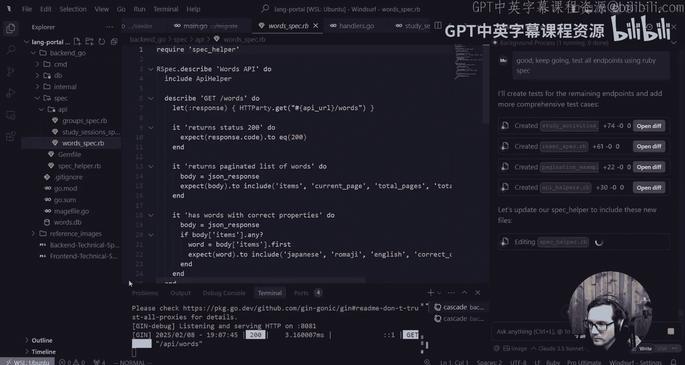

So we'll just wait， wait for it to finish here and then we'll review okay。Okay， so now。

We have a lot more stuff。And so it's testing exactly what expects to says go to here。

And it should return to 200， and it should return in stats with the correct properties。

 And we're expecting these properties， right， There are other checks that you might want to do。

 You might want to say things like。If you increment a value， you can check it。

 so if we go over to something like study sessions。In area， we have this， right。

 So we might say with valid I Ds， return response and valid I。 So this one's really basic。

 It's not checking。嗯。Well， if you have a post here。 so we check the post。And it returns back correct。

But it's not checking whether something increments or something。

 I guess it's fine because it's just checking the endpoints。

 It's not checking the internal internal app。 We'd have to write unit tests for that。

 And this isn't unit tests。So do you want to run this command？ Yeah， let's go ahead and do that。

So now it's actually just going to run the R spec stuff。Bundle， not found。Really what？Oh。

 I don't think we want to install it that way。Ruby has to be installed in a very particular way。

 so just one moment here。I'm going to go over to here。 And do we not have Ruby。M RVM。

So I'm going install RVM really quickly。 And yeah， everyone should have Ruby。 It's great， so。😊。

At some point， you knew this was coming。

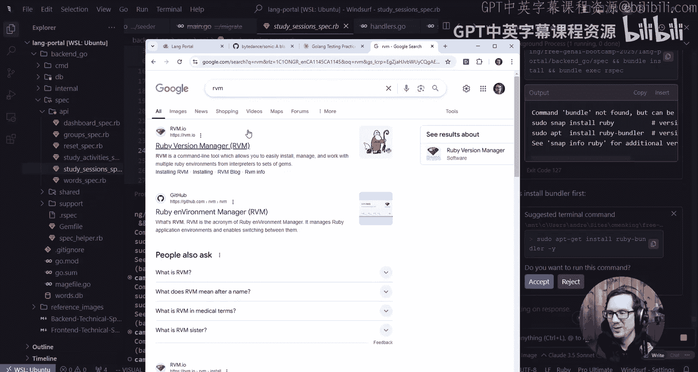

So install Ruby should be pretty straightforward， I think I should be able to grab this line here。

So RVM is a Ruby version manager。So since I can't find out， and we'll go ahead and grab this one。

 I guess。And then after we install G PG， whatever it is。

 I'm going try the next line here for installing RVM with the default Ruy on rails。

 I don't want ruby on railils。 I just want rubby。 We'll grab this。 We'll paste that into here。

 That's gonna install Ruby。 We'll give it a moment here。嗯。I think it didn't like the G PG thing。

 So I'm gonna go back up here。 We didn't。 I think this line didn't run。

 We didn't have G PG2 installed。 I， I mean， G PG GBG is necessary。 It's。

 it's like a key or chain to check to make sure that what you're pulling from is valid。

But it's always kind of an extra step that's kind of a pain， even though we should be doing it。

 But anyway， so now that we have that extra step， we're going go back over to here。

 I'm gonna grab this line here。We'll hit enter。 And so that's gonna go ahead and now install RVM。

 So RVM stands for Ruby version manager。 And if we do RVM， was it list， we can see， do we get RVM。

 at least， We do not。So， it says。Installing RVM to this path， adding RVM to this line。Okay。

 so doesn't know about it yet。 but maybe I got to just restart my source。Bash profile。

 maybe like that。Now do we have RVM there we go now I have it。 So let's say RVM list。

So I can say RVM install。 I don't know the latest version of Ruby is。

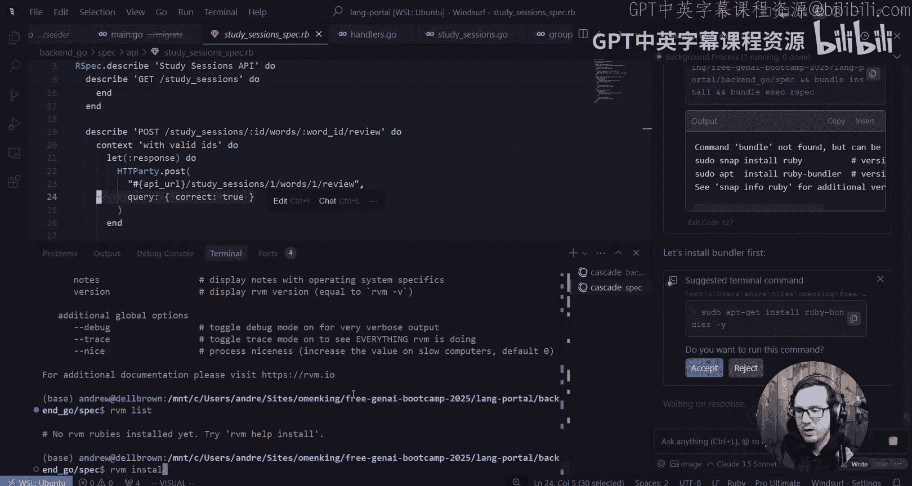

You should all love Ruby。 It's such a good language。 It's so nice and fun。 and under the sun。😊，So。

Made by Yukihiro Matsumoto， who is a。Is Japanese。So you know， it is a good language。 It iss weird。

 It's Japanese， but it's written in English， but it's supposed to to be very。

 very similar to English。 But anyway， so all I'm going to do here is look at what the latest version is。

 it's 3。27。 Wow， we are moving up in the world here。 So's gonna say Ruy， So I'm gonna say 2。3。7。

 is's gonna know that it wants to be ruby。 And if the binary is available。

 it's going to go ahead and download that。

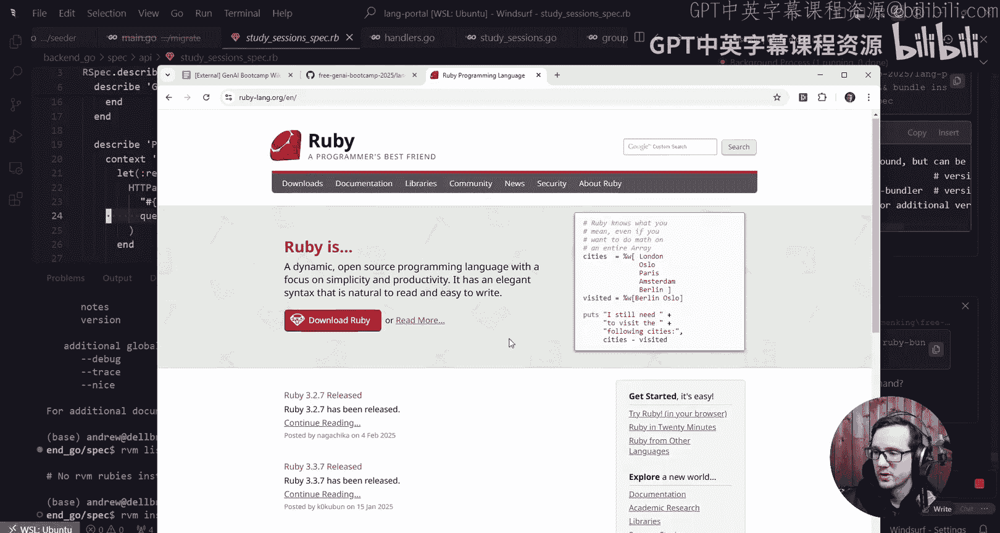

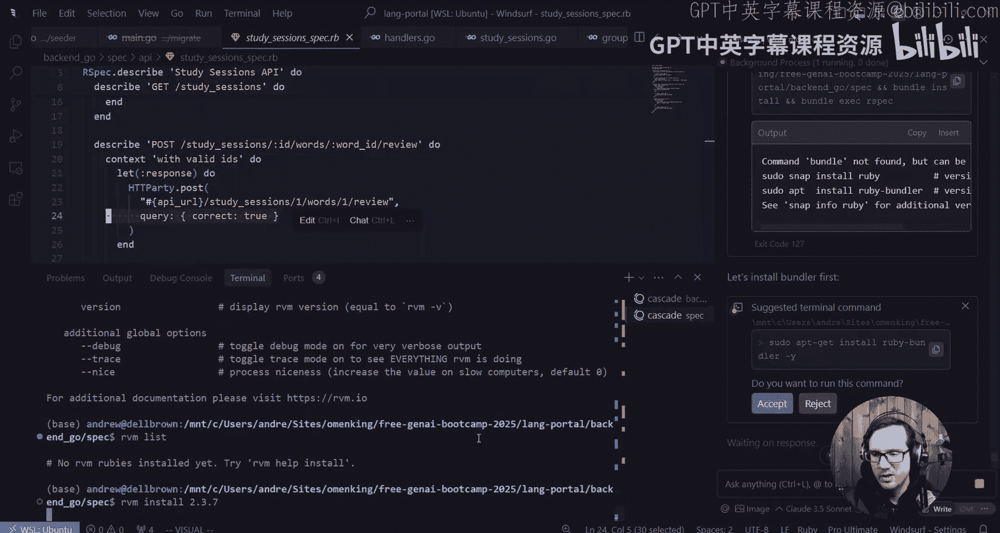

So， here。It's having some issues。 So what I'm going to do。It was also 3。4。1。 I'm not sure why， Oh。

 you know， sometimes the latest is not always the one that's shown here。So maybe 3。4。1。

 we'll try that。

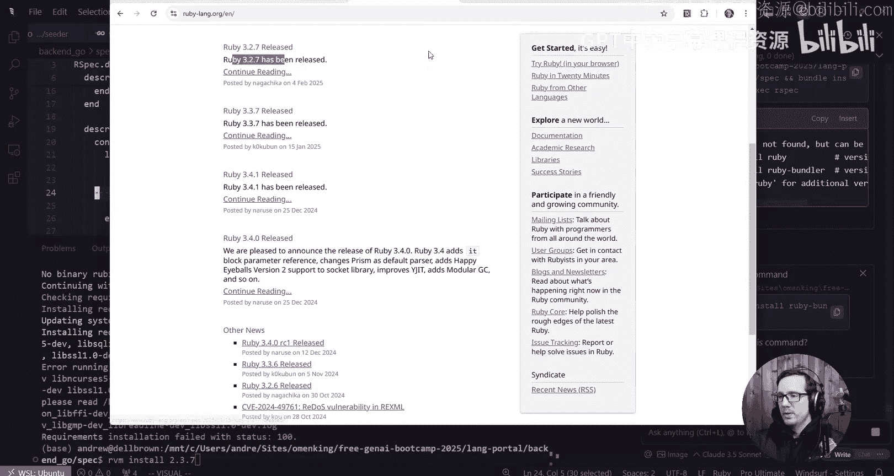

Yeah， two's really old， what am I doing too？I should deal this like that's not， that's not new。 Well。

3。2。7。 No， that's pretty new。 I was thinking like 2。7。 I've been using rubby for， like， ever， so。

Before it was even two， I was just when it was like one。We'll go ahead here， and。

Because if it's the newer one， it's gonna have all the compatible ones that that 3。2。

7 might be an older release。 and that's not available on U Btu。So here it is installing 3。4。1。

 I'm gonna wait a little while。 It shouldn't take too long。

 but I'm gonna wait a while till this is done， okay。Alright， so RVM should be installed。

 Let's go ahead and type in or sorry， Ruby。 Ruby should be installed。 So we have version 3。4。1。

 We need install bundler。 So we'll go ahead and do that。 That's what's being used to do bundler。

 I'm just gonna go here and tell it like I have Ruby installed now with bundler。 so you don't need。

To install Ruy bundler。Like you are。So go ahead and just hoops。Told there。O。And so now we'll run it。

 just do a bundle expect as that our aspect。And we'll give it a moment here。And so now it's running。

 it's just installing before I didn't need it because it was just running raw Ruby。

 which I don't know how it did it because maybe it was just showing as a preview。

 and I actually never ran it。 See it， it shows this。Oh。

 saying like what you would want to see as good output。 I thought it ran it。Oh。

 and so then it it ran into problems。 Okay， so now here we， it's running。 Let's take a look。

So it says no such file spec helper。It might be just where I tried to put it。

 but let's see here it says， it seems to be an issue。 Let's fix the directory structure。 Yeah。

 it's probably what the problem is。And so then we go here， it says。I think it's fixing it。

Might just be the pathing。 Yeah， I was gonna say maybe it's doing require relative to fix it。

Now we're using something I know。嗯。Okay， so that is still going good， good。Arpect bundle。

 Ex aspect format documentation。 And I mean， that's a format you can do it。

 I usually don't specify the format。 Im surprise it's doing that。

But we'll go here and it's still having an issue。No examples found。I mean， that's fine。

 If wants to run them individually， that's not going to help。Still failing。Do you need that， though。

Okay， I mean， that's gonna to format things。 That's not why it's broken。Well， yes， of course。

 that would make sense， yeah。嗯。😊，Really struggling here。I'm sure if it's forcing it。

 but let's try this again here。Okay。Without any configuration files。是。

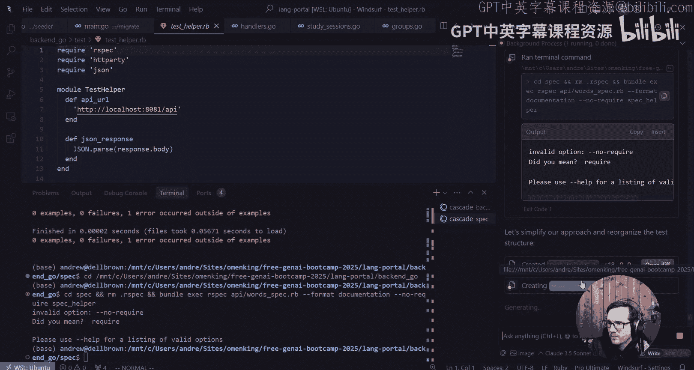

They just get rid of all my testile。Now， it's doing test。I don't really want test。

It just made another folder call that doesn't make any sense。O。

I think it needs a little bit help here。 So let's go back over to here。 We have the API。I mean。

 we have these， which is fine。 But these should work。 This shouldn't be our issue。

 So I'm gonna delete this folder here。 This is silly。 And we have the API directory here。 We have。

The spec folder here， which is fine。 We have a spec helper here， which is fine。

 I'm gonna close this out and go into manual as it is really struggling here。

 So we are in the spec directory。 I'm going to do a bundle install to make sure whatever is supposed to be there is installed。

 Now to run R spec， we should just be able to run R spec just run R spec。 That's it。

 And so it's saying R spec， no examples found。 So it's been a while。

 but let's go look up the docks and see how it's supposed to work。😊。

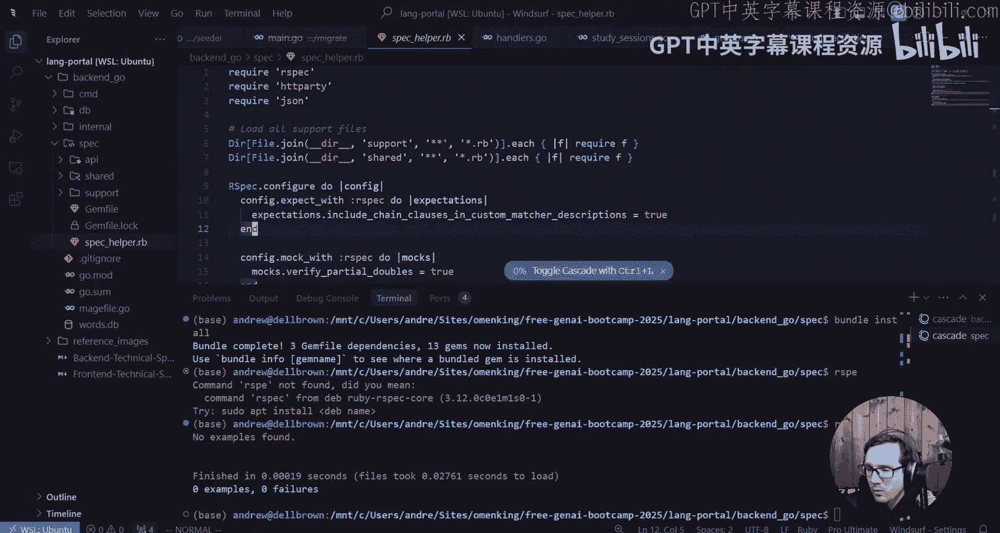

So look up R spec。And we'll go to here。And we'll go to documentation。

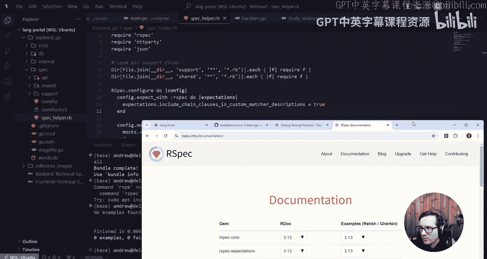

And。We are just looking for。The most basic start to this。 So we'll go into maybe R dooc here。

So gemm install R spec or just R spec core。You want to run against main branch。

 Does it really matter here？So here the R spec rules are here， alias's shared example。

 context better data。So what I'm trying to find here is how does it load。The files are data， right。

 So it should tell us。Install basic structure。Okay， I understand that。The Ars that command。

So when you install Rpect core， Ge， it installs the aspect exable， which we have。

 The aspect spec command comes with many useful options like R spec help。Store command line options。

 That's what it was trying to do。 So start a simple example behavior with your system just before you write any implementation code。

 So in your spec。Calculator respect do RV file says our， our spec spec， Calculator spec。 Okay。

 so we don't need。 We could have the gem file at the top level。

 We really don't need it at this level。 It makes no sense that it did that。

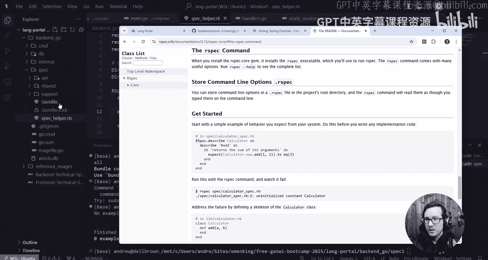

But it's fine that it's there。 I don't care。So what we can do is we can write R spec and then API。

And just specify one， in particular， this one。And so now what it's doing is it's actually。

Kind of figuring it out。 right， So that's okay。 But here's saying cannot load such file as spec helper。

Now， the spec al should implicitly get loaded in。

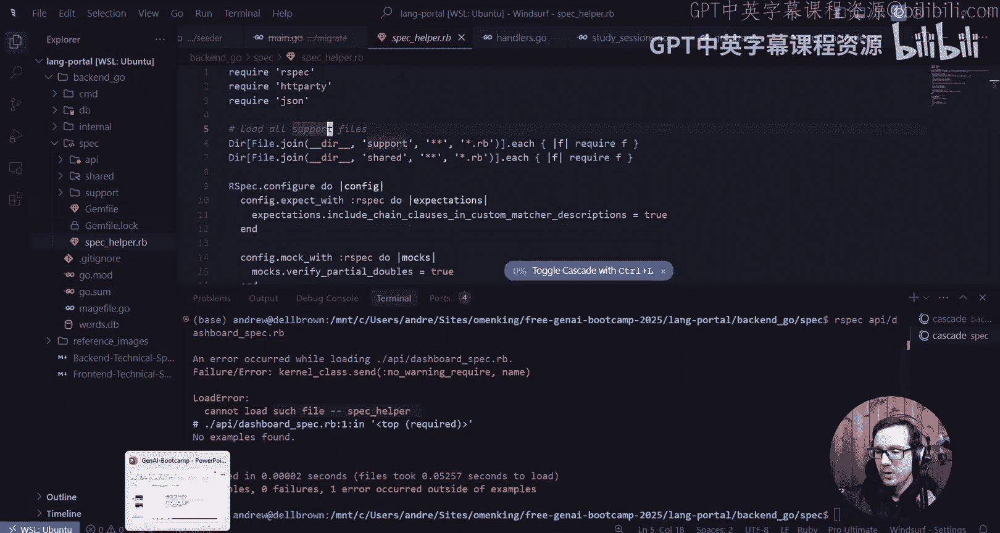

So I'm going to go ahead and just search for this spec helper。Sec helper。Implicit loading。Ruby。So。

 here。

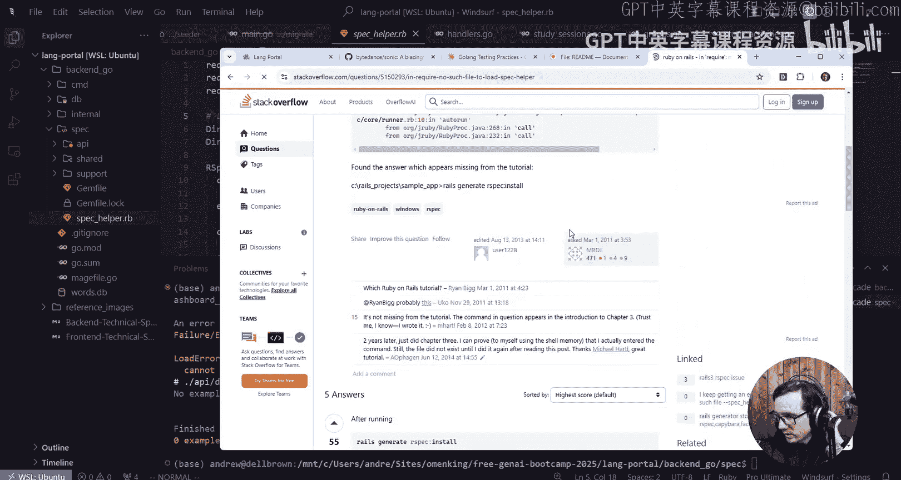

I mean， you could place your spec files under your example folders， but this is in rails。

So what we'll do is we'll go over to here because it might get confused with rails and what what else。

 But this one specifically is the dashboard1。And here it's trying to require it that way。 But really。

 we should be doing require relative。 So if we are here in this folder and we say we go up a directory into here。

 and it's now here。 It should now include that file。

 So I'm going to go ahead and run it manually here。It saying no such file。

No such file an error occurred for API spec。Spec helpper， On line 1。You gotta be crazy。

 Let's put the D R B in there。 We shouldn't have to do that。 Let's try that there。Oh， actually。

 that actually did help。Really， did that help。嗯嗯。Lottle supported files。Support and shared。

 That's totally fine。Some basic configuration include helper modules， API helper， API helpers。

So it' would have those in there。So it was trying to load this。 It created it， which is fine。

Great study session。Review word， get stats。 So this is kind of like extra stuff that's loaded in here。

And'm not saying uninitialized constant API helper。I dont know Is constant API helper。

 What are you talking abouts right here。So maybe in our spec helper here。

It's saying config I included it， right？

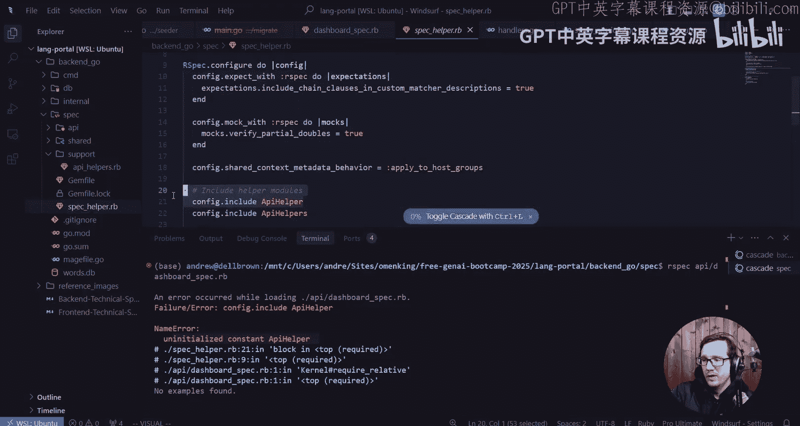

So I'm gonna go back over to Cascade and I just tell it like， yeah， I mean。

Maybe we can just help it out here， and I'll just show it this。

But it kind of made the code a little bit more complicated than it had to be。

 And I'm not sure why I did that。 We'll go ahead and try this。

 And maybe this will contextual help it a bit。And so now we've got in a past the whole like requires issue。

But this is where we might want to pare down the code and make it a little bit simpler so they can run the files。

Because it is getting a little bit confused。And so now we'll take a look at this again。

Go to the top here， bring this over here。So now we're getting a report of what it ran。

 So saying failed， failed， failed， failed， which is fine。

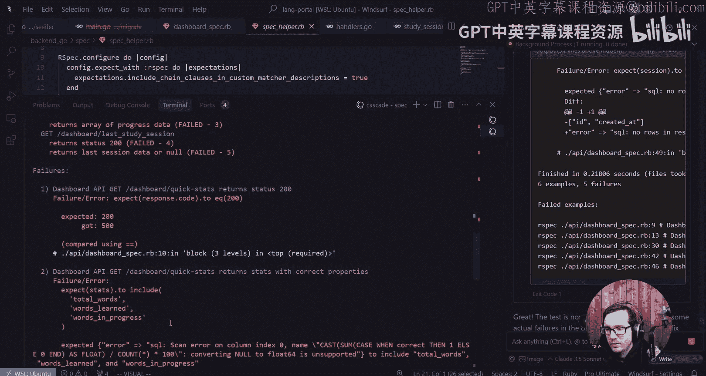

How do we even know if this app is running， right。Great， the test is now running。

 but we're seeing some actual fails in the dashboard endpoints。

 Let's fix the test expectations to match the actual API responses。they don't match。So。

 but I guess the question is like， is it matching based on the documentation？We'll hold on。

Are you matching。Like the source of truth。Is our。Back and so， so。

Are you going to make sure that is that's。What appears in our。What are tests or spec code implements。

Okay， so I'm gonna to go down here and that again， because I don't know if it's actually doing that。

I mean， when we looked at it before， it looked fine。But dashboard is kind of a hard one to。

 to tackle。 Maybe what we should really be doing is looking at the words， words dot pi first。

 We do have a lot of a end points。 so I can understand why this is a bit of a challenge。

Maybe that postman file might have been easier for us to work with， but again。

 I don't want to use something that is paid and a pain in the butt， especially for API testing。

So now it's made some changes。 What a change I don't know， but it looks right to me。

 We're run it again。So this one works according to the specs。So some of them actually pass。

 let's take a look。Oh， so some of them are passing。 Okay， cool。嗯。Let let's move on。

For dash from the dashboard from now。Let's focus on。Easier。

 easier end points like the words end point， the word like words， words and groups。

 So I'm gonna go just to help it out a little bit here， because if we go back over to our ruby file。

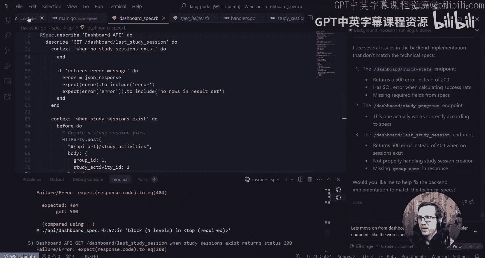

All of these need that spec helper。 So I'm just gonna go， oh， wait， did it add to all of them。

Not all of them。 this one doesn't have it。Oops。So I'm going to go back over to this one here， copy。

I'll paste it in here。And we go here。 one's fine。 This one's fine。 This one's fine。 This one's fine。

And we'll do this。Becauseuse dashboard is kind of hard， right， because it's。

 it has a more complex query。 And if the data isn't there for it。

 it's not gonna spit out good results。The other thing is that I don't know if it actually created a like a。

I guess it's just running off the main application。

Normally you'd have a test database and run against the app separately here。

 but we're literally running against our development database， but that's totally fine。 I don't care。

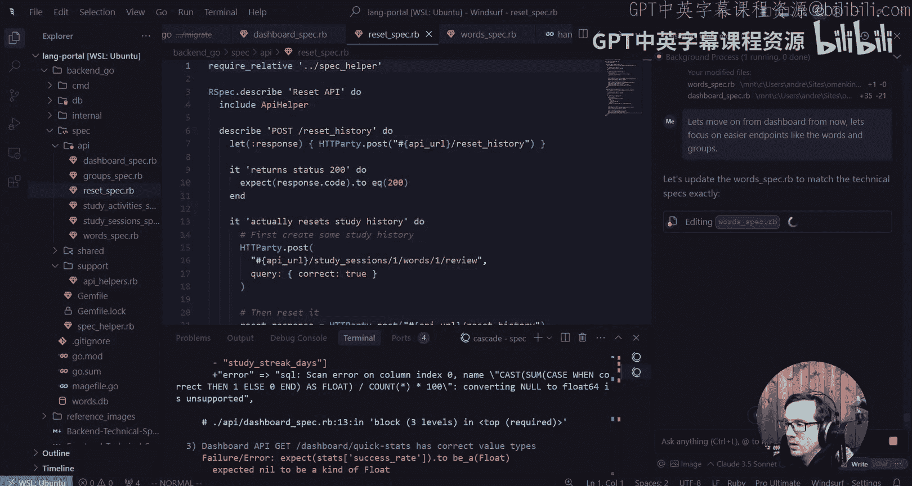

I don't know if it has to update the words specs， I would rather had just tested it first。Alright。

 and so we're just gonna wait for this to finish。 Alright， that was a bit of a weight。

 Let's take a look and see what we get。 So now it's trying to run。Let's dashboards back。

 Let's go down more。 Did it run the other one。It did not。 So here it says。

 let's view the current group specs。 and it's analyzing them。

 So now it wants to go ahead and run them。 I don't know why I just didn't run them one at a time。

 I guess I told it words and groups。 So it got confused。And so we'll take a look here and see。

 So now we have this one returning， but says has groups correct properties failed。

 has correct value types failed。 So let's go take a look into this group specs and see what it says。

Cause we didn't write these by hand， right？ So here we have。It has the correct pagination structure。

So in here for pagination， current page， total pages， total items， item page per value。

 if we go over to the actual implementation。Into our internal into the models。

 into the model go code。You know what we could have done before we even do this before we wrote any code。

 we could have asked it to write all the test code first and then mock the endpoints。

But we have pagination and it has current page， total pages， total items， items per page。

 but maybe the structure that's being returned is not the same thing。

Has the correct value types returns 404 when failed。So it seems like on the pagination。

 it's having some issues。Okay， we'll go back over to here。嗯。And we'll run this one command， I guess。

嗯，哼。😊，Acept that。Now we get a 404。Let me completely rewrite the word spec file。Oh。

 this is where I kind of feel like I should be just writing these by hand the the test files。

I are so simple， to be honest， I mean， it would take time。 but the point is。

 I would know exactly what I get out of it。 And then we could be looking at the API a little bit more closely。

We'll let it think here， okay。Oh， here we go。 Comee back。It's going to run the test again， sure。

So here says the words end point returns a paginate fields at the root level instead of under a pagination object。

 That is true。 returnsturns nil for the items instead of an empty array。

Returns 500 instead of 200 for valid Is。Would you like me to help fix these， Yes， Please fix them。

I mean， like we'd have to really dig in to take a look。 but it is supposed to be， as it described。

 So we'll let it try to do this back in a moment。 Alright， let's take a look and see what we have。

 So now it's saying I made several updates。 So it fixed the word responses， items， Here's like that。

So now let's go ahead， the APA matches the technical specifications。

 Let's go ahead and hit up and run it。That should have worked。Okay， well let's。Run the tests again。

 specs again。And check。at some point， we want to be able to just run our back and everything run。

 But until we get them all running， I just would rather just focus on them individually。

 It's spending out a lot of stuff there for us to see where we are。 No such file director。

 We did it blow away our main dot go。

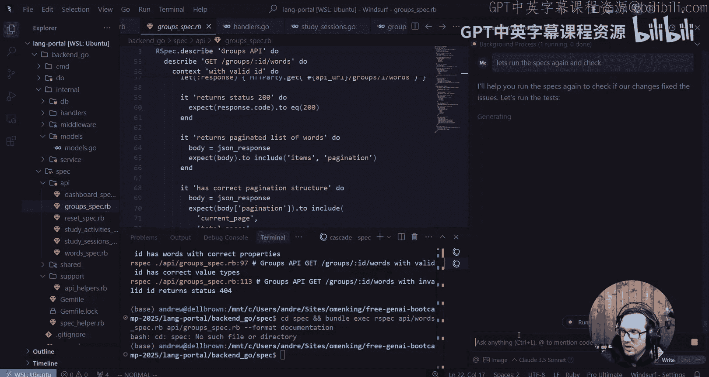

The other thing is that it has to stop and start the app。Over， like， rebuild it。

What the hecks are doing now。This is where， you know， you have to ask yourself。

Is it worth it to use the Jennyi when。We don't know what it's doing。

 and it's going in these loops here。 And then we have to manually check everything anyway。

 And so we have just implemented it and coro it along this entire time。

 So another approach we could have done is implemented each API endpoint individually and then wrote the test and made sure that they worked because if we have to step through it anyway。

But when we have all this stuff here and is trying to do it， it's just not very effective， is it。

It's dry in。Sure is trying。Well， we'll wait a little bit more here。 Allright， We'll let it run now。

Oh， cool。 it actually kind of ran tests。 So we see some of it Lots going on here。

It might help to zoom out a little bit。 I know it's gonna to be a bit harder for you， but for me。

 it's just really hard to see what's going on。

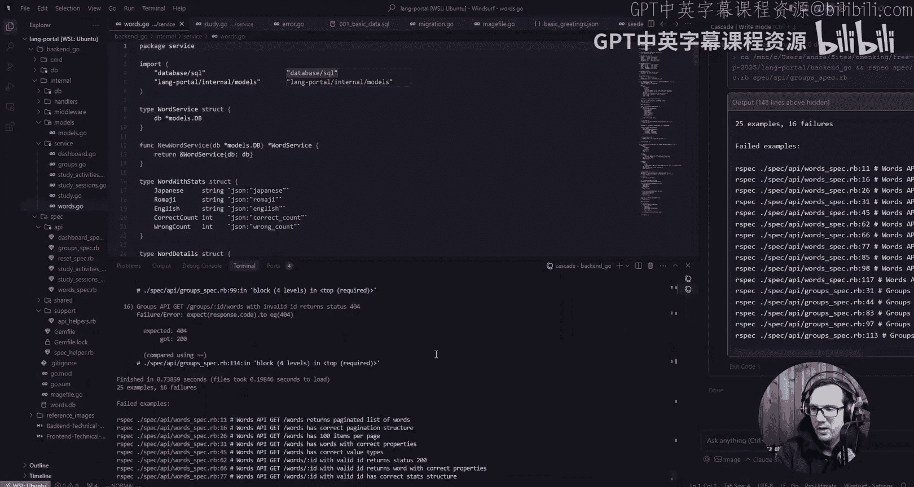

And so we can see a lot of these tests are failing。嗯。Yeah， I was like， yep， they fail。 There you go。

 It's done， Not very helpful。 So where's return， aaginated list of words。

 That should be the first one， so。I really want to focus just on this one here， just the words。

And so if we hit up， that's what it ran。But really， we just clear this out here for a second。This。

This is assuming that the golang app is still running。Okay， so now it's running this。

 If we go back over to here in this other tab。I'm going to hit stop here I'm going to hit up。

And what I wanted to do is run it again。 I'm just going to pare it down。

 So it's a little bit easier for me to work。Not really reading these commands。

 Like I know what they're doing， but I'm just saying， like， I'm not thinking too hard about it。

 So now it's rerunning the server， It should be reruning it with the new code。

 If I go back here and run this again。Right。The first problem we have here is。The first one。

 so it says。Got 200， expect 200， got 404 in word spec。So let's go take a look at this。

The first one here。And here we have words。And it's going to API URL words。Right。

 and it's expecting a 200 code。So that's where we should really be focusing on first。

But we do have some tests passing。Well， this's actually ones for words I D， right， So technically。

 the regular words is working。 It's not showing the ones that fail didn't work， but it's。

 it's going here。 Word I doesn't work。 So we go down to words I D。

And you can see it's going to words one。Right so here's suggesting that words one does not work。Okay。

 so let's just focus on each at of time， so。Let's just tackle。One failure at a time。Okay。

Because I feel like it's trying to do so much。 and then we can't keep track of it and it's changing some stuff。

Or one doesn't exist。 I'd be very surprised if one didn't exist。

This one problem is that when it runs again， we don't have a test database and an isolate app。

 And this is where we're running to issue，Isiling all the data， but not inserting the new data。 Well。

 yes， of course。And so maybe if we have some tests， we'll actually see more stuff passing here。

I'm just gonna run it manually。 I don't like how it's doing that。

 So I'm gonna go here and we'll stop this and we'll turn this back on。

 And then I'll go back over here。 I'm just running it manually。

And so now do we have more that's passing？No， but we'll let it run it whatever command it wants to run。

 command， our expect not found when solve for the。No， no， no， no， no， no， no， no， no。

 you have our spec。 Okay， no， you have our spec。 you don't have to do that。Okay。

 it's just running the domain file。 I already did this。 I already did this。 I don't need to do that。

 So we'll go here。 We'll run that。 It is now running。Okay， we'll go back to over to this one。

 We'll hit up。And I actually only want to run the word spec files。

 It's actually running two of them right now。 So just hit enter there。And this way。

 we can be a little bit more hyper focused on exactly fixing that stuff。

 I'm gonna drag this on over here。

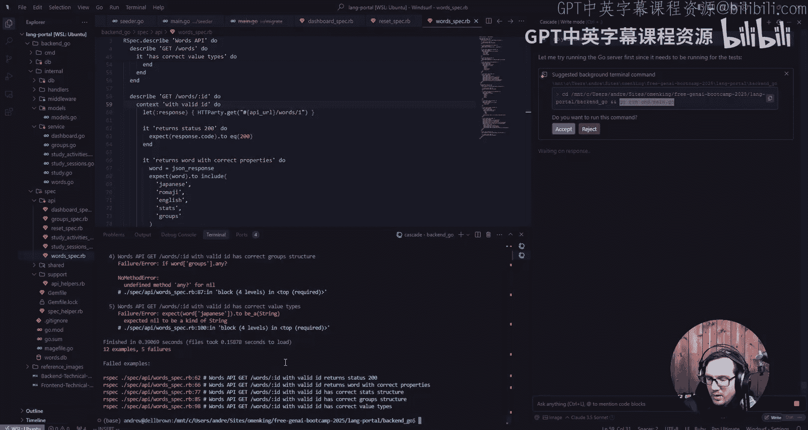

It's AMI time for those that the live stream I haveve been recording since like for hours here so。

But here's saying response code， whatever， whatever。 So the problem is like。

 I don't know what's in this word database， right， And so this is something we need to check out。

 I wan to see， like SQ light preview。3 explorer， like maybe this here。

I don't care which one it just has to work。

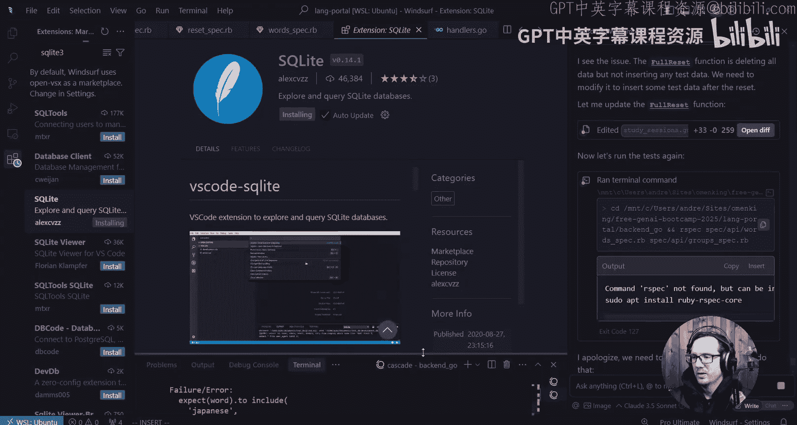

And so that's now installedable'll Go over to here。 I'm gonna go and take a look at our words DB。

Maybe right click。Should let us see it。The Explorer sucks。

 So I'm going to go back and uninstall this one， uninstall。We'll install this one instead。

 I just need one of these to work。We'll go back over to here， we'll click into this。There we go。

 And so now we can see what our records are。 So if we go into words。The problem is it's going 10。

1112， and the record is one。 So， okay， so。Okay， this is， this is failing because。

Our test our data doesn't have a one right now， we have we ID Ds。Of 1011，12， how can we。

Can we have a test database？Where we have a guarantee。Of the data being set。To specific data。Okay。

 cause that's what we really need here。 That's our problem here。Right。That's why it's not working。No。

 no， no， no， no， no， no， no， no， no， make a test database。 B， G， you know， words。Test dot D B， okay。

And make it so we can choose。Which D it's using。And we can write an SQL。To okay。

Cause I don't want to insert exactly what it is， because I'd rather do that。

 It's supposed to increment， right。This is where， you know， you come in handy， right， as the。

 as the developer。So it's gonna go to main dot go models dot go。 great。

 And so I'm hoping that it can handle the two difference here。 first。

 let's create a new environment variable to control which database to use。 That sounds good to me。

 So go to here。😊，Then we're going to create a test data sQL。

So we normally don't like to insert stuff this way， but we're going to do that for our test database。

Let's update the spec helper to use the test database， good。Has very limited data in here， though。

 right now。Now let's initialize the script and run the tests。Okay。

 so I'm gonna ignore that it's doing that。 I'm gonna stop this。 I' gonna run it again。

I'm gonna go over to this one。 I'm gonna stop this。 There's nothing to stop。 but we'll run it again。

 We'll see what we get now。Okay， and so now we get。

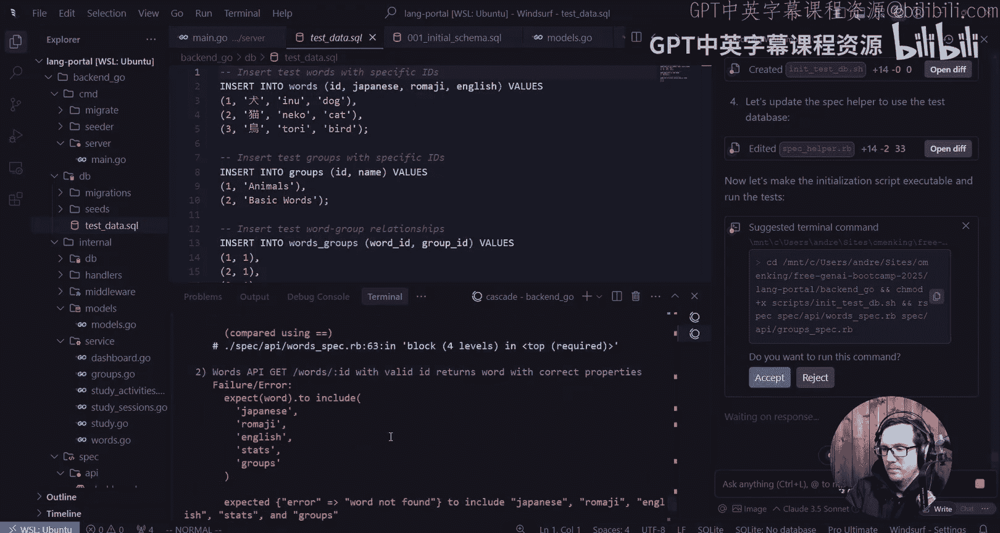

A 200 error on words， I D。 So the thing is that。When we're running the back end go1。

 it's supposed to use a very specific。I guess we could stop it。

 I just don't know what it's running on this side， a。Oh， was this not even running。

 Maybe that's why Oh， it's saying。8081 still in use。 Oh boy。 Okay， wellll we'll run that。

 we'll see what happens。I wish you would stop doing that。 No， this， like， this is all you need。 Like。

 this is all you need。This is how you run the a spec。 Okay， so do this。Like， it's getting confused。

 It's doing really complicated stuff。So run this instead。It's so dumb。 It is so， so dumb。 Okay。

 we'll go back over to here。 it's not the agent's fault。 It's just like it can't handle this part。

 so。Alright， like how， how do I， how do I specify when I run。To use the test database。

 that's what we' want to know here。And I'm gonna go over to here in the back end code。

 I'm gonna make a read me。Okay， so you know， to run。That's gonna be this test， test code。Right now。

 it's this。 It's going to change。 We're going make it a little bit easier， right。

To see what we're doing。嗯。You set the Db path。So here it's suggesting that we。

 we do this like this like this here。grabrab this here for a second。Words dot test D B， go run D B。

 okay so。So when running tests use the。Test。Database。For the go out。Running a test。Okay。

 so I'm gonna go back here， and I'm just gonna， again run these manually causeuse I'm now the boss。

And we'll go ahead and paste this in here。 This is gonna run that。嗯。Okay， something is already。

Running。We go lay up。Is still running prior。On 8081。Can I get a command to kill it。Okay。

I could do PS S O and try this and say Grep go and see what we get。And maybe is。

 it's running on there somewhere。Here it's suggesting this command。That fixed it。 So we'll go here。

 like。Kill， if already running。So you know， if the go length， if a previous。Okay。

 so now it's supposedly be running。 We'll go back down to here。

 I'm gonna go ahead and run this again。 And let's see if we get better coverage。

 It'd be really nice of it。 Oh， look at that。 Wow， yes， yes， yes， yes， yes。 Okay， great。

 So now we're getting coverage here for this one。 let's go over to the group 1。😊，We could just see。

 like， it wasn't gonna check the database。 It didn't know that。

 So we just kind of helped it out there。Sometimes you just gets sick。 So groups， groups is good。

 That one's good。 Please， let's just keep going here。 Let's keep winning。

 I don't think it generated out data for study activities。嗯。So， here。Study。Activity spec。

I expect this one to fail because it doesn't have the data。So go to this one。Mrs Fwell， named Colin。

Okay， so。Okay， so groups and words， specs are all passing。We need to move on。To study activities。

Can you make sure the test database。Is seated。With study activities。

So the specs for study activities。Have a chance of passing。The question is also。

 where did it put that C data， So we have it over here， which is just sitting in there。 Yeah。

 and it doesn't have it in there。 So we'll go ahead and do that because it's supposed to have it。

 We could even tell that specific file。 but I think it'll figure it out。

And we will just watch and see what it does here。It did。 Where did it add。 I don't see nothing。

Close that out。 Re it up again。Other it is。 Okay， flashlashcard， multiple choice。

 That's exactly right。 We have some study session data from the time it started and how much activities and some word reviews。

 that sounds good。 So now what we can do is run that。

 I like how it's actually giving me a simple command this time。 We'll just insert it over here。 No。

 that's not what I wanted。 Which is fine。 But I'm gonna go ahead and stop this。😊。

And would it know to reload that。Okay。How does the test database reload。Do we have to run。

 run a command。The initialization script。Okay， I guess my thought is like。You know， why isn't this a。

A command。That is part of the。For go。Like， why， why is it not done like that， right。I mean。

 it can be a separate script， but like the fact is we have whatever that thing is the the make version of of going here。

It's like， why aren't we utilizing that？So you're right。

 You should be able to use a go command to handle this instead of using a shell script。

 So it actually updated the main dot co。 What did it do。 Open the diff。And so， here。If it's test。

 otherwise load that one， which is fine。Remove existing database if it's not there。

 initialize the new database。呃， would that okay， but。Does that mean every time I start up the go app。

 it's going to reset the database， like， like reset the database。No， the reset。

 the reset only happens when you explicitly run this。

 the main server just connects to whichever database is there。Okay， but why is it not。Oh。

 we have the commands over here， wait。Why are these empty。O。So migrations over here， which is fine。

But go here， this is empty， right。Maage file go。Okay， but。But。Why。

 but why are we not using the mag file。Yeah， he already forgot that it existed， right。

Is it going to rip out all that junk code in there？

So this is the thing is like you constantly have to remind it and tell like， hey。

 remember there's mag file there is a way that we could make that whisper sorry not the whisper。

 the windsurf， there's like a rule file that I saw。 I said earlier。

 I didn't think that windsurf could do it， but someone shared a video that it can do it。

 And so maybe there's a way that we can make a rule so always remembers to remember that there is a mag file to check。

To use the why would， why， why， why， why， why， why， why would you have to do that。Oh， okay。

 so it was doing it that the entire time。 Oh， that's how it was doing it。Before it ran the suite。

 interesting。O。So。OK对。Did you。Did you remove the jump， the code you put you put in main main go。

Right， like， did you do that because we just have a junk code laying around everywhere。

Just junking up everything here。Okay， but didn't you add。But didn't you add in that file there， like。

 it's not， kind doesn't understand。All right， let's go back to the mango here。

 I just don't know if I trust it。Iitialize the database in a failed connection。Oh。

 it's not doing that。呃，OK。Can we。Get rid of the D B andt maingo。

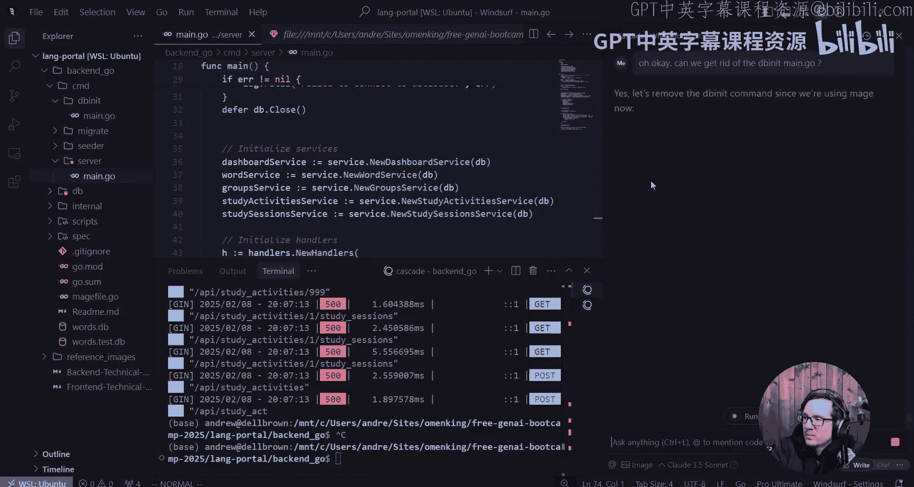

嗯嗯嗯。Yeah， let's delete that。 Thank you。Okay， since these don't have anything in them。

 we'll just take these out。And delete these。Okay， and so now， yep， get rid of it。

 And so now we just have that one。So now what we can do is we'll go back over to here。 I'm going to。

 what's the command to start it， though。We'll go back over to our readme here。

So I'm thinking that it's still this。Sore to go ahead and run that。Still in use。

 I'm going to go kill it。We're going to go back up to this one here。O。It's starting on port 8081。

 That's fine。 We'll go down here。 We're gonna go and hit up and run this again see what we get now。

And so we're getting some passing， right， That's good。 That's good sign。Well， I mean。

 we have one passing， right， So here it's saying， if we go over to here for a second。

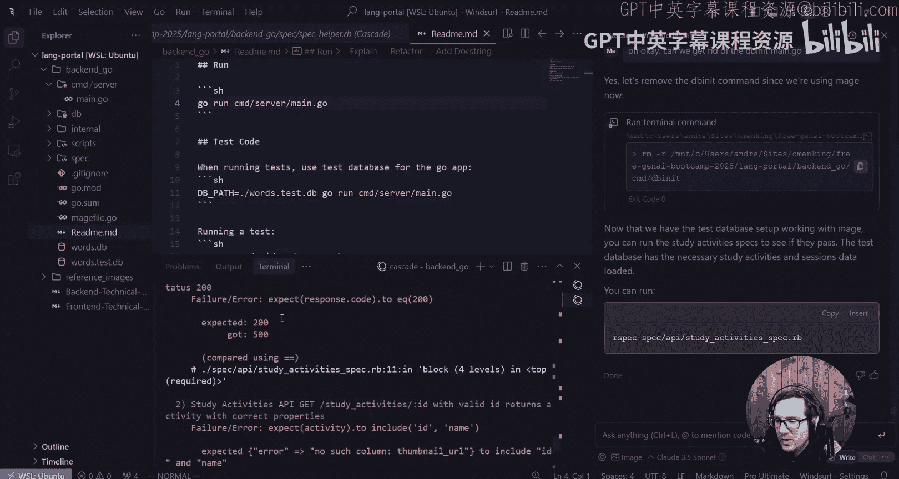

Go bring the font down a little bit just so it's a bit easier for me to see what's going on。

 I know it's really， really small， but I need to， I need it like this so I can see what I'm doing。

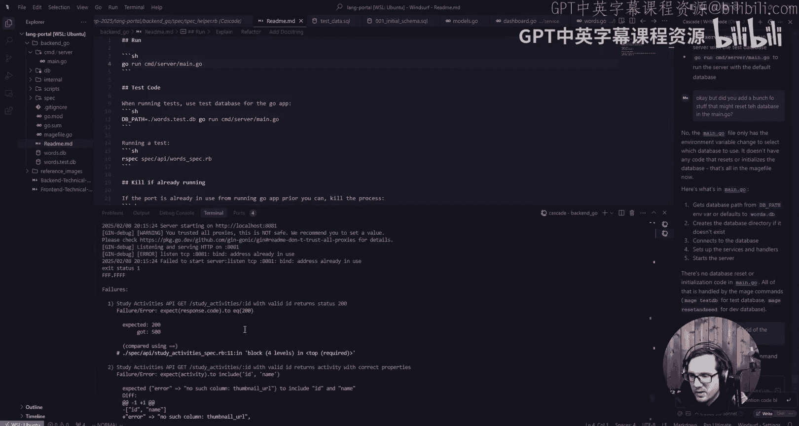

嗯。So saying 200 and got 500。嗯。Study activities， line 11。So if we go into before we do that。

 let's just run one that we know that worked before， like words。

'cause we've been changing a bunch of code。 I just want to see if anything works。

Will this fail as well。So now this has failures， but it worked before。Words I D。

 So now that one's failing again。But I thought we went over here。 we took the Davis。

 This is now one and two， right， So this shouldn't be failing。

If we go back over to our spec code here in our API in our words spec here。The set is one。

So it makes me think that it's not loading that database。Yeah， words， words 1，1，1，1，9。

 like even this is getting  four04。Oh， because that command doesn't run the。Alright。

 it was supposed to run this command。 I， I put the wrong command in here。 Yep， it's binding again。

 We'll kill it that way。 I think what happens is that this like that interface kills and it's still running。

 So now it's ring the test database。 Okay， great。 We'll go back over to here。 We'll hit up。

And so these should all pass。 They do excellent。 We're going to check groups here。

Groups should all pass。 Nope， I want groups， groups， groups， groups， groups， groups， There we go。

These all now pass。 excellent。 Now we're going to go check in study sessions。For study activities。

 right， We run this one。 Does this pass。No， we get full failures。Yeah。

 study activities are really messed up。 So we'll go ahead and。Hopefully we can do it。 But like。

 we have this one running and this one running， Then we need those 1，2，3，4。

 So we don't have much more to do。Doesn't have a name column。

 but their test data is trying to insert one。 Let's fix that。Yeah， it wouldn't。

 study activities wouldn't have any。 That's right。 The schema was incorrect are are the types of activities available。

 And study sessions are， well， no， it should have one。 So the schema was incorrect。

 The study activities are types of activities。And study sessions are instances of those activities。

 Let's check the study Act service to make sure it's implemented correctly。

Let's go check the get study activity。 The handle looks correct。

To make sure our test database is using the updated schema test data。Okay， we'll run that。

It gets a little bit confused in running these things， which is kind of frustrating。

I'm going go back over to here。 I'm going to stop this。We we run that。I'mty in clear here。

Can we run mag？Mys not found。So there's some other way to run age， like how do。How do I run mag。

Go run。Go run mag。 Okay， great。 So I'm gonna go here and we'll say， go run mag。

And let's go back and update our docs。Okay， running mag。We have here， and it has to be go run。

Mage test D B is an example。I'm not， yeah， we have this one。Seed。There we go。

 So now we know we have those commands。We'll click into this， we'll see what we have here。

We have nothing in student activities。 So I'm gonna make sure that the database has stop has stopped running。

With this command here， I'm gonna run this again。Go run H SDB。Go run Maage Testee B。

I know it does the opposite pass， but it makes things confusing when it does that。Well。

 then how's it been okay， but。But how has it been running。Like cows have been running the commands。

 that we didn't have that before。Okay， so I want to see if I can run this then can we run it this way。

Yes， O， so。Maybe there's a way that it can be less for both。 I don't care。 I just want it to work。

 So I'm gonna go ahead and paste it in here。 And we have this。 People are like。

 people are that are are go。 people are like， what are you doing， Andrew。But we just wanted to work。

 So now we have this here doesn't need to have test D B and net D。

 but we're gonna go ahead just up for a second。Take that out。WeTake that out。 take that out。 Okay。

 great。 So now I'm gonna just ignore this for now。And that is now initialized。

 We're gonna go back over our word test database。 We'll check our study sessions。

 Do we have anything in here for study sessions。I don't see it。I see， oh， study activities。

 I don't see anything。 Let's go back over to our database， our test data。We have study activities。

 I don't see them here。Okay， so， you know， I was able to run the test D B， but I still don't see。

The study activities。Having data。And maybe that's where we should have stuck with dash scripts because they' have been easier to check。

Oh， I hate when it tries to run。Because it keep failing， right， Okay， so there it has it。

 There we go。That's fine。 But the other thing is that this just inserted the S QL manually， no。

Words test Davis。 Okay， but like。Like you inserted the data。Using EsQol light 3 directly。

You didn't use， use the mag command and fix the mag command。Like， what are you doing， buddy。

Switching back to standinging here。

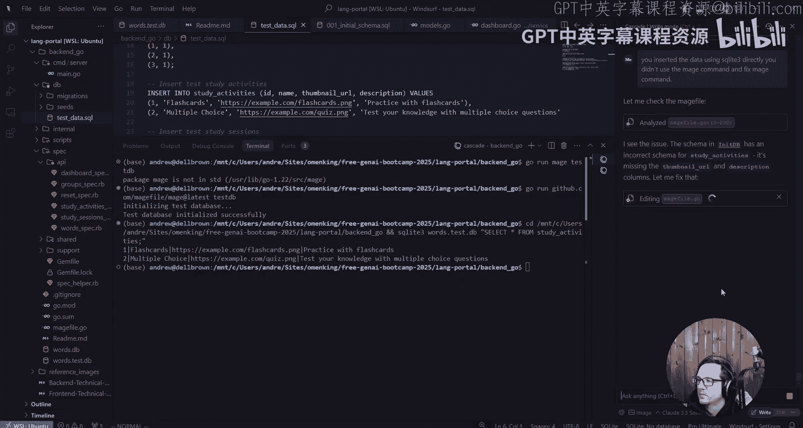

Please。Oh， there you go。 So there is a problem。It telling us， no， no， everything's fine。

 But now it's saying， oh， no， it's not right。 Okay， so now what we'll do。

So what I want to do here is I'm gonna go over to the test database because I don't trust it。

 I want to make sure that it's not running the the thing in the background here。

 I'm gonna go over to this test database。 It probably has study activities。 No。

 it still doesn't have study activities。 I'm gonna delete this file here。

 I want to see what happens if we run this。嗯。This one here， which sets up the test database。

 Does that also create the database， It does。Refresh this here。Okay， and we go here。

 Now it's being inserted。 Okay， good。We have sessions good。 We have review items Good。 Now。

 there was another issue with that it had with the study sessions， But now that issue is resolved。

 Let's go down here。 Why， actually we have to run the back end first。

So we'll go up until we can find it here。Someumwhere， it's here。Lu。This one here， yup， test database。

 And so now we'll go back over to here， and I'll run。This。Again。AndSo this time。

 we're getting some passes， which is good。But now we have an issue with study activities。

 I D study sessions return should return that。 But if we get a 500 error。 Okay， so the question is。

 why do we get a 500 error， We can see 500s over here。 We don't exactly see as to why。嗯。

But there's a reason why， right， there has to be， but。Okay。

 so let's go ahead and just ask it to check why。While that's going on。

 let's take a look at the test data。Maybe there's just no C data and it can't handle it when that happens。

The same one。 So there definitely is that。Okay， it's just checking， like it's doing a query saying。

 like， is there any stuff and there clearly is。

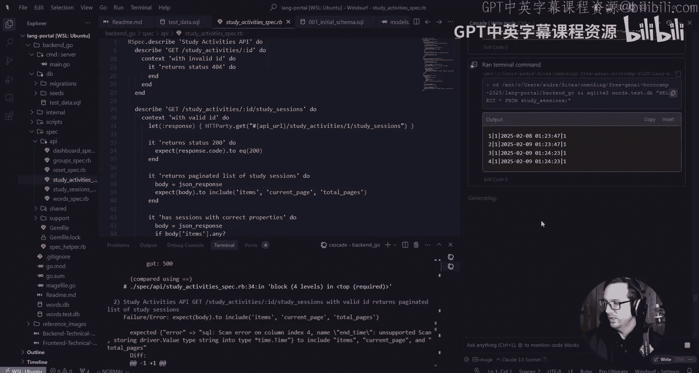

嗯。That's why the words。 I mean， you can do that if you want。Yep， it's inserting data。

While it's doing that， let's take a look here。We have study activities。

 and then we have study sessions。 These are marked as one。 and that's what we're looking at。

 So it should have returned that data there。 And then these are all associated with that one。

We'll give it a moment to let it thank here。But we're getting close。 This one's a long one， I know。

 but we're getting really close here。 I'll be back in just a moment。😊，Wait， hold on。

Since I update the server to handle time par more carefully。 Now， restart the server。

 and let's try that again。 Okay， so we'll restart the server。Didn't import the time package。

So we starting the server good。I'm not sure where it's restarting it。

 but it's restarting it somewhere。And it's already in you。

 So what we'll do again just to try to help it out。We'll kill it， and then we will start it up again。

Here。Here I， I started。Well， I'll just run the test De， like this。I think it just passed。

So stop us for a second。I mean， it definitely had more passes it looked like。

Let's go back over here and take a look。So now we have more that are passing， Okay， so。

Faied here is's expected the items to be this。But we got this。So， I mean， it doesn't look super bad。

 Just looks like it needs a little bit more help。We almost have it working。嗯。Oh， the root level。

 Yeah， it's not supposed to be the root level。 So the。It's confused。 Yep。

 it's the tests that are wrong。Yeah， the only way we're going to really。

 really be sure this is working， we probably still have to manually go and check every single endpoint。

Because， you know， again， it's changing so much， so。Okay， and it wants to test it again。

 So I' gonna go ahead and。It's going kill it。 It always seems to be what we need to do here。

 We'll run this again here like this。嗯。Whoa， what's going on here？Its like it really broke it。

We'll give it a moment here to update。 Alright， suggesting it fixed its problems。

 So we're gonna go ahead。 I'm gonna just hit that。 I don't think I have to do that。

 We'll go ahead and run this again。And。Yeah， I think it's running again good。

We'll go ahead and run the study activities。And so now， oh， wow， it's really the close。

So there's one where it says expected 200 and got to。 I don't even know what a 201 is， but。

We'll let it figure that one out。But we are almost in really， really good shape here， okay。

So weve got study activities almost working， words and groups。

But we're creating it to a wide created for pose for study activities。 Let me see here。I mean。

 like that's fine， but really it should just be a 200。Okay， so now so you can run this over again。

 a problem。We'll go here。 We'll do this。I know it's so weird that I do that， but it works。It works。

And we'll run this test next。 Perf， perfect tests。So now we are， we have perfect tests for that one。

 let's go run words， Let's see if that group does group still work。Perfect tests。 Let's go1 words。

Perfect tests。 Good。 Now we need to do study sessions。 That'd be cool if study sessions just worked。

 Imagine if that just happened。 that'd be really awesome。 We'll go ahead and do that。😊。

And we have some problems here。Okay， so now。Stop this here。We'll do that。We have study sessions。

 We have reset， and we have dashboard Dboard is a little bit trickier because it has more complex queries。

 but we'll see what we get。And， you know， some of these tests aren't like thoroughly testing it。

 And we'd have to do deeper tests for that， but。You know， we'll， we'll find out as we go here。

We're trying to scan the study sessions fields directly into the response。

 but the time field formats wrong sounds like a similar problem that study activities had。

And so it seems like they're just applyinging that over to the study sessions now。

So wants to run the server again， so I'm going to go ahead and just。Kill it， and then start it。

And then we'll go over to here。 That didn't work。So see what happens here。Okay。

 so we're going to stop this here。Run this one。It's running good。 Now， we're going to run this again。

Please just work， please just work getting closer， though， probably similar areas like 200 to2201。😊。

Pretty close。 I'm going to cheat。 I'm just gonna go grab all three and dump them in here。

The reason we shouldn't do that is because if we only give it one to work on a time。

 then it's going to use more of the context to try to figure out that one as opposed to trying to do all of them。

But if the agent behind wind service is smart， he'll break it up and give it as full attention to each task。

 I'm not sure。But if we get this working， then。We got this， this this。

 and I can go watch kingdom Kingdom of the planet of the Apes。

 It's the latest planet of the Apes movie I've yet to see。Give it a moment here。

Let's run the server again with our test changes， okay。I'm going to kill the server。 Start it up。

 We're going make our way over to here。Did it start。It did， good。Going to go ahead and run this。Very。

 very close。 Very， very close， good。We'll stop this here。Well go ahead and do that。

 We'll see if it can fix those last two for us。The correct parameter is a query parameter。

 but our other handler is expecting a body。 Let's update the handler， wow。It was really interesting。

 like how much it got wrong， but at the same time， we gave it a whole text tech doc and just said。

 go at it。So， you know， if you're building a piece by piece and you're going to have a lot better chance of things working。

 maybe an approach that could be better is like implement each piece and have test code each piece and have more control over what's going in here。

嗯。But it is a little bit harder to chunk it when we tell to do so much upfront。

 but we'll go ahead and we'll stop this and we'll go run that and then we'll go back over here。

 run this again。Very close。 Very， very， very close。And just notice。

 like goess not throwing air because it's a static type language。 So the。The。

 the agent really has to go deep and look and see what's going on here。

So it's going try to reinitialize database here and take a look。So it again here。嗯。

I'm just going to stop it so that it can run it。There we go。Are you sure that's the problem？I mean。

 it's been running stuff this entire time。Or it is。 has a composite primary key， Okay。

 which means it can't have multiple reviews from the same word。Let me update the schema， okay。可。

Do you really need to add the main function of the go file， I'm not sure if it has to do that。

It's just trying to run it。 It's having a hard time。Well， I mean， that did work for it。 That's fine。

Okay， so I'm gonna go ahead here and just stop this one as it doesn't seem to do that。

 And then we'll run this again here。Okay， it's not saying anything。

 but I guess it wants us to run the test。 So I'm gonna to go run the test。

I didn't mean to run that 1。 I actually meant to run this。You're still getting 500 air。 Okay。

 so I'm gonna stop this。I'm going to delete the word test database。I'm going to go ahead， and。Kill。

 kill。 I'm going to start this up。 No， I think we need to run。而。T D B。 So'll run that。

Ssuming that this didn't break because they made some weird change to the file。

We'll go ahead and do that。Okay， you。You broke my you broke my mag file。

That's why I probably didn't need that other code in there。Yeah。

 that's what I thought you shouldn't have the main functions of the image file。 That's right。

As if as if I'm a go expert。Yeah， you're not running anything。 I'm gonna run it myself。 Thank you。

There we go。 That's initialized。 Good。 We're going to go ahead and start up the database again if we can find it here or the server。

 which is here。Good， we're gonna go over to here and we're gonna run the R spec file。Perfect， okay。

 so that one works。We able to go and try to do study sessions。 I think we just ran that one， though。

Study activities。 The reason I'm going backwards is that just because like it's changing so much stuff。

 I just want to make sure it's not breaking the previous aspects。Normally you run them all together。

 But right now， you know， that R spec command is not exactly working。Toyddleler Bird。

 if you're watching， get it to work。He'd know how to fix it。We'll run the words one。Good。

 so now we have study sessions， words， study activities， groups。

 And now we just need reset spec and dashboard。 Let's try。

 I don't know what re spec we expect that to do。嗯。Let's go ahead and run that one。嗯。Sure。

 we'll do this one next， I guess。But then it's just two more。 And。

 and we then we have like a fully speced thing。 And supposing that our test code is correct。

Then in this very specific way， we know that most part， we're kind。

 we have some kind of expectation that our code is running correctly。Jenny， I can replace QA people。

 It it just simply can't。I realize my head's been in the way this entire time。

 I'm not sure if I should move it up here instead。There there's nothing really interesting that's being generated out here。

 So I don't think it really matters， but I'm sure someone's going to， hey， Andrew。

 your head's been in this way， the entire video。And that's been an issue。So yeah， I see test fail。

 you need to update the dashboard service to return zero words learned。 I mean。

 I didn't run the dashboard one。Why is it updating。Dashboard。I mean。

 we do need dashboard to be fixed。 Did I run dashboard instead， I that why。Now， I ran resets back。

So why is it talking about dashboard stuff， We have reset。Oh，cause it would probably check， Okay。

 then reset it， then check that the study history has been cleared。 Oh， that's why it's doing that。

 okay。I mean， that's a convoluted way to check， but I suppose that is one way to check。

But our dashboard would have to fix。 I hope it fixes our dashboard stuff。

 that makes me think we should have made sure our dashboard endpoints worked first。Look。

 if it fixes both at the same time， I get perfect passing， I'm fine with that。 I'm happy with that。

I'm not going to complain。So it wants me to test the database now。 so I'm gonna to go ahead here。

And I'm going to kill， kill the old one。 Start up the other one。And I'm going to。

 actually I'm gonna run dash， but I'm more interested in that one becauseuse this one's reliant on the other one。

 So I'd rather run that one first。And this one。Not doing great。 So I'm gonna go ahead again。

 I'm just getting kind of tired。 So I'm gonna cheat and just keep。Pasting these in here like this。

And this is why we get bad code because then you get tired。 you're just like。

 I want to go watch Kingdom of the plan the ape。 so I want this to work。

 and then you are being paid for it。 So then you then you push it as a PR and then someone at your company is like。

 I want to go and watch X， Y， Z and go home。 So I'll let the Geni PR to review the Gennyi other code and you know。

 you just have this big circle of problems。Yep， yep， that's， that's how the future is for coding。

I know I'm the problem， but whatever。It's just how things are going。Okay。Is the server still running。

Come on， dashboard spec。You're the last holdout。 Okay， we're getting closer，200 to 404。 That's good。

No study such found。 Okay， so things like more of a data problem now， so。Very， very close。

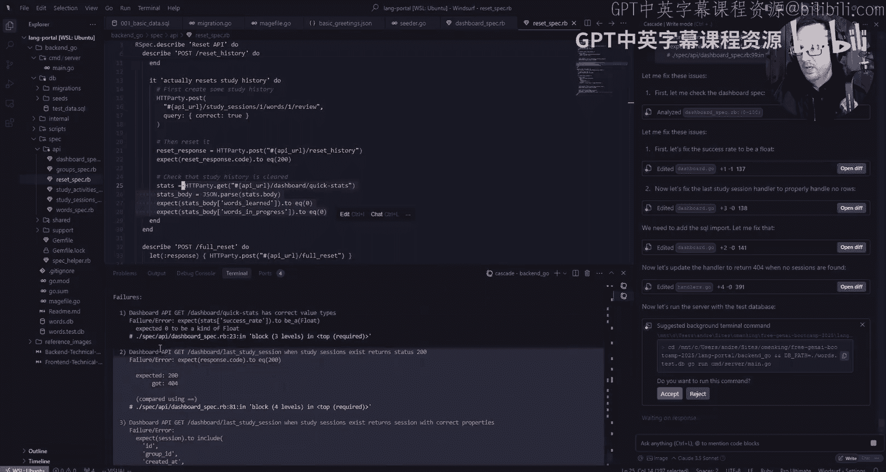

We are so close。Once it has 100% pass， we're done， right， but。The interesting part is like， well。

 no if it really works if we， if we get a front end implemented。

 And I would think that that should be easier， right。嗯。What no， what the heck is this。 No， no， no。

 no， no， no， no， no， no， No， no， no。 where， What is this， Stop。 What is this。This doesn't exist。

What did it just do？What did it just do。I don't know why it thought that exists。 That does not exist。

This is a problem when you get tired， then it starts doing things it's not supposed to do。Okay， so。

Okay， so what I' going to do。I'm going to stop it。 I'm going to delete。This one here。And。

We will go ahead and run dashboards back。Please， just work。It's even worse than before。

 Now it's all failing。 Are you kidding me？What is it doing。So close to getting this to work。 So。

 so close。Okay。Okay， now。Now， even more is broken。By saying no such table study tables。

 Let me go take a look here。 You know what。 Is this here。 Let me go check。I am going to。Run。

This first。I'm going to delete this。Hold on here。Soy sessions。 Okay， now we have stuff in here。 Okay。

 so now。I will go stop this。 I'm going to。Startup。The server。

 And I'm gonna run this again because it was saying like data wasn't there， right， And data。

 data wasn't there。 I don't know。 But now maybe it is。 Okay， so now。Now we just have one。 Okay。

 let's get this one to work。 We are on the home stretch here， assuming our other code is not broken。

Okay， this is what we have。Fix it。I'm so tired。 I just want to stop and go watch kingdom of the plant of the Is。

M yeah， not properly handling the response structure， obviously。Okay， let's go over here。

Let's kill it。 Let's start it。 We have to restart it because it's compiled code， right。

 That's how it works。 We'll go ahead and do R spec spec。They're all passing。 Okay。

 let's go take a look at。wordsors。I'm going to just set this up so it does all them。 Let me see here。

Can we just do this。全聚泽。We， that's even better。嗯。I just guessed honestly， but we'll go here and。

Or running A test running。All tests。We nice if we could just do our spec。 But， I mean。

 that that works the same as well。 It is the exact same thing。

 So we'll go here and just say like this。And so we have a few failures in here。 What's failing。

Dashboard， I don't care。 Why the wait， Why is dashboard failing。Oh， you know what。

 Because if it resets the data while it's doing， this this would mess everything up。Yeah。

 so the one that's， this is gonna mess it up if we run。This one here。

So I'm just going to skip this for now。Ignore。Ignore for now。It would mess up。The specs。

 because it will clear。Okay， so， so we' gonna to do is go ahead and delete this。

I'm going go back over to the first one here。 I'm gonna kill it。 I'm gonna start it。 Actually， no。

 sorry， Before I do that， I'm going to。Run this。 It's got to make sure that other one's gone。

 I want it gone here。 Let's delete this one here， delete permanently。And so now I'm gonna run this。

 That's going to create the new test database。 We're gonna run this one over here。 That is good。

 We're gonna go back over to here。 We're gonna run all the specs。 And I hope it get all green。

 so I can go nope。😊，Soy session， so we only have a few that don't work。

Let me just run it individually。Now， it's failing。Knice that it's like failing at random， too。

You know what it might be， is that when we're posting data。Because there's a review step。 It's。

 it's messing up the data。Right， so I actually think that it's all passing green。

 But because we're hard coding numbers and then the test database can be updated and it's not resetting on every single run。

 that that's where we're getting inconsistent data。 So I think we're done。 Okay。

 so I'm gonna say we're done。 I know it's not doesn't look like 100% pass， but it absolutely is。

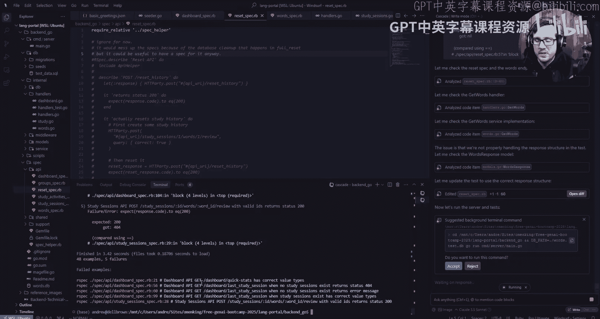

It's great。 Would I rely on this if I put into production， No， I would have to thoroughly do it。

 But I can see how people can kind of like trick themselves in thinking that everything works。

 So get test code working。 So we know our API is in good working order。

 We have implemented this and go。 That's great。😊。

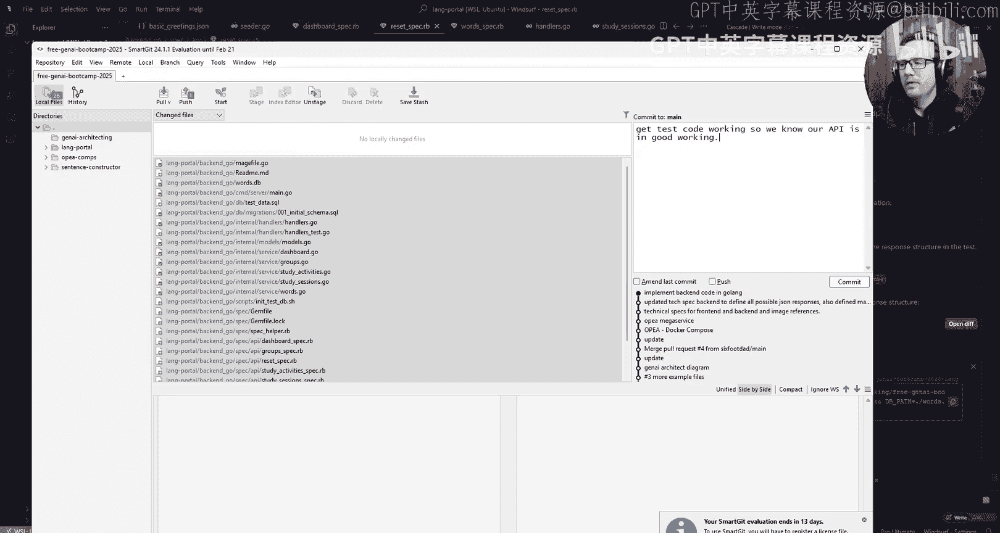

Do we have confidence that we did it correctly， No， shall'll we put this in production？No。

 unless there's no risk that we'll get in trouble。 but we are done。 And， you know。

 maybe I'll look at the code later on。 But at least now we have a code base that we could go and reverse engineer。

 learn and then become as efficient as this。 and then take it over and pilot it from there。 But yeah。

 we are done。 And I'll see the next one。 Chow。