# ExamPro《生成式AI训练营｜Free GenAI Bootcamp》中英字幕（deepseek - P24：-24-Frontend with Kristi and Matt.zh_en - GPT中英字幕课程资源 - BV1SFEWzLEab

Hey， everyone， welcome to the Free Gen AI Boot camp。 My name is Chrisy Perult。

 and I am a co foundunder and architect of Teach Me AWS， as well as an AWS hero。😊。

Yeah and I'm Matt Colultter， I'm also a cofiner and architect with Teach me AWS and an AWS hero。

Today， we're going go through the front end application for a Japanese language learning Web app。

 And I'll be the first to say neither one of us are AI experts。

 but hopefully we will walk through together some of the popular AI tools that you can utilize to build up your own front end Web application。

 Yeah， and neither of us speaks Japanese either。 So we don't know if the results of this or any good。

 but we're just going to go with it。 So we'll learn together here today。😊，So up on the screen。

 you'll see that I have started a Google Doc where we're going to start to build up our frontend prompt。

 So in order to go into these AI applications and to actually build up a web app。

 you have to tell it exactly what you want it to do and from experience we know that JenAI needs very specific and explicit instructions to do that。

 So we have our own sort of prompt off to the side to kind of help us along with this and some strict instructions from Andrew as well for how we want to build this application。

 So we'll start to build up this prompt together。 and then we're going to pass it through two very popular AI services lovable and party rock。

 So you may have used these before， heard of them or tried them out。 If not。

 we'll get a chance to take a look at both services and maybe compare and contrast some of the differences in what you're going to get for a web application。

try not to make jokes about lovable I doubt it's not a great name。To be fair， though。

 every time I think of party Rock， I think of the party rock anthem。 So also not a great name。

 but how that queued up that anytime we do something good。 It's just going to kick off seriously。😊。

So as we said this is going to be a Japanese language learning web app。

 so I threw that in there to start I think one thing that we're going to want to let our AI know is that our actual role in this is our frontend developers because we're going to want to be able to see and kind of edit the code and let the AI know that you know we have some understanding of some technical things and so this project brief is going to have a lot of technical details。

So if we list our role slash profession。And we're going to put in。Front and developer。

It doesn't say good front end developer。 It does not。 So any front end developer works。 And。

 of course， it's copy pasting over and white。Alright。Alright。

 and then we're gonna want to give it a project description。And a project。Brief。Yeah so I。

 I did have a conversation with Andrew before we recorded this， because otherwise。

 it's going to be a very different project brief than what we would have come up with。

So we do have some words for this already， but essentially。

 we're trying to build a portal that allows us to launch study activities。Yeah， and we're。

 we're trying to store group and explore Japanese vocabulary and review study progress。

 And the whole thing is gonna to be a web app that's intended for desktop only。

 So there's no mobile version of this app。 And yeah， for now， that's pretty much what the brief was。

And I've fixed a typo already。 so we're off to a good start with bringing these in。

 So hopefully this is a good explanation at a high level for all of us here。

 as well as for the AI to understand exactly what we're looking to build and accomplish with our web application。

And as we started with， you know we talked about how we want the AI to realize that we're front end developers and that's kind of the focus of this so we also want to pass in some technical requirements and again。

 this is directly from the project brief of what we want to build today。

 I will say even though we don't have much AI experience between the two of us I believe both of us have used pretty much everything on the technical requirements list so hopefully we'll be able to take a look at what the AI generates and let you know how good of the job it's done。

YeahMaybe we should go rogue and say it's not going to be Javascript。 It's going to be Python。

 Go off script and put in a Python in flask。All right。

 so today we have Re JS as our front end library and then we're going to take advantage of tailwind CSS for our CSS framework。

 Vite。js as the local development server， our favorite language typepescript for programming and then Sha the CN for components so I think I have used most of these except maybe the development server that one's a little new to me。

Yeah， so I've definitely used react tailwind from my type strip。

YesSo in terms of matching up some of the project description with the technical requirements。

 we're going to need to tell the AI what routes or route， depending on where you're from。

 that we want in the UI for people to actually view because with these prompts。

 if you leave it open to interpretation， you don't know what you're gonna to get。

 So we're gonna to need a few， we'll need a dashboard， which can summarize。

 I guess our learnings study activities where it can come through and say。

 like these are today's study activities， words to talk through the words you already know and some new words。

Groups， I'm not sure what the group's page is going to do。

 but we'll find our later Session and then settings。 That's what Andre has specified he wants。😊。

And he wants the default route to go to the dashboard， which kind of makes sense。

hopefully groups means study groups so that you don't have to learn the Japanese language all on your own here。

 That would sense。 Yes would probably make the most sense。 That's what I would do。

 trying to read Andrews mind here。 So as you can see。

 we've already got quite a long prompt just to build up a web application So maybe if you've kind of been playing around with some of these applications before。

 I know we were messing around with it a little bit before this too。

 and I was very simple and straightforward and just build me an app to help me cook dinner。

 and it kind of just went off and did whatever it wanted to do。

 So this definitely gives quite a lot of instruction。 And you want to be very explicit。

 if there is something that you have in mind to build up to especially with the technical requirements。

 I think by default， they gave us maybe Tpescript on the application we just built。

 So it really depends like if you are dead set on having Python。

 you probably want to specify that in here。 So you can kind of。

Use your own adventure with these prompts， but the more explicit you make these。

 the closer you'll get to what the intended use is for your application。

So we also need to be quite specific in terms of how people are going to navigate around the app because we haven't said anything about the the state of the U at this point in time。

 So we probably need to tell it that we specifically need navigation to exist in the app on what navigation routes we want。

 And I feel like that's going to directly move onto to one map with the routes that were mentioned before。

 So dashboards， study activities， Word， word groups， S and settings。Hopefully。

 this one should be pretty simple for the AI to be like yes。 that makes sense。 Well， there you go。

 and there's your groups， too。 So I would say maybe an enhancement is to allow for study groups for people to work together on your language learning app。

 So this is why we're explicit because groups can be up to interpretation。 But as we see here。

 if we give it the navigation。 Itll actually title it exactly how we're specifying it too。

 And this is why never try to second guess under。😊，He's keeping us on our toes over here。Awesome。

 so what do you think， should we try this out and then see what gets us。 Allright。

 so we do have quite a lot of other things we can add to this to build up our prompts。

 But I think instead of watching us build out a word doc。

 it might be more interesting to see what our AI services gives us。

 And then we'll go back and maybe try to add some of these enhancements and see how our AI tools help with that。

 Yeah， great， So I'm gonna copy and paste this entire prompt that we've put together。😊。

And we're going to move into our first application， which is lovable。 It looks very lovable。

 I know I did expect a heart。 So I'm glad that's there。😊。

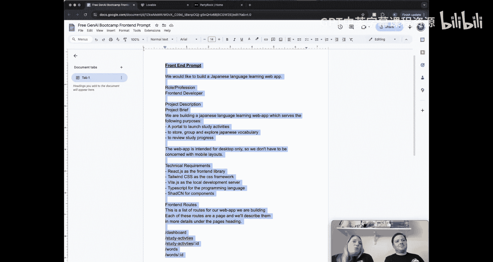

So you can see on this page that it is a very simple UI right in here is our little prompt box and you can actually see some of your previous projects in here。

 so for instance， as I said we tried to check this out with creating our own dinner app since we always go back and forth on exactly which we should go for dinner every night。

And you'll also notice that there's some other options here。

 So if you have an image that you'd like to upload in here， you can。

 I also kind of checked out this import。 so it lets you bring in images from Figma as well。

 which is pretty cool。 So if you're more kind of graphical or prefer to define your code and applications more in image format this is a really great app that would also support that as well。

 or a little boring today and we're just doing it through text。

 you'll also notice over here that anything that you build this for the free version is going to be public。

 So keep that in mind as you're building out if you do want it to be private you will have to pay for that to unlock some of those features。

 So could be advantageous for you or if you're working on a team or something， this might be helpful。

 But we're gonna stick for the free version for now。

 so you may be able to even find this out there once once I create it to start stealing from it and trying it out。

😊。

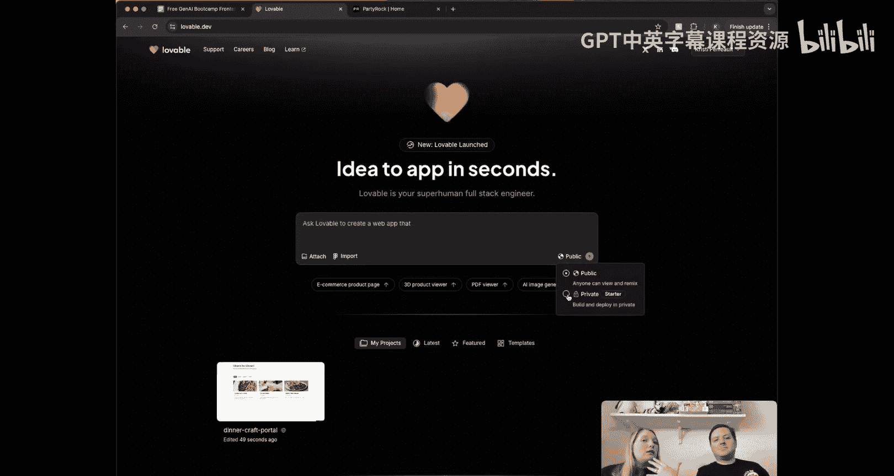

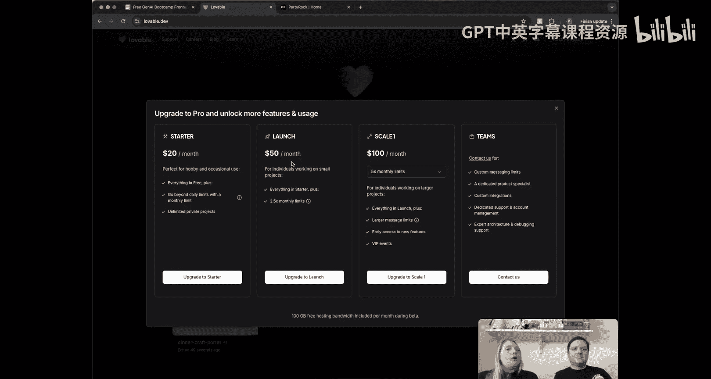

There isn't much to this UI， but you'll actually see this little learn button in the top and if we open that up。

 you can see that there is tons of documentation in here。

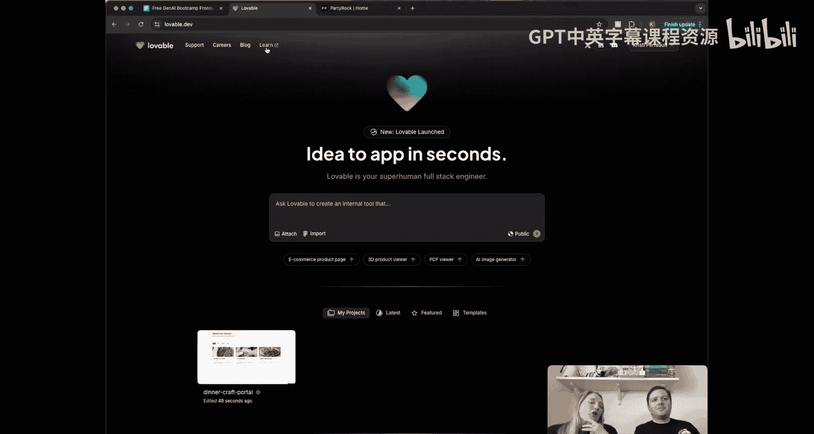

so hopefully you shouldn't need most of this， given the idea。

 is the AI is smart enough that you can communicate back and forward with it。

 but we don't know yet because we haven't tried it so。Yeah。

 there's some good user guides in here to kind of get started。

 especially if our overview isn't as helpful as we'd like it to me。

 you can definitely check it out here。 It'll give you some prompt ideas。

 you'll also see in here that there's some maturity level for the AI。

 which is pretty cool So it showcases where the models are at in terms of building and good thing because we're building a frontend UI app and it says it's pretty mature right now。

 So hopefully so I'm a fun that authentication requires some patience because that is always true。

 no matter who builds the if the AI can figure this out。

 then I think we could be out of the job with that because those user logins are pretty tough to manage and maintain we know from experience building teach me if you look up teach me AWS could me you'll find it。

😊，So there's definitely some great stuff in here。 Also if there's like features or you're looking for updates or to connect with other community members。

 their spaces for that in here as well。 So lovable is pretty built out as far as AI tools for building web applications and hopefully this will get you to what you need and in addition to our kind of walk through here today just a quick question。

 Krisy because you set up the account for this。 You didn't have to give it any card details or anything you get I did not know I was actually able to sign up with my Gmail I also believe for lovable I gave you the option to create your own or sign up through Github as well if you're looking to take advantage of that。

 It was a very， very simple to click process to set up。😊。

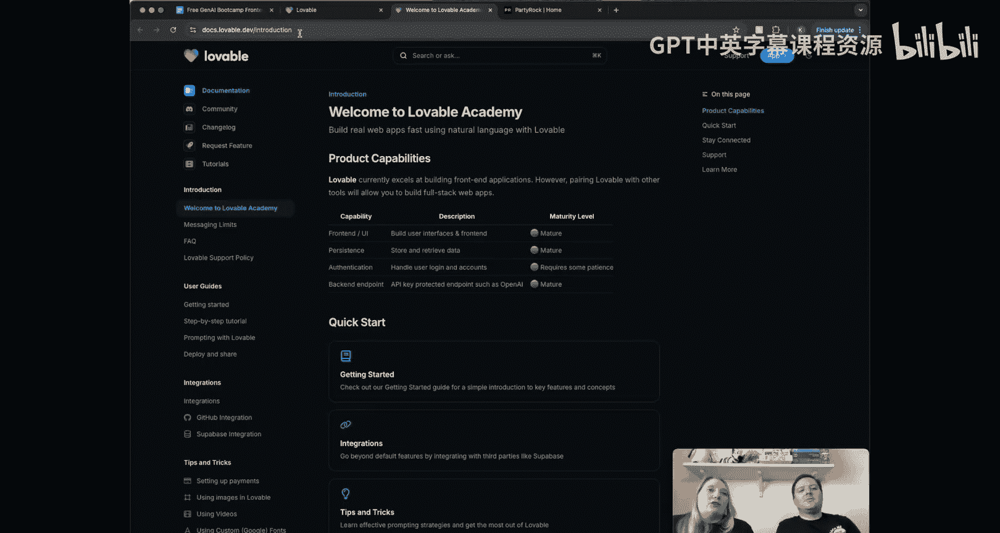

Awesome， so I have our prompt。 hopefully still saved in my clipboard。 Pi。 So' paste it in。

 And I'm gonna check just to make sure that it has everything expected。 And it missed something。

 So we probably don't need to say it's a front end prompt。

 Do you need to say assuming the rule of a web developer I think we can try it。

 or I suppose it's already in there like that。 Let's just leave it as it is and see what happens。

 You， we're testing this out。 So we'll see。 So hopefully we've got our project description in here。

 I think it'll probably be better if I actually have formal capitalizations and things in here， too。

😊，Just in case。We are building a language web app to launch our activities intended for desktop。

 and then we have our technical requirements we just went through as well as our routes。

and then our navigation，So hopefully， it's smart enough to understand these as headers and take in what I've put in here。

 But I guess we will find out。's rolled out dice。 So I know that when we did this before。

 it did take a minute or two just with the regular prompt。 So don't be concerned。 Obviously。

 it is building a web up behind the scenes。 So it is probably going to take us a few minutes to set up a preview and check this out。

 What I do like is that the chat stays up on the right here left here。 And we can see。

 is building our pages。 It's almost like it's done this before。

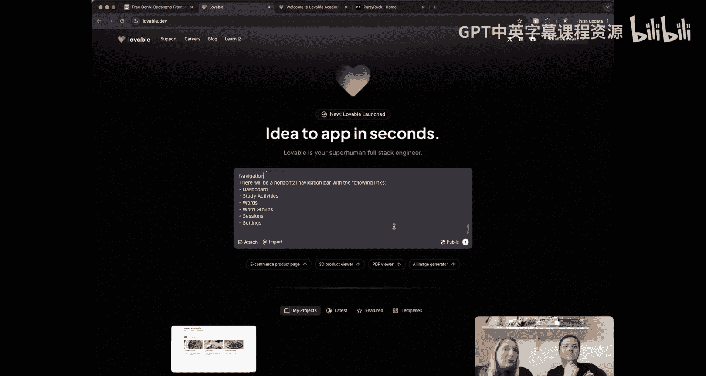

You know， as as someone who's been in react and Typescript。

 this actually does look pretty standard for our pages and how I would set this up。 Yeah。

 it's got a couple of components and stuff， yeah。I mean， yeah， we jumped straight into the code here。

 but should it not have jumped straight to the app。 Well， I think it's still building out。 See。

 it's creating。 this is probably because we had said that we were fronted developers。

 So it's going to show us the code before。 a preview of an app， which is kind of cool。 Oh。

 here we go。 It was just showing us what it was doing。 W。😊。

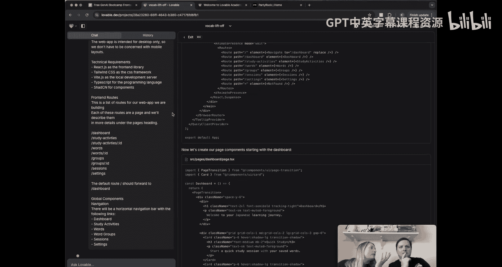

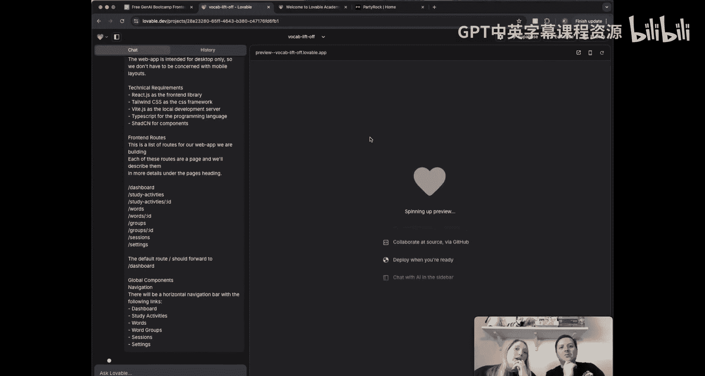

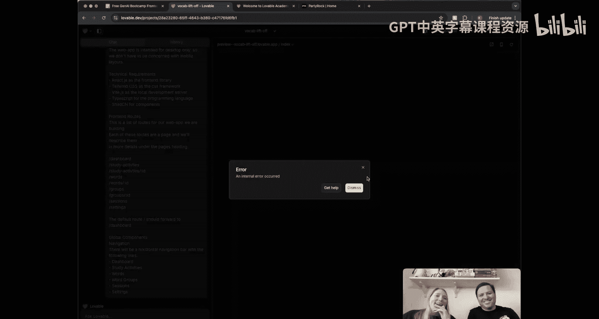

No， allright。 so welcome to your boy。😊，It tried really hard。

 so let's see we'll look at what the AI is saying。I will help you create a beautiful and functional Japanese language learning web app。

😊，Oh， it actually sees what says where it's pulling from inspiration， which is kind of cool。 So。

 you know， Duollingo is a popular language learning app。

 It's pulled up and tried to do the core routing structure， nav bar dashboard layout。 empty design。

 smooth。 Yeah， it's pretty much exactly what we asked it to do。 in code。 I mean。

 we didn't specify any of these colors。 So it's pretty cool。 It just came up with a theme， yeah。😊。

I know I am not very design， savvy， so that would be helpful for me as well。As always。

 don't get sued because it's got a green night。Well， it looks like it's trying to show us the index。

 so if we try to go to the dashboard view， that was all disappointing。

is there an error anywhere we can see。 Let's see。 editit number one。 Well。

 we can see some of the code it tried to create。

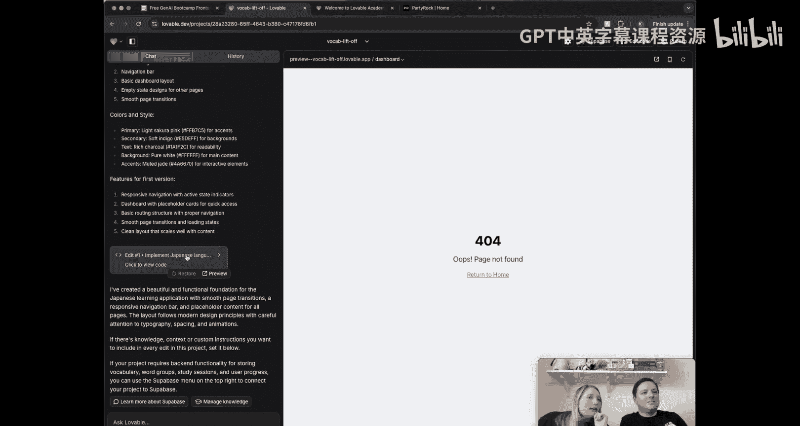

So we have our tailwind config in here。So even that's not showing us anything。

 We do still have the code that we can look through and。

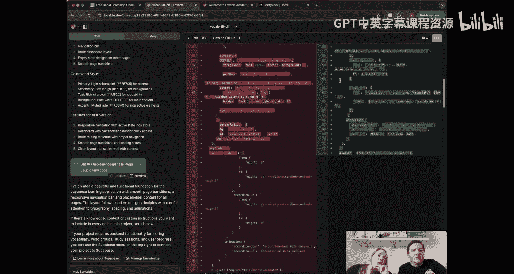

We've got our layout now bar。Interesting， it does specify that because we haven't picked out a backend functionality for storing our words。

We can connect to Superb as well。 So I wonder if it's having a hard time without having a。

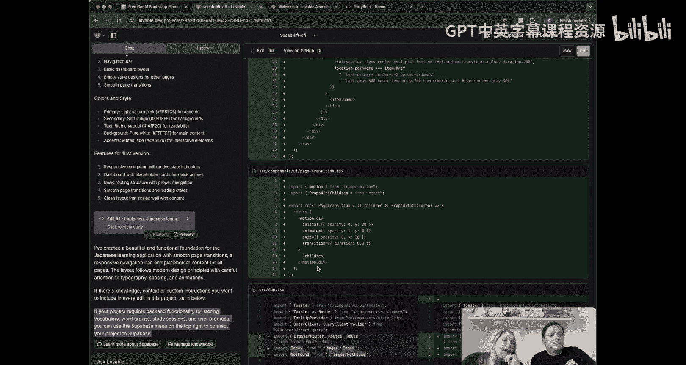

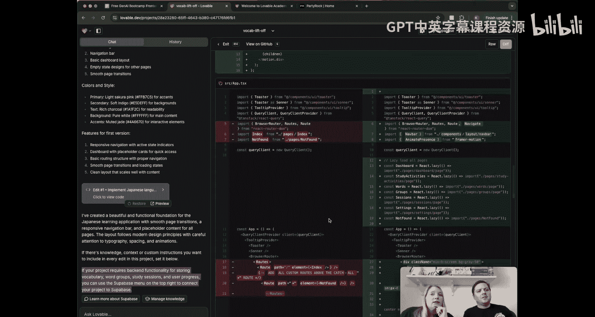

Backend application。Let city。Up。There is some page on nowv in here as well。

 Looks like it's attempted to put together our dashboard。 Welcome to your Japanese learning journey。

Study activities page。 So these are very basic。 But， you know， it's kind of what we said。

 This is on Github as well。 I noticed so this code exists。 because it says their' view it on Github。

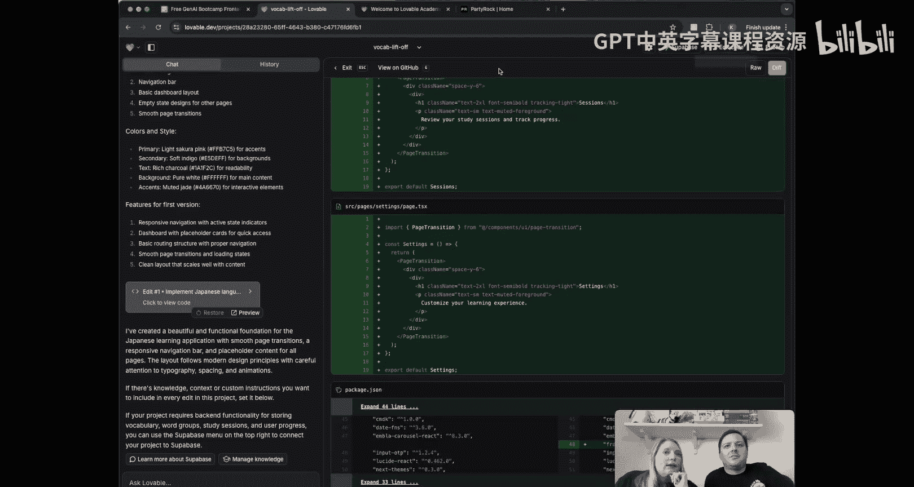

Yep， so we can check that out as well。Out I'm going connect to GithHub。 So someone's GiHub。

 I need Gi。

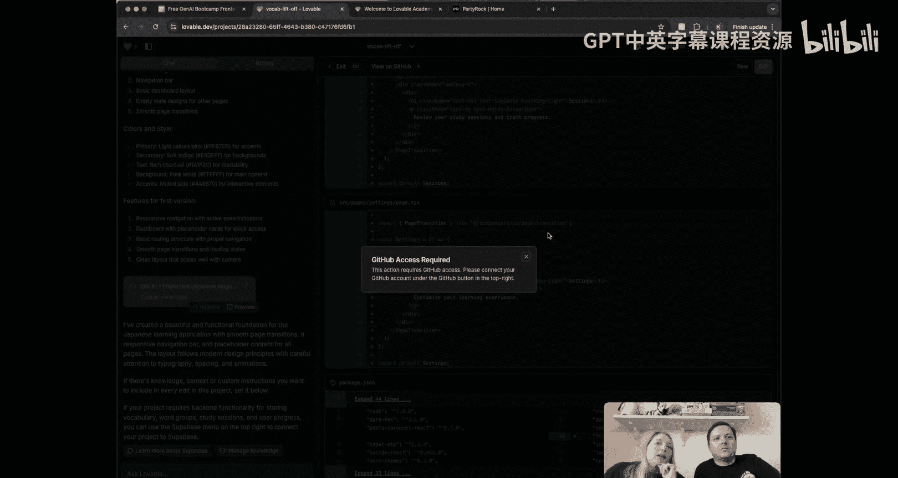

So it does look like if I set this account up with my GitHub profile。

 it'd probably just open it straight there， but we can connect to it and check it out It's just thinking if you had to get you could have clonebed it and seen the local errors。

See this is its connected。Maybe I can try to sign in off screen here and see what happens。

Its a little interesting that it doesn't tell us exactly what the error is either。 Yeah。

 it's got to be someone。 Can we just ask it， probably。Alright。Oh。

 it's trying to sign me in right now。And GitHub。 so hopefully we can see the code over there， too。

Talking about authentication being fine。This is why we only share one screen when we're recording。

Allright， let's see。Oh， transfer Yeah so what's and we're going to send it over to mine。

Not giving anything away cause hopefully you all know my name。😊。

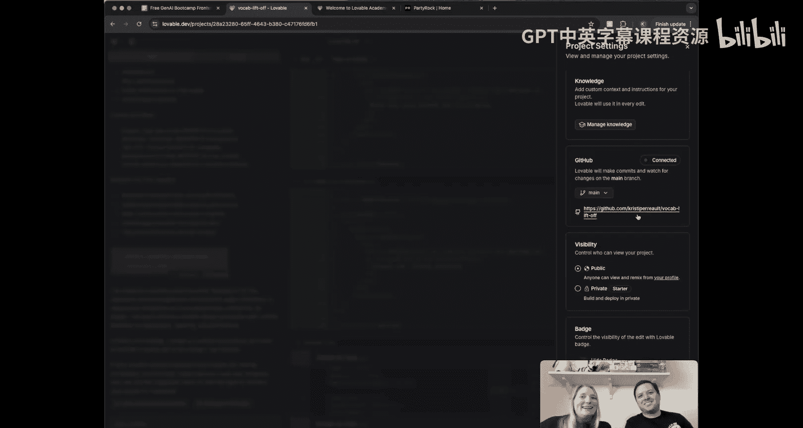

And let's see if it's actually in GitHub。Alright， so this is great。

 So if you didn't sign up with your Github profile。

 it's obviously very easy to get this set up for you in Github anyway。

 so we can actually see what it built。 So even if it's not going to show us in our little web app over here。

 we can maybe check it out and see。😊。

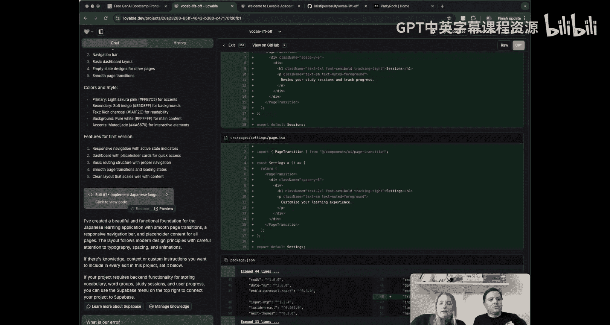

If it'll tell us what our error is and while that's going off to do that。

 we can kind of see some of the structure in here。 So it actually does give us a。

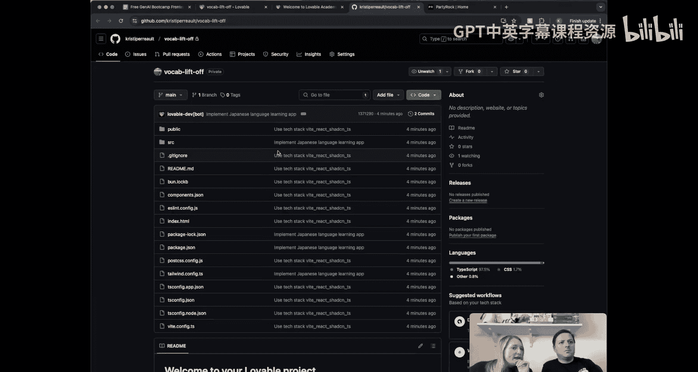

Read me with instructions on how to edit。 I mean， yeah， if if we hadt been set up。

 you could have clone it went then and tried to run it and what happened。

 It even took in all of our project。

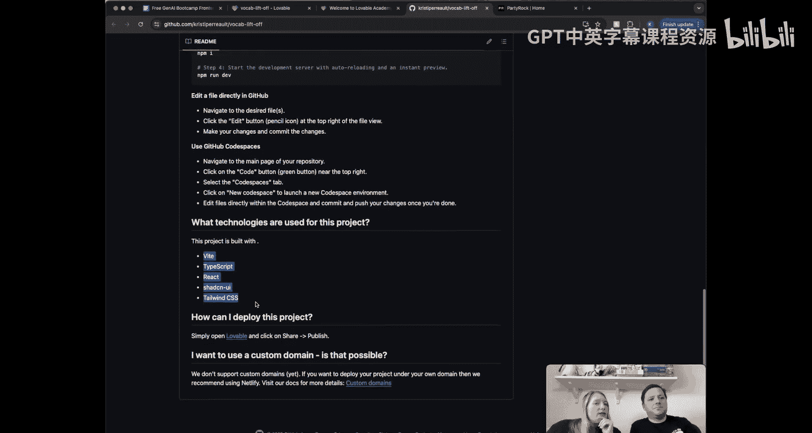

Details。

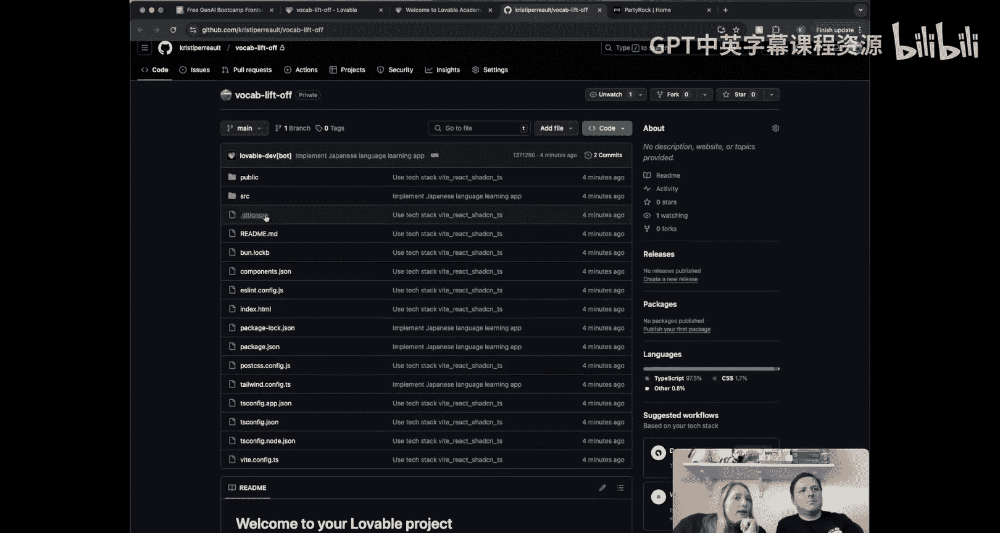

And we have our source file。 So this is largely what you'd expect out of a react application too。

Yeah， I mean， obviously， you would have to dive， dive into it to be like what's。

 what's good and what's bad about how it's laid this out。 But if you've never start， you know。

 like if you've never created a react app before， I mean， you've got a decent structure set up here。

 Yeah， I mean， they have components， pages。 This is kind of how I would expect a structure to be。

 And then names of our different routes。So like if we take a look at our dashboard。

I will say one thing it is lacking is tests。We did not ask it to create a test。

s anything we want AI for testing。 Yes So I do know when I usually create like components in like angular or in react。

 It'll give you like a couple different files like your C S as well as like your your spec file and stuff。

 So that is a little different coming out of this。 So it's not gonna work exactly like a create react app would。

 Yeah I'm almost like， because you could use the tests to create the app。 if you know what I mean。

 like in the ultimate test driven development， just pass the tests to the AI and say make these pass with an app。

 Yeah， you definitely could do that。😊。

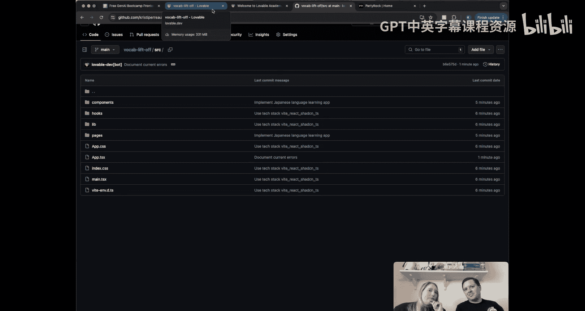

So let's see the error code we got was the user attempted to access a nonexent route。 Well。

 that's interesting。 Oh， that was the error because you click the dashboard one。

 We need the error before that。We have set up the route dashboard in our app T S X。

 here error suggests there might be an issue with the react import in one of our files。

 Looking at our code base， I noticed that it's missing the react import since we're using JS。

 Let me fix this out of the react import，Build unsuccessful。 Yeah， interesting。

 So if you click that build unsuccessful， what happens。

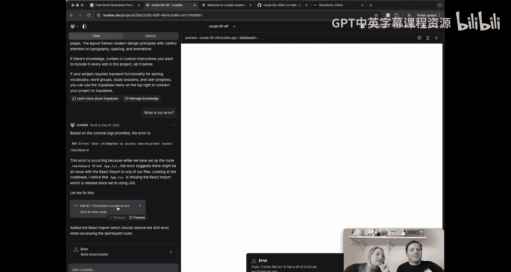

So it's missing some declaration。 So what happens if we try to fix this yeah。

Please think step by step in order to resolve。Or're trying to teach it like a human。Allright。

 let's see if that works。Can we just ask it to recursively keep going until it fix。

 So we'll get an infinite loop。 Yeah， All right， I think there's a limit to the free tier。

 So I really don't know if I want it does that out。 There's a server just break somewhere。

 So maybe while this is running and we'll see， oh， actually。

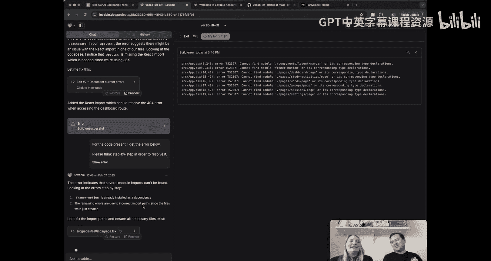

Change is already applied error at the bottom of the screen。 Yeah， Change already applied。 Let's see。

Because the code changes I suggested were the same as the previous code。

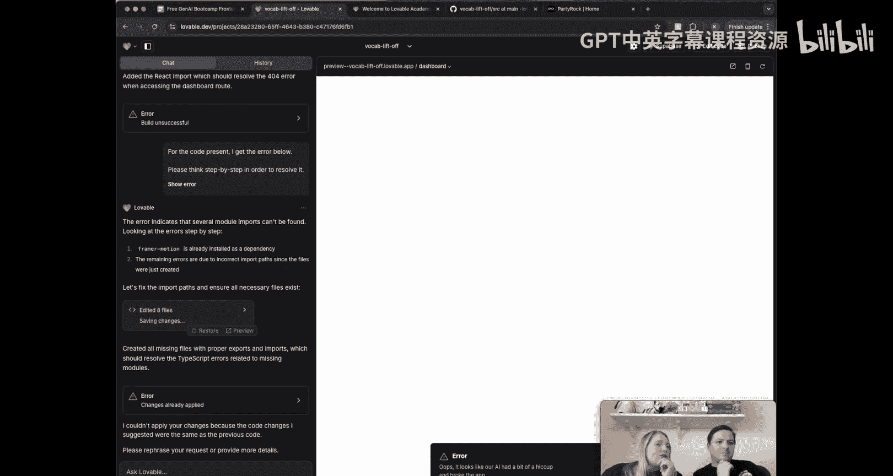

Let's see。So it didn't know how to fix it。 Yeah， I guess not。

So this is the fun thing about AI in that you do actually need to know how to code the thing before you use an AI generator to generate a code this。

 because it's kind of what we've been talking about for years。 in that before AI。

 we even had quick starter templates where people could come along and like pick a template that someone else has built and rapidly deploy it。

 And the day one experience of this， being able to go， I want an app is awesome。

 But the day two experience of taking this app and actually keeping it running and production means that you need to understand everything that's inside it。

 And right now， that's that's the issue。 It's the exact issue we're in right now。 Yeah， Yeah。

 for sure。 And I mean， it you know if we had。😊。

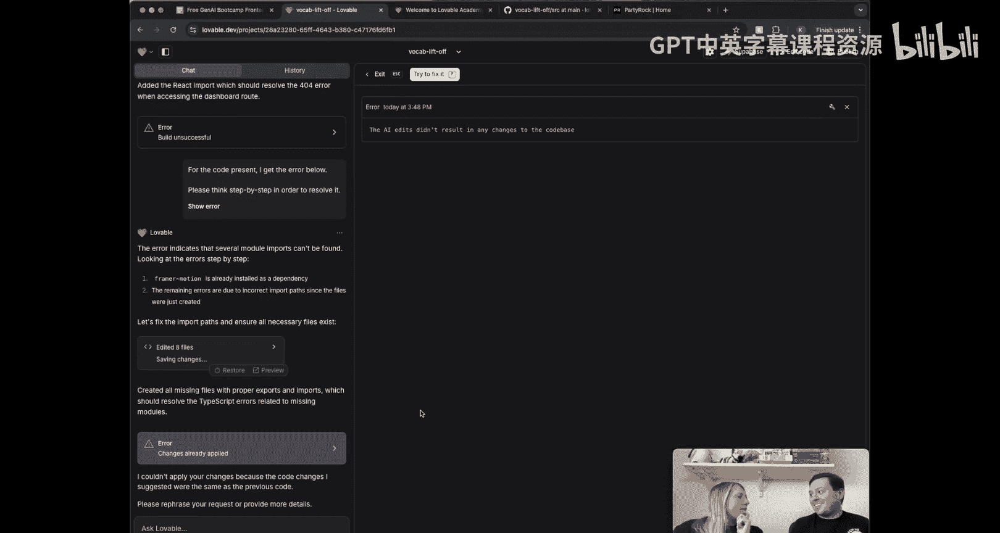

You know， the actual time to dig into this， we can kind of go step by step through these things and pull this up in our IDE and see what the IDdeE catches。

 but it's it's a great way to get started and set up the project structure that you need。

 It's almost like pseudo coding without having a pseudocode。The question is for fairness。

 the lovable， did we want to like put in Andrews full prompt and see if it works。

 I think we should try that。 So maybe let's， so we've kind of tried to prompt this one。

 I'm actually curious if we go back into the lovable app and try it out as a new application。

 and see what happens。 So I think it might be easier to bring it into our prompt first。 exactly。

 So let's jump down to navigation and we'll pull up。

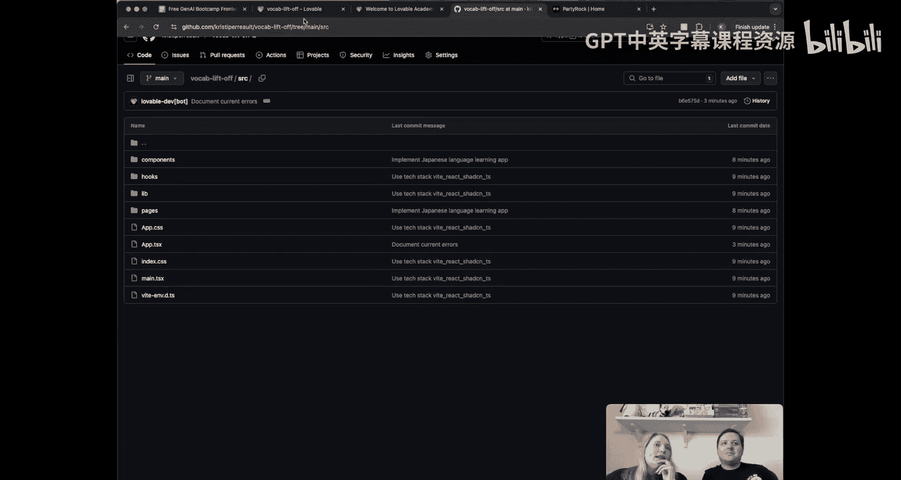

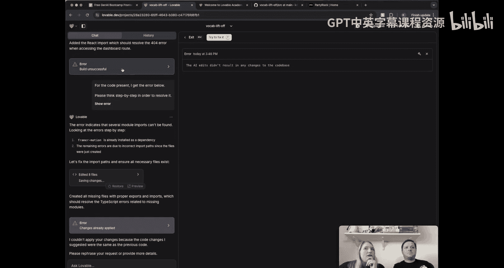

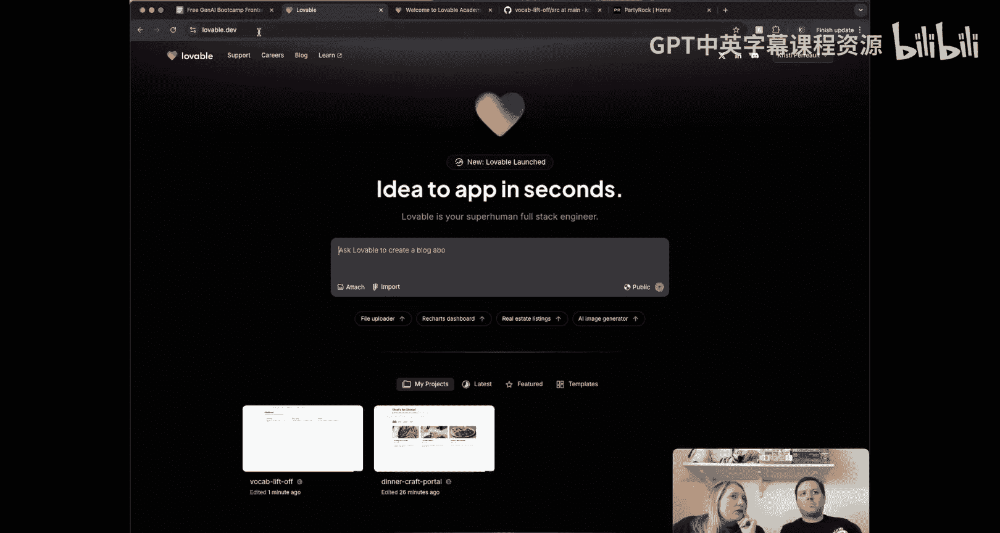

What's remaining。 So we've got a bunch of things。 So we'll talk a little bit about some of these that we're bringing in as well just to So we're not totally lost because this is a pretty big company based。

But you'll see none of it because white， yeah， I' need to highlight it first。

Those that work in dark mode know the struggle。 Oh yeah， I'm surprised。 this is white background。

 that just raised your dark mode everything。 No， I know a new computer。 Okay。

 so let's take a look at this and I'll do some edits as we go through here just to make sure。😊。

So another thing that's key for navigation， breadcrumbs。Yeah， I mean。

 breadcrumbs are like whenever the subnavig within an element so like underneath study activities。

 what do we want to have？I'm a bit like， I don't know what an adventure mud is， but yeah， it's good。

 It's good typing tutor core verbs。 I don't know what the third one is。 But， yeah， as we said。

 we don't know Japanese。 Yeah， actually surprised how well that copy past it over。😊，Awesome。

 so then we have some more explicit detail on our pages。 so like our dashboard。

 so it'll give us a page of the summary of your progress with the last session。

We do have an index here， it looks like this is our route page for study activities。

I hope Andrew doesn't watch this back and sees me fixing those tablepos。Listen。

 that's just how you spell it in Canada。 what his answer is。う。😊，Alright， so we've got some cards。

 not playing cards。 This is， I think that Han is also。嗯。Yeah go。So these are our cards。

 so thumbnails， titles and some buttons， so we're getting a little bit more complicated here with some of our direction。

 which is why I was curious what it would do if we gave it less first。

So they know they need to use a group ID。You can see it's very specific that it's like， listen。

 there's not going be more than 20 study activities。

 So we're not going for geoingo levels of success here。Awesome， so we have a activity showcase page。

 so this is under study activities。And then we've got more information on what those pages will look like。

since you'll be watching this back， you can definitely pause and take a look at the what's written here as well if I'm going too fast。

So we'll have some session items， group names。And we know have itemss。Then we have a words index。

 which is the table of words with the following cells。 So Japanese， ramaji， English。

And then number of correct and number of wrong word items。

 which is pretty standard for if we're kind of trying to learn a language。

There should only be 50 words displayed at a time because that's all you ever need。

ItMight be overwhelming if there's any more than that。Obviously in imaginationation。

And then make the table sortable。 Well， we're adding some sorting as well。

 These are some pretty advanced features。 But stuff you probably would want。 I mean。

 this is a good 9 to 12 months for the developer where it really is。 Yeah。

 so we're just asking right away to do this。 So I guess we can't get mad that it didn't work on the first try。

Pagination logic， we've got some word groups。Session index。啊。A settings page。

And imagine that it would be kind of cool to add like a profile to this。 as well。 Well。

 that's where settings has reset history。 So I think settings is like your profile。 Yeah。

 but to be able to upload like your profile。 Yeah， a little bio and stuff。

 little flag for what languages you're learning。😊，So ideas to expand on this for sure。

 So it looks like this is pretty cleaned up in here。 as you can see now with all of that。

 we're on our sixth page。 So let's see how the lovable prompt engine takes advantage of this。

And how long it takes to actually go through this。 So I'm going to not copy front end prompt this time。

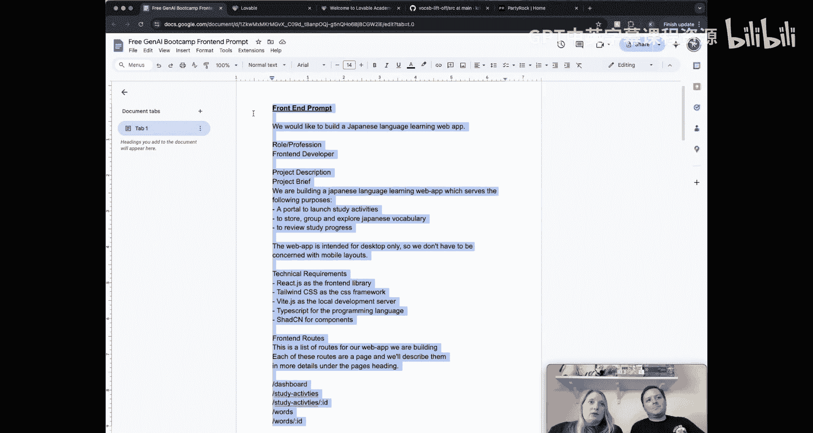

And let's create a new one。

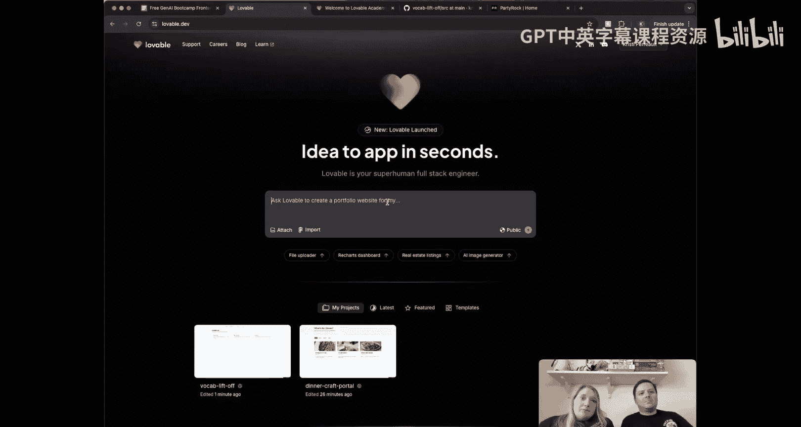

Very long， but it took all the words in air。 So it doesn't look like there's a issue with。Our length。

And you'll notice it's not。 I originally had assumed the prompt would have to be full blown English。

 Like， please， could you， you know， like proper grammar， whereas this is really。

 this is a list of stuff。 Just do it， like minimal English。

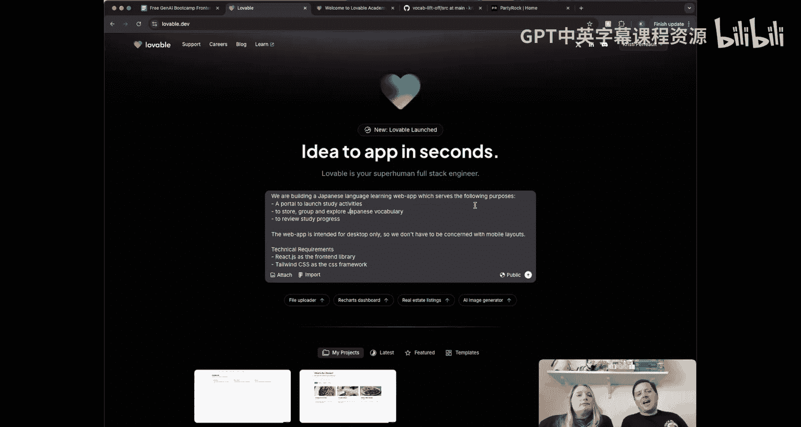

That's a good point， though， because I actually did notice。

 and we'll jump over and try out a different AI tool in a second here。

 But I actually did notice that some of these specify specifically。

 they'll only take English written prompts。 So unfortunately。

 we're actually creating a language prompt。 So if you wanted to try out your Japanese to build the prompt。

 It actually is not going to take it in a lot of these situations。

 I do wonder if there's another AI that can translate your language and further into the AI。

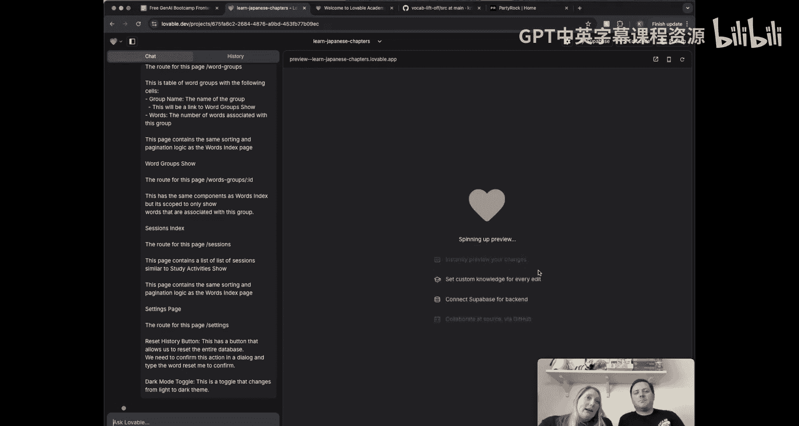

So we'll let this run for a few minutes because I think this is gonna to take some time and we'll see if this actually works this time with the full prompt。

 So while we're doing that， let's kind of hop over to one of our other services that we' take advantage of which is party Rockck so if you didn't know party Rockck is AWS's version of their app generation AI app generation So this has gotten a lot of hype over the last year or so I would say and it's built on bedrock which is one of their models and tools to utilize for AI and this doesn't require your AW as a kind details or anything。

 this is a completely free public preview of what Brock does Yes。

 and I similar to lovable I signed up through my Gmail account on this they do give you the option if you want to set it up with your Amazon account as well or you can take advantage of I believe Gitthub was the other one on this or you could just create your own application。

 So again， very quick twostep process to sign up。

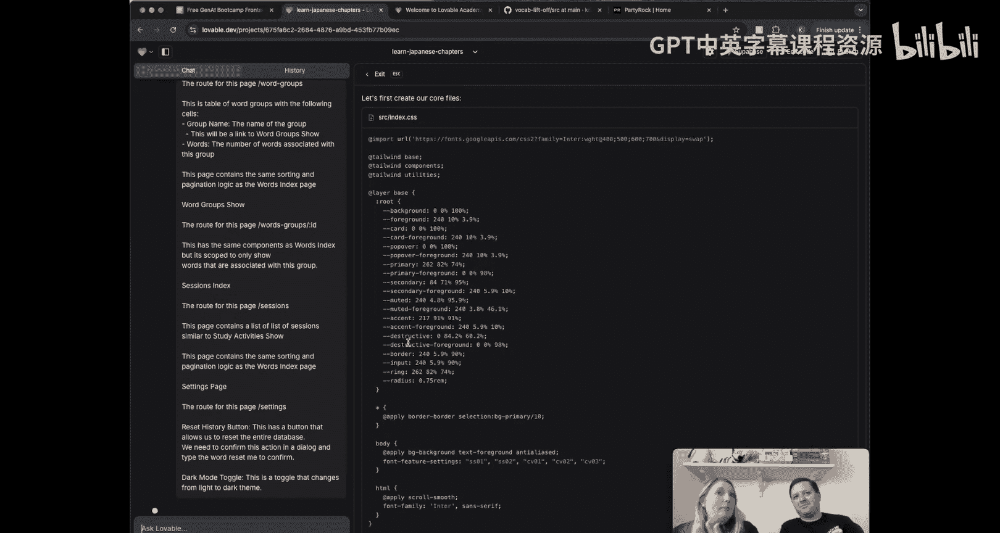

For this，As you can see， their UI theme is much different。

 is this is definitely a I would say lovables maybe a little bit more modern looking。

 So this kind of has a retrovibe to it， which is kind of cool and similar to you know our lovable application。

 There's a bunch of different areas here where you can take advantage of just it's probably worth point night that because this one is like the public preview like fun。

 let's go build applications learn AI。 but AWS also has like a much snazzier look in AI inside the AWS console that's probably more comparable to lovable。

 but at the end of the day， these are the public tools that don't require other accounts you can use for free exactly。

 And as you can see here， it's very similar you know， create this it'll be public。

 there is a guide here too。 So if you want to take advantage of you know。

 learning a little bit more about how to get started it actually gives you really explicit details on how you build your。

😊，App and you'll see here it's powered by Amazon bedrock and you know kind of some tips So this is where I noticed that earlier right party Rock is intended with use for the English language prompts only so something to be aware of and to keep an eye on as you're building these applications too and we have seen one of these apps in the wild because one of the heroes actually built a quiz to ask how well you know the other AWS heroes have the answer 20 random questions on everybody We didn't do too well there's too many of us。

It's hard to know that many people across the globe or like there's others。

So as you can see in here you'll start with a prompt and then they're kind of calling our error edits like remixing an application so if you want to change stuff up you can do that which is kind of what we were just doing and lovable to is playing around those some things or you can just start from scratch so what we want to do is actually generator on so a little different it comes with the pop up let's see if my prompt is still in my clipboard here。

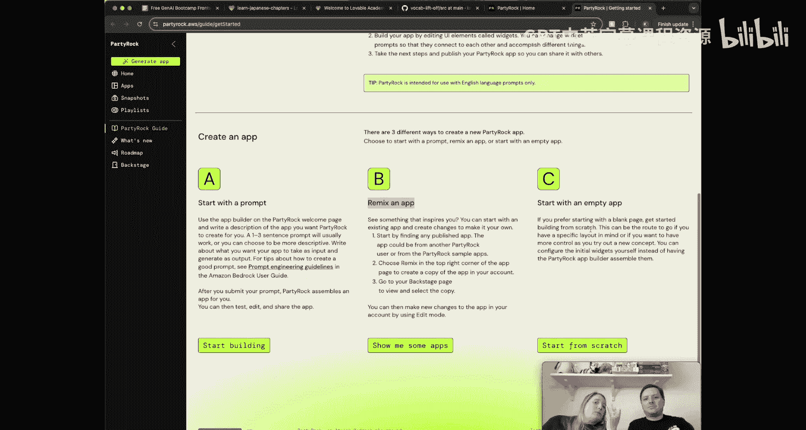

Alright， so you can see everything in here， too。 I'm going to fix the capitalization because that in on the word doc。

 And you'll see here that like， if you needs help getting started with something。

 it'll give you some example props that will help come out of the box。 So let's run this。

And we're really going to test how well May。Mac handles。

 building multiple AI applications at the same time。

 And I believe we were told this party rock has daily free credits for this， right？

 I think that is the case。 You may have to check us on that。 But yes， so we'll see。 I。

 I also tried out nap on this earlier。 So we'll see if well run on that。

 And you can kind of see that this is loading a little differently。 So similar， though。

 it's gonna go through and figure out our routes， our words or study materials。 So that's building。

 maybe we can jump over。 no。😊。

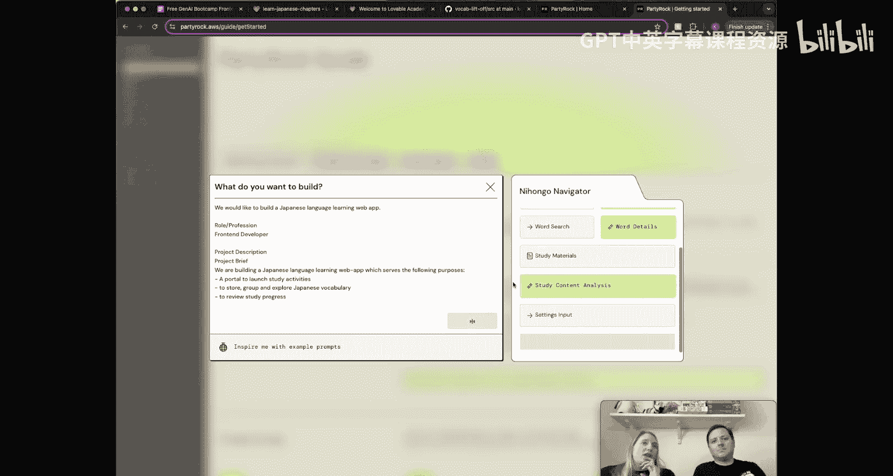

So。se thing it gave us a very similar starting prompt here but，If you look， it actually。

It's almost like it's like， hey， you've given us a lot of stuff。

 So we're gonna up our wheel cap for you because they are getting really fancy with sophisticated typography。

 which is kind of cool。 So we've got our color palette again。 It's trying to do。 Oh。

 it's still building stuff。 Oh， okay， So this is taking quite a while。😊。

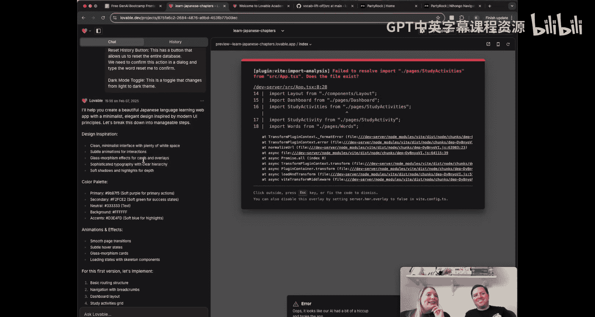

Oh， and it gave us some Japanese， which is cool。 So you can't tell it stuff in Japanese。

 but it can tell you things。 We don't even know if that is。 Japanese， Let's be honest。😊。

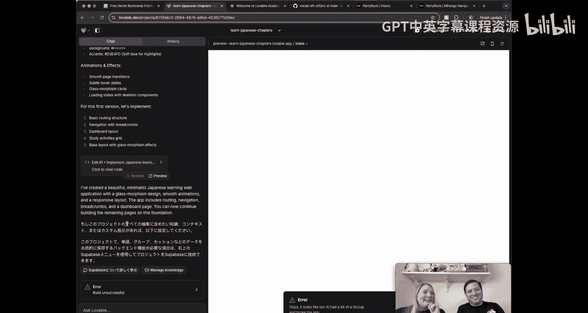

So it looks like we still do have an error here。 Very similar。 Actually。

 it's the same error with trying to find the modules with type declarations。

I can probably try to fix it again， but I have a feeling it's going to do the same thing as last time。

But out of curiosity， I bet if I clicked editit code this time。I will transfer it over into my。

 The question is， does it fail or does it overwrite the other one， Does it create a new one， Yeah。

 well， I did create a new prompt。 So I am going to guess it's going to create a new repo in my Github account。

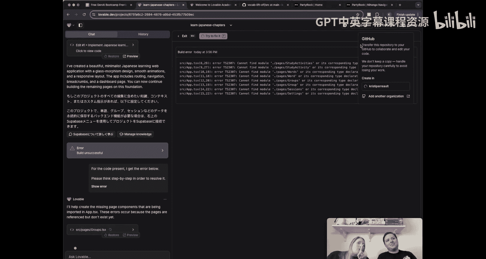

So all that。So， oh， it will that。 It worked that time。ow， Oh， this is really cool。😊，Okay。

 so as we can see here then， we have， let me make this a little bit bigger。

 Let's learn some Japanese。 Yeah， so we've got our dashboard。

 which we did also say we expected it to land on our dashboard as our homepage。

 So we've got some high level title cards， which we also talked about in our prompts。 So total words。

😊，Let's see we've got a bunch of our different landing pages。So let's jump over to。 Well。

 I don't know if we gave it activity。 I was hoping it was just smart enough to know wed want some activities。

 Okay， so note a note taken。 It's not gonna be smart enough to know that you want activities in here。

 But it will actually create them。 So if you want to build this I even more add your own activities in here and see when it does。

 That would actually be another thing。 Like I wonder if we could ask it that。

 I don't want to mess with it。 Yeah， that's the mess with。 I' not going mess with it yet。 but。😊。

But yet， hass put the structure in place， at least for if a back end or some other source exists that it could display it。

 Yep， and I actually wonder。I see。 I would like to see it in code form side by side。 Like。

 it seems like I'd have to actually open this in。GHub to actually see the code。Cause was there not a。

 what happens if you click at a code and the。 That's the one that sends me to get。 Oh，s。 Okay。

 But maybe once you tell it your Github from that point， Github is your only choice。 So here it is。

 actually， interestingly enough。 And it does look a little bit more put together Then see。

 this app has quite a lot of config files and kind of some junk。

 Maybe whereas it looks like this one's a little bit more put together。

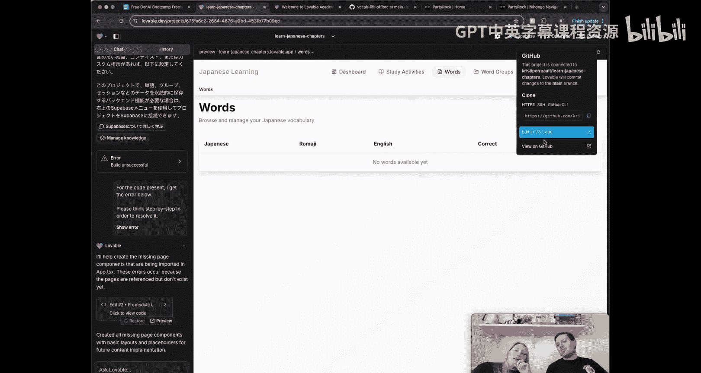

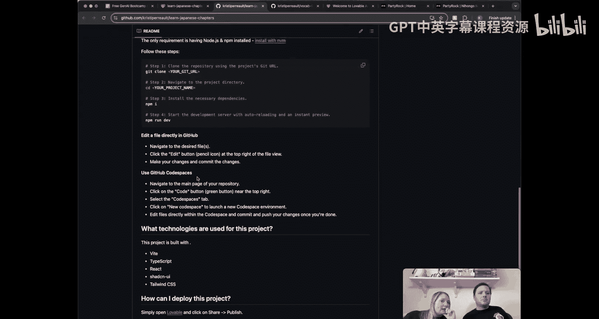

The read me is pretty similar。

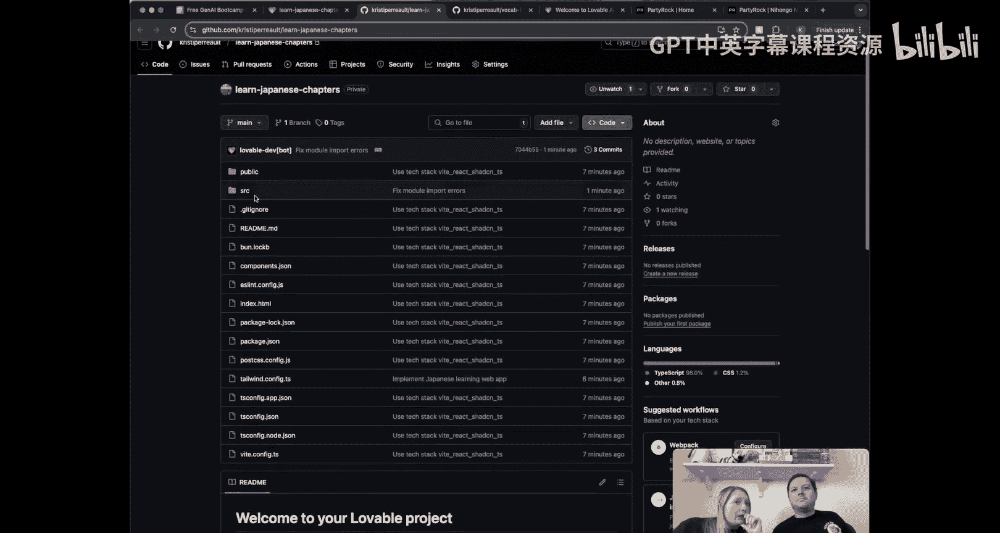

But it is kind of cool。 So like let's take a look， look I'm curious if we're looking at our words page。

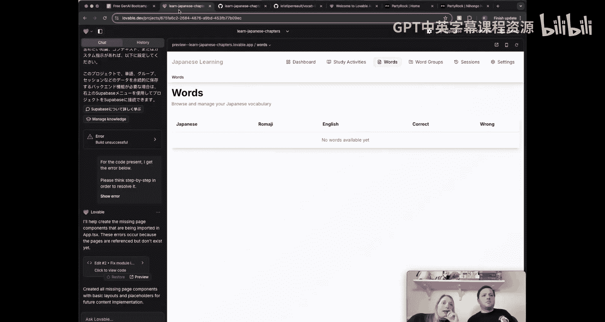

Words， yeah。There's two of a word and words of Yeah， not the same thing。 the same thing。 Yeah。

 so it look about it did create like a full bloom table with classes。with alignments，But I'm like。

 there's no data sources at the Right because we're， we're also front。 This is just the front end。

 So there is another video where someone else will be going through a backend app and building that with AI。

 So I'd be curious how those hook up together。 So， yes， it is good。

 good to recognize that this is just the front end。 So it's not pulling in。

 you still need a developer at this point。 It does look pretty， though。😊。

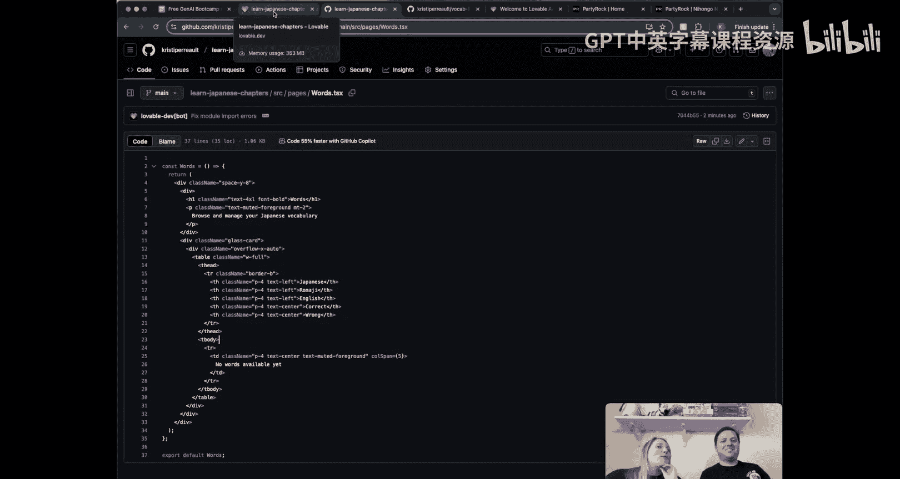

So previous study sessions， word groups enter setting options。 So I'm curious if we can say like。

Maybe。Add common。Japanese to Japanese。And common English phrases， maybe。To our， our English words。

 English words。With their Japanese translations because you， there's Japanese and then there's。

Remanine嗯。So add common English words with their Japanese and rai translations。To our。Words page。

Alright， we'll see if that does anything。 So while that's loading。

 I guess we'll go back over to our party rock app and see what party rock came up with。

 What have we got。

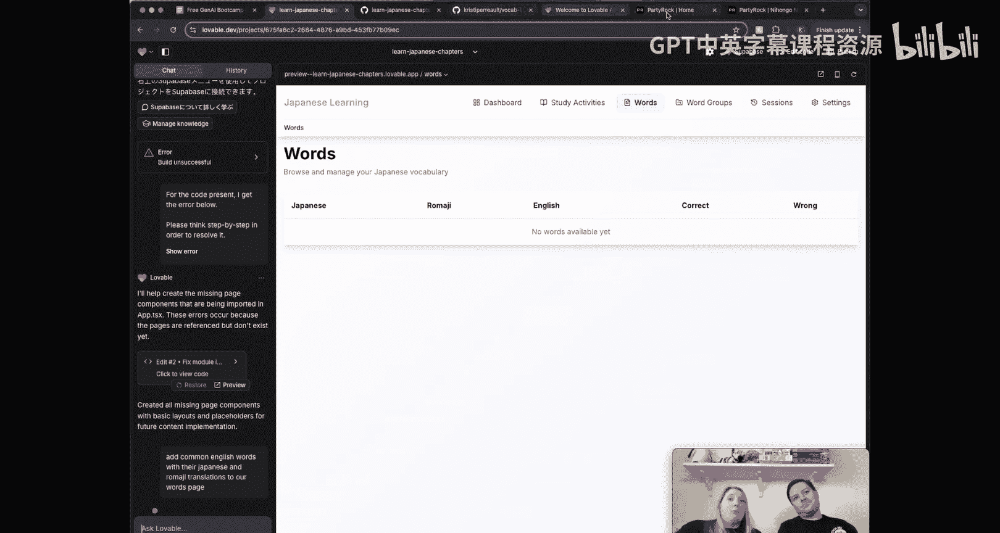

诶。So this one is this layouts a little different。 We don't actually have a full blown chat window。

 I think it's at the bottom here。 if you w to。 Yeah， I'm not sure party Rock does multiple screens。

 I think this is hard to you。 I always， I mean， from what I've seen anyway。

 it looks like the you eyes are always these boxes。 Yeah， these like cards here。

 And I made the window too big without realizing it's outside of our range。 So。

 and then you can see that there's like a remix button。 So obviously， this is public。

 So I'm sure you could look this up。 what you could do is take what I've already created and remix it yourself as well。

 But yeah， this one's definitely a little less。😊，Less frills。 Yeah， Probably the good way to put it。

 So like if you're looking for like more of a single page， like， hey， it's a little more modular。

 because like what happens if you put slash， you know what， the top platformss navigation input。

 Like， what have you put a navigation input on there See like slash dashboard， like it suggested。😊，나。

I mean， like。We need the other one round。Do you have to click the button Like。

 what does the button in the top right of the box do。To widgets they create widgets。 So here we go。

 So we can update like our placeholders and stuff in here， But the default value。Okay。

 but there's no buttons。 So how does that。You know， like。Yeah， this is a little different。

 So it's got a。This is kind of low。 It's like a chat bot for your Japanese studies。

 This is definitely different， like different vibe。 Like it's。

 it's more of creating a series of widgets than it is creating like an actual app。

 because you don't get the code based of this。 I understand correctly。

 Like party rock is always hosted by party rock。Yeah， that's true。

 So our technical details don't really matter here that we put in。

 but just to keep things consistent。 I was curious。 So you can kind of play around with this。 I mean。

 it might not be the best for the course。 but if you're kind of playing around with some AI tools or want to you know。

 create your own quiz app， maybe maybe that's actually the best use case for this alongside the course is like if you want to just create like a flashcard app。

 like you were saying with the hero quiz， like you know。

 if you give it some data of like common Japanese words or phrases that you want to start learning for the translation。

 this would be a really cool app to take advantage of to do that almost like a flashcard study guide。

I do like that there's less errors you have to worry about in this。 Yeah。

 like this is definitely simplifying it because it's not trying to build a codes。

 It's building an experience。 definitely means you can focus on what experience you want。 Like。

 I feel like with this， if we'd given it a much more specific verbos English prompt。

 we'd have been more likely to get what we expected， yep， yep。Yeah。

 because if we look at like our party rock guide。Yeah。

 you can see what kind of widgets you have available to you。

 so it'll do image generation chatbot and text generation。 so that's what it gave us。

 which is pretty cool that it understood from that that we wanted to learn Japanese and it said， hey。

 I think the best way that I have to do that is through a chatbot， which is neat。

So this would be a really cool tool to check out for some of that。

 but if you are looking for actual code。

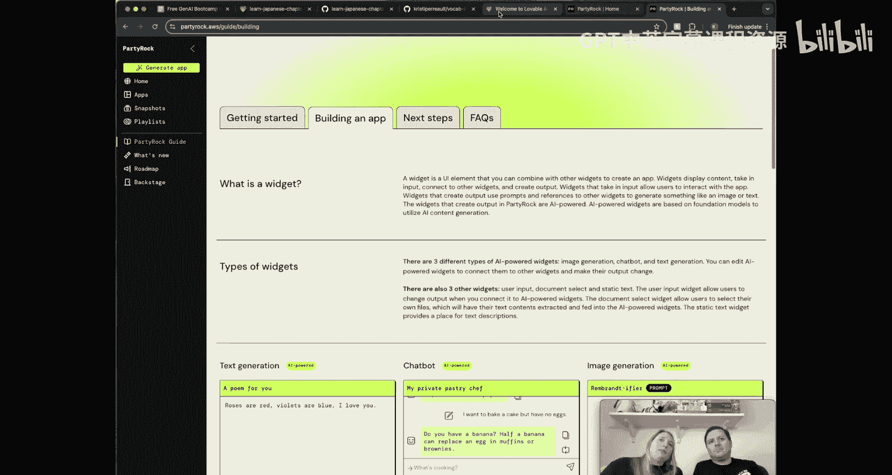

I think global bull is going to be where you want to be。You'll love it more。All right， let's see。

 They've updated the words page to include a table with some common Japanese words。Wowow。

 that's cool。 Yeah， we don't know if it's。 Yeah， I no idea。 It's right。

 but I don't know why it came us how many were correct and wrong。 It just kind of filled it in。 But。

 I mean， can eat you Well。 You know that one。😊，This is cool， yeah。It is in there。

So from our very limited knowledge of this。That's pretty cool。

 As long as you know exactly what you want。😊，It can produce it for you。 exactlyly。

 This is the learning I've taken away。 I'm taking away。

 If Andrew gives us something to use what you say。 Yeah， as you't try to create our own。

 If I want to create an app through AI， I'm going to ask Andrew to write the problem first this。 man。

 I'm going look good。😊，I hope we watches this and lets us know。 But yeah。

 I think this is pretty cool。 I mean， I wonder， like you probably。😊，I wonder if it has access to。

 so I'm curious now it probably doesn't have。

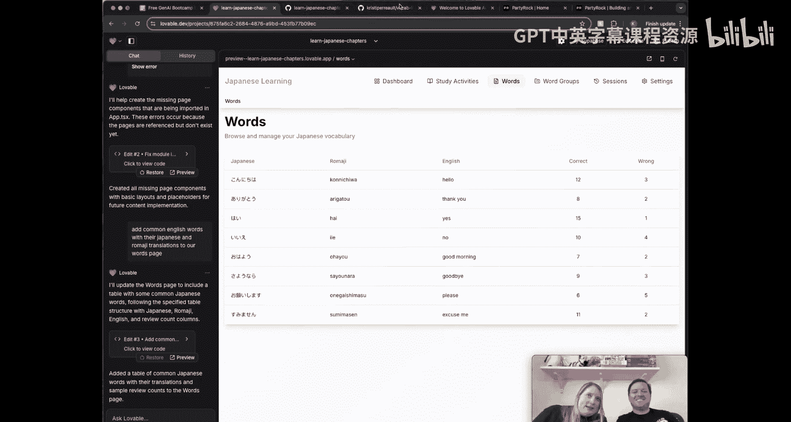

Oh， see。 you4 minutes ago， it updated the words page。 So it does actually go back。 Yeah。

 see we going。 Here we go。 Can you ask it to add test。Unit tests。

 know that we've seen it works and it's out of words。 Can we see what happens if you're like。

 can you add unit tests。

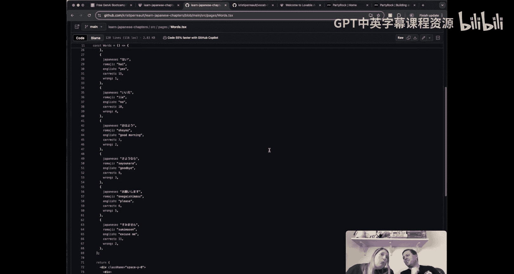

She， I added the police So when our AI over Lords take over。 Oh， see， Ive。

 I've hit my free messages today。😊。

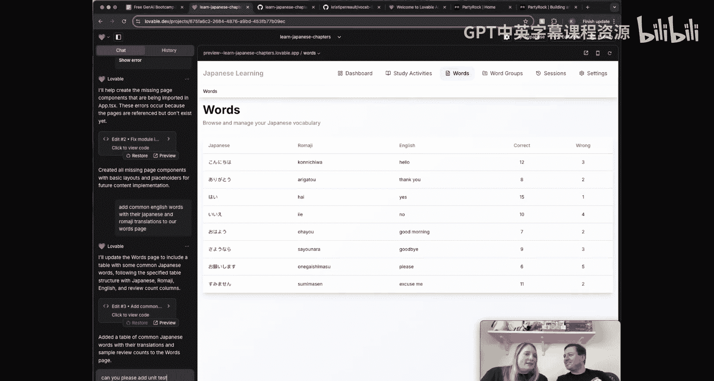

So that's a good test for， you know， that's about the extent of the free tier。

 So to you do all I've taken out of this。 AI is exactly like every other developer do anything to get out of writing tests。

 including charge more money。 It's convenient that when I asked it that， It didn't want to do it。

 So you'll notice this is the same， though， you reach your free messaging limit for today。

 Yeah So we can come back tomorrow and ask it to add unit tests。 And hopefully it would。

 but that does give you a heads up to know。 like if you're using the free tier。

 maybe use your messaging sparingly or at least be very effective with what you want to say。

 or you know，20 bucks a month isn't the end of the world。 This is a free Gen AI boot camp。 So。

 I mean， you could spend the money on some tools。 But the other thing I was thinking is this is connected to your Github account。

 So you obviously can generate with Gen AI write the test yourself and see if the AI for like something else。

 Yeah， exactly。😊。

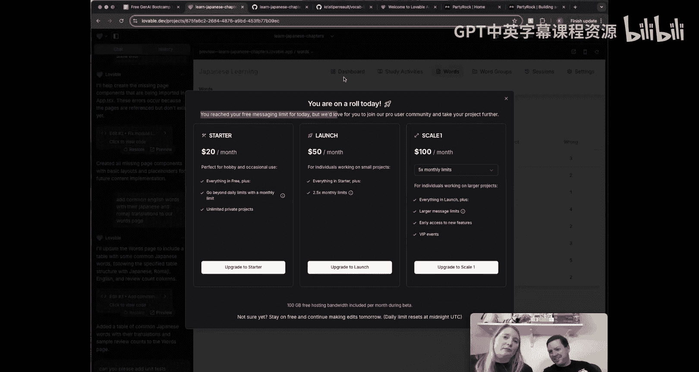

As we just saw， right， like， it actually did go into my Github and and pull this up。

 or you can just jump in here and then switch to Gitthub Copit Yeah and try out Copit。

 So you can take advantage of all the AI tools and you don't have to do it if you don't want to。

Awesome， so we've kind of gone through the prompts that we have。

 There are definitely other AI tools out there。 that'll build web applications。

 If you do a quick Google search， you'll find a bunch of them。

 We were just really interested in trying out poverty rock and lovable for ourselves。

 lovable seems really effective。 So I would say， give that a shot for sure。 Like we said， you know。

 obviously， with all of this， you're gonna want basic understanding as a developer runend developer。

 too。 It's not my area of expertise。 I'm more of a serverless person。 So for me， building Us。

 This is a really cool and powerful tool to be able to take advantage of。 Yeah。

 I'm just thinking as well， the lovable app isn't hosted。😊，Right， like in this。

 it's not that you can add a， you probably have to pay more if you want to add a URL to it and let people hit it。

 So like there is a level to this of like， no matter what。

 no matter what you're still going to have to understand where you're going to host this app， but。

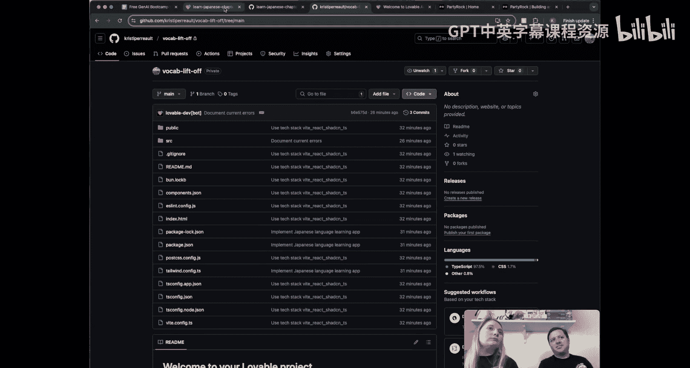

Okay， so they don't support it。 So see， you're still going to have to have someone who understands whether they're going to use Netlify。

 amplify some other service to deploy this thing。But it's still pretty awesome that it can give you the the work in Cos to start with。

 Yeah， And I mean， you can see right here， it says you can deploy with just a click using lovable。

 which I'm sure is probably another paid for feature。 Yeah。

 And then if you want to take advantage of your custom domain， they don't support it yet。

 So maybe if you want to put in that feature requests or plus one it。'llll。

 they'll put more weight into that。 But yes， you'll need to set up some of your own infrastructure too to get some of these things working together more seamlessly。

😊，But honestly， for starting off with an app， this is pretty powerful。 So definitely check this out。

 let us know how it goes。 Yeah， I think that's all we have for you today。 Yeah。

 just a basic run through of us on our first time around this site。 Hopefully you' enjoyed it。

 We tried to make it light。😊。

Yeah reachach out。 if you have any questions。 Al right， thanks， everyone。

 and good luck with the rest of the free Gen AI boot camp。 thanks thanks。😊。

