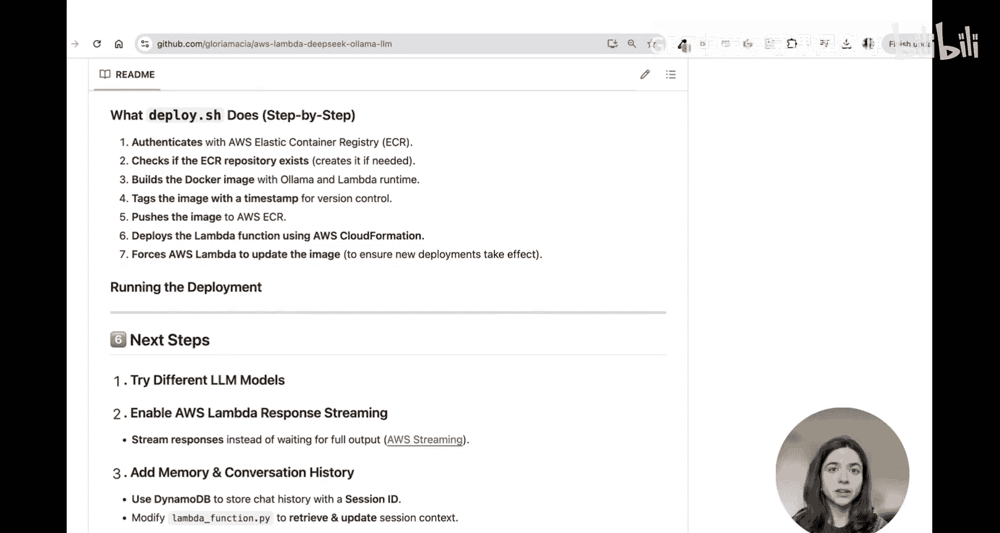
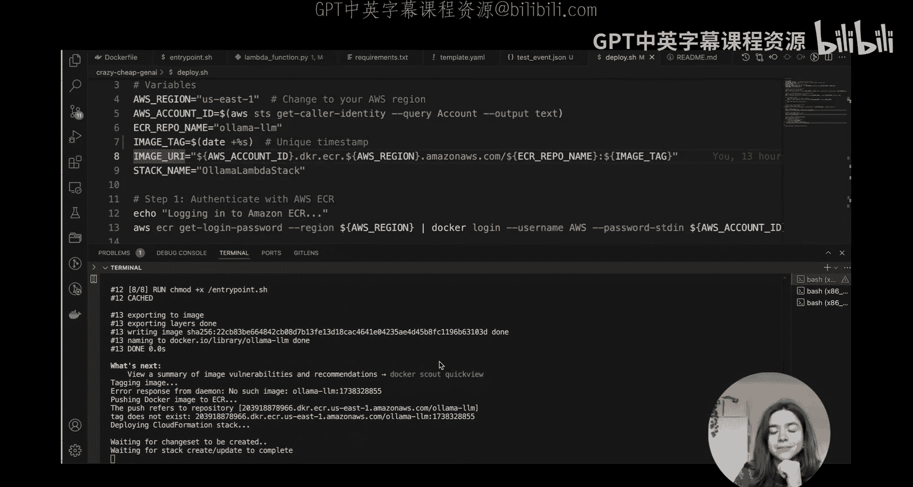
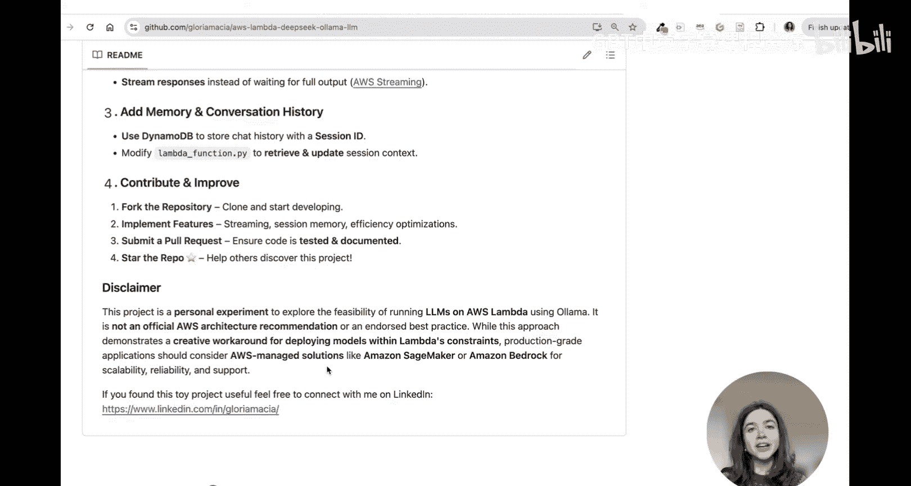

# ExamPro《生成式AI训练营｜Free GenAI Bootcamp》中英字幕（deepseek - P25：-25-Deepseek in AWS Lambda with Gloria.zh_en - GPT中英字幕课程资源 - BV1SFEWzLEab

Hi everyone in this week's tutorial I want to show you how you can deploy the O Lama models in an AWS Lada thanks to a creative and hacky way of using the AWS service let's get started First I wanted to show you quickly the O Lama website in which you can find many models to run locally。

Here we are going to take a look at deeps R1 and what I want you to notice is essentially that this is a model family。

 you can pull the famous deeps R1 with 671 billion parameters。

 but this one will definitely fit in the 10。G limitationation memory of our lambmbda。

 you can find also here the steel models， which are smaller models that yet they achieve very good performance。

 So the biggest one that I managed to fit in the memory of the lambda is the 8 billion per m one。

 So that's the one we are going to pull。I also wanted to show you very quickly the actual API docs of Oma as we are going to be using them a lot。

 a couple things here， we are going to be using the generate chat completion here is where you can turn the streaming on and off。

Here is how we pull a model specifying which model we want to pull。Finally， we are not using it。

 but I also want you to notice that there is a way of creating a model。

 so it's not only about the models that are available in the O Lama H。

But you could bring your own model which binds  Laama to so many possibilities here are the results of executing our Lada function。

 and as you can see， tapetick manages to return the successful answer。

 I also wanted to show you how we are actually using all the memory available in AWS Lambda。Next。

 we are going to take a look at the invocation locks。

Notice on the locks how we are pulling the deeps model。 Then we are loading the model。

 We are seeing the response that the model has been successfully loaded。

 and then the actual Lambda implicationss with our testest event wise， the sky blue starts。

 Now that you have seen it working。This is the code you can use to run it for yourself。

 You scroll a bit down， and you find here the instructions to deploy。

 simply run the deploy Sha script。It's very simple because I've created everything as infrastructure as code。

If you scroll a bit down it tells you exactly what it's doing so what the deploy script does is it first authenticates you with ECR and it checks if a repository already exists。

 the first time it won't exist so it's creating one for you and then it's building your Docker image locally and pushing it to the newly created ECR repo。

 the image is taed with a timest so that whenever a new image is pushed。

 the Lada automatically picks it up。Now that we have our image in IR we can deploy the cloud formation template that will create a Lada and the Lada will be using that image here you can see me running the script locally when it finishes I will show you the deployed Cloud formation template。

The Cloud Form stack is now in createre Compte status and if we click on the resources tab you will notice that two resources have been created。

 one， our Lambda function and two， the execution role that the Lambda function needs to be able to write locks。

If we click on the Lambda function now it takes us to the Lambda function console。

 what I want you to notice there is that it's actually taking our image from ECR。

 so let's click on that image。See how the name of the ECA Repo is exactly the one that we defined in the Cloud Form template and that our image is stacked with the timestamp。

If we go back to the Lambda function console and we check the locks you will notice a couple interesting things first the first time the model is run。

 it pulls it because it's not present in the Docker image so that takes a while the function is having a cold start。

However， in subsequent implications， so when the Lada function is in bulk next。

The model has already been downloaded， so it's already in the cache and the only thing the Oma server needs to do is to load it。

 so this is much， much faster。Hence you can think of clever strategies like provisioning Lada functions or using a bandbri to keep your Lambda function warm so that your users don't experience cold Start。

Something else that you will find interesting that I did on my script is to add the remaining disk space available I'm using the maximum ephemeral storage that the lambda provides which is 10 gig and at the end of the code once the model has been pulled。

 I'm asking to report the available space that's useful because while Lada gives you the amount of memory that's being used out of the box it doesn't do it for remaining space available so by adding these lines of code what I'm telling you is which models you will be able to fit because you can see here if you get an error if the model you're trying to pull from the  lamaha is too big and it doesn't fit on this 10 gig space though you will see that you hit the memory limit much faster。

How does it all work As I already mentioned we are using the steel models which are smaller optimized versions of LLMs that retain most of the capabilities while reducing significantly the computational overhead。

 and this is what makes it ideal for serverless execution and then O Lama enables us to efficiently deploy large language models locally。

 the twist here is that instead of using our local computer， we are using AWS Lambda。

To be able to do that we need to do a couple clever tricks so first we are increasing the Lada resource limits to the maximum so I'm using the maximum memory available at Lambda and the maximum ephal storage available the storage is ephemeral and that's important because you cannot bring lada image with the model already pulled inside if you want to put it on that ephemeral storage you will need to do it at the function runtime。

Then I'm setting the timeout to five minutes， which is more than enough。

 but if you're hitting timeout limits because you're pulling very big models you might want to consider increasing the second trick I'm doing to make sure that the ma server is the ephemeral storage of the Lambda function is to change the model path but you will see that in my code again the first time it takes a while because the model is being pulled and you're experiencing a gold start but from that point onwards the function is already warm。

The third trick is I'm using a library a Python library called AWS Lambda RIC essentially what you need to know is that Lambda containers don't automatically run Python scripts it's not the way they are expected to behave with the Lambda handleler so we are using this clever library which creates a runtime interface client that allows us to start an HTP server inside the Lambda to bridge request from in our case it's just a test bin but it could be an API like API gateway that sends the request to our Lambda then it keeps the Lambda process alive while running the O Lama server you will see that there is a script that it's run at the very end of our Docker image called entrypoint S。

And essentially it starts the Lamma server in the background。

 and that's very important because then the Lada runtime will call the functional in the foreground what the function is doing is waiting for requests。

Here you see an example of the API usage and how you can send a test event。

As well as the response that it should return。A couple things you could do try it for LLMs I'm showing you a dipseick。

 but you could try the Lamma models， you could try miso， you could draw Gema。

 essentially any model that's available on the Lamma hub plus bring your own model second。

I haven't implemented yet， it will let Lada respond to streaming， but that's actually possible。

 so I'm linking here a blog post in case somebody wants to take the change。

Third right now our lambda don't have memory right so every invocation is separate and it doesn't remember previous conversation history。

 but that could be implemented if for instance you are using DynamodDB to a store session ID so that's a possible enhancement to the current code if you wish to take on any of these changes。

 feel free to contribute for the repo， I a feature and submit a pull request last but not least if you like this code。

 give it a start。I would like to end the video with a disclaimer which is that this is a personal experiment to explore the feasibility of running LLMs on AWS Lambda using Oama。

 it's not an official AWS architecture recommendation and by no means and endorse best practice。

 where this approach demonstrates a creative workaround of deploying models within the Lambda constraints in a crazy cheap way。

 you should consider for production grade applications。

 AWS managed solutions like Amazon SageMaker or Amazon bedrock。

 as they give you better scalability reliability and support。If you found this toy project useful。

 feel free to connect with me on LinkedIn， I would be very curious to hear what you built。

