# ExamPro《生成式AI训练营｜Free GenAI Bootcamp》中英字幕（deepseek - P26：-26-OPEA Comps Ollama.zh_en - GPT中英字幕课程资源 - BV1SFEWzLEab

Hey， everyone， it's Andrew Brown。 In this video， we're gonna be focusing on OPA。

 or if we pronounce it all the letters， Oe， which is the open platform for enterprise。

 I want us to start working with this and in the smallest amount of units。

 If you did my Jeni essentials course， you know that we actually deploy an entire microservice。

 But you know， we want to make so that you can build whatever you want。

 And so we have to start with the foundational blocks of the framework。

 So what I'm going to do is I'm going go over to the Github for OPA。 So I'mtyping OPA Github。

 And so OPA or OPA as they like it to be pronounced is a collection of open source projects。

 And the one that is built by a bunch of components is the Jenny I comps。 So if we go into here。

 we have comps。 And then in here we have more comps。

 And so these are all the working components that we can utilize。😊。

And so what I want to do is I want to pick out a few and get them running。 and as your homework。

 I want you to either replicate what I have or get ones that I didn't use to get working in order for us to utilize this stuff。

 we're gonna have to utilize containers if you don't have Docker set up or you don't have the resources on your local computer。

 you can use Gitpod。 you can use Github code spaces。 Those both allow you to run containers。

 if you need GPUs， then maybe lightning AI， you might be able to get containers running on there。

 but last time I checked it wasn't easy to do that Another possibilities is you can just launch up a virtual machine on eight of us。

GCP or Azure。 So if you have cloud credits or you can work in the free tier。

 maybe there's things that you can do there。 but I'm gonna be using my local compute here today。

 I do have the Intel AIP that I could utilize here and I can also just run it on my current machine。

 if I have it on my current machine， I think I'm just gonna utilize that here very quickly。

 But if I feel that I need compute or I want to use CPU compute， then I'm gonna bring in the AIPC。

 So we do have a lot of components here。 and maybe what we can do is go over to the OPA website which is OPA dev。

 I'm gonna tell you that there's a lot of documentation and it's a mess。

 but at least it's all there right So I think maybe at some point they're gonna to clean this up and make it a little bit easier。

 but you know if you know what the containers look like in the inside。 It's not too bad。

So here we have our comps， which are microservices， and you can see that we have a variety of them。

 And so probably the one that we're most interested in running on day one would be the run one that runs the model。

 So we have LMs and L L VMs。 I always forget the difference between these two。 So let's open them up。

And。Okay， document summary of this service。And again。

 you can see there's some inconsistencies with the documentation。 But， you know， again。

 that's totally fine。 So L M is the microservice that leverages L chain to implement summarization strategies and facilitate LM interface using text generation interface。

 So remember。Before I was saying that， you know Lang chain， this isn't the Gen essentials。

 but Lang chain ama index do not scale because they are single instances。

 but these these parts don't really need to scale beyond a single container as they are just facilitating things where you want to see scaling in your container workload is the actual model itself。

 which would be served by TGI。 I don't think there is a model specifically for TG。

 let's take a look here and see if there is。So I'm just looking for I type in TGI。Okay。

 so we do actually have one down here。 T G I LO M microservice。 We'll take a look here。

Tech generation F is a toolkit for deploys and serving large language models。

 So we're setting up the environment。 we're utilizing it。 And so what I'm looking for。

 is it doing anything special。 So if we go back over to here， I know this is a bit of a mess。

 but I'm trying to match up this information right So what I'm looking for is do we have TGI has third parties over here。

And then in here we have T G I。 there it is。 And so B LM is another way that we cons bottles。 Again。

 this is covered in the geni essentials。 If this stuff is complicated。

 go reference those sections in that course。 When we go to T GI。

 This is the thing that's going to actually run the model。Okay。

 so this is a toolkit for developing and serving large language models。

 TGI enables high performance tech generation for most popular open LMs， including Lama falcon。

 star codeder， Bom， GPT， Neo X and more。 So we have information here。 But you know what。

 I think before we really get started on here， I should write up a document of what we're trying to accomplish here。

 So I'm going go over to sometimes I'm all over the place。 I apologize folks。

 But I'm gonna go to our main document。

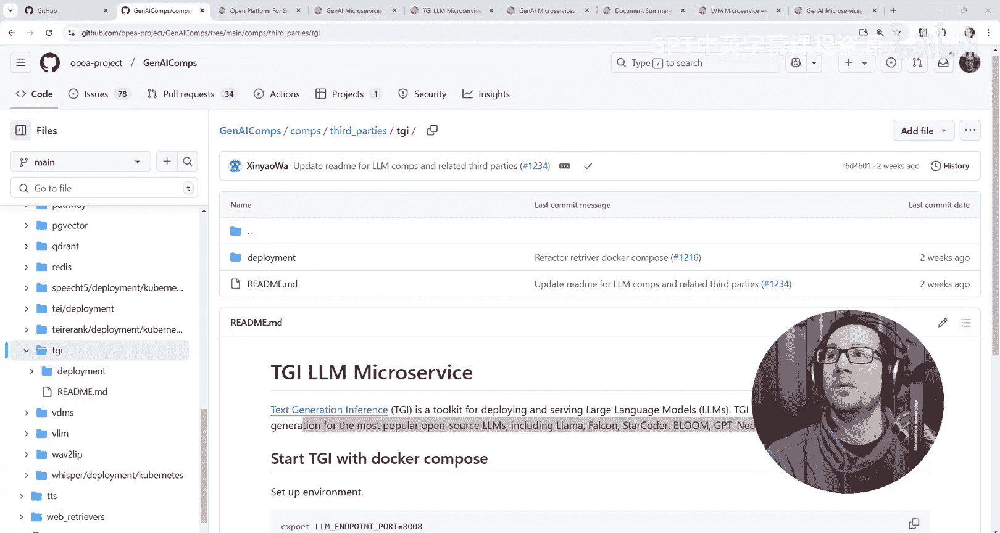

Okay， and we're going to go find it easy ways to go to full curriculum here。

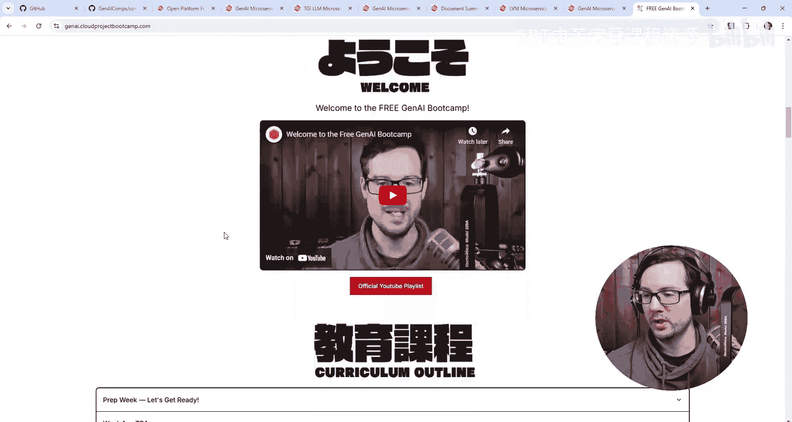

And on the left hand side， we are into week 2。And I'm going to go ahead and make a new project here。

 So I'm going to add a new sub tab。 and this one is going to be 200。We'll call this OPA comps。Right。

 and so I'm just gonna go ahead and grab this。 There's no magic that's happening over here。

 It's just me。Working through this stuff。 So OPA comps。

This will be level 200 because we are in the second week and second week shouldn't be super。

 super hard。 And so we're gonna need ourselves a business goal。 So the business goal is the。

The company wants you to。Utilize the company wants you to build a。

Or want you to explore the effort it would take to run the AI workloads。Completely on servers。

That will live in house。Okay， the fractional CTO。I used to be a fractional CTO for a while。

 But that's someone that works like， you know， they're like a CTO for hire for multiple companies。

 But the fractional CTO suggests that it's best practice。

To run workloads in containers or Kubernetes。You as the you as the AI engineer。

Have been tasked to determine。How to learn to work with the building。

 the major building block or the or the the the the building blocks。To construct。Your own。呃。

GenAI we'll say GenAI workloads。Running on containers。Okay， and so we are gonna stick with O A。

 there's really not many other options out there。 But like in terms of technical restrictions。

 we're gonna say， we're gonna say we're gonna use。OPA Cls project。

And so I'm going to go ahead and link this here。Which is。This is all the this is all the services。

So grab this one here。And then we'll get the repo as well， which is over here。To any add cops。

This is gonna be the Github repo， okay。So we'll go ahead and paste that in here。

And so now we can reference both those things。 So that's， that's gonna be our technical restrictions。

 And for now， we're just gonna stick with Docker Docker containers because Kubernetes can be really hard。

 I have made an entire Kubernetes course。 And you think I would be really good at it。 But I'm not。

 I really rely on our friends like our other guest instructors。😊，James and Julia。

 So we are gonna to do Kubernetes later on。 But for now， we're gonna keep a simple docker containers。

 and it's just less moving parts。 will make things a lot easier。 So we have our business goal。

 We have our technical restrictions。 What are some technical uncertainties that we have。Right。

 so the question is like。Using OPA， which， you know。Does it。Serve the model via a。LLM server， right。

 And I believe that it does。And then the question is like。

 how do we connect to services or how do we orchestrate？Two services together。

So that might be something we want to figure out。And。You know what does the consistency？

Like what because like if you're testing this for real， you want to use those building blocks。

 you want to understand like， are those building blocks good overall。

 And so you'd have to kind of explore a few of them。 So what is the quality of build。

Across the various。OPA， like various OPA comps。You know， like。

 is it gonna be a good solution or can we only use a few of these， right？

 I'm gonna make this really clearcause some folks are never sure about homework。

 but like homework challenges。Would be。Chain like。Chain or orchestrate。Vultiple services。

E G2 or three together。Or。Try and get。Multiple。Try to get。A different。

Compamp working that Andrew did not use。Am going to give you homework bonuses。

This is something because I really do like OPA and I would just say that the documentation here is not strong。

 and this is a great opportunity for us to make it more clear for others。

 And so I would say for this one。Make a tutorial。Or technical doc that is public。So on LinkedIn。

Medium。嗯。What else could it be your own blog， like hash node， your own blog？A Github。 I don't。

 I don't know。 Github。 I'd rather， I rather people like practice trying to make and explain how it works。

 And this is something that I would， I would really like to see and you know。

Tag Andrew or show off the work in the Discord show and tell。Which， by the way。

 I'm gonna go make that right now。 I said I when I was in the last office hours。

 I thought I would make a show and tell Discord channel so that when you're working on stuff。

 you can show off。ll be back in just a moment。

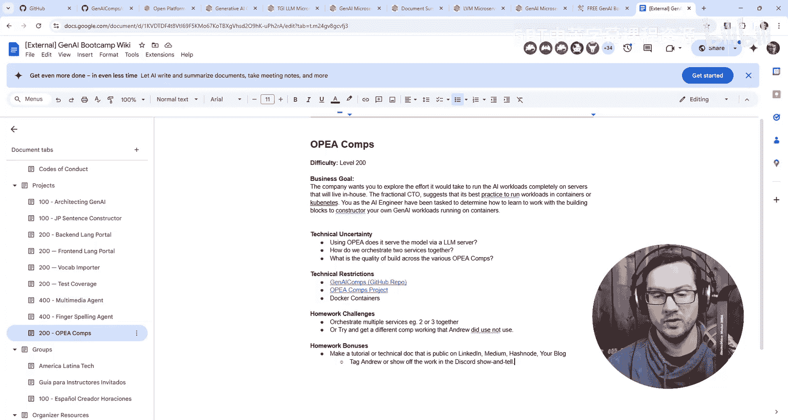

There we go。 I just added it to the， the channel。 I'm， I'm calling hack and tell。 So， you know。

 if there's something here， we might have one in here so that you can tell us what we utilize。

 And for this one， I'm gonna call it this will be OPA comps。 and this will be week 1。 So， you know。

 tell us what。What like or like share， like share。Share your tutorial on how you got a different kind of comp working or comps you chain together。

And again， you know， just do what you can。 lot of folks get stressed out because they think they have to do all everything that I see。

 But I'm looking for creativity。 And for those to start to bound。

 So if you wanted to do exactly what I do， you can do that If you want to do something more creative。

 absolutely do that as long as it's within the scope of this of this thing and you're not again。

 shipping me some kind of random thing。 I won't take something super random。😊。

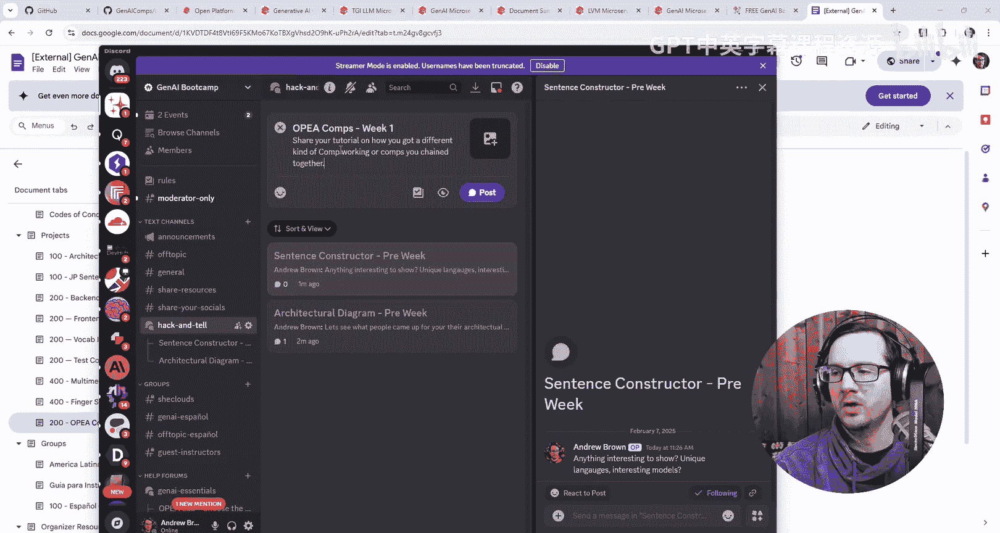

But yeah， so we have this kind of detailed out。 So now that we have that。

 let's make our way back over to here。 And so we were looking at the TGI， right， so。

The thing I'm wondering is like TGI actually already has a container it can run on its own。

 but it appears to have its own here that's integrated and it might be that we use this one or we use the generic one that is not in here because this one might be set up for a very specific use case。

So what I want to do is go back over to here。Under the code。And so， we have T GI。Right。

 here it's saying on Zion or it's saying on Gaudti。

 So I'm thinking that this one in particular is specifically configured。Maybe for Zon processors。

 So let's go take a look here。 There might be nothing special in particular for it to be optimized for that。

 Let's take a look。So we have a health check， we have TGI gaudti server here。And so， that's fine。

What I want to do and we have TG I server up here。 So we have the normal variant here。

 which is a CPU。 And then we have the one here。 So what I want is I want to be able to run this。

On my current machine。And it really comes down to what is available here。

 Like if this one doesn't work。 we could always do  laama。 So see how  laama is here。

 So you got to make it work for what it is。 So maybe know TgiI makes more sense if we are gonna run these on real servers with Zon processors。

 or if we're going to run this on gauddi， which is very expensive。

 we can actually run it until AI cloud， I think they have notebooks in there。

 But maybe what would make more sense is actually to run  lama because we all have like we all can install  lama。

 I have' it installed right now and that might be an easier way。

 So O Lama allows you to run open source language models forllma 3 it can do more than just that。

 but it bundles model weights configuration things like that。

So maybe this is the one that we might want to run download install O Lama onto the available supported platforms。

 including Windows。Modify the O Lama service configuration。 Okay， add your proxy server to here。

 restart and sell like that。 I don't know if we have to do all of those things。

 but it's just a matter of making sure that it runs。 But also over here， we have deployment。

 and we go to compose。 And here it says O Lama， O Lama。 So we have an image。Oh， okay。

 so this is literally running Oma as a container。So， you know， I just want to show you there's。

 there's no real magic that's going on here。 It's just the fact that they've figured the configuration for you。

 And this one's set up into bridge mode。 If you're not good with Linux networking， neither am I。

 I did cover it my Kubernetes course some of these things， which by the way， is free。

 So you can look up bridge networking there。 But as I remember。

 bridge networking allows you to bridge a connection to other ones。

 So that's going to be a good way we can work here。But this seems to be。A good start for that。

 So maybe what we'll do is get O on working first。 And T GI is a little bit too complicated。

 So that's what I'm gonna focus on。 Now I need to run this somewhere。

 and I'm gonna open up my V S code。 And so I have the free Jeni I boot campamp here。

 This is Lng portal， which I don't have yet。 So I'm thinking。

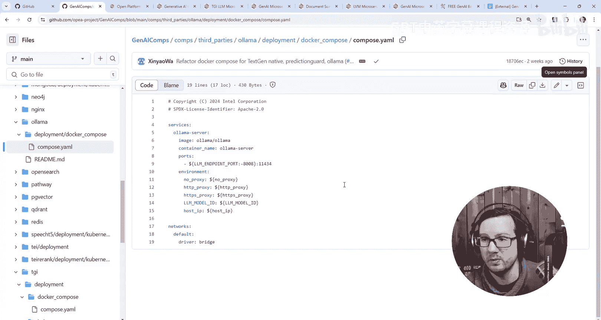

I'm not sure what all these components are doing here。

 but I'm thinking that this is the exam pro co1， and I want the omen king1。 whoops。

 I'm not sure I can't seem to see D back here today。And it's gonna get a bit confusing。

 So I'm gonna make a new folder called Omen King just so I can distinguish between these two。

 And I'm gonna clone that one down from here。 So I'm gonna go over。 And by the way。

 I'm just using V S code。 I'm not using windsurf right now。 I'm trying to keep it simple for now。

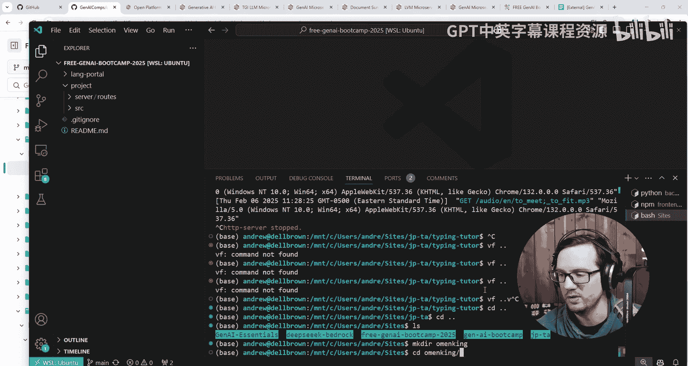

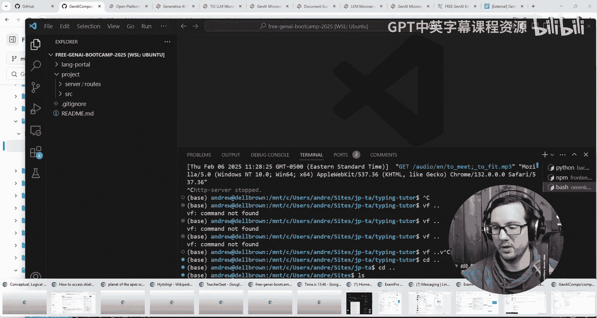

But if you want， you can use coilt or whatever to help you along here。

But I'm going to go type in GiHub or sorry， 2025。Free Jen boot camp。I can clone mine down。

 You're not supposed to clone mine。 You're supposed to clone your own， right。

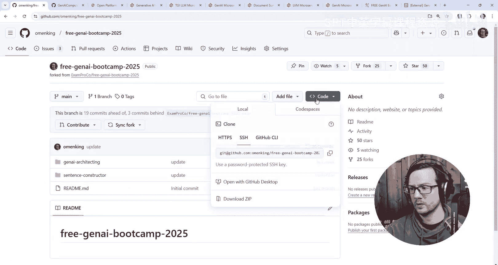

And so I'm going to go ahead and clone this。And type in code period。

 you might have to have that installed for VS code to work if you don't know how to work with VS code。

 We cover it in the the the Github or the。

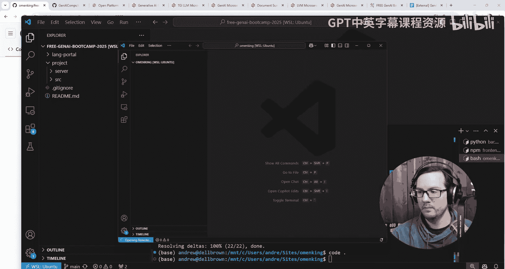

The essentials course， Jeni essentials course。 Okay， so we'll expand this open。

 And so I'm gonna make a new folder here。 And this is gonna be called OPA A comps。 right。

 I want you to match this the name of this folder exactly as I do here。 So make sure you do match it。

And we are going to go ahead and start to get set up。 So how can we start working。

I have a few too many tabs open， let me close a few， okay。

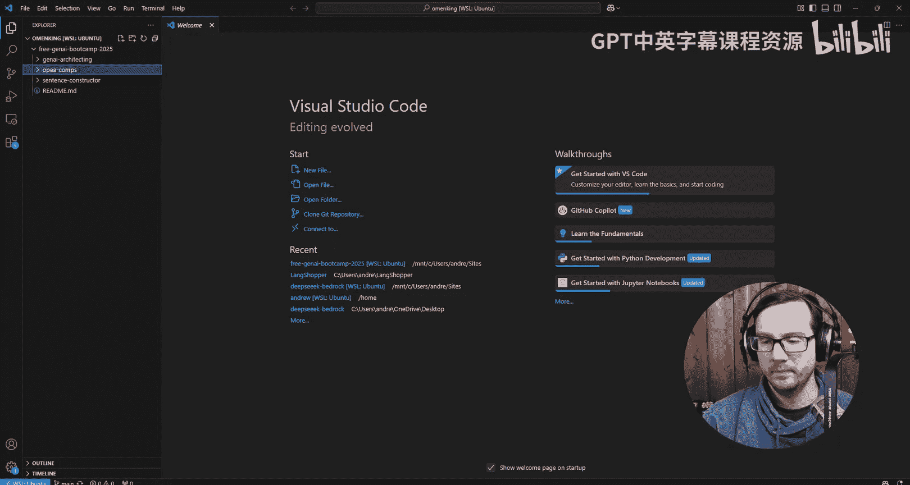

I closed so much I lost my folder， but that's totally fine， so I'm going to drag this on down here。

And we have Jenny icons， right？And so then here， we're gonna go into comps again。

 And we know that we want to run our the actual models are in third party here， and we have  Lama。

 And so we scroll on down。 And so we have some options here。

 So modify the O Lama service config file。Okay， I see that。 But like if we look here。

This is just a deployment file， right， There's nothing。Downal llama。

 so I guess what they're suggesting is that you can either run it as a container or they're here they're just talking about running it in general。

Right， I would rather run it as。As this。 And so what I'm thinking， like， there's no。

 there's no rules on how we can run this。 but I'm just literally gonna grab the deployment file here。

So I'm just going to go ahead and grab this。And this is going to be the service for running Oama。

 So I'm going to go ahead here to say。

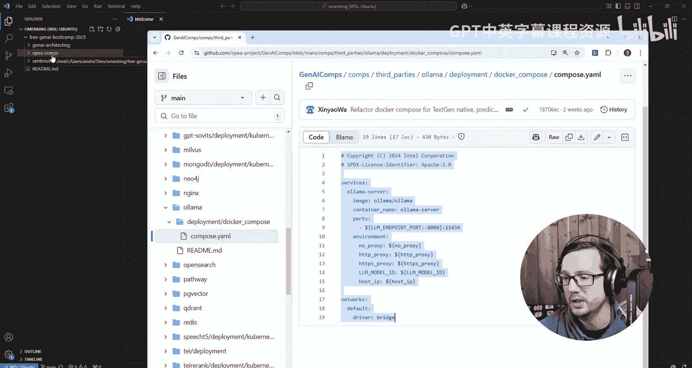

Workload。Dot yaml， or sorry， we'll call this Docker compose yal。I'm gonna go ahead and paste it。

 And by the way， there are plugins。 I'm gonna install the Docker extension。

 This will make my life way easier。 I really hope I already have Docker installed。

 that won't have to installed twice。 But so now we have it here。 we also have a Docker tab here。

 to fail to connect to Docker。 Is it installed， The question is， are we in WSL right now。

 So that's another thing that we want to take a look here。😊，So notice here， Yeah， we are。

 I'm going type in Docker。 Do we see Docker。 And so Docker is not installed right now。

 So if you don't have Docker， I have instructions， these are， these are one way you do it。

 but don't do it this way。 If we're gonna install Docker， I guess I have to install it。

 we're gonna go over to the Docker Ubutu website。

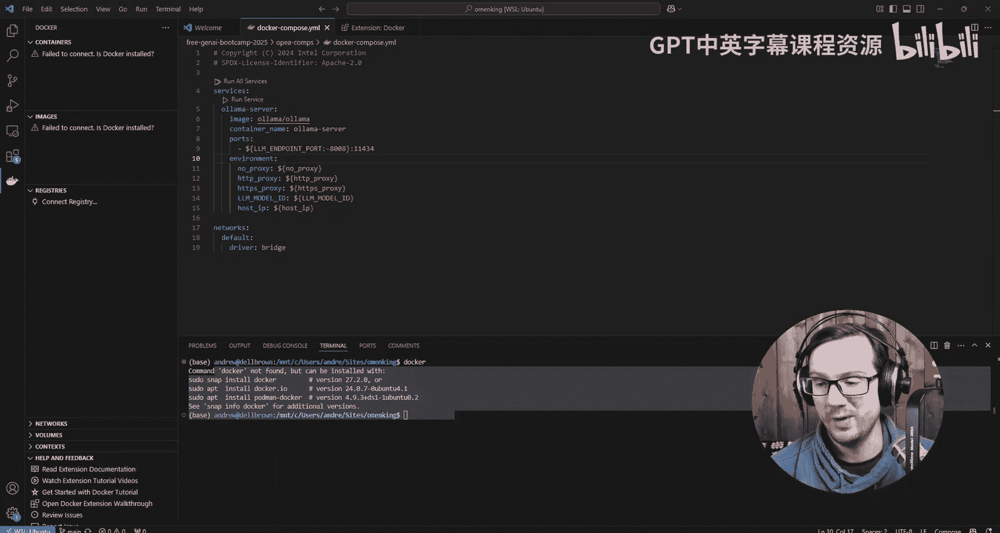

If you're on Windows， use WSL， do not use the window side of it。 We're not gonna support you if。

 if you try to do everything the window side it's just too hard， it doesn't work well。

 but if you're on Mac， the process will be look up Mac， So they probably have Mac。 if it's not Mac。

 then it's normally Deian because or not Deian， but。I don't know。 But there it， you can install it。

 There's lots， lots of ways to install it。 But I'm gonna go ahead here and get going。

 So before you install Docker engine， you need to install configuring packs。

This is already covered again in our in our， in our gen essentials。

 but I'm gonna go ahead and do it again here because I have to。

So I'm just going to run these line by line。

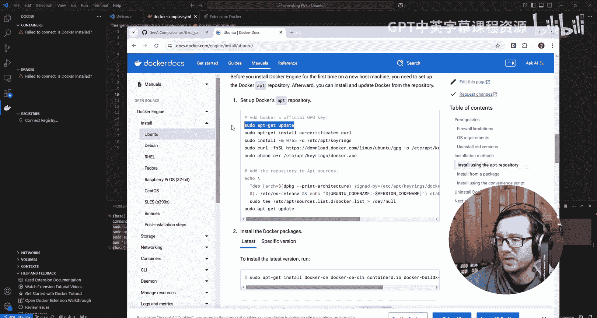

You're gonna to put my password in here。Run the next one。We'll run the next one。

We will run the next one。We'll run the next one。 I't remember there being this many lines。

 but it says they're here。And then we'll run the next line。See， they're really tricky here。

And then we'll run the next one。And now that I'm a bit more aware of my head。

 I'm gonna to move it there in the bottom corner。 So now that should make it so that we can pull from the app repo。

 And so this one's gonna to install。 So we're installing Docker C， the Community editionition。

 community CI container I O， container DIO， which is the underlying container engine that we're running。

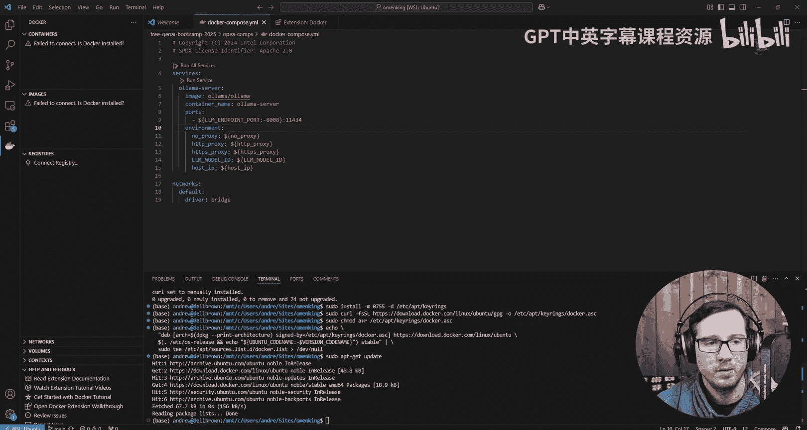

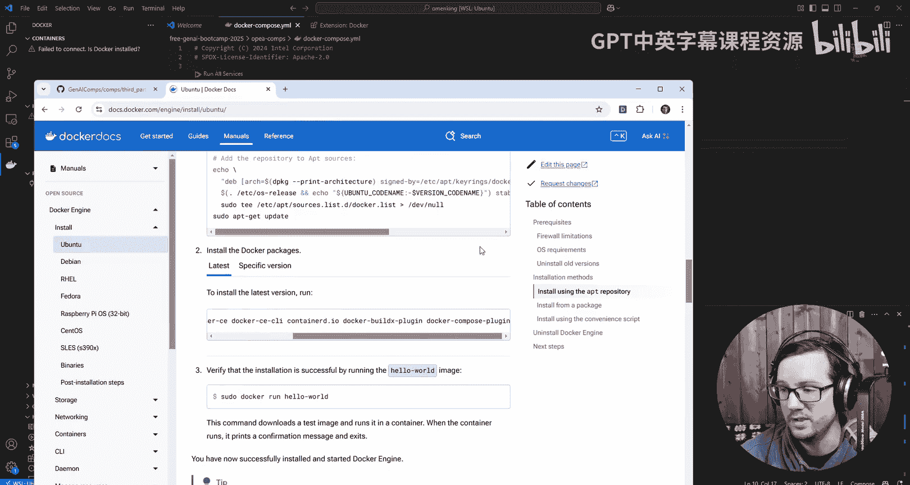

Which is an OCI compliant container engine。 when we talk to James。

 he'll tell us all about that stuff。

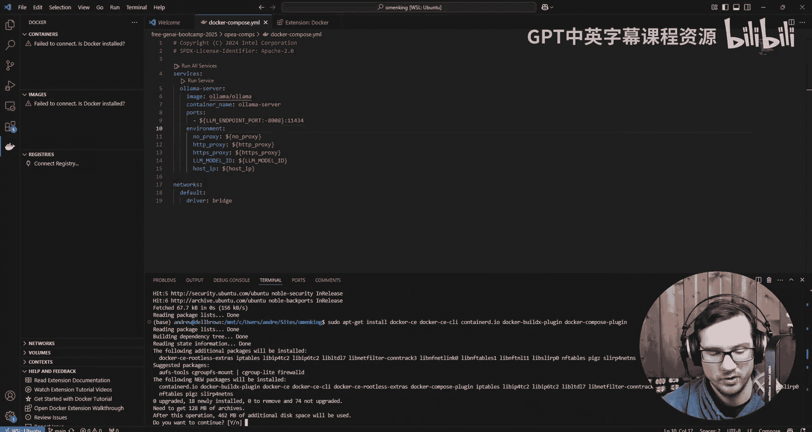

I'm really bad at telling that stuff。 This is gonna install。

 I don't like it when it has to have pseudo。 So we're gonna find a way to turn off pseudo。 again。

 This is all my Jenny essentials scores。 I'm just kind do it from scratch here because it's not that hard for me to do。

 So I gonna grab pseudo and run this here。

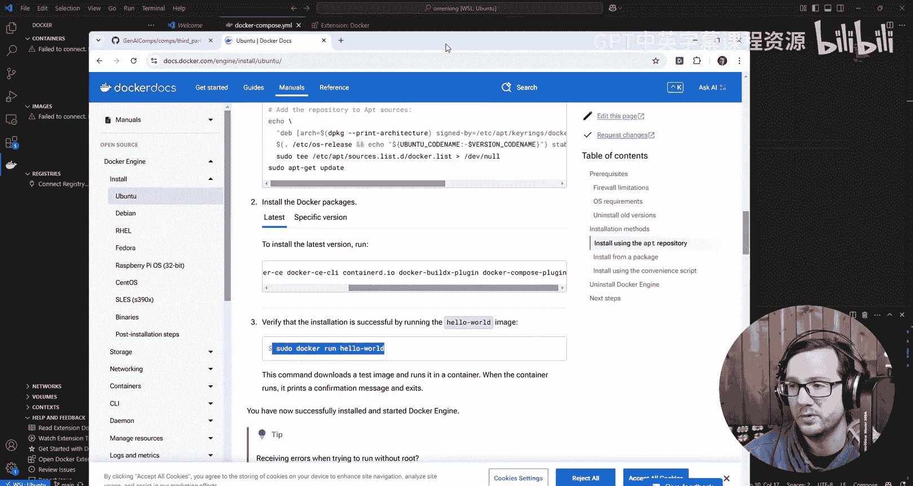

And so it says， I'm able to find it down only， but I want to run it without pseudo。 I promise you。

 this will make your life so much easier。 So we're gonna say Docker without pseudo。

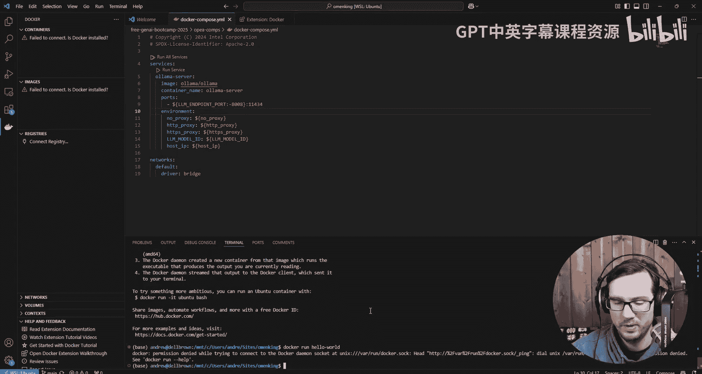

I'm gonna go here， maybe here。And I'll know it when I see it。It's kind of like that group stuff here。

 Yeah， it's kind of like this。Yeah， I I don't know。

 I'm gonna go to the Gen essential to grab it from there。 They're not looking。

 they're not looking like I want them to look。 And so we go into local development here。

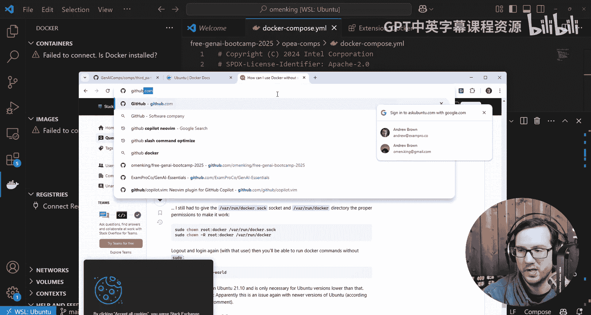

Local dev。In。

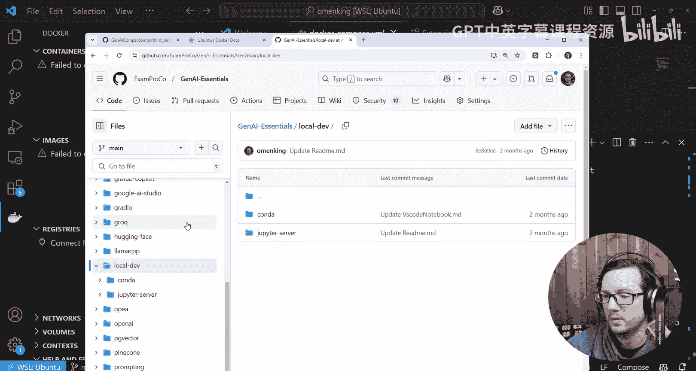

Maybe not there。 OPA， nope。Just give me a moment to find it here。Oh， you know what， I think。

 I think when I did this here， I actually referenced another one， and I didn't copy the code over。

 I mean， it might be here somewhere， but。

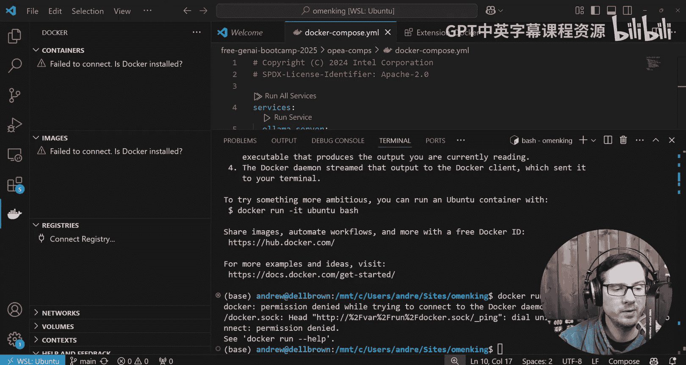

We definitely install it。 But I think what I did is I referenced another project。 This is my problem。

 having too many projects。 So we'll go over to here。 This is actually one that I did with AWS。

Which was。Let's say GenI， we got lots of GenI stuff here。Workshop here。 Yeah， it was in this one。And。

It was in docks， I believe。It was this one here， Huging face set up。Some are here。Oh。

 intermediate workshop。 Yeah， it's over here and。

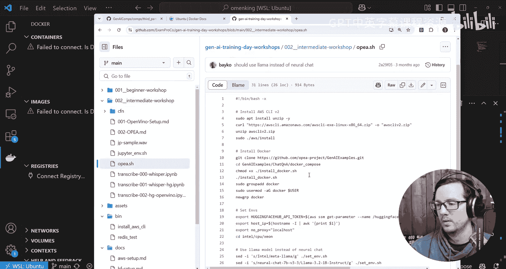

Yeah， it's these three lines here。 So we have pseudo group ad Docker。 So yeah。

 if you did the O OPA video another one， we basically follow this。

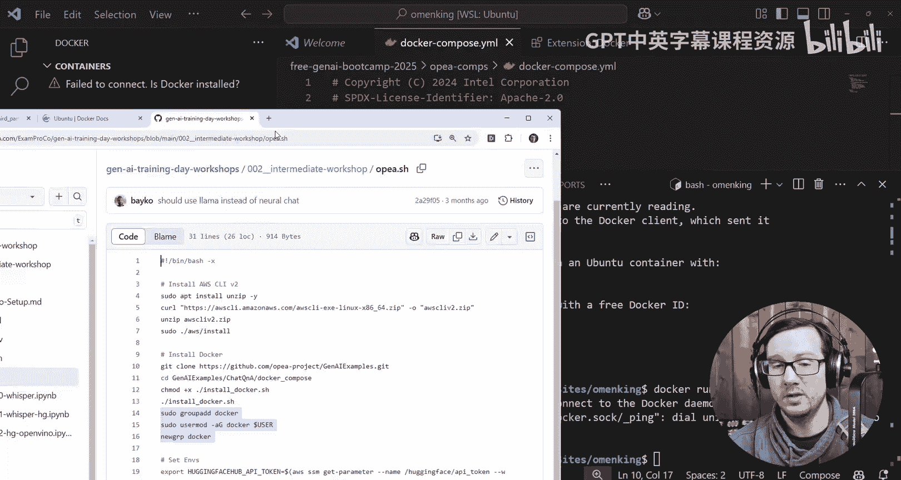

And if there is an OPA 1， maybe that's where it is in the Jeni essential essentials。

That's probably where it is。 But we need these to line pseudogroup ad docker。

 this one here and this one， This one here probably will air out the first one。

 It doesn't really matter。 but I'm gonna run it anyway。

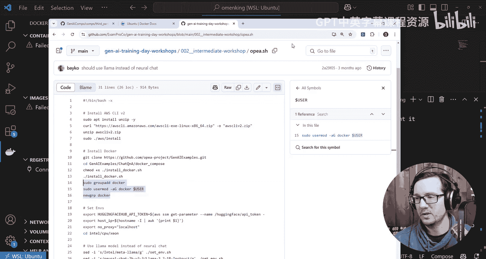

This is pretty much instructions。 I was finally online。 just didn't have that last line。

 which is this new group docker。 If we don't do that， it's not gonna do what we want。

 So now what I want to do is hit up what I'm trying to do。

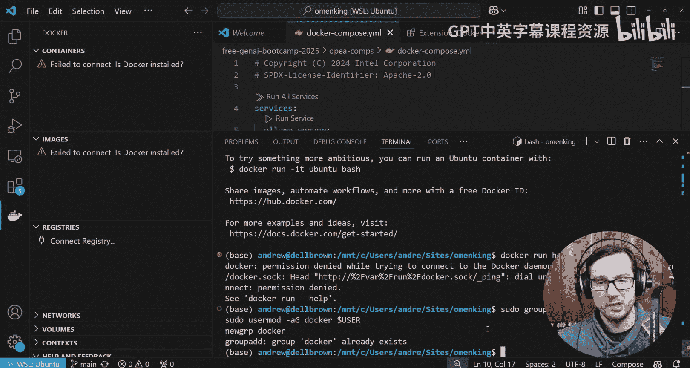

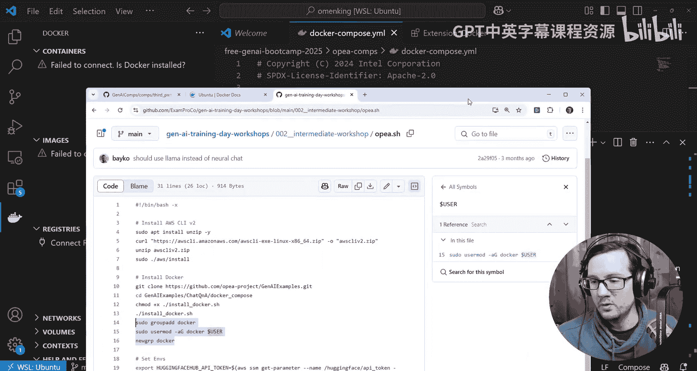

Is I want to run the the hello world again。 So instead of doing pseudo docker。

 pseudo run hellello world， I just wantan to do this。And so I think it ran。 Yeah， hello from Docker。

 So that successfully ran。 Again， I'm gonna make my head way， way smaller。

 get all the way out of here。 And so that's gonna be a way that。😊。

We can now work with these containers。 So it is installed。

 I'm gonna to go ahead and hit connect if that helps it。Refresh。

And it seems like it's a bit confused。 So what I'm gonna to do is close this out and reopen it。

 Just give me a moment。 I'm gonna close it out。 So I'm not showing my whole screen one second。

All right， so I've reopened it。Saying this works on the Windows mount system for best performance recommend moving to home。

 I don't care。 And so we'll go back over to here。 And so now we can see the the previous round containers。

 sometimes restarting it really fixes the problem。 So， you know， this is not what we're running here。

 but this is hello world， right， And so when we have this thing installedd， you can basically。

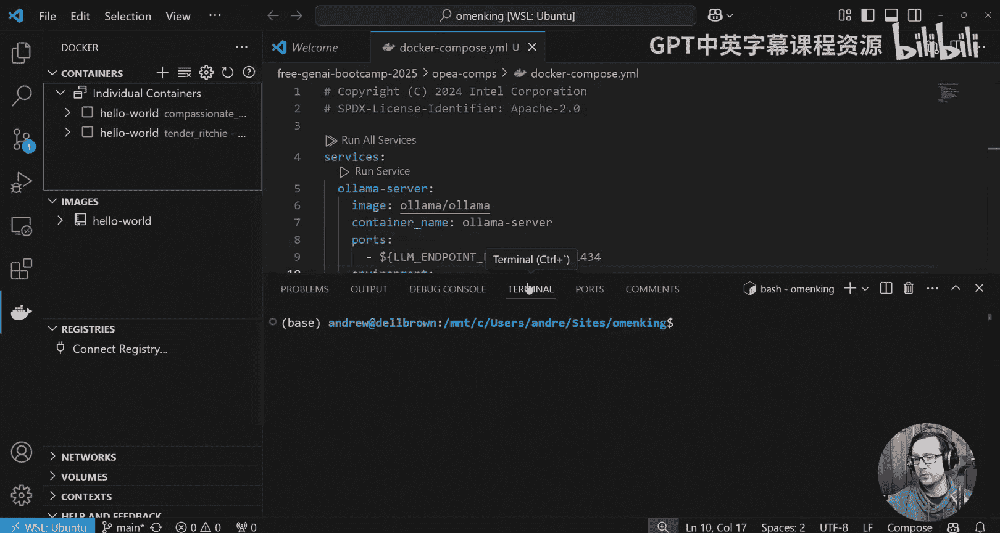

Ohpe， that closed out。 Give me one moment。 I don't like crashed。

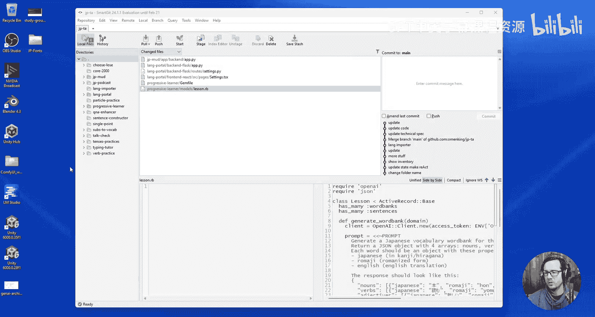

There we go。But anyway， I was trying to say that sometimes there's like contextual menus and things like that that will show stuff。

So what I was hoping was is I， yeah， here we have composed up， composed down， select services。

 And so we only have an individual service that's running in here， which is the O Lama server。

And it looks like it has port 8，08 or 1，1，4，3，4。 So I'm not sure which way it's mapping。

 But the point is is that it's taking a port and mapping a particular way。 We have no proxy。

 Ht B proxy。 So these are some options that we can set。

 We want to use no proxy as there is no proxy that's happening here。 And then there's the host I。

 but I'm not sure where it's gonna to get these values。

 And I almost feel like I have to pass them in。So， let's go take a look。

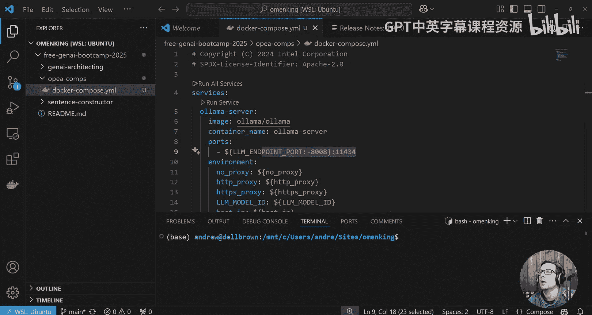

At the docks。Bring this up here。And let's say if we have an examples here。

 we'll go back to the readme。So we have here。Sudo M Olaama service。

 add your proxy to the information。 We're not running a proxy here usage。 And so they have this。

 So that's not that useful。 Let's go take a look at the OPA A dot devv website because I feel like we have to set those environment variables。

 Otherwise， how's it going to work。So I'm going go over to。I I to go to OPA A dot。

And we're gonna go to microservices。 And I'm looking for third parties。 And in here， I'm looking for。

Olama。So I don't directly see it here， but we might see it somewhere else。 Let's type it in， O lama。

And so we don't have that information。 So that's something that is missing from the documentation。

 Again， it's not like it's gonna to be that hard to figure out。 it's such a basic thing。

 but it's just， I wish they kind of gave us an example so we could， we could copy and place。

 So I'm gonna make a new read me here just so we have some instructions ourselves。

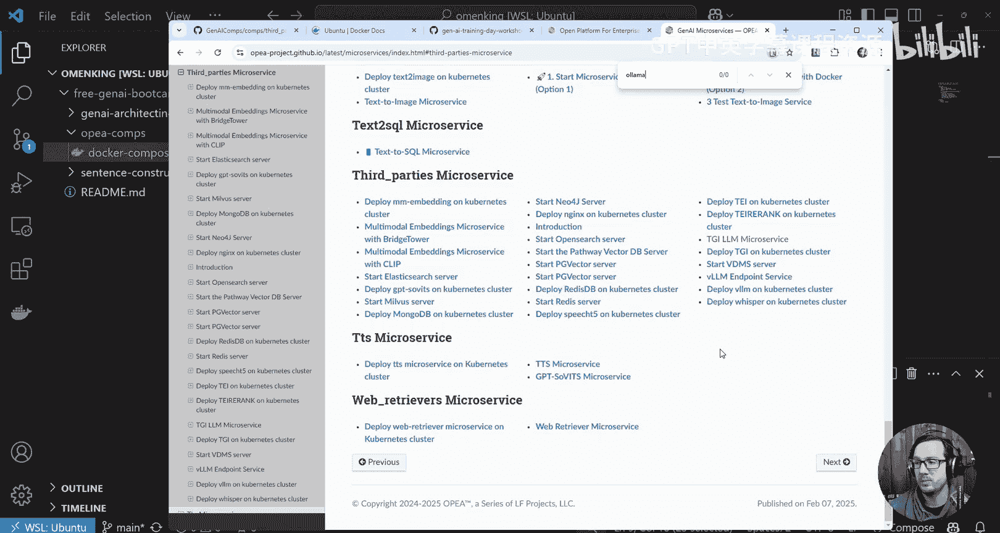

And I'm going to go and say， you know， running。Running O Laama， third party。Service container。

We' called service。So we know based on this that there is some stuff that we have to provide here。

 And so I'm expecting it to fail if we try to start this。

 So I'm going to right click it and go to compose up。And so notice right away。

 it's saying that some things are not set。 So the variable not set defaulting to blank string。

 So it's trying to set these things and are not going anywhere。 The host I。

 I think we do have to set it to something。 But we'll see what happens。 Also。

 it's like the LM model I Id variables not set。 So defaulting to blank string。

 So it's going to download it。 but it's not going to be able to run it without these value set here。

So maybe what we can do。Is just look up this container here。

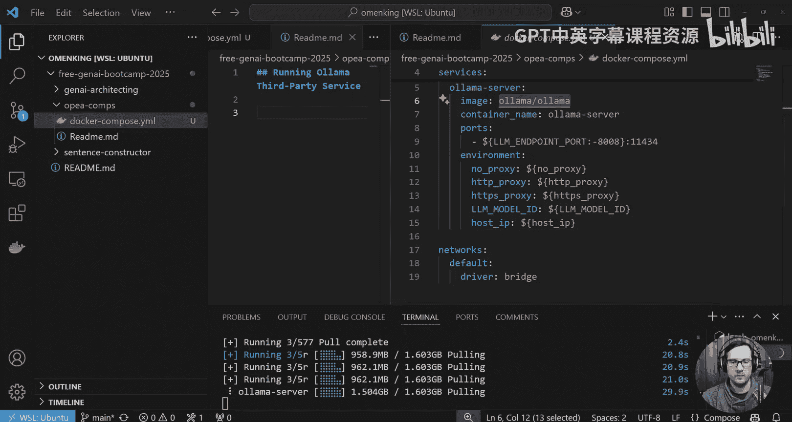

Right， and。Container。And see if we can find some of the instructions。

Becauseuse they didn't create this containers so somewhere else they would have the information。

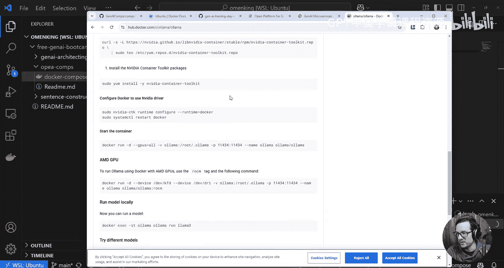

So I'm not exactly sure， but what we'll do is we'll copy this here。

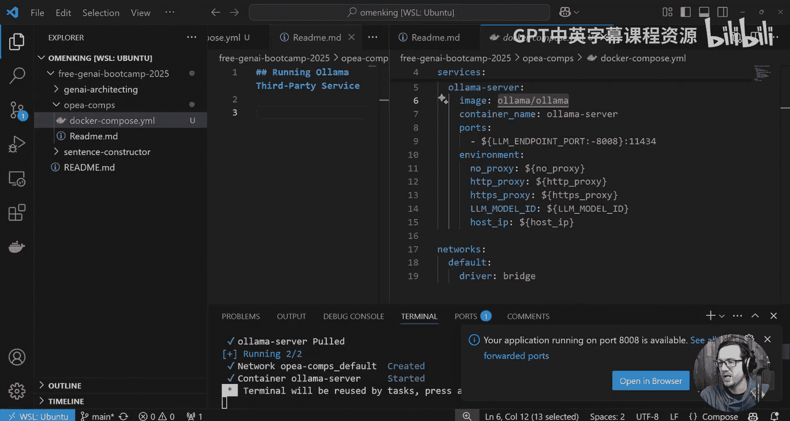

And we're gonna to go ahead， and。I'm gonna to use clo。 It doesn't matter what you use。

 I'm gonna ask something to fix this， but we'll go here and say， you know。

 what values am I supposed to pass and set when doing Docker compose。

And'll give it a moment here to figure it out。 So here we have some information。

 And so it has LM port 88，8，0，8 Lama 2， which by the way is really old。 that's not to help us。

 But it iss kind of setting us up with some from some values here。 Let's to say， you know。

 what should the host IP be。The IP address of your host， usually the local host I address， like。

 is there。I feel like we could probably just set it to 000 or like 127，001， it might still work。

It should be the IP address of your host machine。 You can find it using Linux or whatever。 And again。

 it's a little bit frustrating that that documentation is incomplete。

 But that's what I mean where they have the bones， But some of the docs are not in。

 in good shape here。 So I'm gonna go here。 And so that one's fine。 It's not allma， too。

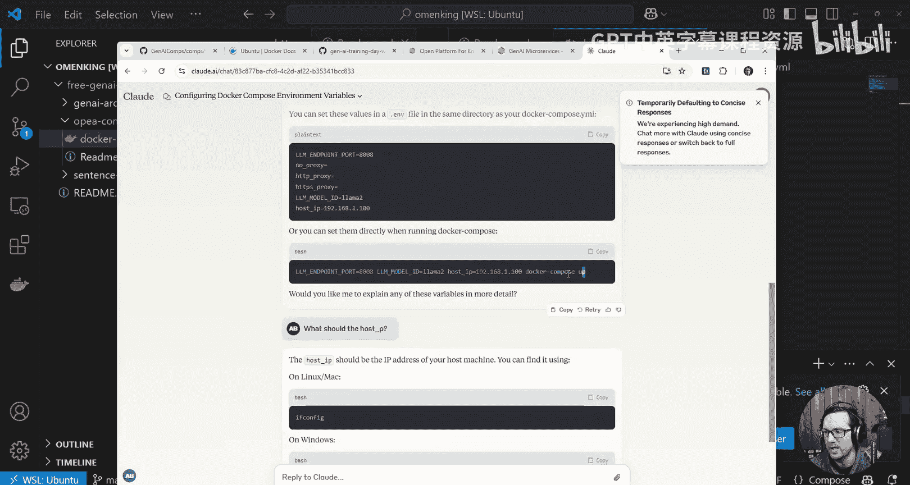

We'll try Lama 3。21 billion。 Can We'll just try to do that。Unless it's already changed。

 there's a newer one。

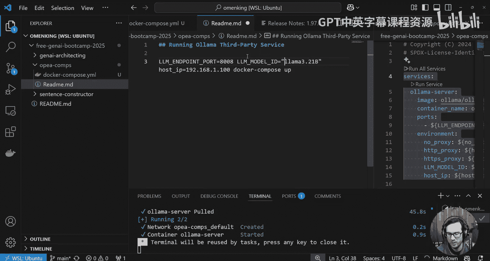

The we'll literally go over to hugging face and we'll get the right code here。

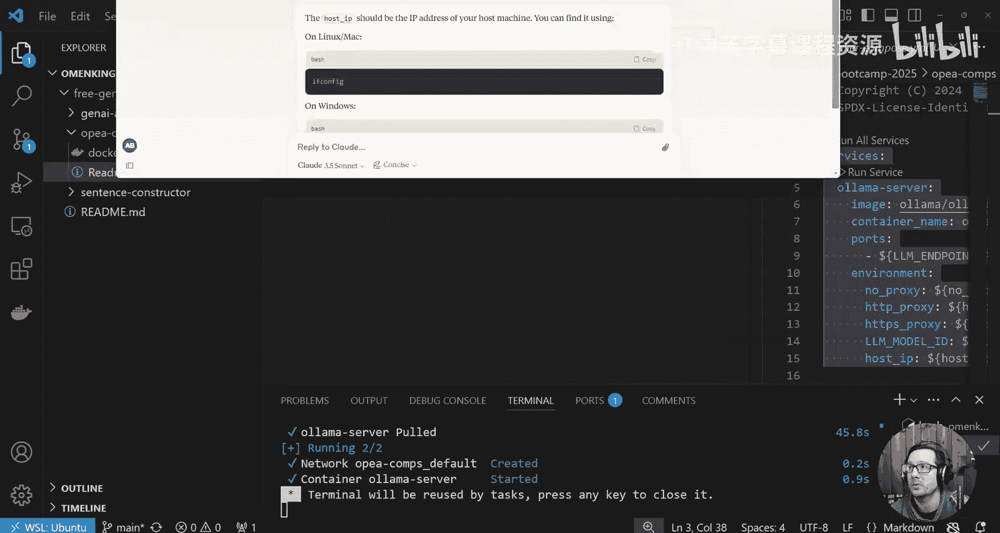

Actually， you know what， we'll go to Oma and get it from there。So if we go to  Lama here。

 we could run deep say， you can do that if you want。 I'm gonna stick with what I know。

 and we have Lama 3。2 because this is what's going to get passed in。 But I want 3。21 billion。

 I want it to be really， really small for all of you out there so that this is very efficient。

 And so this has to be the value that we want to pass in here。

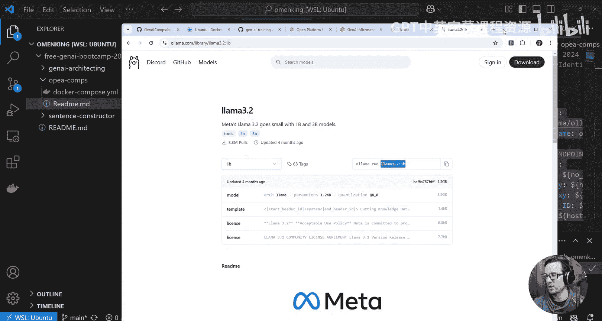

So I'm going to go grab the library link here。

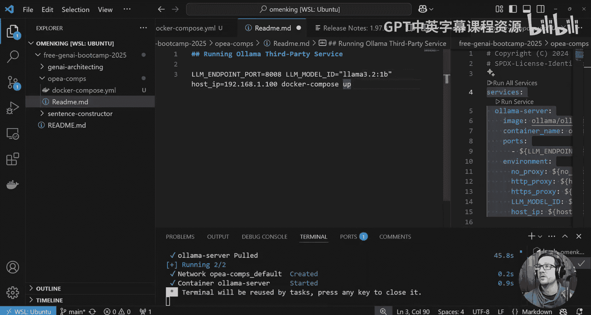

This is the whole library。 And I'm going to assume that， you know。

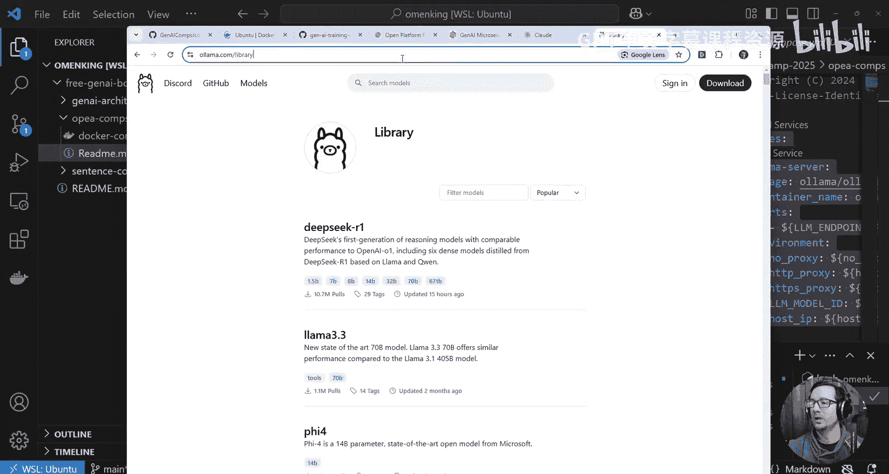

Choosing a model。So。you can get the model I d that oama will launch，From the Oama library。Okay。

 so that will be。One thing here。And you know what's not on right now is my vim keys。三个人。

Turn those on。 Sometimes I turn them off because they conflict with。Other extensions。

 I know with Github Co pilott， it was causing some issues。 And so I turned it off last time。

 But I think Github Co pilot is。Not on right now， which I don't care。 But anyway， so we you。

 we can get the model I D from here。 So E G， E G， this will be。This one here。And we're gonna assume。

Would be， I wanted this。Here。This is where I could use my networking friends like Tim or or anybody。

 all my networking friendsca I'， I'm really bad at it， but I'm not sure what the port has to be here。

So we'll just assume that it has to be my IP address。 So getting。Getting the host I。

I think they said this would be， I have confid。Or it's IP config， depending on where you are。

 But I'm gonna go ahead and open a new tab。 and I'm in bash here。

 I'm gonna go ahead and type in I config。So it's saying we need to install this。 So for Linux。

I am on Windows， but we want to do it on the Linux side here。

 So I'm going to try and do what it's suggesting here。And so let's see if we can run this now。

 and we can。I feel like there's another way to do it， but。

So what I'm looking for is the IP address here。And I would think that it would be Ethernet 0。

This is usually what like this is like the actual connection。So I'm carefully looking at this。

 And again， not the best at reading this， but maybe this is it。 I don't know。

For those that are looking at me being like， what the he's going on there。Sorry， I， I don't know。

 I'm not that I'm not that great at this part。We'll go ahead and paste this in here。

So now we have 80，0，8。AndSo we can try this。 Now， we can't do that doc and compose up the way we did before because that's not going to work。

 It is running。But I'm going to stop this。I'm going see。If this is going to work in our favor。

 So I'm going to go back over to this tab， I think this is running Docker here。

 and we need to C into the 2025 folder here， whoops。Regen EI， OPA。And。

We'll go ahead and copy this here and see if it picks those up when it runs us here。

It saying Docker composed not found。 what it should be Ca Docker is here。 Yes， Docker is there， good。

Maybe we'll take out the hyphen compose。 that might be messing it up。

That's the old syntax with a hyphen， right。And that's fine。

 We're gonna to ignore that for the second。 But let's see if it picked up what we wanted it to pick up。

 So I'm gonna scroll up here。

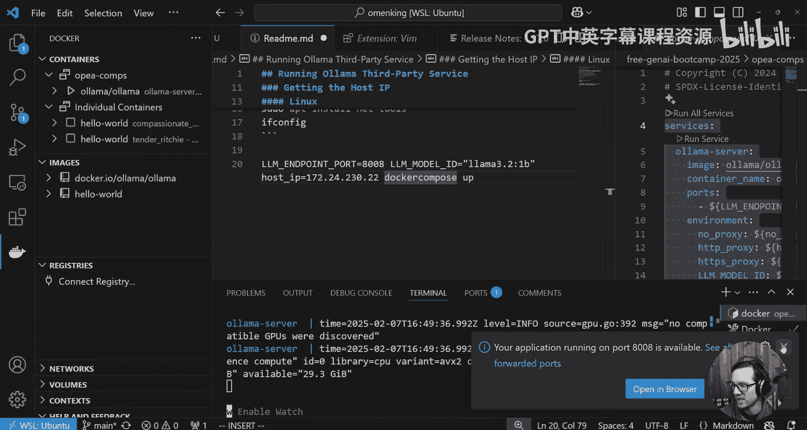

It says couldn't find root I D Oma generating new private key。 The key is found。

 It's looking at the configuration。We're carefully looking at this here。

 and so it is doing stuff It's running something。

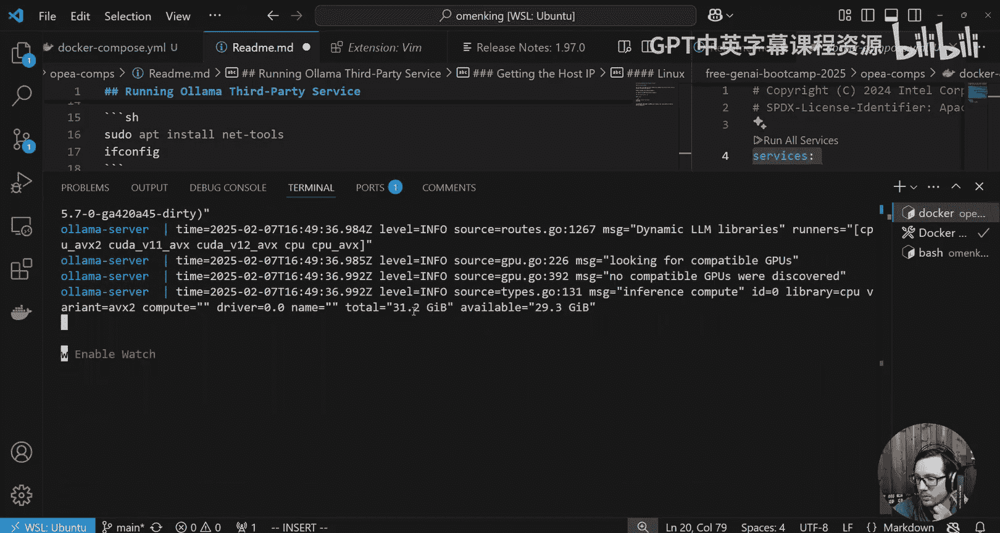

But how do we know that it's working？So again， just carefully looking at this here。TGI is way easier。

 by the way。 But we'd have to go spin up an easy two instance with a Zon processor。

 and I don't want to do that。 So we'll get this working this way。

 It's not complaining about other stuff。 Like， we aren't going to do a proxy。

 So it's probably fine that it's left blank。 One other thing that I'll check is that when I deployed this into the the other one。

When we did it for real in the other project。And the Genna essentials， I。

 I remember having to set this value。So， what we can do。

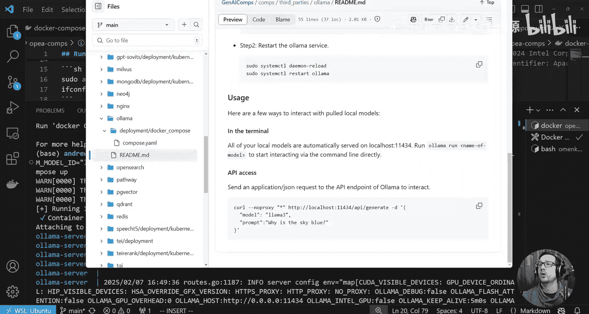

Is go over to my gen essentials， of course。And。We should have OPA somewhere in here if we didn't。

 it's because we literally just lifted the other one。 there is OPA basic。And then here。

 we set some value。 So here I was mapping my existing host IP P。

 which is something we could probably do， but says proxy is， no proxy is local host。

 So I can just match those values。 And maybe we can just kind of get away with that。

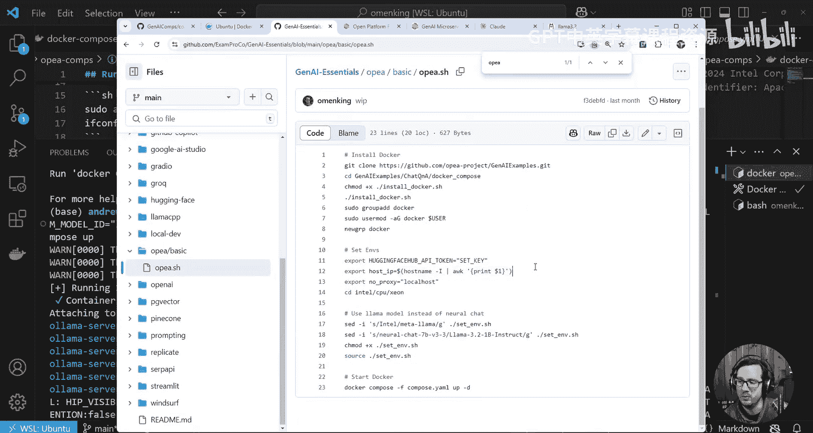

So I'm going to say no proxy。And then， local host。And it'd be interesting to grab the host name that like the IP address that way。

 But the host name doesn't always contain the I address。 So that might not necessarily work。

So I'm gonna， I'm going to stop this， even though we ran it。

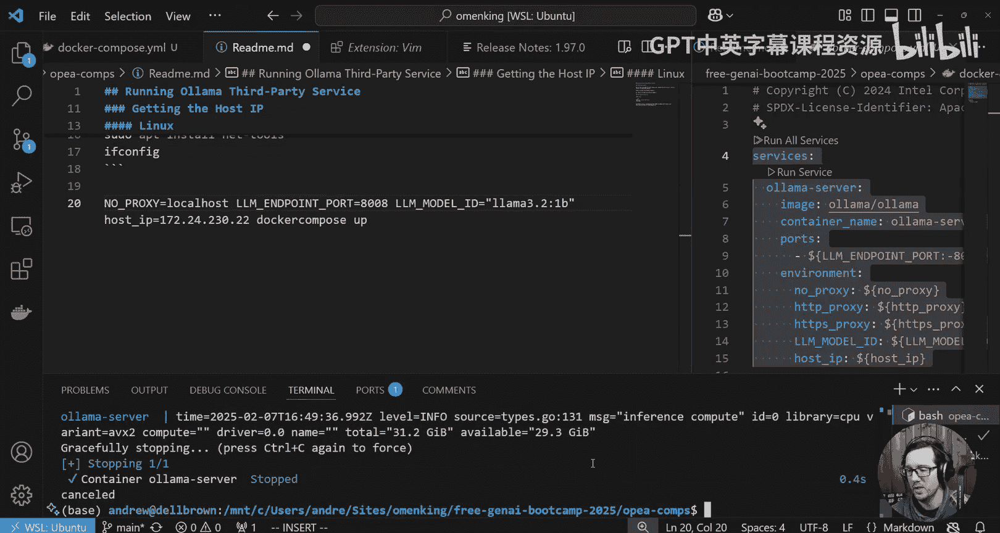

And I'm gonna try again， this is the Jenny。 I'm gonna try this command and see what we get。

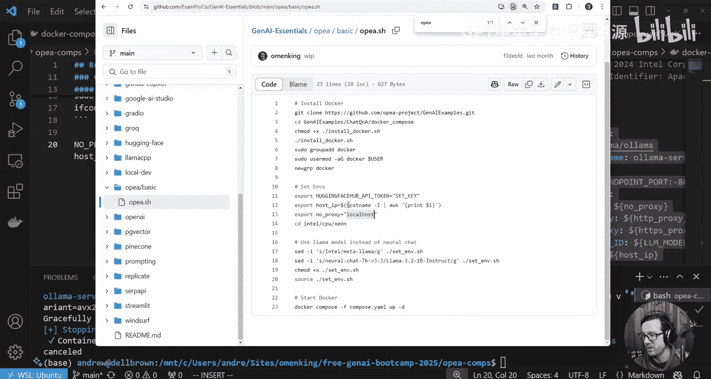

This might not work for you。But remember， like here， like it didn't work。

 and it would just default to something and still work。 Okay， so that works。

 It actually gives me a thing。 So maybe that's what I'm gonna do。

 I'm gonna grab this thing and call it host I P。Like this。Get your IP address。Right。

 or or you can try this this way。Right， this way it might work。And up here， like， this is 1，72，24th。

 So， okay， so I did grab the right value， but we can also do it that way。

 So it looks like I was right。 And I do know a little bit of networking Hooray。But， you know。

 maybe this will make our lives a little bit easier。

 I would like to do forward slash or back slashes to make this command a bit more manageable。

 But for now I'm going to leave it alone， we're gonna run this again。

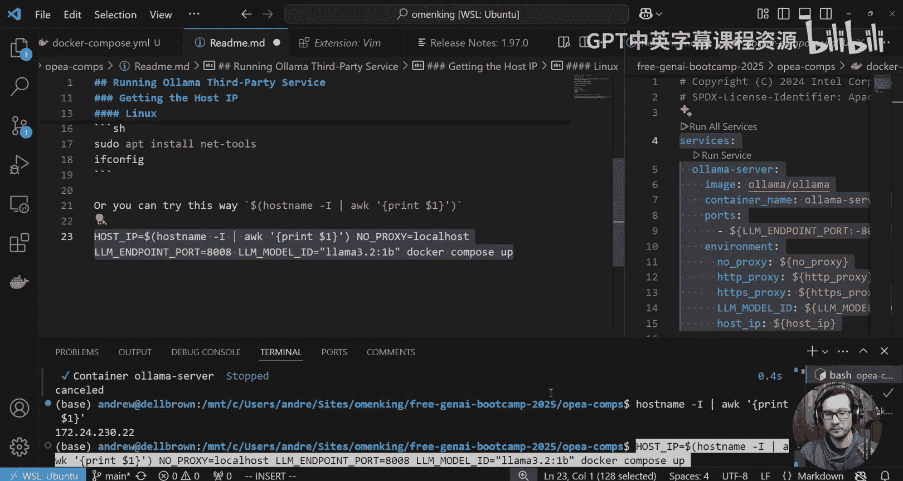

And so in theory， we should have everything we need to run this。

We don't need to open this in the browser。 I don't think this would give us an interface。 Well。

 you know what， It does say it's running。 So that's a good indicator。

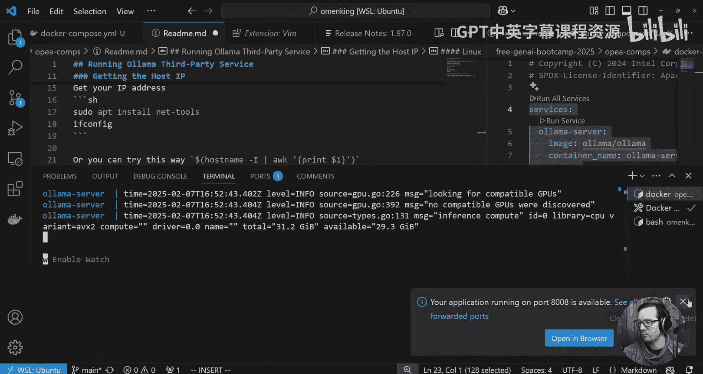

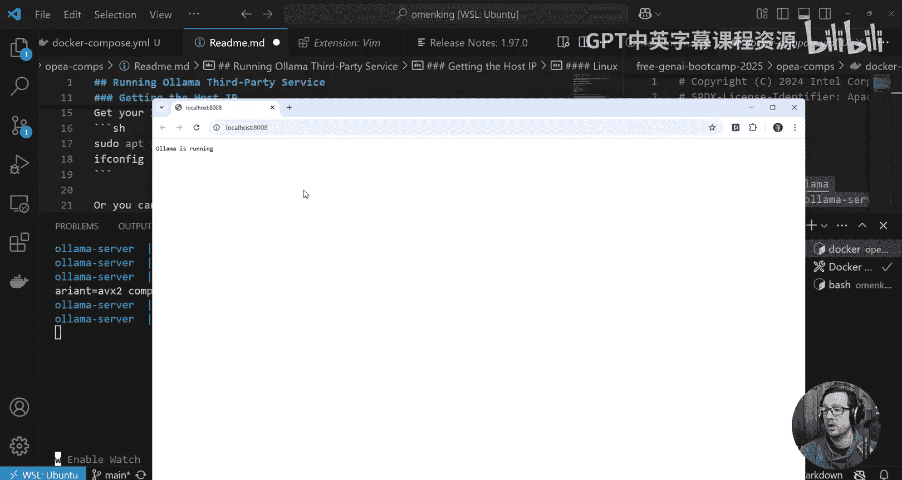

The question is like， is the model ready and we don't know。So normally when you run models。

 you can check the container and see if it's doing something。 So if we do Docker， actually。

 you might be able to do it from here， if we go Docker here and I right click and view the logs。

 it might tell us that it's doing something。 So if we go all the way down the ground。

 what I'm looking for to see is if it's pulling the model。

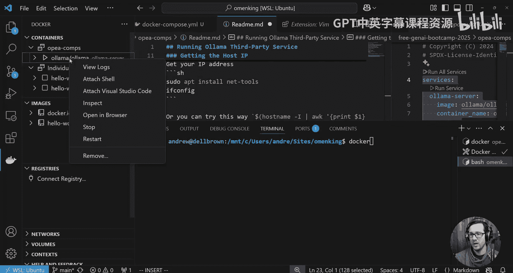

But if I， if I've already have O installed， I've downloaded the model， then。

Like even even if this is running Olum in in Ilit， if I have on my machine stored the model。

 it's not going to have to download it twice。 which I don't know。 So anyway。

 the point is is that we have it running。 Now now the thing that we need to do is interface with it。

 So how can we interface with this programmatically。

 There's actually SDK or API that I have used in the Jen essentials。

 But let's go back over to these docs here。

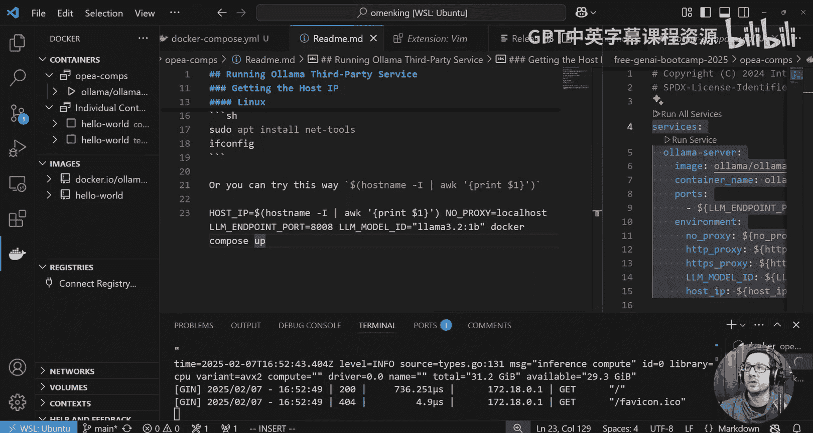

Over here， and here they have this example of curl， no proxy， whatever， whatever。And so here。

 they're actually saying they're hitting the API endpoint， API generate， okay。

 so if we didn't provide any values， then maybe it would actually just expect us to do this。

 and then it would actually download the model。 Okay， that kind of makes sense。

 But we here are specifying a very exact model。 So I guess Oama has an API。

And we did see it as it spun up that there was an API。Okay， and so here's the API， right。

 So we'll go back over to here and we'll take a look and just say Oama API。

Once the， once the O Laama server is running。We can make API calls to the Oama API， right。

 which is over here。

And so the thing is that we just want to run a model。Just create a model， show a model。

 deletete a model， download model， pull a model。 I'm hoping that it's gonna just pull the model。

 run it， but says generate a completion。 And this is kind of what we want to do。

And so here they have an example。 That's exactly the one that we are using。So I grab that。

 I don't know if here。 we have to。You know， we'll say generate。Gen a request。

But I don't know if we have to specify 1 billion here。

 I'm just gonna put it in here because I don't want it to end up downloading the larger one。 and。

 and that would be unfortunate。 We do see port 1，1，4，3，4。 The question is， what is the open port。

 I don't know。 Let's just drop this down here。What's the boot。Give us a refresh here。

So there is a way to find out。And we know how to do this from our prior bootab。

But what I'm going to try to do is just do Docker P。And this should tell。 So here it's going 8，0，0。

8 to 1，1，4，3，4。 The direction always confuses me， by the way。 But I think 8，0，0，8 goes to 1，1，4，3，4。

 So I think it's running on 8，0，0，8。 But let's first try this one and see if it fails and make sure you have curl installed。

 If you're on a Mac。 You have curl installed on Linux。 You might have to install it。

 We'll go ahead and run this。This is saying。Well， this't this actually came from here that actually didn't do what we wanted。

 which is totally fine。I wanted to bring in that one B in here。 so it doesn't download the big one。

 So say it can't connect， which is totally fine。 So what I'm going to do instead is switch this over to 8。

 Was it 8，0，0，8， they said。We'll run this up again。8，0，0，8。By the way。

 this might still not work because it really depends on the networking mode of Docker。

And so it's saying failed to connect， et cetera， et cetera。 So that's not working。

Another way that we can try this。Is we can go here。And we can just right click and attach a shell。

 That's going to bring us into the actual container。 And so this is local host， right。

 And if it's running on 1，1，4，3，4，3， then we can copy this。

 And now we won't have a permission denied issue。 It says command off。 let's try W get。

 but none of these commands exist。 So I don't have a means to， to do this inside the container。

So another way that we could do this is that we could attach another container to the network and then connect to to that one。

 It really comes down to that bridge communication。 And I always kind of forget how bridge works。

 Let's just take a moment here and see if I can find the slides。 I'll be back in one moment。 Okay。

 I am back。 and I have my slides。 And so what I'm looking for is that bridge mode。😊。

I know I must cover it in this thing， oops。So for those that are interested in my Kubernetes course。

 remember， it's free on freecode camp， but I'm gonna go look for that bridge networking mode。

So they can act as a tunnel to create a bridge networking mode。

 That's not what I'm interested in yet。A bridge。Bridge mode。There's modes that I cover in here。

 I know I cover them。Okay， if I don't cover in this， then maybe I covered somewhere else。

 Just give me a moment to find the slides。 I have so many slides and notes。

 I just never know where things are anymore。 So I'm opening up this stuff here。

 We'll say bridge mode。 Well， here's one that describes it。

 So it is not exactly what I was looking for。 I have like a diagram that really explains it。

 explains it。 But bridge isolates between containers， but they can still communicate with each other。

But what I'm thinking is that that doesn't。 Oh， here we go。 Again。

 this is not exactly the same thing。 But container guest port maps to host different port。

 The guest and host can connect host mode。 container guest port directly maps to the same host port。

 The guest and host port will be the same。 You don't need to define the post， etctera。

 So I'm thinking what's happening here is that because it's on bridge mode in order for us to access the container。

 We need another container to interact with it。 So I'm gonna go just test that theory out。

 We're gonna to brew this on down here。 I'm gonna make a new conversation。 Again。

 use whatever you want to have the conversation。 But you know。

 I have a container that is I have a docker compose。

In bridge mode。When I attempt to run curl on my host machine。嗯。I get access denied。will， can I only。

 can I only access。The API by running another container in the Docker compose。And that's。

 that's what my theory is， again， not an expert at this stuff。 Never remember it。 Now。

 you can access the API from your host from See， but you need to properly expose the port in your Docker compose file adds a port file。

 Okay， we have that already。

So we'll go back over to here ifs not if that's not the issue。

 then maybe there's a permissions issue。But we'll go ahead here and I'll just show this like。

 this is what I have。

This is what I have。So your configuration looks correct with  Laama with port 8，0，0，8。

 If you're getting access to 9， check the verified port mappings。

 curl if there's an accessibility issue， Ex the container logs。 So that's actually a good idea。

 We should check the container logs。 But I'm going go out of the shell and we'll go back over to here。

It actually just failed to connect。So I'm going go give it that information。

So saying maps on port 8，8，8，0，0，8， right， So， okay， that's fine。 We'll go ahead and do that。

 We'll see what the error is there。This is what I like about LO Ms or these assistance is that I don't have to try to like。

 keep things straight。Okay， so now we're getting somewhere。 So it says Lama 3。21 billion， so。

I guess it was working this entire time。 And so at least we cleared up that thing。

 So it should really be that。But the thing that I want to run is Lama 3。21 billion。

 That's what I want to run。 That's the， that's the thing that we have here。 If we go up。

What did we set it as。I don't have my example here。 That's frustrating。Oh， right here。 Okay。

 so we'll copy this。 You'll notice my copying paste doesn't work out the time。 It's just Windows。

 It's not me。 And so maybe it's lowercase 1 B。 So I'm gonna go ahead and grab this。And。

We'll paste it in like this。 Now， we told it what model is supposed to run。

 So maybe by default it already knows。 These are questions like we don't know。

 This is something we go back to our technical uncertainty but you'd like， we're using O Lama。

 Do you need to do this， Do you need to do that， whatever， whatever。 So we now have model Lama 3。

12 billion not found。 So saying the models not found。

 even though we specified the model during its start up time。So if we can't enter a request。

 maybe we can say download a model。Another thing that I'm wondering is like。

 you probably want the model to reference something locally， right。

 as opposed to what's going on here。 But I'm gonna go ahead back over to。

Here， we'll bring this down。And there are other API endpoints。 So we go up to here。

 We have create a model。I don't want to create a model。 I just want to pull a model。Let's go here。

 pull a bottle。

So this will pull one。 So let's go ahead and try this。So pull， pull a model。

And so I want this to be small。 So I'm gonna do this here。 I thought。

 I thought it would do that because when， you know。

 I normally install  Lama and I run these commands。 It usually does it。 But maybe the C I。

We use an ama is runningD separately， right。So maybe we still have to run this manually。

 I'm gonna go ahead and copy this。Pate。Also， while we're working through this。

 we should be really doing our， our documentation here。 So I'm gonna go and just say， like technical。

Uncertainty。So， you know， like。When in bridge mode。Does bridge mode。Mean， we can't access。We can。

 we need to。We can only access Oama API。With another model。With another model in the Docker compose。

And the and the， and the answer is。No， the host machine。Well be able to access it。

Which port is being mapped？8，0，0，8 to I'm just putting whatever number。 So in this case，8，0，0。

8 is what the port。What is， is the port。The host machine。Will。Access the other port。Is the gas port。

So。The port of the service。Inside the container， okay。So's that Q， you know， if we pass the model I。

 the LOM model ID。To the ama server。Will it download the model。When we。Start up the O Laama server。好。

Will will the ball on start， right， it does not appear so。You。

 the O Lama c I might be running multiple APIs。 So you need to call the poll。

AI before trying to generate text。Here's something It's like Q。 will the model be downloaded。

In the container。And。Does that mean。It will the model。Deleted when the container stops rang。

So these are， these are questions we wna like be able to ask， right？ So we have that， which is great。

 But we'll go back up to here。 And so we're gonna pull this one。😊。

It hit enter。Its doubt it's pulling it。 Now， we don't even have to check the logs because we can see it right here。

 And so it's attempting to pull it。 I'm going to assume that it's going inside of this container because unless this is mounted。

 normally what you do is you have a mount directory， right。

 But notice there are no mount directories， so it must be downloading within the container。

I go down here it's just like the model will download into the container。And vanish。

When the container stops running。You need to mount。A local drive。

 and there is probably more work to be done。Right， because it's not as simple as mounting。

 There's probably more to it。 But we're gonna go ahead and grab this one， to generate command。

I'm just gonna put this top level。 I know my， my markdown is a little bit messy。So run this。And。

Is it working， It's， it's， it's a little bit messy what it's doing。 It is。 It's working。

 It's streaming it each part， okay。So this does work。Right， it's not the prettiest thing ever。

 but it does work。 But I guess this kind of makes sense because like， if you're using。The CI。

 like it's just gonna hit the API like this。 It's， it's going to come back like this mess。

 And so if we want it to be more comprehensible， we need an intermediate program or something else。

 So I'm gonna consider this part working。 And we're gonna say OPA。Dooccker compose。Right。

 and what I want to do in the next video is like， let's figure out if we can now。

 now that we have this running， how do we get something attached to it。

 And so I think it's like it's either the L M1 or whatever that the ones that's running L chain。

 And maybe what we can do is that hit that container and then we'll get something that looks more like a human response。

 right， Because this， you would never just deploy on its So you wouldn't deploy  Lama And you could。

 you could go deploy this on E2。 you'd rather probably use TGI or something else。

 But the point is is that you would want to always front this with something right。

 for security reasons to make it easier to work with also so that if if you need to change out the engine。

Or the server， you can。 So the server is being separated from the thing that interfaces with the server。

 okay。So we're gonna go ahead， and I'm just going to go hit ahead and commit these changes。Okay。

 and think my changes。And I'll be back here in just a moment for the next part of the video， okay。

