# ExamPro《生成式AI训练营｜Free GenAI Bootcamp》中英字幕（deepseek - P27：-27-OPEA Code Explanation.zh_en - GPT中英字幕课程资源 - BV1SFEWzLEab

All right， so we are back and we have Oama running。 I didn't turn anything off。

 if you want to stop them。 It's pretty easy， just stop them。 but you know we do have this running。

 Now I got to point out that I am also recording at the same time which if I pull this over this pulse from my GPs。

 and so I might switch over to my AIPC at some point here just because you know I need the GPus here for recording。

 but if if we don't have any issues。 I'm just going to stay over here。

 we might also try to there are like setups for the mega servicesice that I would like to try on the AIC later on。

 but right now I'm just going again keep my setup as simple as possible。

 So we have the Docker compose file in here。 and we have the O lama server。

 I'm just going to leave it alone。 I just don't feel like downloading the model more than once here。

 but I want to go back over to。Here， and I want to see what is our next step， Right？ So we have。

 we have。

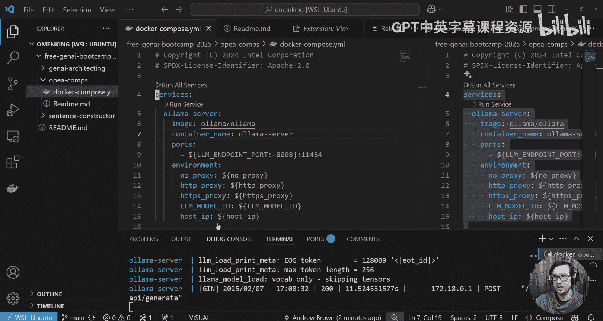

Our。LM server running。 And so now we need to front it with something。

And so we'll go back over to wherever that was。这什么门？All right， and。We're looking。

 It's either the L Ms or the L VL Ms。 I forget the difference between these two services。

 I always get them mixed up。 So let's open this one first and read a little bit about it。

This microservice is leverages Lng chain to implement summarization strategies and facilitates LLM interface using text generation interface on Intel Zion or gaudi2 processors。

 You can set the back end as either T G I or V LLM。 So then we'll go over。 This is LLM。

 So We'll go over to this one here。This is the visual question and answering is one of the multimodal tasks empowered by the VLLM。

 Okay， so this is large vision。Models。Right， so that's large vision models。

So what we're finding out here is that the LM microservice is suggesting that it only works with those ones。

 But what I'm going to do is go over to here because I don't necessarily trust the docs as they're always evolving this product。

 And so if we go into this one here， let's take a look at what we have。This has source。

And it has multiple options， we have FAQ， text generation doc sumization。

 text generation is what we want to do。And what we're looking at here is。

The entry point file and the Docker file。 So the Docker file is going to tell us what we can do here。

And it's running Python's slim。And we can see that it's installing some libraries。

It's adding a user here。 I'm not sure what user， but it's adding the home user。 it's called user。

 It's bringing home user comps。 So it's making a folder and copying comps into it。

 which is this folder here。 it's copying the contents of it。

And then what it's doing is it's bringing in the text generation requirements TXT file。

 so whatever is in here is getting installed。And then what it's doing is bringing the text generation stuff in here。

 And it's launching endpoint dot S H。 So we look at this。Let we go into here。

We can see that it's running OPA LLM microservice。So it's just this file here。And if we look at this。

 the question is， is there anything that is specific to Intel Zion processors because so far。

 I'm not sure I don't see it， but we have Intel 8。 Hbu。 that's probably for gati。

 but this one here probably will run at least on my computer it will on this。 Now again。

 if you really want to run this like with a guarantee you could just launch up an Intel Zion processor。

 the M 7 you don't need a large， but you need something that would be an Intel at least Zion4 processor on either of bus。

 but I'm carefully looking at this here。 it's installing an open telemetry again that's not specific to this。

 this is just an open source tool it has this API protocol template here。

And what I'm looking for here。See it can route to bedrock if you want to use bedrock instead。

We have OPA text Gen native。 So wants to use a native one for generation。

 And so what I'm carefully looking for here is I'm trying to understand。

Because I know it will work like no problem with TGI。But I'm trying to figure out。嗯。

How we're going to connect that over to Oma。Right。So have LM generate， that's fine。It starts here。

Okay， so let's go back to the readme here。

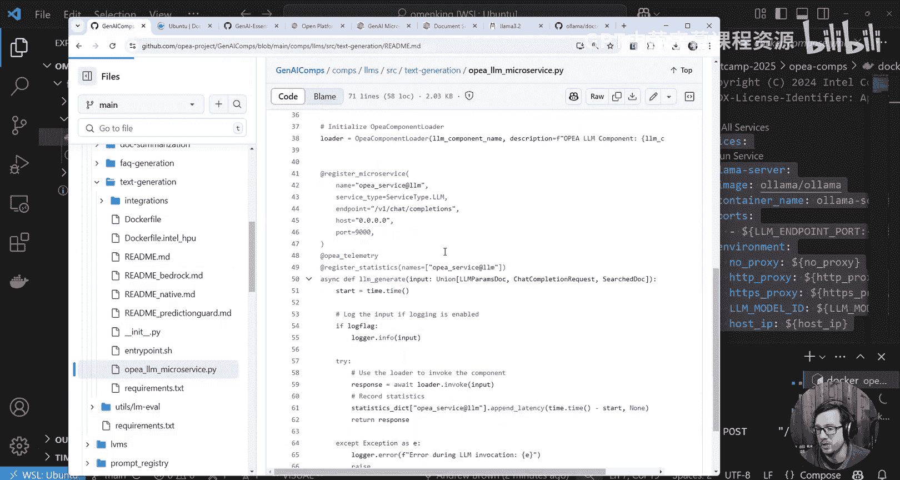

You can see there's a few different ones。 We have bedrock native and whatever。

But we'll go over to here and we'll say micro design for language model interface。

 pre of this microface is that you you must have LM Tech generation service。

 T G or VLM already running users need to set the LM service end point into the variable endpoint variable。

 So that's all it needs。 It just needs to know where the endpoint variable is。

 And it can interface with it。 It' suggesting T G and VLM。

 But I think it really depends on what the standard of the API is。

 And so I'm not sure if Tgi and VlM standardizes on the same one。

 So what I'm gonna to do is go back over to here。 into my readme。

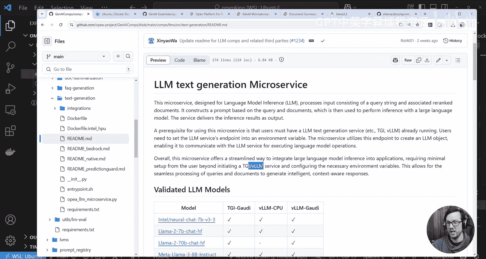

Here， and so I have a question， which is。嗯。This is answer here。

So our question is for the LLM service。Which can do text generation。It suggests。

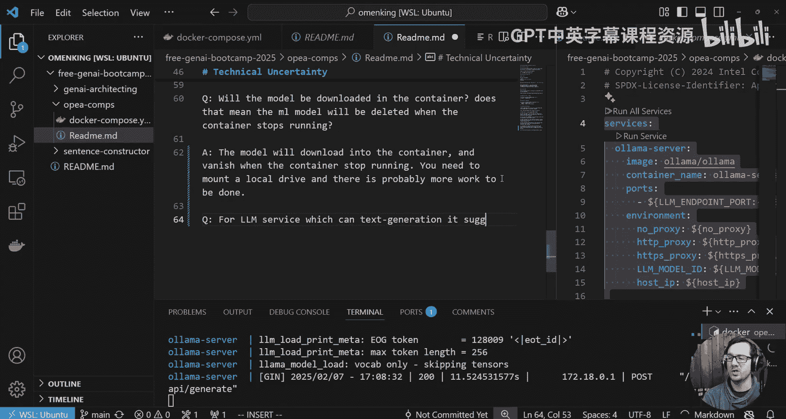

It will only work with TGI or VLLM， and all you provide it。Is the port number？Of the like。

All you all you have to do。Is have it running。So maybe it so like， so you know， I'm saying so？

You know。First of all， does TGI and VLLM。Have a standardized。A PI。Or is there code to detect。

Which one is running。Do we really have to。Use a Zion or a gaudy processor。 because to me。

 it doesn't seem like we would have to。Right， these are just generic services。

 And there's nothing it's inherently specific when I was using OPA say like， you can， you don't。

 you can only use these models， validated models。 but you could run Lama 3。21 billion。

 We are running Lama 3。21 billion。 But you'll see here in the， in the information here。

 It's a bit not， not updated， Okay， so。Here the saying if you want to use the LM。

 refer to the VLM to build the VLM Docker image first， so prepare the text gen Docker image。

Start the album service with build image。Seep environment variables。And run the darkcker one。 Now。

 I don't believe。That we needed A T G I， like Intel processor。 So， you know， like， again。

 I think it has to do with compatibility。 But let's go into this code here。

 And what I'm looking for again is what is， what's the thing。

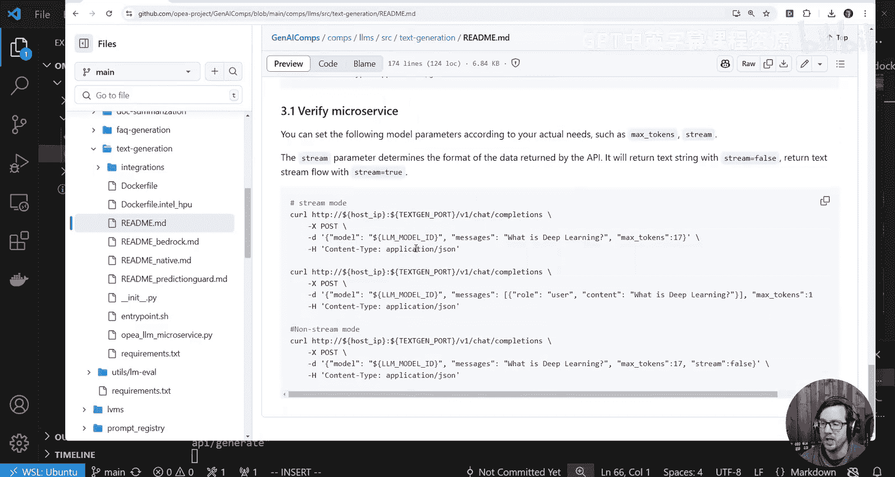

What's the thing here that's saying it has to be VLM or TGI？Right， so I'm looking here。

And I'm trying to find。That thing。 So it has register microservice here at sign， LLM。

 auto completion。And so I'm， I'm just carefully trying to find。That specific one。

 So we have native over here。And so this is kind of where I want to open up the code and start to ask questions。

 And so this is where I' gonna start leveraging windsurf。 So what I'm gonna do。

I think I know the answer， but I'm gonna see if we can ask windsurf。 And you， again。

 you can use whatever you want。

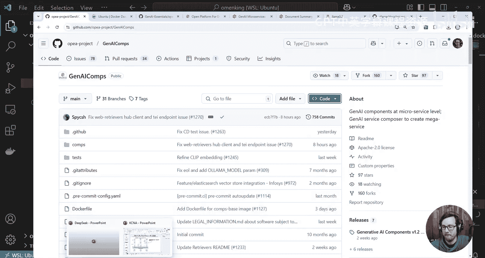

嗯。But I'm gonna to go ahead， and。Cone this。 So this is in windsurf。Very easy install。

 I'm not going to show you how to installed。You can go to the windsurf website。

 I think we have it in the JennyEssentials。

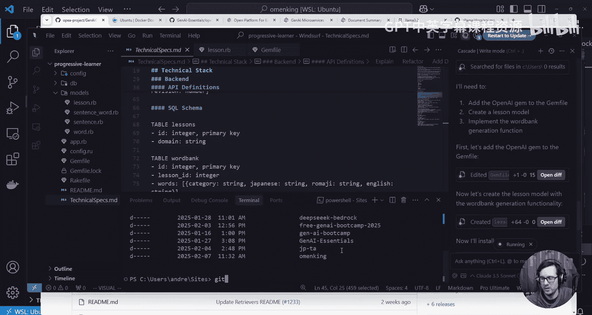

And I'm just going to go do a git clone here， and I'm going to clone the Jenny icons folder。

 and I'll just say yes here。Permission denied。Why it's， it's an open source repo。

I'm going to go ahead and try this again。 copypy I'm going to do in VS code just to rule out if it's a windsurf thing。

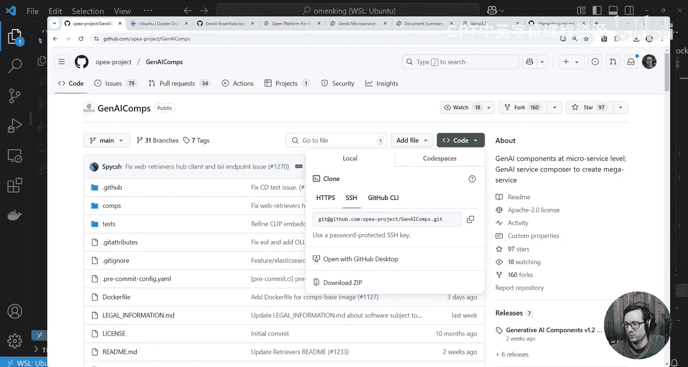

And I'm going to go back here and say。Good clone this one。There we go。

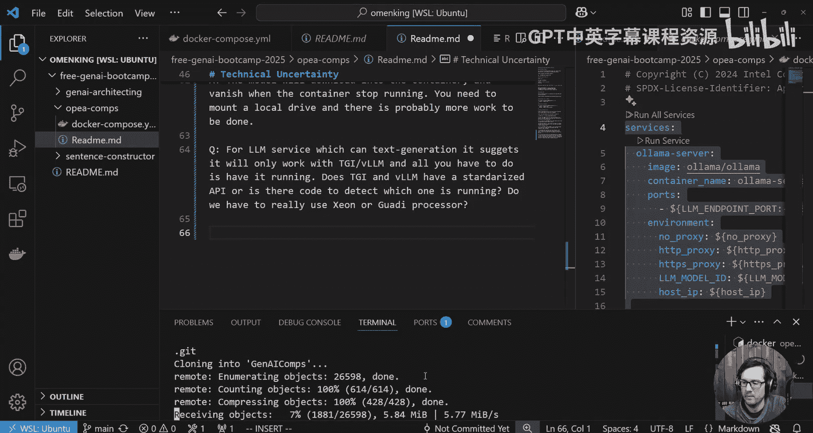

And once that's cloned， it'll pull all the stuff out， maybe we could just ask questions and say， hey。

 can you tell us a little bit more about what's going on here？Great。

 so I'm gonna go back over to windsurf。I'm going to go ahead and say file folder open。

 and I'm looking for in here Jenny I comps。 I'm going to open up the entire comps folder because in case there's something that's cross reference。

 I want to have it here。

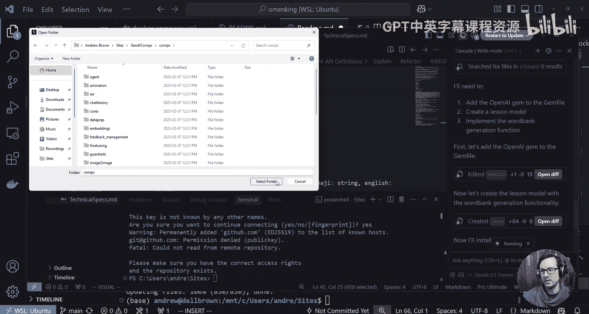

And so。What we want to know more about is this LO M thing here。 This folder right here。

 And so I have over here this， I'm gonna just restart an update before we get going here。

I know that for some of my boot campers。If they see an update button， it stresses them out。

 And to be honest， when I'm on a a。A call with somebody。 And they had like low battery。

 I'll like say， like， hey， you gotta go fix that right away。

 becauseuse I I'll I'll never take my attention off of that because we're developers。 We are， we。

 we are。Focus on the details， right， So I'm waiting for cascade to open up here。 It's open。

 And so I need to know a bit more about what's going on here。

 So I'm gonna go ahead and just say file。 I actually want a directory。 So say directory L L Ms。Right。

 and so。I actually just want to have a conversation with it。

 so I'm going to cut this out go over to here。And。I'm gonna say， you know， this。Folder。

Allows us to deploy a container service。It says it only works with TGI or LVLLM or L LVLOM。It's LOM。

 So it's VLOM。What part of the code。Tells us。This is true。Okay。

 and let's see if we can kind of figure it out。With these tools。

 I always try to give it the the fewest amount of folders。

 so it gets less confused when it's looking。But searching to the whole code base。

 which I don't really want it to do。 and that's why I kind of wanted to show that direct folder。

 but there might be， I don't think there is a shared folder， but if there is one。

 I just wanted to do that here。And so let's see if it can kind of help us out here。Based on the code。

 I can confirm the container service indeed works with TGI， this evidence is in several key places。

So here it has the open text Gen service， which is over here at Ins underserv has a clear dock ring。

The dogization method signature in various integration files consistently with TGI VLM。

There are specific TGI classes。So that's what we're looking for。So if we got under integrations。

 is there one，4？Is there one for。Look forward here， Dr。 Popo。Soce。So I mean。

 this is a doc and fact generation。 I only care about text generation， though。

So we go to text generation， we have integrations。It doesn't say TGI。

So I'm going to go back here and say， you know， I'm only interested。In performing text generation。

What indication。How would it know。Where the TGI server is running。And you know。

 wording really matters here。 I'm not wording this very well。 So if it fails。

 it's kind of my fault here。 But while that's going here， we'll open up the service pie。

And we see OPA A LM， because this is the thing that it's saying it's serving， right。

 And it's interesting has some default here， but it has port 80，80 as the LLM end point。

So that's kind of interesting。So again， I don't see anything that says in particular。

That it's either or right。 So based on the code and documentation。

 here's how the service TJ is running。 The service looks for the T GI service endpoint It environment variable。

 I think we just saw that there。Oh， here we go。 initialized component here。 So it says。

We can see the function calls get L end point。Right but we just saw ourselves， right？

That if we go up here。ThatThat's there as well， right， and it's defaulting to 8080。For some reason。

So that's that there， so we have LMN point。And this says T G I L endpoint。

 So this is the the location is variables through this。 So maybe there is a T G L M。

 This is what I want to find out。Where's this。不支是。TgiI。I don't see this specific one。

And none of them are said this is used。Where in。The service do pi。In the， we'll say file。

Service dot pi。Are you seeing T G I L point。I I don't see。 I don't see it。Are you sure？

Is Claude son mess with us。Okay， so there's only one element point， right？

 So now the next question is。For does V does。Does VLLM and TGI have the same API？

I'm not sure what it's trying to search for。

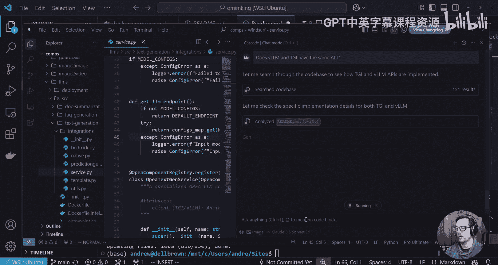

Okay， and so。That's interesting。I'm going to go back over to Claude over here。

 And so what I want to know。Does VLO M and T GI have。Very similar similar or the same API schemas。

So if you wanted to swap one for another。You could。And so this is what I'm trying to get at。

 And then the question question is like， can O have the same thing。

 Let me think about this as the last update。Have similar but not identical APIs。

 They both aim to be compatible with open A AI style formats。Okay， so you can see here， for example。

 there's a bit different。 So， you know， let's go ask perplexity because this is what I want to find out。

 perplexity is a sort。 But we're trying to figure out， do they all have similar API。 So V LLM。

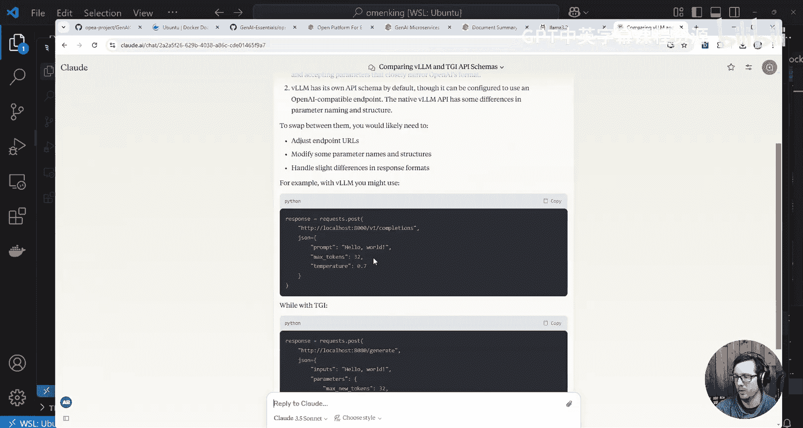

T G i and o lama all have APIs。Where are their API schemas， How similar are they。

The reason I want to use perplexy is it goes out to the internet。 I'm not using a paid version。

 I'm actually just using free right now。嗯。So it says with the O， okay。

 so VLM TGI all offer API compatities， making them easy to integrate， right， so they。

If if they're the same， then why can't it use ama， it seems like it should be able to。

So I'm going to go back over to our VS code one。So in theory， they should be interchangeable。

Right and we'll go back over to here。And so we have these three。 And so， yeah。

 if they're standardizing on that thing， that in theory， we should be able to use Oama with LLM。

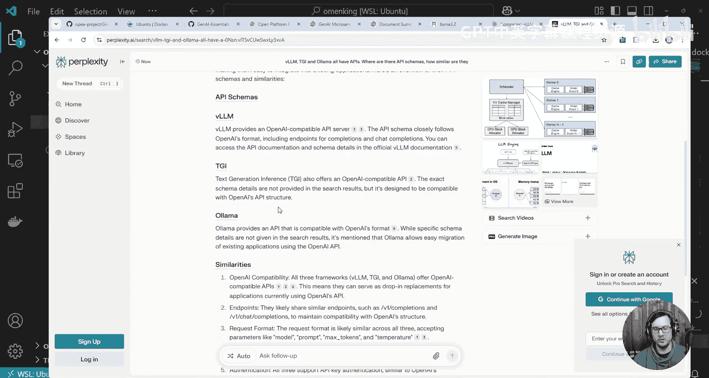

So we're going to make our way back over to here。And I'm going to save this file。

 And so now I just have to think about this that if we're going to run that LLM thing。

 we just have to tell it where it is。 That's， that's it。So I'm going to go back over to here。

 And this is a little bit trickier because we have to pull in a bit more code。

 I really only want to pull in the component than I need。

 I don't really want to pull in everything else。 I'm not sure if we can get away with this。

 but I'm going to try anyway。

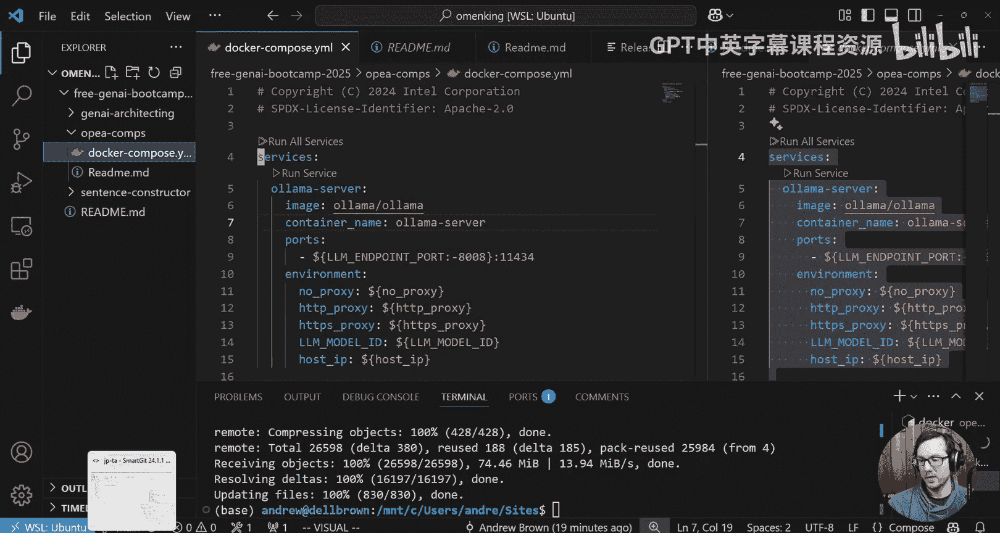

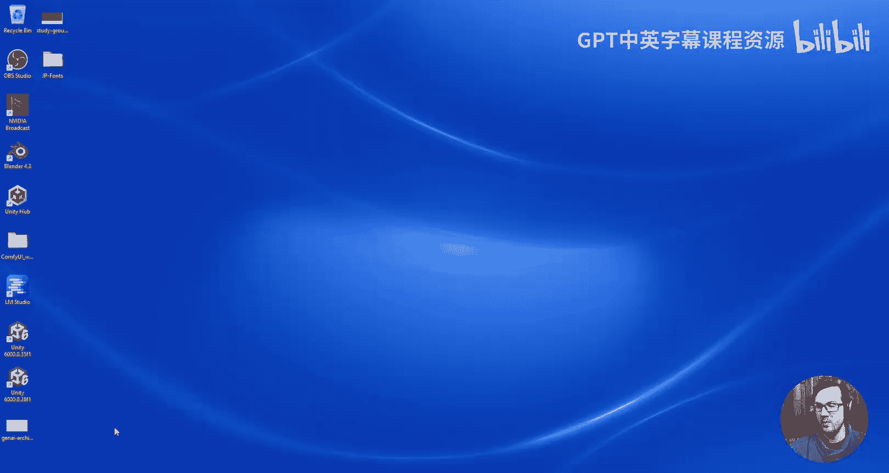

I we'll try to bring in that individual code。 So I have Jen icon comps here as a folder over here on the left hand side。

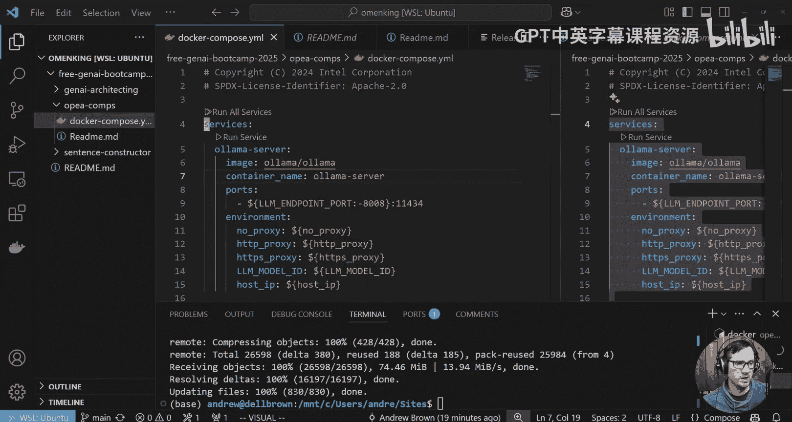

And we have this entire directory of comps。But the question is。

 will it reference anything outside of it because there is cores？And it could reference cores。

So the question is like， what's the minimal stuff that we need to bring in， And it might be cores。

 But right now， I don't know， so。What I'm going to do。Its a bit sloppy。

 but I'm going to go ahead and just grab。Why do we have a top level docker file。

I'm thinking maybe just grabbing comps and bringing it over。 Yeah， I'm not sure。

I'm thinking about this。 Let me think about it for a second。 Okay， alright， you know。

 I was thinking about， we could actually just ask it Winsurf， like。

 what is the minimal amount of files we need to bring in。 So I'm gonna go back over to here。

 I'm gonna start a new conversation。 And I want to tell it that you know， I want to， I want to。

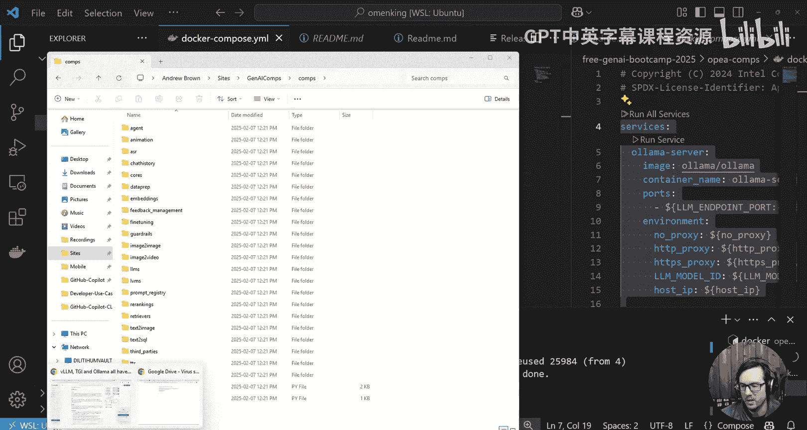

Use。The code in。TheWhat's the directory called this is a directory。can't see it right now。At sign。

Lms。Do that。But， I need to know。What other。Folds are absolutely necessary。To run this code。

Do we need to bring in cores？Folder， what is the bare minimum。Other folders。The same hierarchy level。

At the directory level， I have to bring in。Because that's what we don't know， right？

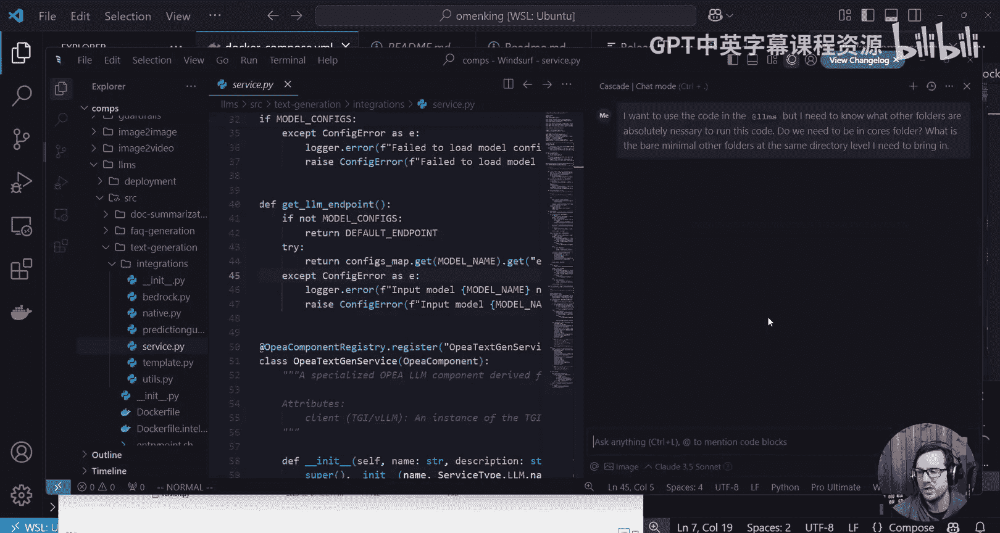

And so we'll let it figure it out here and give it a moment。 This actually you might be in the docks。

 We just have to read a little bit about it。So while that is going。

So it says contains core components like OPA component core。 So this is what I thought in LLM。 Yeah。

 that's all we probably need。 Let's go take a look here for a second。There is a knit dot pie here。Oh。

 right， right， right， right， right， right， right， right， Right， right， right， right， right， right。

 right， right， right。 So maybe our approach should be a little bit different。

Because if these are all like this， then we can just import all these components if we want to reference them。

 But right now， I just want to run them and stick them together， so。

What I'm going to do is I'm going to go back over to here。

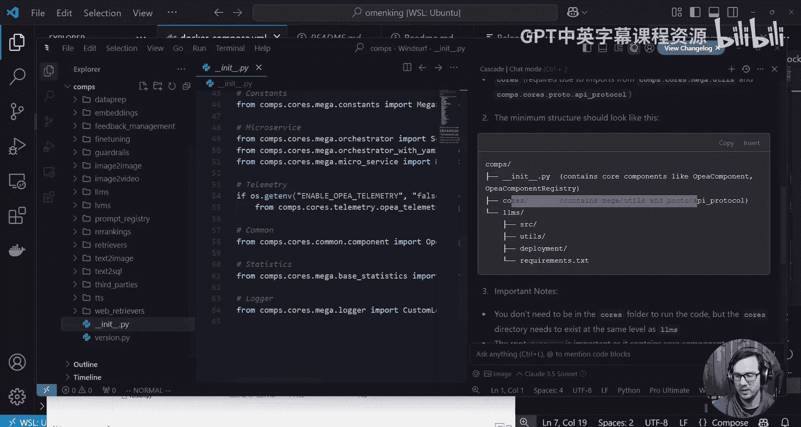

And I'm going to go to the OPA dev。I just gonna me a moment to see if I'm just really cutting this up in a weird way and see if there's a better way to do this。

'll be back in just a moment。 Okay， All right， so here's where my confusion is。

 right they have this article here。 They explain about the architecture。

 And so one thing we can do is we can install the components a P。

 which actually I really like OPA comps。 We can also just pull down the source。

 Now I can pull out those folders， and we can make it work in isolate。

 So we're only shipping exactly the code that we need。 But down below here。

 they're showing that they have a file。 So they say a microservice is can be created by using a decor register microservice and taking the embedding microservice an example。

 And so the idea is that we are bringing in。😊，The comps here。

 and then we use a decorator to define it。But what I don't understand is how's it going to orchestrate all these things。

 Because these are all individual containers。 Is this going to spin up containers if I run this file。

 And that's what I'm trying to figure out。 again， there's no information that I can find directly on here。

 There's probably somewhere。 but that's the trick is to try to find that information。

So maybe that's the route that we need to go down here。 So I'm just trying to decide here。 I mean。

 one thing that we learned， which was interesting is the fact that the APIs are very similar。

 So if we were to start up one of these things， we know that they should have good operability here。

 And so O is still in the table here。 T G is still in the table despite talking about the other architectures here。

 So maybe what we should do is we should really be trying to get this thing to work and then observe that actually spins up containers because if it does in a single file。

 that'd be really， really cool。 But I would have thought that this would have to be know， I mean。

 like you construct your own your docker file， which we can still do。

 but I'm trying to here to trying to save time based on the way that they have it laid out here。

 So let me try that next， I'm gonna to stop the video again。

 And this video is basically just we learned about。😊，The different kinds of things here。

 and we explored the code。Which is fine because in developer week。

 I want to show you how you can use stuff to to investigate code。 but yeah。

 we'll try to figure this out next， okay。

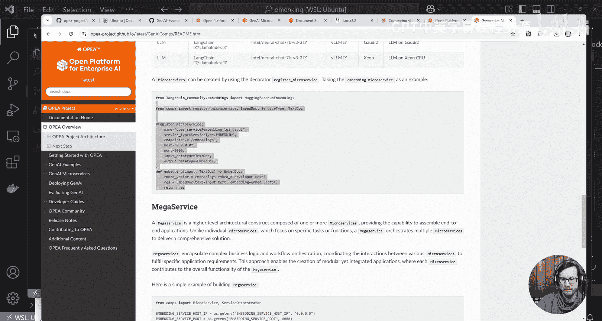