# ExamPro《生成式AI训练营｜Free GenAI Bootcamp》中英字幕（deepseek - P28：-28-OPEA Mega Service.zh_en - GPT中英字幕课程资源 - BV1SFEWzLEab

All right， folks， I am back and I can't remember exactly what we did in the last video。

 but I made a video after this， and it was a failed attempt。

 And so I reached out to some of my container friends。

 and they helped me get into the right direction， so。

What I'm going to do is I'm gonna go back over to OPA OPA do dev。

 and there was a very specific page that we were looking at for trying to build our own mega serviceice。

 Now， it's not that I want to build a mega serviceice。

 but once you take more than one service and you make them work together。

 you've basically built a megaservice。 but we'll go over here to the technical docs and we'll go back over into Geni microservices into this component here。

 and then down below there are a couple of code examples。

 this says like a microservice can be created using a decorator。

 which I kind of like that way of doing it， taking the embedding as an example。

 So here they have one here But then down below we have this mega serviceice。

 but I was trying to figure out， okay， we have this file that how does this thing work like。

 okay I make this file。

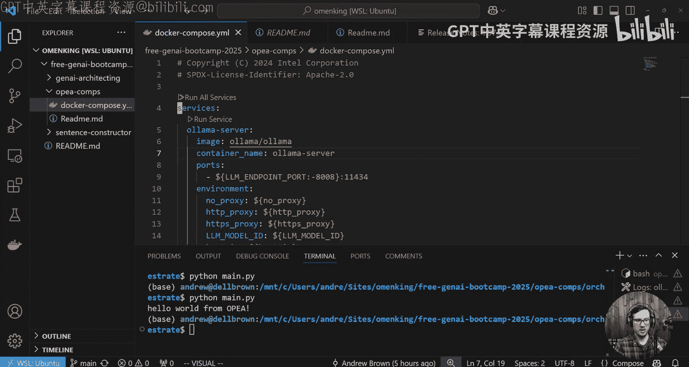

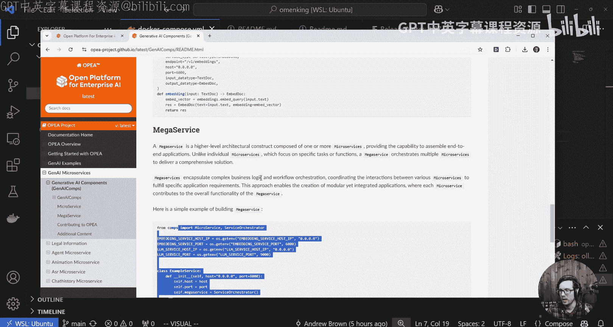

But you'll notice here that there's no， like。It doesn't show you how to call it or anything like that。

 So the little tip I got was to look at the OPA examples projects。

 And it seemed really obvious that that's where I should have looked before。 But I didn't。

 But what I'm thinking is that we'll look at some of the examples。

And maybe we can work our way backwards。 So if you go into any of these。

 these are all the mega services。 This is if you assemble them together。

And if you look into the Docker file and you go down below。

 you'll notice that its endpoint is this thing called chat chat Q& A Pi。 But if you open this up。

 you'll notice that this code is starting to look really similar to the code that is here right。

 So I think what's happening is that or it's not that I know what's happening。

 but I'm saying like we can kind of think our way through this by looking at the megaservices and trying to make a paired down version。

So the question is like， how does it start？ So down below here。

 it has a main and it can take some arguments。 And then you'll notice that it just has a start function here。

 So that means that somewhere in here， there is a start。 So we'll go over to here。

And so it's starting it up that way。 So maybe what we need to do。Is work it that way。

 I don't exactly know how to do this。 I mean， we could try running it。

 but I really don't know how we're going to do that。 So let's focus on getting this one to work。

 or if it's not exactly this， we'll have to make some changes。

 But let's go ahead and go back to VS code and we're gonna stay in the OPA comps。

 and I'm gonna make a new a new folder inside of here。

 And this is gonna to be mega service because that's basically what we're making。

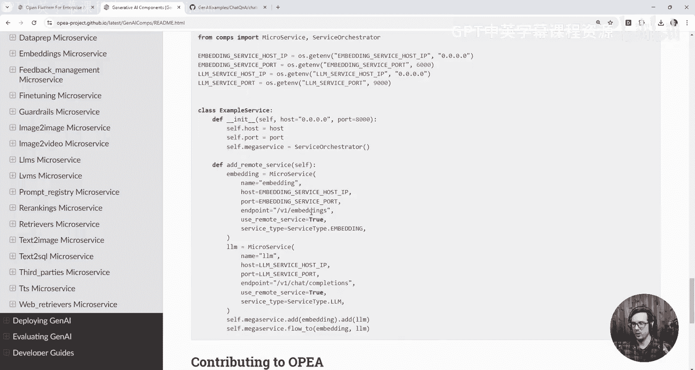

It's called megaservice。And so I want to bring in this app， I'm just something called App dot Pi。

 I don't have a very， very strict naming convention for this here。

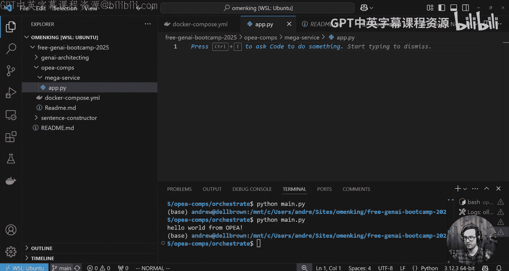

But we will go， and。I'm just going to close that tab out。 and we're going go back to our docs。

 I'm gonna go ahead and grab this code here。Okay， so we'll go here and we'll go back and we'll paste it in。

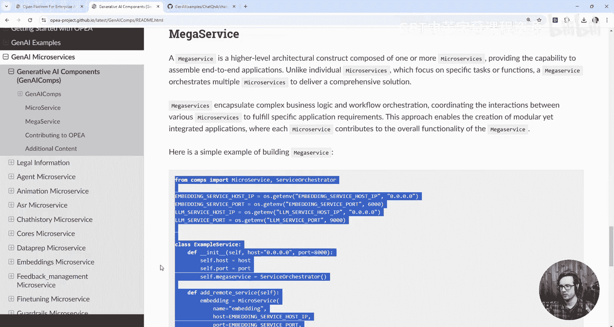

And so we have comps here。 Now， we gotta bring in comps somehow。 It's also asking for O S。

 It doesn't know where it is。 So I again， this， this code here is kind of incomplete。

 So we're just kind of helping it out here。But it's gonna need know about comps。 Now。

 I did do previously a， a Python file like a requirement TD。 And I did tell it to install O comps。

But that didn't really help。So that is what they show here in the docks that we go back over to here。

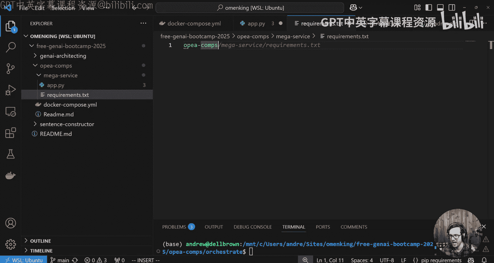

And we look here， there's OPA comps。But I ran that。 And for whatever reason， it just didn't work。

 But we'm gonna try it againcause you know。

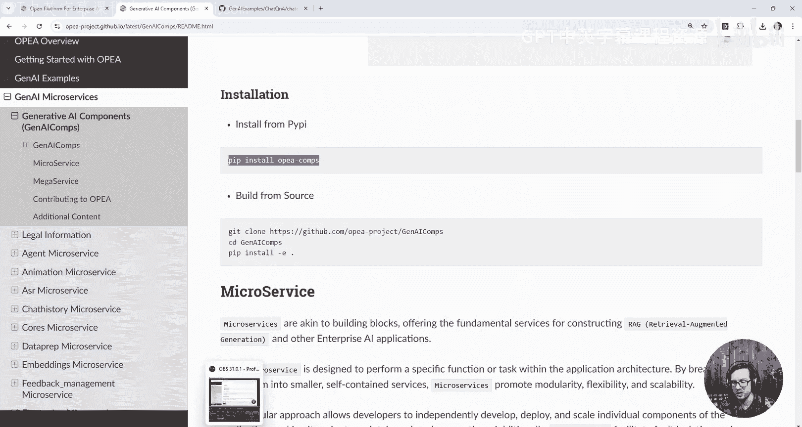

Just because it didn't work once Does't mean it won't work a second time。

 So I'm gonna do a Pip install hyphen R requirements， do T XD。嗯。Oh， sorry。

 I'm in a folder that doesn't exist anymore。 That was my failed attempt。 So we'll go here。

 and I'm gonna do a Pip install requirements on T XD。 And so supposedly。

 I have OPA comps installed now。 And we go back over to here， this should know what it is。 Now。

 it's saying it doesn't know what it is。 I kind of ignoring the fact that it's saying that right now。

 I don't care。But what I want to do is I want to see if this code works。Also。

 one other thing is that it doesn't know what this service type is。

 So it's not sure where that's coming from。So。I think GiHub Copis on， I didn't tell it to turn on。

 but I need to find out where this service type is coming from。

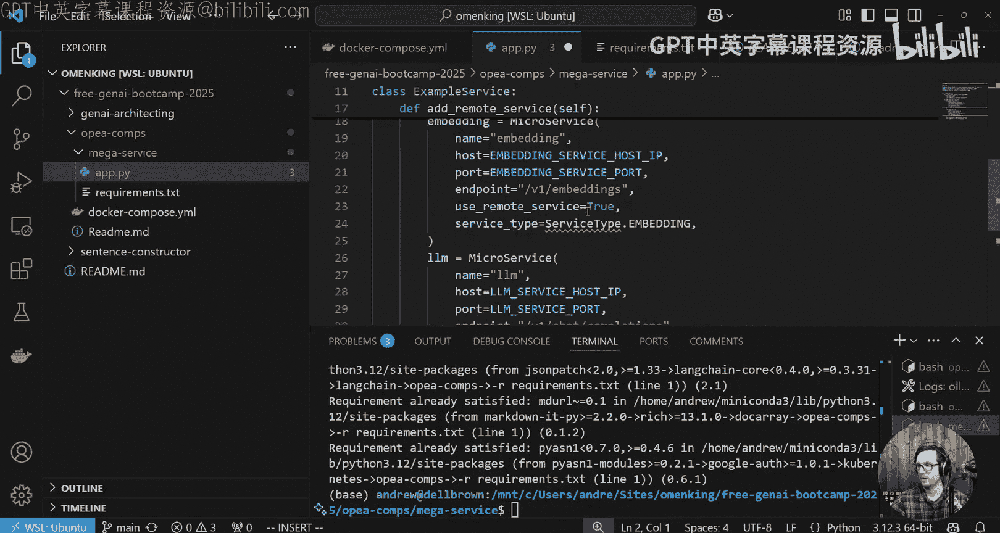

Right here。So I'm not sure if it's coming from comps。So what we can do。

Is I still have comps over here， I'm going ask in the codeb here from windsurf again。

 if you don't have Wordsurve， use whatever you can or you can just do whatever you can， right。

 but you know is there a class called service type， I'm trying to in this project。

And I'm gonna go back over to the code。 I know it's weird that I'm working between two， but it works。

 but。You know。I have this code that has an undeing class。And I'm trying to。Find it。

And we could manually look for it。Okay， and so we'll see if we can search the。 now， it said right。

 We don't want right。We just want， we just want chat。 I forgot to change it over to there。

 But it's gonna search the entire comps directory。As it's found it。

 So it's in comps core mega constants。So here's what it's suggesting for us to bring it in。

 So there we go。

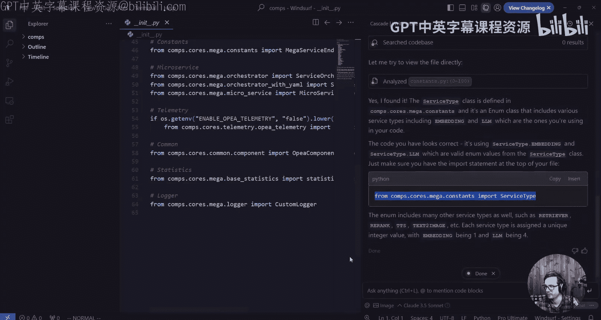

And， you know， I could do all this in windsurf， but I'm just trying to be very。

I'm trying to use as little as I can because if people are following along， they don't have it。

 I don't want them to run into the same trouble as me。Okay， so， you know， we have those two here。

 and it looks like they're kind of imported。 But again。

 I'm just going to ignore the fact that it's saying they can't resolve it because I don't necessarily trust that information there。

 It might be true。 but right now， we don't have like a main function。 It's not calling anything。

 but I just want to see if it runs without an error。 So I'm gonna go ahead and type in Python。

 And we're gonna to do app up high。 And here it's saying cannot import microservice from comps。Right。

 so I'm going to go back over to here。 Well， first of all， what happens if I take this line up？

Becauseuse what I want to see， Will it fail in that line says no module name cores and things like that。

 So we're running into some issues here。And so。I don't know why， but I mean。

 it's like it's not importing it。So maybe that has something to do with O， O comps。

 but they're not even using it， right， So that's gonna be a challenge。

I was just asking off screen if somebody knew about the OPA comps because。

This is where I'm kind of running into issues now I can bring it into this project。

 It's a little bit heavy， heavy duty to do that。But I don't know if it's 100% done via the import method。

 And if it's not， I don't care， we can just manually import it anyway。

 So maybe what I'll do is I'll do it that way。 I'm gonna go back over to the documentation here and it has this other one where it says build from source。

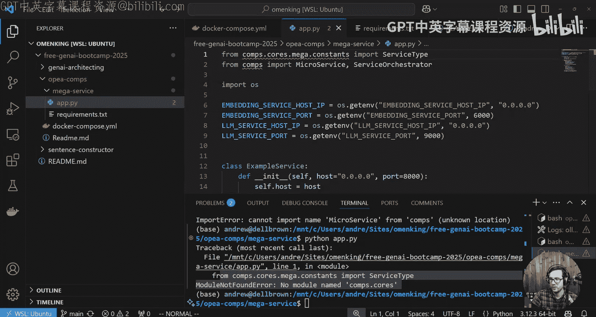

Right， but even if it does this， wouldn't that install a plugin。 Let's go ask this here。

Does this build， build a plug。Yeah， it sets it into developer mode。Okay。

 so I'm not sure why it's not referencing it。But let me do some research， okay。

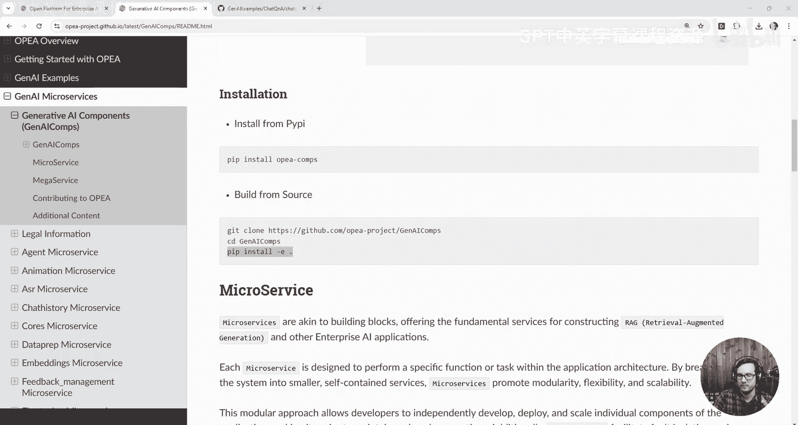

So I was asking Claude， and I mean， I I know it's already installed。 we have it right here。

 It's OPA comps， right。But the question is， like， what is the import statement， Is it actually comps。

 And that's what I don't know。 So go back over here。 You can see I was asking it。

 but we'll go to this。

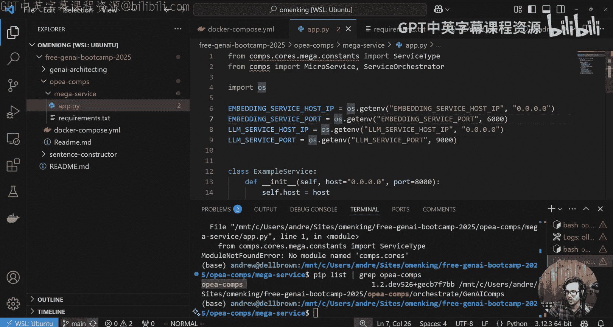

The actual， actual thing。

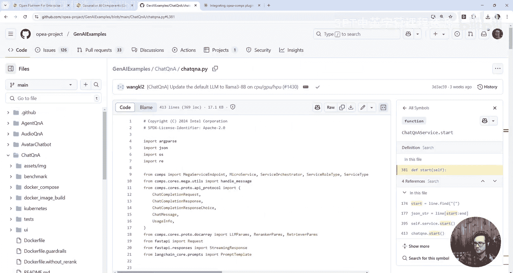

Maybe go back over here becauseuse the entire repo is over here， right。

 or at least all the comps are， you know， how like。

I think this is where it would make more sense to open the entire project。 I。

 just opened the comps directory， but I'm gonna go back to Winsurf。 And yes。

 I'm relying on onesurf quite a bit， but I'm gonna open the entire directory here。

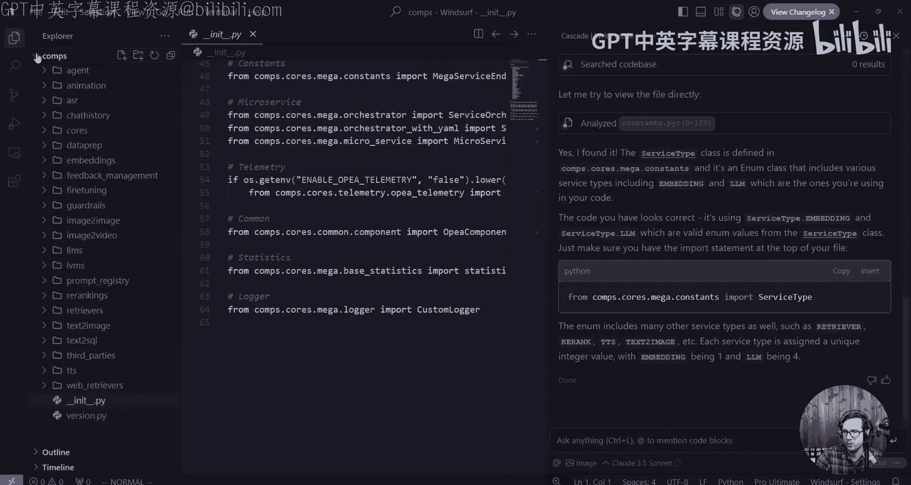

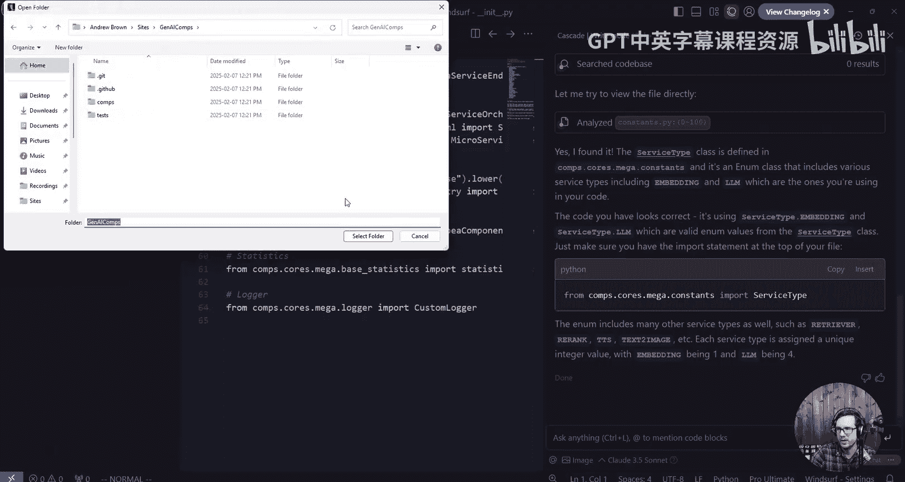

And I'm gonna ask it， like。How would I actually import this。Cause I'm。

 I'm having trouble getting it to install。 So how would I use the comps within at like to import as a。

A Python library。And maybe it might be able to figure it out here by looking at the code base。

 I keep forgetting to put it to chat。 a big deal。 But it's gonna search the code base。

 And maybe this is something that we can utilize to get some some of our help here。First， make sure。

Yeah， so I mean， that's one way。 And that makes sense with that period command。

 So where you want to install it。Once installed， you can import the various components here are some of the main components。

Okay， and so I'm gonna go back over to here。In my attempts。In my project， I'm getting。Again。

 I'm stuck in the right tab， which is not good。And。If this， is that's not gonna to help us。

 So would you like me to verify the installation or check the other potential issues the project is in another folder。

You know， but like。There is a piip。And install O A。Opiid comps。 but is there。In the code。

If the import code is there。Like， there must be some way， like we do import comps。

 could be like console log or something out here。

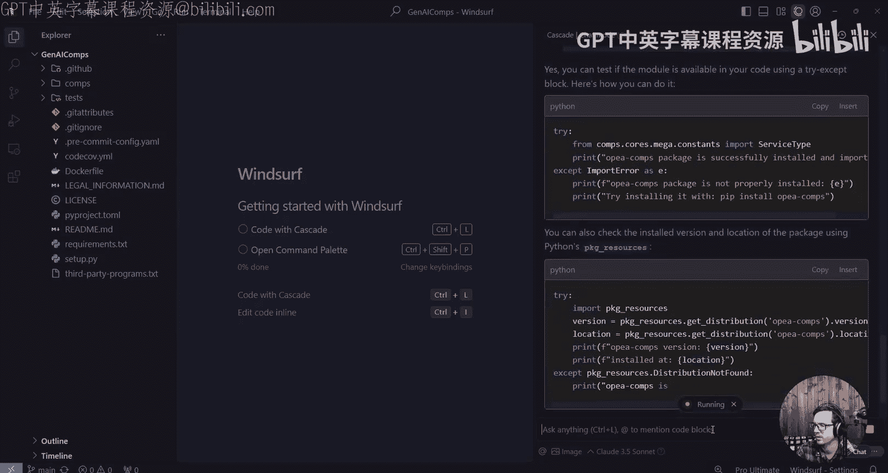

So one thing I'm going to try to do here and again， not not an expert at this stuff。

But I'm going try to go here。 I'm just gonna go all the way down the ground。

 I'm gonna comment this out。I'm going try to do something that makes no sense。 I'm gonna do print。

Cos。Will this even work。Maybe we say import comps like that。Module cops。Can I get anything here。

 Do I get a version。

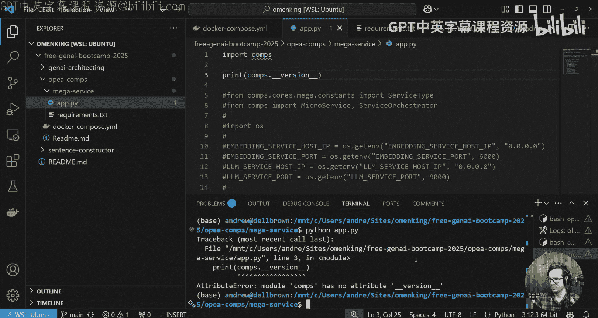

Coms has no like， okay， so I'll go back over to here and just say， okay， but。

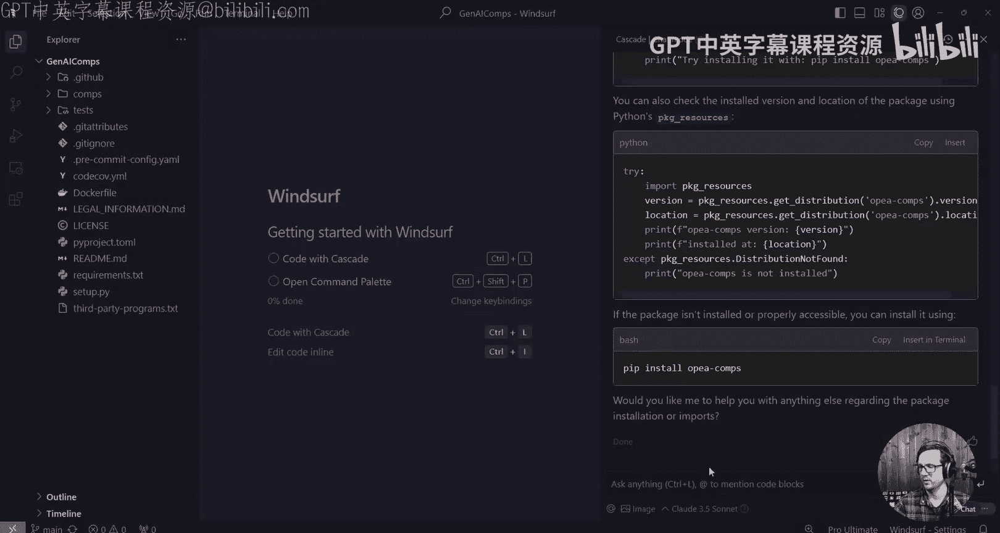

I want to show it like my code example and just say， like， what could I。

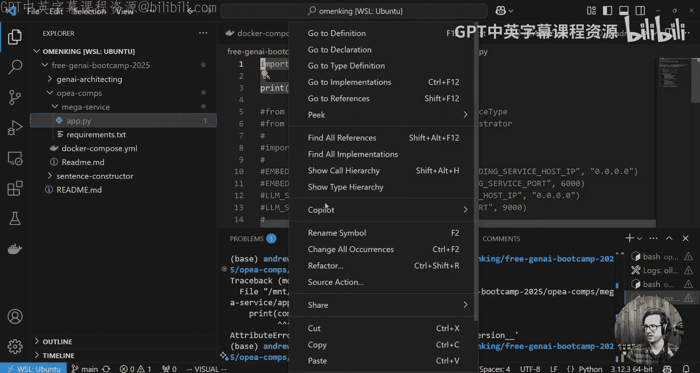

Like I need a really simple way to to test。So much cleaner way might be this。

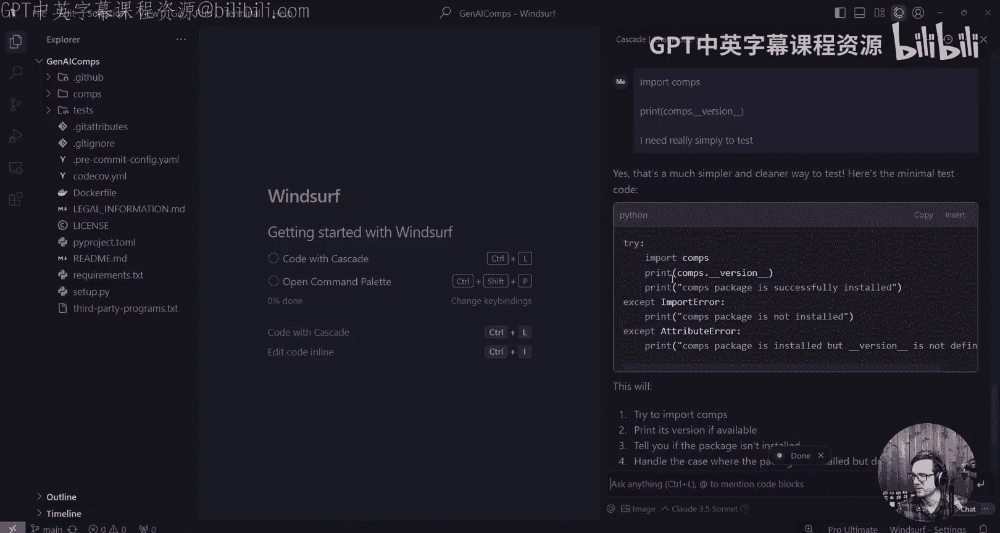

We'll try this here。Okay。

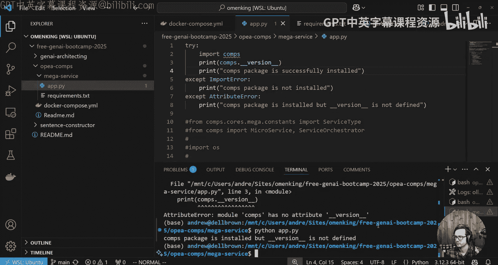

So let me check the version handling on the package。 I mean， there is no， there is no version。

 but like， I just want to see anything。So here's another suggestion。 We'll try this instead。

 And like， once we get something working， I think this is the hardest part about。

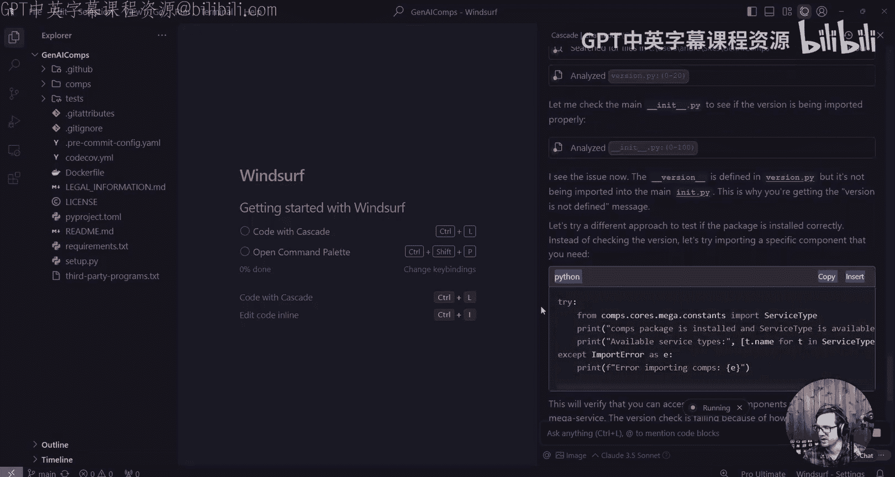

OPA A is just getting the comps installed。 And once we have it， will'll be in good shape here。

 So go ahead and save that。 We'll hit up。And here we'll just show what we got。

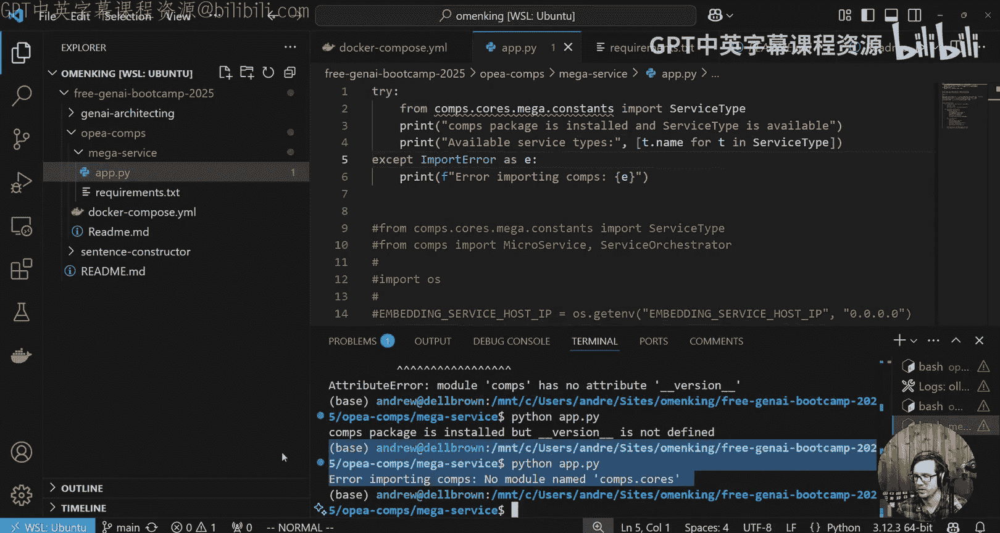

So， it says。The other thing that it might be is like， but I mean， it has to be in contextcause we。

 we checked it， right， Like we said what it is。 But we'll go ahead and try this。

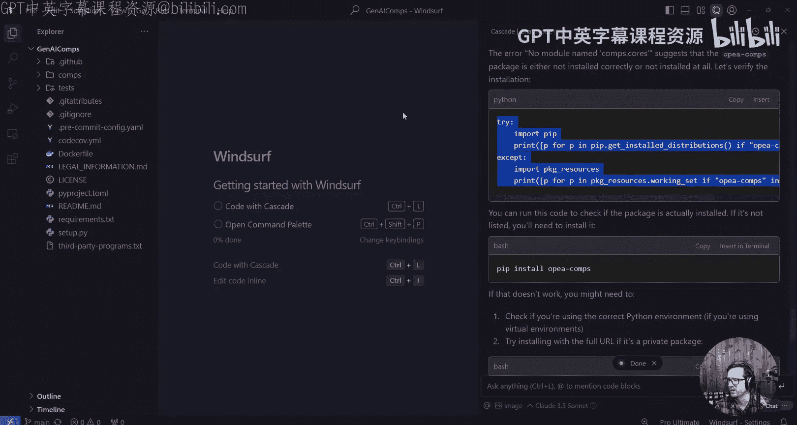

I'll go back over to here。 So so weird that I'm going from one editor to the other。

 I probably just open it up in windsurf。But we'll see what happens if we， we do this。

 So we'll go ahead and run this。And here we do get something。So， it says。Deprecation warning。

 and it looks so it looks like it's actually picking up the package， right。

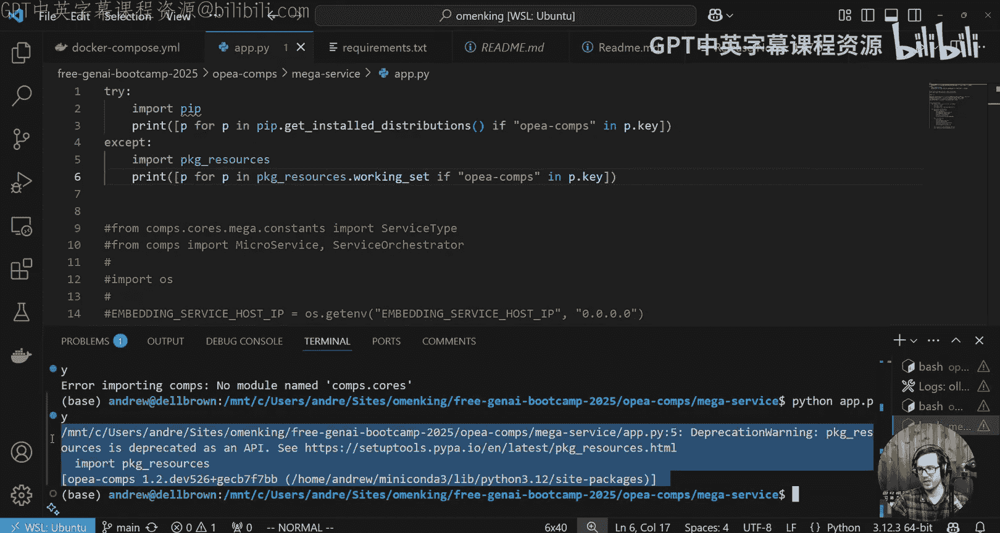

So we go and give it back to this。

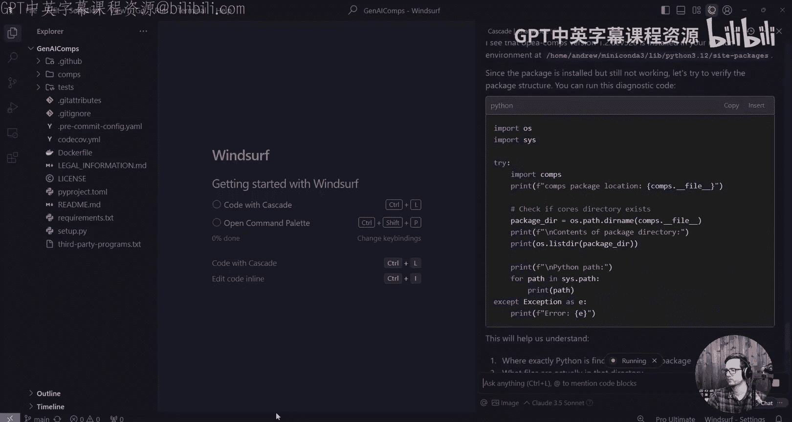

Okay， so I'll go ahead and run that。And here。Coms package， location， none， interesting。

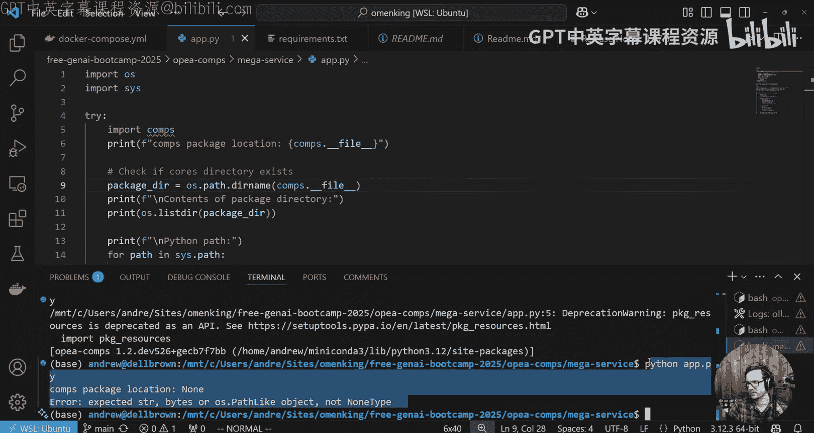

And so I'm gonna keep posting it here， but we're starting to get somewhere， right again。

 if this was Ruy， I would know in two seconds how to debu it。The Python can import comps。

 but the comps dot file is none which suggests there might be an issue with the package installation solution。

 Let's try a different diagnostic approach。So where Python is looking for the package。

 how the console package is registered with Python， the actual structure of the installed package。

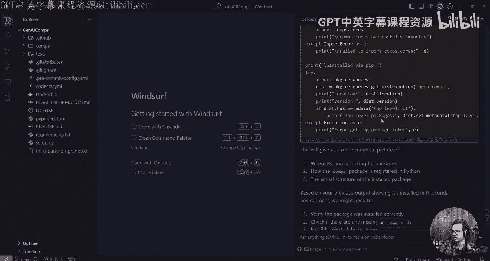

Somebody that knows Python probably could figure this out in like two seconds。

So we'll go ahead and paste this in and we'll try this again。Lets enter。And we'll see what we got。

So here it has comps package detailed comps inside modules through properties， comps。Installed viaip。

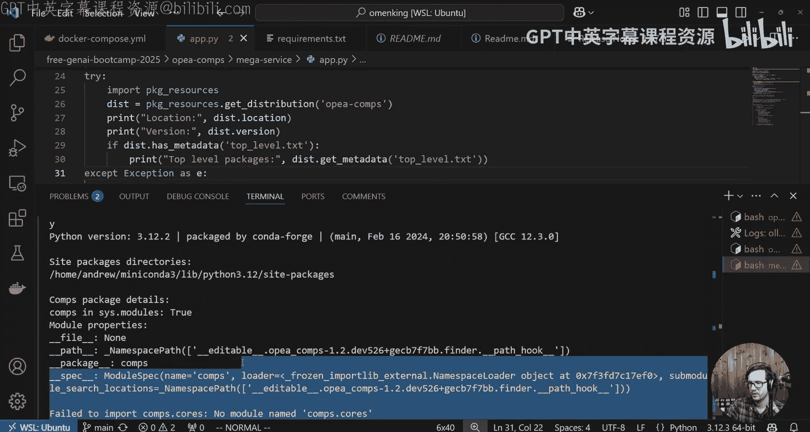

So it's definitely there。That's good。 Like we're starting to make some progress。

The package is installed in edible mo mode， but it seems that the installation might not be properly set up。

 Okay， so if sounds to unintall and reinstall。 So maybe what happened is that I。

 I had a prior install and it kind of messed it up。 So go， we'll go andinstall it。

 Maybe it just tells us to reintall it again。Here we go。

So it might be really specifically my fault here， interesting。

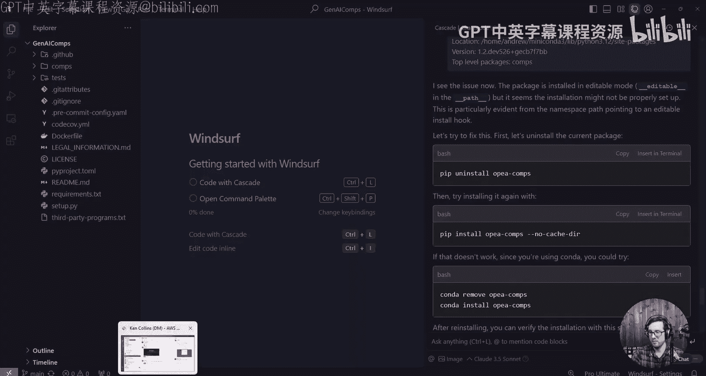

Because there was two ways to install it， as you saw from the other site and maybe。

If we go back to where was it here， it was here。嗯。

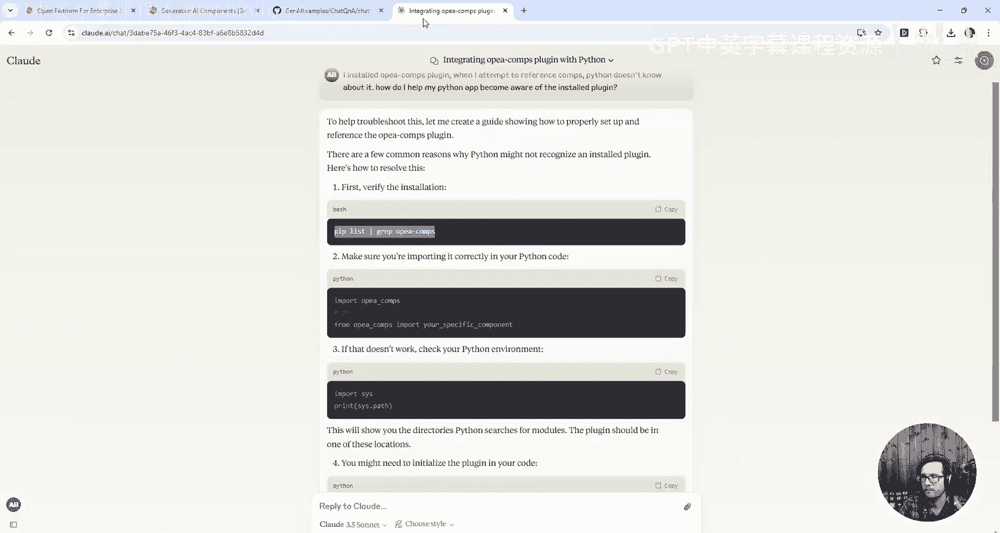

But there is this way。 And so that's the edible mode， which I don't want。 I just want to use it。

 as is。So now' successfully installed OPA A comps 1。

 let's go ahead and try to run that path dot path dot I again。

 But we have to undo some of our code here。So I'm going to go ahead and cut this out。And we will。

Bring this back in。Ohoops。All the way down the ground。And we'll try this again。

And so we don't get any errors， which which suggesting to me that these are now properly imported。

 So we are now in better shape。 So that's really， really good。So I would say what we need here。嗯。

Like we have this example service， but we need to know how to run this right And so we'd probably have to create an instance of it。

 It looks like as soon as we create an instance， it starts up。

 and we do have this service orchestrator， which I'm not 100% familiar with。

 but I'm going to go back over to here。 And what I want to do is go back to the code here。

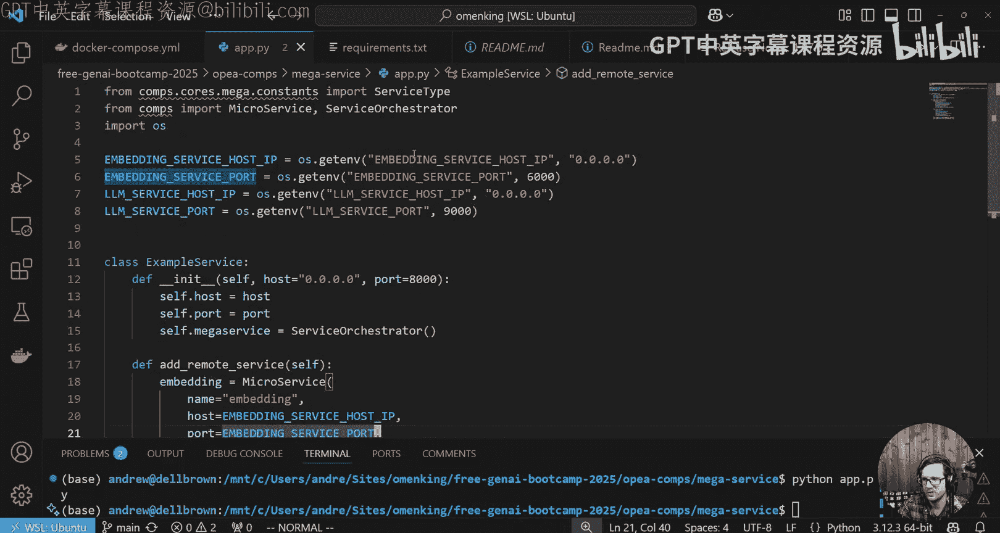

And try to figure out how to run this。 So if we go to the Docker file。

 becauseuse this one's just running through Docker， which then would spin up other stuff， I guess。

But here we have Python 3，11 slim。 That's fine。This is going to bring in。The cops folder。

And then it looks like they're going to build it from scratch。And reference it。

That's what I think it's doing。 They're referencing it locally。

 And so then all they're doing is running the chat Qne A。 So if we go to chat Q A here。

We can see that there are some things being installed here from the Comps directory。

And we have our class chat template。Okay， and so we go all the way down the ground。

Here we have T QA and it has a knit right here。And you see service orchestrator。

 So you have the service orchestrator here， okay。And then the mega services， and then it's end point。

And then we go down enough。We can see that we create an instance of it， and then we start it。And I。

 and I think again， we do have a start function here， which is here。So what's interesting is， like。

They don't create one， but that's fine。 So what I'm gonna do。Is just go create instance of this。

 right， So I'm gonna go and copy this。

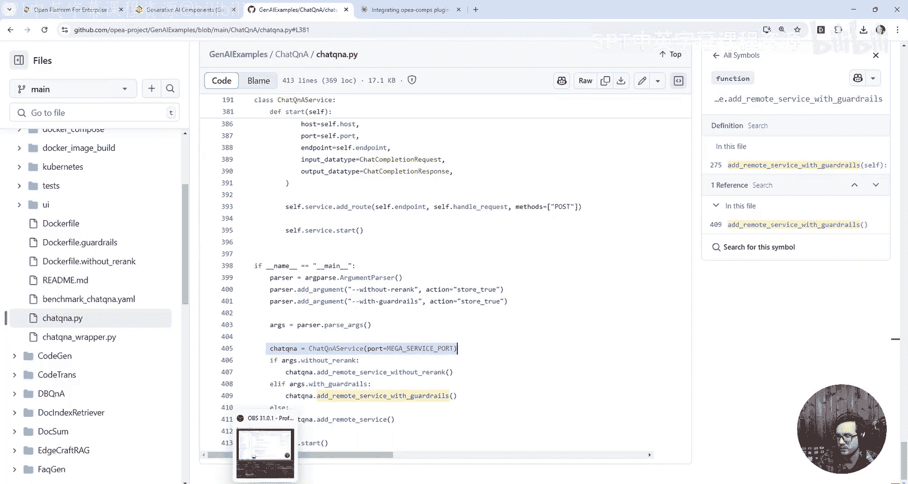

We'll go back over to here。And it'll go down here。I'll paste it in。 And this is our example service。

Example service。And then I'll take out these parentheses。And this is gonna be just E XP example。

 This is be our example， right， So now we have our example here。Okay。嗯。

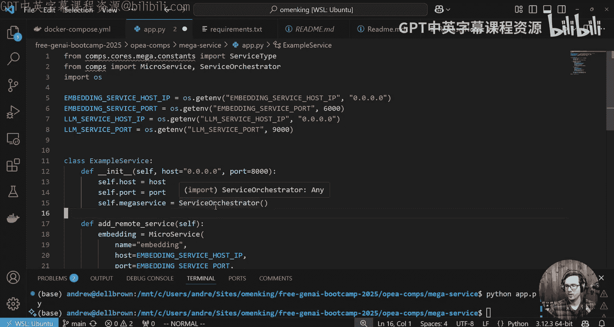

So， I mean， we have the service orchestrator。 I don't know much about it right now。

 But if we don't know what it is。Let's go to chat， I can just clear it out。You know。

 what is the service orchestrator。This is so cool。 I could just ask whatever I want。

 I don't have to dig through code。 I mean， the the docs might have it。

 but I don't want to even look through the docks。Based on the research I can explain。

 the service orchestra is a class that manages multiple microservices in the Dg。

It's designed to coordinate an orchestration of the functions。Manages one or more microservices。

 The main method is ad service。Flow to， et cetera， et cetera。

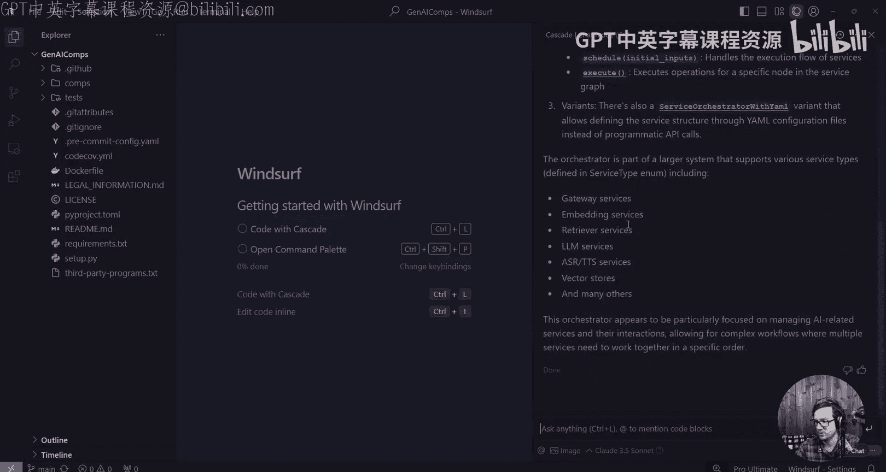

Okay， so that's an interesting start。So we have example here and it gets started up。

 So let's see what happens if we do this。Okay， so no problem so far。

 I'm gonna go ahead and just say print。Hello。's tryry this again。So it is running that part there。

But then we have the ad remote service。And that's not getting called anywhere。Okay。

 so it makes me think that we need to。

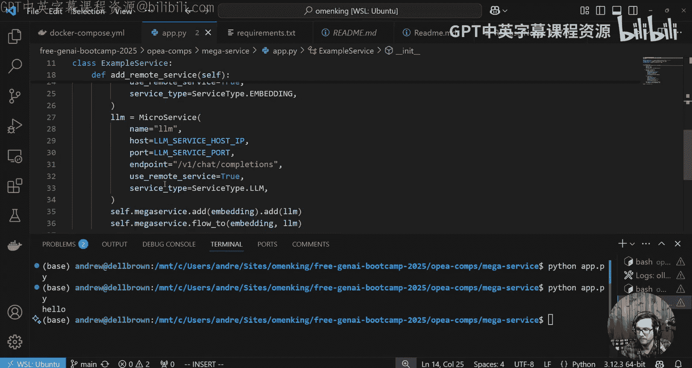

To add it， I'm going to go back over to here。Okay， that's not gonna help me that much。

 I'm gonna go back over to our docs。

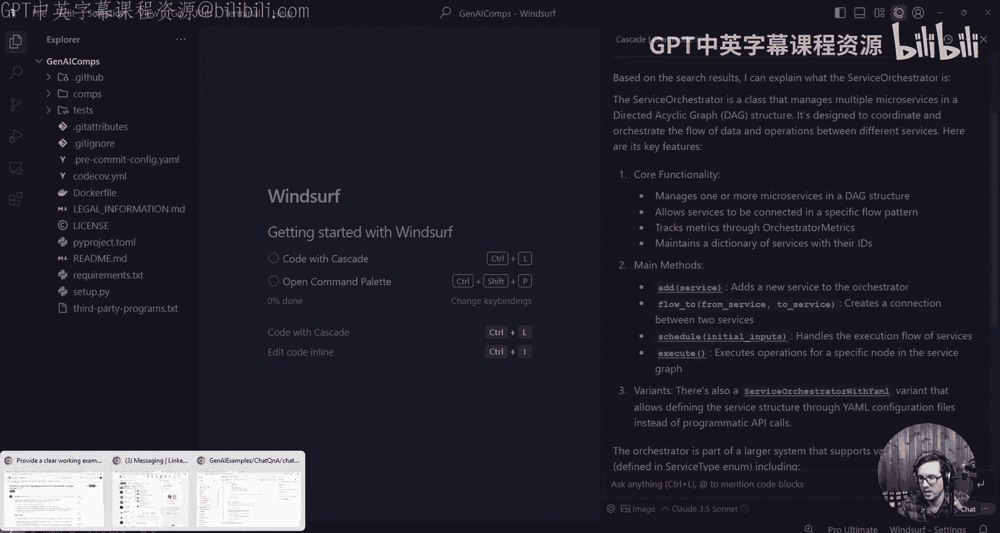

Over here。And so what I'm trying to figure out is like we have those microservices， right？Like here。

 like add， add whatever， right， Where is this getting added。 It actually gets added in here。

 So you can see if it's without this， then do this， Otherwise do that。

 And so it's saying add it and then start it。And these are just microservices， right？Yeah。

 so there's our microservice。 There's our retriever。 There's our L M。 Okay， that's pretty cool。

 So now what I'll do is I'll go back。😊。

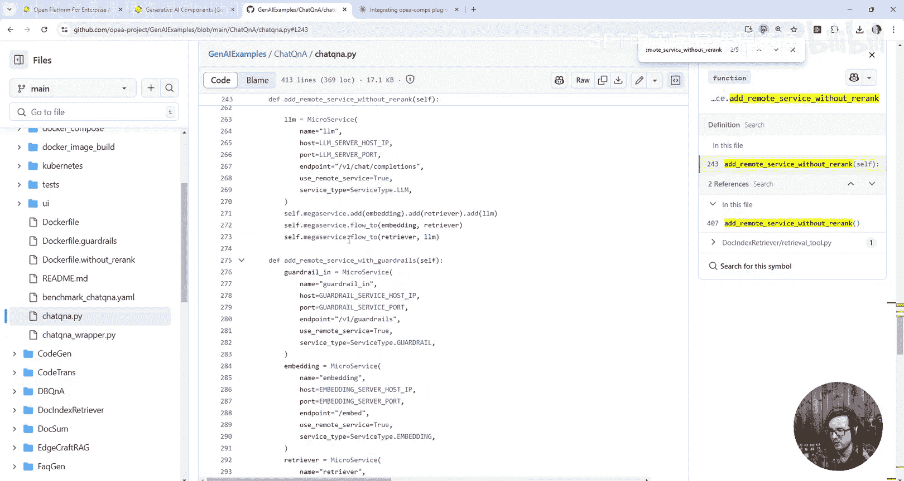

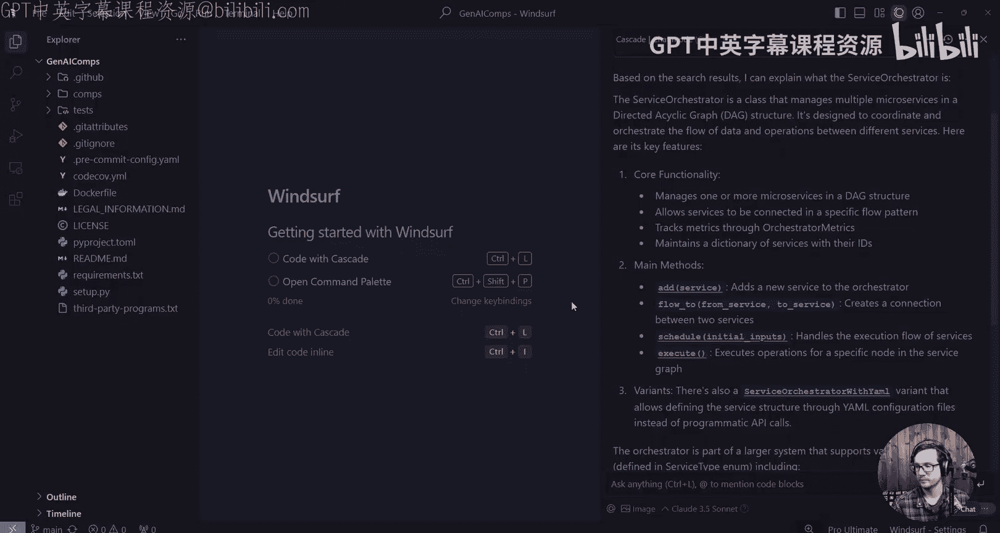

And。I'm going to。Go back into here。 And it seems like add remote service。

 So it seems like what we would want to do after this is call this。add remote service。

 I don't want without rerank。 It's just called a without service， Add remote service。

RightAnd so we'll do parentheses here。And。So that should call that。 Now。

 this would need an embedding model to be running in the background。 This one needs an LM to run。

 I don't really need both here。 It is adding to the megaservices。 Let's go ahead and start that up。

And so we have hello。 Okay， so we're getting closer to something。

 The only thing is that this isn't continually running， right， It's like running and that it stops。

And so that's not very useful to us。

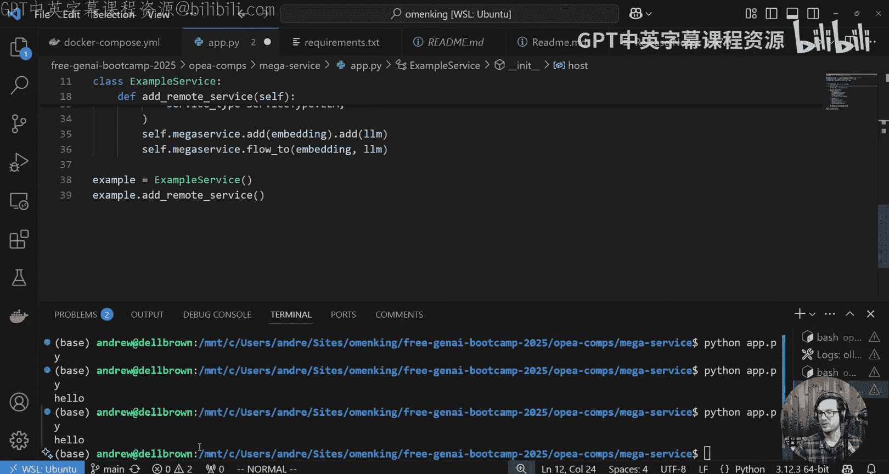

So what I'm going to do is go back over to here。And I want to look at that start a bit closer。

So go here， we'll go to the start。And this seems like it's actually starting up this。

 So this is defining omega service。 and then it's starting it up。

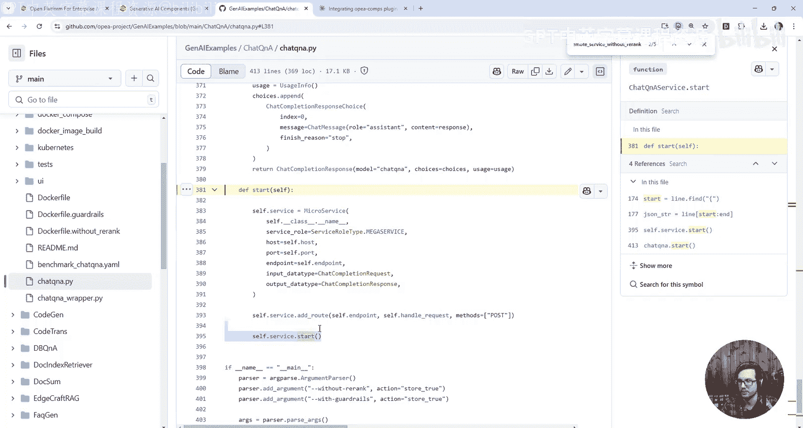

So go ahead and copy this。And I'm going to zoom out a little bit here。And I'll paste it in here。

We have service role type。 I'm not sure where this comes from。So maybe I'll go back over here。

 or I'll just say。We'll go back to this。

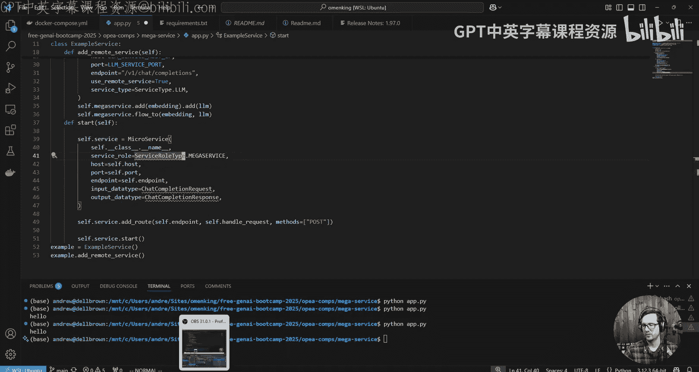

You know where does come from。Okay， cool。How do I import it。Great。There we go。 Okay。

 so it's part of the constants。

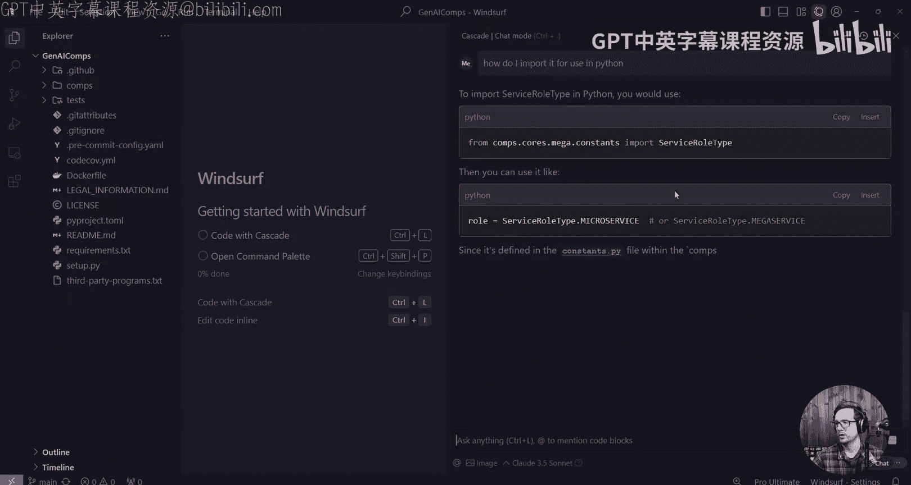

So go back over to here。And since it's the same thing， we can just go ahead and do this， right。

And then we go down below， we have chat completion request， chat completion response。

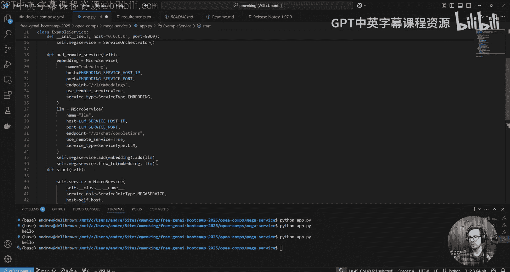

呃。I need to import this。Where is it。Same thing for response。Okay， so that's in the API protocol。

 We'll go ahead and copy that over。

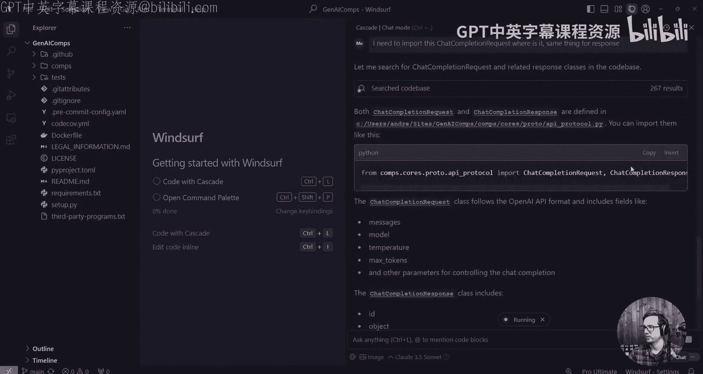

And what I'm going to do is go ahead and just paste this in here。

And so now all the things must be defined。 And then we're adding the route。 Okay。

 so what we'll do is go hit up。And so， I mean， it' still running。 We're not starting it up。

 We have the start function， right， So we will go example dot start。

And notice the calls start over here。 So let's go ahead and do this and see what happens。

So self at endpoint where it's kind of messing up on line 45。Here。

So that's another thing that we're missing。 So I'm gonna go back over to。

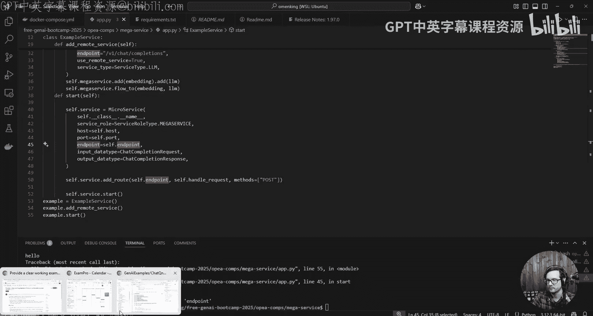

Our code here。And so this has an end point， which is clearly a function。

Or it's something that's defined earlier。Up here。嗯哼哼。I think this part here。That's imported， right。

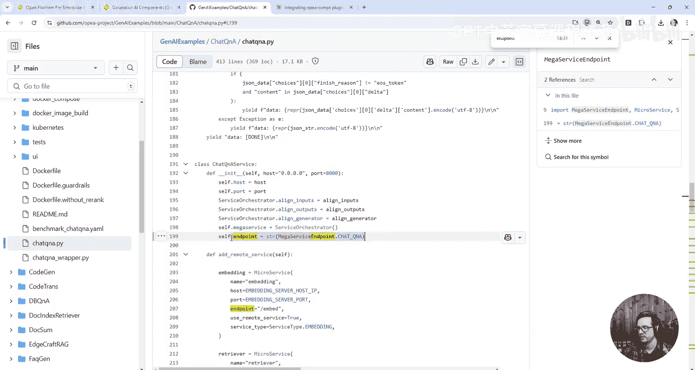

So I'm gonna ask you to explain this。 So， you know。I have to set an end point。Here is an example。

Of one。You know， you know， what could this value be？If I had to manually set it。Is it a port？

Kind of dress。With the port， it's probably whatever the local IP address with the port is， right。

 or just the port。So we'll take a look here and see what happens。Get， terrible networking。

No one should ever rely on me in terms of networking。So look into the code。

 it looks like it's just defined like that。Oh， okay。

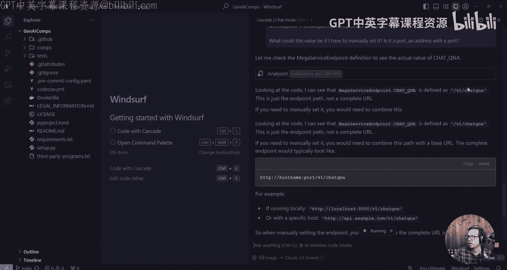

So let's go back and bring it over to here。And so this is self at end point。

 I'm going to define it up here。Ill just say self at endpoint。And this is going to be， you know。

 example。So that's now our endpoint。Maybe call example service。And we'll go ahead and hit up。

Example service has no attribute called handle request。Handled request。

 So that is another function that we need to find out about。 Let's go look at that。

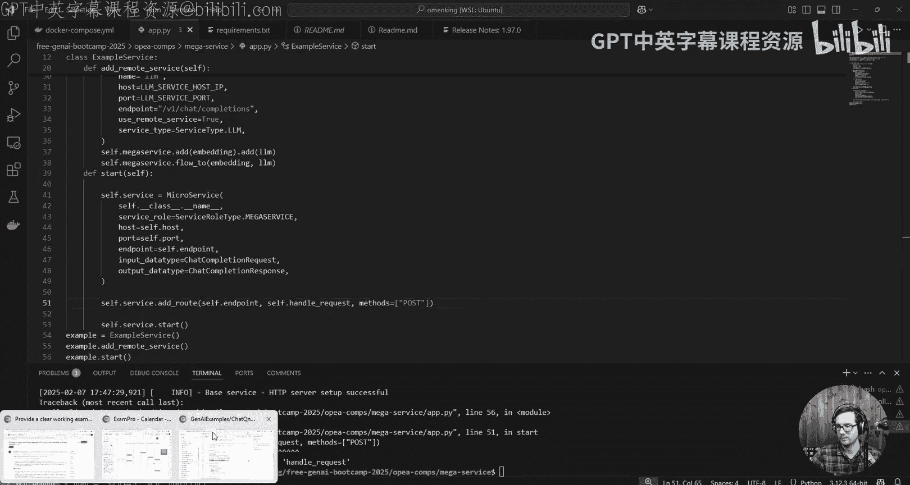

So that's a big function。 So if we get a request。We have to do chat completion request。

 parse the data， handle the message。We have LM parameterss， or parameters， we rank parameterss。嗯。

Choice append。So what I'm trying to figure out。Cause I don't need something that complicated。 Again。

 this is a very complex use case。But I wonder if we went to another one， if we had something simpler。

 right。Som trying to find one that is probably less common。And maybe visual Q& A。

 I'm not sure if all these look the same。They do。 Okay， And so you can see this one。

 this example here。

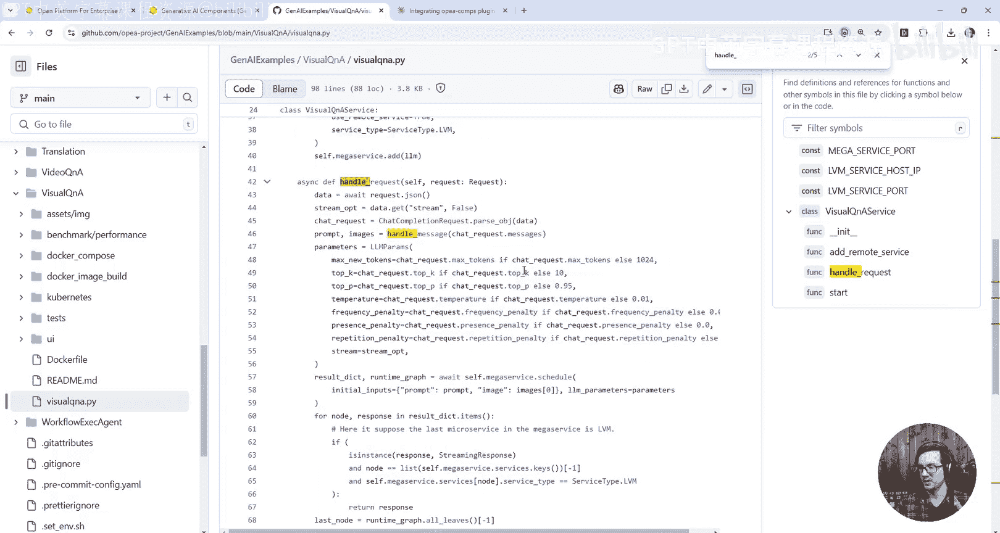

So I'm just trying to figure out like， okay， what do we have to do to handle the request。

So I'm going to do is copy this over and say， like， you know， I need to implement。Okay。

 and so the idea is that now can search comp the the the genetic comp。

 and maybe it can come up with something to fill that gap。

 But we're getting pretty close to getting something。 Now， again。

 maybe somewhere in the documentation， it talks about these components。But I I don't。

 I don't know where We'd have to pull all the docs and and ask it to， to， to go there。

 if we type in docs。No， but these are very specific docs， right。

 So I'm not sure how we pull in another ones。So we have one so based on your codinging components。

 I can see a simple im for handle requests that might work。

So here we have chat completion and response， schedule the request through the orchestrator， okay。

Create a response and have this return。 So I'll go ahead and copy this。

And what we'll do is bring this in here。Okay， and so now we， that didn't really paste in， right。

I'll put it below the start。In case we need to fix that there。

And then this needs indentation needs to be fixed。There we go。And so now we have something here。

 We are missing a few functions。I'm going to take a guess and assume that this chat completion responses is here。

Or sorry， chat completion choice。And so that's all that one。 but where does chat message come from？

Oh， over here。

Oh， okay， cool。 So we can grab this。coco狗。And that isn't the API。

 so we can go ahead and then just paste this in here。I don't know fast APIs installed。

Fast API that like that might already be something that O A installs， But just in case it doesn't。

I'm going to do Pip install hyphen R requirements TXD。And then we'll run this here。

And now we have something running。 Wow， did we get a service to run now， the thing is。

 is that there's no LLM attached to it， right， and there's no embedding model。

 So those are two things that are missing。 But it says our application is running on port 8000。

 I don't know what to expect。 So I'm gonna go ahead and just ping it really quickly。

 So I'm gonna say curl， local hosts。 Well， we do have some example code in this one here。Do we not？

 Yes， we do。 And so I'm going to go ahead and just make a read me here。If we get this to work。

 that's gonna be really cool。I'm going to copy this over here。And paste it in。

What port did it say was running on。 It was running on port 8000。 Okay， so do 8000 here。

 And it's was it version 1 example service。I don't know what we're supposed to ping it with。

 But let's go back over to thing。 It's like， okay， you know， my service。

My my class runs。can you write a curl command。I could use to test it。

Now I'm getting real lazy I'm just letting it do everything， but hey， it works really， really well。

So they have that one and the simpler one down below。We're not going to specify the model。

 It's going to be just whatever is running down below。 So we'll go back over to here。

And I mean， we could past both of them in as as a simple example， a more complex example。Well。

 let's try the simpler one here。 So I'm gonna copy this。I wasn't too far off。Will hit enter。

 So says cannot connect to local host or to port 0，6000， whatever。

So， we have this。I should mention， I'm not running。An LLM or an embedding。L M is this 6000。

Go trying to。Connect to a L on being served。Because I don't know what ports they're on， right？Yes。

 exactly。 So this is occurring because of this one， the embedding model or or which one。

So it says here because the service is trying to connect to remote service。

 you configure it as a remote service， the service is trying to connect to these services like port 600。

 but since you're not actually running alema and the betting service， the connection fails。嗯。Okay。

 so， but which service is it for？The the embedding model or the LLM model。Or is it a pipeline。

 And so there is only。1 port number。Cause remember's using a dag and stuff like that on on the in behind the scenes。

So give it a moment here。It's used by the embedding service。So right now。

 we're not running a betting service。 I'd rather just run。I'd rather just run the LOM。Okay。

 so if I comment out， if I comment out the embedding。And I just leave。The LLM。

 what port is the LOM expected to run on？Because that's going run on a very particular port。

We'll give it a moment here to generate out。I mean， this is talking about a very specific one。 but。

 you know， like they don't have our code， right。

But maybe it's starting on on 9000。 Let's go back and take a look at our code。

 Maybe it is defined in there。 and we're just being lazy， and we should just be reading our code。

But if we go here。Okay， oh， right here。 So 60900。 Okay， so it is on that port。So you know。

 probably what I would do is I'd like break the code up a little bit。

 but I want to take out the the embedding model。Ebedding。Again， I'm just trying to hack this here。

 I'm not gonna read anything about it， but here we see add the mega service。

 add embedding and then add LOM。And I don't need a flow to， maybe we just take this out here。Again。

 don't know anything about this。 but I'm just gonna go and add this one here。

And we're just gonna say flow to LM。 So we have an idea like how we can chain things together。

 There we go。 Okay， so now。We have those these set up。And so if we were to start this up。

 I'm expecting it to complain about 9000 now， which is what I would prefer。

 Soll go back over to here。 I'm gonna restart this up。Says one argument missing to service。

Where's that problem on flow2？Okay， so what if we just take out the flow to。And then we run this。

Po 8000。 Okay， that's fine。 We'll go back over to here。 We'll try this again。

And now it's about 9000 excellent。 Okay， so we don't need the flow because we wanted to go to the LM。

 And we just wanted to come back with something。 Now。

 remember that we had that other one running from before。In the OPA comps， I believe。

And I'm not sure is that still running。It is not okay。Depends on what， what state you left it in。

 But this is the one over here。 And this is from the last video that we did。

 I'm just heading up and running it again。 We have the documentation there。

 Just go back and check it。But this one starting on port 8000。 That's no good for me。

 I need this on port 9000。 So I'm gonna go back over to。This one， the O comps in here。And in here。

 it's starting here。 But I actually need it on port 9000。 That's where I needed to run。

 We could also change it the other way if we wanted to。 But this is the way I want to change it。

 So I' go ahead and hit enter， oops， try this one more time。It didn't copy and paste the right thing。

 So we'll go ahead and hit enter here。And so this is going to start up on port 9000。 Now， we didn't。

 we need to make sure that this works。 So I'm going go ahead and change this out to 9000。

And change this out to 9000。Okay， and。We need this model to be there。

 but I don't think we have a model。 But let's go ahead and take a look。

 Maybe it is there and it's cache， but I really don't think so。

So we hit enter and so it doesn't know what the model is because， again。

 it's stored within the model， as we found that before。 So we'll go ahead and hit enter。

 And this is gonna pull the Lama 3。21 billion model。

There's probably some way that we could solve this， but this is how we're going to do it。

But the idea is that once it's pulled， we'll test that it's running。

 And then once it's working there， I'm hoping that if we hit it there。

 our mega service will work and we'll be in good shape。So we'll wait a little bit here。

 It shouldn't take too long。 but I'll be back in just a moment。 Okay， oh， no。

 I don't have to go anywhere。 It's already done。 So let's go ahead and invoke it and see what happens。

 Will'll it enter。Okay， so now we're getting output。 So it's working perfect。

 We'll go back over to here。 We'll hit up。Right， and so this is now going to the example service。

 We'll hit enter。 And what do we get back with。Did it work。I can't tell。

 So I'm gonna take a look here for a second。LM microservice core dump。 Did it work。 I don't know。

 Let's go back over to here。So， it says。Faaiil to establish trace or connection。

 I don't know if this is recent。 So what I'm gonna do is stop this。 Start it back up。

I'm going go over here。 does this start up other containers。It does not。O。

And I'm going to go back over to here。And。We have 48000。And we're going to go ahead and hit up。

And we'll try this again。And the reason I did that was I wanted to see if we got an error。

 So now we get a 200， right， We got a 200。But then it spit back， connection refused。Okay， so 200。

Connection refused。Max retrys succeeded with URL。So I'm not sure if its because of that streaming issue。

 So if we go over to here。Right。What I'm looking for， what's this mess。All those are just logs。

 we'll close this out。That's just logs。But if we go back over to here， I mean。

 this should this should tell us something when something happens， right？

Let me see if I can split this。Cause this one here is our top server there。

And then there's this one here。We can't really split it the way we want。 Let's file me。

 but I can still run it in here， I suppose。But I w to go back to this one here。

 I know it's a big old。 wow， I can't say anything。 What's going on here。

But I'm trying to get this curl here。 I'm trying to get this curl。

 And what I'm trying to do is observe what happens。It's not copy and pasting。I'm trying to。Observe。

If this moves it all。 So it does make it to the  laama server， right。

 So it's going through the mega service。And it's sending it over to here。But whatever comes back。

It does not like。But we are running Ola。 Remember it's sad that it shouldn't work with Olaba。

Maybe it doesn't。嗯。

So we're going to copy this。So I'm gonna to tell you， like， I now have my mega service running。

I have O Laama running on port。9000。I can see。The request makes it。To Oama server。

This is what I get back。As an error。We'll see what it says。

 and maybe this is where we have to use TGI。Or Vlm。It's coming from open tometry。

 trying to export trace collectors that isn't running as key part。

 Your request of the LM service worked。But your telemetry is trying to send data to port 4138。

 which is the default open telemetry report。 Oh， that makes sense。 Disable open telemetry。 Okay。

 so maybe that's what we can do for now。 I don't know if that's in our code。

 Let's go take a look here。

Open telemetry， telemetry。

It's part of the framework， right。Okay， according to this， you can customize the endpoint。嗯Okay， so。

 but。But how do I do this in my code？And maybe we'd to look at another mega service for that。

So maybe here it's suggesting to do this。

Now， you'd obviously want to have open telemetry， but。For this particular part。

 I just want it out of the way。 So we'll go here。And。We'll try this。

 And so now we'll stop our mega server， Start it back up。I'm gonna hit enter。 Who， that's the best。

 We'll try that again。 We'll hit enter。That's a crazy mess。 Now， it might be working。

 We're just getting weird output。So it's still saying it。

People don't know， like for open telemetry is a way of。

 it's like an open way of tracking stuff for logs。I mean， if there's something wrong going on。

 we might want to actually see that。

Oh， is there a decorator there。 I didn't see it。There's no decorator。Okay， well。

 besides the open telemetry issue， how am I supposed to know if this worked or not。

 Because when we do this。We got this weird output。 and I can't see what's going on， right？

 So maybe what we can do is say， like， okay。

Can my curl dump to a file。For the response， it can。 I just don't remember how to do it。

 I think like， literally might just be like， like like angled arrow in there。 Oh， it's just， oh。

 okay。So for output， let's see here。Okay， so it's as simple as this。

 So what I'm gonna to do is go back over here and gonna type in clear。 I'm just gonna hit up。

I'm going to put， it's not typing now。 say output dot Jason。Okay， and so now I'm ty in clear here。

What is going on， I think that that just might be bash。 We'll reopen this here。And in here。

 we have that I'm going just say output put Json。 And so this is the response that's coming back。

So here we have choices， message， assistant content。So go back to this。 we'll say response。

This is the response I get。So it says I see the issue now in your handle request。

 you're directly converting the raw response from the LM service to a stream which is exposed to the internal streaming object。

 let's modify the request handler。

So go ahead and copy this。Okay， I'm gonna go down here。And we're going to pace this in。And so。

 now we have。This new request handler。Has changed it。 So better handle streaming。

 Let's go ahead and try this out。 So we'll go back over to here。 We'll stop this service。

 We'll start it back up。 That's the mega service。By the way， if you're watching us' going， Andrew。

 how do I keep up with all this stuff， just watch it。

 just watch what we're doing and then try to work through yourself and just recall like oh where Andrew had trouble or techniques that we use to debug it and if you can't get it working。

 that's totally fine just just absorb what you can as we will cover OPA again and we'll have more domain knowledge and more help and so it'll be less of a pain。

So I'm just trying to get this curl。嗯。We'll go back over to this one here and read me。

And I'm just gonna say hyphen here output to Json。Well， first， let's try it without that。

 Let's see what happens if we just do it the regular way， because maybe we've fixed it now。

And so now we actually get a response back。That's not spitting everything everywhere。

But it's still not telling us anything， right， Like， we see this。That's great and all。

 but that doesn't tell me anything like， I have this。

Now， this is what I get back now。It's that handle， that's that handle function。 It's。

 it's really tricky，Maybe what we need to do is give it like some of the code to see what it's getting backcause I don't think it understands what it's getting。

Here it's changing for streaming。So you can see like the hardest part about these LLMs is just processing the data。

So really interesting。 So we'll go back over to here。 and I'm gonna grab this one here。我赔死的。

We'll save that。Okay， and we'll hit up。Well， we gotta stop and start it right， So we'll stop it。

We'll start it。And then we'll try again。And still， the message is。Content， no response。

 content available。Is that what we got before？诶。No， it's， it's okay。 So we got this。

Do you think this has to do with us using O Laama。It's going out to the Internet and checking right now。

 That's what Winsurf is doing because， again， it said that it had to use TGI。

 but they're using standard APIs， it shouldn't really matter。Yes， okay。

 So here's expecting a different format， okay。Now， maybe we got them。 Now， maybe we have it。 Okay。

 let's see what happens here。 So I'm gonna go ahead and copy this。

Fingers crossed。Let code here， sorry。I don't know what this file is。

But we will go and bring in our new handle request。Alright。

 since we seem to be doing this handle request though。

 I almost kind of wan to make it its own module and and then import it that way。 So now we have this。

 And so it's going to。But say llma too， or whatever molly you're using， which is not this。嗯。

This is Lama 3。13。2。1 B， I believe。 Yeah， yeah， yeah。嗯。Is that just going to work。

That'd be really nice if it just works， but。I'm a bit hesitant to believe that might work。

Here it's suggesting that we need a bit of a different output。

 Let's go see if that makes a difference。

It doesn't know that there's a lama 3。21 billion。 So I'm gonna go over to here。

I just want to make sure that I'm copying this exactly right。我。3。21 bill。And so we'll copy this。

We'll type in clear。We'll go down below。 We'll hit enter。

 And so this is gonna to give us an output here。This one's called response。 I'm just going to cat。

The response。And so we're still getting that thing。

 So what I would say is that there's something wrong with our returned output and how we're handling it。

 It's clearly going to the the， the the server and coming back。 But this is where the tricky part is。

 right。But， you know， I think that unless we find an example， I think most of them are built around。

嗯。T GI， but there might be a mega service。

Specifically。For this， remember chat Q and A， if you go here and you go to Docker composeose。

And you go to。Intel， and you go to CPUU and you go to AI PCC。Like what what is this one using， right？

Like， look， this one's using  laama。This one's using old Lama with 3。2。 So clearly。

 there is already existing code here on how to handle it， right。

So maybe that's what we need to be looking at。 So let's click into this one here。Now。

 this one's a little bit different because it's running everything。As composed files。Right。

Now this is kind of how I envisioned it earlier， but it's running as composed files。

 but there has to be like some kind of entry point or something in here。So we have this one。嗯哼哼哼。

Talcker composed yael。So somewhere in here， there must be like a chat Q A。

 And so I guess these are all the services that are underneath that it has to reference in the mega service。

So I think this is the one。 Maybe it's this one here。That is responsible for the orchestration。

 but there's also this one Yeah， this one's U Y， so this one's just chat Q A。

That makes me think it's running this one here。Okay。But anyway， the point is。

Cack Q&A is clearly configured to work with Oama and despite what the documentation says。

 it clearly can work with Oama and what we need to do is we need to figure out exactly what the request handle is。

 and maybe it's just a matter of copying the one that's in here。Or working through the code in here。

嗯。But we'd have to do a little bit more here because they have this handle message here up over here。

And maybe it's this。But this one is handling a lot of different use cases。

 so I'm not sure about that， but we're going to pause it here Currently。

 I do think that we did get quite far through it。But， you know。

 I don't wantna exhaust everybody here。 And we're just gonna park it。 And maybe in a future video。

 I will solve it。 Okay， but yeah， chhow。

