# ExamPro《生成式AI训练营｜Free GenAI Bootcamp》中英字幕（deepseek - P29：-29-Vocab Importer with Brian Hough.zh_en - GPT中英字幕课程资源 - BV1SFEWzLEab

Hey everyone it's Andrew Brown and we are here at the Free Jen A bootot camp I'm joined by our guest instructor Brian as we are going to be developing an application here for our week one or week two。

 depending if you count from zero， boot camp and so you know in this session I want to see if we can build out our Lng Port or not Ling Port but our Lang and Porter。

 but before we talk about that I want to give Brian an opportunity to introduce himself to our boot campers and so I'll hand it over to you there。

 Brian。Awesome， yeah， thanks， Andrew。 Yeah， everybody。 My name is Brian Huff。 I am from Boston。

 It is very cold where I am very， very chilly。 It was like 13 degrees yesterday。

 so I'm still falling out but I would say I'm really excited for this boot camp。

 I'm really excited that Andrew is creating this。 I think Jen AI AI skills are like hands down any developer needs to know these things。

 So I love the whole like open source education。 I got into this space through open source projects and hackathons。

 so this is very close to my heart and that goes back about like four years ago。

 four or five years ago。 So've been coding since then I am a very proud AWs community builder。

 that's really how I got to start working in the cloud and building applications like what we're gonna be building today。

 and I became an AWs hero a year ago。 So I've been really loving building a lot of like advanced cloud architectures and just like hacking。

😊，undAnd learning how to build stuff。 So that's what I do with techt playbook。

 So I make a lot of content on YouTube and then I also do a lot of work for clients。

 So yeah excited to be here and thank you Andrew for having me with you and yeah so today we're gonna be building an Azure I'm just joking but would that be I be hey we can we can I'm okay with it but I'm gonna go just ahead and share my screen and I want to just get boot campers prep here to see what we're jumping into first and then I'm gonna to hand it over to Brian to drive our development here today so the Vocab importer。

 the business goal here is that we want to I'll just read it the prototype of the language learning app is built but we need to quickly populate the application with wording word groups of students can begin testing the system there is currently no interface for manually adding words or groups and the process would be too tedious you've been asked to create an internal facing tool to generate vocab。

And when I say internal facing that means it can be ugly。

 it just has to be functional be able to export the generated vocab to Jason later for import we'll talk about why in just a moment be able to import JO files which the system already does but it'd be nice if this app as a stretch if we can get it to do it so the technical restrictionsion since this is an internal facing tool the fractional CTO wants you to use an app prototyping framework like radio streamlit fast HTML what we're going to show you here today is dealer's choice so Brian can use whatever you want I put radioio streamlit fast HTML here for boot campampers because these things are like dead simpleim to use but we might use something a little bit more more complex here to kind of show you what you might use beyond that and then you can use whatever LM you want is serverless managed LLM API or local model however you need to get it to work deepse doesn't matter to me。

Google Gema or Gemini or Gema， which is very popular。

 but I think Brian is very very very much liking G。

 which is a managed serverless API that serves up open source models but it's really really really really。

 really really really， really， really， really really。

 really fast really fast and it has a very generous free tier so it's perfect for this boot camp but anyway I'm just going to pull up the L portal application here I do believe I have it running。

😊。

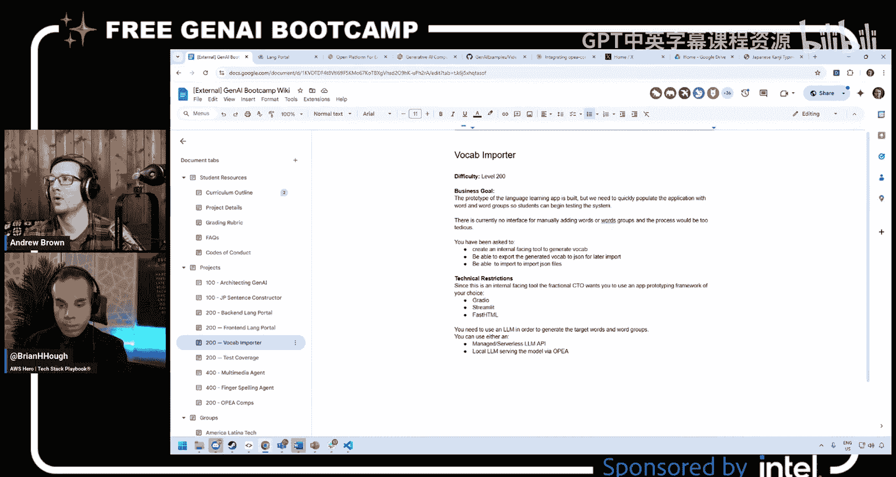

But to get a running， I'm going to just stop it here for a second just so people can see it。

 but it's not really important to get this running for this this thing， but you know。

 if we want to do it， we do Python app on the back end side， we'll do。

Mpm Run Dev on the front end side。But the database has to be imported， so we have an invoke init Db。

And that will create a words dot pi。Words up high words dot Db。

 But what we're trying to generate out here， this is the C data that's getting loaded into our database。

We're trying to match this structure of outputted data so here is a bunch of adjectives that go into a word group called adjectives this one's a bunch of verbs and so that is what we're trying to output as our end goal here but I'm going to guide Brian through the technical requirements but and Brian's going to be the one that's going to be doing the implementation so I'm going to get my screen out of the way here I'm get let Brian go ahead and share his screen are we going to use any fancy GenAI tools to generate out UI and do some exploratory tool checking。

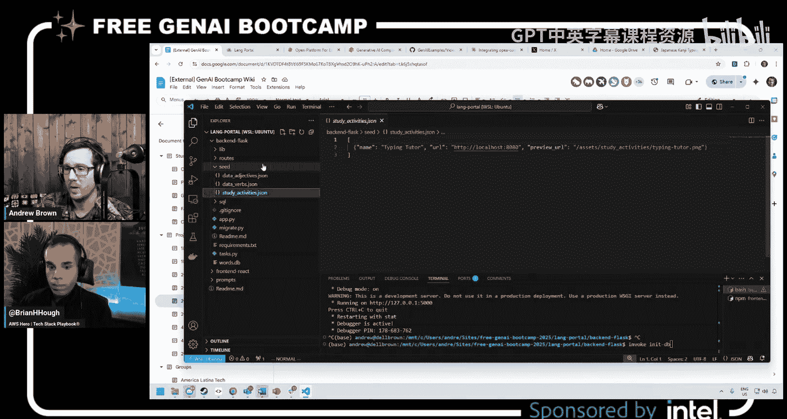

Oh absolutely I thought that this would be an opportune time since it is a GenI bootc for us to use some GenI tools that'd be kind of lame if we were like now we're going to like code manually。

 what is this。But， I mean， it's not bad。 I mean， often I switch back to manual coding。

 but it's it's kind of incidental。 I don't even notice when I do that。 Yeah。

 I feel like it's it's helpful getting started， it's like once you have like repeatable frameworks。

 it's kind of like cloud formation right it's like if anybody doesn't know cloud formation。

 those are like templates to make recipes to build cloud systems。

 So it's kind of like instead of you clicking in the console like make this database。

 make this authentication system， you can just like write the same script and then just deploy it So makes it really easy。

 when you have your boilerplate， yeah， it's you don't end up leaning into it too much exactly。Okay。

 cool， I'm going to share a window。Let us see。There we go I'm going to bring up the screen here and we can see it and we are over at v0。

 dev so v0 is a product that is produced by Vercell。

 which is also the company that makes next JS I think that it's optimized specifically to produce next JS code but it's also really good at a frontronend react you don't necessarily have to use it for next JS and so I guess we kind of need some kind of interface and so I'm thinking like if this la importer it generates a vocabulary。

 it'd be really nice if we could give it some human text to say give me vocabulary for。You know。

 like tech words and whatever， and then it would generate out that information but。

But I guess the thing is that we need to describe what our application is， yeah。

 so give me you know a vocabulary language importer。Where we have a text field that allows us to。

That allows us to import a thematic。

Thethematic category for the generation of。I know we're repeat words but language vocabulary。

 you know， the APIN you know， when submitting， when submitting that text field。

 it should hit an APIN point that would invoke， we could even tell it to say like go invoke an LLM in GO。

I'm not sure if it could do that， but it'd be really interesting to see what it could do。

There's so many ways to write this， but we'll just do whatever here and we'll see what comes out。

So say like on the server side and then pass that information back。To the front， the front。And。

This I guess one oh sorry one key thing that's really important is that it has to produce the structure Jason output I haven't provided you the structure yet。

 but I guess I could provide it to you I'm not sure if it would be too much for it。

 but I'm going to drop it here in the chat I'm going to drop it in our in our streamy chat。

 which is always easy to find。Perfect， okay， I have that open。Or if you can find。

 I never can find anything， but。Okay， cool。 So， it has to create a structure， just an output。

Like this example。The Json that is outputted back to。The front end should be copyable。

So it should be sent to ateer。An input field， and there should be a copy button so that it can be copied to the clip board。

 and that should give an alert that it was copied。To。And when it's done processing。

 it should make like a toaster ding sound， I'm just joking， oh yeah。

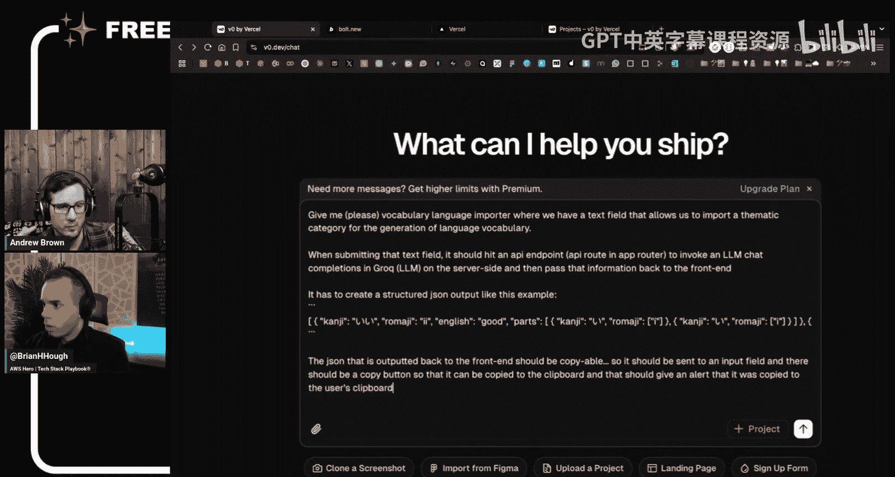

Speaking of toast， have you used toast notifications those are always fun Oh。

 you mean just like in your in your UI I remember back in 200 five or six when I was getting really into programming for Mac。

 it was like the rage to integrate with toast。Oh yeah。 it's， it's great。 It's fun。

 like a little like pop up notifications。😊，Okay， I think we've got everything。

 I did copy your instructions。Sure go。

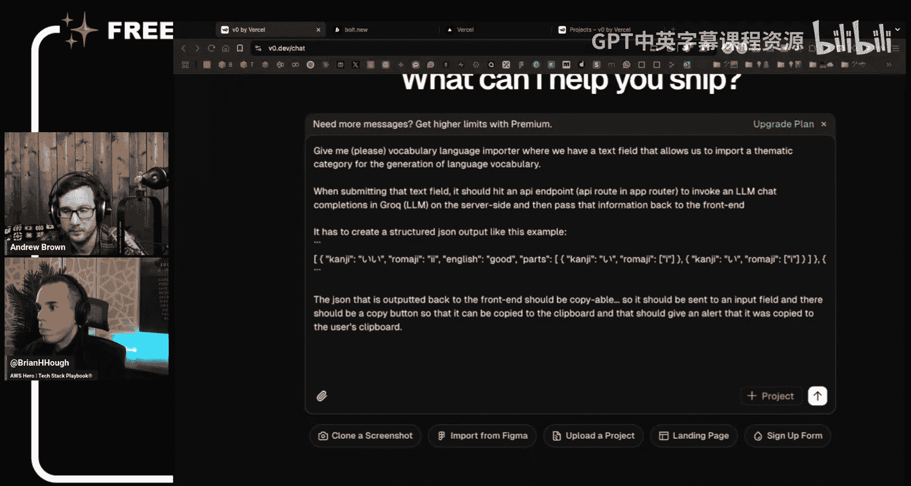

So I think that makes sense right a lot of this I feel like is prompt it's like prompt engineering because if you write a really good prompt it it sets the tone for everything Oh no this is prompt engineering yeah。

 there's lots of ways to do it， but let's just hit let's just hit it let's let it rip and see what happens I'm also going to copy this just that's probably a good idea Yeah if we want to。

Use another AI tool。 cough， cough， cough。 We can do that。 Okay， cool， All right， so I'm going to， oh。

 and then in terms of technical requirements。 So the app should use app router and the latest version of next JS。

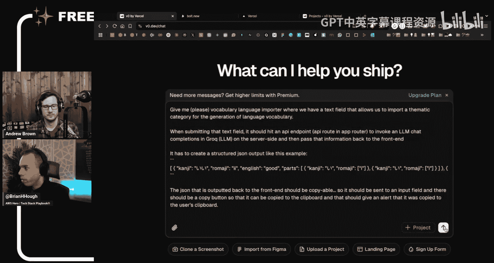

And the LOm。LLM calls should run odd。An API route。On the server side。Okay， I think that should do it。

Go for it， yeah。Al right， so I'm going to upload this。Oh， it's thinking。

Can we just talk about how cool this is， Like， we're living in the world of。

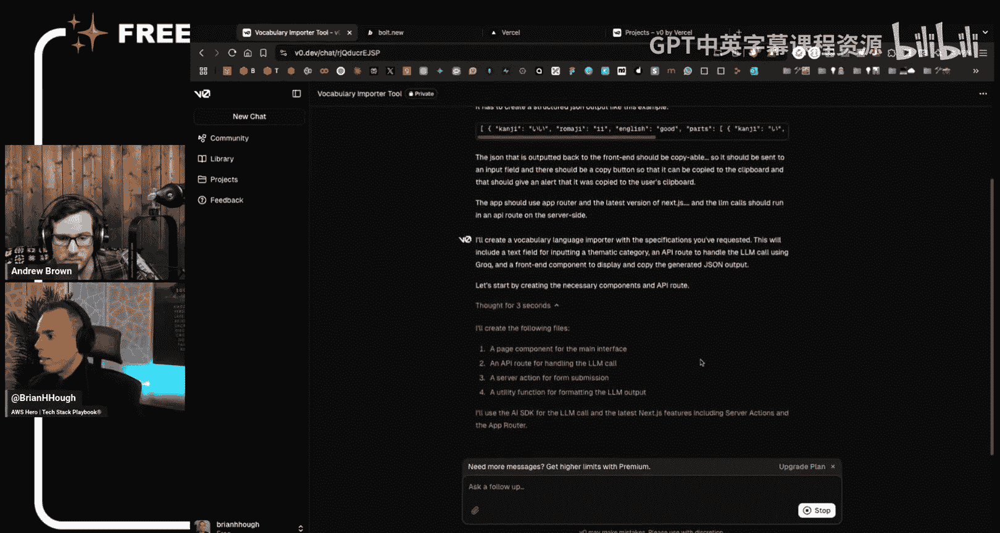

AI make I could never have imagined this when I started learning how to code。This is nuts。

The question is are we going to see better apps or just more true like know what I mean like actually work with all these well no。

 I mean like with all these advancements， it really comes down into the people that build the stuff and so do we actually get better better apps built out or does it really come down to the individual But another interesting thing is like you know people think that no one can build another social platform like social developer platform or just the social platform in general。

 but turns out like old ideas are always new and until somebody builds it again and does a better job or gets everyone to use it it always seems almost impossible but we have our vocabulary language import porter。

 we have a field it says generate vocabulary but the question is what does the backend look like did it finish？

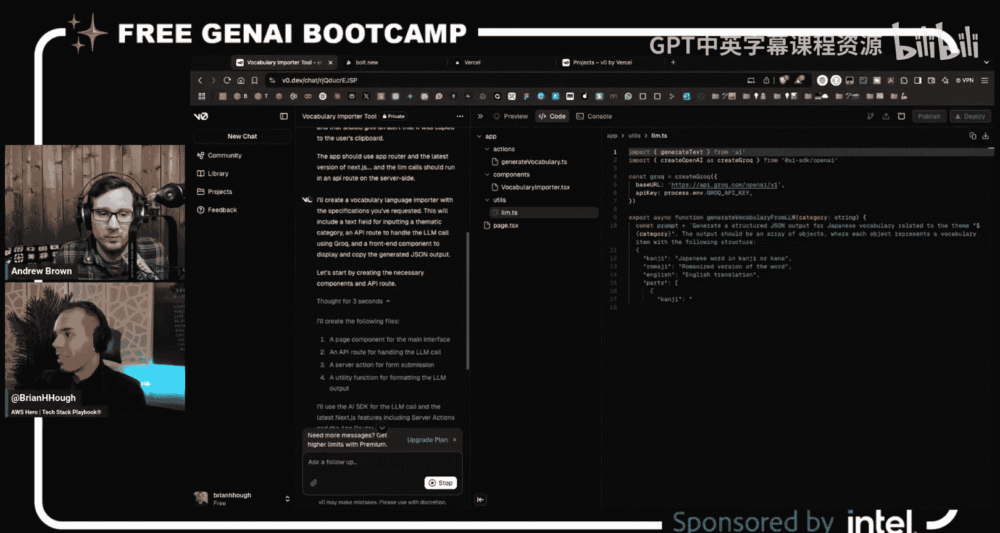

Yeah。Well， it finished， but it doesn't。 So it's gonna have this like E and V local。

 but so I'm going to go off screen because I don't does VO let you do secrets if you go to the left hand side here。

 I'm just curious if you scroll the way down， did the did the first self finish。

 I can't tell sometimes unless you scroll all the way down。 Yeah， I did。

So we have the G API key and you know what， if if you're worried about it。

 I'll just give you my key because I'm we can rotate these out anyway before the end of the video。

 Oh no， I was just wondering， like， if we were to deploy this， I'm just wondering， like。

 is there a way to like give it secrets So that like when it deploy， it could do that inver cell。

 there is。 Yeah， there's definitely a way to pass it， but I don't know what it utilizes。

 you could also just ask the prompt。On the left hand side， if you wanted a publish a vercell。

That's true I want to be a little cognizant of like not keeping up token I don't know how many tokens I have left not many not many Yeah but you know maybe I'll go over to Claude and I'll go ask Claude real quick Claude's a friend right and so Cla and so I'll say for a for an application that is deployed to Versll。

Is there a configuration file to load NVs？Because I feel like it's going to tell us to do that somewhere else。

 Yeah， the example would make sense， but。So oh yes。

 let's create a dot EV dot local file for development。

 but most importantly the production of for sale。 Okay。

 so's saying that so I'm going to ask it like does the dot Ev dot local I don't know we can see what I'm writing here。

 but well， you know what I can。I can really just show my screen while I'm doing this I'll stop oh yeah I don't know even have to stop we'll just flip between them but does the does the yeah。

 just reshare yours and it'll sit in the bottom there， but does the NBA local get committed to GiHub。

I let's just see what it says there。No， it should not be committed there。 So we have dot V dot local。

 So I'm assuming that it's not going to get committed， but what we should do。

Is maybe we'll bring back up your screen here。And before you put in your API key。

 I think we should do a quick test。So yeah， just when you get a moment。

 they're pulled back up your screen。

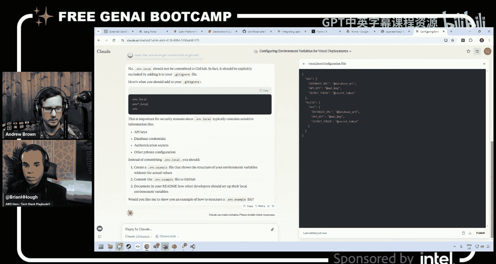

Okay， cool， try and add my key now or no， we'll add it afterwards because let's let's see if we can sync the repo to GitHub first or create one first and then and then we'll see what happens。

 yeah。Because if it doesn't take the fall over， then we know， right？True true。All right。

 share my screen。Sharrry window。And so we'll bring this all the way back up here and just before we even sync it I'm just curious about the backend code so we have UTLs and you're going to have to help me because I'm not the best at next GS。

 but UTLs LLM I'm going to assume that contains our LLM code if we go into that。Yeah yeah。

 there we go。 Oh does it it uses AI SDK。 It's actually using， is that， is that the verll AIS SDK。

I think so or do we get access to the to the package at JO I feel like it's like missing some stuff let me like you don't see everything in here like the node modules and stuff。

 So okay so but AIS SDK is is verll in the Jeni essentials people are saying Andrew。

 why didnt you cover you covered you cover some things in Verscell。

 but you didn't cover the It I didn't think it was that interesting。

 but now we're covering it so I've covered all bases here but the code looks really good here it does ask for output a Json the only thing that I'm not sure if it will do is that is proper JON output normally starting Json's a real pain in the butt。

 but I'm really surprised that it has everything here， but maybe what we'll go do is。

Publishes to GitHub， So one of those buttons up there， like there's publish and deploy。

 what if we click publish？

Does that go to Gitthub？the oh to the community for users to view and use all publisheration are subject to review now not really what we want that sounds more like like a thing to share apps。

 but on the left hand side there's like three buttons what's the first one。

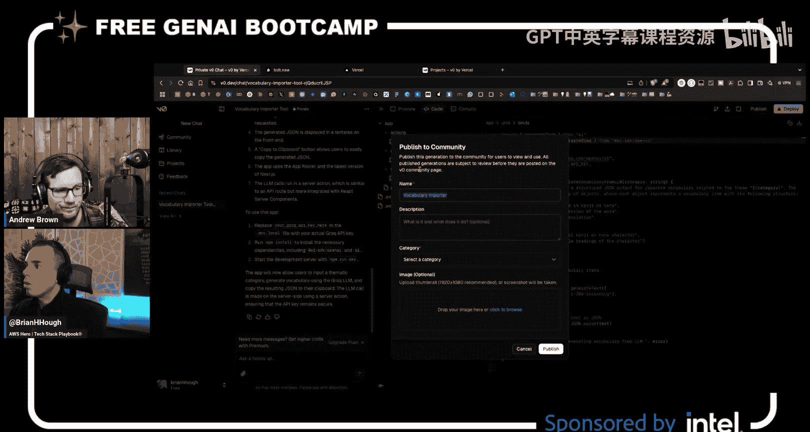

Oh， this is four four。

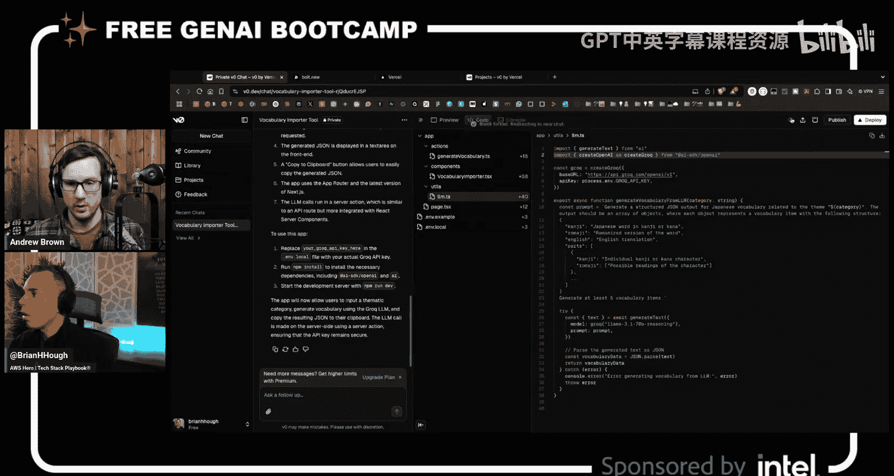

I think it forks it in this thing。So it's not going to like fork it to GitHub。

 it's just going to make another fork in this one， it's not a big deal。

 but what if what's the other tabs there there's like a download and a third one。

 what's the other ones？

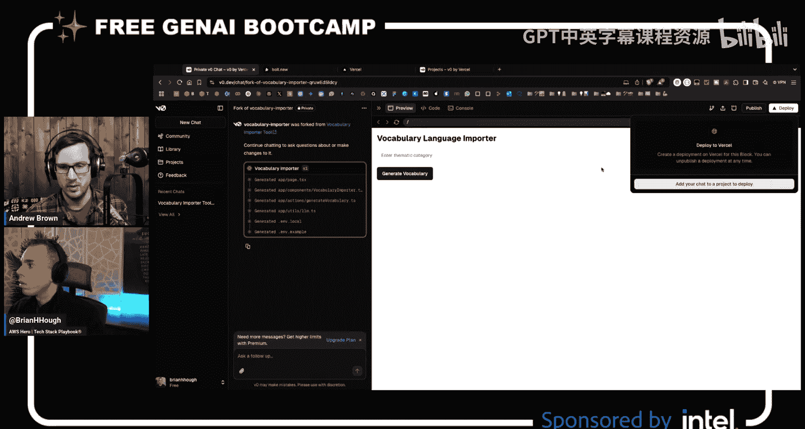

Yeah， there's download。 there's share。Oh， so I guess that's like if I wanted to share it with you。

 like you could get access to this chat。

So we can say v0 syncnc to Gitthub， is that something it can do？

How can I make a project from v0 to GiHub for anyone coming install a fresh copy next Gs。

 install the thing， add to Cobase。 You know what， I'm remembering this now。

 and I think last time I used it， what it did was it gave you something like a like a one line it gave you like code that you could drop into your thing and it doesn't sync to Github So let's go take a look at the download maybe。

In the top right corner here。Yeah， I did that。 That's what it does。 So basically， you。

 you initialize a new project and you do NPX Shad Xen ad and it will do that stuff。 I can't。

 I can't imagine bringing the back end code， though。How does that make any sense？

 So maybe we should just download the zip。That might you got in forbet， yeah。

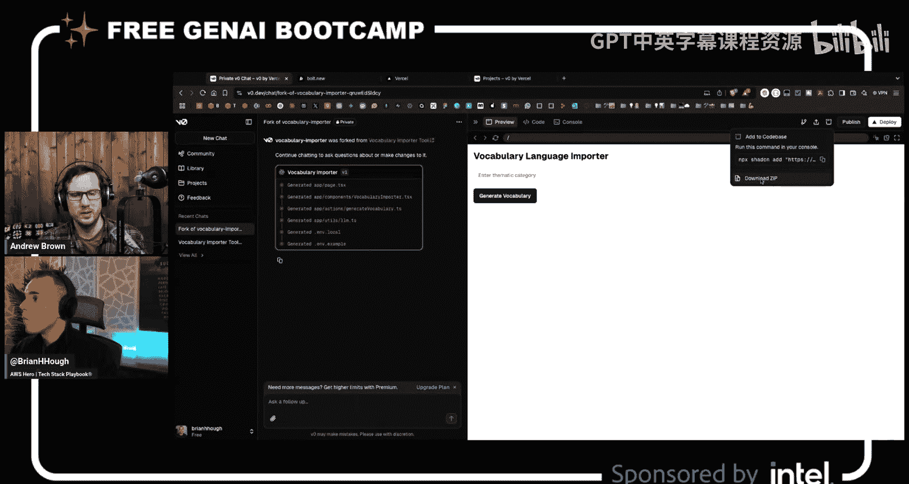

And then do you have a favorite editor in particular？

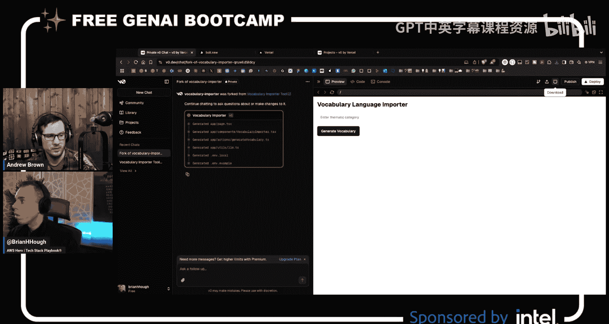

I wanted to like， see if we could like， go into bolt， like， if we can like import it into bolt。

 But I don't know if we can do that。 not B is like， it will generate the front。 Like。

 I don't know if it'll do the next yes part， but it would just do the front end。

 but our front ends done。

So， let's do1 because then we could like share it together， we could like， okay， sure， yeah。

Does it have a it have a server attached to it too？

Yeah， yeah。 we so we can do so we create， we could do like off。 Oh， actually， interesting。

 Maybe we could do。 I've never used it。 So I'm excited to try out code sandbox。😊，Yeah。

 let's try app router。 I'm gonna to try like。Try this。

So this will create basically a server for us to run our code and then。

I think we can just upload the code here。But yeah， I've been using code10 B andrup it quite a lot because you can actually run what's sorry。

 what's the other one there。Oh Replet oh Replet yeah， yeah。

 that's another one people keep u keep bugging me to use it's been around for a long time。

 butum I just never got into it and I guess it's been there's been more talk about it as of late。

Yeah， they have a very cool AI assistant feature now in Relet so you can like if you like you run into errors。

 you could ask your assistant to like help you code it out it's pretty cool。Okay cool。

 so we have our we have our app now if I it looks like all the stuff we didn't see before are now here。

 right？Yeah。Oh， this is really interesting Okay， there there was a lot of stuff that it did not did not share。

 that's interesting。Like， I don't see the。This was in the zip。

Oh there it is yeah theres a lot of I need to like delete that。

I want to oh did it did it put it inside of itself or something weird Yeah。

 I think I need to like bring it to the outside okay。So if I do that， yeah。

 do you want to replace it， replace。Actually， I kind of want to replace everything。Go for it。

Okay， we're living dangerously。

You got bears in your neighborhood too？I was going to say like either this will work or it will not。

 we'll find out how dangerous do you want to live？I'd say a fair amount of danger。

 but like not too much， it's like the discretion。 Okay， so put the put the axe away， got it。 Yeah。

 no axis， maybe a hammer， hammer too。Okay， so now what we can do is where's our server。

I got to hammer here too， I got everything。Nice， there we go。Okay， so。

Sometimes you have to like restart the Docker Damon。So Code sandbox。

 is it just like Gippodd or it's just developer environments？Yeah， it's like micro Vm。

 so you sort of create these isolated。Like Docker containers that can run your code for you， okay？Um。

 or not，um， but it literally is micro Vm architecture like firecracker or microVm。Yeah。

For those who don't know， microVM is a lightweight type of virtual machine and yeah it's just there are just very efficient virtual machines that usually spin up very quickly and have a very small footprint。

They do that with some kind of magic， I believe。It is magic。

I wonder if we imported it and it needed something。I don't know。That's interesting， okay。Can we like。

 undo this。Because what we could do is just recreate this again。

 which I think we might want to do All right， let's go for it。

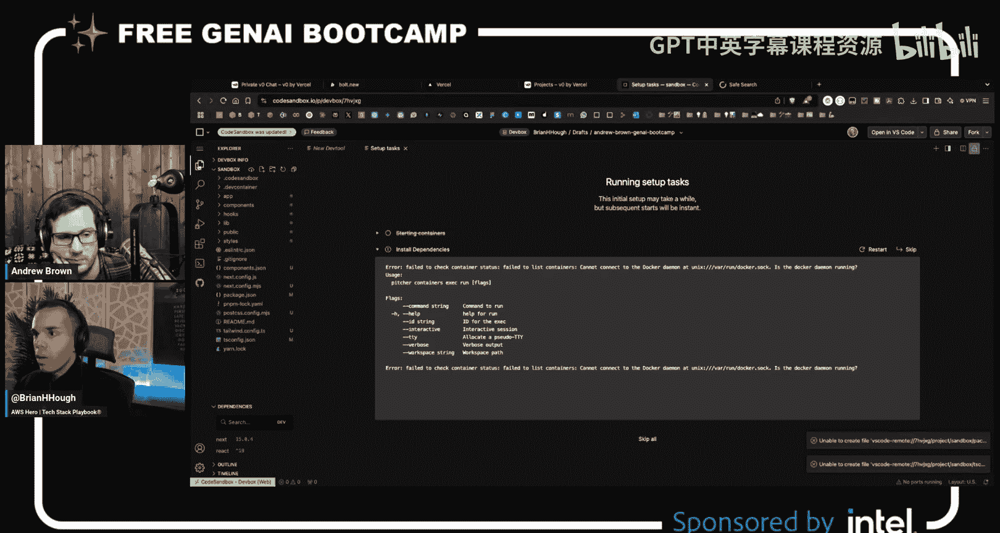

And then we could just drag them individually。 This is。

 there is like no documentation about doing this。 So we're gonna try to see if we can do this。

 Otherwise， we can use Ret。 I sometimes alternate between them for next Js。 Well。

 I wouldn't mind seeing Relet as well as as again， that's been one that I haven't ever gotten around to。

 so。

Okay， so this is going to start again。Yeah， I feel like sometimes they'll be doing maintenance。

In like the evening times， which is like when working like working on this， so it just like might be。

我 see。

I'm going to。Yeah， that should be fine。Now how， how did you get the code in here。

 Did you upload it somewhere， I， this is， this is just a template like the starter。 Oh。

 so you launched it it had。 And so you're trying to rip it out and then import it so that you're at a base level。

 I see。Yeah， yeah， I think。Yeah， I don't know they might be doing some work on this right now All rights let's give Rea a try again。

 if we're just taking a look here that's fine as well。

 but let's take a look at replic because again I don't have any experience with it and we can at least get some exposure to that one as well that might be interesting。

Yeah， let's do it。 Okay， cool。 Alright， so I'm going to。And what does Replepl do That's really good。

 Is it just fast or it has an I Ui or a little bit of both。

 like it's kind of the same as code sandbox。 So this this is Replet。 So when you want to， you know。

 provision， you know， like repo， you could do like a template。

 So they have some like already created templates。

But if you want to do like next JS。You do next JS， I want to do app directory， yeah。And then private。

Create app。And then it looks a little bit they even have an assistant here that's interesting。 Yeah。

 I I think's the thing I heard is that they have their， yeah。

 that was the that's why they were people were talking about them about their assistant。

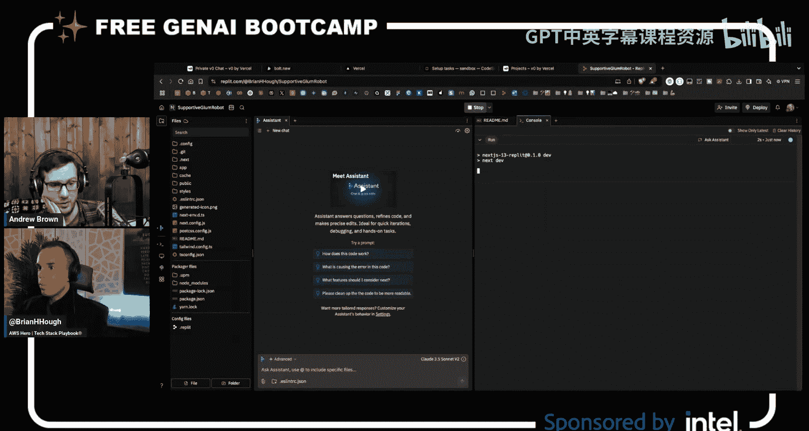

嗯哼m。😊，It's one of the only ones I actually haven' them checked。Yeah。

 it can be very helpful and it actually has helped me with like debugging things from time to time。

So。

This is repplet。And we're going to hope that this work。

There we go。 Okay， cool。 So what I really like about these types of cloud environments is that。

 you know， you have your files here， you can code here。 So like if we wanted to code on this。😊。

We can like move stuff around， we can like bring routes here and then it'll update over here so like it's all kind of all in one and I like packaging this type of stuff up so you don't really like is it running on this thing or running on this thing Another thing that becomes really helpful for people is shells so it's not like this is like devoid of doing things in the terminal so you can like install stuff you could also be running like another server like while this is running which is like pretty cool so。

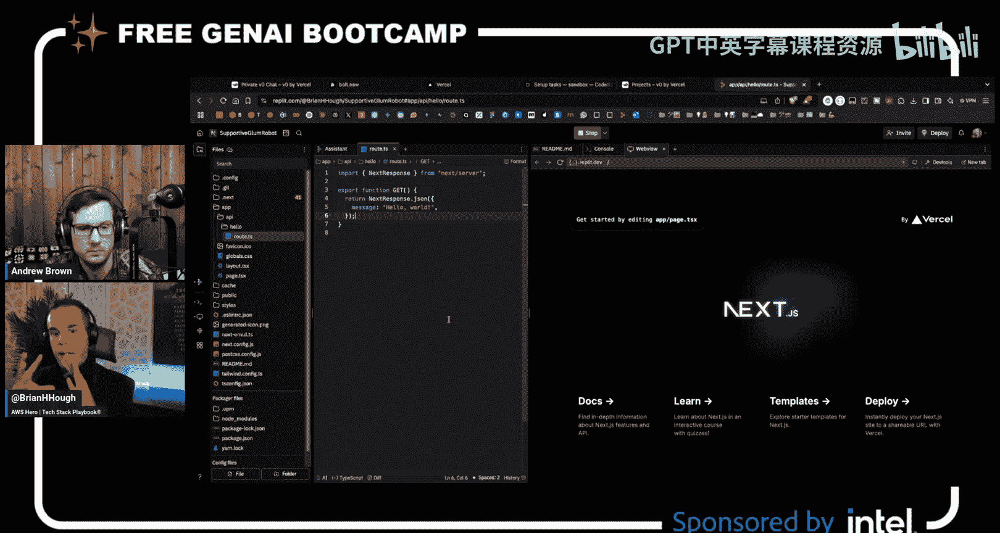

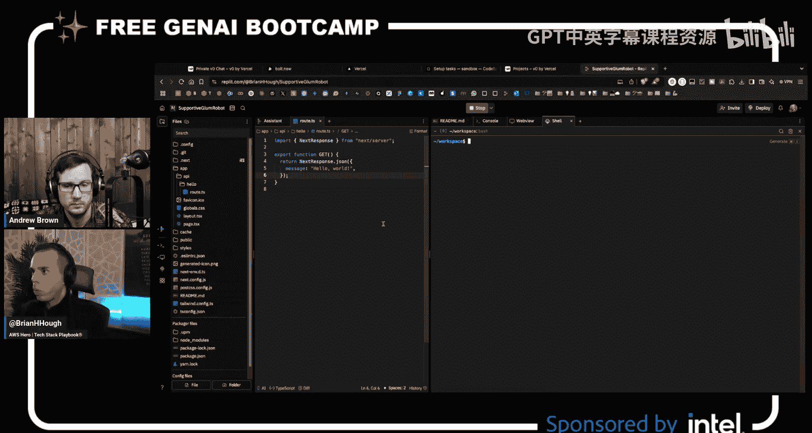

I really like a lot of these like cloud environments to， to code in。 Okay。

 so let's see if we can get our code imported over。 So I see。😊，I don't know if you can see my screen。

 but there's like in the zip， there's like some components。 Yeah， we we only see the browser， but。

I see on components now UI， that's all it generated all of the those are add seaN components yeah。

But this is the base app that came with Reple， it's not the actual code yet over。

Oh the components are so like the API these parts came with Replet， but the components sorry。

 but I'm just saying like the subgen V0， we haven't imported those yet。

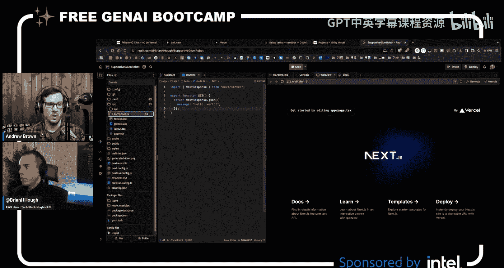

No， just the component structuresies。 So I'm going just start dragging and dropping these over。

And then there was this hooks folder。So these were like。Some use mobile use toast。

UIt had a lid folder。And then。It had this next config。

But I don't think that we need to worry about that， that's this file。

So these are just some settings actually。We might want to change it。

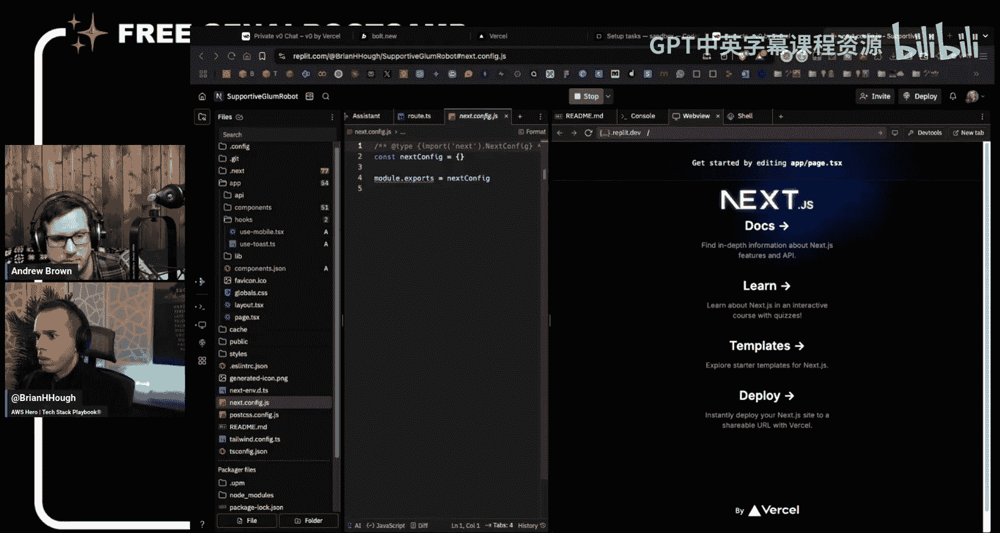

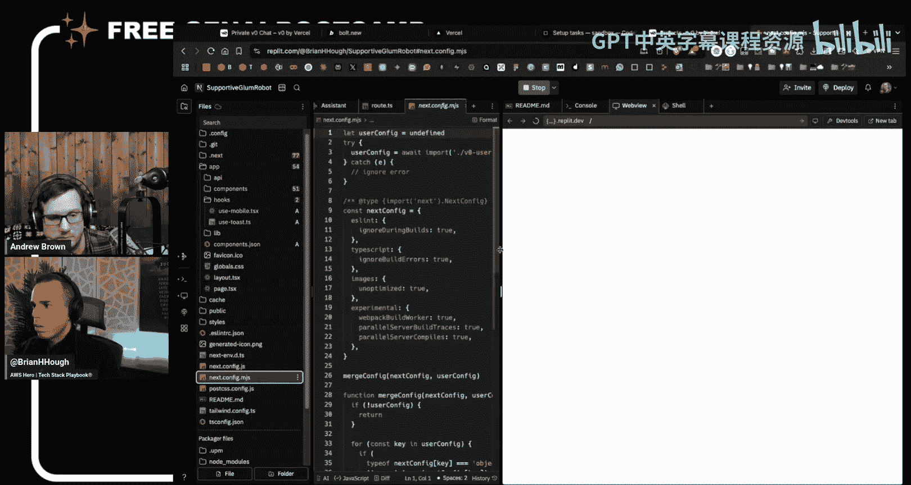

I'm trying to see what the difference is here。That's the other one。 But I， I don't think that this。

 that we necessarily need this over this。 There's just some settings that the VO created。

That I that's like user config， which like I don't know if we actually need that。

 so I might delete that。And then we'll just keep the regular settings and then package a Json。

I'm going to put this in here just for an example purpose。 So these were like。

 So what V O did was or V 0。 it had on hook form it hadras， a bunch of stuff。

 So this is like UI libraries。So I might， I might bring these over to。This package I Json。

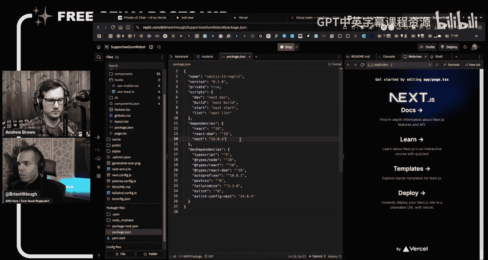

Because next is already copied and then react on is already copied。y， folks， yeah。

 there was there was a bit of a bug。 So Brian， I were just talking about it。

 And so now we're back apologies for the continuity issue there， But I was talking to Brian。

 and I was wondering if if because we're looking at Replet if if we could drop stuff completely in here。

 Or if there's a challenge with that package dot Jason So Brian。

 what do you think do you think that we can。Remove everything。

 drop our project that we download there on the right hand side。

 or do you think there might be a bit of a challenge？

Yeah， so we we were kind of debugging some of that stuff。

 So we should be able to just like so the way that Repl works is like it breaks up stuff in kind of like different ways。

 So we want to just replace that package at Json。 So if we drag it here。

 we're going overwrite that file。If we go here， there's going to be this like day picker。嗯。

Yeah I think we were looking at it and so we when we downloaded it from these zero we were able to get it to run 100% locally but there was one plugin it didn't like and so we're ripping it out unfortunately these tools I mean they're good but unfortunately they'll add all these plugins that we're not using so Ras I think Brian mentioned earlier that is a UI UI kit is that right for a component and so I guess you can bring whatever you want but I guess what they do is they just bring everything and maybe just to give you full coverage i'm not sure。

Yeah。Yeah， it seem like a VO thing， but I feel like there's a lot of stuff that we're probably not using because the app is like pretty simple。

 so。That might just be a default of like import all of the rad stuff。

But I know that one was giving us trouble there so right now you're just doing an NPm install to see if it will take and update the node node modules yes。

 so fingers crossed we know that we can run this locally though so。

Now we're just going to see if basically， if these packages。 Okay， so there's no errors。

 you can also validate that there's no errors。 That's good。 Okay， so now we should be able to just。

Port this whole thing over。 So if I take app。And I replace that here。 So at like the root level。

 you're going to say overwrite this file， you're going to say yes。This is going to say oh。

 we can't find the components， so then we're going to basically take everything else。

We're going to copy components。Put that at the same level as app。

So now we've got our components here。And then it's good now we're going to need to like refresh it。あ。

Oh， there we go。 It needs this other JSON thing。And then we're just going to copy everything else。

 There's just certain things that like like package on JO like lives down here so we don't want to like copy everything。

Copy hooks， copy lib。You don't need that。I don't think we need styles。Do you tell wind。

Tilwin's already there。And we might need to stop it and then rerun it， I wonder。

Let's see。 Otherwise we might need to switch out the tailwind config。

So we're just doing like some surgery here。 Okay， and then。Oh yeah。

 so we need to replace the tailwind。 So that's like the base class。 we just are going to need to。

Add in these files， so we're going to replace them。Do you think we could just select everything。

 but the package Jason drag it in and would that make it work？Yeah。

 I think that's kind of like what what we did。Yeah， I think we just need to let it Oh there we go。

 there we are。Cool， so I mean， like we don't have an API hooked up to it。 Well， I'm sorry。

 there is that API code。 Where was it under， Was it app app utilities or something。yeah。

 Im trying to make the screen a little bit bigger， let me I'm just going to go back sure。

 my one screen， not my we got a nice monitor though。

Oh yeah I feel like it stretches things out it's like hard to see it I'm sure for people this like I got the old boring non HD monitors。

Or non 4K monitors， I think they're their HD， they're just not not 4K。Hey， if it works。

 it works as they say Yeah， so in the app you're asking about the app。 So we do have our u。

 So if I was going to like make this like by myself。

 I would have made like an API route So like I'm just like zoom here So what it's doing is basically doing a lot of like client side code which but then you could also specify you server。

 but I would like put this inside of an API route it's just you can now specify you server and then this will run server side code。

 So this is running that Uts Lm so so I understand that next year asked is both a frontend a backend framework it can run client side in the browser or on the server side are you suggesting here that this code is client side is that what you might think or is it server side because you said that there should be like API routes or something it's not doing that。

 but it says use server， does that mean it actually is using the server It kind of depends on how you write your code I just feel like for me if I'm trying to specify something that needs to run on the server。

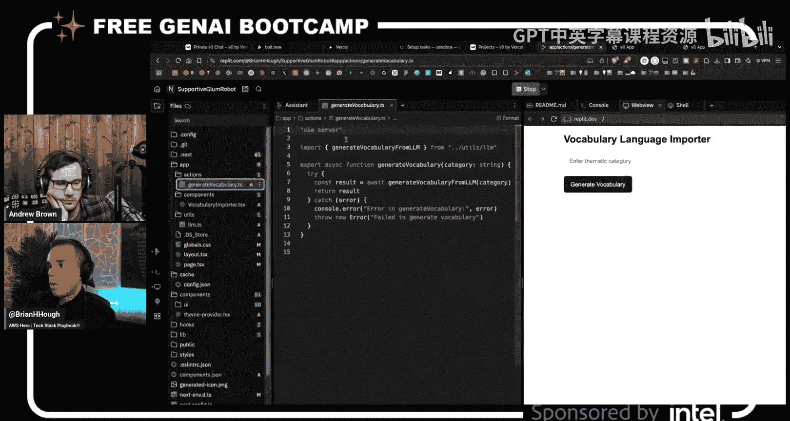

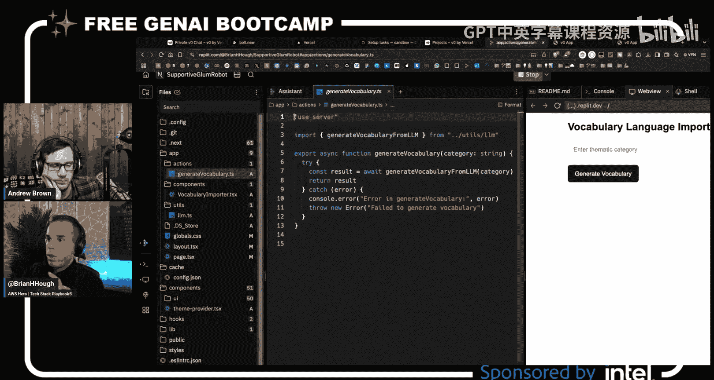

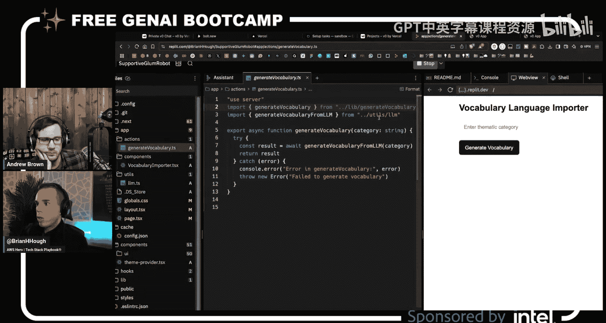

Or I'll usually do the like app and then like like have a subfolder called like API and then what you do is you make you have like a name of your route and then underneath that you do route so like for example。

 just to like put an infrastructure like if you did like API right you could do like。Um。Oh okay。

 so so it's just， it's just a means of how you like to structure and you're just saying if you make an API I'll do a lot more clear like what's what's an API driven part Yeah。

 like you could do like route do Tf and sometimes that's just helpful to sort of think about like you make is this is more of like a naming convention as opposed to other things it's just like for me。

 I like to know that like all of my routes are here as opposed to like actions versus I've never I've never seen I've never seen actions as a naming convention。

 but it's this what what these zero put out。Yeah，'m like that's like maybe that could be helpful for some people。

 but like for me like API it was but I would， yeah。

 that's that's where I would want to find my my API endpoints like anything that's calling something that's serverside。

But actually it's really interesting。Why it might have done that。

 but I will never know Yeah unless we ask for a sell zero but then we'll use the credits and we token yeah we we can't do that sos other that I know we don't want to use that for tokens yeah okay。

 but I think that this worked I'm going to just unshare my screen so that I can add my key in and then but I'll show you all like how to get to that。

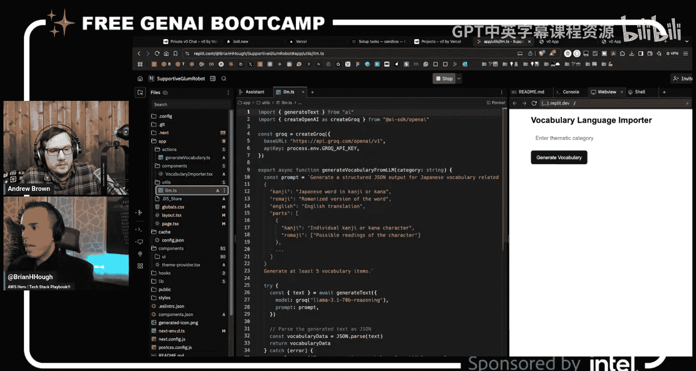

I think I have a G account as well。 And so while you're getting that set up。

 I'm gonna go back and show my screen and I'll just show the rock side of it as you're getting ready there。

 So if we go over to Goc， there is G G okay which is a Twitter thing。 but this is Goc G O RQ co。

 there's even more than just this。 but what G is is it's just it serves models and it serves it really fast。

 And if we go over to the dev console， you'll have to log in。

 I think I might have made one with Google before。 So I'm gonna go ahead and do that when I have the option I choose Google if I don't this might be the first time and I'm in the system It has a playground just like any other kind of thing。

 I'll go gobbly goop whatever I want。 well submit it， It's gonna say you're crazy Andrew。

 and it's gonna to come back here and says it seems like you've entered a string of random characters。

 Is there something I can help you with。 and I don't want to antagonize it too much。

 But on the lefthand side， we have API keys。 And here I've generated a key and so I can just delete this key but I can also generate a new key and I can say。

😊。

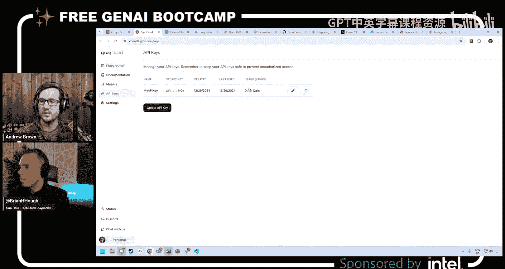

Vocab importer， right， I can do this here。And I can go ahead and submit that and so then I get a key generated out and so this is all that Brian is doing on the back end he's just getting his key ready How's the key going is it slotted in。

Oh yep， yeah， I addeded in。

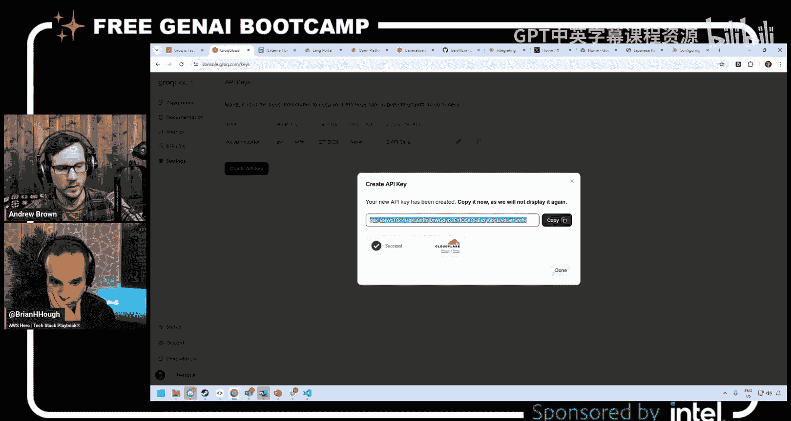

But yeah， Gro there's nothing special about it except that it's really fast and it's very cost effectiveff or I mean this one's free。

 but I actually don't know how cost effectiveff it is I shouldn't really speak to that but I know that they're trying to get pay on demand and but anyway you can see it has a lot of models we have deepse gemma。

 distilled whisper that's for audio， we have Laama mystral， so a lot of interesting stuff there。

 but yep。I will just give Brian a moment here to get his screen going again here。but it is really。

 really fast。So。Like I remember every time I use it， it's like instantaneous。

 There's another one called like T 3， I heard of today， but。Oh yeah， oh， I don't know much about it。

 I just saw it for like a second， but。I don't know if it's a competitor to rock， but there's a few。

 there's actually a special name。For it was like T3 do dev or T3 AI。

 But there's some kind of special name。 Yeah， this， this person。 Oh， you know what。

 it's the guy named T 3 Theo is probably his product。 Yeah， it is。 Oh， no wonder it was junk。 Okay。

 I was what sorry， I was watching a video today。 And he was talking about like how fast Google Jema was。

 And then he showed a bunch of like a bunch of charts。 And he didn't do any coding。

 And I was just like。He's like I'm so impressed by this thing and like look at this chart and look at that chart I'm like okay。

 but show me show me building something and I don't care。

 but yeah now that makes total sense I didn't realize it well then I don't want to endorse that because I don't like the there's too much too much left content there but not trying to get into beefs but anyway。

All right， and want me want me to screen share again，Okay， cool。Al right， now we go back。

 but I know there's， there's a name for these kind of like they are just AI inference platforms。

 But the fact that they're so darn fast， they actually have like a specialized name。

 I don't know what's called。

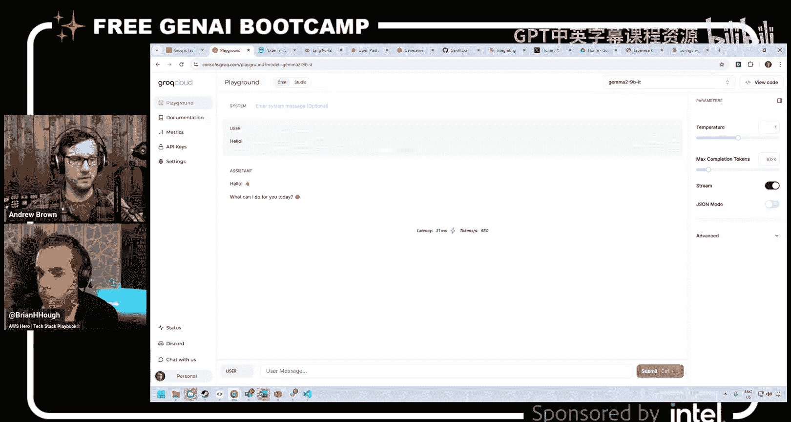

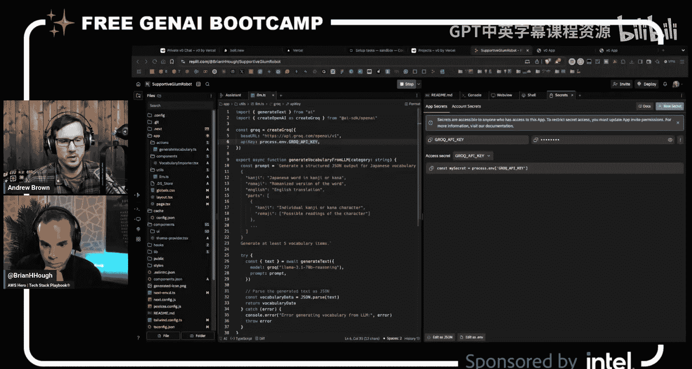

I bump this up a bit Okay cool so for anybody that is working with API keys。

 one of the things that I really like about Relet is if you go to secrets So I just click on this。

 they have tools so if you click on secrets highly recommend this So that's this window here and you're able to just add in your key and then adding in the value of that key but it's hidden and it gives you sort of an example of how to call it but this is something where like you never want to hard code your API keys like ever that's like a big。

 big big security no no because if you deploy this into production and then they can see the code they'll just be able to like take your keys and then just start prompting So imagine you have like a limited number of tokens right now you're gonna have even less because people are going to be like taking those keys potentially and like using them for their own API calls so that makes this is a way where we。

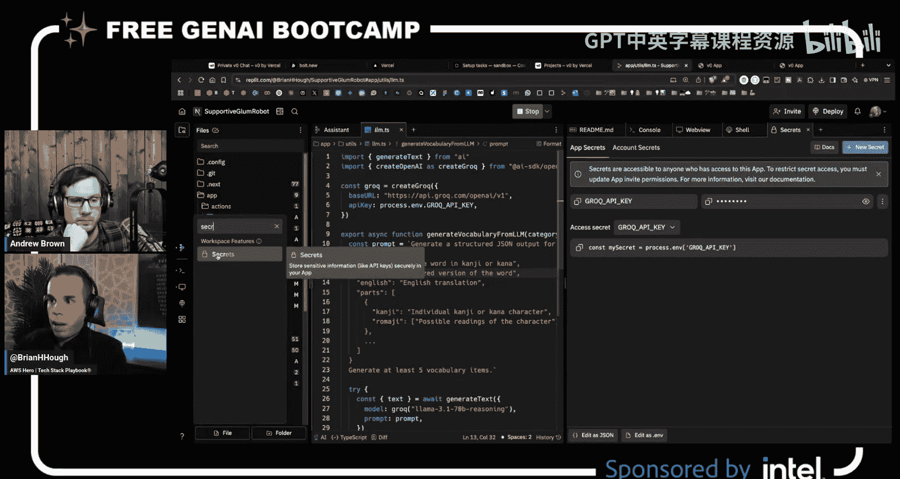

Can securely store our app secrets you can also do like account secrets if you want if you're building many apps and you just want like one rock。

 but this is just an app specific secret， so it's just in this little repository here。😡。

And so I'm going assume that gets loaded into the environment variables because it's doing process。

 EV and so the app's gonna to be aware of those， which is really really nice So yeah。

 it seems like Repl has more tighter integrations to have a more user friendlyly experience or developer friendly experience and so it takes a little bit farther than some of the other ones we have seen at least in our other bootcs here So we have it installed and supposedly like we haven't really audited the code but we're assuming that when we put that text field box in it's going to hit this thing it's going to come back with something So what do you think do you think we put put them in that box and hit a button see what happens I think so it's either going work or won't that's what one of my mentors always said it will either work or it will not and when way to test and what category of or thematic category of vocab would you like to see de generated。

嗯。😊，Both you are good。 Could we do like。Like weather， I feel like whatever you want。

 we can do whatever category you want。Okay， I'm thinking cold so I'm thinking like how do I say cold that would be what I'd like to know Okay。

 cool and then something also that I'm going do is just bring the console down here。

So one of the things that I like about this is like you can have your dev server below the app so that like as you're inspecting code you can also see like what's happening so if this were to error we'll see why so okay moment of truth。

Right， well look， this is what， this is what we expect to first go， right。

 Like if it worked the first time。Because we be out of a job， right？But can be very interesting。

 So it says fail to generate the code。We actually move the content， oh， oh， oh oh， oh。

 could we use the assistant？Yeah， oh yeah。 We could。 actually， let's。Let's see， so。

My code don't work。I got an error like I w， I wonder if it would。

 I wonder if it would know to look at the console。😊，I would。So something like that。 I'd be like。

 I tried to click generate vocabulary。 like in my app and the dev server gave bunch errors。

 Can you help me for those who don't know right now， it's， it's， it's late at night。 So if I'm yani。

 it's because we're having a late night coding session。 hackathon， if you will。 Oh， yes， So yeah。

 I'm just curious， does it pick up console。 So looking。

 oh it says reading six files looking at the error logs。 Oh， there are error logs， okay。😊，Oh。

 that's the problem。 It's the border， it's the border border class。

 no it's not I feel like we fix that though Well if you go if you go up to the console back to the console there。

 maybe try copying the error there because I don't think it has access to the console and slowly looking at the files low API key is missing Oh。

 okay， well， that's pretty clear then I mean。😊，Did we。

 do you have to like stop and restart it for it to take effect the the key that you put in。

 I thought I did that。 But yeah， we could also try that and also did suggest like putting it in quotes。

 So I'm just wondering if that's something where like shouldn't matter or both syn taxesaxes are valid。

 You got to take the period in front of the the end out of there。

But they're both fantastically the same same thing right all I can think of is that it's not yeah like here it is well we'll hold on let's go back there for a second to that other one it says G API I'm just looking for spell and mistakes I'm right like but Goc API Goc API know they're identical on both sides right。

H。So what I would probably suggest to do if we go back to console for a second。

This is going to expose your key just so you know， so you'll have to rotate it out， but。

Can we get another tab in console？Or is it just the one Yeah。

 I think maybe that was it let's just try bring itm I'm just curious if that's going。

If it really is not going to work。Okay， yeah， because it it must be something about the key itself。

 I， we could try stopping it and restarting it。 Well， let's just open the the raw server here。

 like wherever we can enter terminal commands。 So let's just check to make sure that environment variable is loaded Ca if it's not loaded。

 it's gonna to keep complaining。 So what we can do is type in。E， N V。Space。Pippe。It's。

 it's an actual symbol。 I know it's the， I don't know how to describe it。 it's oh， wait a second。

 this， yes， that thing。 Yeah pipe， that's a。It's a pipe。

 There's so many things that could be a pipe on the keyboard have like vertical line really vertical pipe Grep GREP space。

 G G RO GRO Q， yeah， and it just hit。Don't need to put the whole thing in。

 just put it in gr because it'll it will that's what the grip's for is to partially do it。

And so it says Envi updated reloading shell， so it didn't show anything， let's test in E and V now。

It didn't show us anything as if it didn't get set。 So it should be in here somewhere。

 Let's go back and hit up again。On the keyboard and get back to Gro。There it is。

 so you know what I think？Is that the environment didn't have it loaded for some reason I'm not sure。

 but now we'll clear it so we know for certain that it's there it's there we can see it right there in our in our shell so and you stopped it and restarted as we were talking right what if we entered it again and tried it again。

Yeah， that's right。Oh， wait a second。 Oh， this this did more stuff， though。

So now it is calling the L， I don't think I was doing this before。Model not found。 Oh， interesting。

 Oh， that's interesting。 So like， oh， so it chose that model。

 but I guess it's not like a VO chose that。 Yeah， yeah。

 it probably would note the latest one is because it's out of date。

 but I guess we go over to G and go take a look。 So yeah if you want oh yeah。

 you got it perfect and we'll go over there and we'll see what models we have available。

 There's a lot。 I know its about Gema right now。 Some people like deepse。

 I don't think it really matters which one we use。

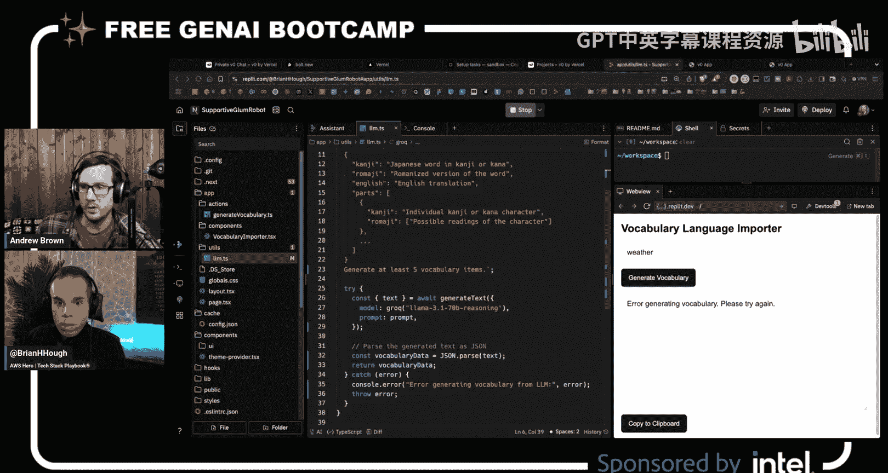

嗯。Maybe we'll try the Gema to hyphen 9 B， hyphen IT。

 I'm not sure what the oh I probably sends for instruct。

And so let's see we put that one in there and see what happens， yeah。Did it copy it。 Oh， nice。

 I did copy it to the clipboard cool。

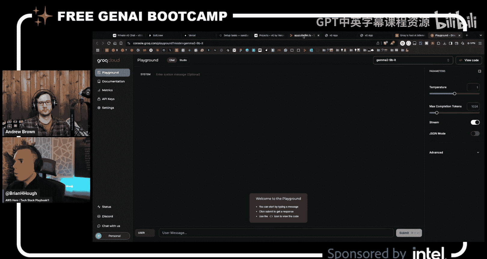

Go back here， and then。Whoa。But that means that the rock key must be loaded now now it's just an issue of configuration of what what what it generated not our fault。

 but like we're here just acting as the fixers。Yeah。Cool， another error。 So we'll scroll up here and。

Our problem is。A syntax here， generate vocabulary， syntax unexpected。Something， something。

 So I think that has to do with the prompt document。Right， but El is not valid adjacent。

 so maybe what's being returned at Kent Pars。Um， there。

 so we have that it seems like it was something around there like you do like it maybe it was like line 20。

The thing is， is that normally when you provide。Jason structure like this is a way you can do it。

But it's not only the way that you'd want to do it。

 and this is why I thought we might have a bit of an issue here because I'm not sure how we could format it。

I'm just wondering if that like to have it return it in。Quote。I don't know if that Well。

 I guess the question is like， where's it failing， I it on the parsing of the return data？

 So if you go back to the code there for a second to the LLM dot Ts and we have the prompt on line 10。

 if we scroll down， it gets fed into line 26 to generate out the text and returns back a text。

But what does that text look like before it parses line 32 because if the text returned is not J on line 32。

 that's where it'd be throwing error so on line 30 we need to print out the stuff oh yeah。

 console log okay， and so let's do what it's actually returning。

Because maybe it's not Jason and Jason structured is really hard to get get it to do consistently Also something that I I do a lot is like for anybody that's into debugging I'll make stuff like this just so that it will like it'll show in the terminal just a little bit more easily to give it like like a thick line the way I learned how to do that was back in like 97 because my mom used to write emails and back then emails were all text basically and so you had to come up with like creative ways to like break stuff up so it's really bizarre that it it's not bizarre that we do encoding but it's just like it's bizarre like I picked up my patterns of how to make my decorators for separation based on my mom used to write emails hey again。

 like if it works it works Okay， let's try generating again。I guess at auto reloads。

 so we don't have to do anything fancy right yeah， I don't Oh Oh got look， it actually made it。

So it's doing that， will we scroll up for a second here。We have it says text JO。

 did you write that or is that what it's outputting？That's what it's doing so it's doing。

Ca it's text， so that's like the the Lm， but I'm saying you didn't write。the back check JO right。

 it's outputting it and so that's where it's messing up on the parsing。Exactly， yeah。But I mean。

 the output looks really good with the exception of that one issue， right？Air generating Boocab。

 so maybe， maybe what we have to say， like go back to the instructions and tell it not to do that what it's doing。

So it says generally at least five vocabulary items and wrap them in。I mean。

 that's not but that's not what you even did because yours。

 those are triple back ticks and yours are double quotations。

But just take that part out and let's see what happens if you do that。Maybe wrap them in a string。

Well， the thing is， is that you don't want anything wrapped， you want raw Jason back。

 so you don't want anything other than Jason back。Yeah， and nothing else。 Yeah。

 and just would be like， and nothing else。U and again。

 like this is why there's like other tools like a tool called In。

 but specifically for Python and this is where it's like even if you don't like Python。

 you're kind of forced to use it because a lot of the tooling is in there。

 whereas's like for for a JavaScript it might not may not't have it。

That that did't but that that what you just said that worked hoay。

 prompt is eie like you pretty crafty no， like， but I feel like that's something that a lot of people like including myself like struggle with of like how do you get a really good prompt and how do you work with these LOms so like that was really crafty that idea of like explicitly calling it out like that like you just said。

 that was like a very good tactic。

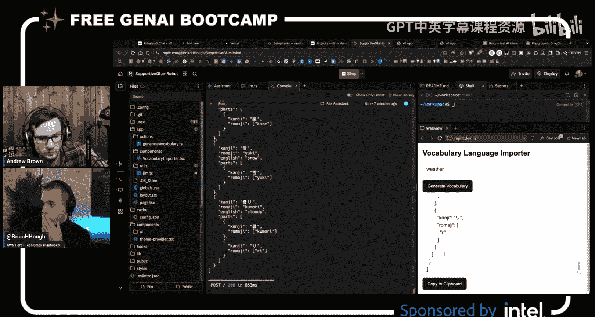

Well， you know， and the thing is like prompt engineering。

 there's all these in the boot camp or the Jenny essential essentials we covered like all these techniques like tree of thought and all these fancy turnsns really comes down to like people just writing whatever till they get their output So there's no there's no there's no secret to it but I got to coin my own phrase for whatever prompt engineering techniques that I use and make it it's like LLM whispering I don't know I feel like exactly we could work with that。

But yes， so now we have our output and I guess the question is that whether it actually looks good。

 Let's scroll up to the top。Yeah， like does that look good。

 Let me make this song bigger so that it's easier to see。I would say is the ramaji correct。

 That's fine。 I think the way that I it probably needs a little bit more instruction to understand what's going on there。

 but I'm gonna go take a look here。 I'm just gonna show my screen really quickly here you don't have to do anything I'm just going to switch out here but but if if folks are looking at my screen here。

 The output here is like imagine you have the word E。

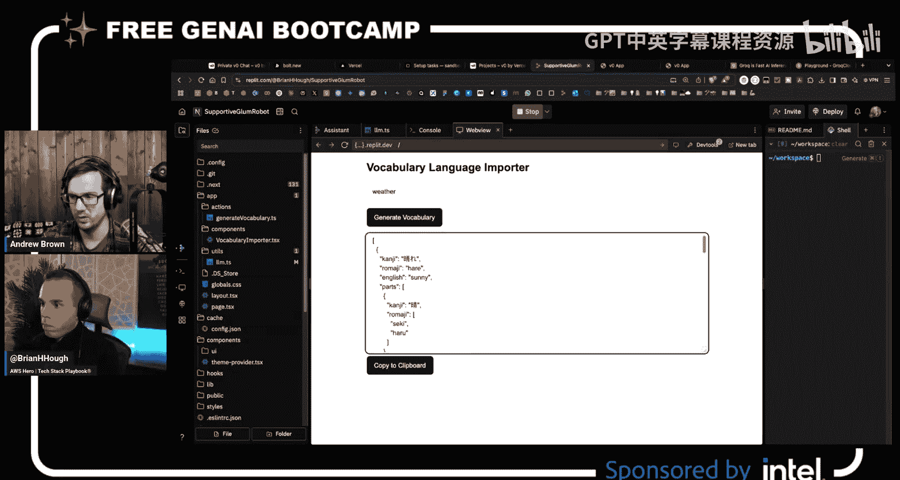

Right E， which means good in Japanese E and you have Yoi means good as well。

 And so E has one character and two characters。 And so these parts are breaking up each kanji and then and providing this and then that the reason we do that is because it has to do with that game typing tutor and typing tutor you're spelling every single letter and that's why it has that mapping and specifically for that game。

Now we don't need necessarily have to fix that but we'll go go another example here we have Issoashi。

 which means busy and Japanese so here you have the first letter here and this one is going to be。

Esoga， oh， does it really know' that can， right， Iogahi， Oh， maybe it is Eso。Goashhi。

 this is really interesting because when I was talking to my Japanese teacher who showed up for our live stream。

 one question I asked was， can a kanji represent more than once two sounds？And she basically said。

 I don't know， I don't think so。But then we have Atta Rahi。 That's so weird because I had。

 I had Tim and I had my guess my my actual Japanese seizure。 and we couldn't think of any。

 but I've already found two where these have three conas。

 So that's gonna be really interesting for students that or boot campers that watch that。 But anyway。

 that's the kind of stretch we want to get back。 I want to go take a look at back at Brian's screen here。

 And so the output is。😊。

Parts and it shows the Kanji， which is correct and then Romaji and it says Seuhau。

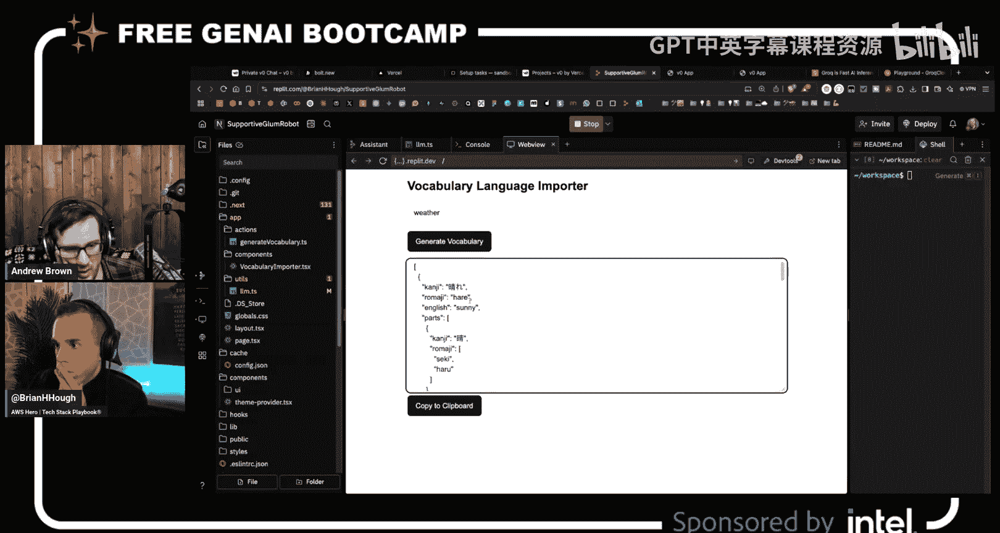

That doesn't make any sense because at the top if you see the top there perfect thank you。

 it says Hoday， you see the ramaji that's the Japanese the English letters for the Japanese words Hoday。

 which is sunny and that's correct and then down below it's showing the first kanji of that word and saying Se Kai Hadu and I think what it's doing is it's giving us a literal translation of exactly that kanji。

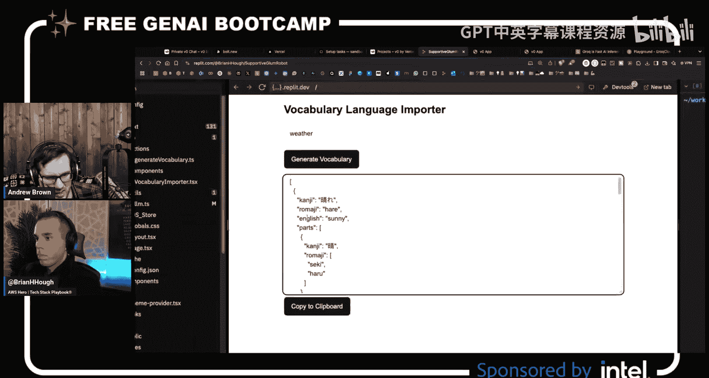

Because conji can have multiple pronunciations and it's giving us I think more than one pronunciation of it which is not right so this is where we need to fix our prompt engineering and this is actually a perfect example。

 so can you copy。😡。

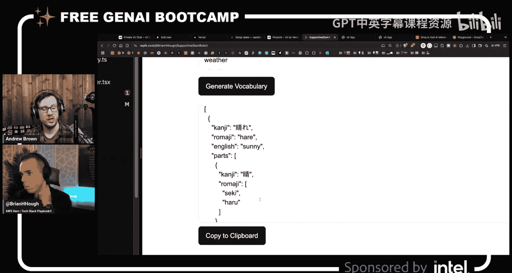

Do see that that that the that part， that Json copy that Json because we're going to tell the prompt to fix itself。

 So really that mistake there， we want to copy that mistake where it it from。I don't have a。

 I don't have a pen， but I would draw it out here on the screen， but Brian。

 if you could copy where it has，um yeah， the curly just one line up there。

 we don't have line numbers， so this is a bit a bit hard to explain but I apologize， but yeah。

 and go down down where we have the ramaji for the Harru。To the closing square bracket。Copy that。

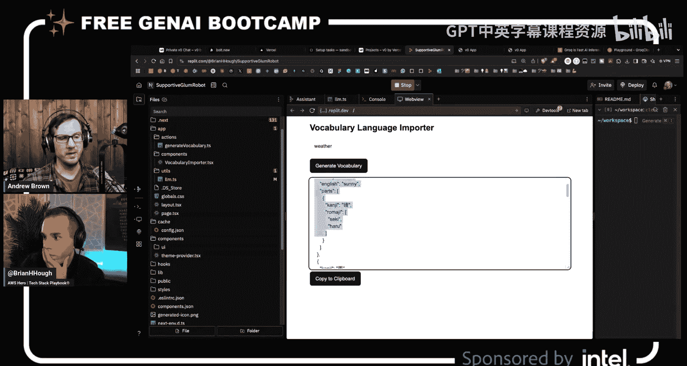

And we'll take that and bring it over back to our prompt document。And so。Um。We need to on line 23。

 we need to keep going down here so。We want to provide an example。And we'll just say。

Here is an example of bad output。Right， and。And then we'll explain why's spot， you know。

 the reason that it's bad。The reason that it's bad is because。Because I like it gives like a generic。

I swear bad is because it's bad like you know what there's gonna be so many like technical documents and reports of this stuff because people are just going to be like a generated out。

 but this is why we're here to give it a good instruction。

 But the reason this is bad is because the parts of ramaji that are shown。Do not represent。

The the word the word it's so instead of it， instead of it listing secki space Hadru。It should。

 it should just sayhuh。Because that is what the kanji is representing for the word holiday。

And so sometimes you， you can give it a good example as well where we can correct it。

 but this should be enough because gemm is supposed to be really smart according to Google。

 And so I told you we'd use something other than AS here today。 We are multi cloudud here。

 Let's go so。😊，So we we'll save that and let's go see if our magic LLM whispering or prompt whispering works here and we'll try it again and so we'll just give it a nice refresh there to clear out our bottom。

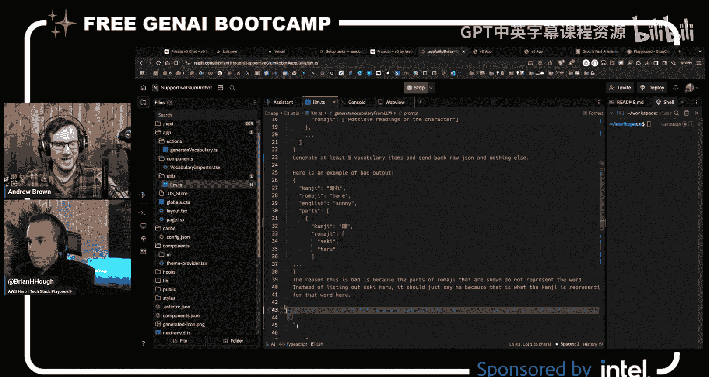

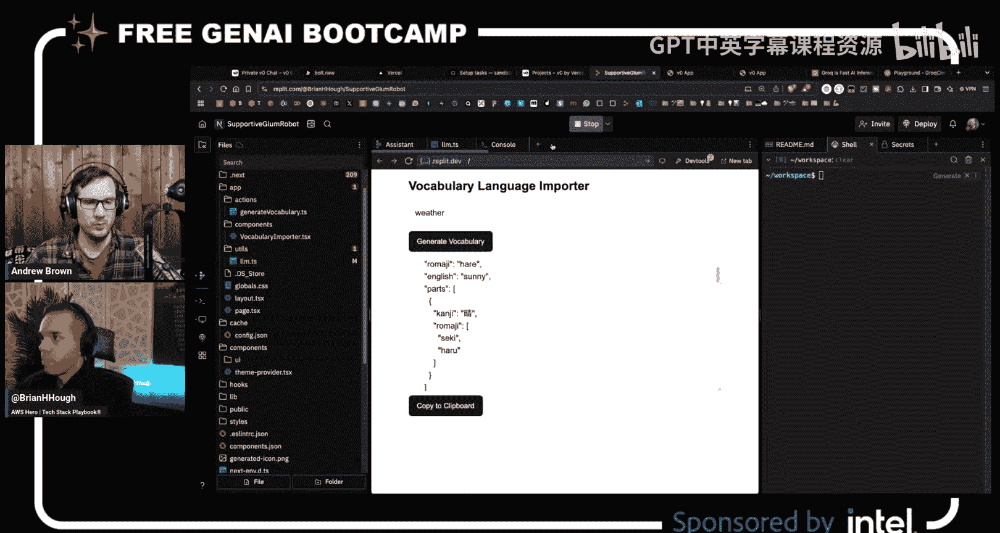

Or hit the button again， I don't know， I guess you could just keep running it， right？

I think so like it'll probably give different slightly different results， Okay， Ha and it says Hadru。

Why， why does he keep doing that？So。This is where we need to give it a good example because it's not listening to us。

So let's go back to our Lm。ts and this is the thing is if you have a dumb LLm。

 you can make it real smart， but you just got to really tell it what to do。

So here is the example of good output and so we're going to copy the the ones， yeah。

 exactly and just take out the Hadru part。Right， and so this is what we want。 Now。

 because it will generate this word， it's going to be overfitted。To always produce this correct one。

 but we'll see what it does with other ones that's why sometimes what you want to do is provide examples that aren't in the ones that are being generated out so you know that it will work。

 but it should be fine so let's go ahead and generate little vocabulary again after we save here and see if we get see if we get better results。

All right， so generate again。Oh good， okay， so that's her。But the other thing that's missing here。

 if we go back up。Is that we have ha gray right and so there are two sections， two parts to this。

 there's the the first one and the second one， right？So let's go down and look at the next one。

We almost got this working， we're only going to do so much here， we have A。And we have a。

 but we don't have May。Right， so it's still missing one of the parts， let's go back over to our LLM。

I remember we talked about the bat example， we got to expand about why the example is bad another reason the example is bad is it' it's missing the other part。

So there be， there should be two parts， one for hot and the other one for ray。Okay。

 if I look my I'm getting that right Oh yeah， you got it and so if you scroll on down there and look at our code here。

 we have we now to we now need to put the other part in so it's missing the other one yeah exactly you got it and so we'll copied it in and put in Ray。

I'm really on autopilot Andrew， I'm like try to listen to you to like， oh， you're doing good。

 you're doing good。Okay， is that right， No， that's exactly right， You're perfect。 Yeah， okay。

 and then I like how you said like why you explain it。 So this is a good out。😊，But because。Because看。

The conji。Constists of。Multiple。So I know because you don't know the Japanese language。

 but Kanji refers to when the character actually means Chinese character and so Japanese is actually a mix of three different writing systems if you can believe it。

Wow， yeah， so， so the thing is， the thing is that this is a this is a good output because the u the word u the word represents each。

This is good to output because the word represents。嗯。All all the Kanji and Kna。

Sn shown in shown in the word， right。 So Khan is going to refer to Japanese native writing systems and。

Kranji is going to be the Chinese right。 Thats why it's so hard to learn Japanese。 you have to。

Deal with three writing systems and。It's stride， it's one。Yeah， I mean， it's very like intricate。

 I feel like as like programmers， we would probably find like language learning font， you know， well。

 the really interesting thing about Japanese is that as from a technical perspective。

 it's really interesting because their language is really concise and you can omit words that are already known in context basically refactoring your sentences smaller and smaller as you're having a conversation So like if we're talking here and we know that you are the topic。

 we't we won't keep mentioning you as the topic people won't even mention I don't know。

 it's really interesting but the time it takes to learn Japanese you can learn Spanish， French。

 German， I don't know， like five languages。 So I don't know。 maybe I should have。

So of shows differently， but I'm committed， so I'm going to stick with it。Okay， cool。

 so that make sense。 This is a good output because did I capture that right。

 the work you got it it's， it's perfect。 So what we'll do is we'll go run it again。 again。

 there's no， there's no crazy sign to this。 It's just， does it read like it make sense。 And。

 then we just fiddle it around till we get it to work。😊。

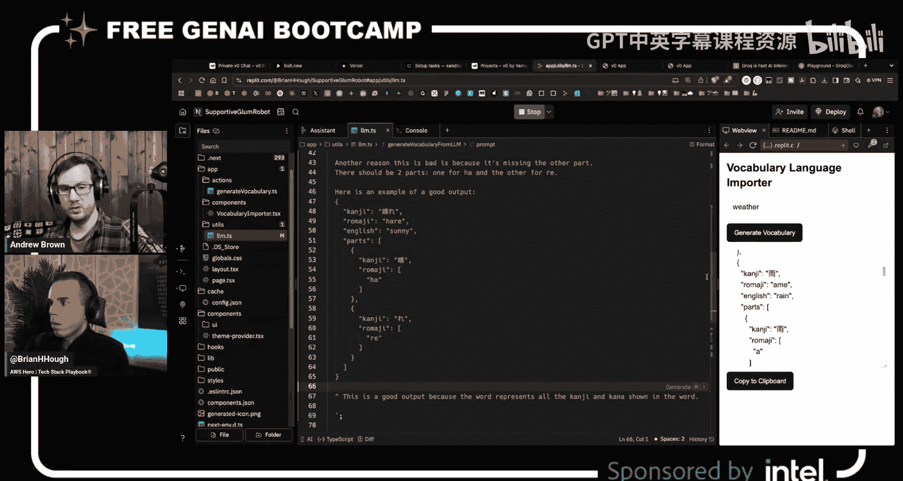

So go here and we'll scroll it down， we have ha。Oh， oh there we go， yeah， it's， okay， really。

 perfect。Cool， and then rain，That wouldn't， that wound didn't work out。 Okay。

 can we do like another example。 where're like so sometimes what happens is if you give it multiple examples。

 right？ And so this， the the code's a little bit long， can we kind of like。

 I just want to show you my screen for a second。 Can we I gonna go back and just show here。

 But I have mine a little bit more compressed， Like in this way。 And that way。

 we can kind of get more examples， if you can see here。 Oh， yeah， why is it making it so longer。

 I'm like。 Yeah， I don't know。

It's just how to output it， I think because it probably used， I don't know。

 but if we just formatted a bit， then then we can get a few examples。

 but it might need like three or four examples of good to know what good is。Right you know what。

 why don't I just give you some good examples and then you don't have to。Oh， that would help yeah。

 I wonder if it's using if ES Lint， it's using Linting。

 so I'm wondering if that's breaking it up so much。I don't know。But I copied it into the chat。

 I'm happy to copy it and give it， give it a spin。 Yeah。

 and then we'll just say these are good examples。 And maybe that will improve it。 But again。

 we don't have to make it perfect here。 We'll just do our best because of boot campers。

 if you're watching。That's your homework。 Get it to， get it， get it to work。

It's not a cop out it's it's learning folks so we'll go ahead here and I actually can give you four examples and I just feel really generous here today it's actually not giving me all of the the code I copied so I'm actually going to drop it into a gist right now for you Yeah just so that we're not missing that code there。

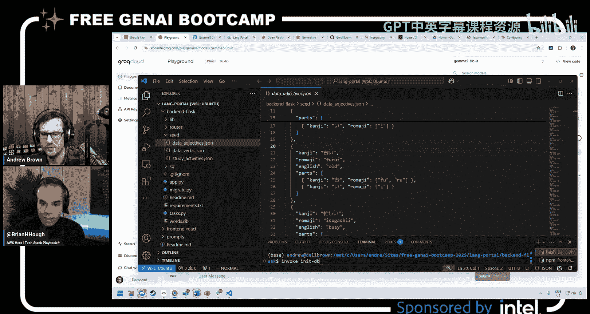

And we love， we love a good。Just file on Gitthub。Oh， thank you。By the way。

 gs are not private no matter what， but they are secret， there's a distinction there。

 it's just hard to find like like unlisted links。So this one has multiple good examples and so we say like here are great examples。

Where it shows all the parts properly broken up， and if it still doesn't like it。

 then then I don't know， gemma is not as good as Google says。Yeah。🤢。

They need to go back to a fine tune it。 They missed some things。 But this is。

 this is what it was a 7 or 9 billion parameter model。 There's way bigger ones out there。

 So they probably would perform better。 But these smaller models that can do this。

 but you do really have to give them a lot of good examples。

 And what we're actually doing right now is providing it something we call few shot few shot meaning providing multiple examples of what we want is expected output。

 But oh， oh yeah， your screen， Oh no， I I'm sharing， I'm sharing。

 So I'm gonna get my screen out of the way here。I'm going to bring yours on back up here perfect sorry。

 cool， I just copied in what you had and then I replaced it so these are great examples broken up。

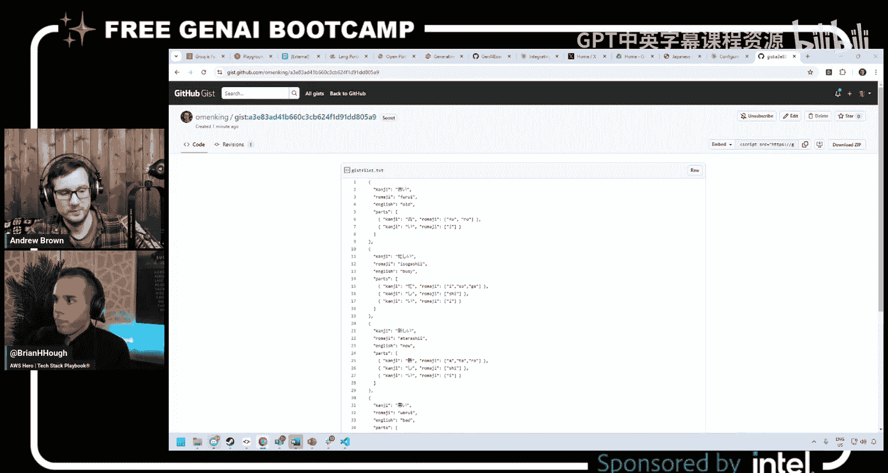

That's all there， All right， let's moment of truth。Please， please， please， please， please。Oh。

 wait a second that。Can we just give it a hard refresh and just restart just in case？

So we got the hot ray。And then。Rain， well， you know what， rain， we go back to rain for a second。

The ame Wait， wheres rain think it us the second one Oh there we go， Okay， there is that one。

 that one's correct because there's only a single conji and it represents both the sound。

 So that one's actually correct。Oh， is it Oh okay。 Yeah， so I don't know if it was right before。

 but I think we， I think it's because I'm tired you're probably tired too。

 but I think I'm getting tired。 And so I'm， no， I think。

 I think I've improved it because it's like this， this is a single。Kanji。

 right so that it works that's correct， yes。okay。I know I know that one really well because I have a lot of snow and every day I have to do somekikikikiki。

ki yaki yaki， what is it？I guess I don't know it anymore。

 but the word for shoveling snow is really funny， I like it was oh。

 I had to do that a lot these past couple weeks。That word is top of mind for me。Shoovel snow is。Yeah。

 Yukikaki yeah Yukikikikaki Makiki， there we go。 I thought there was more cocks in there。

 but no it's just the one。 But yeah， we basically have our functioning app here and we can just copy and paste it。

 Now you can take this further。 The way you can take us further is we could integrate it into we could have another button that if our app。

 if this lived beside our app， we could say go read the like go write an SQL thing that to insert into the SQL database or go trigger another action。

 But in terms of what we want to do， it's that's a simple right。

 And that's all we wanted to do here today。😊。

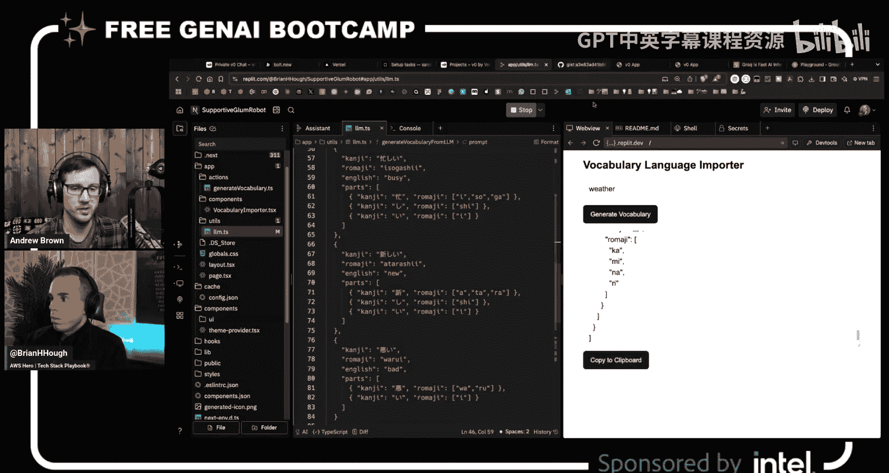

Um， so I guess my question to Brian isum， u， are you convinced that uh like are。

 are you convinced with Google Gemmas this something you want to use in the future。

 you're happy with it or sticking with Amazon， u Nova， u，OA Preium， Nova Pro。

 I can't remember the name of it。I mean， I'm pretty impressed with this。

 I think one of the things that's interesting though right is that we did need to do the few shot approach to get to give it examples and I do wonder if we took any of the other if we took like a bigger model and then actually trained it on like a language set or we just took Json and then did like a fine tuning approach。

 I wonder if that would work because otherwise like if I could just take like a smaller LLM like this。

 give it some examples and then get the output I feel like that that would save us so much money because to actually train a model is crazy expensive So I'm like if this smaller model can give me what I want and I just need to give it a few examples。

 I'm like I would use this LLM for sure and look at how fast G worked。

 I mean like as students we prompted it， it was already done So like the trainer thought that you just described is exactly where everyone mine goes goes when they use these models these smaller models go can I fine tune them which is really interesting that we don't see a lot of people showing off the use case because。

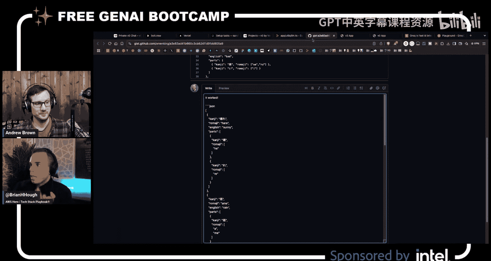

You have to build one out to do it， but it totally is possible and we're going to do it right now I'm just joking but。

W2 might might take as long as this but yeah that's the thing is like but you might be surprised like you might be able to get a 1 billion parameter model to do this right but again you have to provide enough examples but then you're making for a very specific use case like this exact use case right right but yeah it's interesting maybe like maybe 200300 samples trained within 20 minutes for 5 might produce the results that you want but again there's going be a model just for this one task right and we could use an LLM to make example data so I feel like now that we have like a good example of this maybe we could look at like if we said like generate like hundreds of these or something like that and we test one in every like five or 10 or something like that you know that's how we could generate like our example testing set and then use that to train it but synthetic data generation is like a perfect use case of it like bigger models you have the bigger models to do the heavier lifting the only thing is that when we're looking at。

And if we' structuring this language， a language has a certain amount of words。

 So like if you learned all like 5 to 10000 words， you basically hit everything。

 So you could also just theoretically generate it at once and have it all。 Yeah。

 but there are 50000 words in total。 or if you wanted to change the schema a bit。

 or if you wanted to。Work with another target language， then maybe that utility is there， but yeah。

 I mean。It's cool。And。And I like our app， I mean， like I was just showing like the fact I was able to copy this to my clipboard and then just copy that。

 so like。

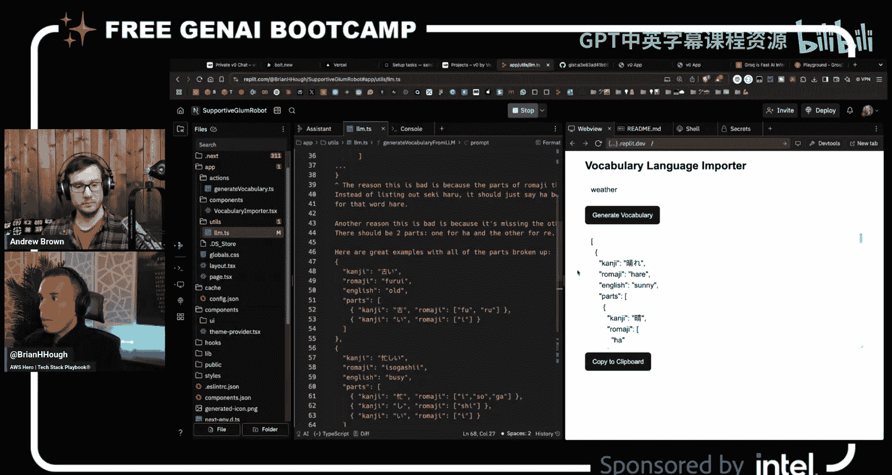

I can comment this， like on your。Just here， you know， so like kind of cool， you know。

 And we were able to work on this and build an app within。😊。

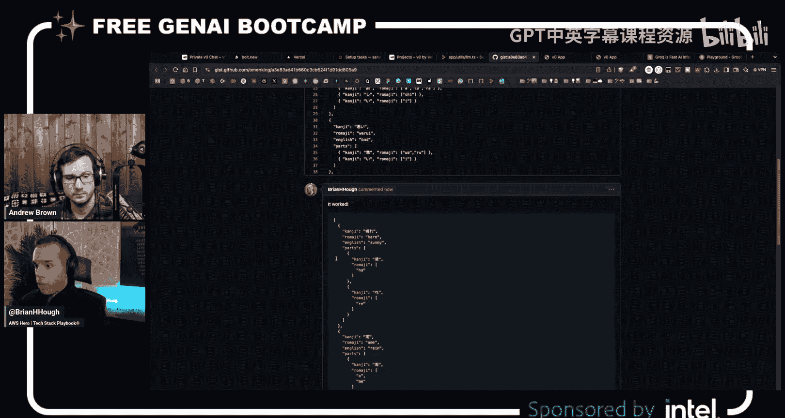

What got like less than an hour， which very quickly， yeah I'm trying how long would have this。

 how long do you think this would have taken us if we didn't have LLms like AI like。Oh。

 the manual process， I don't know， like it's still kind of possible like before LLMs。

 there are NLP tools are like like specifically tools that are not using LLMs to match words。

 But the problem is， is that if you hit， let's say slang words。Mmhm。😊。

They like if it's a dictionary word， other ones that have no album could handle it。

 but if you had to handle like slang， like I was trying to watch a movie called。

Weathering with you and it's a Japanese film it's this one anyway。

 they're very good movies where they have a lot of common vocabulary in them。

 And so when I took the subtitles， I actually tried to generate this out not using LLM and it horribly failed because of all the slang because in Japanese they'll leave out words or just like in all languages right。

 but they do it a lot more because they like to make things very concise and so it didn't work whereas an LLM could not only handle dictionary terms but even slang terms and figure out like if something was introduced even one time that they could kind of figure it out whereas the other like other ones can't figure them out so。

And yeah， the time， the time to do that would be manual process， right。

 You'd literally have to manually do it。 And I actually did do it So I can tell you that I was going through a movie and like manually do processing it。

 And if you have a movie that's one hour， it's like。If you have one movie that's one hour。

 you might take you 10 hours to go through it， right where this is。

One hour and you can use it on infinite amount of movies right or whatever your use case is so。

No100%。But I'm happy with our app， this is pretty cool。Cool well。

 I appreciate you coming out here and showing us how we can build it。

 And now I know what Replepl is so I have no more excuses。 I can go ahead and give it a try here。

 and yeah， I hope it I hope it warms up where you are I can't imagine it being cold。

 but oh goodness gracious。 it is it's getting colder by the week。 let me tell you oh gosh。

 what how loaded did it hit。😊，The coldest that it's gotten to recently was 13。

 but it did get to 10 degrees like several weeks ago， is that 13 Fahrenheit？Oh，Fahrenhe Celsius。

 I don't know。Oh， so you hit so so if it was3， but that's what you measure in Fahrenheit。yeah。

 okay so that's negative 10 okay that sounds cool yeah。

 was it was not pleasant let me tell you like it's it's like it hurts your face that level of cold and it's like oh you gotta like get some hot chocolate and like put that on your face for like hours。

Well。Don't go outside。your coding yeah I appreciate appreciate your help here and we'll all see you soon boot campers in class and yeah we'll all see you soon。

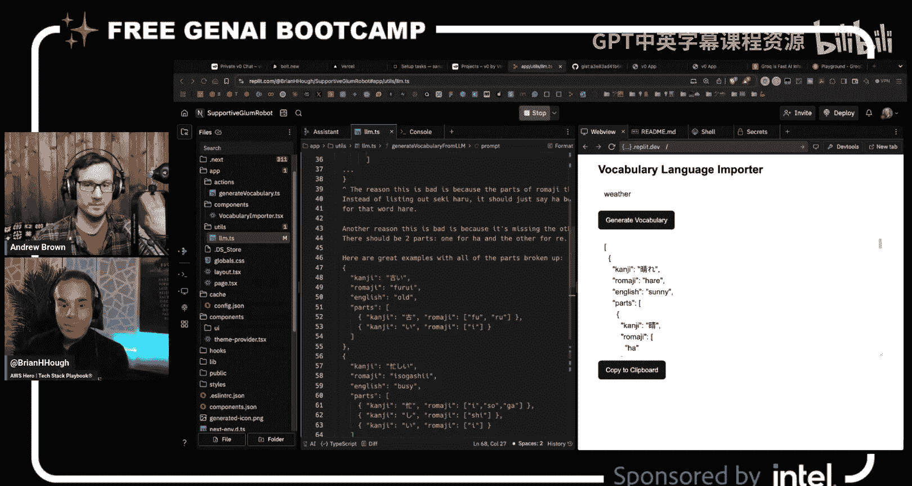

Thanks everybody， thanks And。