# ExamPro《生成式AI训练营｜Free GenAI Bootcamp》中英字幕（deepseek - P30：-30-Week 1 Homework Submissions Example.zh_en - GPT中英字幕课程资源 - BV1SFEWzLEab

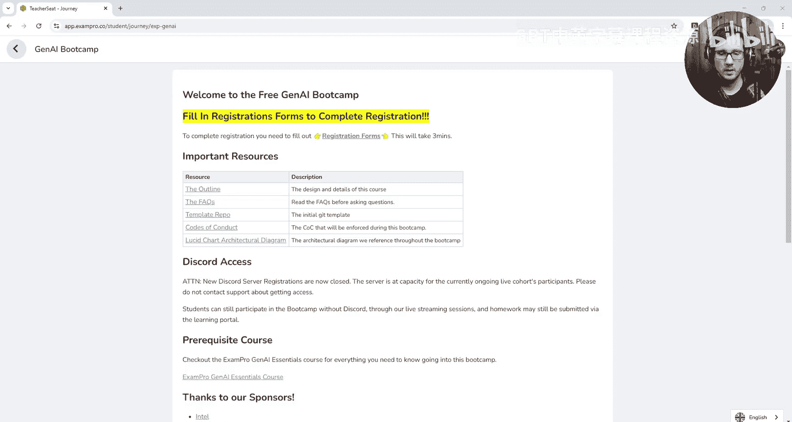

Hey， this is Andrew Brown。 And what I want to show here is submitting for week1。

 I'm gonna to try to do my best to always shoot a video so that you have an idea of what I'm looking in terms of submissions。

 We're gonna go down to homework submission。 We can see we have a lot of stuff here in week 1。

 we have the govtech data primer， everything like that。

 also just consider that we can tell whether you've watched the videos or not。

 So make sure that you have gone through and watch the videos as I will kind of be watching that as well。

 there was a lot of interesting stuff in this particular week。

 and I'm gonna go over here into week1 submissions and we'll go ahead and fill in the form。

 And so I'm going to describe what I'm looking for in here。 this video should appear。

 And so there's a lot of things we did。 We didn't even put everything that we did in here。

 But there are two things that I really want to know about。 And I am seeing one missing。

 So just give me a moment to add it back in here。 there we go。 So I've just updated it here。

 And so there are a few fields here。

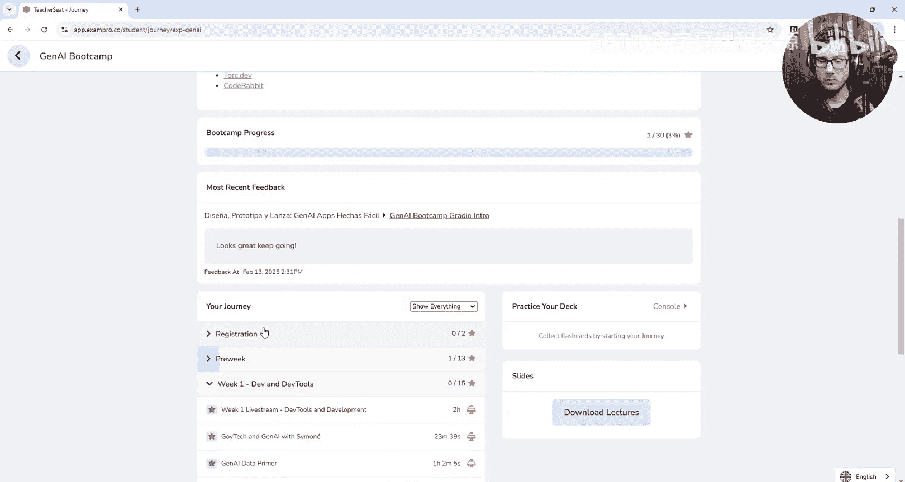

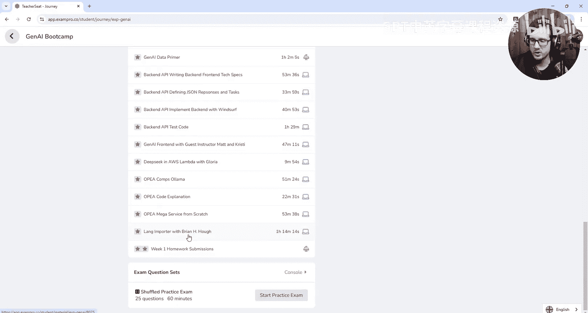

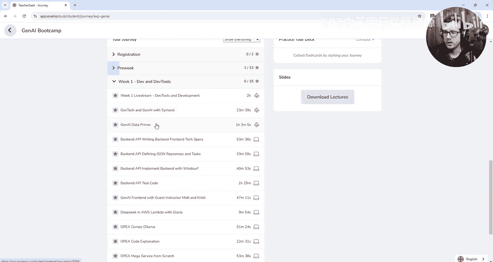

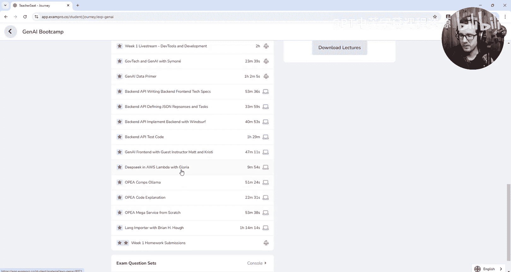

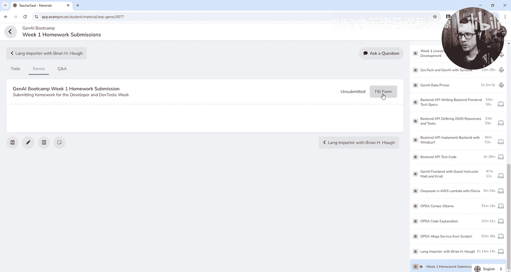

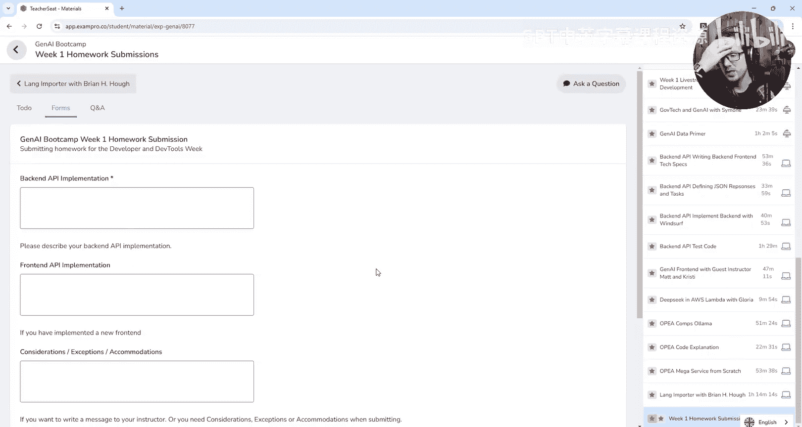

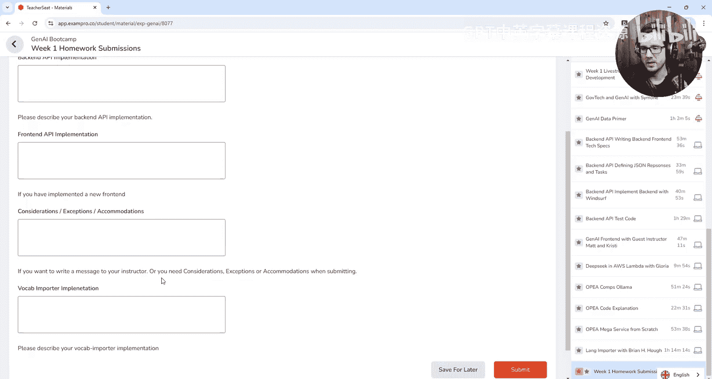

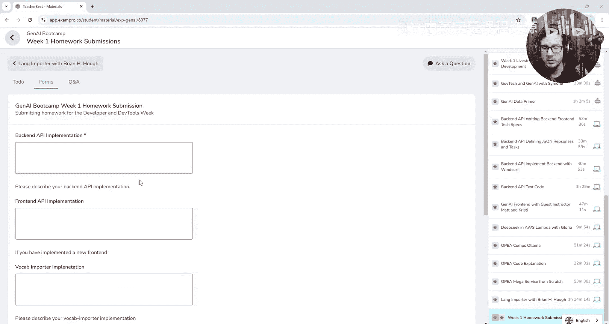

And I want to point out that if it's not required， you don't have to fill it in。 But if you can。

 that would be really， really good。 Well let's take a look at we have。

 So the first is the backend API implementation。 So what I'm looking for is to know what it is that you did differently or maybe all you did was implement the missing endpoints or whatever。

 But like in here， I'm just gonna say that you know， reimplemented the entire， So I'd say， I。

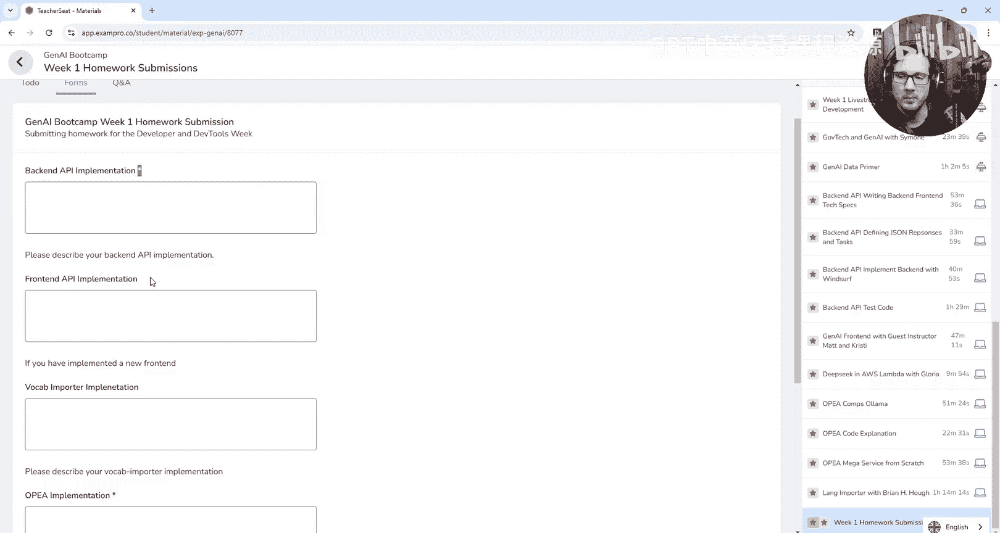

Wrote the。Text spec from scratch。For the back end。I re implementeded。呃。Back end API。 So I used。

 keep be nice and simple。 But I like， I use golang and gin。ok。Now， I'm still using Japanese。

 but if you're using a different target language， you might want to describe that， you know。

 you had to do something different in order to accommodate the backend for your case。

 I would just say one thing is that， you know， I， you know。

 I noticed that the original implementation had inconsistent。Inconsistent API paths。

 So I had to correct。 So I， so I normalized。Normalized the APIs。 So they are consistent。

 So that's definitely something that I did。 You know， I used Ruby to。

 I used Ruby and R spec to write a test。 a test suite to ensure the code generated was accurate。

Did what was expected？One thing that I like that I had that I surprised was like， you know。

 I had used。I used windsurf。And the approach。I used to build it。Build the backend was to feed。

The entire text spec。The entire tech spec。And have it。Greatate the entire。Back end in one go。However。

When I was writing。When I was generating test code。I found。That。呃。The AI discovered。

Many air in errors。From the back end API generation。I ensured to。Because I detailed。The endpoints。

Endpoints。你。Detailed exactly。What I expected。Back as Jason output。I have strong confidence。

That the test generated。Are accurate。I did not have time to use the app。With a front end。嗯。So。

 I'll be continuing。To use the existing。Exing。Flash back end。 And what I did。

 and if people end up doing this is like， you know， in order to use the， the flat， the the the flask。

Backend， originally provided。I had to go。Back a commit to be able to pull the。

To be commit to be able to。To have all API endpoints working because it really depends on what your goal is。

 So like maybe you just reimplement those ones。 but like because I already implemented in the back end and I want to continue on the flask one。

 I went to the commit history。 So if I just go over to Github here for a moment and we go to the exam Pro repo over here。

 we have a lot of different reos here and we click into the free Genii bootc you know I had ripped out some of those endpoints。

 And so in order to get it， I just went here before the changes。

 maybe maybe to this I can't really remember which one。 And then I went and browse the files there。

 actually， I think I go back here if you click on this。

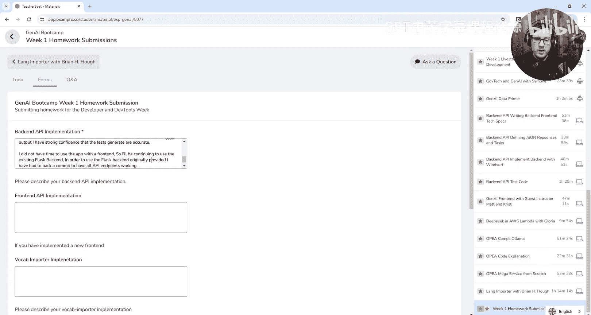

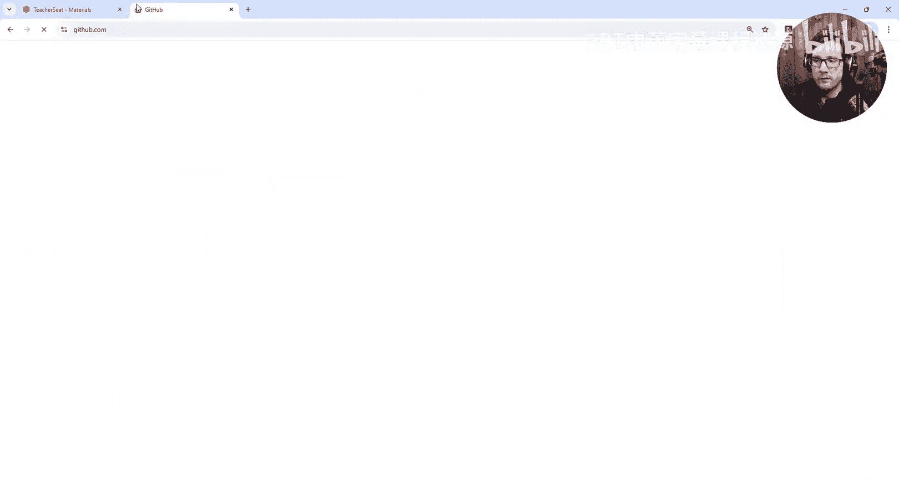

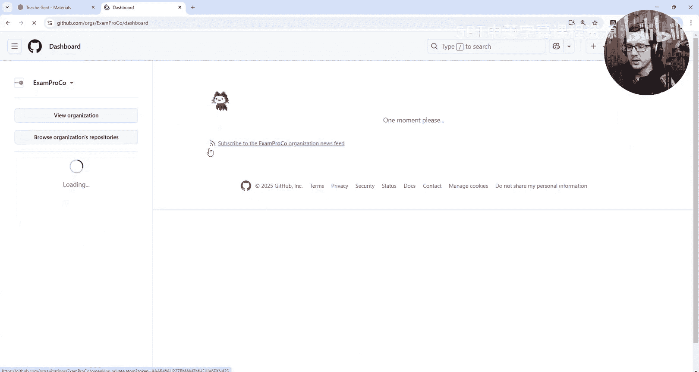

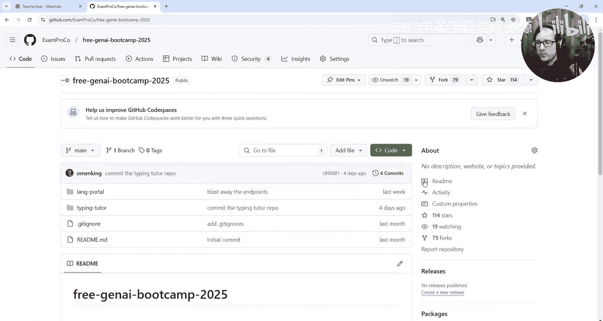

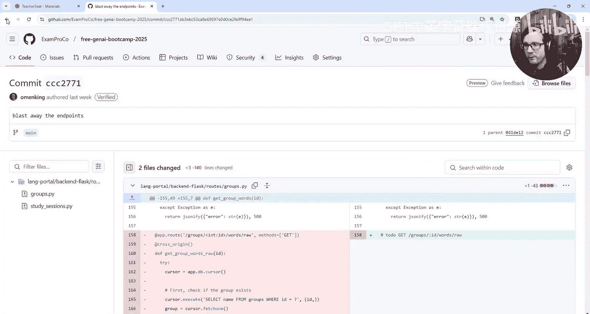

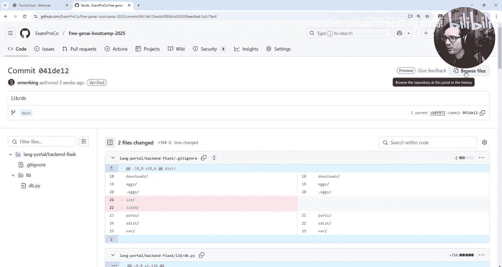

Right， you can browse the repo and see if the endpoint exists or not。

 but you can also just download the base from here。 And I do this in the next week videos。

 But that would be something you'd have to work around。

 And that's one of our little traps that we sit out there to make sure because of people。

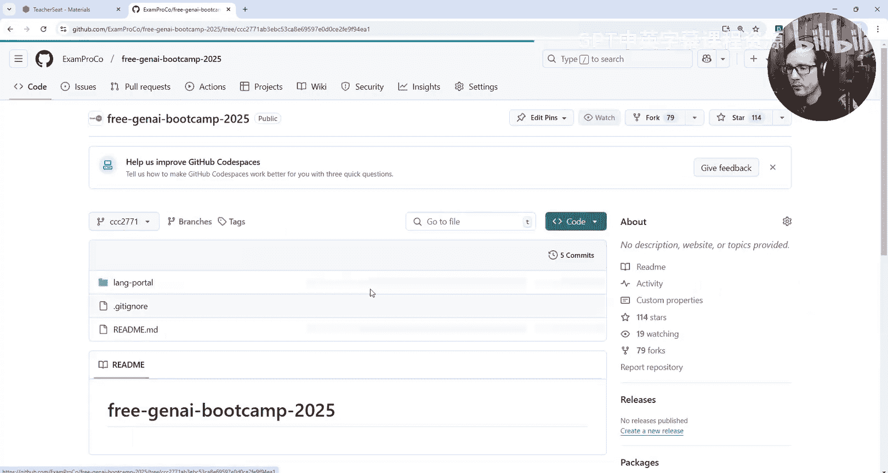

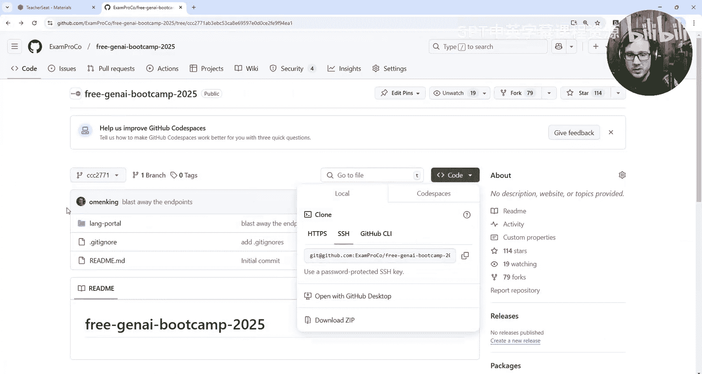

You know， I I purposely put this back in in a broken state。 So you either have to fix them。

 or you have to make a new one， or you have to point out that you pulled out the old code to do it for the front end。

 I didn't do anything for this week。 I mean， I obviously generated the original one。

 So I'm gonna to pretend that I did it this week。 And I would just say， you know， you know。

 I used lovable lovable。 So like， you know， I wrote a front end text spec。

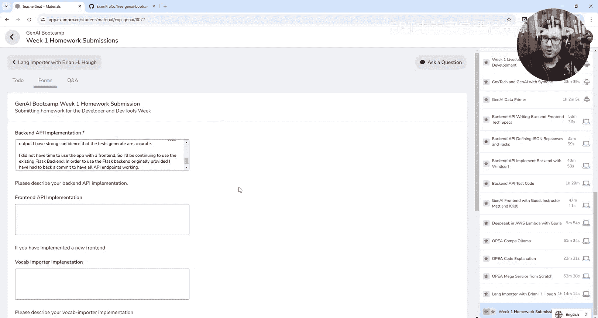

And I fed the I used lovable。And I had lovable。Deev to implement the front end。 it did an okay job。

 however。It was struggling。Oh， sorry， but I would say like the， the workflow was。Frustrating。

 so I downloaded。The code into windsurf。And finish the implementation。By hand。I would say， lovable。

You know， like， you know， if if I had paid， if I had paid version。Had the paid version。Viin。

Of lovable。Maybe through， you know，200 iterations。Chat interactions。I could have completed it。

However， having the API back or the back end。API code in the same repo。In windsurf。

Allowed it to cross reference。codeode from each， okay。Right， then we have the vocab importer。

 and I did this with Brian。 And so I actually wanted to do this。 I didn't do it myself。 Well， no。

 sorry， I actually did do this， but I never recorded。 It was before the start of the boot camp。 But。

 you know you can make one that's based on the vocab importer。 So， you know。

 I created a vocab importer。

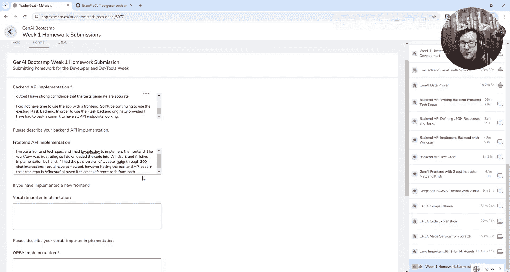

Using radio， I really like radio， and I focused on core 2000 generation。Generation， right。 so like。

 and it could have been like， you know， I focus so， so I already had。The vocabist。

 I extracted out of an onky deck。So， my vocab importer。Categorizes the。The words into groups。However。

I could not get。Good thematic grouping。Using Clad onnet 3。5。 So maybe this task。

Is better left to humans。嗯。And so， I did not complete。This project。Okay。

 for the O P OPA A implementation。 So this is something that I don't care if you're able to get it fully working。

 but just tell me how far did you get， right？ So I would say， you know， I was able to get the O lama。

Container running。啊，嗯。When it came to the mega service。I I had issues。 the code technically worked。

Technically worked。But the handler implementation。Requires more thinking。

So if I can finish that implementation。I would have a working。I would have it working。

 what do you call it？If's position， I would have a working mega service， right？So， you know。

 that was the issue I had I'd probably be a bit more descriptive than this。 But， you know。

 I'm just trying to get this kind of done。 So you have general idea what。

 if you have considerations exceptions accommodations。 I've added this in the prewe。

 but you know if you've been having any issues and you need me to consider this when I grade。

 then know， please do right in here in terms of when I will grade this stuff。

 It's kind of hard to say because we have a lot of users。

 but I will probably be doing some grading for some folks。

 but as the boot camp continues through the other weeks。

 you'll see more aggressive grading for me covering basically everybody。

 I'm gonna go ahead and submit this And so now I'm submit。 And so there you go。

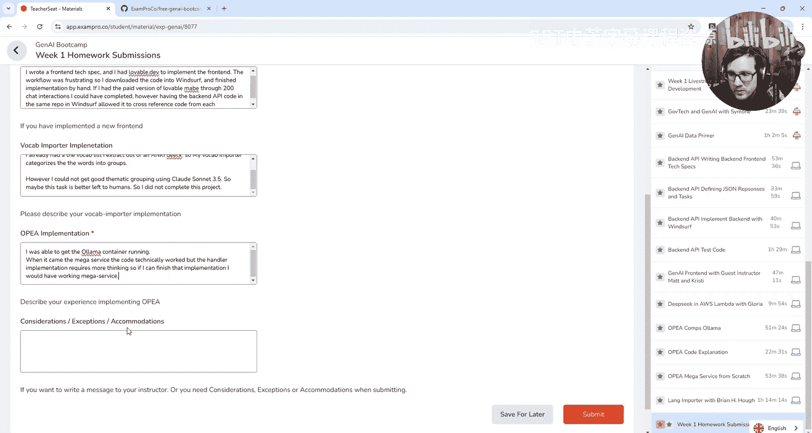

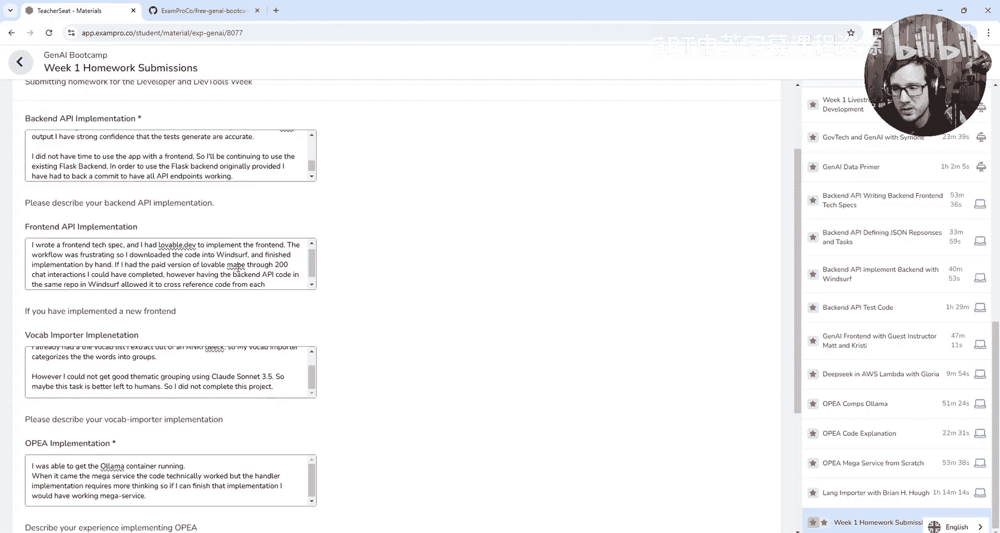

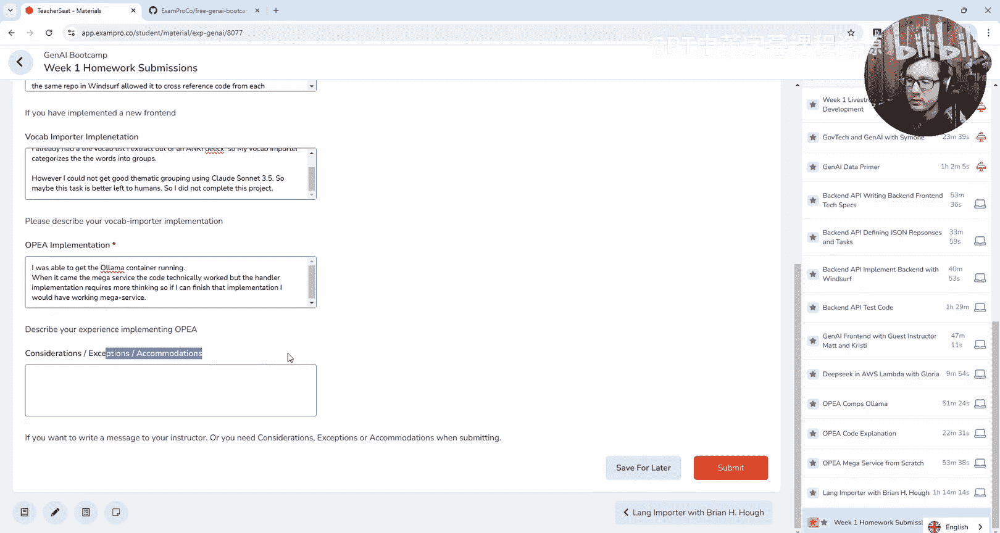