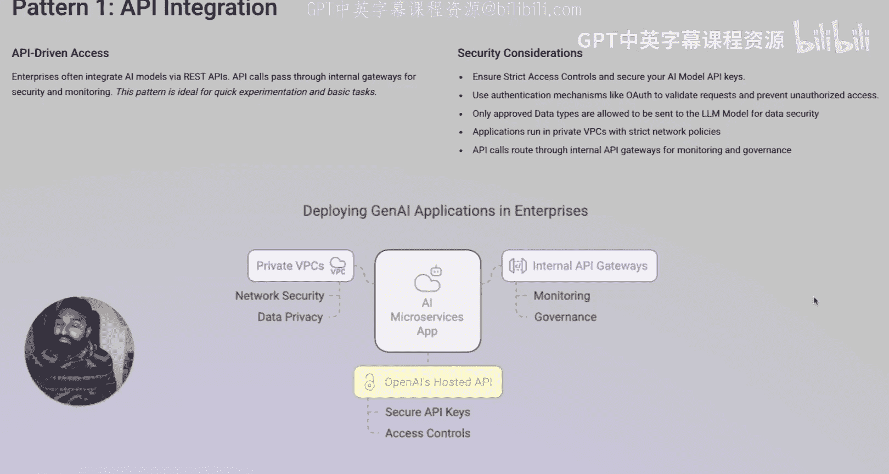
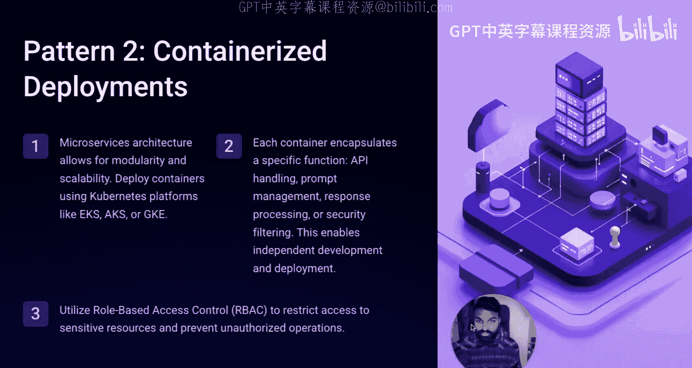
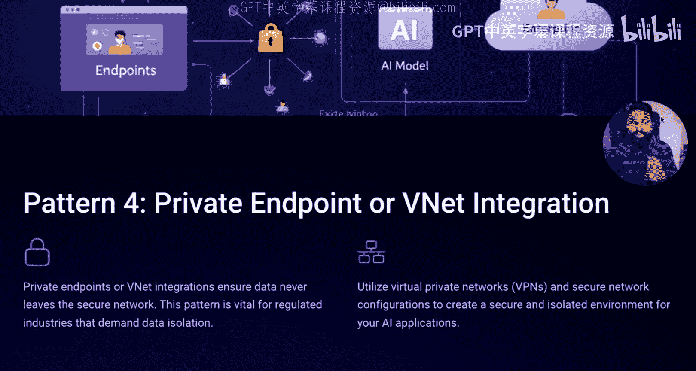
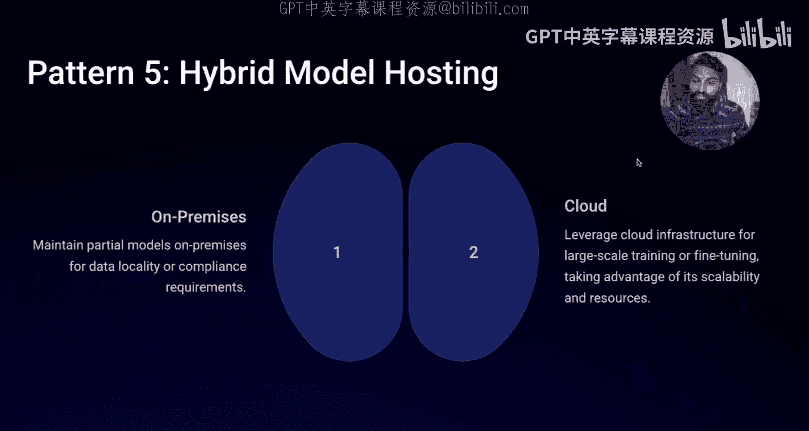

# ExamPro《生成式AI训练营｜Free GenAI Bootcamp》中英字幕（deepseek - P31：-31-How Do Top Companies Deploy AI in 2025_.zh_en - GPT中英字幕课程资源 - BV1SFEWzLEab

These are the top five AI deployment patterns for most enterprise on how they deploy Gen AI applications or AI applications in general。

 First pattern is API integration。 Most AI applications or even gen AI applications are being created as microservices。

 which means they primarily work or something called API or application programming interface。 Now。

 depending on where these applications are located。

 whether they're inside a virtual network in a private network。

 perhaps or they might be allowed access to the internet for it to talk to cloudde or open AI or any of the other LM models。

 they will primarily be talking through something called a rest API and would have components like API gateway。

 the networking components that may required for it access keys and stuff as well。 Now。

 if you are deploying some of the security considerations you may want to have is having a strict access controls for who can access the AI application whether it's the users that you're allowing access to the LLM model itself。

 whether it's the network access to people who may be working in the backend。

How they connect to these Ls And whether there's a third party that is allowed to access these as well。

 that would be the network security component and the access component that you'll think about。

 Now talking about API， we also need to talk about API access keys as well。 most of the LM models。

 if you are using A talk to them， there is an API key that's required for you to authenticate to know that hey。

 I'm a sh。 And this is my request to you。 And for this reason。

 a lot of the applications are hosted internally because your enterprise。

 you don't want your application to be on the internet， at least not the backend。

 So a lot of the backend is primarily on private virtual cloud networks。

 And they also have strict network policies to only allow traffic from known I addresses。 Now。

 finally， once you put these considerations in you need to continuously monitor for security misbehavior or some kind of anomaly that you would pick up on the fact。

 in case there have something wrong with the L models that you're working with。

 And maybe if they are compromise which also brings me to the number to pattern。

 which is container as application， a lot of。😊。

Work on a containers approach for the AI application。 Perhaps you want to run a LLM model locally。

 And instead of trying to build in the cloud， you may want to build it locally and containerize the entire application into a container operating system。

 which you can deploy any place。 Now， usually these are experimental hugging face or deep or any of the other perhaps wonderful L model that you may want to use locally to see if there's actually something that can help you before you start deploying it into your enterprise environment。

 This may be primarily in your laptops。 And you may be using it in a contained environment。

 hence the containerized。 And once you're ready and you've deployed certain patterns and you encapsulate each component or service of that L model into a container application。

 which you can deploy into a microservice architecture。 Now。

 for a security consideration perspective， if the container application is only on your laptop。

 perhaps the consideration for security is limited to your laptop itself。 However。

 if you are going to deploy into a development。😊，a test environment。 then again。

 we go back to the identity access management， who has access to the LLM model that you're containerizing and the data that you're using。

 I it the kind of data that you should be using for something which is perhaps going to go on the Internet。

 Now another common pattern for sometimes the reasons could be that you may be using a serverless architecture because you don't want to host applications。

 But because you're using Geni， or you're using applications， which are AI enabled。

 you have a lot of data processing do， which doesn't really work in the serverless model。

 So in this particular pattern， you may have a Lada or a cloud function of some sort。

 which is handling all the API request for your application。 There is a database in the backend。

 which could be a vector database， which is holding all the data perhaps before the information process and after the information process Now in this particular scenario。

 again have to have security considerations for your API access keys。

 the security of the database itself and making sure that you have the right kind of access。

 but also if you are learning。😊。

Btches of data processing through it。 How are you making sure data security is enabled across the board in terms of how it's transited。

 how it's resting in your database and who has access to that data。

 number four pattern is when you're using a private endpoint like perhaps a cloud service that is available from Azure or AWgCP to host your own LLM model without having to use your own infrastructure for services like bedrock private endpoints are available for most of the cloud hosted LM models where're using a cloud service to host and do all the experiments that you want to in that particular scenario。

 you may even have a virtual network which private that is interacting with this particular service as well in this particular pattern。

 security considerations are obviously who has access again， identity being the most important key。

 Second being the data part。 What kind of data is being sent over and how is the data being managed for security encryption as well as the entire data lifecycle offered as well。

5 model is a hybrid model where you may have。

Much more compute available because of the resources you have on premise or perhaps the data that you are trying to use so sensitive in nature that you can't bring that to the cloud。

 So you may use services that are hosted in the cloud provider for their LL models。

 but the data that you may have is on premise。 Now， technically。

 this is called a hybrid model because youre using capabilities， the best capabilities。

 of course of both onpre as well as cloud， but it is something that to be noted that a lot of the applications that are probably being created in enterprise may fall in this category where you're using a hybrid pattern and on top of this。

 you could build on microservices or you could go on the server as an extra。

 but this is kind like the foundational model where you would be using quite a bit of it。 Now。

 from security perspective， primarily relies on the networking part where who have access to the network and the data that is allowed access at all。

 So the two main components again， identity and data Now that you understand the five patterns for deploying。

😊。

AI applications you probably are ready to run your experiment or pilot for AI by building security for design。

 I will leave a video over here for top AI security that you need to consider before you start building a pilot or building each AI application in your moment。

 enjoy。😊。