# ExamPro《生成式AI训练营｜Free GenAI Bootcamp》中英字幕（deepseek - P32：-32-GenAI Bootcamp - Week 2.zh_en - GPT中英字幕课程资源 - BV1SFEWzLEab

Everyoney everyone， it's Andrew Brown and welcome to the freeG boot camp。

 we are starting on week two or week three， depending if you count from zero。

 but before I introduce you to our I guess instructor here。

 what I want to do is I just want to quickly show my screen here and I just want to remind folks that if you are deaf or hard of hearing the best way to watch this live stream is on LinkedIn if you're on YouTube we'll drop the link in the description and we'll do our best of with videos provide capturing and this is just because YouTube doesn't always provide live cap but LinkedIn does so make sure you go over there so that you can hear and follow along with us but now that I have that out of the way I want to go ahead and introduce to us our guest instructor for this week Hey do on how you doingy what's up Andrew I'm doing well hello everyone thanks for having me on。

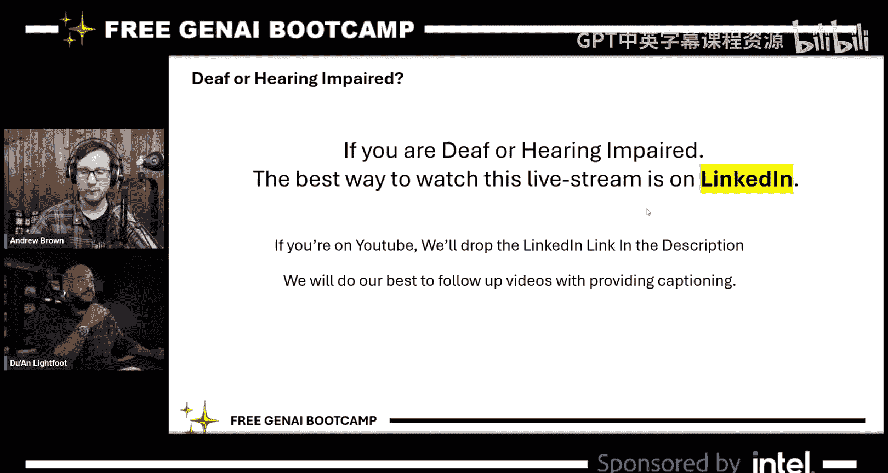

Cool and so folks probably not know， but I've worked with Dunda quite a few times and we just recently did put together live sorry inperson events for Jenny I training so this is just kind of a bit of a continuation of that which is really really fun so I'm really excited to see what we're going to build here I do have some slides prep that we're going to go through just like every week and you know we'll do the first thing we get away is thank the sponsors so we want to thank our sponsors Intel for sponsoring the boot camp as you know we have a landing page for them for there's three things that I've chosen。

Oh sorry apparently I'm not sharing my screen， but there are three there are three sponsors I want to highlight today。

 but again， Intel has three products that are community base that I really want to get people more involved and to utilize I think we worked with OPA last week I'm curious boot campers who got a chance to work with OPA and was it easy or hard I'm just wondering how people made out So I'm just gonna watch the comments here and see how that went for folks。

😊，I willll just give it a moment there too。Get in some chat there。Okay， so some folks。

 some folks were getting getting along there couldn't get the mega mega service app to work。

 I I almost got it， I technically got it to work， but not 100%。

 So there would be a little bit more work to do there。 And my my watch always rings at noon。

 which is very。😊，Very very perfect to remind me of what I need to do here yeah and so some people were able to get some people are a little bit behind some people had their containers got their containers not to crash so some people are getting along there and thank you Shazzd as always Shazad just donated into the stream five euros so that'll be good for me as I need something hot to keep me。

Keep me going in this cold weather Be says you know trying to understand the megaurface are different things a little bit behind the schedule so yeah folks that's why I wanted to introduce it very early so that we had opportunity to catch up so this week is a little bit lighter than other weeks if you have that opportunity try to catch up with OPA because we are going to be going heavy into that I think next week so just make sure that you get a little bit time to get familiar with that there we also have torque so Toque I would describe them as a developer developer profiles that help you connect you with jobs I have a really really really really really really good career session with Ken Collins from Toque and we talk about defining what an AI applied engineer is and he comes with information from the other side to say。

 hey， this is what companies the challenge they're having with aligning these skills and he has really really good stuff to the fact that I will probably go shoot a bunch of videos。

And including the Jen essentials based on the feedback of that session。

 so I'm really excited to share that with you。 we also have code Rabbit you folks probably heard in the developer week that I wanted to cover code reviews and so I just happen to be looking this tool tool and they just happen to be a sponsor now so now I have more motivation to come in here and make sure that we have this opportunity to look at AI coding review and as our projects become more complex this would be a great opportunity to have something to audit to check to say hey what is the code that we are checking in here so you'll definitely see me utilizing that in other weeks here some FAQs I can't see submissions when can I submit so this week was a little bit slow for me。

😊。

Getting that form out， I think I really said literally yesterday。

 that's just because I was trying to define what I wanted for the homework。

 but the other thing is I wanted to make sure that I provided that grading video so that you could see exactly what it looked like from my side when I'm grading so you have a better opportunity to to make sure you do your best submission so that I can grade you as fairly and best as possible。

 understand folks at prea week， I don't expect anyone to have perfect submissions that's your opportunity to learn you can't go back and fix them。

 but if you submit it， but you can for future weeks。

 so just do your best focusing on future weeks there how do I run the typing tutor game so for those that got the frontend back and running they might have noticed that when they tried to launch the game it wasn't there that's because at that time I didn't include in the codebase it is now in the exam Pro code forlash free Gen free Gen bootcam 2025 so you could just download it and drop it in there and I think I cover that somewhere and if I don't。

I will make a separate video if that helps people out I couldn't finish the backend front end how do I continue so in the dev Tools week you were tasked with building out the backend from scratch or reimplementing the ones that we ripped out so if you were for whatever reason unable to complete the back end that's okay because the code there in the exam pro code repo is there you can download it。

Right but you have to remember to download a very specific commit。

 I purposely put a code trap in there so that if you're just kind of copy pasting and drops things in it's not going to work expected so in a video here in this week I actually show how I download that repo and work with it because I continue to use that one even though I have the golang one that I built in a separate video so just consider that and again we have a frontend there for you I didn't even have time to build a front end so I'm behind on homework。

Not just boot campers， so again， don't stress out if you're behind， even I'm behind。

Trying to keep up with my own expectations when will I see grading if you make it to the end and submit submit the last week。

 you will get graded no matter what if you submit all weeks， you will get personal grading from me。

 I am grading throughout different weeks but it really depends on how much I can do there's so many submissions and so you know some will get submissions in one week and some will get in the other ones some might only see submissions all the way in the boot camp it's just the best that we can do to submit as much as we can and Sha Shaa is here in the comments Sha do you want to join the stream did I did I not share the link with Shaa I feel real bad if I didn't I going go know Shaa was sick last week so she was unable to make it。

 but Shaa if if you want to join the stream I'm going to drop it drop it in here in the privates。

How embarrassing， Well I gonna go。 Im gonna drop here。 The Link didn't work for me。 Oh， okay。

 You know what， This is Duand knows Duan knows what's going on。 I sent out the wrong link。

 And so Duon was like sitting in the room by himself。 and he's like， where are you， And I'm like。

 what do you be， where Where am I， I'm here， So in different rooms。

 But I shall I dropped the link to you in your socials on that that one particular platform。

 So go take a look for that。 And when Shala joins。😊，She she can give me heck for besting that up。

I think I dropped it in let me go take a look here。

And I'm just going to keep scrolling down here yeah I dropped in the link here so we'll let Shea join here in a moment reminders。

 okay。There' shallow。yeah， but anyway， Si me must end。

 I did not mean to send you the wrong link there， but for those that I just want to give a few reminders for those about grading because I did do some grading and there's a few things I noticed。

So make sure to provide summaries， not links when asked form。

 if it says URL that I'm expecting a URL in the form， if there's nothing asking for a URL。

 then make sure to provide a summary and you know some folks they like to write a lot of detail。

 detail is great。But at the same time， I need the high level information so that I can use that to see the landscape of your application and dig in and go find things Okay so do your best to try to provide summaries and when you do provide summaries。

 use simple language use the least amount of descriptive words because I just need to be able to read it in the shortest amount of time and find the key value information So yeah just write like Stephen King Stephen King but he writes real simple and he repeats things and it makes it real easy reading for me make sure repo is private some of our best boot campers I looked in and the repo is private I think they meant to make it public but I know they're really good so know this is why I try to grade as much as I can in preweak to catch these things but make sure your repo is public So double triple quadruple check this week we're focused on multi modalities So when we say modalities it's just different ways we can work with Jen I this means working with things other than LLMsre。

Working with LLMs， but there's a lot of models that aren't LLMs that fall into GenI。

 so we have voiceice to text which is ASR there's a lot of different different types of speech to text or voice to text but specifically automatic speech recognition。

Like open whisper computer vision which we we get exposure to with Robs Robs ASL figure spelling。

 we have Texas speech like maybe using a managed service like AWs Poly if there's an open source one I don't know it。

 but maybe somebody out there can find a Texas speech one that we can use and tell us how it goes we have transformers vision encoder decoder I don't know to call this but this is where we are taking image and we are figuring out what the image is and producing a result from it so we have a lot of fun stuff this is a really really fun week but again it's a lighter week and so use this time to try to catch up from the prior week there and do how many how many cameras do you got。

I got two cameras， but I'll put a backup camera just in case some have with this camera I can just flip over I got。

 I got a backup camera too， but I don't like the angle of it so I keep it I keep it off there Sha。

 how's your homework doing Are you all submitted and all caught up。No。

 so work has been crazy as usual， what else is new and last week I was sick。

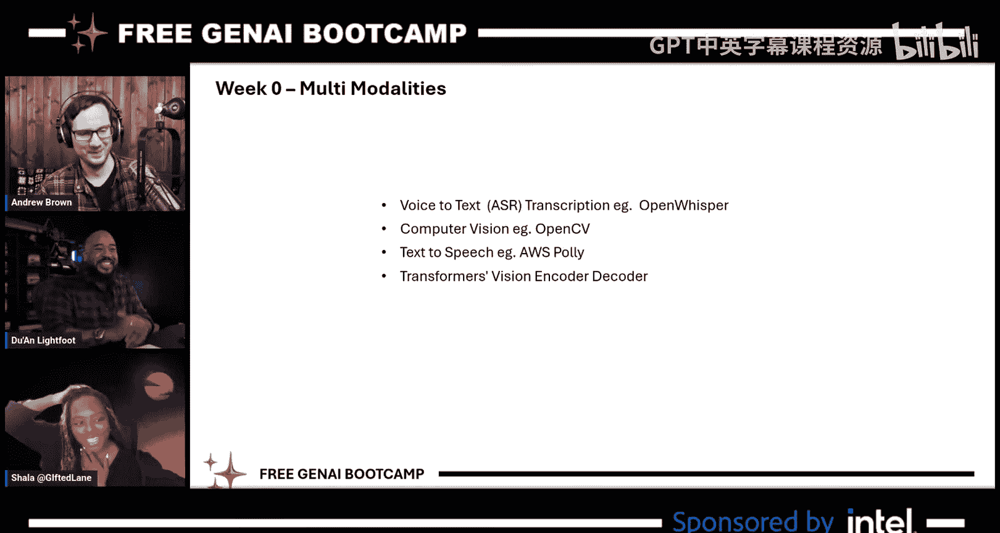

And I'm also prepping for AWS DevOs pro exams sos so so what tips you got for boot campers that are juggling a lot of stuff and you know trying to manage it all？

First off first off， give yourself some grace I have to tell myself that as well you can't do all the things It's not about you know the classic you know it's not about how you started and how everyone else is doing focus on yourself and taking what you want to take from this boot camp from this boot camp so first and foremost give yourself some grace iss okay do your classic。

 you know if you have multiple things prioritize number them the things that you need to get done first work on them first you personally I use a time timer type thing because I like doing the phadro method So when I have multiple things I'll focus 25 minutes on one thing then 25 minutes on another thing and I get through it Well and I think that's really solid advice where it's like time time box right and what you get done is what you get done and just be realistic with。

You're with what you're capable of in the time that you have it right for those who don't know I wake up。

 don't wake up as early as Duon， but I wake up at 630 I found out Duon wakes up at530 at least today he did is that is that usual Du on for you its something earlier than that but two days ago I didn't really get sleep so I had to make a for it last night so I got up to53 you night。

So okay， so you woke up late today。anyway， you know I wake up at 630 and I want to get my Japanese language learning down as we're focusing on doing all this other stuff and so I will study for three hours before anybody wakes up and you know if I find that have I don't have enough time I have the ability to adjust how much I want to study so there's a certain amount of words I'm trying to learn per day and if I think that it's a heavier day then I cut it back to 10 because that stuff accumulates and accumulates and a lot of people end up quitting because they stack too much stuff on one of the best skills you'll learn from this boot camp is time management。

 whether that is waking up early say real expectations with yourself reducing scope but consistency is what matters the most if you can submit every single week even if it's the smallest piece of code and it's all you know how to do people that get to the end still get a badge right so like the lowest level badge that we have is still a really really good badge so you just manage what you can and I just want to remind that there but now that we got that PSA out of the way。

We're going to start jumping right into this， but maybe I should talk about， you know， but yeah。

 we said we're gonna to work on that doc first so let me pull up the word doc and let's kind of scrap out what we're going to do today and we are going full live here so folks if you can fall along do the best that you can I'm not sure if the repo that Duon has is that public a or no is not public but I'm make public okay so Duon will work on that in the background here but what I'm going to do is I'm going to get my screen up here Bacos trying to get our screen set up here but I'm gonna pull this one up and I'm gonna make a new project and I want to show like how I write this up and think about them when we do this and so we are on week。

2 or three， depending on what you count from。 And so last week was like level 200 stuff。

 I'm not sure why OPA is under test coverage，' supposed to be its own little thing here。

 but that's fine。 So this is， we are， I would say that we're probably on level 300 now。

So let's say level 300 and I'm going to call this one。I mean， it is with rag and tool use。

But the other thing that we're doing here is is that this use case is。

 I'm going to call it listening。Listening learning app， okay？So。For those who don't know。

When you want to learn language， I cover this in my office hours。

But let's say I'm saying for the JLPT， right， The JLPT N5 has a listening component。

 So there's three parts of this exam。 There is a comprehension part。

Sorry there's a there's a like multiple choice part of like choose the right word or whatever then there's a words that are comprehension like try to make sense of the sentence and do things correctly but then there's an audio part now you can't hear this audio you don't really need to hear it but the point is is that these are a series of videos not this fellow here Clickup is getting free advertisements right in the boot camp here I should reach out and get my money from them but the point is is that they have a series of audio clips and in them they're giving you a scenario they're saying like if I scroll here a bit sooner。

It's this this man goes to a cafe and， you know they they're asking like what do you want to order。

 I want to order do you want to order coffee or do you want an ice tea No， I would like a coffee。

 do you want your coffee black or do you want with sugar and milk， yes。

 I want with sugar milk And so if you listen carefully you'll notice that that in that conversation they're talking about all these things So if you just listen。

 you pick up the words and you think oh， I heard coffee or sorry I heard tea then therefore the answer is tea。

 that's not right because you have to have comprehension right And so the trick with this is that you have to carefully listen and then you have to choose from the for Now the problem with this is that if you do this once you now know the answer。

Right so how can we create a system which will create derivatives of this thing or create new scenarios in this format so that we have infinite things to practice on and so that's what I'm hoping that we can kind of achieve here today or work towards that here remember it does not matter if we complete the task in the two hours here we're here to interact with do on in Shaa and try to figure out like what does real worldl building look like when you're with the team so I'm going to go over here I'm going to call this the listening learning app。

Listening to the learninging app and I'm just going to put in the difficulty here。And200。Y'all。

 you think 200， Yeah， I think 200 Okay so and so there there we're already starting to adjust so we'll go ahead here and we will we'll call 200 here Well。

 300 or to，300 works， I was thinking 200，300300 works because 500 if we're doing agents。

 the reason why I say we're doing agents that does make it 300 rag。

 I would say 200 but we can make it 300 Okay， 300 yeah。

But this this is what it's like when you work with your team you're trying to scope and figure out fit right even if you're doing like story story points and prep a project。

 you try to figure out the challenge or difficulty of something because if you know how hard it is and you know how much work it's going be involved so the business goal is you know you are an AI engineer willll call it applied applied AI engineer。

 which is the term the Ken calls like to use it I like saying practitioner。

 AI practitioner but he says applied AI engineer which makes more sense for the industry when you're a job searching for this stuff。

 you' are an applied AI engineer and you have been tasked to build。Um， a language or a language。

Listening， comprehension。诶。App， okay， And so what is the app going to do。嗯。There are， there are。

Practice。Listening comprehension examples。For language learning tests。Right。On YouTube。

So we're going to pull the YouTube content。And。Use that to generate out similar style listening comprehension。

And I mean， we should really describe why do we want to do this， so like why it's because， you know。

 when oh serious。yeah， so for me， yeah， the scope， the scope here， I would say is。

It's twofold first we got to get the YouTube either video transcript or audio right depending on how we do it。

 the next thing we also have to transcribe it。The way I was thinking that we kind of and we can get to that point was to actually get the transcript first and then analyze the transcript and understand it and then when we started talking about the agent and workflow。

 then we talk about integrating audio， but this is really interesting and I like where you're going with the business go。

So we'll talk about technical requirements， so some of our technical requirements are I'm trying to remember so like we need to。

 I think you just said we have voice to text。Um， do we have is what do we want to use for that？

Voices text， I would say or ASR， ASR automatic speak recognition。So voice two text。Yes。

 so we want to be able to listen to our voice and speak。 It takes as input voice and it outputs text。

 And so in this case， it'd be a transcription tran。 Yes， well。Oh you want。

 do want you want to use a man of service。And many server okay for folks that are listening。

 you can use AWS Amazon Transcribe works really good or for those that are that have no spend。

 you can try out open whisperhis Okay so there's multiple options here。

 but Amazon transcribe like if you don't want to go around with things you can use an API and it works pretty fast So another thing is YouTube actually transcribe videos and there's a YouTube API for that So we'll use that API to just get the transcript directly。

And so I guess my question is like does this one have a transcribe。

 So if I go over to this this video here， and so that's the thing is like maybe we can skip that step if we go down here。

 Oh， there's transcription， you could also pull it here as well。

Right and we'll pull it through code so we can actually get it and integrate it what could we use to like how would we pull it through code is there that particular tool for that or yes there's a YouTube API I could see you' paste it here in the chat YouTube。

Transcribe API。And。I'll paste it here so you can see it in the private chat and we can use that to pull the transcript directly。

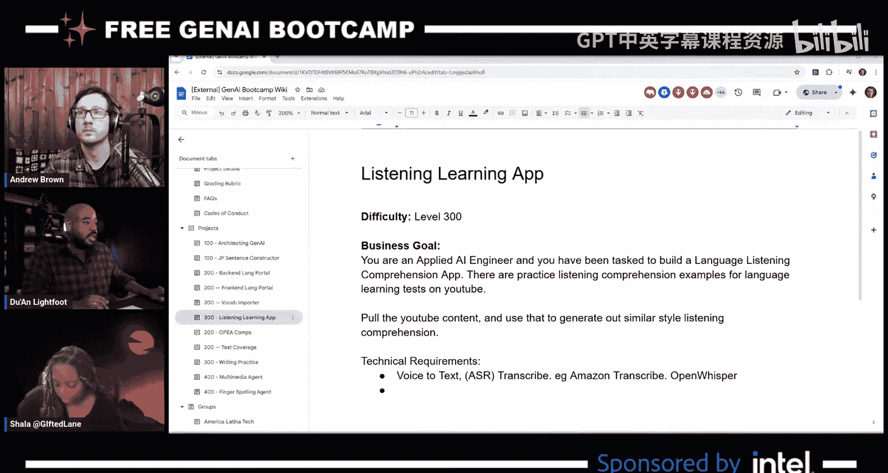

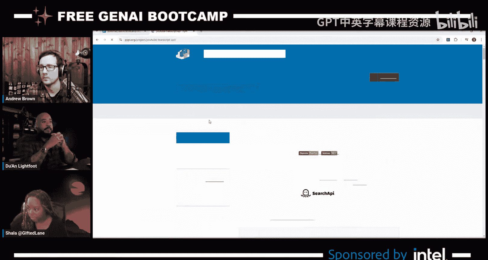

Okay， cool。 So we have YouTube transcript API。 Oh， so basically。

 what you're saying is that we can skip the so you can skip that step。 now， now boot campers。

 if for whatever reason you didn't have the transcript。

 then you would have to add this additional steps。 So this is gonna be。

 we'll just say optional or not required。😊，Because with YouTube， right， you if it has a transcript。

 then you could just use that API for this。 I'm gonna go grab the YouTube we'll say YouTube transcript API。

 So this will be download transcript。Transcript。From YouTube， okay？And the reason why I like this。

 I'll tell you where I'm going is since we're talking about agents。

 what if you could just give your LLL a YouTube video and have them grab the transcript directly？

Right and then discuss with it so we'll talk about that as well Okay and we're talking about and that's tool use that's tool use yes oh that's tool use okay so we have voice to text again optional but if you didn't have that option but but since we found out a solution we're going to skip that which makes more sense to skip it is to use YouTube transcript API to download the transcript from YouTube we need to use something that has agent like does this use case have like does our use case need an agent because we need tool use right right because we're。

Ty use is given the LLM capabilities when we started talking eight。Now we're getting into teaching。

 but if we think about the LLM， think of that as the brain right now in order for you to be able to access you to that brain needs some type of extensions it needs hands and the internet it needs to be able to search so that's where we provide the tools now when we started talking about the workflow and now we're communicating with the agent and it's making reasoning decision or when to use that tool so that's going to be our agent。

And and folks， remember the word agent is very variable， I've almost tempted to make a。

 what do you call it when you have a bunch of people at a conference and they all talk about an opinion。

Yeah， yeah， but we're going to draw it out so you can actually see but I'm just saying like we have like role of the neuroscient we have。

 we have so many。So many folks and they're all like this is what an agent is and I'm just like I don't。

 I don't know anymore， I don't know。I just want to build a thing so author to Roa to hear Roa's description of an agent。

But but well everybody everybody has their own really it's really interesting。

 So it's kind of like it's like a fuzzy term So it's like I kind of want to have like this fuzzy box and through everything or get everyone on call like a panel and then have little boxes and see what goes into into the box of what an agent is but so we so we'll call that agent use where we're using a tool and we have voice to text to speech and then we have the YouTube transcribe API oh。

 but we have to then produce audio because we have to make it like a listening thing So then we have text text to text to voice or text to speech。

 whatever you want to call it And so there's probably a proper word for this I think it's TtS which is text to speech keep writing voice。

Yeah。And this one also might be speech to text it is Okay。

 And so I think the abbreviation here is this， but generally like there's speech to text。

 but then there's ASR in particular right so this could mean something a little bit different or I mean this is maybe a subcategory of it I'm not sure but we have text to speech and so you know for that what would you use for text to speech Amazon Poly Amazon Poly and you know what I use Amazon Poly because it's just the easiest one to use so so for those like for those that don't know like before this boot am started six months I built all of these apps and I needed to produce audio quite a bit。

And you can get Texas speech in AWs， Google， Microsoft。

 there's some open source ones not open source ones。

 there's ones that are managed that sound like realistic。

 but the only one that could get consistently working for me was the Amazon Poly So that's the one that I use and so for Japanese right so it also depends on what language you're using right so some couldn't even handle Japanese or the quality of it was low。

 So you have to kind of figure out what the best in class one is and for me Amazon Poly was the best if anyone ends up finding an open source one love to see that as bonus points So we have that And so I guess this is kind of the technical requirements here anything else that we might be missing one。

嗯。What if we want to be able to like retrieve the transcript and be able to do anything so right Well。

 we got to store it somewhere too right so where do we want to store our our knowledge I think you mentioned SQL light I would like to use SQ light and if that's still on the table let's go ahead and do it there was a service I found that。

Ken Collins told me that I really wanted to try it but I'll do that in a separate video we don't need to overload ourselves here today so Esco light will be our our simple knowledge base that we will rag out to I'm not you know sorry one more in order to help us build I don't know about many of the viewers I are watching this but I've learned to code probably about I would say five six years ago and it's still things I still get stuck with and so one thing that's helped me has been using Gen AI to help assist me in my code so with this we'll use a code assistant。

And in this example I'm going to use Amazon Q developer because that's what's in my IDE Co and luckily in the last week or last week folks got really familiar with AI coding assistant I don't think they got to see Amazon developer Q so this would be a great opportunity for them to see the capabilities of it and because do want specific working with Amazon specific APIs I wouldn't be surprised if Amazon developer queue performs very well for those specific tasks Do you think that we would just use APIs or the service that we're using we have to do we have to use do we need infrastructure for anything or no I don't think so。

We may have to do some stuff and transcribe it for use transcribe but as far as like VpCs。

 E2 instances， anything like that， everything we're doing is many service cool Okay。

 so I think we have a document here and if there's there's also some technical uncertainty I like to write this in here so people can think about their technical uncertainty because this is gonna help you determine what to what to provide in terms of your journaling and when you see Ken Collins video the number one thing that he cared about for hiring at the big recruitment company rannstad right was how do you show what it is that you did that was different or like how like how how how how and that always derives from technical uncertainty So technical uncertainty you know one here do want do you have any technical uncertainty about this this application as we go through it there's a couple So the first is gonna be I don't know Japanese don't know Japanese。

That is technical uncertainty for sure right if you don't know the target language。

 how do you know the output is good or bad and so you either have to have access to somebody and that could be a fail point for the project or you have to do your best and say like hey I did this to evaluate it but that was the best I could determine right any others for you maybe SQL a light but we may can get around that by using some like line chain or something but I like to do everything from scratch so everybody can actually see what's happening so we have to look at some documentation on that or use to to help me with that or talk to you Andrew because I'm sure you know now is this for using are we gonna is this using it as a vector store in particular or just vector store vector store correct Okay so and my brain I'm thinking that we can use it if we can then the other thing that we could use locally is Pg vector but accident storing storing documents as a vector store with SQ light so that's a really good example there for that。

You know， there could be there could be things like I know like I already know Amazon Poly I have technical certainty of it。

 but folks out there might have technical uncertainty of what language they can use because not everyone's using Japanese right I think one person's they're targeting ancient Greek right so I don't think you can go to Amazon polyly and generate ancient Greek or if somebody's doing tokiona。

 the artificial language I don't know if they can do that So it's like it could be text to voice text to voice text might。

Oh sorry， text to speech， I will say TSS。Might not exist。

For my target language or might not be good enough。Right and this is the same thing for ASR right。

 might not exist for my target language。Or might not be good enough。And boot Ams。

 if you find that you're at a deadtop because you cannot do it because of these things。

 then go shore up OPA and get ready for that， okay， or go or show up。

 shore up something else that we will use down the road or go invest time into your custom learning app for those are trying to get red squ and just trying to blow me off my socks by building something that I didn't even think that you could do go invest time in that right for final submissions so but if you can follow along with your target language。

 absolutely do that， share that information So those are a couple things there Another thing was like and and actually I think when serious to want it was one more thing for technical requirements。

 we need a front end so for now we're going use stream。Oh yeah， front end。 Yeah， so front end。

And so this could be streamlit and you know what， I hate streamlit because I'm bad at it if I'm bad at it。

 I hate it so。But there is a actually this week we had Daria and she had an app build streamlit and I had to recreate it and I tried to build and streamlin I gave up when I went back to radio but you know again。

 just because I don't like it doesn't mean it's bad it just means I am bad utilizing that thing and other people are more successful than it for whatever reason despite me being a developer I don't know why so the other thing here is that you know it's a question of like well what happens like you know can you pull。

Transcripts。For the target videos。Right， so like。You know， I think I was saw Du on yesterday。

 you know， he was saying I don't think you can pull transcripts anymore and I was like， well。

 even if you couldn't， you can probably pull the audio and then transcribe it。

And then it looks like there are videos with transcripts and there is an API way so like that's working into that technical certainty like I just didn't know till Duan came I was like yes。

 I can pull I like oh great excellent right and so that is just emerging o yes sorry so this is a good opportunity to really dive into agents because what we could actually do here is try the YouTube transcribe API。

And if there's no transcript available for the video。

Let the model determine what to do so we'll have another function or tool that says transcribe video。

 so it passes in the URL to that tool and then it triggers AWS or Amazon Transcribe to transcribe the video and then once it's done。

 then the model can work with it。Yeah， it makes sense yeah， so yeah。

 in the case that it doesn't doesn't happen， then you write it over。

 were you able to get that code base public anywhere？

Oh you want you want to make it public now Oh yeah so this is gonna be this is just the scaffolding for the code I'll make it public right now yeah and then let's give it a minute let's release the chaos so this will have the front end and you all will have to do the back end kind of stuff as we go and。

Yeah， while I'm doing this， I think you two should ban her or sure。

just tells you what makes it very clear like buy me some time but you know someone actually asked a question they said how about guardras this project right oh sorry is there any other questions you see their show off from the audience that's one another one I had if we could jump back to the red badge real quick from Ali I hope I saying that correctly they wanted to verify if they should not follow the implementation weekly and instead it's something of pursue something of their own to get the red badge so people are trying to figure out how do they get the coveted we bad Hey's it's your it's all it's your risk right so if you decide to go full off track and do something crazy。

Right， that's up to you， but I would say that， you know。

 if if you do every single week and then you do something extra。

That's red Squa right but if you decide to abandon key stuff in in that thing that thing better be really good and really on on key for the project so I don't know I can't I can't say for yourself。

 but it's just a gamble for you right？You know， you have to decide yourself what it is that you want to do。

 was there any other questions from our boot campers Yes。

 now let's go back to the other one where it's like how about guard rails in the project So like uncertainty and profanity。

 which is a good one let me chi me here So in Oto we should actually add that as a technical requirement is guardras and I can actually show how to add that to your application Oh is it easy Yeah it's pretty easy Okay So actually I think I wish I had Rob around here Robs whenever get instructor this week。

 but I think that he say that I don't want my I don't want my apps and not let me swear there's a reason for it right。

 but you know for me， I find what's frustrating when I use Claude is like I said this before well I like to be I like it to be a little bit mean to me like as an instructor because then it makes me more motivated it says I'm not allowed to tell it to do that but yeah guardras。

Garras is a good idea and if we can squeeze it in， let's squeeze it in。

 but we'll see how it goes here are you a job instructor or use it with your work？Oh。

 talking about Jessica， sorry， yep， Shela。Oh no， I was just going to say two year note about。

 you know， saying hey， can you be a little bit being to me what's funny is so with my Korean language learning。

 I do go to a place physically。And I learned with a native speaker， you know。

 who moved here and yeah， she's。We love her I've had her like she's been teaching us now for like two years and yeah。

 she's mean to us， but in a loving way， like she gives us like no breaks or she's like， nope。

 you said that wrong or she's so direct its hilarious。😊，Yeah， so， I mean， hopefully I'm not too mean。

 but I am， I am a bit intense， that's for sure。But how's that Rpo coming Dan is coming？

Here's something else I noticed sure yeah quick site tangent I've been in messing around in AWS as I do every day for work and notice I use chatbot a lot and I see that as getting renamed to Amazon Q developer and I find that interesting。

😊，Are you talking about Amazon the Amazon Q developer chatbot Yeah like where you connect u say like if you're doing like Cloudwa alarms or whatever and you need to like put them into a slacklack channel and so you can use the chatbot to do it I keep seeing the messages now saying hey we're changing AWS chatbot to you Amazon AWS Amazon developer like Q developer。

Yeah， that's our chat system， right so when you think。The the branding around it。

 Amazon Q developer used to be Amazon Co whisper but now developer so you have Q developer in your IDE Q developer chat in your IDE Q developer in the console as well so Amazon Q is in the console as well to assist you with that it's also in Lambda it's in a whole bunch so。

系い。Yeah。😊，All right， more Advter， so if I have a list excuse me， I'm still worrying avisalign。

 this is week 11 and I just switched to my new set today so。

I got to get used how many sets are there？So if it depends by person and what each person's use cases or situation is mine I took my wisdom teeth out and apparently they were my natural retainers because they were going under the guns towards the teeth so when I took those out my teeth started spacing out so miner just literally just the invisalant is just pushing them back together so I only have 14 weeks and so I had three weeks left。

OneOne day I'll start invisign， but I don't know I have generated videos in me with like straight teeth and it's just eerie。

 It's uncanny。 so I don't know if I can ever fix that now I do know that for those who are asking about grading the way you'll know is an example of a platform it'll be very obvious it'll be right at the top。

 but yeah， folks just look out。 it just takes me time to catch up with grading so。

Yeah my team does help out， but I try to do much one to one grading myself and then provide instruction to some of my employees to make sure we do that so that stuff is coming here but anyway while doing I was getting prepped here we could talk a little bit more about you know like text to speech and actually I think that we did cover this or speech to text in the JennyI course so like if you don't know how to use openWhis I'm pretty sure I demo it in there right I don't know if we do text to speech。

But。Maybe while Duons looking at that， I'm going to see if I can find about SQL light and see if we can actually use it as a vector store because I'm not even sure if we can do that。

Let's go find out here and so we'll say esco light vector store。

 So how to use EsCO light as a vector store and vector embeddings See like people are suggesting that we can。

 but is it a mistake， right， So maybe what we'll do is go over to Claude。And we'll say， you know。

 can I use SQL light？Three as a vector store。Is it better to submit late or partial submissions grading wise。

 I don't know it's up to you folks I tell you this over and over and over again it's your choice of when you want to submit it'm not I'm not counting the minutes and there's not like a mathematical calculation based on if you're 10 minutes late this many points do its is it there or is it not there were you consistent with your submissions were you're not consistent with your submissions do you have reason to why it's not consistent。

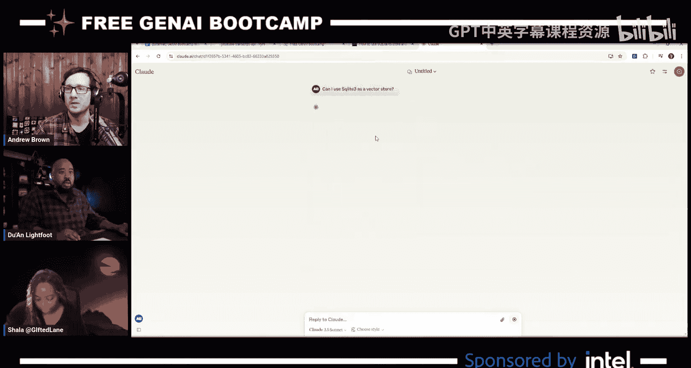

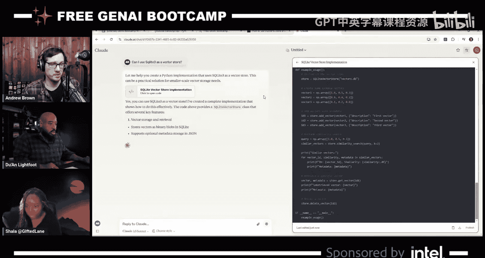

If like if you go to your work it's either done or it's not done or it's it's good enough or it's or it's not good enough right so think think of it we're in the workplace right now it's it's this is not this is not like。

A mathematical solution to gaining points。So let me help you with a Python implementation with SQL3 Oh are we using Python today Duan or something else Yes we are using Python Okay it is so here's SQL as a vector store I've completed an implementation that shows how to do effectively the code above provides an SQL light vector story class that does it Okay so it's literally storing it as a class and here creates an example of vectors with MP which is fine but this doesn't seem very good it seems very。

 very manual and then if we want to do similarity search we'd have to do it this way So I don't know does like is there。

😊，Is there， I thought there was a fork。 Is there a fork of Esco light 3，4 vector store。

And we'll go over to here， Trso is an SQL compatible database with Lib SQL。

 an open source fork of it， so there's something like this， which I've never heard of Trsso。

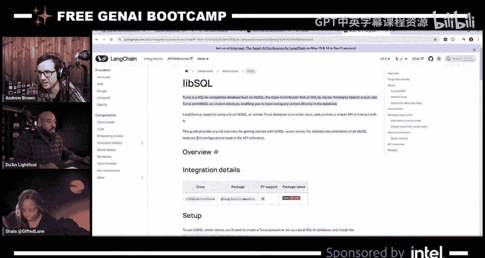

Database for all multi tenantant applications。

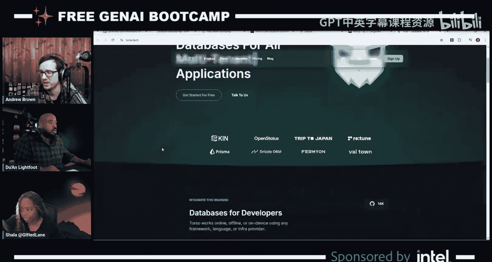

Yeah， I don't know。 So Duan， I might have made a bad choice picking SQl light。

 like clearly we can do it with it， but maybe we should be using PG vector。

 which I think and the genetic essentials actually show off folks who haveve never heard of a PG vector。

 the PG stands for Postgress and and it's basically just an extension of Postgres that we can utilize So maybe what we'll need to do is get that running。

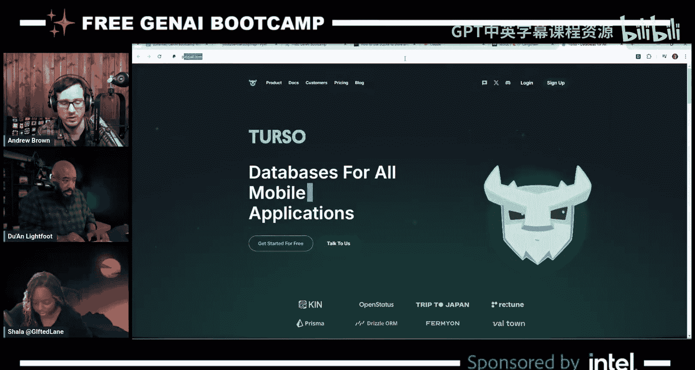

For that there， so what I'm going to do。How's that repo going to one There you go， Oh， excellent。

 cool， So I'm gonna I'm gonna to help a little bit here and get us set up here unless you want to use Amazon developer Q to see if it can do PG extensions。

😊，Good architect take a vote。So， but for me， I can go ahead and hit period here real quick or not in here。

 Actually， we'll go back for a second and I need to run this in some kind of environment。

 So I'm going to launch it in。Code space is here today。I do like Giodd。

 but they're going through some changes， there。Yeah， so awesome， so you're driving。

For for a little bit， I'm just going to do the database you doing and then I've given it right back to you。

 Okay， so that will be in right that will be in。Let's see， let's do rack in the rag。

 so you'll do the rag part， right？I guess I am。 Yeah。 so。

 so all I'm going to do here is I just want to get the the database set up so that we can。

 we can utilize。Uh， what do you call it， uh， yeah， yeah， yeah， true。

 are you talking you utilizeum and so the vettings， the vectorus in the vectorus？

OkaySo so all I need is I need is like you know， can I get a docker container sorry like I can you give me a Docker container that runs Postgress and has the PG vector extension installed？

Extension installed you don't have to spell right， just got to get the sentence right and Cde will kind of understand what I'm trying to say。

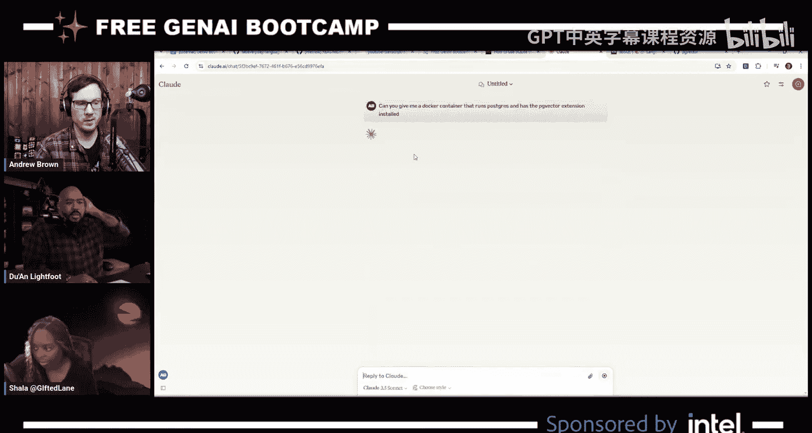

I'm a little bit hard to understand both writing and speaking。

But here it has we have Postgress 15 and here you can see that it's installing the dev server I'm not sure if that's right or raw。

 but that's fine here it's going to clone and install PG vector again that seems okay and then it's starting up it's calling the database vector DB which is probably not what we want the thing to be called but I'm going to go ahead and copy this right？

😊。

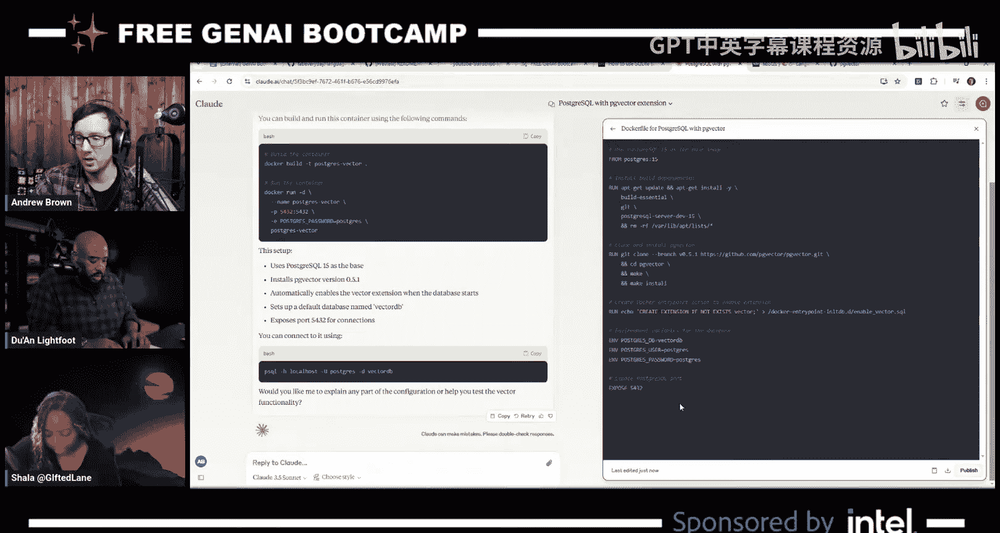

And folks， if you're following along here， what I'm going to do。

 I'm going to drop the the link here so everyone can get the same repo here and work with this and actually if I want to work with this。

 I can't just work with this one， I actually have to fork it。

So I'm going to actually go ahead and press the fork here。

Okay and then also what I'm going to do is copy this and paste this over into YouTube Baco if you can drop that into LinkedIn for folks that are over on LinkedIn we can go ahead and do that and so now I have my own fork of this repo and if I go over to here I can open up the code spaces delete this old one that's a mess up on my part and folks if I'm going too fast don't worry you'll be able to catch up in the recording sometimes things are more chaotic and you just got to shift to observing the chaos。

So we will we will pull that up and by the way， we can get if we can get a scale from one to 10 on how chaotic this is。

 give me your numbers。But sorry， so you using what's the name of the database you're going to use Oh。

 it's just going to be Postgres with the Pg vector extension。Oh。

 someone's really generous they gave us a 0。9， meaning it's not， it's not chaotic at all。

Cedric thinks it's a one。No one's going over 11 so that or over 10。

 so that's good Oh this like you ever heard that that's the in memoryory vector sorry what's it called chromromo Db。

I have heard of it。 I just haven't used it。 Is it easy to use， Yes， like everything's。

Check it out Chel DB， Python vector vector so example。 Sure， let's， let's just。

 let's let's mix it up。 I don't care。 I'll go for it so but is this in is this serverless。Yet， yes。

 it's in memory。 So it's not really。You don't need to build out a database how well。

 let's go for it then。 so I'm gonna go ahead here。 I don't have it。 I'm gonna sign up for it。 Again。

 they're not a sponsor， but Chrome， if you want to be a sponsor。You know reach out here。

 but I going to go ahead and sign up and soon as it be a one click one one click authorization here。

 we'll use the same docker image。 Yeah， that was the goal。

 but now we're using Chromo so we're going go here and we have a oh I'm on a waiting list。Well。

But maybe we'll get through it。 Are you using the self hosted version。 Oh。

 this is the self hosted version。For Chel， yeah。They're saying there is one。Yeah， you don't need。

 you don't need to connect to anything。 Oh， I just do P stall。Yeah， oh， okay， folks， I got a new。

 I got a new like for you。😊，So I grab I'm going to grab this one here and I'm going to go over to the repo here we'll make we'll put in the readme here。

 I'm just going to put this under here。Go all the way down， whoops。

Go all the way down to the ground here， I'm not going to be able to live without my vi。

 Nobody installed this， It's a nightmare。If you install them。

 And so I'm going to go ahead and install that there in the bottom left corner。

 I'm going to go ahead and change my settings。 And we're going to change our theme to Github dark。

 That is easier to read。 And so now I have my vim。 and now I'm really， really fast。

 So we'll talk about our was this for our knowledge base， I guess。😊。

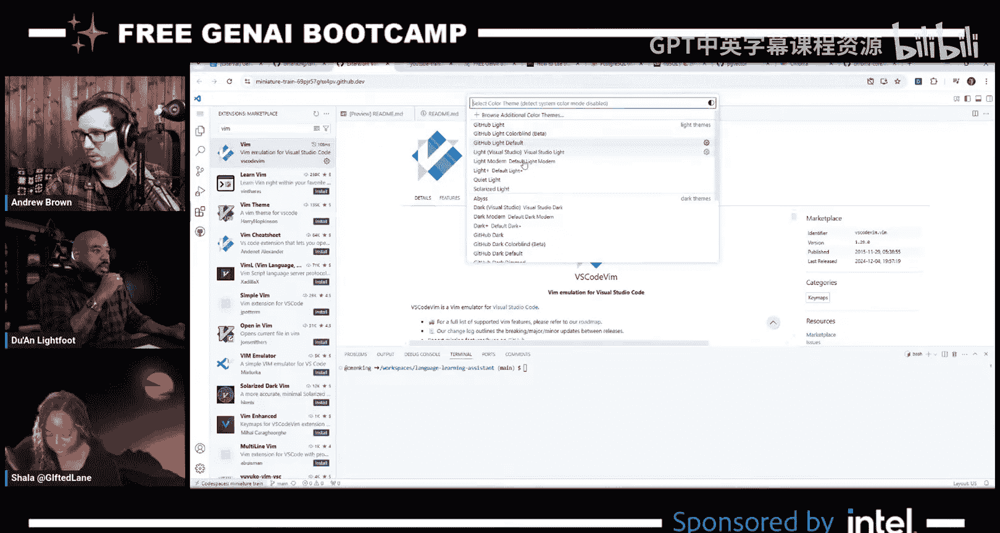

Right， for a hour base。And if I paste in here， we have chromroma。

 so let's see if we can get chroma to work and not this one， but the open source one。

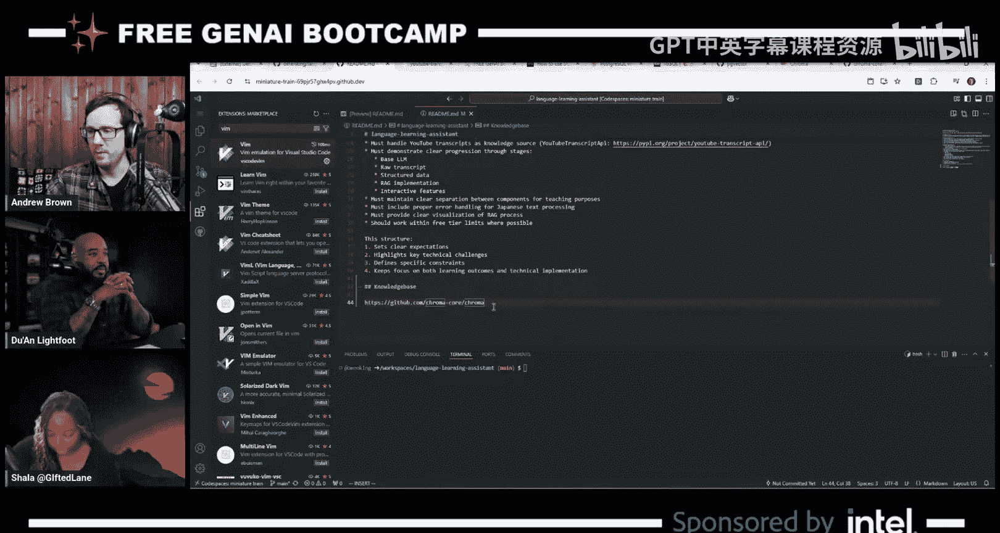

Right， so I think that's the link I provided there。 Yes。

 and it looks like we just do a Pip install to do it。 So probably want that in our back end code。

 So I'm gonna to go over here to back end。

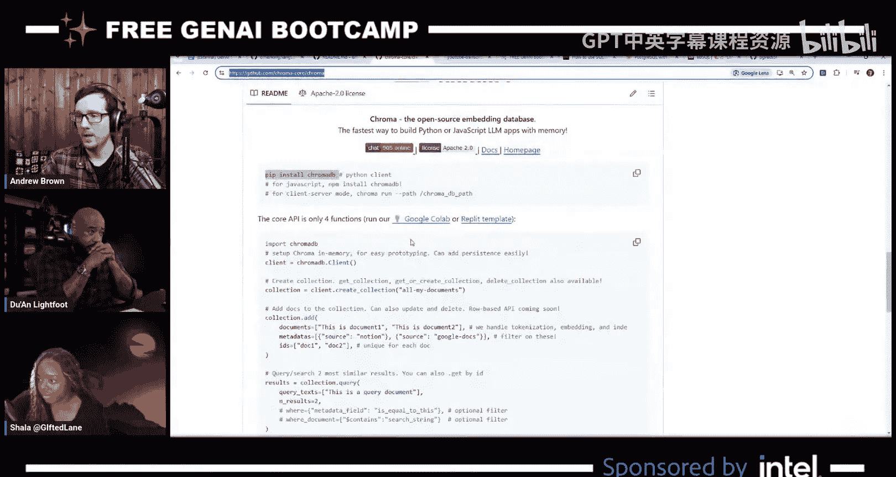

And we do not have a requirements on Txc， but I'm going to go ahead and add one for fun。

And I think I spellelt requirements right， if it's wrong， folks tell me。

We'll go ahead and drop in chroma Db， and so now we have chroma Db sorry， extremely。

 you can do chroma Db extremely。And bottle three Bo three and that's going to bring in Amazon bedrock correct。

 yeah， okay， so I'm going to see you in the back end Pip install hyphen R requirements to Txc can you make the font larger afterward Yeah。

 okay， cool cool。Yeah。😊，so we'll go ahead and do that。Carla， yeah， I apologize， folks。 I。

 I gotta remember to。Keep that font large One of the things about this for those that are watching I like to do a virtual environment I'm not sure if you all know about that。

 but if you're doing this I highly recommend a virtual environment because a lot of these dependencies will change the versions will change and if you try to use it three months from now something in the code may totally be different and then it doesn't work sorry I highly recommend using virtual environments in Python。

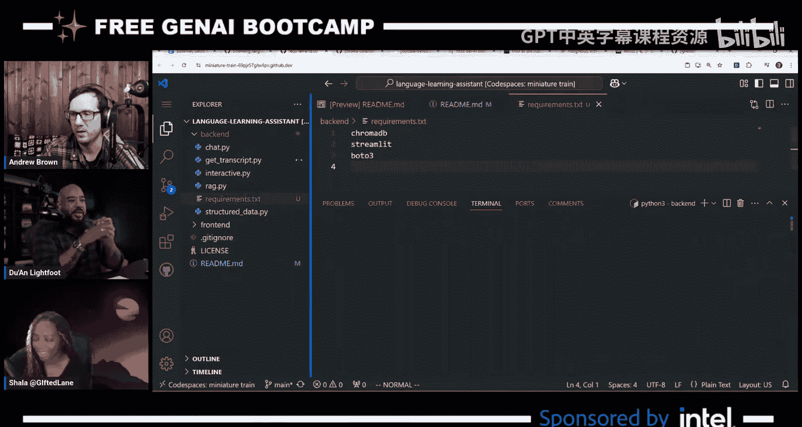

1000% so being on call for last week doesn't seem to be chaotic at all Well。

 that's either a good or bad thing， but that's okay it's just it is what it is right so we are install chromroa to be streamlet but three it looks like it's almost done and so we are are good to go here and I guess the question is like how do we use chromme So have you used this this chromroa before Yeah。

 I normally using in L but I know use it so we'll figure out Okay some examples right down on how to use it。

😊，So what I'm going to do just to get kind of familiar with this， we do have the the oh， okay。

 perfect。 So we have kind of the empty stuff。 And so I'm thinking here， oh。

 we probably put in the rag file， right。Correct， so are you going to try don't know yeah I'm just going to copy their example here I no no idea what I'm doing but I'm going to paste in here I'm going to rely on you。

All right， so we can just walk through it so you're importing Chrome DB and then from there you're initializing the client and then from there you're taking a collection which is all your documents right and that that collection that you create。

 you're going to add documents to it and you can name it whatever。

And notice that when you look at collections at is you're adding those documents along with the metadata and so this is important if you're doing rag or retrieval augmented generation is that okay you have your documents which is your different files let's say file one file2 file three or chunk one chunk two chunk three depending on how you're implementing this and then you have metadata that references those documents together so document one may be a dis sources of notion right the author is this you add all of your metadata that corresponds to that document so this is how you actually identifying and building that collection and now once you have that。

Result says the similarity search so now you're searching those documents to find out information。

 so if Andrew was to add I don't know， like his bio in there you could actually query his his bio to return the related document or related chunk to that specific。

Um questionestion or query and it's using a similarity search that says okay。

 I'm looking at these different。These different texts within this chunk or this document。

 and I'm determining which one of these documents are most related to answer Andrew's question。

Would we have two databases I'm not sure we will have to find out by the end of this right sorry you you can and the reason why you will have two databases。

 let's say you have your your vectors or your chunks within Chroma Db。Well。

 let's say related to that you want to have your metadata and your actual whole entire types documents in like a Dynamo DB database and so now rather than just using RA every time which happens before you actually send your request to your LLM。

 you may want to have like some type of agent workflow when you ask about a video rather than referencing a document。

 you actually reference the database whether that's SQL to tell you about that particular video。

And sorry， it's just someone's like seriously， though you should never pollute your base environment。

 I always polluting my bass environment。 I always say don't do it。 And then I'm just like。

 I'm lazy and I'm just gonna I do not do it。 I felt that pain once so many times I no。No。

 I nope been there done that I said never again you don't like dealing with eyetorrch Ptorrch conflicts constantly I use sage make for that I don't even do that or my that part。

There we go。So so we have this and I guess I guess my question is like are there different kinds of searches that we can do with Chroma or is it just this one similar similarity search I'm sure it has different types of searches you can do。

😊，So there's if you look at the features for the different type of search。

 I guess I guess what I'm trying to figure I was like， okay。

 I have this here now and we have these are string documents。

 but I need to add in the actual transcripts So what I'll do is I need to figure it out maybe they got some documentation here we should actually just run the code we should actually go through run the code Oh see if this works not gonna come back to it right Sure so I'm gonna go ahead and type in Python Python rag dot pi and we'll see what happens。

It's a good point your system has an unsupported version of SQLA3 Cha requires it uses SQLA3。😀。😊。

You have installed it， all right。No， I didn't I never installed SquiL A3 No you installed Ch didn't8 but I think underneath it's using SquiA3 right so maybe there's a version already installed on Giub Github code spaces。

 but your system has an unsported version of Squi a3 requires three or more try to upgrade so this is I think using I don't know Uuntu but let's see if I can figure this out so we'll go over here。

1 to Esco light 3。 like it's probably pseudo app Escal light 3， But just in case it's not。

 Digital edition is always really， really good for those。 don't use the platform。 But I use it。

 I use their， their docs to copy paste commands。 And so that's what they put here。

Let's go back over to here。And I'm gonna to do a pseudo app。Get update first。

 I don't like doing those， but that's fine。I just think it's funny that it uses escalate through underneath。

Well， it's built in， right， it's built in the Python。So here。Well， it was just like。

 it was too hard for me to do it manually。 but I guess if they're doing the work。

 it's it's a lot nicer， but it says 0，0，0， so。If you do a pip。Yeah。Install hyphen， hyphen， upgrade。

 no， Pip install， hyphen， hyphen， upgrade SQL light 3。Okay。So have it。

 so you could actually do a Pistar SQL light3。In Python。But it's not writtenden in Python， right。

 I thought it was built in。Well I think what it is the standard library has a adapter to the Squi 3 SquiY3 is a binary that sits on the machine somewhere。

 so even if we update that it doesn't update the underlying binary so what it's saying here is that the version that is installed on this machine is out of date and so it's going done done it says we're already on the news version so maybe what we need to do is download to an older version but let's go take a look here back to our Python rag and see what it says。

So it says your system has an unsported version of escalate Chroma requires 336。5。

 but what version are we running and it's saying that we are on 331 so。This oh。

 it doesn't have the list one， so we actually have to go compile it。So what we'll do。Escal 3， abutu。

We're really off the rails， I don't care， it's fun。it doesn't matter to me like， I mean。

 I'll lose a lot of sleep tonight， but because I'll be recording all day。

 but it's it's totally fine for me so we'll say install from sos。

So they argue you to a pivot that's called DB ecalate through。

 I'm not sure Phil because I don't know if that will bring the binary over。

 but we'll take a look here and see what happens here。

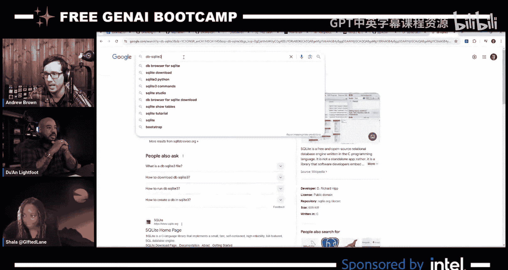

Because sometimes those are just adapters so we go over here and this is updated by this fellow here I this thought it says I know I went this thought it。

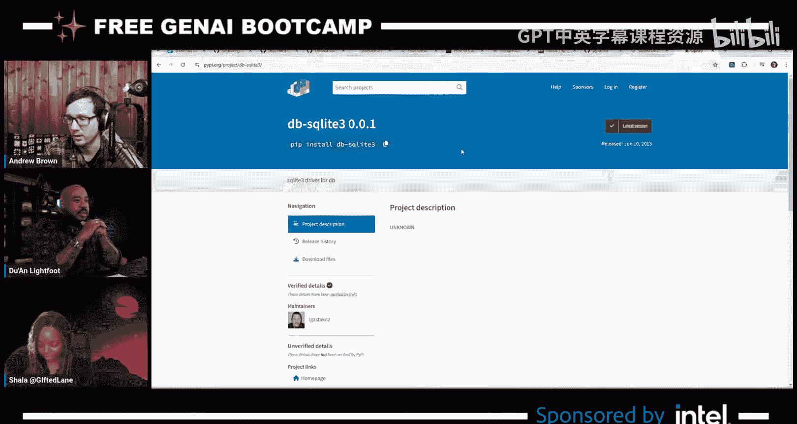

No， you wouldn't install it a note， nope， you go here it's just like， nope。

 how wouldn this thought at。There's there's not a lot here。 I don't think， I don't think that's our。

 our solution here。Yeah， one one of my friends used to write articles for Digitaloce。

 so that's why they're so good。 she used to work at example for a little bit toos super nice。

 But anyway， so I think maybe what we'll need to do is install from source。

 which I assume we can do that let's let's just type an SQ I 3 or maybe there's a binary we can download SQ light 3。

😊，Um。Or you know， the other thing we could do is we this downgrade Cha。

But we'll say escallight three GiHub。And。Sudon never this what you're using right now is VS code in a browser。

I never use that but what's your， what's your go to？

And my local environment sage maker doesn't like the tool。 I do a Jupiter notebook like that's。

Just so I can tell you notes。Well， worst case， we can switch to local if this is becoming an issue at this point。

 it doesn't matter if we figure figure out I like to see you figure it out。 So， I mean， like here。

 I just want to see if it's really hard to build a different source。

 So that's what I'm trying to find out here。 or sometimes what they'll do is they'll have releases here on the right hand side。

 So if you go here。 says there's no releases。 But if we go to tags。😊，This says version 3。4。3。49。

 so it's possible that we might be able to just download it。

But how would it know what it's compiled for， that's what I didn't understand。

So it says SLA is already the newest version， oh oh， so hold on， let's go back over to here。It is 3。

31。 Thank you boot campers。 So I think someone I' was saying is like this one's saying indeed well but hold on this is 3。

31。 this one is 3。35。 No we don't have the latest one So we over here and this one's 3。49。

 And so that one is newer than this one。But my question is like if we have these tag versions。

 what is this， is this just source code， so I have to download this file and find out here。

 just give me a moment here and we'll find out in just a moment。

I'm going to just pull up my downloads here and we'll take a look。😀Ha。😊。

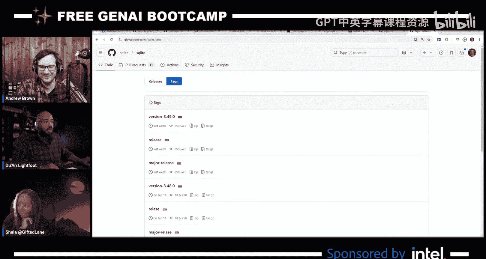

ultra bass is really funny， everyone witnessing Andrew driving the Devos snowmobile blindly in the snow。

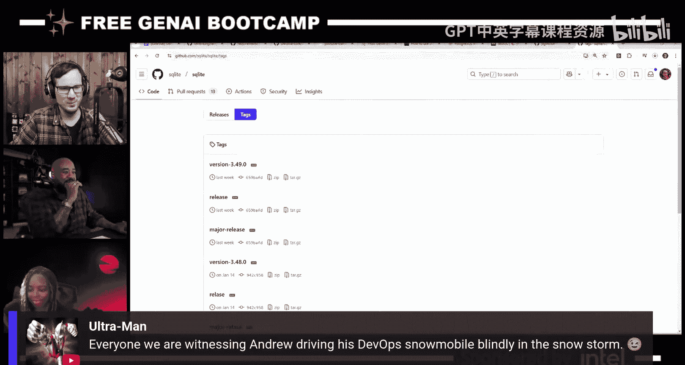

Though it's but we did actually have a lot of heavy snow today。

 so but so now I have the esco light downloaded here if we go into here and click in。😊。

We can see that it's the source code， so this is the source code。

 so we'd have to download that and compile it。And so I have to really make a decision。

 do I want to compile the source code just so I can use Github code spaces or。

We can try something more practical and we could just download we could see if sorry we can get a later version of esco a3 on my local machine and so this is where I'm going to try my local machine and hope that I make the right choice as opposed to doing source compilation When it ever comes to compiling stuff from So that's kind of where I should stop because it becomes really hard for everybody and actually this week in our boot camp I didn't record a implementation after Rob's video for the ASL fingerpelling because I have found out for my local development I would have to compile webcam webcam drivers and in a new distribution so that's where the opposite where I was having issued with local development let's go find out sorry before you do can we try one thing Sure are you able to do a Python virtual environment here。

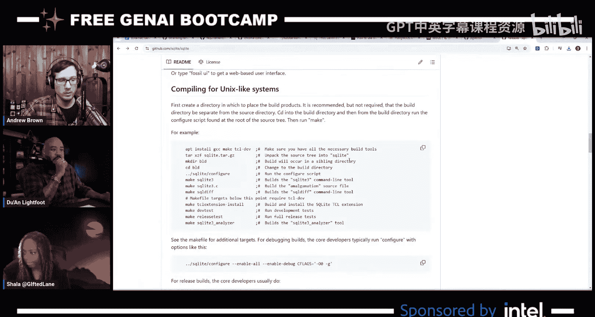

I can， I can do a Python virtual environment if you tell me the command because I don't know it。

 I know Conda， I don't know Python， Python3。Well， just probably Python， right？

Try pythonis see what happens， Okay， well hold on， hold on， hold on。

Python Python hyphen heaven version， okay， so it's just Python。Mney film。Mus M V， E N V。嗯，A。V， E。

 en V。And so this little create environment called V VMv， Yeah， okay。

 so I hit enter here and now I create a virtual environment。 they actually create an back in。

 but that's okay， and then we'll do source。Actually， yeah。

's hold on before we do that because you say that's okay， but then when I have to commit。

 I might have a billion files， so I'm just going to back out a couple levels and I'm going to run that one more time。

系。Now how do we activate that， I'm going to show you source。Okay， space V， E， en V。Forlash。BIN。

Forestlashs activate and press enter。All right， now you got to virtual environment now what I would do is Cd back into the back end and installer requirements。

The reason I don't think this is going to work is because that's going to be for the Python libraries and this SsQite3 is a binary that sits somewhere else in another folder that it's referencing。

 but if this works， then I will I will give it to you Yeah。

 the reason why I wonder if this will work because。This is installed。

 this should be install and SQL light is part of。A chromroa Db and it should use that virtual environment that separate from the binaries that are local that's just what I think。

 but we'll see。So but anyway， if yeah， sometimes sometimes libraries， yeah。

 they bundle in the extensions or the native extensions。

 and so if it does that that'd be great and then we have this big。

 big lesson or the biggest PSA of don't work in base。But we'll see what happens here I mean。

 it looks like it's down quite a bit of stuff， so you， I'm really curious。

What it's going to do because I know like when you at least in Conda。

 if you create a new environment， it does not include anything from base。

 it basically is a new environment and so I'm assuming that with Python environment。

 it's going to be the same process， correct？That's why I say whenever you're doing Python is。

I recommend doing a virtual environment because it'll make your life a whole lot easier。

Most of the problems I run into is not implementing the code， it's just like getting my environment。

Yeah， I'm like like JavaScriptscript and reacting all that that didn't know。

 that'd be the hard stuff for me， but Python， I can figure that out。You are using GiHub dev。

 Can you do this in cursor I mean Gi like cursor is its own ID that is local and cursor。

 I don't believe has a thing that you can。 So if you wanted a coding assistant in here。

 we'd go on the left hand side here and I mean right now we're in the GiHub。

 the GiHub environment so they'd want you to use GitHub Copilot。

 but like if you wanted something else like I think Amazon developer Q shows up in here right。

Does it queue？If sir end up with you。So so I could install this and activate it right now and it could help us along a little bit。

 but this is now done here down below， let's go ahead and run it。

And then I I'll have to eat my shirt here after this works。So we have Python， is it the rag， yeah。

 ragg？pe， nope， I win win I win pain。 That's what I win。 So we're gonna go。

 we're going to go over here。 And what I'm going to do is download this repo。

 I do want to commit the code that I already have。

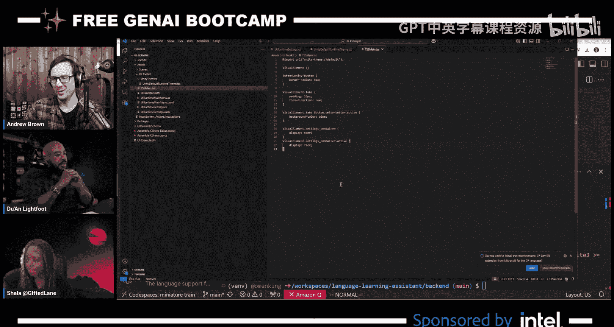

I'm still working on prewe and I didn't I get time after work for important stuff。 And yeah， again。

 that's fine， folks。 I expect late submissions。 We purposely built in expectations that people are gonna be submitting late。

 we just knew that was gonna happen So what I'm gonna to do is just commit this work initially。

 we'll just say rag。 And if all we accomplish is getting chromroa to work then that is gonna need to stream。

 but I'm going go ahead and syncchist。 I'm going go over to here。

 I'm going to grab the local local host we're gonna copy the SSH link。

 I'm going go over to VS code here today。 You know， I like Winsurf。

 but I'm just gonna go playing Jane because I don't need anything fancy yet。

 You can see a video game I'm working on the background here。 I'm gonna go open up my terminal。😊。

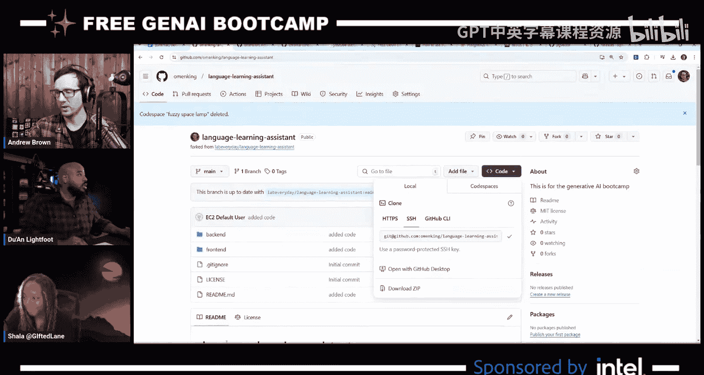

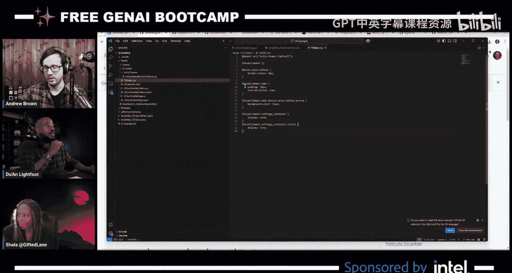

And I'm constantly switching environments like you'll see me I just like I can get it working in whatever environment that's the environment I'm going to work in。

 so go ahead and I'm going to go into my sites directory that's where I like to store stuff I'm going to go into my omen King directory and I'm going to do gi clone and paste this in here So now I'm cloning the repo locally and so what I'm hoping is that in this environment I have an escalate version that is going it's going to like so I'm going to go ahead and just check the version first。

And this one is actually a later version。 So here I've already installed it。

 I did a pseudo app app get install Escalate 3， and it's a later version， so。

We're going to be rocking here in just a moment。But I'm going to go into here。

Lanage learning assistant I'm going to do code space period and I'm going to open this up in another VS code so that it has more context。

 I don't know why it's installing the VS code server I'm guessing I've never installed it in my WSL。

 but once that's installed then it will launch up a new window here I'm constantly wiping out my distribution so I'm always doing things from scratch but now we're opened up here in more context and so I'm over here。

And， you know， if we want to have fun， I'm not sure if I can bring it in， but I'll try。

But if I go to Amazon Q， if people are curious， I'll go ahead and install this。

 I'll have to deactivate， I'm not， I'm not saying I turned this on。

 but it might be turned on Gitthub Copi。So I'm going to go over here and turn off GitHub Copilot。

Because we might as get some help while we're here， right？

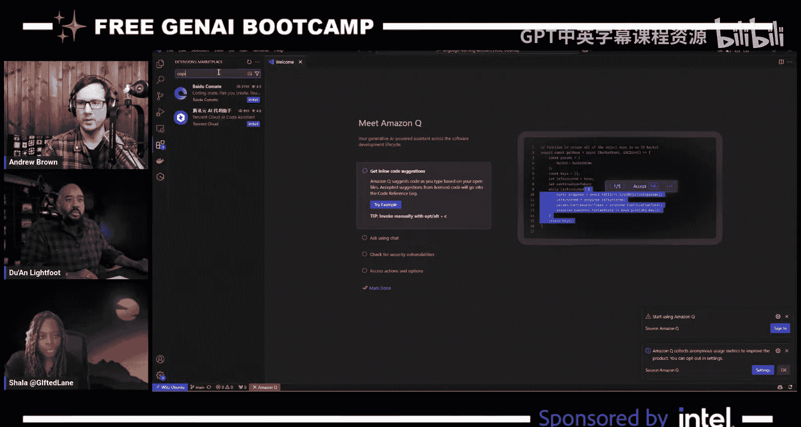

Yeah and wait a minute what are you turning on are you using Q I'm turning on Q Okay cool so because because do on those Q well。

 so so that will help me out here to figure how to prompt properly So I now have queue installed and they have a free version actually I was told recently they they have a more generous free tier So I didn't know that Someone from the Q teams like Andrew did you know did you know and I was like no I did not know So here has a confirmation code。

 And so what I'm doing is proceeding to browser and I'll say open。

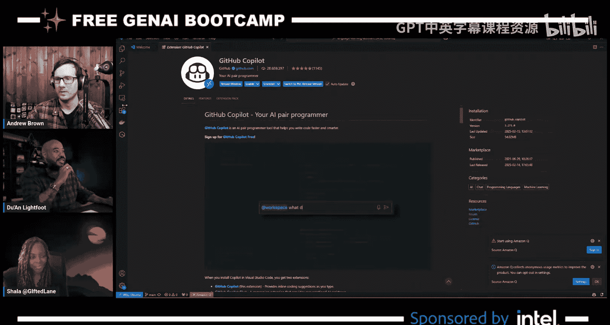

We'll give it a moment to open and over here it's opening a tab， right？

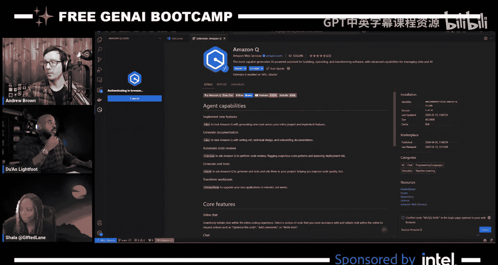

For here， and then I'll have to log in， so I'm going to log in with my builder ID。

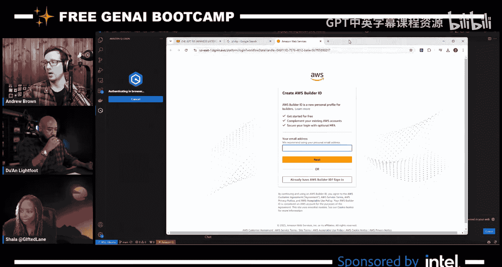

That's like a global kind What is the builder ID How do we describe that is pitch a profile for all things you do in community or on AWS that's what builder I is being built out to be So if you do anything outside of the console like AWs blog community AWs in your ID。

 that's your builder ID So could we say that it's like the Facebook login of the of the AWS world。

We can say that。And so I'm just， I'm logging here off screen I just don't want to show my password and I'll try one more time I have the worst password manager in the world。

Un they become a sponsor then they're the best， but they're。No， no。

 they're not good on there's no there's no way otherwise I don't move it because they're so hard to to migrate away from we'll go ahead and sign in here and so I'm just logging into my builder ID。

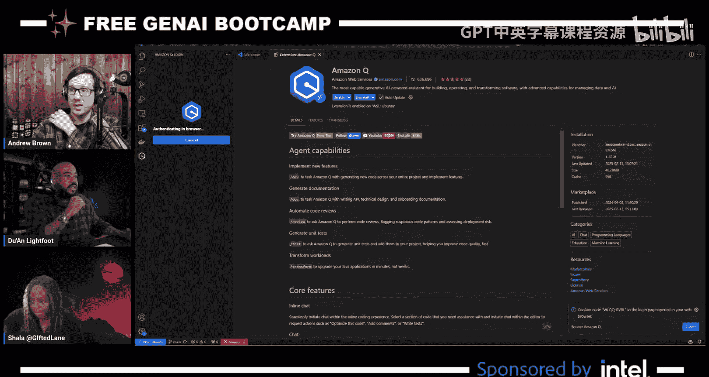

I've gone a different computer， so it's been a while。

 so it's giving me a confirmation code to confirm。And so all they say is confirm the code。

 I'm going to say yes。 and I didn't even check the numbers。

 And so now someone else has access to my account， probably I'm joking。 I know it's fine。

 And so now we have Amazon Q developer。 This is the tip I think I learned from Duan。

 put it to the right。

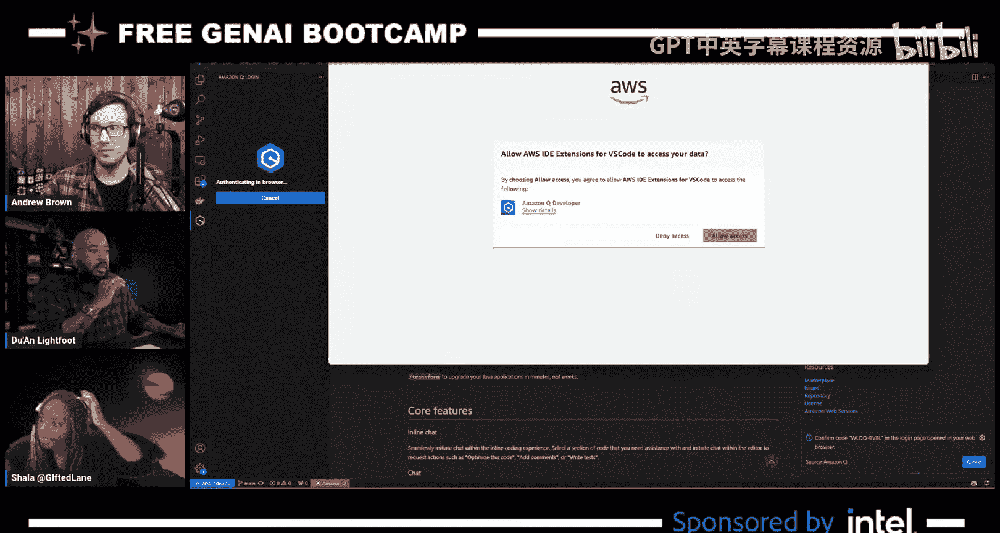

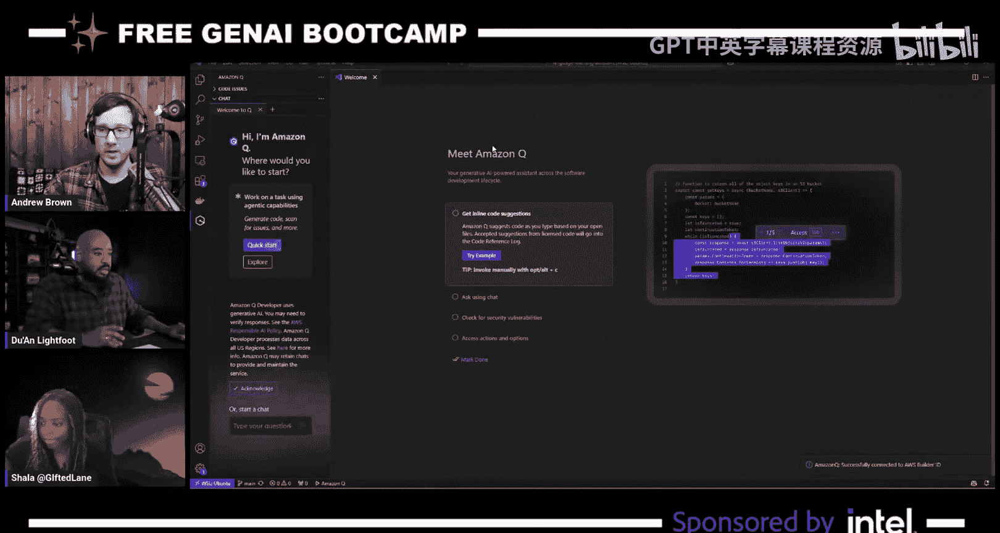

Yes， yeah， put it to the right that makes your life a lot easier。 Oh。

 this is new I didn't have this before the code issues， but we're going to drag this on up here。And。

I don' I'll look at this。This is not， this is not， this is copil， right， sneaky， sneaky。Oh yeah。

That's copd they， they're sneakyy， little go ahead and say， how do I hide this， You can minimize it。

 there's the drop down， Yeah minimize that Oh sneaky， sneaky。Okay。

 so what I'm going to do here is go to my back end。 Oh， sorry， so we can run our code now， right。

 I'm going to open my terminal。Does Amazon developer Q have auto completion and oh， get a Cod。

 this won't go away。It's a meaning。 Let's go check a look。 I like， maybe I have to re。

 maybe have to re reload。Becauseuse I don't want to have two in here or things are going to get confusing。

 So I'm going to reload the window。

Okay。And now it's out of here， but I guess I was going to ask like。

 does does Amazon developer Q have completion in here yet or no， it does。

Do I have to install something to get it？Um it should be on the CI， I don't know。

 I think it's separate from what you're doing now， you have to install that I can get you the link。

Okay， so I would want to run this Python。 Oh， we got to do a Pip install now。 Oh， oh。

 oh before we do anything else。Before we do anything else， I'm going to use Conda。

And I'm going to create a new environment。 I don't remember how to do it。

 So I'm going to go over to the Jenny essentials， by the way。

 If anyone hasn't done the Jeni essentials yet。 It's a really good course。😊。

And so somewhere in here I have setting up our local dev and I'll go to Conda and I'm going to go into setup here and here to describe how to make。

Environment， so here's an example I'm going copy this。 I'm going over here。 And what do we call this。

 This is I'm gonna call it listening learning， we'll call it listening learning app LL just to make my life a little bit easier。

 I'm gonna work with Python 3。10 So do on do not get mad at me。

 but I just keep using Python Python 3。10 because it works。 Yeah it works。

 I think you probably need to zoom in。 So like a control plus or whatever Sure everybody can see。😊。

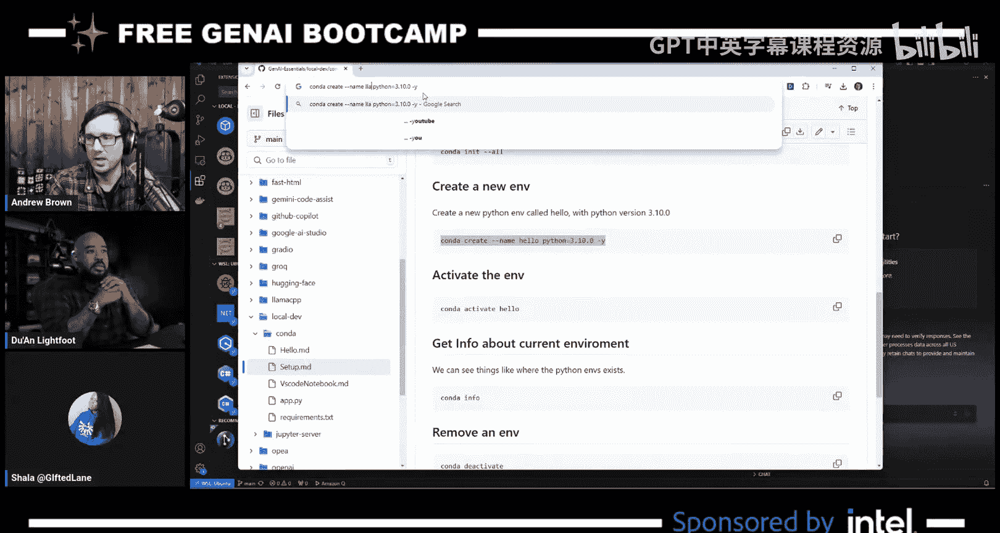

And I'm going to collapse this out of the way and so now is' creating that environment。

Are there any vector database providers？m， providedded by cloud providers， Du？Um it。On AWS。

 we have Amazon bearright Know bases， and then there you can find a bunch of hosted vector databases on AWS。

 we also have Amazon， Aurora。There's a bunch of vector vector stores where you can actually store。

 But if you check out Amazon on knowledge basis， Amazon Bro knowledge basis。

 it'll have all of that information and I'll drop the link for for Aurora and RDS。

 they're using Pg vector。 So that's the extension that allows you to use it as a vector store。

 But anyway。

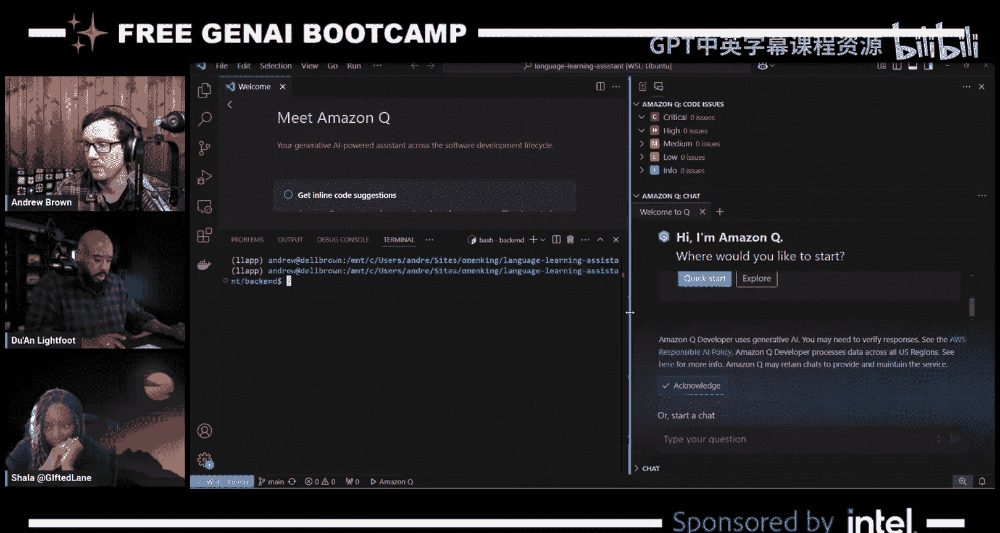

Now that we have our environment set up， I'm going to do a PP install hyphen R requirements。Baco。

 we really need， you know， that meme where it works on my machine meme。

 but we really need that flash on the screen right now because this is only going to work on my machine。

Everyone knows that meme。So in a private chat， I don't know。

 Sha love you have access to the You chat in your on your computer。Can you see the private chat here？

If you could copy the link to knowledge bases as well as the。

Dmazon Q developer command line installing。 I added that there for you， Andrew。

Oh perfect hosting it to the places now thank you。And I'll add them to。The GitHub as well。

 so when I do another push， which I did another push。For the chat so we can kind of speed this up。

 But whenever you get there， we can get set up with。 folks， what is U V。

 I keep seeing that in the comments。 Is that some type of vector store solution that I've never heard of。

Uv guys， U， U， what what's U folks。You got to tell me， I don't know what it is。

 So now we've done a Pip install here。And so maybe we can use Chroma now。Python， rag Gp。

 so we'll go ahead and run that。UV Python package。 Oh， it's a project manager。 Okay。

 so like it's an alternative to Conda Forge。Maybe。I mean， it's just a package。

 like Condaforge is a bit more than a package manager。 But okay， I got it。

 So now that we've done Python dot ragg， we didn't get any errors。 So therefore it must be good。

 I don't think we did any logging in here。 Did you print anything out。 You didn't print your results。

And that other completion there is Amazoncu people who've seen that。There you go。 Okay。

 so now I don't know how to。I don't know how to change this out for documents。

 but I know this is actually one thing I really like about Amazon Q is they have context windows here。

I wish， I wish I wish I wish all of them had this because it make my life a lot easier I going to go here and by the way。

 if you give me tips to on how to do this better， I'd love to hear I going to go here and sayum inlinecast。

 Chris， learn the shortcuts。Well， you teach them when I go here， but I'm。

 I'm so old school like I just， you know， the problem is I'm on a Mac and I'm on a Windows and then I have a Mac keyboard on my Windows machine and it just。

I don't know to press anymore， but here I'm going to say like you know， for chromma， for chromroma。

DB， how do I reference documents locally to add them to the collection？You know， these are。

 these are text。Fileles， okay， and we'll let it run there。 I actually don't have anything here。

 So probably we should have a folder here， which stores our data like our raw data files。

 Do you have a naming convention you want for that。

 It's just kind of transcripts Ca that's what we're still right。Okay。

 and so we don't have any transcripts right now， but I'm to make a docke in here when you need something to stay around。

 you give it a doc keep that way we don't lose it。And so here I wasn't paying attention。

Where did it go I wasn't paying attention Did I blast it away by accident because it added the cold it just went oh it added the cold for Oh just did it Yeah。

 you pressed it in real fast and it went oh head in so I wasn't paying attention Yeah。

 so the width open so it opened the file， right？And they open each file so rather than。

You pass in like finance with a list of finance that kind of gave you。Each one， I see， okay。

So we'll go ahead and do this。 Then there's metadata。And。Filter on these。

 So I'm not sure what we need to do with the metadata。 So I don't know what this is。

 I'm going to go ahead， and I'm going to， I kind of broke the code by myself here。

 I'm going to ask you to explain this metadata part。 So I'm going to go here and say run with open。

 So you took it out。And so now the code is broken。I took something out， yeah。

 the width open to open the back end。Oh， one second here。There it is， okay。

This is why Pe program is useful。If you don't got pair programming。

 then you'll help to use Geni folks。 Okay， so here we go。 This is now making more sense。 All right。

 so we can see this here。 Now this is not obviously where it is。

 but metada is just data metada that's attached to the documents right。

 so what you could actually do is the path to each document would be the source。

 So wheres what or the YouTube URL would be the source。😊，RightWell we could make that well oh yeah。

 I see what you're saying that could be the like literal source of where it's coming from I see you're saying but specifically you can do maybe the the document in the transcript or the chunk or whatever have you want to do it that could kind of you know let you know what the source is but normally it's the actual document that it comes from So I guess the thing is like I want to download I want to download those transcripts and and I think you called the API was it called YouTube transcripts API Yeah let's actually load the front so people can see it and then okay sure so I'll go back I guess I' driving let's fine。

U drive it's up to you no， that's fine， I'm already doing it。And so theres a streamlit， Yes。

 a streamlit run in a front end。In Ma that pie。Stream lit， they no stream lie。被告。呃。Oh。

 I gotta run run。 Yeah， the word run。 Okay， sure sure。 and we'll go ahead and run that。

 So that's starting on port 8，5，0，1。 We're gonna go ahead and open this up。 drag it on over。

 And we have our， I like the little flags。😊，Did you do that or was that Jenny I generated？Yeah。

 I just， I actually went to Google and found the flags and pasted it in the little emojiia or whatever folks。

 you got to do that human touch， okay？U so walk me through what we're looking at oh so right right here the first screen in the app is just a basic chatbo and this is how you will normally communicate with the chatbot but right now we don't have a back end to be able to do any type of API calls to any large language models we just have a boilerp front end code。

And yeah， so we actually need to implement the backend okay and this isn't gonna work right now because well unless I have my AWS API key set locally。

 this would not necessarily work or sorry is there even any Amazon bedrock code in here Vo3 stuff there's nothing in that no Bodo3 there's no backing so on the lefthand side where it says select stage the goal is actually build each one of these on stages the first thing you do is you chat with Clyde in this sense we'll probably change that to chat with Nova because we'll use a lightweight Amazon Nova model the next is the raw text if you go through that and here's where you want to download the YouTube transcript so you'll paste down your URL and you'll download the transcript this isn't going to work right now because there's no backend we actually need to build that out。

And then from there， the next option there is you structured that data。

 so once you have your transcript you want to analyze and structure that data in a way that's going to work inside of your vector store so what Andrew was showing you was how we would use Chroma DB to basically split our documents and storm。

Inside the vector store to create those chunks that we can actually use similarity search to download and then from there that's where the RAG implementation with our chatbot and then we do some interactive learning at the last piece with some question and answers。

Okay， so so just a chat chat conversation nothing hooked up to anything anything there just the raw transcription processing so whatever you need to do to get the transcripts so in this case it's the YouTube API so here you're providing the URL gets it we have our structured data so how are we going to change the data that we've taken before we inserted it into Ra is that right。

The Ra implementation， which we've kind of skipped ahead to and the interactive learning。

 So this is all of it pulled together as the final solution。

 correct Okay but with the assumption that it already has the data loaded into data loaded in so we'll go back over back over to here。

 And so now that we have the lay of the land of what we're building and we have this here and so we're kind of working on this one we can continue on this or we can go to the first step。

 maybe we should do things sequentially because that might make a little bit more sense。

 and so we're gonna to park this for now， but at least it takes out the technical uncertainty in the orders and we kind of honed in on this was because of that thing I found technical uncertainty I wanted to figure that out quickly as possible because that could hang the whole project and when you work in real project。

 that's what you do but the chat stuff I think we're gonna to be pretty confident in it。

 So I have this open here and we have Amazon developer Q how can I get it to just write the stuff for me and save me the time you can do a。

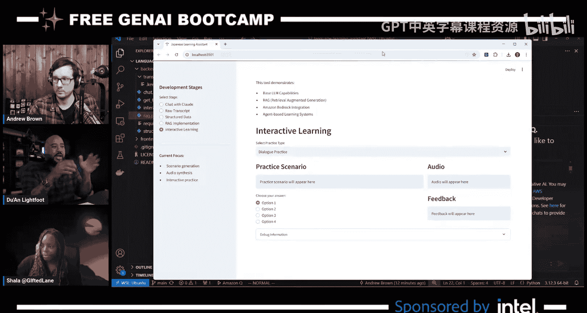

Pool。A good poll， yes。Oh， but I'm I'm in a fork， so， so pull up from the fork。

You at the merge or okay， so what I'll do， hold on here。 Yeah， I'll merge it in。 So， so Duance say。

 he's already got me the code。 I'm looking for。😊。

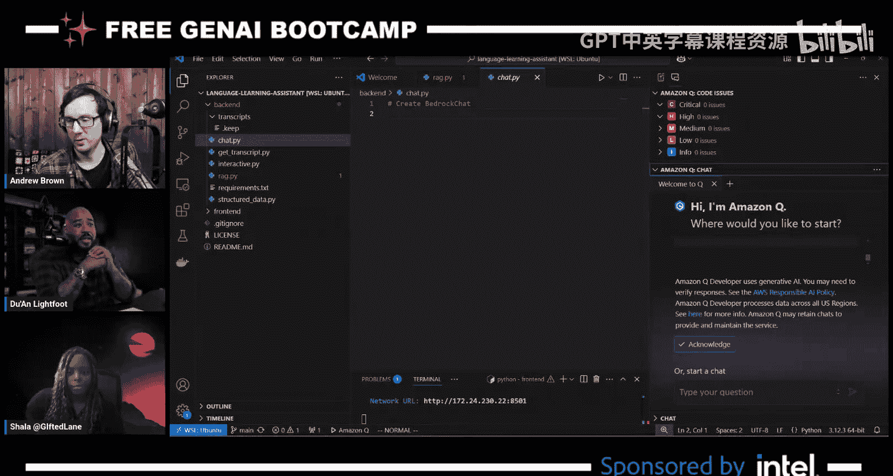

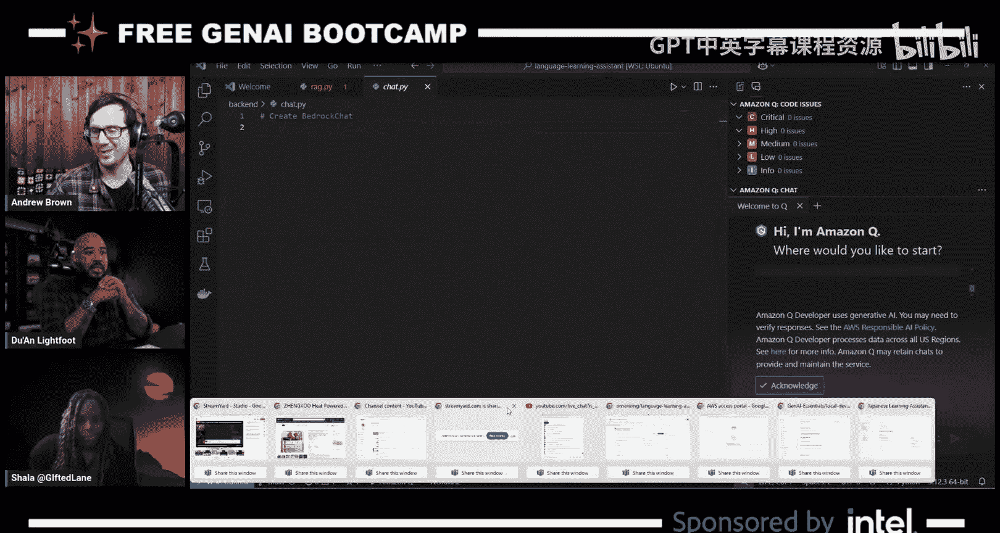

I'm looking for that repo here just a moment here， I got so many darn windows。Um。

Can't find it people， people went when I was up to earlier for the call they trying to buy a little fan that goes on my my stove so the heat gets to me。

But' I'm looking for that repo and I already already lost the link so I'm going to go back over to GiHub here and I'm going to go over to the repo that I have。

 which is。

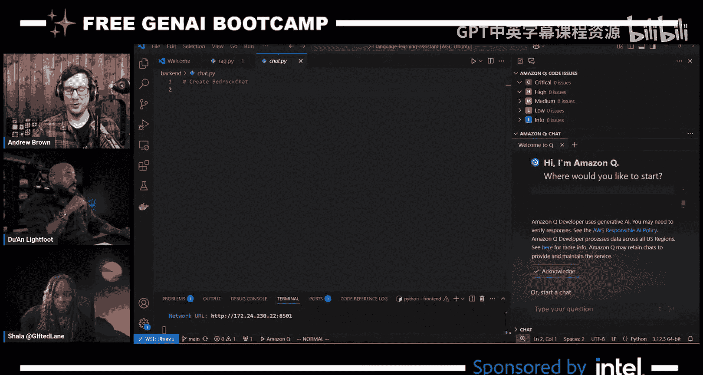

呃。We got。W， I can't even spell my own my own handle。 We'll go Oman King here and jumping over here。

 I'll go to over the repo and we'll jump into language learning assistant and I'm going to go over to poll re class。

 I believe。And I'm going to create a new pull request， and I'm going to grab from Duons。

 which is lab lab lab every day。And if there's any changes in here。

 I'm going to merge into my main one。 So since there isn't any changes that compare。

 do you have it in a branch or is it pushed。U。It's in the same branch。

Everything is good in Maine right let me take a look here and oh， you know what now I'm over here。

So maybe what's happening， Hol on just a moment， I think so I'll create a new poll request。Oh。

 it's trying to create the source one。Oh， I see。 I see。 I see。 I see。 Hol on。 Let's go this way。

 if I flip it this way。Go to go the other way。 So I have this here。And I want to merge it into mine。

 Can I do this， There we go。 There we go。 Sorry， y， now I fixed it。

And so here I want to compare acrossforks。And here。If folks that took our terraform boot camp。

They know this。 We did so much。 It might as well been the get the get boot camp。

 because we did so much which by the way， if anyone wants a get beginner boot camp， I'm still。

 I'm still up to do one， but not， not， not as big as this boot camp。 So we'll go ahead。

 And so now is my name。 And so we do have some code changes here。 And we have some implementation。

 How did you create that code。😊，Is right by hander。

I wrote some of it by hand and I wrote some with AI because just for the sake of time。

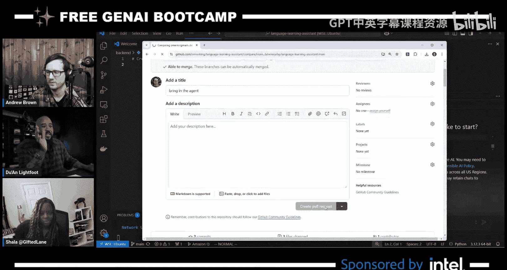

Okay， and so I'm going here and we're going to merge this into here。 You know， folks。

 you've already worked with the LMs。 You know what an API looks like。

 So this is kind of uninteresting stuff。 But we're going to go over to here and take a look。 Oh。

 I got a poll now， right， So we're gonna stop this here。 We're gonna do a good poll。And。

How would you deal with streaming from the LM call to streamlit due to the streamlit react with each widget。

 I don't know I find streaming really hard， especially with streamlit。 So that's for Duon。

 you know the answer。 I wouldn't know the answer to that。 We'll go ahead and pull that。

 What's the question It's how would you deal with streaming。 I'll pull up the comment here。

 It says how would you deal with streaming from the LM call to streamlit。

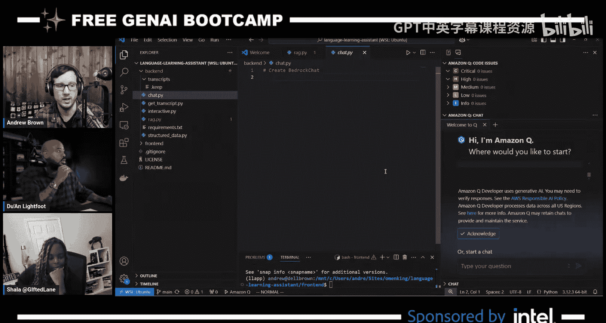

Does streamamlit react with each widget and so oh sorry。

 it does streamamlit can handle streaming within streamamlit。So if your LLM does the streaming。

 you can actually process that within stream as well。And stream lit。

Let me let me see if I can find it so stream lit。Streaming response。

So there's a normally when you write to streamlit， you do the ST right or streamlit dot right is the function you will call or the the。

I don't think it's a struggle， but it's the call board that you would invoke with。

The streaming is extremelyly。St。Thatt right underscore stream。 And so here is the。

Co in streamly to handle streaming responses。So we have the code here and it's currently said as Nova micro and so we have Nova microcro Nova light Nova Pro Nova Premiere and so we have these four different levels of stuff actually when Nova Nova came out。

 it was actually way better than than Titan text or the previous one the things but will micro be able to handle our what we want to do with it yes I tested it out it can handle it okay good I tested it out because is really really fast and yeah it can handle okay so。

😊，This is over here and then。Our front end is over here so how does it connect from here to this specific code do you actually have it like rigged up in the front end to load those scripts or do we have to integrate that can oh we have to import them we can go through everything so let's go through it okay so so we have the chat one here Yes over the chat one I actually created a class to be able to use the Amazon bearrock Converse API to be able to chat conversations to the LLm the thing about Amazon bearrock is that it allows you to use different providers so you can use with the Lamo models enthrop with the cloud models or Amazon Titan with the Titan models or now the brand new Amazon Nova models and several other providers you also have a marketplace where you can use different models as well now in this example what we're doing is we're taking a user message so I ask the question and then we get an assistant response This also allows us to implement。

Tools if we need it， so we're going to start here and if you run this code。

 if you scroll to the bottom。Inside of here， we can just have a simple chat assistant so we can see how it works so if you do Python。

Chat da pie。Oh yeah， just to run it individually without without the front end Okay I like to run things individually so they can see how it actually works Okay。

 so'll do Python dot。Chat up high chat up high， yep， and so ask the question。

Can you make me a listening comprehension？Comprehension， question and answer。For the JLPT。And 5。

Comprehension。Test section， let's see what does。And if I do well by default， we'll take a look here。

And what do we get？Oh， we're getting con then it is really good I that's micro too now I don't know how small small is。

 but that's really， really good and it。It was instant。

 but the reason why why I'm so impressed is that is that prior to Nova when we had small models。

 it could never handle this and we actually weren't using meta meta AI in the first week。

 people noticed that it had had a role struggle showing the kji。 But this is their micro model。

 that's crazy。 So here's the thing about like the。The thing about large language models or foundation models in general is that they're getting smart。

 smarter。Meaning that the data and the training is getting better， the more questions we ask。

 the more understanding that we help provide to the internet when it comes to using these large language models the better data they get actually trained on and so every version of a model should be able to perform better because it has better data to be able to answer those questions so that's when I think about the micro is that it has better data so it performs a lot better。

And and since Sha says， you know that that。That Shah wants to get boot camp。

 Sha is gonna get what she wants And we're gonna do get boot camp。 Okay， I think it's。

 I think it's slepted on like， I love get。 And there's so many awesome commands that people tend not to know that。

😊，Can just say their day。I'm all gate command line a lot of people aren't So if you do forcelash exit exit out the chat。

 Oh cool before we exit， I just want to evaluate the output here。 And first of all。

 I'm impressed by the kanji that we got good kji it's not in the format that we want so because it doesn't have examples I bet if we provided examples。

 which is what we're doing with the rag it would be better at figuring out what exactly that we want but its output is actually really。

 really good yeah， I'm just again， I'm really surprised that because you normally if you go this you probably avoid micro right away thing Yeah it's probably like the other old light one。

 so I won't touch it， but only smokes。😊，That was a really surprise here。

 but let's go ahead and see what it looks like in the front end and see if that works yes so we can go to the front end look at the code and so in the front end if we go down to see first we import right is it important Okay sorry yes。

So we import it from the back end and then we keep all the code the same。

 but where we actually render the chat stage here， we actually start the bearro chat session。

 So we actually initiatedize our communication of bearro right something to call out here you're going to need access to Amazon bearro。

 you got to ensure the models are enabled And when I mean by access so yeah API keys and API tokens and obviously Andrew was already authenticated and connected has a session to AWS Well yeah。

 I did even notice that So folks I already put my key in here and I've already activated these models if you have yet to look at the Jen essentials I show you how to do that in the Jen essentials So all that information is there and then you can catch up here if you don't know how to have that configured So here we have it and I guess you're calling all of them stages So in streamlit and by the way。

 we'll see more streamlit stuff when Darria shows her code base this week which will get published after this。

This live stream here but they're all broken up into stages and then you can see that we have this controlling what is showing it so we have the sidebar and based on what radio button's chosen it's going to render that and we're currently looking at that and so Don has implemented the first stage for us so if we go start up the front end here i'm going to go back there and we'll just do a quick sanity check to make sure it works i'm sure it works。

We'll type it streamlit， run， and then this is。Main dot Pi。

 and so that's starting up on port 88 port local hosts。Her local host 8051。And I'll go down here。

And I might have type it wrong， I did。So I mean it doesn't work， it's 90% of the time my mistake。

So here it's saying does not know where the module is and this is a common issue that you can sometimes have and it's just that it depends on where you're running this from right so I'm running it from the front end。

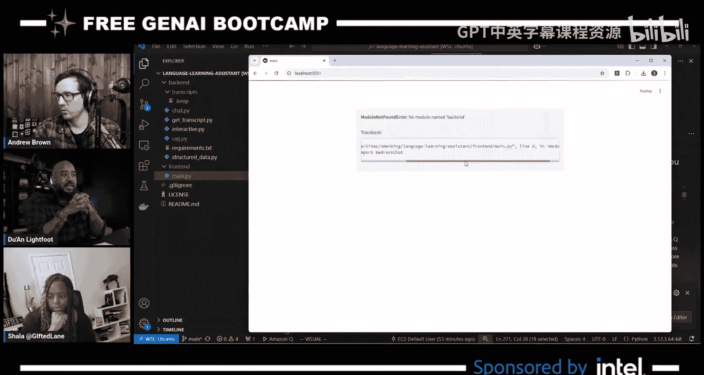

And。It depends on how it looks at the project， so I'm going to go up a level。

 I'm going to see this fixes it。I'm going try running it from here Python frontend main and let's see if that fixes the issue still has an issue with it and that's totally fine。

 I have this problem all the time trying to get imports to work。

 especially with this one So it should know where it is because they're in the same folder right but what I'm going to do is I'm actually going ask chat Amazon Q and see if we can help me fix this maybe put a dot in front of back backing it。

Sure u with a for slash or no for slash， no for slash， okay。

 isnt so I'm going to go back into the front end and try this again， I don't think it was one it。Oh。

 like like it has to be at the top level， you think？No， it's not going like it， so take the dot out。

 but this this has some cute。Let see what Q says。 Okay， so I'm going to go here。

 I'm just going to give it the error code。Oh， I got acknowledged too。

It's going to tell you to import cis and then the path。man。

 there has to be a way to see this whole thing， so minimize the code issues at the top。

Because this is some valuable information。 And I'm not sure why to check。 Well。

 it's because remember I zoomed in， right， So that's probably what's messing it up。

 See how it's starting to get to normal。 you probablyd have to do a hard refresh to fix it。

 but it's because I'm distorting my screen。 So here's suggesting to do this。

So we'll go here and we'll try that。We hold on hold let's three to ahead so so change this to this okay。

 we had that before make sure you have the following directory to front end and knit main chat dot pie。

We don't。 do we have these in knit directories。 No， you can add。 Okay， so maybe it wants that。

And I think you can just have them blank， right， if anyone's a Python expert chime in in the chat。

 sorry they are blank and what that does is helps with the initializing the paths for the imports。

 So some depending on your system， you do need those。Okay。

 so and then here down below we have when the script is running。

 you should run it from the root directory of your project。

 So it's saying I didn't know you can do frontend do main I even know that was a thing。

 If you want to run the script directly， you can do that so let's go ahead and do that。

 I'm told that I often do not use the correct the correct things for Python。

 I just don't care because I like Ruby and Id rather do things in Ruby way。

But sometimes it doesn't work out well。You're doing extremely。Oh， sorry， Yes， yes yes is。

 So we'll hold on。 Let's， let's ask this here。 But， you know， you know， we are using。Streamlit。

How does this command work？First stream， and do you know like what is the model that is being used？

When we use this， is it a very specific model？This' Amazon。Thiss Amazon model， Okay。

 but do we know if it's a Nova model or it probably is。

Or there's a lot of moving parts so it could be a things go you know。

 I actually already know that answer because I got a buddy on that team and they basically have I think they have a collection of agents and are like Lms that are specialized for T So it's probably routing to the most most efficient thing we actually have something called router that actually is something as nu that's pretty cool where you could actually leverage let's say C has three different models you sonnet you have highik you have opus you ask a question in your front how do you really know which which model is going to be the most efficient。

😊。

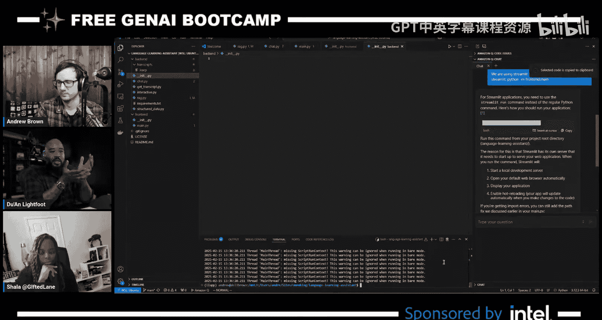

For it to answer that question， right， Haikku could probably handle it what what proud router does and it actually handles routing to the correct model to help you save on things like cost。

 right？

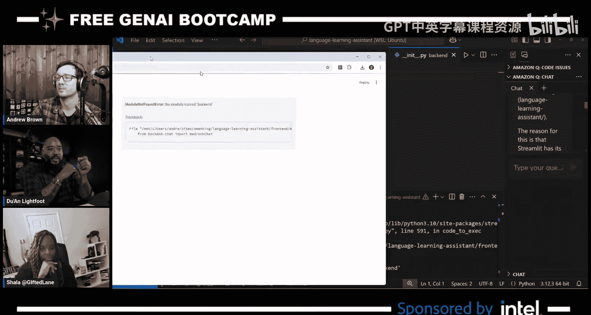

So I'm going to go ahead and copy this here It's having a little bit of troublet because we have two things we have streamlit and then we also have that so we have two layers that we're working through so I'm going to go ahead and feed it back into here and we'll see if it can help me with it again in partss is something that's always a big headache for me and I don't know why half the time they don't work but it's no it's no fault on the LLM that's just something to do with configuration of Python is there has pass that you have set up on your local system。

Like you don't have your audio pass set it right。 Maybe， yeah。

 So the error occurs because Python can't find the backend module since you're using a con environment。

 Oh， interesting。 So that's want you to do the cis O S and the path the pin。 So know interesting。

 So what I'm gonna do here we're in the main dot pie。 Hey， like， if it fixes it， I'll put it in here。

 but。

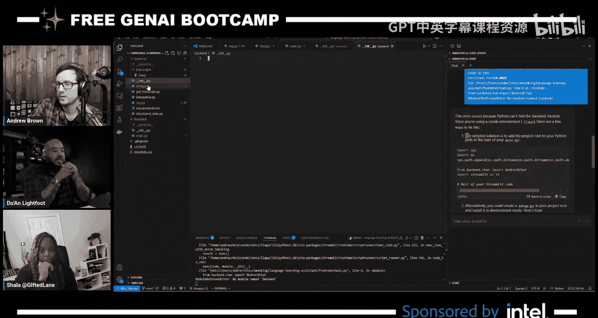

I keep using condodas， though I just't， I can't quit it。And。

They were actually at reinvent the Connda team and they were there I was like what do you sound like we're not selling anything we're just trying to make people aware of everything that Kanda does it was really it was really cool Did you talk to them Matt was so busy I really I don't even think I saw you this year。

 Sha at Reinvent。Yeah， I was it， it was， it was chaos。 And plus I had the fan with me too。

 So I was doing like two things at once。😊，😀Yeah。😊，Yeah， Chris told me you were there and I'm like。

 I haven't seen it I barely saw him， I saw him like once。And folks。

 people are talking about Chris Williams from our week zero instructor。But he's usually easy to find。

 though， for some reason， he stands out。CAnd I'm the hardest one to find because I'm not even five feet so say child is a little bit hard to find。

But anyway， apparently that worked so that's really good and now I know maybe that was the issue I was always having because they're using in K environments I didn't know so now we're in here so started exploring the the Japanese language try asking a question oh it's down here it's just。

This is just streamlit， but for folks who can't see because it's really really light。

 there's a box down here， so I would say create me a create me a listening。Comprehension。Question。

Based on the JLPN5。Match their format。Like how would it know that format I needs to see it right。

 but I'm going to ask it as if it can do it anyway。That is so fast。No。

That's insane like it was literally I couldn't even do it and I just like it just went boom like that was insane sure。

 here's a listening comprehension question in the format typically using JLPn 5 so here it has。

This is not， this is going to be a format if it's on the rid part of it。

 but not the listing thing so it doesn't know right fair enough no one would know that they and let's had examples。

We can clear the chat， sorry yes， you should ask， can you convert that into Japanese？Okay， well。

 I'll gotta go， I' gotta re ask the question。 So can you。Produce a。Listening comprehension question。

That would be that would appear on the JLPT。And five I'm actually going to write remind remind reminder the JLPN5 is 100% in Japanese。

Okay， so I mean， that should kind of help it along there and we'll go here and so we have this here and if I think this is Butsuo。

解释话。Nobody listened to me。Here and so I'm just trying to figure it out if this is correct， no。

 it's still not right but。The point is is that， you know， with some prompting we have a little bit。

A little bit something closer to the stream the streamlit team recently changed for to U for streamlit cloud。

 Okay， yeah， and for those who don't know streamlit you can actually deploy。

Like if you wanted to deploy to streamreamL they have cloud hosting as well so that's another pipeline that you can do there actually I think I talked to that with with Daria or maybe when I was recording the afternoon I was talking about as a deployment option that you could do it because Daria deployed her infrastructure into AWS but when I did it I just didn't do that part and I was talking about easier places you can deploy。

Can we please maximize the text on screen。 Yeah， I can do that a little bit here。

 but it's gonna be a little bit hard for some of these things。

 So now we have this done that's done and dusted。 And so far we're almost done the live stream and we finished one I told you I thought you I was like。

 you know what， we're gonna finish one sliver of this thing。😊。

U but we're going to learn a learn to have a lot of fun along the way and so we have the raw transcript。

 which is the next step that you do one more one more merge and then you already got that code for me already there oh my goodness excellent okay。

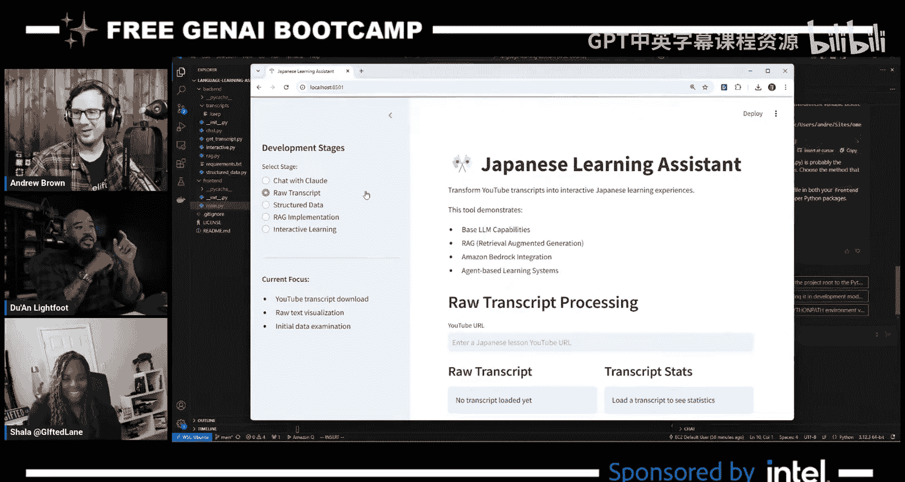

We'll go ahead here to say update， update the rag。 I'm not sure what's in there。 Oh。

 it's the fix for whatever that was。 Oh， we got our keep file too。 Oh let's take it all。Good commit。

Excellent。Like commit。I've never done any type of version control in VS code。No， oh。

 where do you do it， Do you do it externally like with get smart or rural terminal。Comman line。

 I use Gi all command line。 It's honestly more reliable to be honest。 half the time I don't use it。

 I actually don't like using this。 I use something called getmart and and gett X。

 but I just don't have it open right now and I got too many windows So whatm gonna do is I' gonna go over to here where are you finding time to write this code or you just you've been doing in the background while I've been talking her Yeah。

 I've been doing in the back well， I got I got some of it done。 So this part is done And yeah。

 so I'm just trying to speed things up because I okay， I'm always ready。

And so we'll go here and this one will be bring in the transcripts Po stuffy。We'll go for it。Again。

 nobody grades me so I can write whatever I want。But when when I want to got to read your commits。

 folks， make your commits。Do your best of your commits as best you can。 This branch has no conflicts。

 Great， let's merge it。Where's my merge button？Try the new merge experience。Oh， you know what。

 Maybe because I'm。I didn't merge it the right way。So let me try this one more time。 You now have a。

 I'm sure you don't care， But now you have a useless commit。

 So it's this way to go back to this again。 So this way， that one to this way。

And so I'll go here and I will create a new pull request。

 and this will be bring in transcript pullinging。We say we all need to on on our team。う。

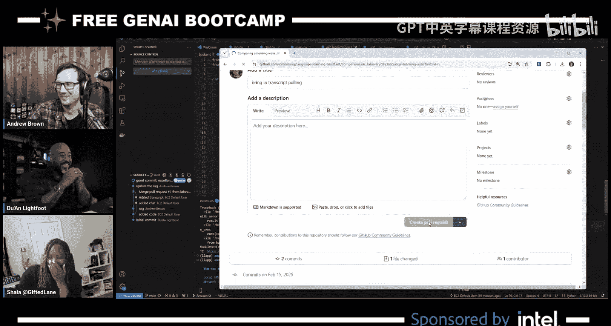

Teamwork， make the dream work。Okay， we'll go ahead and we'll confirm this here and so now we we have it here I'm going to go back over to here。

 I'm going to stop here， I'm going to do it old school away just for doing on we'll do a get pull thank you。

😊，Then there's other people that like if I don't update my my chroma draws them crazy too。

 but to be fair that when someone has like a low battery that stresses me out like like I'll stop the meat like mean like stop it。

 go plug your computer in now before it's too late because it's not because the computer could die it's like the battery I'm thinking about the battery life。

Let's take a look at this code here。We only got 50 more minutes but but since we're getting sped along here we're actually getting complete quite quickly so here we have the transcript another class by Duon because Duon is a classic guy and you not I actually have a Python I actually did a Python for that engineers course that I made at Cisco and they said so I know Python one of the few things in life I know I'm terrible Python I'm just awful and so here we have it is this the playlist。

Yeah， so that's actually the playlist and so this an example。

 if you run it it going to download the transcript all of them。

Or just a single video it a single video Okay， so it's a YouTube and it has to playlist but it's actually targeting a single one so let's go ahead and I'm going to be a little bit speedy here。

 but I'm going to go into the back end and we're going to go into the transcripts I'm going to do a python no it's not going to work so you actually have to add this depend to the requirements。

Oh， okay， okay， okay， okay。 So it just called this。 Yes。

 it's called that and add that to the requirements。Oh， it then't do another paper style or。

How you don't encounter。Yeah， it是。Yeah， nice team to gave me a lot of stickers。Nice。Okay。

 so now that we have that， we'll go back in our transcripts。

 we'll do this one here and we'll go ahead and do get transcripts。

Hold on your back here you got to go on the back here， oh yeah， yeah。

 oh am I not in the back end let me why now？Okay， oh， it's here， there it is。

 Oh because I made the folder called transcripts to store it。

 which they're not even in there right now， they might go somewhere else unless that's actually where you made them go。

Um， I see right story it in memory right now， Oh， okay， so we need to， we need to uh。

 tell where to go。

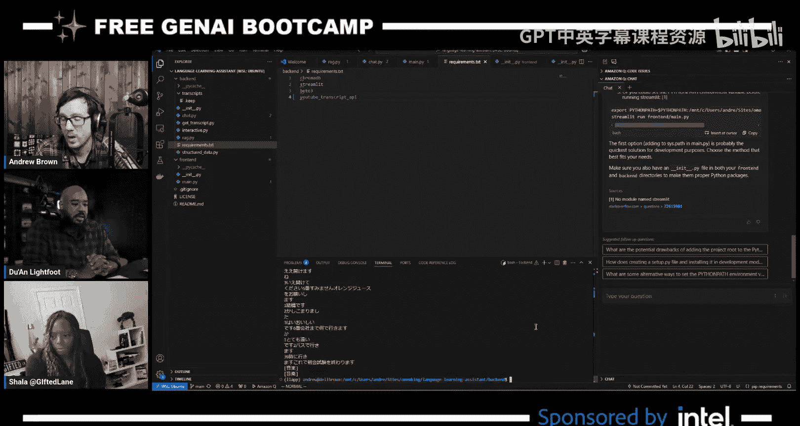

Oh， because it's right here。So I can just update this code and say Amazon Q。

 is there a way to reference files in Amazon Q can you like Esign a specific file or drag it in here or you could tell it this file right but if you do an as sign you do have a bunch of options So if you do workspace so I to look at the home entire workspace Okay but is there a way to say like exactly this file or is there a way to describe like say go for the file that I'm in or yeah。

 so if you just put your cursor in there。Oh， okay， and then tell it， now talk to it。Oh。

 like literally just where it is。 Yeah， just okay， this file I need to output the transcript to the transcripts folder。

 Can you retain the name of the video， but。Turn the name into a slug， E G。

So I actually have code in there to do that if you didn't look at down on the code。

 theres the same transcript。Okay， so where is it so in inside of the the get transcript the whole class has print and say right here safe so you just have oh okay。

 right and then make sure to pilot this transcripts that's it yes's already transcripts because I knew you were David transcripts I could see the future。

So sorry， the parameters is self。No transcript and then。Soll scrolldown， so now。Inside the main， go。

 go inside the man。Right。Above， above， up， up， up， up oh， you mean here， sorry， sorry yesterday。

 so when you have transcripting you use downloader above the if statement， above the if statement。

 right？Above that， yes， yes， now do。Downloader。 saveve transcript。Oh， okay。

 add in that right there And you're good to go。 So that's gonna to say the transcript with the video I URL。

 Oh， because this is running main here。 for some reason。

 I was just thinking it was running again because I'm not reading I thought I was just running Get Cr。

 Okay， perfect。 So well， that save me some trouble。😊，And。Oh， there it is。 There it is the the only。

 and again， it doesn't really matter。 but the only thing that I might change is I might。

 I might have it like。Try to retain the name because if I want to pass it as metadata that could be useful。

 but it doesn't like let's say it's not an issue in this use case。

 but let's say we wanted to do JLPTN5 and4N3N2N1 we might want to retain its level in the metadata source。

The API has metadata right so you could actually extract the metadata from this API right I know need video ID because now you always got the video ID and you can reference it sometime I will append the title at the top of the transcript before I save it Okay there's a couple ways you can do it So so my question is do you got more code for me or or you're all tapped out now let's test it out let's test it out Okay okay。

 okay Phs man is phases。We only got 10 minutes， I know， I know， but right right now we're going to。

Build up Ra apart right so the reason I'm trying to get like doon's code is because like whatever I don't have。

 I gotta do myself I got you you know， I got you and John never know。

 you know that So extremely where I made up。Okay， I'm going to use a commandr to find it。

 stream it there it is Oh， I got to go up the level， I think。 and itll say some look here。

You are the right level， but okay。Cool。Allright。So now we're going to take the YouTube URL we download it。

Well， I can go grab anyone， right， Yeah， you should be able to down download anyone Okay。

 I got a few too many tabs open and I'm gonna to go over here and we'll say YouTube JLP。

 I'm trying to make like a like a clean route because who knows what my YouTube looks like listening here。

And so this might be its probably the one actually provided you， it is。

 but I'm going to go and I think it's going to go down one if I can， this is actually a playlist。

I think。And so。I's this one doesn't really matter。 So we'll grab this one they're all kind of similar and we'll go back over to here。

 we'll past this in press in and then oh just enter， Okay。

 your press enter and then press download transcript。

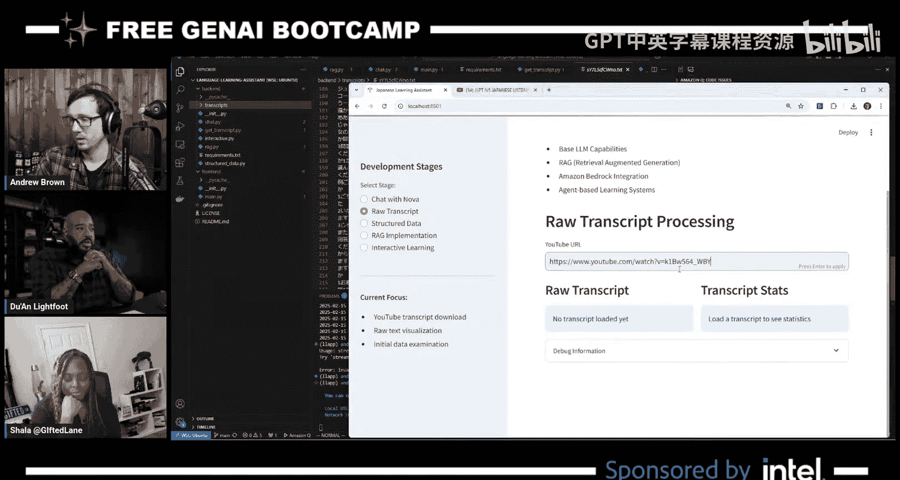

Oh， okay， and the download transcript， okay。And says YouTube transcript download or not is not defined。

 so we'll go back over to here， maybe because it's not loaded and know it should be Oh no。

 it's not loaded in here。 so I do got more code for you Okay。

 I'll take it I'll chill out it's coming。Dan， do you have to run or you coming into office hours for fun I'll come to office hours for fun Okay。

 you're in the Discord right we get we you you got in the discord right I think so I never use Discord。

That's it's interesting actually go back to the code。

 I don't have work code for you and we just have to import okay so from back in dot get transcript so right up under the other import。

No， no， no， inside of the main do， Okay， yeah yeah， now you just had to import so from back in。No。

 from。Not import yet from backing in。 get transcript。Import。

And I think I call it what I I call it is it YouTube transcript Yeah。

 if or downloader downloader downloader Okay， we should be good I'm gonna stop it might refresh it reload it。

 but I'm just I never know so I just always do it that way I' go ahead and copy this refresh the page we're gonna be back over here we'll go to the raw transcript we'll paste this in here we'll hit enter we'll do download transcript that we go and so now we have the transcript tells us the characters number of Japanese characters if you inside the transcript if you just highlight inside of there don' tro。

Oh， okay， control it。It's not done like not on this Windows machine it is Oh there we go I had to click click a couple times but I got it now。

 yes， so now you got this whole thing copyied and so normally right if you want to know about this video and you already see what I'm getting at。

You would go to a large language model and ask about it。 So you want to ask about it。 Yeah， so folks。

 remember， remember week pre weekek， when I' made all those examples for prompt engineering。

 we're adding in context learning or we're adding our knowledge in place， whatever you want to call。

 Duan， do you have a proper term for that one。In contextstized learning you add in context to a model I use terms and I don't always know what they mean but you know learning is though right yeah it's learning in context it's where you provide examples in context so it can learn from it during the prompt so normally you have to train the model so it's just you provide me you provide data and you train the model so it learns about that data in contextized learning the machine learn the machine to L alone the foundation model is actually learning about that data in context right so rather than you have the train the model it actually does it within the prompt。

嗯。Well that makes sense。 So here is the transcript for the comprehensive listening language learning。

 jail。 what am I starting to write。 But anyway， I'm'm gonna stick with that wording。 anyway。

 here' is the transcript for the comprehensivehens for， for listening for。

 for the listening practice practice。😊，Exam questions for the JLPT and five。

And so I'm going to paste this in here。 I don't know what they're going to do doing put transcript here。

 I now it can handle it， probably。And。I want to create。呃。I want you to。

Tell me what format these questions。Are following。So first I asking what is the structure of it。

 is there a structure right because in the next step， we'd have to tell it how to do it。

The format that is so fast。Like it's a bit a bit insane because like I use open AI it's not even that fast。

 but like it's just so blow my mind here we' only got four more minutes。

 but I'm just going to take a look at this here listening practice exam questions for the JLBTN5 appear to follow a structured formatting include situational dialogue logs and stuff each question stats starts with an introduction line that sets the context of it it's usually like like this says like guy and girl guy and girl having conversations like 999% that。

And so here it says this may include the details like characters involved setting and stuff like guy and Girl at a bar。

 guy and Girl IKA fighting and so here we have listening segments that says a spoken dialogue monologue is provided with the listener must pay attention in order to following questions the segments are designed to test comprehension that's exactly right following Listen segments a questions is asked based in the context the questions are usually straightforward for most questions four choices are provided that's right and so now we have an example。

So we have So Kara N5， no， whatever that word is for Shi K or whatever Hajimy mass。

 and so they're starting it off there， so they're doing the introduction。

And then we have a conversation between it Yeah exactly they always say like conversation between a man woman about health yours told exactly that no he to lot。

 Kono whatever about what that stuff So this is kind of coming closer to it but this is kind of the format right it's not the full thing it didn't actually give us the thing because here here they'll ask a question at the start of it then they'll have a conversation and then they'll ask the question again or sorry no they'll say what the situation is。

Then the then the the listening segment and then the question， so that's what it is introduction。

 listening segment question， and then your four choices。So that's exactly right。

 so let's see if it can generate one， so say， okay。

 create me one about a man and a woman writing Python code。

I'm not sure how I was going to handle that， but let's。Was it okay？In Japanese， Okay， but remember。

 you are creating a scenario for the JLP T N 5， JLP T N5 listening。 Does it have a history here。

Or was it that was it one shot the conversationverse， the chat history here。

 what you could have asked it was， tell me the last。So now， yeah。

 see now it's kind of not following anymore from the thing。

 So I think that's more like a memory or chat conversation。

 but I bet I have a feeling if I did it in one go， it would have got it right just the last two questions I actually what was the last。

Three things I asked， I think it was three things， okay。I'm just wondering if it knows。

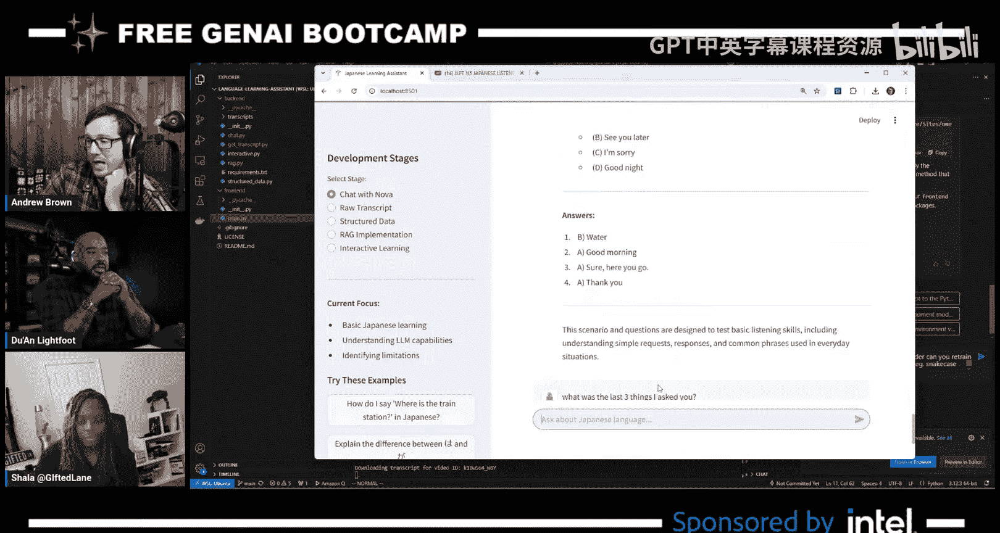

So what's happening is。My conversations aren't being sent back to the model so right now we're doing a single conversation like a single every time it doesn't know like every response is different thats that's what i'm feeling right so inside of my chat we actually need some type of message handler so if you go back to chat pie what we need to do。

Inside of here， we actually need a self dot messages array and so what happens is every time this is initial initialized。

 the messages get stored in that。Self do messages away。 You can't hear me。 No， I can hear you。

 but Baco has informed me that we are out of time。 And yes， Baco is real。

 But when Baco says we're done， we're done。 So Duant has more code for me somewhere。

Its coming you give me that code and I will I will wrap this up， but so far。Wow。

 how fast how fast is micro and I'm really curious to see how far far along we get with it here but everyone now it's time for after class Q&A。

 this is only in the discord so for folks that are listening here join us over for some behind the scenes and also where you can ask questions directly to us and then obviously since we didn't 100% finish this I will have to record videos post this the Spanish boot camp。

 I think it's scheduled for today I know Hazel's videos coming out at 3 pm so for those that are doing the Spanish bootcamp and this one look out for that video I believe it gets released unless once it's at four I can't remember that one's kind of a little bit all over the place but we'll make it over to the discord there and yeah folks hopefully that wasn't too chaotic but we did get through those hard parts but yeah this is what it's like every day working through those things but I'm gonna say bye bye to everybody here see in class here and enjoy the usual theme song okay。

In the alarms your laptop top starts， hint and Farm de the share village ironing sand wax the last o wires。

 these farm flew cause fire in。Nense founds of vis and on our pot he one that have I out。

A in friends from distance song。Sherry' I has a love with bro。Aid the hum of the machiness。

 the glance swift jewels do so sp that thenly cast Mcweidows a tree， lodgeged over favorless Entes。

Healy you that starts like to。Together we sway strongs in our eyes across gal wide。

 not whole skies left echo in the emptyI。😊，Aced by she and a million andrye。

 a quest assumedumed the first off sky。🎼Could your sandwich curl suffice。

To break the barrier doesnel the ice。Once pastize us often buy its small cos we gently faint faint for just a little one and blue dirty lights in this humble place。

Al mightighty probes since then the time of the space。In this se， not what was the。Fight even we die。

 thigh st， fronty young little stars we。🎼Com。🎼You fall in peace with the home。🎼The clips。🎼笑我们。

Ma you know to silk sky for you with some which doesug suffies to break the variousies mouth the eyes。

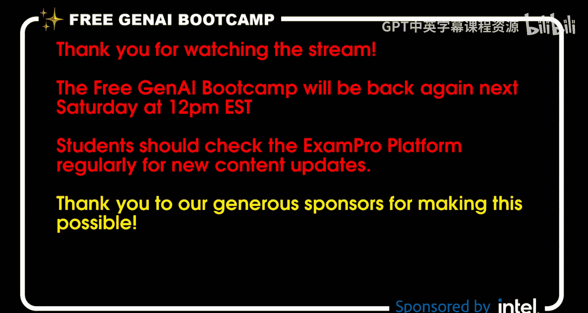