# ExamPro《生成式AI训练营｜Free GenAI Bootcamp》中英字幕（deepseek - P33：-33-ASL Finger Spelling with Rob Koch and Kemalcan.zh_en - GPT中英字幕课程资源 - BV1SFEWzLEab

Hey everyone， it's Andrew Brown and welcome to the Free Jennyi Bo camp。

 we are here with both Rob and Kamal John， and we got a really cool project to showcase to you here。

 but before we look at that project， I'd like Rob and Kamal John to introduce themselves to our boot campers。

So Rob， you want to start？Yeah hello everybody I'm Rob Koch。

 I am here in I work for Slom consulting as a data engineer principal。

 I am here today having worked here for two and a half years doing tech consulting for mostly data and machine learning projects。

😊，I live in the Seattle， Washington area。And it's great to be here thank you for inviting us to。

Have a visitor instruction and myself and Kamaljo。So I am going to explain a little bit about what we're doing and then I'll pass it over to him。

 but I am also a AWS data Hero it's you know familiar space there with Andrew Brown as well。

 so thanks for being here and I'll let Camal Don introduce himself。Hello everybody。

 my name is Kamajjjmusson。I'm a senior engineer at Salm as well， working with Rob here。

I'm very excited to be a part of FreeGR Boot camp today。Yeah。

 and I think we can start with the technical explanations now Rob back。Great。

 so I came into this kind of naive， so to speak。I mean。

 it really could with machine learning and technology。

 it's quite exciting to be able to play around with and to be able you know to either hit a wall or maybe run into some frustrating things。

 but that's part of what we're doing hereca we're going to walk you through a bit of our journey of how we've gotten to the point when we have with a computer to recognize sign language。

Some interesting things that we found along the way。

 different points that we found that were quite interesting roadblocks and things like。

What we did to overcome some of those。We're not quite 100% there yet。

 but we do have there are other companies out there that are professionally running this type of activity and their work is far beyond what we have done here on the side。

 but I will say that the point is it's a journey and it's fun and it's challenging。

And it's been really cool to engage with the community and all of that so that's really why we're here so just wanted to set up a little bit of the background you know the coding and the framework and what we've used over and over for other things not only sign language but could possibly be used for gesture based computing and things like that what we're using here could be used for that as well as you know communicating like telling your computer what to do for an example。

😊，So the motivations are not only for sign language or recognition。

 but also you know not only translation purposes， but really a lot of other things that are gesture based we started out working with。

😊，First。I came to Kamalja with an idea of saying， hey。

 I wanted to do sign language recognition right and so everybody was excited to participate in the journey so what was I guess you could explain maybe the first thing you did what did you ask for at the very beginning of how to get this going？

😊，I did have a very limited information knowledge about American Sign Language letters， alphabets。

First thing I asked was。I ask if every single letter has an expression in American Sign Language。

 and I ask if any of them are， they require multiple movements rather than one static image。

Eventually， I knew we were going to deal with videos。But I approach this as a。

Framees or pictures rather than video。So that's why it was important to understand and it turned out that。

Letters， for example， J and Z are represented in multiple movements rather than one set of image while the rest of the 24 letters are represented。

Once setting image。And of course， to understand the RAA domain， I ask many more questions。

But we immediately div in， you know， like we wanted to create something fast and fail fast and now move forward that was the initial goal。

Yeah， absolutely and。One of the first things that Kamaljan did was ask me for some videos。

 so we needed to train the data and as well as meetinging the data that we could label right correct so。

We did a little bit of a training of the data。We needed that data then to help us progress。

The data that we could train and test as well。So we have reached out to some wonderful people at CNCF。

 the Cloud Native Computing Foundation。And the Deaf of Hard and Hearing Work group there。

 I asked several of those members if they wouldn't mind sending me some videos of them。

 a thank you to all of you who did send me some videos I just asked everyone to sign the alphabet A to Z。

And so I got collected all of those videos from various people in various environments and then handed them to Kalja to be able to work with them and then yeah what happened after what did you do with those videos that I gave to you So we were first very lucky to have these videos because they were real videos rather than toy data sets。

Yes。We needed more data。So first I started we started with these videos， we chopped them up。

And shuffle them into multiple letters。Another thing we needed to do was to create augmentations。

 so one image， for example， L can be represented like this。However， it can be like this or this。

 so taking one image。Rotating it， Philiping it， changing the colors。

Pla chrom somethingical chromatic aberrations or changing to。Structure of it basically。

It was essential。Because this helped us to create multiple。Image is from one image。Mmhm。

And that was our starting point we once we felt like this is good enough to apply it on a model。

We started laying out the pipeline process and apply different models and try experiment different models that was the initial phase。

If that's okay， I can continue。啱。嗯。Please yeah， feel free to so you tried different models and then created what we found was to be a good one right and then those models。

😊，Were able to get the shape of the hand， so it was looking at things like。

Something around the shape of the hand or did you use anything specific to help that out other than the things you've already mentioned I know some of the challenges that we had with the data sets were that the volume and all of that just the sheer volume of that particular sign like I mean there's there's not a whole lot of it out there and readily available so that was kind of some of the challenges we faced right the sheer volume of video data that you the data set that you had yes very correct。

So that volume。There were maybe like 10 videos， the amount of data was not enough so we needed to supplement these with the data we found online。

 we found three data sets online。Okay， we shovled everything。

 initially I wanted to use those videos as a test data set。And then I shuffled everything。

 tried different approaches。But first models failed and luckily failed fast。

They were not great at inference sites， so we thought that that must be。

Mostly because of the number of data in the data sets， we had total in total， we had 4000 images。

For the entire 26 categories labels in the alphabet and that was not enough。え。S。

 we looked for bigger data sets。And different approaches， we started thinking about what we can do。

And finally， we found another data set that had。え？Augmented data in it， in other words。

 one image can be represented in multiple ways。As much as the lower quality， higher quality。

 et cetera。TheOh so like lots of variations of that data there but I guess the original like the original reason was you wanted to see what you could do at the bare minimum with your own data set and then after that was not enough that's why you had to reach out to get more correct。

 yes， what we tried with our data set。Was not good enough in some cases。

 some of the letters were not even recognized。If it not， they were not detected。

So we knew we need more data， we need more data， and we need。Diverse data。Okay， sorry。

 so when when you gave the original data set， like like you did not realize the diversity of data you needed during instruction or it was just the data that you got back was the data that you got back from your original data collection。

This is what we had on the hand in the beginning。え？We had our data was diverse enough。

But apparently we needed more。So that's why we try to find。Bigger， better data sets。

The original data set was in a video format right and so these other data sets were they in video are they just images and like did you have to convert the original videos into images to normalize the data？

Yes， yes， each video has frame per second number。Based on that number， we extracted images。

 frames from those videos and used them。of course， there's like a whole pipeline。

 we augmented them and normalizedize them， resize， etc。This is Ta was the first。Few experiments。

Once we felt like， okay， we have enough data set， which is。About 7，000 images per letter。

 quite a bit。Okay， this is good enough， let's find out different approach or different paths to increase the accuracy and continue。

One of the， we were lucky to find this open source library called Mediapipe。

 Media Pipe is from Google， they developed it。There are multiple versions of it， but one version。

Extracts the hand image from any images。Recognizes it。And gives 21 points。In a hands。For each point。

 it gives X， Y and z points。Like data points， let's say。So therefore we have for one hand。

 we have 21 times three。6 or data points for for those points in the hands。

 did they correspond to bones or any physical structure or it was more just like the the mesh。

 the shape that that they could provide。Yeah， this is a great question they my understanding they're not explicit about that。

 I can actually show the。That'd be cool to see yeah。

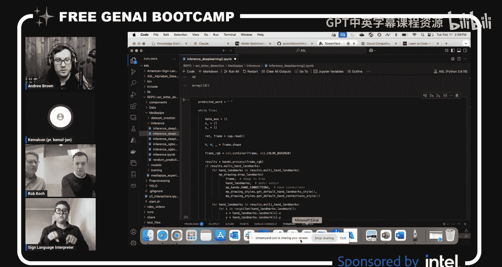

诶。おと？So remember also that the。

AL American Sign Language is a spatial language and it relies on the space around it right so when we're signing you're dealing with a lot of background noise so to speak like I've got this shirt on that you could consider noisy versus the white wall behind me is not so if I sign a here half of my hand is on the wall and the other half of my hand is on my shirt for the background so there's a lot of media libraries that struggle a lot with that particular scenario learning how to identify within the box where the hand is if the wall is the same color as my hand that would also be very hard for the computer to recognize so luckily we had a library available that was called media pipe like Cammalja just brought up here on the screen there's some other open source versions called RTM pose as well we haven't experimented with that here。

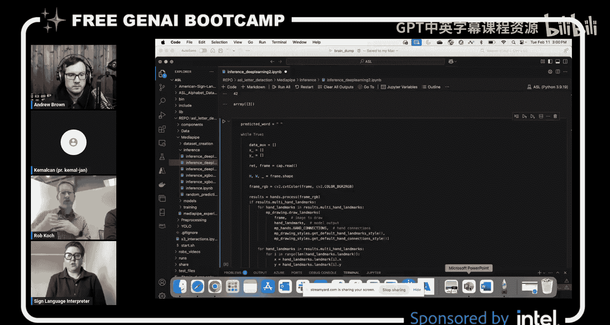

But we just chased down the low hanging fruit to be able to use this library here and you're able to see with the hands and how it can detect all of the different points there。

On the hand so media pipe helped a lot with that was augmentation is that the correct word then i'm using that correctly so augmenting your hand shape to be able to find the various lines on it so that that worked out really well。

Yes， as you can see， there are five data points for all， let's say five points， not data point。

 five points for each finger plus one the。The bottomottom of the pump。

So therefore there are 21 points and for each point， there is X， Y and z a coordinates。

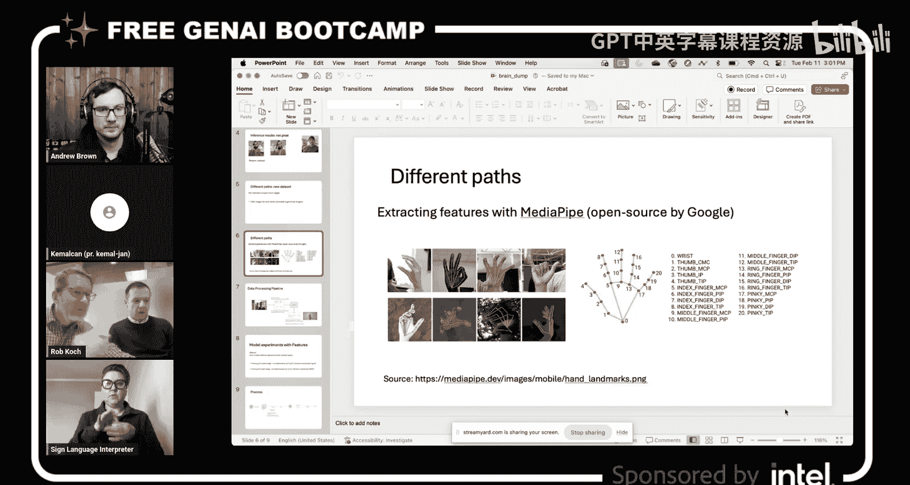

So we use in this phase we call it feature extractions， feature engineering sort of it is。

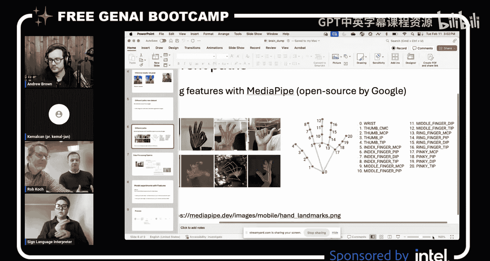

We didn't need to deal with the frame data anymore and those huge matrices。

 we only have features from each image。In those cases， in some cases。

 there are multiple hands in the image， therefore we have multiple。Those arrays for each image。

And the rest。Is。Actually， pure machine learning。Once we have the huge data sets， of course。

 we saved it in certain format and not dealt with images anymore。From that moment。

 we applied boosting methods and begging methods like random forest。

 we used ex boost and as well as as I mentioned， deep learning model torch。诶。我。

We had some discussions like some people suggested。

 some friends suggested that we need to stick with random forest because there is no pattern here。

 but I thought our features are great for torch model， however。

You I was wrong in the first experiments again。Trch model did not give us not even good results。

Because。As I said， there's X， Y and z points for each point。Cordant， loss coordinates。

Z coordinate did not give us a meaningful information， it didn't give a signal， it was pure noise。

Because Z， as you can imagine， that with the depth of the picture we didn't have a spatial。

Sppatial data， that case。 In other words， none of the hands。None of the picture， for example。

 this is a camera， let's say I am doing B。 none of the pictures were taken from multiple。

Spaial arearia of。Off the hands。Therefore， that see was irrelevant。

So it seems like it's like a twopart problem because I think Rob mentioned this earlier。

 but what's really important is that the source images， which is take a step back。

 have to be in the environment and they have to be detected that way because that's what's going to be what the web camera looks like I had a question in the back of my head which was what would you why didn't you think or not why didn't you。

 but did you consider using synthetic data， meaning a 3D model of hands instead of having to get real images。

 3D models in all the poses that you needed them in but as Rob pointed out was that you needed in a real environment because what if your hands up and your hands were white and the backgrounds rule white and part of it is obscured and we see media pipe which is drawing these positions and lines I'm assuming that we have those data points like it's calculating saying this data point is most likely this place in space is there any other means。

detect a hand or is this basically the natural way to possibly solve this problem like I know there's ones where they literally look at the pixels right and they're doing some kind of detection of it of like computer vision and but I guess my thought is like was there any alternative besides these sticks or these vertices or this it really is the way to go？

s。Yeah， that's a great question， please go ahead。So with the manual hand shape。

 we are letting the machine decide which shape it is right and they had a lot of struggle with that at the beginning。

 for example， like if you were spelling A like this and then T like this。

 the thumb there comes in between the two fingers and then you have S right here right so AT and S almost have a very similar hand shape。

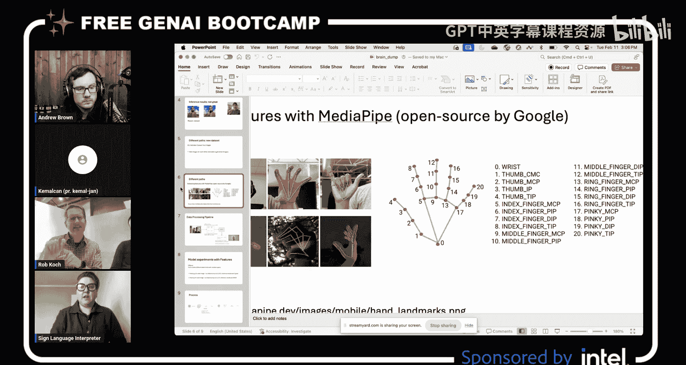

So that we noticed that was a challenge for the machine learning library where if you had without media pipe to help it denote and identify those obvious differences。

 where is my thumb right wheres my thumb relative to my hand M&N would probably be very hard right？

Without media pipe， does media Pi panel M& M well or does that also have some challenges because they're so similar？

So with media pipe that does all of the hard work， so to speak so it's already you know have years of programming and they already have all of that incorporated into their library where it makes it easier for us to。

Then train the model。Because it's looking at each one of these points on the hands， right。

 the 21 points like E John mentioned， and so it's identifying。

Those different points and putting them into the model and training the data set on that and now we have to rely on the source of the data without being able to you know restore it to you know100 million images right we can use media pipe is I sort of would you say it's a shortcut I don't know if it's necessarily the best way to describe it but maybe kind of like a shortcut Yes。

 yes，'s it's a shortcut be definitely oddsource that portion of the problem to the media pipe。

And once we have the features。We didn't actually want to spend more time on detecting the hands。But。

In some pictures， mediapath couldn't detect the hands， even though there were hands。They' were rare。

We just didn't include them in our data sets。We save them somewhere to check out to look for different parents。

This is still some work to do if we need to pursue like why media pipe fail to detect hands there。

We saved those images。But we didn't spend time to investigate and。You know。

 work on it and optimize it。I guess there's oh sorry I guess there's probably like a good enough approach because if you have streaming video right and your hand is moving。

 it's not like you need to detect 100% of that there and so like what was the like I don't know but what like how do you know like what the final thing is because it's always just calculating on the fly right so it's a very high chance that you will get it correct so you only need to get a percentage correct So yes。

Correct， there are percentages in two places First， you set up media pipe。

There is a percentage if you are 30% sure。Detect the hand， if not。

 not that you can change that percentage。Second percentage， of course。

 you can apply it on the machine learning model。With the probability。

Once we apply the machine learning model， as you are going to see in the。でも。Let's say。W。E。

 I will say welcome WE， and these changes hand moves。八。Model detects every single frame very fast。

 so it actually detects different letters between W and E。Thisす。😊。

Is a post processing problem and we dealt with。In a different way。So far。

 I explained everything to the model， so we train the model， use Pytorrch and I say， okay。

 let's have some inference and see what it feels like that now。

With the three points X Y Z coordinates， it didn't work well。

 but then use X Y only work perfectly not perfectly but great good good enough right yeah yeah yeah。

诶。They are not seeing it。 I can go。

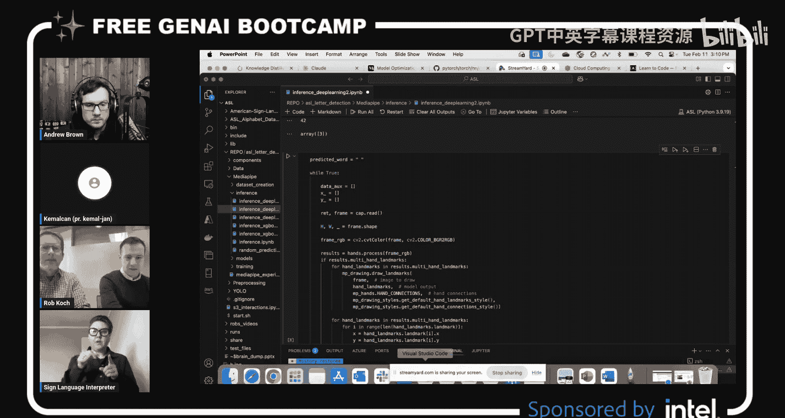

啊。傻悲。うん。So yeah one of the other things that there was a lot of math involved or a lot of post processing like Kamalja was talking about just now with the fingerpelling of W to E it would capture every frame per second so I mean that is a lot of frames right so we're talking about 3024 to 30 frames per second depending on your camera and so the W as you're making them transition between the W and the E and those letters media pipe and our model would then。

😊，Wrongly identify the letters there and so we would say something like oh we haven't told you the letter yet and so W going to the E and picking up the you know coming up with another letter it's trying to find that you know O or B or whatever it thinks it is in between during the transition time even though it's short so we're trying to figure out how to identify which is the right one and which one to keep So that's kind of where the postprocesing challenge comes in and so Camalton willll walk us through that before we just jump into that so the thing is is that you have media pipeline media pipelines producing these vertices of the spatial position of these these things right and then you have to take that data and pipe it into something and that's making a prediction of what it is I'm guessing that that prediction model is the model that you build and it has a confidence score so I guess maybe the confidence like does it produce a confidence score。

And does that play into how you wait， whether it is a letter or not。

 or do you look at past or prior frames that are close together to？

To better determine it and maybe i'm getting ahead of myself but you're going to explain all this。

 but that's that's what I'm thinking in my head so I'll let you go let you go at your pace here sorry that this is this is a great a great point yeah imagine like looking at the previous frame or not。

That was our solution， but before we got to get there， yes。

For every singlepolitician there probable score， we initially tried to use it。

 one of the things that we tried was。你 said。Most probable letter， let's say， W and。

Its percentage is like 40% second。Probable letter， let's say S。Or。Let's say you， right？Let's say，20%。

We try to apply a threshold。 we said if there is like。

If the first one is two times bigger than the other one， second one。Give us an estimation， if not。

 don't give us an estimation， we try different approaches like that。But unfortunately。

 none of the approaches。Which use the probability？Sold our problem。Our problem was。

Number of frames and how fast the model was predicted because hands change。We are not static images。

 right， We just like。WE， as I'm moving my hands， there are like five different letters between。

But once we agreed with the model， we were satisfied with it is。

We we can solve this in the post processing and just like you said。

Looking at the previous frames was a great idea。 What we did was as you can see on the screen right now for each frame。

 let's say one。Video。30 minute， 30 seconds video。Has 900 frames。

Let's say 30 frames per second is 900 frames。For each frame， we made an estimation。We started with W。

 let's say we are going to spell welcome。WWW and maybe W 20 times and supposed to go to E。

The next letter， but there is like B in the middle and there is s in the middle that are different。

Letters sorry just a quick question， does this app go beyond just detecting letters and it will actually detect words？

This is what our goal is Okay because because like I haven't seen like maybe maybe Rob knows what I'm talking about but like that's a discussion for another day for sure we definitely are trying to do the models and things like that where you know it's static images and things like that and having many sign languages can recognize you know。

 but there's a lot of moving parts right so we're you know if you're driving this way and youre moving forward or you're going somewhere and you're you're literally coming from here to there in that movement here where we're you know the letters are and more of the static where it's literally in one place right but we we did。

Run into some issues with the two letters next to each other that involve movement。

 So that's something that we are。 Yeah， we'll tackle that on another day， right。

 I was gonna say if you solved it because it's hard。 Like I can just think of all the moving parts。

 but I've seen a lot of， I've seen a lot of demos of of detecting static image like literally like frame。

 you know， like old time photos we had to stand really still。

 It's like stand really still show us the letter you have It'll detect that right。

 So now we're at step  two or it's like， okay， we can detect it in motion。 And now step 3， it's like。

 let's get a word。 we get a word， that'd be really cool。 be able to spell the word。 Sorry， yes。😊。

It's hard， yeah， it's hard。Yeah， so I was just thinking you can explain maybe how we did that post processing part。

Yeah， for the post process spark the， as I said， for each frame。We had the estimation prediction。

We look where that。As prediction changes。啊。We drop every single letter。

That was not predicted less than 10 times。Because clearly there are。

Intermissionary letters like there。Like hands hands is changing hands are changing between letters。

 this is what was happening so we dropped those， this is how we solve the problem。诶好拜再拜。

So if I sign W like this and you can see that this is a W。And you know God。

 you seen the percentages of what that comes in like if you were to W like maybe you sign it like this or like this。

 is that a lower probability that it's going to detect a W right because it's like leaning forward versus like the coming up in between or lowering down to the E so if it was a W。

 what percentage do you see in your model just straight up like this？

It's hard to answer like each letter， of course。Model， when it does prediction。

 it doesn't actually give one prediction it gives。26 predictions。

And gives a probability for each of these two to6 predictions sorry just to help the boot campers there 26 because there's 26 letters and so there's a confidence score of whatever so you might have a letter like M and N and they both might have both high confidence scores because they're so darn similar and then you have ones that are like maybe a might be closer and other ones sorry yes。

Yes， correct。modelel sps up confidence score or probability for each of the labels and actually return us all labels with the associated probability。

But what we call prediction is the highest probability， right？え？So yeah， back to your question。

 actually we can actually see the confidence score of each label。じ。えと。

So imagine you have something that's。Culture， like I have in 10000 letters。

 let's say in another alphabet， would then that have to learn。

 could the model handle learning all of that。Mick， if you were to try to come up with the probability score for each and the 10。

000 letters in an alphabet， let's say if that were the case。

And it would would it get too much pressure on the model or once you train it， it would be fine。はい。

I probably the bigger architecture for it， yes， in fact。I'm talking about for deep learning models。

You don't even need to train the model because when you create the model。With enough notes。

It associates random weights。For each node。啊。It's ready to predict it doesn' need it doesn't need to be trained。

One other thought I was thinking about is that you know you have a letter like a confidence of what it is。

 but there is the shape of a letter on its on its way to be created And so it'd be interesting if there was data on that but I imagine that's hard because when you are morphing from one sign to another how would you ever know where the hand is right So it's just like you can't even really have that kind of transition period because you have to know from which sign you're coming from to another sign I'm just saying like if you like a common story that this person is starting to form the letter W right and this is at the intermediate at stage。

 how would you know because it's based on the shape of where the position of the hand was prior to the prior sign but again maybe we're getting too far in the weeds and to advance。

 but when I think of LLMs and they talk about predicting things they talk about the whole sentence of the context they look back and forward the words like they understand the context of it and I thought well maybe if you。

You know each frame is showing a representation its like you feed into I'm not saying we're doing an LLM but you feed the data into there each frame and it kind of figures out the context。

 but I could see how that'd be really really hard for sign to build a model like that right so very true that's the reason why using this smoothing process and looking the previous and next letters is very important so of course we cannot even though we know the previous letter we cannot know how you change the hand for example W to E。

I can drop my you know first couple fingers first or maybe last couple fingers first。

 you can't know that。But once you have like W 20 times。

 you're sure that this is a W and once you C E 20 times or 30 times you should like， okay。

 this person。Is representing E。诶。Yeah， that's how we overcome and。

This is automatically tying to a birdt。Like you have to look at the previous frame and next frame to make sure what letter it is。

And also。If you're sure about this letter and if you're looking at the previous one and next one。

You are pretty much a rough idea about what the word is。

ch I would not you spoil spoiler about that it's the next phase do you think there's enough data out there for folks to develop these models to make them better or is there still a lack of good good ASL data。

 at least at least on your outings to find data？Would you like to take that？Yeah。

 so with the static images that we have they' using those tools like media pipe or RTM pose and those type of things definitely help with。

😊，Getting the process more accelerated and the ASL dictionaries that are out there。

 there's also a company out there that's making an effort to collect and harvest that kind of data。

And so being able to have that access to that data and。You know。

 maybe could be sold and or given away to you know public use where they could enhance their models with that。

With sign language there's a lot of movement as we've been talking about and there's a lot of pixels I guess or points that you'd want to。

 if you can imagine media pipe， for example， doing all of those different points。

 we would need a library to give us all of this X Y Z and spatial information that would give it better context as to what's what the sign is doing and where it's going and all of those things。

 for example， like if I am envisioning you know and kind of under a surface like an underground and then a tree is coming up over here it can get that you know obviously it's it's demonstrating the roots of the tree kind of going in and then the tree growing up out of the ground right so there's a lot of。

There's a lot of nuances that's where ASL will take a very long time and I think it's a long way from being detected。

 I think that machine learning。Or you know， the different professional companies like I was talking about earlier that are out there and they get more of those signs exact English type recognition where you would do。

The root and then sign the roots and then the tree but that's not ASL it's more of a visual spatial language right so I would sign it like roots going into a tree like I just did so the movement would definitely help identify what the person is saying but we still have a long long way to go as far as that's concerned and how people sign are completely different to even regionally within America so it's like how people have different accents you know like in Canada you have an accent different than we do here in the states and you know people learn differently as well and so there's regional signs there's specific to a specific region right so there's a lot of challenges that we have in sign language I do recognize yes when we have speech to text you can see that you know that's pretty common out there and computer and webbased platforms and things video chats。

 whatever that may be。😊，And they years and years and years of training you know。

 30 plus years of training that those have， you know they started way back with companies like Dr andpe and things like that that have all of those data right those companies some of them are no longer around but because of all of that data before most of you are born most likely we've been collecting that data as head start right and so sign language data and detection is in its infancy really。

 so we've got a long way to go There's I think I've seen it I'm not sure if you've seen a ro but I'm assuming that the problem the problem is different from being able to make a model that can recognize sign but I've seen these agents where it generates a fake person and they're signing and so my question is like that person that is like you know just how we have videos that make fake looking people there's videos Yeah like an avaar in avaar。

Yeah are those signs even accurate like did they actually do it is it like a just a can model like and some are yeah。

 some are I mean I would say some companies out there have a really amazing job that they've done with making more realistic some of them are a little more cartoony than others and some are you know almost like a real person like you've seen with。

AI， like a。诶。Diffusion and things like that right and different types of ones that have been improved to a point where we can now see very realistic so those avatars are kind of the same way pretty easy to make them look that way it's you know and you could get there if they aren't but yeah but I guess I guess my core of my question is like just because they can generate a one that looks like it's signing or maybe make accurate signs it's not the same thing as interpreting signs and these are two different domain problems that have to be solved right so one solve doesn't doesn't lend to the other right。

Or no right or I don't know so we have well we have sign language interpreters that give a lot of the added context like they can capture the emotions of the person and be able to interpret that or if the person has an accent or if the speech to text you know that doesn't do a great job necessarily interpreters can interpret the facial expression or that say like hey。

 I think this person didn't quite understand the question or maybe it was hard to hear this particular nuance of that and it's not showing up in the text so there's a lot of visual cues that interpreters can add value there hearing people you know like maybe。

A person is not making sense or things are kind of vague your face would you know shift to being like oh I not quite understanding right avatars are more kind of deadpan they they don't they they are operating off of assumptions maybe or they might say the wrong thing or where the interpreter would be like actually I don't think that's what they said or that's what they meant right that's the。

you know interpreters that might fingerspell a word that a lot of a lot of this happens in the tech world right we have to fingerspell a lot of things and sometimes it gets spelled wrong then I can give the interpreter I can feed that information back to them and say this is actually the way way it's spelled so yeah with。

😊，Signs and being able to contribute that information back to each other working So right I'm sitting here and I'm taking in with the interpreter signing and there's a few times over this you know recording that we've gone back and forth and got some clarification there and things like that so that kind of stuff happens that wouldn't necessarily happen within avatar So yeah。

 and then you've you know I guess if we're ready and there's no other questions we can fall into a little bit more of the tech part Now let's jump into the code。

😊，Or demo， too。

养了是啊。

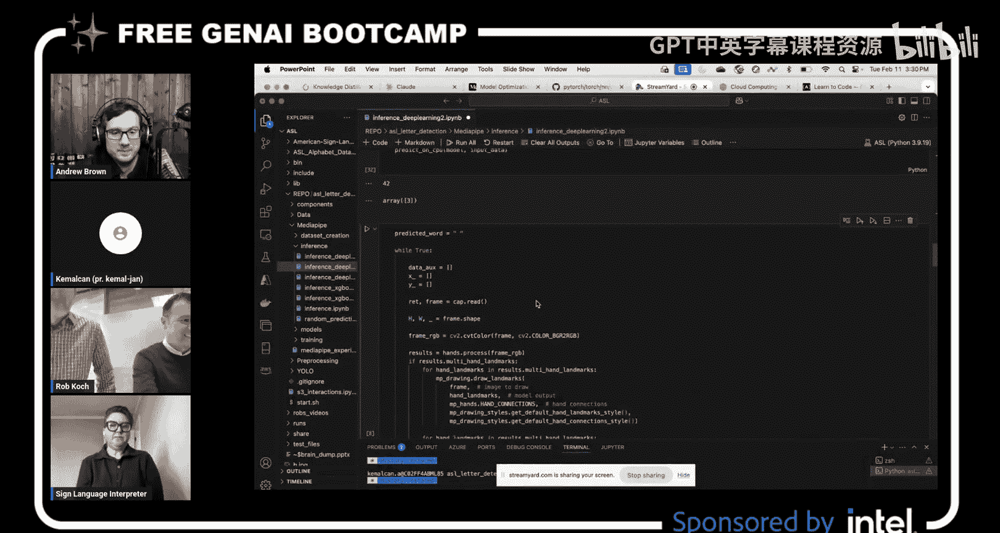

So。As I said， we are working on an application， but today I will be showing you。

Juipter notebook and I'm。好并。All of the boot campers are familiar with Tri with the notebook and all of that。

That's might Oh yeah， yeah， we covered in the Gene essentials they're all they're all ready for Jupiter。

 yep， okay。Do you want me to walk through the quote a little bit or just directly jump into the demo？

It's dealer's choice。 But what do you want to do， Do you want to do demo or you want to you want to talk。

 you want to talk shop。Very very briefly I'll talk about the call a little bit so as I said we trained the call we trained the model。

A model saved my local as well as in the repo and because I'm using my personal my work laptop I'm not using GPU there is CPU here that's why I need to specify it but。

You can use of course GPU as well， in certain cases we do that。But here I have on the CPU。

So this is going to load the model。 So I guess my I have 100 questions。

 but how long does it take to train the model。I used， I think H100 and mediadia chip。

Took20 minutes15 minutes but H 100 in the cloud， right or do you have an H 100 in your laptop I wish no for those who are listening H100s are very expensive graphics excuse me sorry excuse me thats my。

I gave you incorrect information Oh sure yeah。V 100 or a1 either1 Oh a100 okay so the more affordable but still expensive GPU。

 So for those that are listening there are theres it's like H 100 a100。

 there's another letter 100 and I can't remember what the cost I know maybe like 5070000 it depends like when you bought and what's supposed to pop right now。

 but the point is is that folks you probably don't own one， but in the cloud。

 you can rent it for a small period of time and I don't think it's that expensive。

 like like it is expensive， but not expensive if you're running it for a limited time like you said 20 minutes sorry yeah correct correct I did all the pipeline on model developments on cheaper。

Okay， but when it comes to like inference of model training。

 special model training and saving the model that happened in Media chip。Oh sorry。

 since this is not a large language model， it's just a model。

 was the memory requirements not as insane？He。When we use the images images itself。

 we needed more space because each image is。Bigger than the features that we extracted from mediapi。

Mediapi eventually gives us an array for each hand， usually there is like one hand in one picture。

So it doesn't require ton of space， but also I want you to remind you like my data set consists of 7。

000 images for each letter， so 7000 approximately 7，000 times 26， a lot of data。Okay。

 so yeah I'm just trying to relate this back to LLMs for folks because the trick with LLMs is that we have to hold the model weights in memory right and then they do multiple epochs and so I think that this this the neural whatever the I assume it's deep learning with like a neural network is going to be way smaller than LLM but here you're saying that there's this is true that it might be smaller but we do have this other issue of loading the images into memory so that has to be factored in as well okay I think sorry yes。

Yes， ideally we should we needed to actually this we phase out the problem， we extracted the images。

And store the data somewhere and we were done with the images and never looked at the images again and verped on those features。

对。Yeah， and。Again， if you want to like tie it to the LMs。

 like there are optimization techniques where you can do pruning or other prop like knowledge distillation to make it faster。

 buts that's beyond my skills。

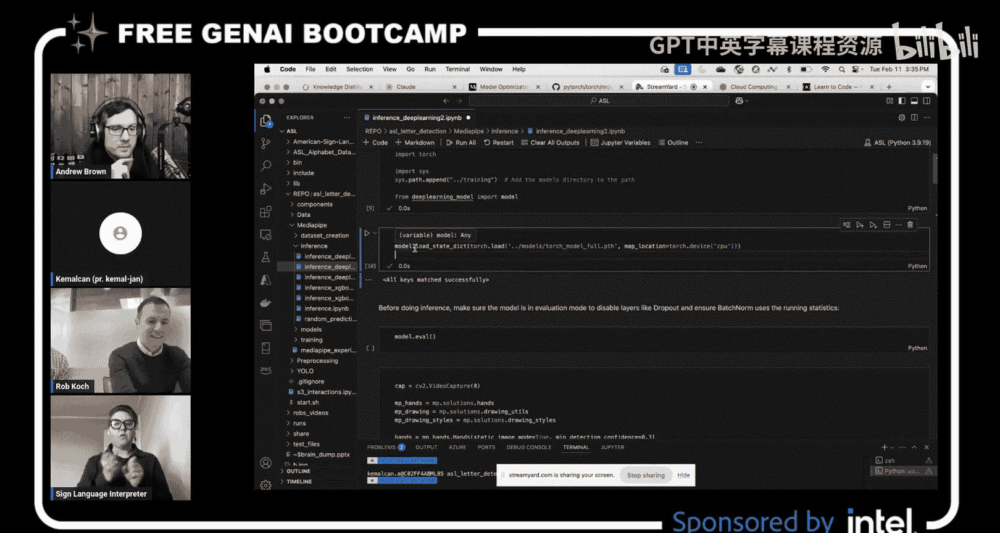

Okay， here I load because the model was saved。So I'm able to load it so was it was trained prior and you're just loading it into your machine using CPUs。

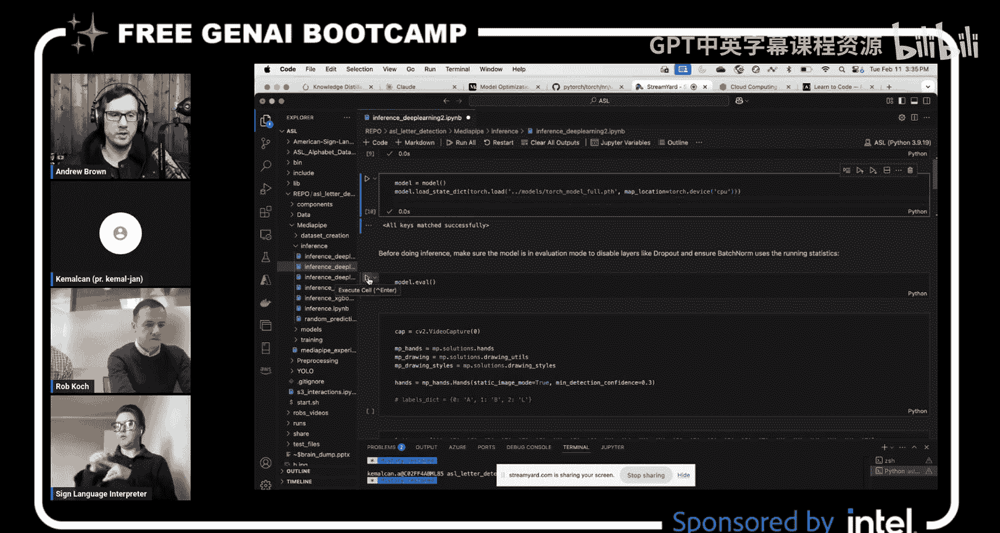

Yes， correct。And I am telling model that I'm going to do inference。

 don't change anything with the model。

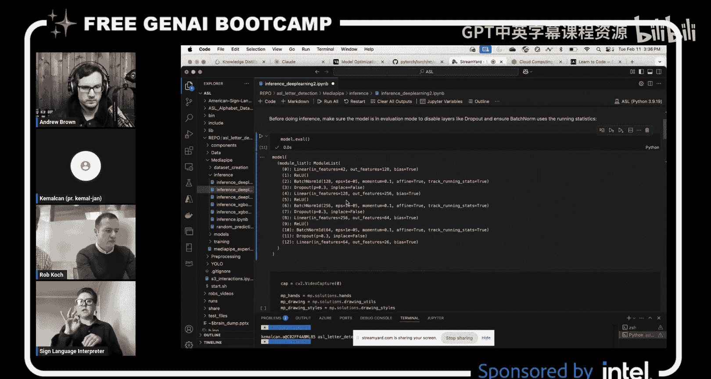

This going to roll scroll up a little bit this CV2 from open CV is a very well known image and video library。

 you may be familiar with it so I'm going to start the camera with that。

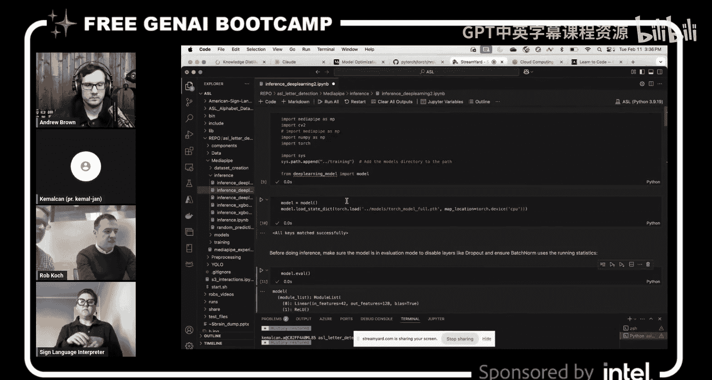

For those that are watching， CV stands for Computer Vision。

 and I think that is what is responsible for capturing the video and passing it along to a mediaD pipeline。

 I think。Yes， correct， okay。

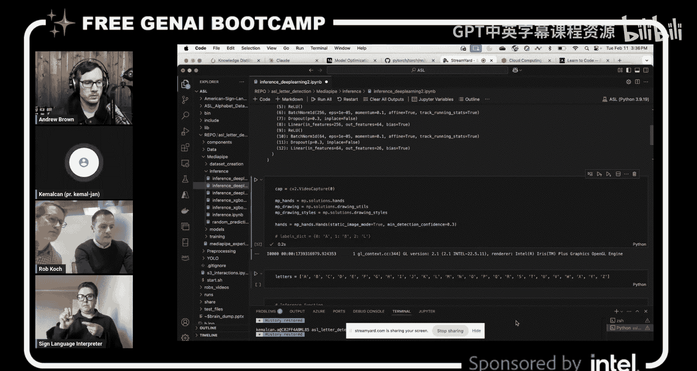

好啊。

It's a very very common library， it has a lot of features and very easy to learn， I recommend them。

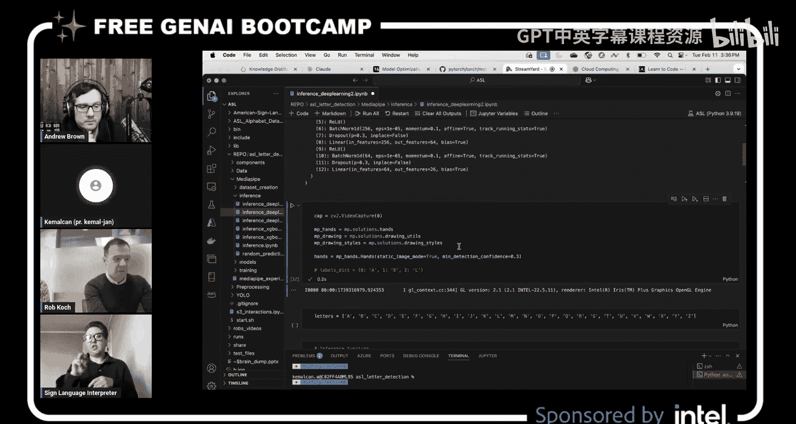

But it's not it's not specific for this it's a general， yeah。

 it's a general purpose library for computer vision and same thing with media pipe it doesn't have to just be what we're using it for its just。

We're using these two libraries for this use case。Yes。

 correct Open CV is generally used for minute things including reading an image digital image into an array which is the most common use case at least everything starts with that Okay I think I've heard the word convolutional neural net I'm not I'm not sure if that's what it is but it almost sounds like it's one of those three letter things。

Covolutional neural network is a type of。Deep learning model that's used for usually for images。

 sometimes for language processing too but。Most for images this library has a lot of tools。

So value you have a digital picture。For example， you give this method to its location， hey。

 this is my image。And it takes that image and converts to an array bunch of numbers。And therefore。

 you have the representation of that image in numbers each number。It between  zero to2 255 or 254。

Here we're not going to use that we are just going to use this library to start my camera and these are the letters that I will be making prediction。

This model， I don't need this at this moment because it uses GPU， but I have the same one with CPU。

I'm saying basically。When you have an input data， use my model to make predictions。I see。一。Here。

 both open CV and media pipe called this。What next to each other？Basically。Start my camera and just。

Gather frames from my video， take the video， give me the frames。Fast， do it fast。

 This is what it's doing。 And once I have frame this frame。I's an array。Gives。

But each frame from this video is convert to 10 array bunch of number， list of numbers。

This just changes its shape from DGR format to RGB red， green， blue format。

Just changes the place of the numbers。This is a little bit confusing。

 but basically what's happening here。Detect the hands。

And give me the coordinates of those hands and finally， once you detect them。

 you also present them on the camera。Nan， once you detect the hands。Gather that feature。

 bunch of numbers。Numbers that represent the hands。Feed to the model。嗯。When you feed the tool model。

 give me your prediction。Basically，Model itself is is doing it。 So it's running right now。

 So I'm going to。Share this， I think this one。😔，Here。点啊？Oh both hands， okay， you can do both hands。

 you can change that to separate hands， but usually use one。If there's two hands， how does that work。

 does it compute all of it or does it separate out the two hands？

You have to move it the interpreter can't see me sign okay。

 so the model is guessing what letters I'm using or where my hands are and things like that and it's you could see in the in the code the Python where there was only the first 42 points that means it's one hand right？

😊，So that means it ignores the rest so if I have my other hand here。

 it'll do the first 42 points and。If you have what is it 21， how does it how is it 42。

 where's the 42 coming from is that total your hands why there's like 21 points。

There's x and y for each point， so therefore they're like 42。

Yes okay so that's just the x and y so that makes 21 and 21 so there's 21 x21 y got it you see that X it detected it and y see it's working so so 42 so 42 variables that it has to data points that it has to calculate there。

 but when you have all 8080。84 up then what it just ignores one。Okay， let me。

 I think I skipped up but I didn't do with explanation。We have 21 data we have 21 pointseses。

That have an x and y value and if we times it by two we get 42 Yes。

 each of them actually have three X， Y， Z， but we drop to Z， we have X Y。Okay。

And then that's actually an array of。出。出问题往来出。Columns to any1 rows or the otherarrow。

But my model takes。One array can't C to dimensional array。Therefore， I unraved it。

I make of one big array。😡，Instead of 2 times 21， I have one times 42。I see。

And back to your question for the demo purposes here。I said， if you see two hands。

One of them can be different obviously or same。Just see the first notice I notice that the points are colored when when you unravel your array is like the first cell always the same value so that way you know I'm saying like if there's 2121 vertices which has 40 like you have a 40 array of 42 and I see those points are colored does it know exactly like this point is always this point it'll always appear in the same part of the array when it goes in so that it so that the model has some level predictability to predict on based on that array。

I'm actually sure if I the same question。Yeah， so， so， so like if Rob holds his hand up again。

And we see the points。Right， see how， see how like the thumb is colored white and it goes and like this part of the thumb is super white。

 and then it goes here， it's getting gray， gray。 So it's a little bit different。

 But this point here is white。 right， Is this point uniquely identified in in media pipe and this is always this variable。

 Like it knows like this is the thumb。Yeses。😊，So so when you produce that single array。Right。

 is position 0 always the same position in here。 So let's say thumb is position 0 every time it gets fed in for the X value of of the tip of the thumb。

 Is it always the same part of the array。 I to understand the predictability of the array for the model。

Or could they be in any points in the array， like they could be in any order they want to no。

 when its unravel sets it's unravels in a certain。ゆく。Control how， how you can unravel it。

But once it's unravellled。Every single data in the inference and training will be unraveled in the same way I see okay。

 therefore consistency that makes sense because I was like I wonder how the model would handle if all the points that are random every time must be a really good model。

But。Yeah。So like if you show this right like L this is a good example。

 it can detect it both ways and but then it's starting to say and and you know it here it has a challenge with P right it's showing n still it gets K but it doesn't show P even though the same shape just different orientation it's upside down so like K is here right but you don't change the shape you just turn it upside down so it's something to do with I think this here it has a hard time with P。

😊，Q， it does okay， and so yeah we're kind to seeing this go through here with the different letters。

UV， W， X， Y。ZAnd yeah。DL soque gets a little confused there。With yeah， if you want to explain。Oh。

 and just a heads up， we have five more minutes。Yeah， I can actually take any questions or。

Well I think I've answered all my questions， I'm so surprised and like how many variables there are to solve and it makes it a very interesting problem。

 I'd love to see this develop further if you folks end up having more time would love to do a follow up in the future but was there anything in particular that really surprised you from the outcome like I know Rob has seen these projects many times these fingerpellings。

 was there anything that surprised you about going through this process yourself for this project？

诶We。What about like the three points of the Z？Yeah， or something like what we did with the model。

 So X Y coordinates right the adding the Z coordinate。

That model actually had a really hard time and it failed and it couldn't recognize that so we ignored the Z portion of things and the model got better so that was one of the I think that was one thing that was surprising to me just we think that yeah you would have it enhanced a little bit more right？

I totally agree that you asked this question earlier。

I know there will be a lot of developments in spatial data。Especially in this year， maybe next year。

But finding this data in American Sign Language letters is going to be an issue， of course。

 but once we have the spatial data， that's Z。Dimenssion is good to help us a lot。

It's going to solve a lot of problems yes， I was surprised to see that Z was noise。

 totally noise for us， but there is actually value there， but we are not there yet。Okay。

 and so spatial data is one thing， but you know， how do you feel about the technical certainty of solving this problem like or problem where say trying to get to the next step。

 which is。Actually being able to spell out words and detect it like and also have you seen any in the wild that can actually spell out words words and how good they are。

 I'm just trying to understand， like for those that are out there。

 is this a problem that that is close for people to solve or it's still really hard or you know。

 just that general sense， sorry。做一分。So we've got letters like J and have the movement in them and they're not static so capturing those frames before and after like we talked about that's something else that I think we want to focus on and maybe we can try to expand the frames and get more of the frames captured in a series of frames so that it could detect the language of the letter or I mean a word right so once we do like we feel good about Z and J those two letters that have movement once we solve that problem then we'll be able to add signs into it and gestures and things that we talked about before so gesturebased adding those type of things and then that would just really take off from there I think so that's how I feel that we're out right now but I think。

😊，It is still a big challenge and it has been so far。Is there any parting words for our boot campers？

Exelsior。Party words， you said， Oh yeah， partying words， yeah， final words for them。嗯。Well。

 there are a lot of opportunities in the field and I know they're going to be great if they're going through this GeneA boot camp。

 they are going to realize there will be a lot of applications out there and I wish good luck to them。

Great and Rob any words for from yourself there Sure yeah。

 something to add just for all of you out there if this is your first attempt and you fail。

 trust me you will just keep going， don't get discouraged just try iterate walk away， think about it。

 come back you know work on it so that's all a process you will get little wins along the way and so just doing that being able to keep at it you know it might take two and a half years it might take two days Who knows right but you will get there at some point so just keep working at it and that's really the whole point of all of this exercise right's we don't know what we're gonna to get out of it and you know two years or two months from now so that's that's what I always like to remind folks is that you might get up in the morning and get all you know some added unexpected motivation So yeah just keep at it。

😊，Well， I appreciate both your time here， we are out of time。

 but I'm going to see all the boot campers here in class soon again。

 just appreciate you taking the time and letting me ask so many many technical questions but yeah and we'll just say goodbye here Chao Co。

Thank you。😊。

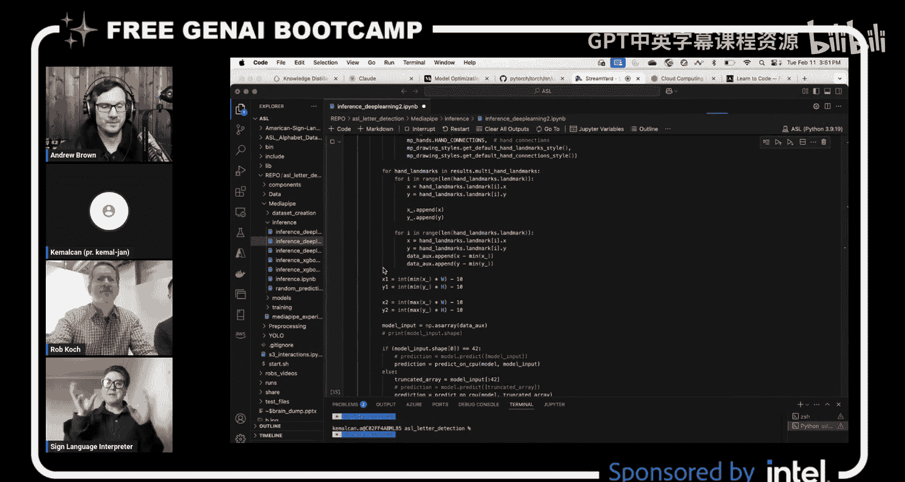

Thank you。😊，Thanks。