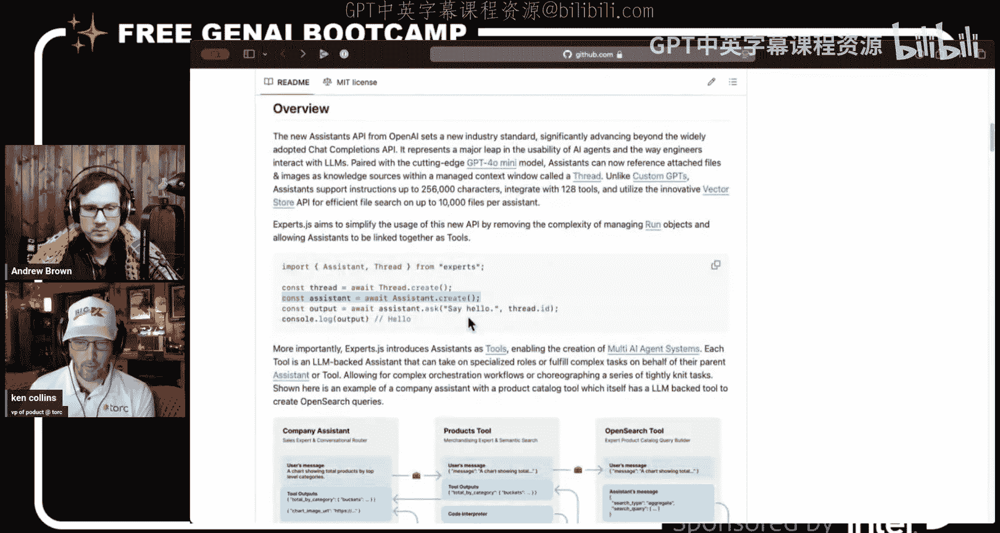
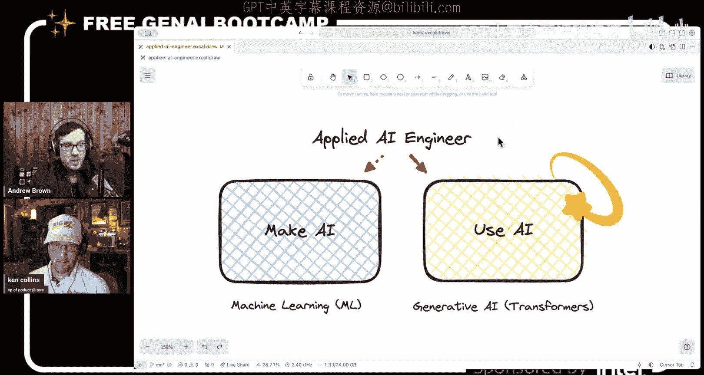
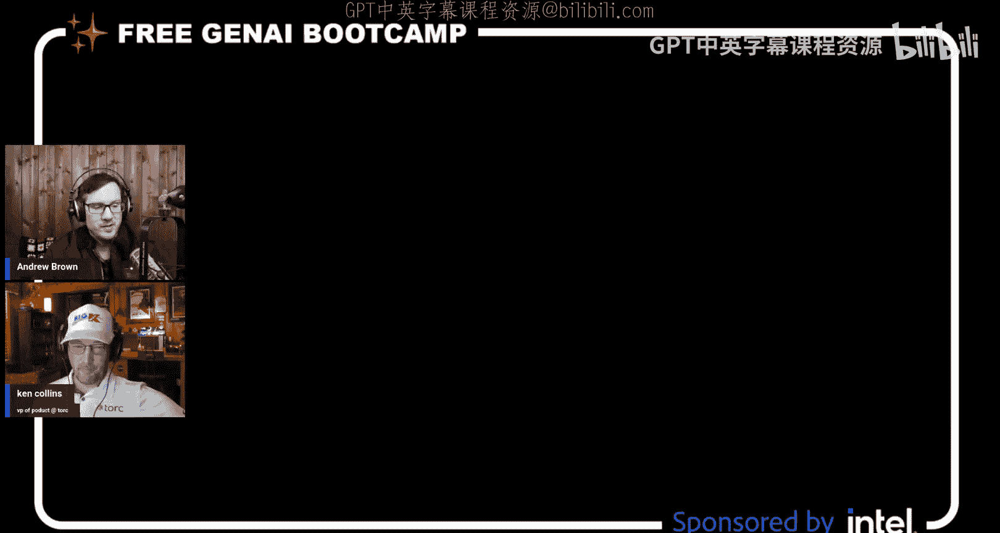

# ExamPro《生成式AI训练营｜Free GenAI Bootcamp》中英字幕（deepseek - P34：-34-Applied AI Engineer - With Ken Collins.zh_en - GPT中英字幕课程资源 - BV1SFEWzLEab

Hey everyone it's Andrew Brown and welcome to the free Jennyi Bo camp I have with us here today Ken Collins and we're going to be doing something a little bit different because we're gonna to be focusing on the career side of matching your skills that we're learning here to the possible roles that you can get in the AI space or Jennyi space but we're going to see that in just in a moment here but I want to pass it over to Ken so Ken Collins can introduce himself and so take it away Ken yeah thanks Andrew so good friend you and I go way back we're both AWS heroes and we both have really well knitted blankets from I don't have mine on today it's pretty warm in my house。

You know we got the same fivebe and so for folks that may not have met me before so my name is Ken Collins currently I'm the VP product at Torque。

 which is a talent marketplace and staff augmentation。

 recently acquired by a larger company called Ronst Digital so very big company very global we've got lots of opportunities for and probably a unique take on people being able to create profiles of share more about themselves and find the right work that's right for them' I think it pretty distinct right it's the ability to build sort of rich data about yourself express yourself in different ways not just past the resume but also we're building an incredibly cool technology with AI to help that from the other side of the fence right like how how do companies find you and fundamentally I've been in this funny recruiting sort of talent cloud business for about four or five months and I think I have some pretty interesting ideas of how this can all change and be a lot better especially。

With AIAnd I think what's really interesting is that you're background before you're a principal engineer so you came from a very technical role and now you're on the other side for us to tell us like hey this is actually how it happens because a lot of us folks on this side of it are saying like how do I lie my skills what do companies actually want it's hard if you just work for a single company because you know what that company wants but now you're on the recruiting side so I feel that you have this wealth of knowledge that you're gonna share with us and I want boot campampers to really really hone in on this information Yeah it's an odd one Andrew I mean I go all the way back to where before you know like I was a graphic artist for a long time and I was like account executive at a new media or an ad agency and then I was a marketing director for an ecommerce-commerce company so。

I kind of bring a lot of weird skills， but now that I've sort of finished up a really good stinentt about 15 years or so in just software development。

 I'm excited to get back to the other side and the leadership side and trying to bring all this together with a fresh perspective and for context one of the things I'll do today for folks is we'll walk through some of the things that I see and apply and what I'm looking for in AI engineers and I think' that's potentially very different from the marketplace so I've just finished some hiring up and hiring a new group and my team to sort of shoot the torque。

Business a little bit further past than where we are today and even that's ahead but。

AI changes so fast and there's so much happening in the industry that I basically wanted a new team to sort of build out prototypes to get about like six months ahead of where we could potentially be and then sort of engineer the right products along the way to get us there and finding talent is pretty hard and I think there's a lot that we can do with technology change that but I thought what it would be really cool today is to share a lot of the things that I've been looking for and what I've seen in the talent marketplace and what I think is a unique opportunity for your group to attach onto to some skills that I see is important that's going to make them you know I think everybody feels like they want 10 years of experience and something but I think one of the cool things about AI is that it's really disrupting a lot of things and。

You have this moment now more than ever。To sort of tackact towards these skills that I think are incredibly important and then ride that wave with it and get jobs that maybe you thought that you really couldn't get before and I think the opportunity is huge and if you can kind of get those skills and promote them in the right way。

 then you can really align yourselves with what companies are looking for。

What's interesting is I always think of the stories from back in the early 90s or 80s of developers or people in the game industry and listening to how they came up with their technical solutions at a time when things did not exist and a lot of times they're coming up with imperfect solutions but the solutions that came up with nobody else was doing and so it's like they came up with an imperfect somebody else cop that imperfect one and then it finally came into the final iteration of what it had to be but there was nothing stopping them from saying oh this is not the right way we're just going to do it because we don't know any better but it is right until someone says that it's wrong and even when I look at like my background in the rails like Ruby on Ra side of it I think Ken you have some experience with Ruby on Ras as well right so yes I'm underplaying it there Ken really knows is Ruby on Ras and so you know I got in that space in 2005 and at that time you know when I wanted to learn how to build apps in this new。

Of building frameworks and there were open source projects out there like Mafisto which was like a v platform built in the rails platform and you know the only way I could figure out how to build a production app because that was the only one that was open source on sourceforge I just had to scour through it and it was a mess but I didn't know as a mess and I just took what I could to get it to work and then in retrospect you go oh it's so obvious what was the right path and so I just want to kind of emphasis on on the opportunity that there is right now and in this boot camp in this boot camp we are changing technology in the fly because like deepse came out and everyone's like deepea is it important I'm like I don't know but we're going to give it a go do you what I mean or it's just every two seconds something's changing right and I mean there's gonna be stuff that's going to be foundational or conceptual information is going to carry on with us but then there's just stuff that we're going be throwing away constantly and we're gonna be jump into one from one ship to another but yeah I'm really excited to see what you。

You're bringing to the table here and I think you got a like a very interactive presentation for us and so we'll just let you pull up your screen there and take a look yeah let's go through it so rather unusualm I am also known for creating a very slim。

Ls that sort of tell a narrative， but I've been having so much fun lately with Xcala draw because I recently found out can you can use thecalala draw extension within VS code so you can basically check in you can just with local file so you can go to Xcalla draw。

com you know there's a Chrome extension where you can save certain files and browser local stack memory and just have some really nice it's just a really great tool。

The fact that you can download these files inside and put them into a git repo and version control then and you basically get the whole ecallaral interface within VS code with the extension' I'm on this label well well Ken you know what this would have been really good for me in my preweek because I created a bunch of diagrams and Lucci charts and you have to pay。

 you have to pay if you want versioning right and you just get it for free but to listen to my pan here so for boot campers they already know this but like we had to share a link so they could see it and the other Andrew when he shared the link he shared the edit link。

And so and so all of my diagrams were blasted away in like chaos and mess and then there was new diagrams I had never made that I'd never seen before and so I have to remake them all and I was just like what solution could I have that would allow me to like you know free or paid or whatever they could download it and you just showed me something so I'm like maybe this is what I'm using tomorrow to remake all those diagrams if you're saying I can download in a repo and I can show them to usK and that's what I'm gonna do I've given one hour long talks before on amazing technology and the first question after I've stopped talking would be what theme are you using in your editor？

Like we just get that out of the way first， right？And I am in cursor here because I'm incredibly cool and everybody should use cursor。

 I think。Okay， so let's start at the top。This is the role that I hired for it's called applieded AI engineer and Andrew you and I I talked about this like what's a good job title right I think a lot of folks are hiring for AI engineer I put applied in front of it because。

So if you go to I have a blog it's called unremarkable。

AI and what I try to teach folks is or at least share my story is that I don't have a machine learning background。

 I don't have data science， I don't have， I'm not even good with Excel sheets， right？

but Google sheetets youre good with right I don't well Google Sheets is way easier to use Excel is just like layers of layers of legacy windows Windows's not you have to navigate but sorry yep I wouldn't even say I'm good with Google sheetetss right like I just I am a I'm the type of engineer that I'm not building functions or other things like that right I'm just trying to creatively think about problems so。

So the thing that I think was hard you and I talk about this do we call it a AI practitioner and I like applied right so I am a practitioner and I encourage everybody else to lean to that side。

 but one of the things that I think is interesting with the market today if you go and look at。

Barious what companies are hiring for an AI engineer。They're advertising， if you look at the skills。

 they're talking about making AI。And what I want to talk about is the opportunity on the U AI and I don't think there's enough emphasis there on hiring managers understanding the skills that you need for that and the opportunity there to do amazing work inside of a lot of different companies when you're just applying AI from an applied practitioner perspective and something we should make clear is that the bootc is focused on the use AI component whereas the make AI that's like guess director Roa who is PhD and neuroscience and and build models from scratch。

 that's someone that they would hire and those are the companies that raise I don't know hundreds and hundreds of million I don't know how much money with a lot of money that are very specialized in the task but just to clarify that there sorry Yes and if you make AI and that's what you do I think you're great and we need you I think there's opportunity on the right-hand side。

 that's where I operate on the right hand side and I think there's just way more opportunity over there。

But we do need people to make this sort of stuff and there are points to where you get in the use AI where you need to maybe do sort of more to the make right maybe you're taking small language models but it's sort of like walking through that right like there's this is typically what you see when you're going out there and applying for jobs and you got these hiring managers and they're making these job opportunities that are very much leaning into the make AI category right and you're going to see things like Python you're going to see things like Tensorflowlow or Pyottorch they're going to think that's important because you're going to want to do some fine tuning you might even see some we need you to have experience with a co architecture or familiararity with data pipelines the idea here is is that。

This kind of goes back to 2023 is this is a mismatch。

 I think in skills because a lot of times when you get into these jobs and I've been told this as well。

 you end up therere like， hey， you know rug pullol。

 like you just need to use AI right I don't know this is if this is a little joke you have there on the bottom。

 but is Yolllo an actual technology。Okay so Yolo is I saw this come up in a couple of my interviews。

 it is a， I believe you could call it a segmentation model and it's old。

 it's not built on the transformers， it's just basically good old fashioned of math。

I don't know what to call it， but， you know， I would look at that they would talk about their experience with Yolo and I would go。

 well。Why didn't you use Meta's new segment anything model V2。

 which apparently is just really amazing and it's based on transformers and it's free and they're like I've never heard of it right。

I think what happens is like when you learn something and it works， you don't。

 you don't necessarily pull up a double game right and Yolo's like 10 years old and。

I would think maybe three years ago it was incredibly important。

 but it's not now right and and I don't think hiring managers know that as well right they're going to talk about convolution neural networks and natural language processing and but the idea is that they really don't know what they're hiring for when they say an AI engineer they're really talking they list out the skills about making AI right so when they say data pipelines。

For them that's important because when you're making AI。

 you need to have a lot of experience either moving data from your data lake or you know feeding these things into ways that I probably don't even have the right vernacular to describe but these things are just not important and oftentimes you will end up finding that they're basically just going kind of do a rug pull on you and they're going go okay well you're going to really kind of sit here and you need to do this stuff right like we just need you not to fine tune a model。

 but we just need you to use an inference platform like open AI or Amazon bedrock sorry so are you saying that job postings are saying make AI but they actually want to work AI and okay so so then you're kind of but does that mean that you should super well maybe we'll get to this later but does that mean we should have superficial knowledge and some of them make AI stuff to check those boxes but actually have the practical skills。

Well， I will tell you。You know some candidates early on in my interview and when I would sit down with them for 15 minutes I would describe that。

 hey， you know this role was about use AI versus make AI and they would I I' admit that they just keyword stuffed just to get the you know just to get past the hiring manager or something like that so I think what I would recommend is that I'm going to share with you that there is a disconnect between job opportunities and what I would look for as a real hiring applied AI。

That means there's a potential risk there， right， because if you're in order to get past。

 probably people that don't even understand that。That's gonna be challenging so I don't have a solution for that so well well my solution and it's it's just incidental but the way we are teaching people is like on the make AI we do teach a bit of each of those so like we're not going deep I'm just saying like yeah you know maybe Roola will show us how to build a very basic neural net like CNN literally CNN using pytorch we're not gonna be experts in it but we have exposure to it and we can speak a little bit to it or things like that but really I don't want people to be trying to build stuff but just at least understand what's underneath and then we have a heavy focus there so I feel that you know if somebody saw this stuff they could say yes I have touched these things no Im not Rola the neuroscientist AI engineer like that can make but you know maybe that might help them I don't know。

Right， I do find like when I was interviewing folks。

 you know they would come from this Python background。

 they would know all this stuff and then I would ask them questions such as hey。

Let's say that we have a system that's based on G 40 and let's assume that we have a good framework such as either Lngcha or the AI Ver SDK words and then I wouldn't give the answer。

 but I would say we have to cut cost by we have to cut costs and increase latency and the first answer they would give is well let's just go start fine tuning because to them Python and all these skills over here where the hammer and every problem I had was the nail and the answer was no you could just change the model out from GP40 to something like Claude Haiku or Jim and I flash 2。

0 and get like three times。Performance and probably 10 times cost savings and you don't have to do any of that stuff it's a one line code change right so depending on when you're prompt engineer but like。

Everybody contextualizes right if you bring this Python baggage。

 if you bring all this other stuff to just you applied AI engineering。There's an opportunity yeah。

 you kind of it's good to have like that basic ground set of like what these things are， but。

From a hiring perspective， when the rubber meets the road。

A lot of times these people I'm not saying I'm discouraging and hiring from python people。

 but when you ask them questions， they just bring that python and that experience。

 oh fine tuning you know， that's the way we're gonna solve this I'm like。

 well what if they gave you three days maybe you have to fine tune faster well then and then what what if we hire somebody else and we have to pass that on like there's there's so many things that that can be difficult it's like when we wanted to。

Sorry， when we wanted to put up the marketing website for this boot camp。

 I didn't have that much experience with Vercell at the time。

 but I do now and I heard that it was really easy to use and I use it and it deployed in an instant I'm like oh great。

 it solved my business use case in seconds and you know to me that's more important than I mean there is a cost factor at some point you do want to know your technical path and and it's nice to have these things as a possible option if you need to go that route but you know it's just about exams。

 you know there's the horse， the zebra and the elephants when we talk about the layoutup if if the answer is a zebra which is an exotic answer。

 a complex answer which would be going to the make AI side whereas the horse option would have just been like swap out the model。

 go over the horse right？Yep，h。So let's so there is a disconnect there and I will say that I think this will course correct at some time people will start trying to figure out at least within the platform that I'm building we're going to try to make this really easy for people to either find this mismatch know they kind of call this and hiring you're always looking for the purple squirrel right and the purple squirres the highly specialized person that has all the text every box that you want and not just the soft skills the hard skills the culture fit everything like that so I think technology is going to make this problem go away and that hiring managers that don't know the skills that they need to actually see are going to be a temporary thing but is this is a problem in the marketplace today so it's basically we need the app that let's them to swipe left or swipe we're right on there。

I've tried to think of never， I never used it， but I'm just saying like just going through profiles and doing that on the hiring side would be very funny to me as a visual。

So there are those apps so maybe you're hiring for hiring oh absolutely yeah。

 even for for blue collar jobs they're very popular well， okay。

I think our Home Depot came out with one too。So what I thought we could do Andrew is I could kind of maybe spin through a little bit right so this is kind of vague right there's a these these skills like prompted engineering nearly how to use inference platforms。

 how to run evaluations which are essentially unit tests for engineers in a different methodology cloud development skills model capabilities and selection that's the horse right just being able to understand the models out there the tradeoffs between them such is like do all models have structured outputs。

 we calling capabilities stuff like that again the make AI people talk about Lama。

 but then when you ask hard questions about how are you going to get Lama to do structured outputs and stuff like that we'll host it on SageMaker are you going scale that it ends up being a hard problems the only place where we diverge from you and I is that I have an additional additional thing that I look at which is do they understand how to run models let's say you want to deploy into the cloud where it's cloud native or not necessarily。

Not necessarily necessarily Kubernetes but let's just say you want to have full technical flexibility down the road if you had to go that route。

 do you understand the hardware requirements to run these models and so I I kind of draw that parallel by how do you do local LLMs with your own hardware so you can kind of understand that but in practicality I almost always start with serverless cloud stuff because it's so easy to get going with so it's not necessarily what I would say in the early on but just more like a possible technical path that I would throw in there sorry。

I love that too， yeah because eventually I think small models and deploying the are going to the platforms is going to get easier to do that。

 even in serverless models where they scaled to zero。

Well well this is this is my my speculative thing is just to believe that as an open technical path in case it happens yeah yeah so one of the things that's really important for me when hiring for applied AI is compound AI this is I believe a rebranding of just multiagian systems and to me it's incredibly important right so like I talked a little bit about in this section here right how do you have what are the model capabilities in their selection right and that's important because。

Never is one particular agent use case going to very rarely be with one model right like maybe you're doing some summarization very。

Common stuff you can do that with one model， but oftentimes when you're trying to break out complex business problems。

 especially ones that duplicate what humans are doing。

 you're going to need to create an agent system that has different components for it so again I think this is a rebranded of multiagent systems or a mixture of experts we've heard it all before but I think compound AI is says it a lot lately and what i've done here is。

I've talked a little bit about the history of that so if this is my blog onremarkable A sorry but just one step back there found AI is a coin term to mean like like like specialized specialized solutions within within your workflow Yeah so each one of these boxes here would represent and I'll show you a diagram example that would be a separate model look cohesively this thing would be basically an AI component or an agent right so the idea would be that you would swap out models I'll talk about like this purple bar at the bottom here that for me represents shared memory。

but if you kind of want to look at the history of what u。

Multti Asianian systems look like I wrote a little。Basically it's kind of like AutoG or Cr AI。

 it's called experts。js and what it essentially did was is it stitched together open AI assistance。

 which is different from their chat completions API and basically the assistance API。

Looks a little bit different right you have to create an instantiate assistant you have to give that assistant a thread to talk through and then of course as with all open AI models they have really good pool calling capabilities so the idea here was is that let's say you are building a chatbot don't recommend that chatbots are the ultimate thing to keep building what's more remarkable or the things underneath them that make them work and those are the skills that you really need to tack to not just stay in chatbot but in this case here imagine a company assistant chatbot the idea is that in order for this assistant here。

 the products tool it to be the best merchandising assistant it needs to be it doesn't need to have context of maybe another assistant that would stack underneath as like a sales assistant or an order refund assistant or something like that the idea is that you through specialization you end up with basically different different agents right so multiagent systems typically were thought about like how well do you stitch these larger assistance or coppis together。

In meaningful ways， this is pretty hard right like in this framework at experts。

js helps you do that and there's some neat things with it right like it helps do thread management。

 which sort of manages conversation state it solve some problems but it creates others where you have to flow information from one way to the other you kind of get like a great plan effect and it's kind of hard especially from a chat bot interface but you know that's where multiagent systems were and where we are now with compound AI it looks a little bit more like this right and I think this is way more logical and I built systems like this before where this makes a lot more sense so before you move on there so just talking to multiagent systems if folks that took my Geni essentials if you think back to when we used Q AI I made a video on that on how to make agent workflows this other system that Ken calls is talking about it called experts Js did you make it because I don't it's not a fork right it's literally you made this so you made your own。

G AI workflow with open because you take a moment is do you have the ability to pull up your the actual repo so people can just visually see it for two seconds yeah definitely so let's do this on Github。

I'm a visualg person， so if people say it once and then'll it'll go into their brain bookmark and so Ken's just gonna get it up there。

 but it'd be nice to see that Github page and it says it's an open AI assistant。

 So you know what even though I use all these models the one that I keep going back to is open AI just because it's so darn easy right now So if you have this one and it's specific to open AI I probably would use it it is and yeah。

 so that'd be perfect for me， I guess my other question is when it says it's open AI does that mean it's compatible with anything with the open AI compatibility or is it specifically just for the open AI it's for the assistance API So about a year ago they came out with this assistance API it's a drastic fundamental change so if you click on this link here they'll talk about the assistance it's still in beta after almost a year。

So whether you're like if you're running LM studio locally or if you're using the verL AI to do different providers on the back back end。

Most。Inference platform standardized around the open AI chat completions API right so very very very very standard API oh this is a completely different API and the reason it's fundamentally different i'll describe it when I go back to my Schlet draw is that you're creating。

Cloud resources， right So the assistant， when you create these things。 So like let's say here。

 basically you have to create a thread and you have to create an assistant。

 and then that thread is a managed memory layer for you。

 which is amazing but you can get managed memory layer through called Z I didn't mean to take over that instance。

 but I'm just going to quickly show people if you're in the open AI playground。

 It has assistance here。 you know what I didn't fully I think I read once what it did。

 I didn't fully understand it。 But now it's really clicking to me like this is what you're talking about。

 which is really cool。 We're learning on the fly here I'm even learning on the fly here。

 So I'm really excited， but I brought your screen back up here。 Sorry， awesome。

 Yeah yeah it is cloud resources。 And because they're based on function and tool call and you can stitch them together So you can basically make an assistant。

😊。

A tool of another assistant right and then you can really start doing complex things and dealing with constrained memory right because you know these these things still have fixed content link windows and stuff like that。

But by all means check this out right this is a different way of dealing with multi Asianian systems where you're stitching it's more like a mixture of experts model but yeah very different and then i'll go back here and show you let me close that window then we'll go back into a sclet draw yeah maybe it will make an appearance in the Geni essentials course well everything I use I just record right so it probably will end up in that course but。

Okay， so I definitely y' this one come back up here， sorry there we go， yeah yeah。So yeah， there's。

 I did this off， I think it's down here。Yeah， so this is the way it's different right because normally you would think of when you're dealing with chat completions。

 there's a logical diagram that sort of maps well to your physical right like you have your own code you're calling the API out you're providing all the messages。

 but if you draw a physical diagram of what the assistance API looks like。

 you end up with your cloud where your code is running here and then the API cloud it's not just in。

 you actually have it's more like what we would look at from a cloudform perspective right you are creating resources。

Within open AI's cloud infrastructure and that being an assistant in a thread object。

 and then you're just invoking those through your code。Okay。

 and and thread is just the is just the history of the conversation bingo right so you don't have to manage the entire conversation set you just post new messages to the thread and then everything is managed for you okay。

 which I think is fundamentally amazing， but I am going to show our audience today about another memory management system。

So that's that's， that's basically， oh， that's basically。

Multi Asianian AI here's an example of compound AI。 so you have a task。

 you're going to end up with some sort of output This is。Complex。

 but it need not be this complex right they can be one or two agents sticks together they can be the same model。

 but in this case I've sort of exploded this out where traditionally you might use some sort of problem of analysis so you can imagine if you go to perplexity AI very popular I don't even use Google anymore I just do everything through perplexity and I ask all my questions there whenever I ask questions the first thing it has to do is it has to create a query plan has to figure out how it's going to search Google right so that's sort of your problem of analysis stage you typically use reasoning models for that good examples would be0103 and now even deepse R1 you typically end up with some sort of tasky composition some processor or rewards model where basically as the AI is going through its thinking and using reflection and step by step you can either reward it or not for going around certain aligned behavior at some point you may need to do actions like those actions could end up performing searches on a knowledge base but the idea here is you end up with like in this case that might be llma that might be。

Lma， the actions might be done with Gemini by Gemini because Gemini and open AI have really good contracts around tool calling certain inference platforms Lama has tool calling built into the framework but not all inference platforms implement that very well right and you have to spend tokens to do that sort of stuff can I got a question about the problem analysis one so you know when we look at models like anything that's not deepse like before we had deepse where we'd actually do problem analysis like on itself is that where we'd have to implement like react patterns and reflection patterns to get similar behavior and so the idea is now like this new type of model I guess it comes it baked in but I guess you have less flexibility if you want to deviate from it so maybe from a technical perspective somebody if they want to build something very custom they might want to use a traditional like one prior to this and then orchestrate their own kind of reasoning before it goes on to the next task。

Or yes or no or both I think it's all up to the the the task at hand right like you have to measure this stuff I think the the thing that's most exciting to me is that。

When I started out the experts。js work right one of the things that happens here is you get a lot of latency between the system right so if this thing has to think about something。

 then it has to figure out that it's going to call another tool。

 it calls this tool this tool takes your question because it's like all right I might need a red hoodie and I need to pull that from the product catalog well maybe uses another do assistant to generate the SQL to even talk to the database once it streams and comes back with the SQL then you have to execute that SQL run it against the database and to return all that information back that takes time for each one of those arrows here and even with GPT4 you might end up with eight。

 nine seconds to wait for。I was making the bank you know certain bets last year that when this came out that models were going to get faster and faster。

 they haven't they've gotten slower right so01 slower than GP40 almost 16 times is slower and then you know03 slower R1 slower right and there's certain firms platforms that can make that fast but if you were banking on just AI getting faster and faster and faster and making that better。

It's not really going to happen right like you can maybe make Lama Gemini flash run faster。

 but when you pull these reasoning models out， you should have a good reason for using a slower model within the architecture so that your overall task and output are going to be a little bit more aligned and depend that's going to depend on your use case if it's a frontend use case typically shoot for three seconds for max attention span or flow state if it's a backend operational use case it could take minutes and be fine but。

It really depends on your use case。And I don't think I've ever seen Zep， what does Zep do。

 is that something to do with memory management？Yeah， Zpp is a favorite topic of mine lately。

 so one of the problems I've always。That has kept me from using。Lma。

 whether it be on bedrock or vertex or any other sort of inference partnership or platform is that。

It didn't have that thread object that managed memory and one thing I hate doing in production applications。

 especially chat applications is managing memory like manage how do I and that's usually where you get to the python side of things where in order to manage that memory state you kind of have to sort of build the sort of fuzzy stuff and extract knowledge out of it so it always fits inside of the context window and it's like reminds me the old days of which probably still to some degree happening now with ios development where you had to do very strict memory management I I just don't want to do that I find memory management to be completely boring in something that I want somebody to solve for me and that's kind of that's kind of what Zep does right so it allows me to use allama model and to have like the concept of an open AI shared thread object that just works and I can drop it into any model so as I change these models they can all have the shared memory layer the cool thing about Zep is that they actually incorporate Neo4j underneath the hood and they have an amazing knowledge graph so knowledge graphs I think are gonna to be a critical。

Of advanced retrieval， you may hear things called CAG versus ragG and I think it's really both right like you need semantic and I'll talk about that a little bit later on。

 but De。Something I think makes sharing memory between these doesn't mean you have to share memory between these agents right the one that may have to ultimately do some of the alignment might need the memory。

 but it might not it's really up to you。Cool yeah， basically any logo you see'll probably end up making a video on it after this for my own benefit。

 I've been on the local L side like I've been writing the Python and stuff like that。

 but you know just sometimes you know you want to focus your attention on what actually matters and know those are things you can always come back and implement later so that's really interesting。

 I'm also really curious what you're gonna say about Verll SDK as I mean。

 I did end up using it incidentally， but everyone keeps talking about it like oh it's a big deal I go oh I didn't even think about it。

 but yeah， I'm curious curious what we'll see in that a moment。

 but let's focus on we're going there it is a big deal and it's probably it's a big deal because it doesn't do so much thing so when you look at this diagram the first thing you're probably going think of is I need an orchestration framework that is not ver Lcha has offered systems wherey if I call this particular agent and it fails because maybe the parsing of the output wasn't right it'll automatically re。

For you maybe three times and you can configure it with like a a nice little number you do not need an orchestration framework here right at the end of the day。

 this is Tri catchch and JavaScript at the end of the day these are four loops and basic things these different things could be in different systems and you're calling them or they could just be in one application main thread where you're you're spawning in a child process or forking out right like there's there is no need to have an orchestration framework like crew AI or autogen or maybe even experts do js right it's just possibly not needed because at the end of the day with just a little bit of software engineering you can coordinate this stuff as you would any sort of control flow and diagram I was I say that said I do recommend one of the critical parts about this is that you're using different models so like if you're running an evaluation on this whole thing you're going to maybe want to test certain。

Data sets that run through it and that you come out with the expected output and maybe one day Gemini is just too expensive for you or even deep seek is too slow and you want to change that model out to something else well。

It's fairly easy even if you' were using pure SDKs for whatever your inference partnership was is just to swap that out with some different code。

 but the thing that I've been really， really loving lately is the Verll AIS SDK I've used Langcha before again with JavaScript that's never as good as I don't think the JavaScript client was ever as good as the Python and I think that's actually a positive thing because the Python client had done so much where people would be applying for me with jobs and they'd be like I'd say well what vector database have you used and they would say I've used FAISS and I was like well that's not a vector database that's an algorithm by Me and they thought it was a database because Langcha Python framework offered a simple document chat with your documents feature with FAIS it's always the start too I think with youre about it on vector database is what's interesting is like I thought I thought you had to learn Lang chain to do anything productive you had your orchestration but as more as I farther got into it。

I realized I don't I could just write basic code and then if if I really needed it if I really needed it then I could consider it but I guess I just entered a time when I never felt productivity and L chain or La index I just felt a lot of pain and and layers but does Ver AI SDK have some level of orchestration in it or and that's amazing that it does not it really focuses on these toplevel interfaces such as generate text generate object stream object oh my God amazing right if you have JavaScriptscript or JSON that are streaming and that streaming needs to be connected up like let's say you're browsing a product catalog and you're using bespoke UI and you're dynamically having AI select UI components as well as the content that goes into those UI components you could stream individual UI components from the JSON response with stream object。

The the hardest thing I found and this is through OPA。

 so like OPA is a this is more like cloud native side。

 So if you want to spin up something that is for enterprise production。

 you can have a bunch of containers， but one thing that they don't do for you。

You have to write your own handlers for when data is coming back and to me that's the big headache it's not the orchestra it's like how do I handle data coming back and parse it and if it's all these different formats and when I'm looking at this。

 I don't know but I'm going go look into it later， but I wonder if if the hidden value here is that they're just handling these things in such an easy way and taking that specific pain away for me that I normally have if that makes sense。

Yeah， and I think one of the。The thing that I really like about the ver AIS SDDK is that the providers are all based on that more basic chat completions API that I talked about so they call those providers right you will run into some friction right so like let's say if you use the G provider with Lama 3。

3。That provider within the basically that sort of plugin within the overall SDK。

 they may not have implemented tool calling in our structured outputs that are compliant with some of these things like stream object easy fix though right it just takes a pull request or maybe raising the but it's just something to watch out for because I think if you're used to using open AI。

And even the open AI through the ver AI SDK， you'll get rock solid tool column and structured outputs。

 but when you swapped the different models it's something that you have to be aogniz about right I wonder if it's using the structured outputs underneath well this is one reason why stick with open AI so much is that this one's still in beta at least I think it is but the structured output JSON it just works right because they built that in the inference platform itself it's actually built into the inference platform there is a but this is in Python this is the problem we always stuck in Python but in Python there's a library called In which actually implements it outside of it so you can plug like a lot of things into it one reason I didn't like Langcha was that Langcha like that was one reason I thought maybe I'll stick with Langcha because it had structured output but underneath it was just calling the native APIs or it had implementations for like outdated models and not new ones so had a vanilla embedding term the in contextex learning of a schema。

And that works for some models and it dozent others， right？But what I think is what I think is again。

 what I like about open the eyes is again it just works， but yeah。

 the other thing is I wish I could just use Ruby I'm not I not sure if you left the Ruby world but I did attempt to make something in Ruby and then I got the open AI implementation and the Ruby jam was not fully implement it and so I had to go and implement it myself。

 but if it had 100% work then I could see myself， I did get it to work， but if it did。

 I wish I could just code in Ruby all day because that's what I like to do so。Yeah and this is 100%。

Of 100%。Javascript right this there's is not in any other language it's just jascript Javascript's good too。

 yeah， so， but but I mean like if if you're going go all in then a coverage built through front end and your back end right or I I suppose maybe Tpescript as well or yes。

 okay getting on。Any thing。So I definitely recommend it， this is a great toolkit。

 it will help you change out。Providers， but then it will help you understand a little bit more about those tradeoffs right so when I talked a little bit about that quiz for hiring folks and and I said we had to switch from open AI what i'm really looking for is an understanding of the tradeoffs of structured outputs which open AI makes really really easy hard to get wrong also makes it slow right so like there's what i'm finding now is that different inference partners are actually really leaning into we calling now it's taking about a year for them to catch up so some of that python stuff that you're talking about hopefully kind of diminishes and we get to again much like shared memory get to move that concern off to the inference partner and we can kind of focus on the business。

So I thought what I could do ultimately we're going to ask you to create a torque profile。

 maybe we'll kind of do that at the at the end and the beginning Andrew but like I think one of the things I wanted to cover with folks is。

More about like some of the things I'm looking at when I'm hiring for folks。

I created I've been having fun lately creating two binary options and then drawing like where I think people should go in between them。

 So I kind of made this like little slider here and you know one of the things I see a lot where people talk about on their resume is using local models or local deployments or when I pose certain questions which you optimize certain things and they would say oh I'd start off for the local model and I will tell you I am a huge fan of Lm studio love it to death got to play with R1 locally it makes me want to buy more Mac minis and stitch them together and run my own inference platform out so the reason so I don't know if you saw I recorded a course for deepse it did really well for some reason because my conclusion was was like yeah deep I was like it's okay but I ended up using Lm because you had used it and I was like oh this is really really really good the only the only thing I had the issue with deepse R1 was that it exhausted the resources of both my computers and then my next thought was like how。

how do I use exo is it called exo how do I use exo to distribute it so my next goal。

 maybe I don't have five Mac minis， but I have four ragt ragtag computers that could do it's I'll tell you how that goes but that's that's literally on my my roadmap to do hopefully before the end of boot camp it looks like you have a lot of wood too so you'll be able to power all this for sure theme or something but yeah every time I try Lm studio and I'm thinking oh maybe I'll use Lm studio for a local model and play out with it with I just kind of it doesn't work right like it seems like this night idea nice idea but。

OhLike recently had to do it doesn't work does it hang your machine Well it's just too slow like so for instance I was doing it seems like I'm just always optimizing the wrong thing when I go back to Lm studio like I use it I have fun with it and certainly if you don't have the finances or the money to pay for these other platforms or you're pushing past their free tier then definitely use that right but you're going to end up with a situation where you know maybe the quantized version that you're using doesn't really kind of perform like it's going to do when you move it to production right so like there's some of that like that Docker story well if it works in your laptop I'll just ship it to the cloud sort of thing。

Well I guess my thoughts like so when I use AlM Studio。

 I was just trying to think of it as an AI power assistant so I know you can download models as well。

 does it have it like an API so you can interact because you can download models and it's lazy too like you could have it just run in the background and automatically offload your model but then when you hit it again it will reload it for you so it can automatically swap your cartridges in and out basically as well which is pretty cool and then I can have one run on my gaming PC behind me so it's neat I like it but at the end of the day I wrote a classification system two weekends ago I tried to start off on LLM studio but then at the end of the I was like I'm just gonna to use bedrock with the haiku model it's just much faster and then I can actually when I needed to run 25 examples just to see if the prompting was working so I went back this way and then my feedback loop was much faster and even when I ran 10000 examples through bedrock with haiku it only cost me $2 so what was I optimizing for I couldn't get it would have taken me。

Two days to get that fast feedback over here with Lm studio and it wouldn't even be the model that was eventually in production I think for me like the the channels of Lm studio is that when you open a model there's all these knobs and diallls to optimize it and I don't know always temperature zero temperature zero every temperature zero every time。

But it was it was just all the options there like to because again my issue was it was hanging but that was specifically for deepse but you know I've had better experience with direct Oma for some reason it's just it just works but yeah I don't know the problem is I do also just it's so easy to dump my open AI key and just go with it and you load up 20 bucks and feels like it lasts forever I'm never I'm my same $20 that I spent months and months and months ago so you know it's kind of hard but I don't know I'm playing both sides is what I'm saying so yeah so the other side is when you get down to using AI where are you going to use it right so as' let's say you have the engineering background you're using AI ver SDK oftentimes I'll see resumes and experience out there that lists like why I work on a chat bot right so like a lot of times you see people where AI spun up Lcha there's some documents in it and now I'm actually a rag person？

Or I've gone through it and I've done something with with the chatbot and now I have chatbot experience and chatbot experiences what I call sort of lazy thinking right because the chatbot that's commoditized right you can load up any model you can chat with it whether you do with LM studio or hundreds of other Python or JavaScript frameworks that allow you to spin up a chatbot incredibly easy versus VC would do the same。

What's really interesting for the skills is not necessarily the chat bot。

 it's the stuff that happens underneath the chat bo right so the chat bot only works amazingly well because you build in retrieval because you have tool calling and you can integrate into the knowledge system。

 So if you're。Talking about your resume if you're listing your skills out and you're thinking about like talking about retrieval or chatbots。

 maybe you know mention chatbot but emphasize more of the things that you did with the chatbot because that's actually the hard stuff right like the knowledge of retrieval systems how you dealt with tool calling or the systems that you talk to what did you do with your tool calling right did you generate equal dynamically did you talk to other API and distributed systems Did you create the knowledge systems underneath that chatbot so that it was a good chatbot those are all the things that are way more interesting。

U， but also where I spent a lot of time on the operational side where you're taking a back end business process。

And you're sort of canonizing it into some sort of whether it be a compound AI。

 but you're just basically just running that through classification is a great example you know that has a lot of value in marketing where you could look at things from like what I did at custom ink like every design。

 you know this is a education segment， is this another business of it does it have a use case like uniforming。

 et cetera， et cetera， classification。Baastly， vastly still。

Very much need in a lot of background business processes and then you kind of get into the business process automation。

 which is basically how do you take things that humans were doing and then automate them and I think AI has way more。

Potential over here for people hiring I think that bots are kind of like the thing that people say but what they really mean it's this stuff under here。

 but I definitely think you know lean more towards the operational but I've kind of put it right about there in the middle you got to know about both of these。

And don't just say chatbot。Yeah， makes sense。 you know。

 I would say and maybe I'm just going to wait because I want to see when data shows up， but yeah。

Let's talk about retrieval， okay。Is that it？ Y， yep， that's it。

 That's exactly what I was looking for。 Was this part， yep。

Oh cool this is the first time you've seen this I don't think you like you you just knew it was coming Well I was just saying I'm just thinking about my pain points of like if I saw somebody on the resume like what what is the thing that would tell me that you know what you're doing because where where I find my decisions all are pinned on how do I handle my large amounts of data like how do I retrieve it and how do I work with it right so you know I did a hackathon where it was for it was a right games hackathon for whatever their game was and they had you know gigabytes of J data and I'm like what do I do with this do I put in a knowledge base or do I put in relational database and how do I retrieve it and you know how do I make it relevant and or you know I was talking to a lot of when I was doing my Jenny I。

And like going around Canada showing people how to use Jennyi， I had a lot of companies being like。

 oh， you know， we have all these medical documents and we don't know like where do they go in a vector Davis。

 whatever would we do and so like it really made me think okay a lot of this can really hinge on how you need to work with your data and like like get to your data and and and yeah sorry but no no you're so right so when a lot of times you'll see resumes are like okay I know ragg right and then like that face example that I talked about where I was like okay well tell me what you know about ragg and I will tell you that almost all of the people that I talked to。

Data in the semantic column and that is not going to get you the job it is not going to get you the job because if you sit here and say okay well I spend a lot of time on documents and chunking and dumping stuff into a knowledge base。

 you're dealing with a highly commoditized system that doesn't bring a lot of a value right like so it's easy to dump you go to Amazon bedrock you can create a knowledge base you can dump documents in you can go to catch UBT you can go to clog projects and dump a whole bunch of things in and get various forms of knowledge retrieval around like semantic documents。

But what really makes these things work in real production environments are when they're paired up next to some other database right so Herber puffer。

 an example of like kind of one type the semantic database。

 most of them even the ones here that like your regular facet or column necessary column but your relational databases so Postgres open searcharch。

 great one right like opensearch， you can install that in a Docker container so look for technologies like Neo4j JS actually isn't in a Docker container you can just use that as a service but so many of these databases there focus on these two look for the overlaps between these two right so look for the overlap where the semantic database and the facet or classified search is actually the same thing and then that way when you get to query and say hey think product catalog I need to find apparel that's good to wear on the beach but it has to be a hoodie right so the hoodie is the facet right so you don't search semantically across all the documents it's like。

ware query on side of a clause on top of a SQL query you're basically doing pre filtering and then you're running your semantic search and now we're finding out that that actually needs to involve knowledge graph as well and then I think a lot of people forget you know retrieval。

Basically can just be good old fashioned APIs but just and I think there's huge value over there right so in my mind AI engineers are application integrators right you're you're not dealing with just the semantic databases you know how to talk all the systems of the particular business or even other vendors that you may need to talk to to get data again those would be things like we talked about over here in the compound AI that could be these things over here you know searching right that could be other types of。

Other types of domains inside your business right like maybe it's the merchandising system that you need to talk to or some sort of order system or whatnot these APIs are just as useful to get data and put them in context learning from。

The thing that and this is I think I kind of fell into this trap initially and I think a lot of people do is that when you first learn about Ra and vector databases。

 everybody wants to she everything in the vector database and they just kind of forget of all these other sources that exist and why they exist right and know like even when I was doing that hackathon in particular。

 everybody's solution was use a vector database and everything was just focused on almost like why you just use a relational database like if you have a bunch of relational database。

 put it in a relational database or if it's highly relational。

 then put it in a graph database if it makes sense and no vector database exists without K andN prefiltering the prefiltering is the most important part as soon as you get to prefiltering because if you have 10 million things in your database and your answer is like I got to do a product recommendation you can't bring back all 10 million of those things and ask AI about them you only have you have to get to a certain part of that database and to get to that certain part you have to prefilter and that's where the regular database comes in so I ask that question all the time Andrewa I would go。

 okay use this。search database tell me about。One column that you used with that right。

 I didn't want to give the candidates of the like a pre filter keyword to。

 but nobody could answer that question or very few could。Well， and and so I think this is， again。

 it's， it's people just。Need to give a bit deeper deeper or get that visualization。

 but I think again， it's just it's just the entry point that people were coming in right and that's I think that's the problem go to the right go to the right think about that。

Sort of totality right So start here with the documents， get that experience。

 but then quickly move over here to the what I'm saying is I've never seen this visualization ever right so I'm just I'm just saying like did you find this visualization or is this something that came out of your head out of my head Okay so like I'm saying like I came to a very like I'm sure I would just use different words but I would have came to the same conclusion but when I started out。

 there was nobody putting this in front of my face right so you only looked at the first thing which was vector databases right and and there was no other other stuff there sorry well I'm a hot person when as soon as I got into AI back in like March of 2023。

I had all this previous experience， I had built enterprise search system I had built faceted catalogs knowledge graphs weren't a big thing for me。

 but I you know APIs were so when I hit the ground running with AI and retrieval。

 I brought all of that with me so that's what I'm trying to tell newcomers if you don't have that experience。

This is what I'm telling you right like go learn that semantic， don't forget that other stuff。

 you will set yourself apart from so many other people by just bringing good database experience。

Well， and and I had， I had the experience of those ones。

 But like I was blindsided by vector databases。 And I I。

 I didn't think of bringing my old skills forward， right， And when I just thought about a bit deeper。

 I'm like， wait， why do we have to do it this way？ And it's not。 It's just nobody was talking about。

Anything else about vector databases but only the first way of doing it。

 which was interesting so this all kind of retrieval kind of all gets into this concept about prompt engineering in weird ways so you can go to Clade maybe anthropics website and look at like you know parts of of a prompt and how to do things but a lot of times you'll end up where you you talk about maybe tasks and context and roles knowledge as this thing called like few shot prompting where you put in example。

You know， previous knowledge like let's say you're asking a classification system to make a decision you would bring in maybe knowledge and examples of what that decision needs to be right so this would be instructions on how to perform the task you know this is like the goal and things like that but I don't think a lot of people think about within prompting you know if you had things like Lang chain you will experience things well you need a prompt template prompt templates are basically retrieval opportunities all over the place right so if you think you have a classification system and maybe provide five or six examples of how that classification might work if you really want that system to do really well maybe come up with 100 examples and then maybe build a separate retrieval system to grab the right example dynamically for the problem at hand that you're running through it so always look at knowledge and examples in fu shot prompting as more retrieval opportunities at the pull again from these sort of static or dynamic systems and databases and API but when you do get the ground running and you。

Maybe you're applying for App AI engineer job and like myself you're asking questions about what are the prompt engineering techniques you use。

 you'll see questions like people saying okay I use chain of thought or metapromping where I'm using a larger model like03 or O or R1 from deepse give me sort of really deep research and then using that deep research to generate a metapromp for another smaller model to use over and over again。

 I'll be honest with you， I've never done metapromping like all the other ones I've done。

 but that's the first time I've heard I mean I can logically understand that but I had not heard the term metapromping till now。

What I've used that too with like thinking like in a lot of my chain of thought systems and this is what I'm talking about down here。

 contextual a lot of these so don't just tell the interviewee like me， hey。

 I've done chain of thought， tell me how you use chain of Though so for example。

 and a lot of times where I've used chain of thought。It would be Claude where I said， okay。

 I need you to start thinking and then give me the answer and the answer needs to be in a certain format and then maybe you start off with a thinking tag so that you're sort of putting words in Claude's mouth to get the model to go with the you know so it starts generating the tokens off of that。

But you have to there's problems there right like so like how do you write the parser so that you're getting the answer only how do you deal with hallucinization so right like one of the way I've done with hallucinizations is let's say if the answer came back and it wasn't an exact string match know I might either do another smaller language model or I just might append another message you go well this is what you told me where you sure you were supposed to pick from these five options and it can kind of course correct after that and then you can kind of run a little four loop to do that three times if need be where you're basically saving tokens and pushing it back up again So these are all words that you can use like the react but contextualize them。

 talk about like how you use them get experience doing that as well right so chain the thought it's just it's very common but when you get down to using it there are very critical decisions you have to make and how you use it dependent upon the system you build。

Something that works really well for me is when I'm building it to define states and to tell it to move through states that might be considered tree of thought but not necessarily because tree of thought limits things。

 but I just found that by describing specific states that I can use a single model more efficiently and not have to break into smaller models right away for specialized tasks but in the boot camp what we tell folks is is like that's what you're supposed to be documenting is like like this stuff like not just that you used it but how did you use it and the way we approach it because I used to write a lot of shred in Canada that is scientific research and whatever whatever and so companies that wanted to get money back for their startups you would go to the government say well I'm doing scientific research in technology right and so you had to have technical uncertainty you had to define what it is beforehand define what your hypothesis was you had to document your approach to it and then what was the outcome or conclusion and so。

To me that's the number one thing that I want boot campers to do because then you know like we're gonna to see the differences of like well okay you chose ancient Greek as your language and you can't use open AI to do that so how did you overcome it so tell me how you did it and in a technical way like exactly what that is and don't give me don't define what don't define what Anna of thought is I don't care I want to know how you solve how you solved through your issue right and so that's kind of like the big the big emphasis of the boot campamp when when I talk a little bit later on about like how I've been fielding applications with with folks like I'll talk about like I'm a huge fan of personal AI and you should use AI for your personal stuff but it's also really easy to tell when you use personal AI to submit for job applications because I bet you one thing my AI is better than your and I'll be able to come up and figure out if you're answering the question I even put in certain put in certain honeypots Andrew in like my AI surveys yeah。

That are meant the sort of suss out if your resume responses are bringing in keywords from the job opportunity in their resume right so like it's it basically allows me to。

Like I know you're using AI in certain places and I think that's fine I highly encourage it。

 but like when I give you questions about sort of like an inversion where I'm asking you ask me what I should have asked you right it's really easy for me to detect AI and census like that because I'm asking you to do the thing you just said right don't tell me what chain of thought is and academically why it's important I want to know exactly how you used it。

So we'll come back to down to like a nice little summary of what I think an AI engineer is I'm going to jump around a little bit because I think one of the big things that if you're an AI engineer。

 you're a cloud native developer and I'm going kind of pun over here to the left a little bit and talk about cloud native so I built we talked a little bit about these kind of concepts before I think it was up here So Ken before you jump on there how do you define cloud native。

嗯。Basically using primitives right so anything like SQS。

You don't have to necessarily be cloud native， but you have to be。

You would have to use the tools that are available to you that could be another Sas service， right。

 so like Zep would be。It would kind of fall to in my definition of cloud right like you're using a cloud service as a key critical part。

 but I think you know I've done a lot of work where AI has been operationalized and part of that operationalized aspect of it is being able to use the cloud really well right so。

How do you set up sorry the reason I bring that that specific term up is some folks willt know and some folks won't。

 but cloud native it means different things depending on where you come from So if you come from the Kubernetes side of it。

 the CNF side of it， they define cloud native is basically using Kubernetes and a collection of other services in that ecosystem basically mean like spin up your own cloud right then the cloud native that I first knew。

 which was like if you use cloud services then you are cloud native right if you say like I use SQL a bunch of stuff that like like infrastructure service infrastructure service。

Or yeah cloud formation， SQS， Lambda right these are all but we've categorized that in the IA infrastructures a service right because they're offering up your storage your compute your databases。

 these are your primitives and just understand that there's the dual of the term and so I think in this case we're talking about not the not the CNCF committees cloud native thing which is actually kind of included in some way but we're talking about cloud managed clouds where you have services that you can get operational very quickly。

Yeah， so if you have experience， so the idea here is is that you know， I'll jump around a little bit。

 but I think there's a sweet spot and being an AI engineer where you' you can use cloud cloud basically about native technologies as well as having a strong engineering background。

 you're a superstar， if you understand databases， if you're dealing with advanced retrieval systems。

 this pattern right here is going to be a gold mineine for you because at the end of the day。

It's like the Good old days with search right so like your Egolia search is not your full transactional database it's an index of it at some point right and when you're dealing with knowledge systems。

 whether there's knowledge graphs semantic retrieval and or cross referencefer which's just good old regular databases to do prefiltering。

You're going to need to normalize the aspect of reinexing right so as new models come out as you need to change and maybe embedding models are even the dimensionity of those embeddings。

 it's going to be common for you to want to as you change your prompts to also change。

The data structures， the index is behind that serve for those for those that are wondering agogolia is a serverless serverless service that you can use to get like it's a man of service to add search into your platform if you've ever used devb。

to at least right now their search is powered by egolia anyone doesn't know that term sorry。Yeah。

 so the idea here is iss basically simple when you're building these systems get used to connecting them with cues right so I talked a lot about how you don't need code necessarily like Lang chain or crew AI to build orchestration systems。

They are certainly not going to give you the capability。

 even if you did need some sort of orchestration to build out pipelines right so when I talk about data pipelines I'm not talking about machine learning data pipelines。

 talk about good old fashioned stuff where you just need a web hook that's something happens so if you are building an AI system around your order system within within your company。

 you're going want to know when an order is created or updated or maybe even the merchandising system when a product is added to the merchandising system or when it's updated so that you can have a representation of that within your stuff right like you don't want the entire representation of the object you only may want a semantic embedding around the product description and then maybe some KN prefiltering for the price or the per unit price so when somebody says in chat it has to be less than $15 per unit you can k in in prefilter off of that in your database before you run your semantic search this type of architecture where。

You could basically stand up either SqSQs or you can listen to eventbri events and then you can reindex data you want to normalize and make that easy because change is going to be happening in these systems and anybody that can take basic cloud things like SqSq's eventbri or hook into other systems through APIs and just get the right data and build it into their indexes normalize that change as AI keeps changing you're going to do really really well so can that ED stands for event drivenn architectures Yes sir okay and how's this maybe it is how is this not a data pipeline。

Or is it？But it depends， I've never really looked at data pipelines as being OLTP。

 right because these to be this is hook up to online transactional processing。

I always looked at data pipelines and data activation where you use things like reverse ETL and databs and other things like that as part of like typically data pipelines take all the online transactional databases and pull them into a data warehouse and then from that data warehouse they create truth and fact tables out of that and then they take the truth of fact tables and then they do the activation with the data and pipe it back out to the business in certain ways like you customer data platforms and things like that that is and then traditionally again the mismatch at the beginning of the talk that's where people think they need to make AI and true you probably need that type of stuff when you're making AI not when you're using it right this is online transactional processing pattern。

Okay， and yeah， to me this is just propagating your data to index it so you always have you're always up up to date and leveraging your existing systems which youd have to do with ingolia anyway exactly right and so I just I just bring that out because some folks might think they have to go the deep end right they're going oh now I have to build a data pipeline and like what does that mean when you when you say data pipeline because that can be a much more involved process absolutely so again。

 so sum it up what is an AI engineer right like it's somebody that is kind of sitting between this sweet spot here you're just a regular engineer that understands control flows and systems right so you've got all the skills of a regular engineer and that's even being commoditized with these with assistance cursor pilota you can describe Ive built entire pipelines where I'm not even really code anymore I'm just describing the process and the engineering is not really what I'm doing what I'm really doing is it looking through there goes I'm really just。

Doing something that's right like so what's normal to me is asy and cues right if you don't have that experience build that stuff up so for example。

When I built a classification system the other day in JavaScript I use async and a weight a lot and if I' am hitting an inferencefer server like Amazon bedrock with the Haiku model。

 I know that there are certain quotas where I can't go over a certain amount of requests or tokens per minute so then I would use something like the PQ library with with JavaScript and that would allow me to throw five or six promises into a queue and then that will sort of throttle my overall token usage。

 but first and foremost， AI engineers or distributed systems engineers you need to you're basically application integrating your regular engineering where you ran unit test which hopefully everybody does It say I do not say you have to be test web development。

 but with AI， you need to know how to test and evaluate that your platforms are run it and again that's super easy Ken how do you feel about AI writing your test？

I don't I don't write tests， I just write。Well， I mean。

 I think AI writing your test means unit tests right like right be some functional tests for this and I think you if we specifically talk about sorry for coming off。

 if we specifically talk about unit tests， there's a there's a company called Kodo used to be called Kodium。

Q O D and their product all it does is write out unit test。 That's all it does。 So。

 but totally logical， do they just end up being like。1 plus one equals two and in a different way。

 I mean， like， like， do you mean like， are the tests good？

Right like you know the test actually exercises in the system in a way I don't know was I actually have a use case for it but was anyway I'll tell you more about it after the call。

 but the thing is is that I have more to investigate with Kodo but what I did is I used because we built the Lang portal which is a traditional application and I had wrote the entire technical doc like because I used to build apps after apps after app so I literally just wrote up everything I wanted and I said go to town which I found out that's a bad approach to using A codinging systems you really brick by brick like you used to do it but with the AI but maybe we'll get your opinion about thatbo cursor later on but after that I told it to go write test code and I said go back to the source of truth to my technical specifications which literally detailed exactly what Jason responses should be exactly we should come back and it found a lot of problems with the code that was generated out but eventually it had all test passing but the question is were my test anyy good so at the end of the day。

It's like someone still has to check it right to make sure it some some stage of it anyway。

 and so I was kind of making a joke like do you let unit。

 do you just let it write all the unit test and then if the LLM says the tests are good from the generated code。

 then therefore everything's okay。I'm honestly not writing tests anymore i'm writing evals right so i'm writing it looks like a unit test。

 but basically。If you're used to writing unit tests with AI， you have to make。

 you have to learn how to make your。Pass that fail or pass 80% of the time pass 100% of the time oh sorry so when I' was talking about unit testing it just meant like traditional code right and so when we're talking about like AI in particular we don't write unit tests for AI like an agent or sorry like the output of anLM we do data valves or are you suggesting that data valves can be used in traditional development I do I have written projects where I have written like a unit test where this particular model' given this particular input as always part of a unit test that runs like NPpM run test or whatever it's going to come out with the right classification but it's going to fail at some point right so like it's not a unit test to me in this sense where I would hook it up to a CICD pipeline and'd say if this fails you can't ship it but I don't really call it unit test anymore I just call them evals and I've been getting better at writing evals。

Okay， so so we're talking about like evaluation， the prediction of of whatever the model we're using。

 right， yes， okay。So playing with tools like Brain trustrus Lnksmith offers them again。

 but I'm liking companies where it's sort of model diagnosticgnos Bra trust has a really good integration with a VerL AIS SDDK because it implements an OTL observer。

 which I think is really cool。But。All this stuff aside right hey you're an engineer。

 you're cloud native， you're perhaps goed and youve got the database experience。

 what I think is more important and that's is being on this human interface side so one of the things that i'm finding out。

I've always felt like I've been a good software engineer， not because I've been incredibly technical。

 but because I've always indexed on creating a solution to either a human problem or some amount of joy in a user interface that I need to bring to somebody during a product experience or basically just solving a business problem。

 right generating revenue， saving money， etc。That I think is going to be the most valuable skill for an AI engineer is being able to connect human centric problem solving。

 thinking creatively right so as I'm building systems within toque where I'm thinking about。

 you know， what are the things that are recruiters really doing with their time？

That's not a coding exercise I have to really get in somebody's head and then once I find that out。

 I need to find ways。To build systems that mimic what the brain is doing。

 and I will tell you something。If you dig into this human interface and you go to a large model like 03 many。

 which can be used right now on Cha GT， and you ask get questions about what you're trying to solve。

 you will end up with probably some 1970s， 1980s or 1990s human interface research that is so critical to what you can apply in AI。

So like Andrew， I forget at what point we talked about like research。

 but I think things are going to kind of come back and cyclical。

 but we're going to look at human interface guidelines that were done。Many。

 many years ago that actually help us guide us and what we're doing and we all we need from an AI engineer perspective is a little bit of empathy and behavioral science。

 which I'm not a behavioral science person right but I have these large language models that I can help me ask questions for and they'll guide me that way and I think there's going to be a lot of value for engineers that have that technical know the control flows the systems that distributed systems and they can sit right here in the middle but human interface I think is going to be I think every AI engineer is going to be a human interface engineer when I went to college behavioral science was part part of what we had to learn right so we were learning all I did multimedia it like all types of technology animation 3D everything which makes sense I'm a kind creatorator now but behavioral science was a large aspect of it because you have to figure out why you're doing it like what's the purpose one thing that I think is interesting if I was trying to create an example for folks is like WTO whenTO first started。

It was a new developer social platform and it did well and you know why it did well was not just because they built a social platform which many people have done over the times people joined them and then just dissipate but they knew that when people joined that they needed to make sure they felt included into the community while they're building it and so they had a whole system to welcome people to interact with them on their day one or day one or day 100 piece of content or days that were there and they built systems around it where it's like you see something remember there's a big scramble about like what platform we should go because something has changed in the world and so people go to blue sky or somewhere else or metathreads whatever it's called people show up and there's no systems in place for those humans and so they're just hoping that by sheer volume that it's going to take wind but it doesn't because。

They didn't really think of the human component of it right they didn't design for that growth for those people you know for the first 100 days or whatever and that's what's missing and that's why I say that there's things that are out there that already exist but you can build them again and they will be successful if you understand that component not the tech component but look where where humans meet the tech or where you can accelerate the human side of that experience sorry yeah100% agree。

So after all this you know this is kind of what I think a really good AI engineer is these are the skills that you think I need I hope i've given folks like just a glimpse into you know the hiring that I've done again that's very much from the skills that I'm looking for but I do believe that it's transformative right like that we're going to see a lot more need for people。

You know， the engineering stuff I think will kind of just be given to us automatically as AI helps us out more with that stuff。

 and I think it will actually end up being more on the human side。

I did want to leave folks with with a way to perhaps get a job and this is no guarantee here but I do work for a company that helps folks land with AI job so what I want to encourage everybody to do is to basically go to torque。

 devv create a profile Andrea I think you and I had talk about ways that grading for this course and work into here I'll give you a little bit of brief explanation but once you go to torque。

 devv you can basically use your resume。Any CV you might have it'll help you set up your profile real quickly check these roles and skills or that interests you。

 there's AI engineer full stack， you might be more of a frontend developer AI engineer or backend developer AI engineer。

 whatever you feel this best for you， create that profile。

 you end up with a great profile and then as course grading works we're gonna to have some Gen AI essentials or I believe the Gen AI boot camp badges to show that you've completed it and then that will help you find a job better on for we're going to be able to know about you that you came in from this community。

 we're going to be able to promote you a little bit better and we're going to be able to engage with you with our community team as well because of that。

And you know boot cameras remember everything we're seeing here， I'm working to align it。

 so even the services， there's some services I didn't even know that that Ken Collin showed me and so you know I might retroactively go back and update the Gen essentials or rework those things so know the goal is to try to align developers the best they can with the outcome and everybody wants everyone to succeed。

 We just need to figure out where that alignment is but yeah I think maybe what I might do after after this is I might go show people and maybe maybe can privately。

 you can tell me whether I did a good job or not but I might try to go and show how I think I would like to see people showcase their skills and maybe people can leverage that to think about you know how to best do that and align themselves for this emerging market。

Yep， and we've got capabilities in our platform， whether through assessments and other things where we can take those skills not just through the badging and the digital credentials。

 but in all sorts of creative ways， so that would be fun Andrew cool cool。

But yeah I appreciate you coming out here and giving us all this information definitely was eye opener for me in terms of the way things are structured because when you're learning this stuff。

 you know I think that we end up at the same stuff but we end up creating our own internal vocabulary and language to describe these things it's interesting the whole bootcamp space around language right and so it's nice when we all start sharing common common terminology and language and describing these things because then we basically form a community and so yeah that's my tie- in I would say to all this kind of stuff but are there any parting words for our boot cameras before we go。

I cannot emphasize enough that I think。This is the right moment for people that maybe have either been in engineering before or adjacent engineering careers or even not an engineering at all some of the best engineers that i've met have liberal arts degrees so the there is an opportunity now where you feel that。

The things that you。Do creatively that Gen AI unlocks to just lean into that like you know I do think there's a lot of companies that still haven't figured out how to apply it yet and I think it's really easy for folks to go what we're being given something and sold something that you know people don't want are the promise is not really going to meet the meet the expectations。

I've come from a perspective where everything that I've done for AI generates value and real meaning and I don't buy it right I think there's so much opportunity still left out there and just in my recent hiring experience。

I would love to find more people here。In this community and from this program that are the type of qualifications that i'm looking for I think it's desperately needed and I think there's just opportunity out there so Id encourage folks to learn。

 be curious， engage with the community yours and ours and just look to the future great well again。

 appreciate your time here and boot campers I will see you in class soon Co Cow。Thanks。

