# ExamPro《生成式AI训练营｜Free GenAI Bootcamp》中英字幕（deepseek - P35：-35-Kana Writing Practice with Darya Petrashka.zh_en - GPT中英字幕课程资源 - BV1SFEWzLEab

Hey everyone， it's Andrew Brown and welcome to the Free Jenning I Bo camp today we have a very fun application that if you like writing。

 you're going to like this one and I have my guest instructor here， Daria。

 who has built the actual application is going to lead us through an instruction。

 but I'll pass over to her to introduce herself and then we're going to dive into this codeb。Yeah。

 hi everyone thanks Andrew for the introduction my name is Darm and I work with a senior data scientist at a company called SLB and due to my work we like as a data scientist we need to create some sort of UI for our applications so people can。

😊，Can have a feel what what we build and that's why I decided to because I also interested in learning Japanese and I found it you know。

 funny and interesting use case to train。😊，OnOne hand by Japanese， another hand。

 building applications。So today we're going to see how to build this Ka application from。

I wouldn't say from scratch， but from my repository from my code base， but let's dive in。😊。

Okay， and we need to share the screen。

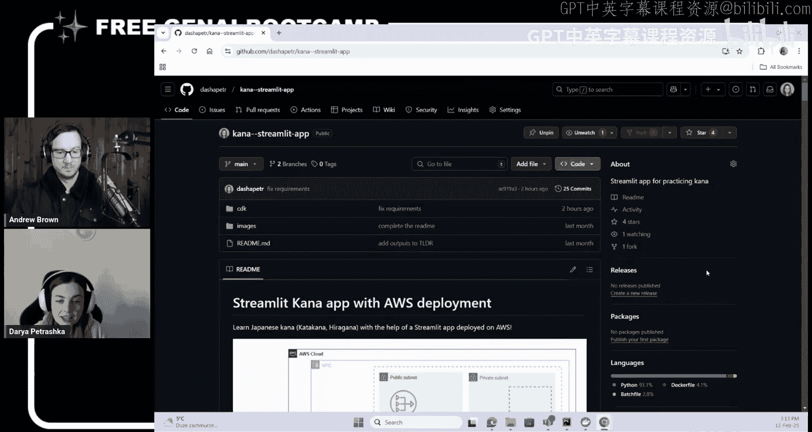

Yeah great so this is an application and so today this will be two parts first part we will have a look at the application itself what a main part what is like what is going on yeah and the second part we will try to deploy this to AWS you can see here the architecture diagram and I will explain it later on but I first need to have a side note here this is an HTTP version of deployment so kind is the simplest version of deployment if you just need to quickly deployment but if you need more secure advanced version of deployment to HTTPS I also have a branch called deploy HTTPS it's more complicated because you need to have your custom domain you need to work with certificate。

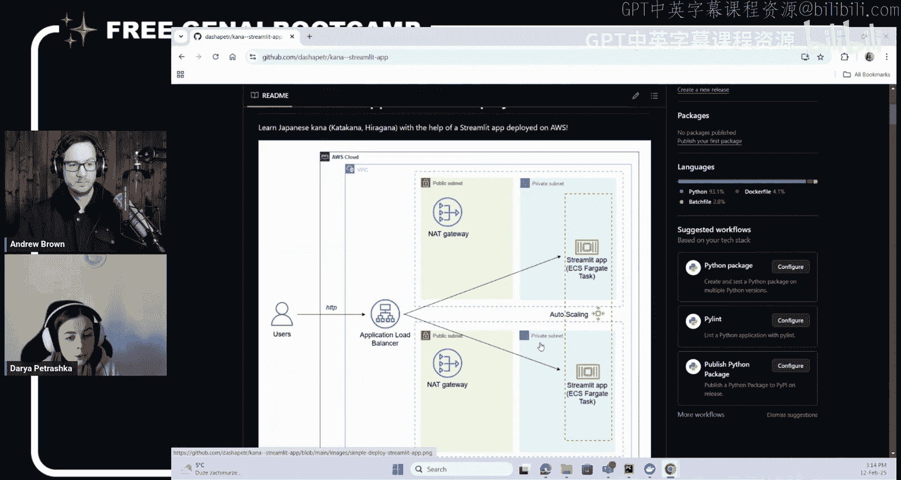

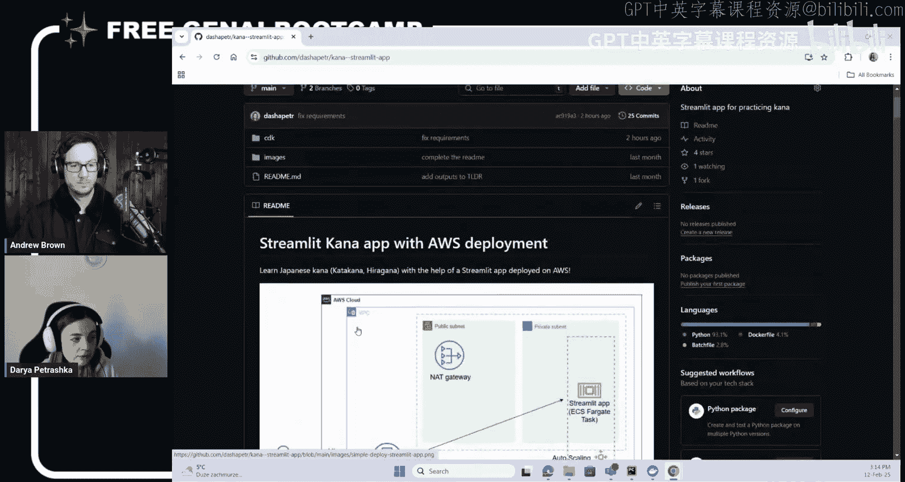

So we're not going to dive into it today， but just in case you know that you have a place to go further so without further ado let's。

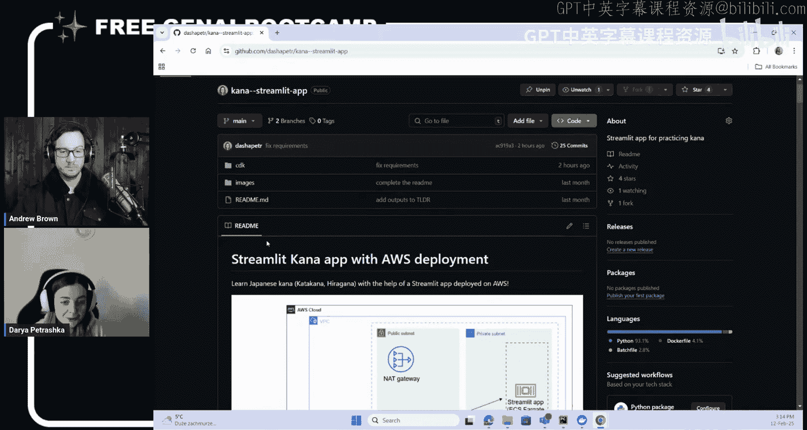

Let's dive into the application itself and first we are just going to clone this report and to see how it works and I will explain you the code base。

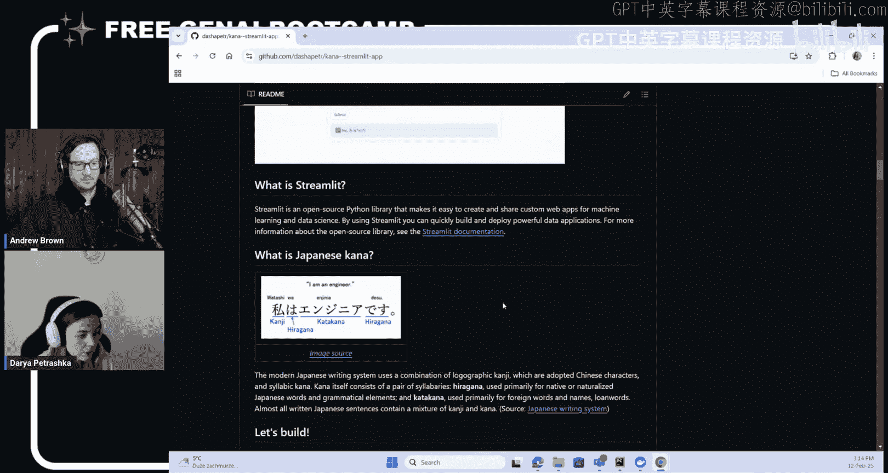

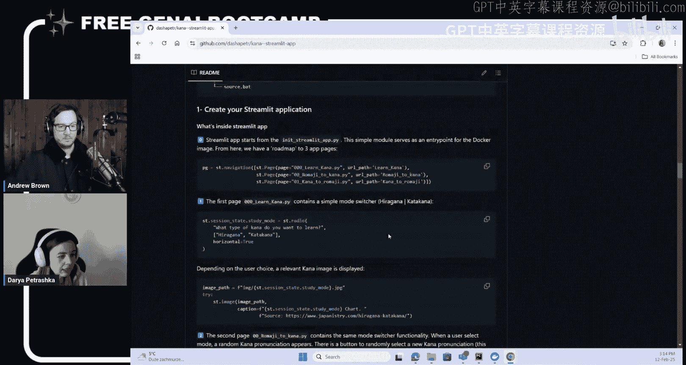

So we are going to get to the common line。And then。Let me see D to the。City to the folder。And。

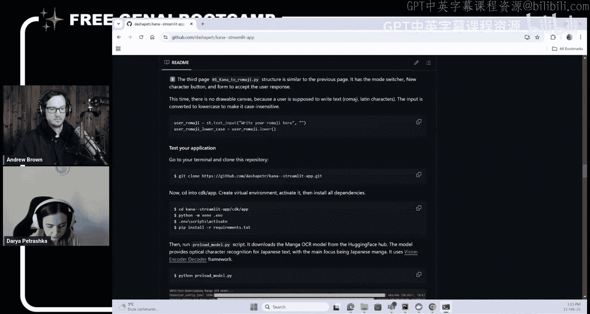

Makeking you folder here。😔，And boot campers， if you see something， it's just because it's off screen。

 okay？Yes， so I already in the directory I'm going to use to clone this reper two and let me copy and paste the comment from my another screen here。

 So this is just a simple gi clone comment。And the next one， were going to C， D to over up。Diirreory。

Then we are just going to create our virtual environment here。And the next step。

 we're going to activate this virtual environment。And we're going to people install requirements。

 So all these comments are inside the re。 So I just show you how it would look like if you would implement it from the itself。

So requirements have been installed。It will take maybe a minute or so。In the meantime。Let me。

Let me open the reportport。Itself and a I'm using P charmm as my ID Oh nice。

Yeah does the company pay for it or now it's a community edition so nothing fancy I didn't know they had a community like for those that don't know pie Char is part of the Jetbrains family these are these are very complete comprehensive IDs and they're really really nice and I mean。

 I'm just curious about pie pie Char is we're waiting。

 does it have any integrations with AI coding assistance yet or。😊。

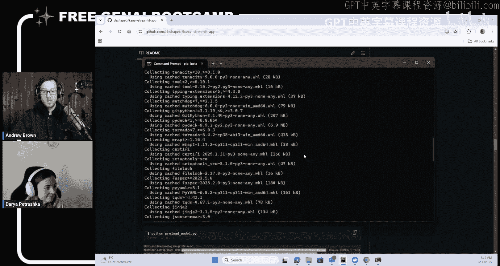

Let me see。I haven't checked it like recently， but when I checked it like last time it hadn't much integration with any like AI features I remember that I was testing codeer in a VS code so yeah it was like that but for those again who are not like if you want an editor that's going to do a lot of the heavy lifting for you you know specifically Python think about it and I did not know there's a community edition so that makes it really interesting so。

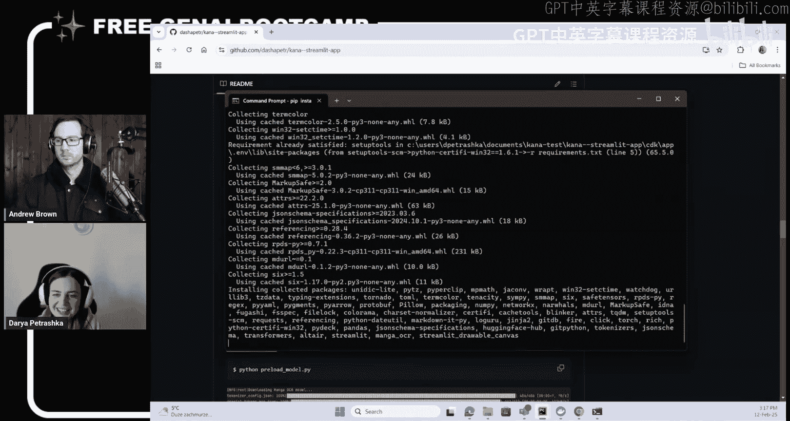

Yeah， exactly yeah， no no problem。 So our requirements are already installed and we need to run this。

😊，This preload model script okay， it was already run this script I will show you this in a minute it will preload the model that do optical character recognition when you try to write your ka。

So， okay， we should be good to see the application running。Iron streamlit。

I run a common streamlet run and I passed in its streamulate output by as an argument and this is our our Ka application so it's not complicated and it is designed it for exactly it is saying to be you you can you can learn Ka you can practice reading and writing and let's do this in parallel I will I will show the streamlit code and in parallel I will show the application itself so it's easy to you to understand what is going on right so this is my。

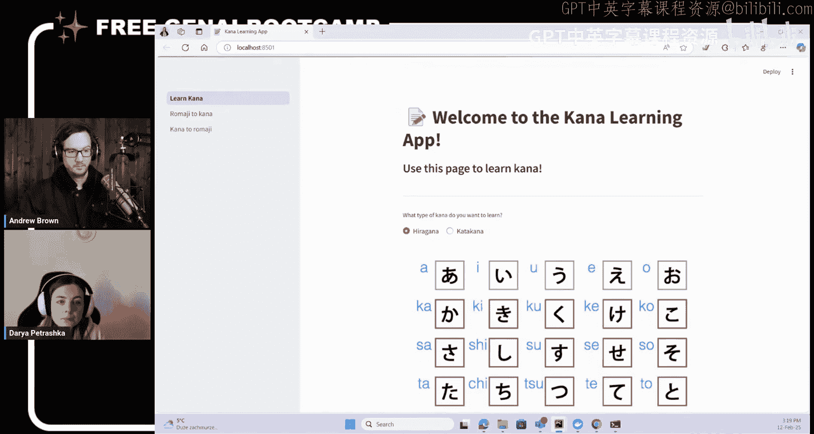

By charm。I opened the coat here。

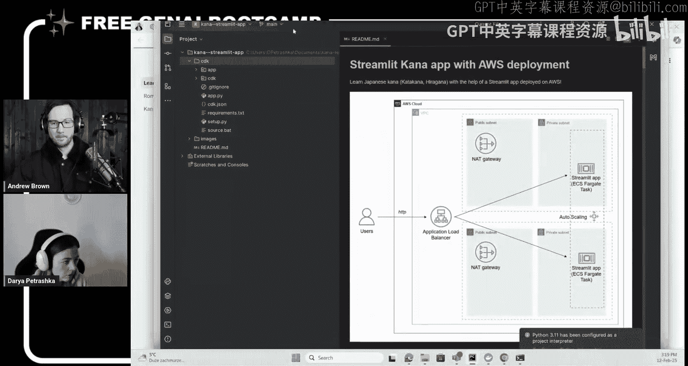

And let me go to the app itself。

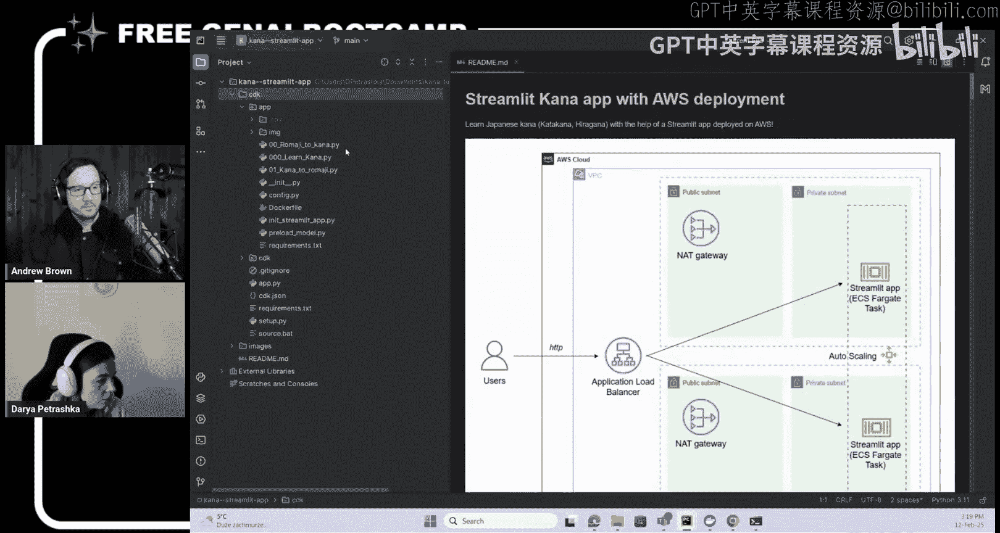

And this is like a first entry point in its streamlet opt by because our streamlet application has multiple pages we're defining the like starting point for Stlet so it know what to run first and then we are just aggregating them where like collecting a book out of pages right。

 and we are just showing Stlet where how to name those files and what is the path to those files。

So this is very simple and the first page is。Aroma Z to Kana no， no， no。

 sorry it's the first page is learn Ka page。 It is very simple and actually let me。

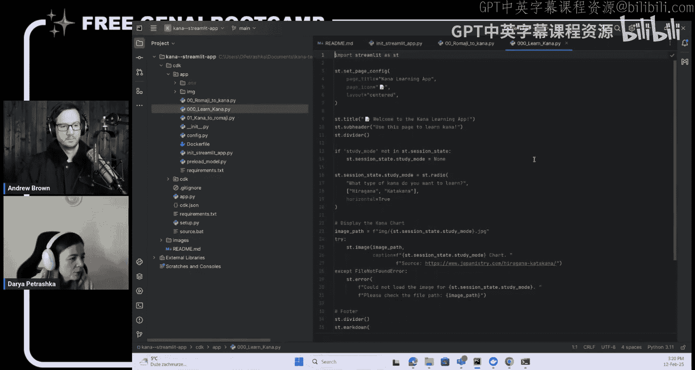

T to show it on em。On a gi up。

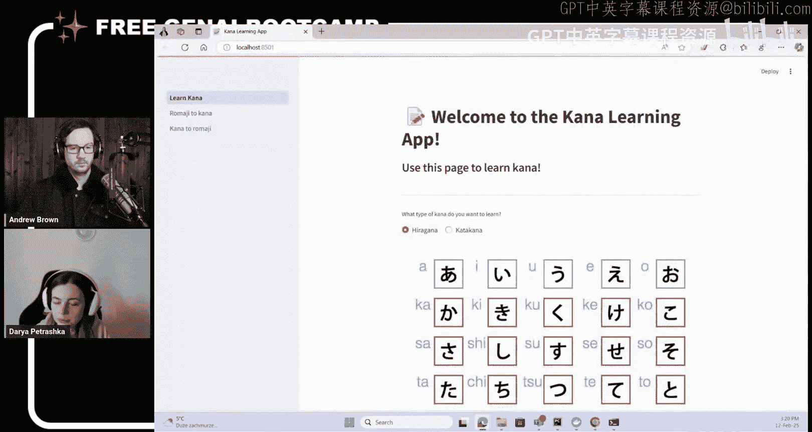

Here， yeah， this would be more， more easy。

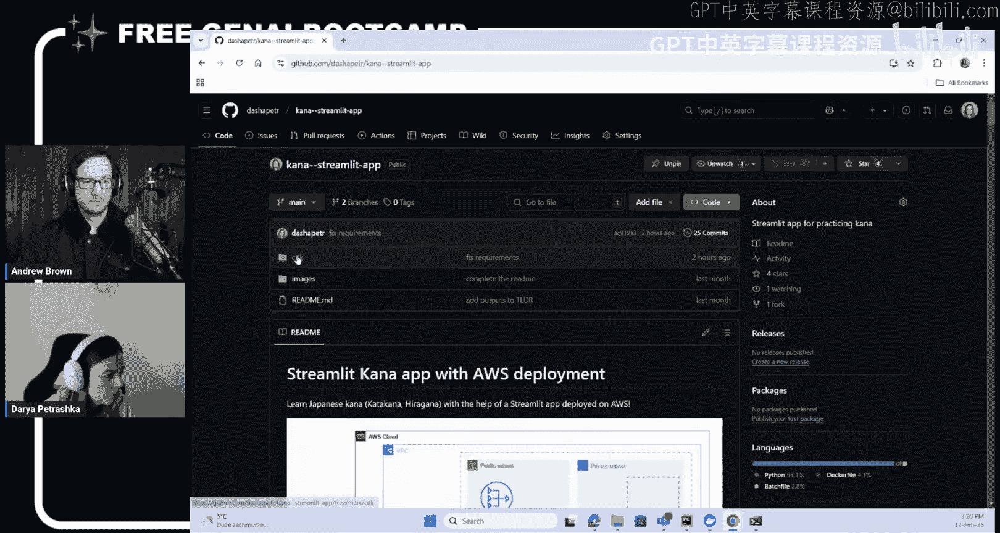

啊 c d k。Up。

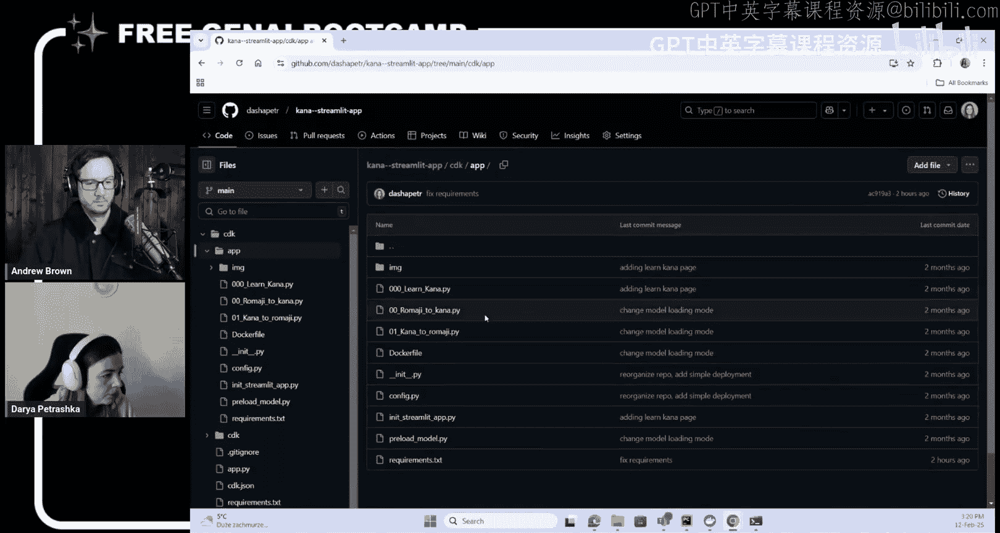

Yeah， this one is the first one so as you can see first we are doing the input streamlet and then we're configuring the page itself。

And then we are showing the page title and the page subheader。

And divider it's just a line that divides it and then the application goes very simple。

 like this page goes very simple because we need to define the study mode。

 as you may know Japanese has two alphabets in addition to Kjias， it has Hiraa and Cattaagonum。

And we are just selecting like providing user a possibility to select whether Heraa was a Catagona to study。

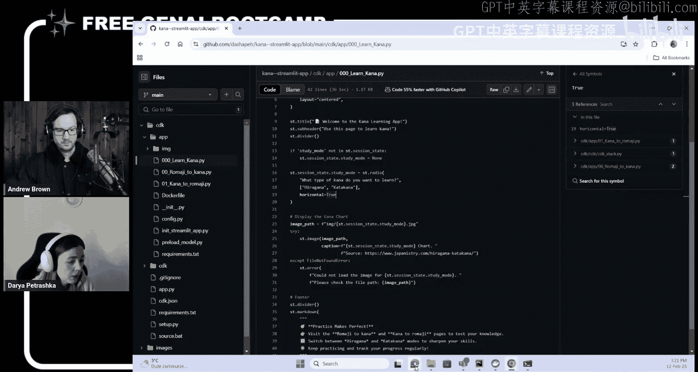

And this is looks like this。 So this is our page title like subheadr and the possibility to select whether Heagona or whether Catagonum。

To study。So it's just a simple radio button to click。And the alphabet changes upon the user click。

 and we have a。Fooer here。And going back to our code， how it looks like。

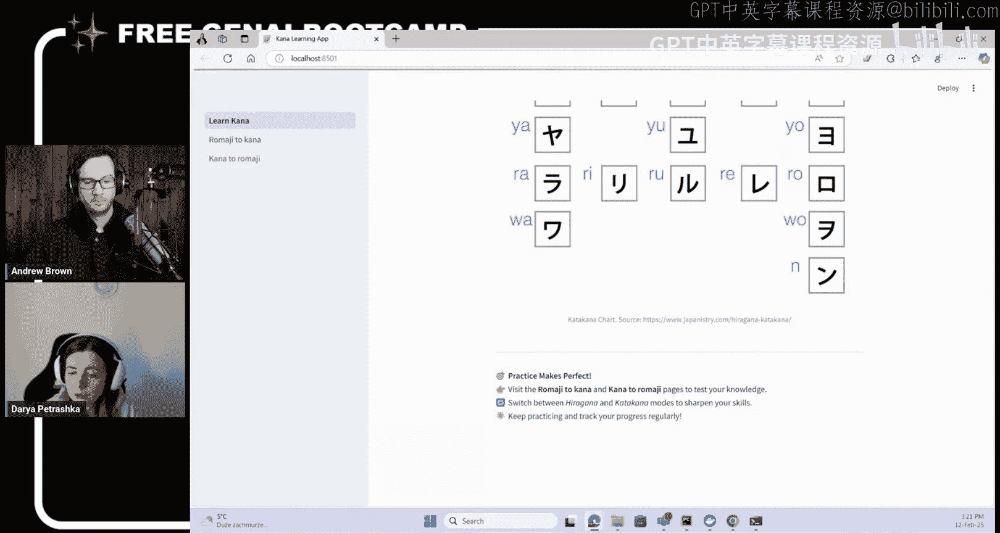

嗯。So we are accepting this as a parameter， as a study mode parameter， and we are。

We are changing the image path here。So we have here two images one is here one is Catagona and we're just changing the path and showing the the correct picture here。

And。Yeah here's a divider and a footer， so this page is very， very simple。Next page。

 next page would be already practicing， so we're already done with some learning。

 good luck with memorizing all these characters。 I know it may be challenging。

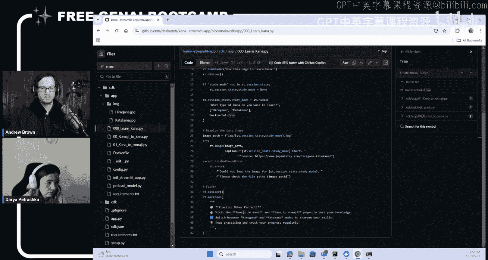

I like I write out Japanese every single day for hours and I cannot do half of the cataonic characters I always forget them。

 they're very hard to remember。Yes， yes， you need to use some techniques， you know。

 like think about like cow or some flowers or some different pictures to memorize， yeah。

 it is really hard。😊，So I read somewhere that Japanese writing system considered to be one of the most complicated systems in the world。

 so it's kind of makes sense。But it works for them， right， So it works well rarely works for them。

 so。But it is。I just， it's really， it's just when you look at the history of how it evolved。

 it's like it works， right， but it's just。yeah， I wonder if they'll ever do a revision of the of the language。

 but because like for those that probably don't know like maybe don't know about Korean。

 but like Korean used to use Chinese characters and they changed it so like it matched all the sounds of their of their their language and they made they made it like to figure out how the fewest amount of letters and very simple components。

 but the Japanese was kind of like，Imagine you you had a legacy code base right characters are your legacy code base and they're like we're gonna use。

 we're gonna use this system for ourselvesse。 It doesn't fit。 Okay。

 then we'll have to build a phonetic one on top of it Okay。

 but then when we have lo words we're gonna have this and I don't know it's sometimes you have like the Windows ecosystem like layers on layers of coding。

 but it works right。Except that it was a legacy code base for quite a long time， right？😊，Yeah。

 no one no one wants to take over that technical debt， they just， they're just like。

 we'll just live with it so。Exactly so yeah so this page is to to practice our kind writing so given the roji or like sound of the can we need to to write something like a character I don't know whether it's correct photo yeah it's so。

😊，It looksBecause it looks like a toe like they're clipping the nails of the toe， really。

 that's yeah， exactly yeah。Yeah， so here's the functionality is you can also change the。😊。

Moode here going know Kataagonum you can if you don't like the character you can change a new character this is like a random choice over over a character and here you can draw and you can submit to check whether it's it's correct note so let's go back to the code base and。

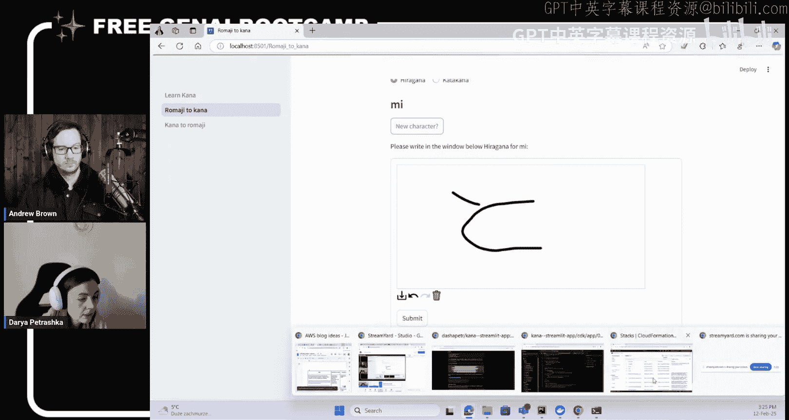

Let me show you this page。

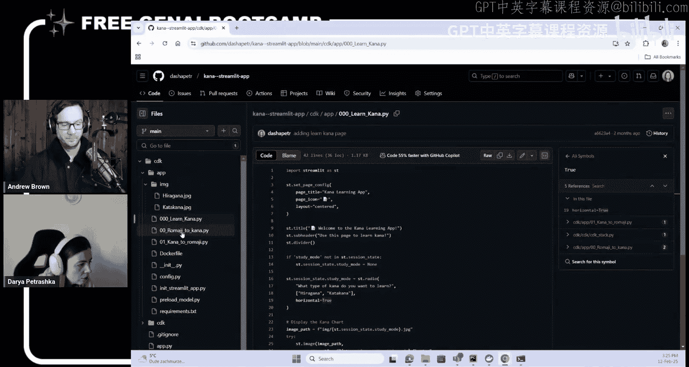

Okay， so this page is a little bit more complicated already because it has more。

Pieces but essentially it is if we don't look at the moment at these helper functions it starts very similar。

 we have a page title， we have some subhead and then we also have a mode here so hereraagonaw Catagona we want to study also here we have a a model that does a character optical character recognition here I used manga OR model from Hiinface hub so it is a OCR model that was created specifically for recognized then yeah manga but it is good for A use case we have only one character to recognize but it's okay for use case something that was really interesting is I looked into it and I think it supports all the kanji too right because yeah but we are not going into kanji。

I also saw I mean for me， I'm not thinking if you're like me， I'm like。

 oh can I can have like I'll update the code so I can practice practice kanji Yeah yeah。

 if you think about possible enhancements， it can be in the future so it gives you for example a phrase and you need to write it in a dable canvas but it's yeah。

 let's agree that it's like a level up。That's a bit more work， yeah， yeah。So yeah。

 and here we have a random choice out of rhmazi， so you can practice different characters of random them。

And here we have a function that change your mode。 So you if you choose Catagona or Heagonana after。

 so if you choose the mode， it should update them。Character。And yeah。

 here is a button to choose a new character of out of selected mode。

And then this is our Dable canvas so here is one trick here if you start to work with streamlet typically like default behavioral streamlet。

 if you click on something it is going to reload the whole page and we don't need to have this behavior in case that we draw a character yeah because there are like at least several clicks when you're drawing like one single character it's not so handy to reload the whole page so we are just using streamlet form here and it is it is like leaves independently on your page it doesn't cause the whole page reload when you when you do something inside this form。

And we'll have a streamlit canvas here， it's imported from not original streamlet。

 but it's a component from a streamlet Dable Can library。

 so people just build on top of streamlate to be able because originally streaml doesn't have such functionality to draw something。

 but people build more like custom components based on streamlet， so we're using this。Yeah。

 and there are a lot of like adjustable features you can if you want to change the color。

 you can change the stroke widths， you can change the size of your canvas， so it's up to you。

When you submit， when you click submit。This your k is going to be saved as a result PNG file and this file is going to be passed to the model。

 so a model what it does it does just recognize character function we have it here。

 so it reads your file and try to understand what is being written on it。Yeah。

 and I just and I just did just a simple post processing to strip all the white spaces and take the like the。

The first character out of model output because it can be not 100% accurate。All right， and yeah。

 if the model analyzed your k and it produced a result and here we're doing we're using dictionary to do the match So if you're kind of match what we have inside this dictionary then it's okay and you are going to have balloons and and yeah a little party but if it not you're going to have a mistake and the warning the balloons is that built into stream streamer Yeah yeah。

 exactly this is a stream if you get something wrong is is there something the opposite of balloons opposite just to red screen。

 let me show you。

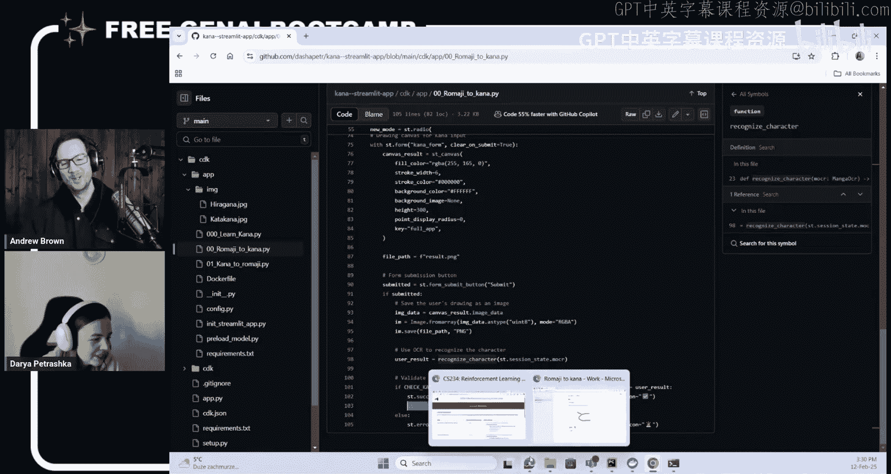

So if I'm going to write something like I， I would forget what is me。 I would write the same to。

 So it's not。It's not so exciting as balloons， but it's just warnings that go back and study。

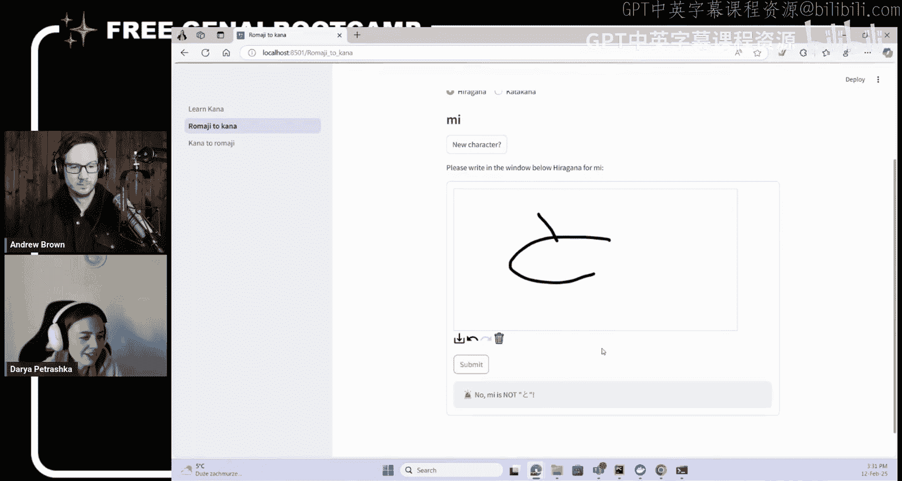

How to do count the things properly so yeah we're done with this page and the next page is a little bit more simple you already have your canm kragano kakana and you just need to try to read it yeah again if you don't like it you can oh this is small I guess。

😊。

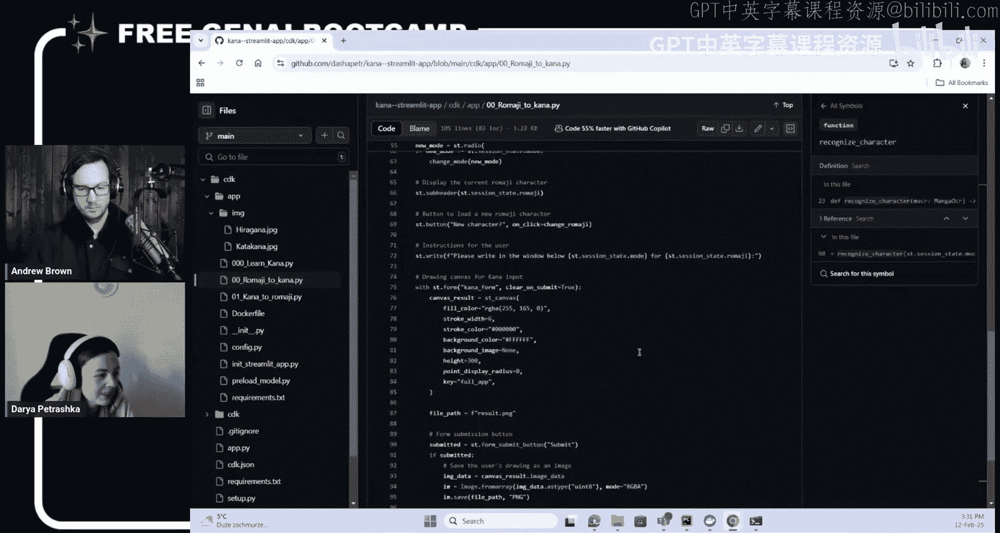

Yes， this was more so you can train yourself with different characters and yeah try to write the pronunciation here。

And if you go back to the code。

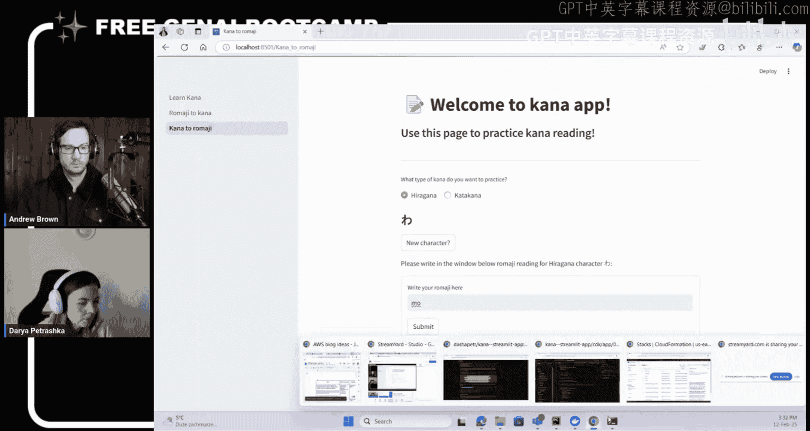

Sorry， very my good， Yeah， this is our page named Kana to Romanie。

And this is pretty similar except we don't have any draw canvas again we have a page config title subheadr。

 we have a Mo selection， catagono hagonum， and we have changing mode function。

And we have a random choice of our character。Yeah， we have change character function here and we have change mode function here。

And。Yeah， what's the difference。We have inside the streamlit form， we have a user text input。

You can see streamlet text input here and you just write like as you would write in a Latin alphabet the pronunciation of the Ka it is doing lower keyin and then it is doing the match by checking what we have in a Ka dictionary and I'm going to show you this kind of dictionary so it's pretty pretty straightforward it is just doing the match between characters and their pronunciation for boot campers that might not know when you want to type Japanese on a keyboard there's two ways there's a keyboard that has all the characters on it kind of and nobody uses that because it's too hard right and the other way is you phonetically spell spell it right which they're spelling ramaji I think Chinese also has the same thing it's called pinion but if people remember back to the Japanese primer where we had by Japanese language teacher。

explainplain that even Japanese students like they they learn how to write everything in phonetic English because they have to if they want to use computers。

Yeah， yeah， I heard about these custom Japanese keyboards， but they're so so rare。

I've never seen one。In real real life， what's really interesting is if you look up like what these you have for typewriters So like before like before digital stuff。

 they had like this big wheel and they had to like move it to the right spot and then pun it's really I can't imagine using a typewriter from the 1940s for for Japanese it's intense。

 but sorry。Yeah。Yeah， yeah， but I like your I like your own notes， they're very like in Japanese。😊。

So yeah， and I need to stop here as the recording because I forgot to do this manual certification a okay or we just cut this but well here I'll just switch so we're still here I just we're just not showing the screen now but we're still recording。

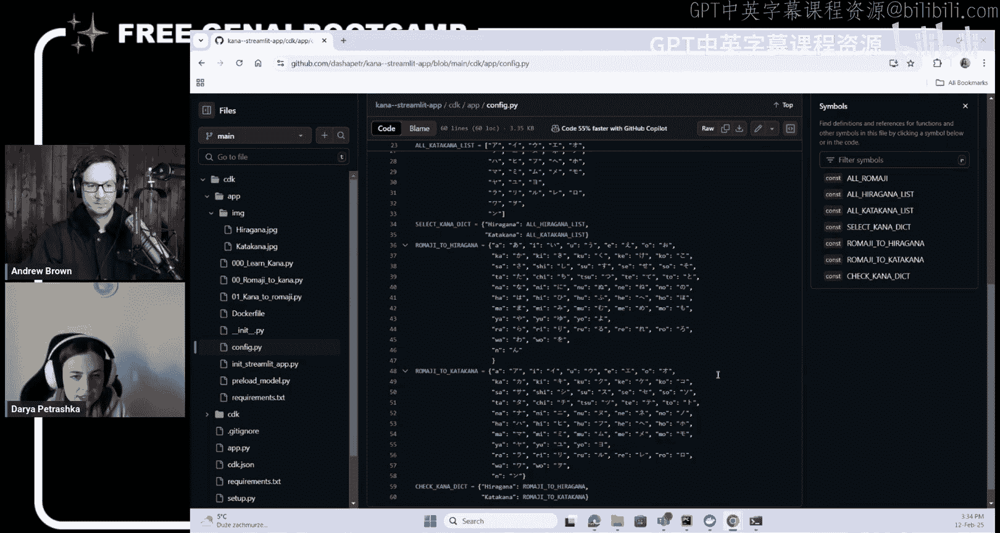

Okay， okay。 but yeah， so not to。Not to。Mislead people。 I just need to add this。Custom C。

So we should be good， while you're getting that certificate up， I'm gonna show people that this this。

 this typewriter I'm talking aboutcause it's so weird。 Yeah， yeah。

But obviously different languages have different challenges。 but like imagine。

 imagine it's the 1940s and you need a typewriter。 And so the invention was， I mean。

 I'm not sure what year it was， but literally they would have to roll this thing to the right location that all all of these have little little little kanji characters on it。

 And then once they roll it to the right thing that they hit it so that to me is it was just because I was thinking about like how did they do it。

 And then I just found it so。

I'm sure if this would show in real time， literally spinning the wheel。To me， that's insane，Oh。Yeah。

 but this is a dedication， you know， to the legacy， yeah， yeah， but it works for them。Yeah， I mean。

All right。But。Yeah， I almost I think I really should just learned French it would have been easier for me。

 but I would say Spanish would is the easiest choice although I already I agree I agree so I used to live in Spain for three years and well the problem was I lived in Barcelona and this is not really Spanish like well they speak Spanish and Catalan right for boot campers that has saw Gloria was in the shoes in。

Week one content， but she's also in the Spanish boot camp。

 but she's originally from I think Barcelona or Catalonia so she knows Catalan， but yes。

 that's the trick is that I I learned a mix of Catalon and Spanish and so now I have nothing because。

There was a bit of a fight about like what I should learn when I was there and it wasn't productive。

Y should choose as a region。B just。Now Ill go to Basque they just speak Spanish right they don't have another I'm making a joke for those in Spain who don't know much about Spain。

 there's another region Spain called Basque and they have their own language that has nothing to do with Spanish and nothing to do with the entire region of Europe like it's like very orphan language Nobody knows how it like got produced。

And yeah， their cheesecake looks burnt that's that's how how different they are。

 but Baque is really interesting because I think they've like the reason that they were able to preserve their language is that they live in this mountainous region between France and and Spain and nobody could conquer it so so they could just preserve their language isolated it yeah。

Yeah， very interesting。But。Yeah， that'd be an interesting one。

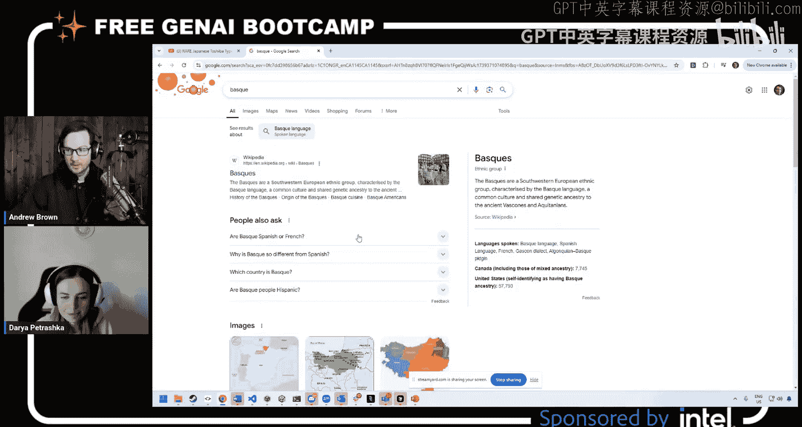

Okay， I am ready， ready to proceed。So yeah， let me。Yeah， we sharing the screen。

 let me just show how to run because I already showed the part different parts of our streamlit application and what we're going to do right now。

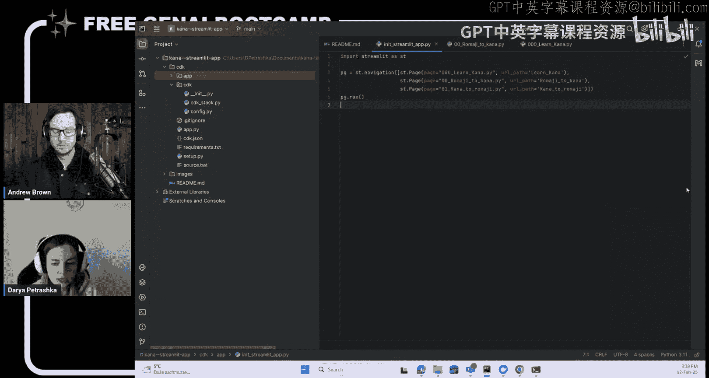

We're going to try to deploy it to AWS actually。

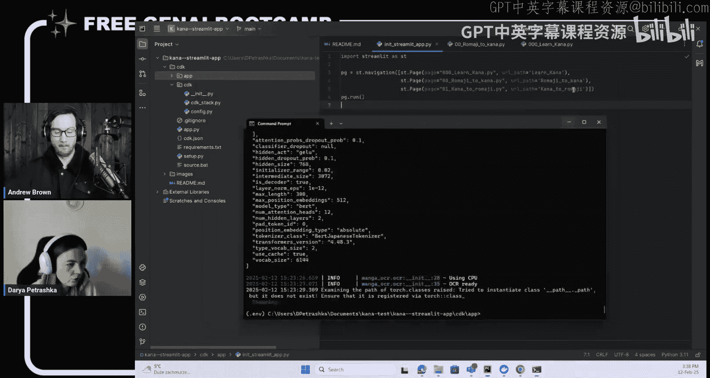

And first I will just kick off the deployment because it is going to take some time and while it is running I will explain what what's inside our docker file。

 what is stack like all the details， but first let me kick off the the deployment itself so there are a couple of prequisites。

You need to have your AWS account， because otherwise， where would you deploy it。 Yeah， also， it is。

 it is very good to have already AWS C I installed。 It's not a complicated task to do。 And the rest。

 Yeah， I will show you how to do it。 So we need to see D our。C DK。And then。

I will just make sure that I have my CI configured properly So boot campampers that are watching you might say what if I don't know CDK AWS there is a it's free。

 they have a free tier called Amazon developer Q which is an AI coding powered assistant you can solve code you can go ask it to explain the CDK code and say how does this work how do I run it what do I need to do it and that might get you started you'd be surprised how far that those tools those tools tools come along the reason I specifically recommending that one is because AWs is AI coding assistant is designed to specifically help you with AWS like it's a general purpose one but they've put extra work to make sure that their stuff just like if you have Google code assist it's specializedize for Google Cloud stuff the Amazon developer Q1 will do that and that's the nicest thing I'll say about I've not always nice to developer queue but like I would say that that's something that it can do that it's good at。

Yeah， exactly， exactly I。I 100% agree。 So yeah， here as you can see that this command Python 3 might work for you。

 but it it doesn't work for me。 That's why I included the。

Yeah I just will I will just run Python comment Python without three and it should work。

 but in order to use the rest of the code I will show you a simple trick you just need to go to dot and f so it's virtual environment that we created and inside the scripts you need to create。

Python three batch file you know I've never even thought about opening up the dot and V。

 I didn't even know there was stuff in it boot campers for that that are watching here in in our gen essentials。

 we use Conda to create an environment It's the same same thing It's just that we're we're skipping one step here because we're not。

Installing a bunch of crazy stuff because this is an application that relies on very stable libraries and we're relying on the cloud for some other components。

 but you'll see earlier that Daria had I think it was Python 3 but sometimes the machines if you install it might be called Python 3 or might just be called Python because I think at one point there was Python 2 And so Python would be installed and that would just be called Python and so then they had to call it with Python 3 but now newer machines just have。

No Python and so that it becomes， anyway， yes， it u， so yeah。

 if you see Python three doesn't work to take out the three， it's the simplest explanation。Yeah。

 so it just like a workaround for me in this case and I'm showing it because I also put this explanation inside the reportpo so next step we just installing requirements and we're already like three steps away from actual deployment。

So。The next step would be after requirements we would call CDK bootsstr enzyme then CDK scenes and then CDK deploy so it's really easy if you have the comments and nothing breaks and works fine for you it's really easy and quick way to deploy your scenes to EWS and I will explain what things。

Once we have this pipeline running for deployment because it is going to take some time and we will be checking it in meantime。

😊，For those who aren't familiar with CDK it is it's a framework that sits on top of Cloudformation so Cloudformation is Yaml and folks did not like writing Yaml。

 at least if you're from a developer background people that that like to write programming codes wanted a real programming language to write their infrastructure and so it comes in multiple different languages we have Python Typescript maybe go maybe see Sha I don't know I know they don't have Ruby but is my favorite language but so you know pick your favorite language and you can write infrastructure what are' you using is it Typescript or Python for the CDK project Python I completely build it using Python it was yeah my challenge for me was because I was following the like other code examples andpo but they had a version1 or the CDK。

I had to， you know do like translation to version two。

 but that was the main challenge for me otherwise when it's smooth。

 you can just you know deploy it quite quite fast I know that the Typescript one is the best supported one in terms of documentation in the first one they do but like you know since we're working with a like an AI AI kind of project。

 it kind of makes sense to do everything in Python makes your life super easy so I would that's what I was thinking I was thinking you probably chose Python because you know now you don't have to work with one language across the board especially someone else comes into the project。

Yeah， exactly， and that was like a purpose of creating this whole cityd casing so you could use your language of choice to have things done。

So now we are starting the actual build and first it's built the Docker container and then it will push this Docker container to ER or El container reiststry to EWS account。

 so it will take some time and while it is going we will just review what's inside our Docker file right because I already mentioned Docker and you're probably curious what's going on。

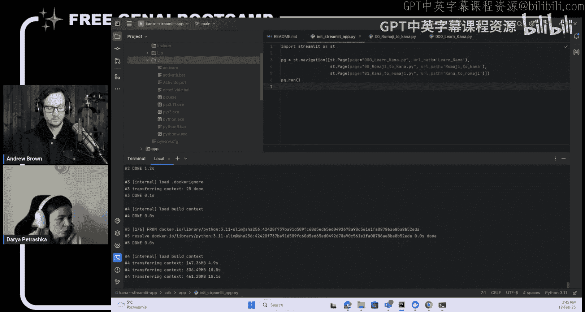

So actual Docker file is very simple and very short here we're not doing some like fancy means deployment or we just have our official python image here。

 where creating and working director called app were coping all the files here。

 then we' installing system dependencies and then when installing Python dependencies here so like you can think about building a docker container is like create a container like a shipping container where you put inside all libraries。

 all requirements and that it can be like independent。

 it can be transferred to any like operation system and have everything it needs to to just be up and running。

😊，So that's the idea。And then it is going toload to run the script of model preload in here。

 and I will show this what this script does and then it exposes the port for the streamlet and basically start our streamlit application。

 you see this in its streamlet output p， so this is our entry point that I showed you so streamamlet knows that our app has multiple pages and where to find each page。

And yeah， go into Proload model。What it does。 It does， because we have our。

Like almost a custom or optical character recognition model and it lives somewhere in a higenface hub so we need to download it somehow。

 but one way to do it is to do it when you for example。

 already created and youre already loading your streamlet page but imagine because I already mentioned that every time you click something on a streamlet page it's going to reload the whole page okay。

 you may say I would use cache for not loading the page like to use this model from the cache and not loading it multiple times。

 but there is also an issue because each time like every new person will。

Well start loading your application it is going to trigger this model loading so why wouldn't we already preload the model while we are building the Docker container Docker image right so this script is exactly designed to do this while we are creating this while we are building the Docker container we're already like downloading the model and it's ready to be used in our application so that is idea of this download model function in our preload model。

Coat。😡，And if folks are wondering where the environment variable is in our GenI essentials。

 I just keep pointing this because if some folks didn't watch all of it。

 we show how to download a model from Huging face and where we put the key and how it gets preloaded into there。

 I would imagine that this would， I guess while we don't want to show the key because it's your key but。

There's probably a configuration with it with it os sorry within within CDK or yeah。

 I think so right somewhere is it somewhere in CDK。

 there's a configuration file to put in the environment variable or is it done， Yeah。

 it would have to be， it would have to be yeah so it's somewhere and if folks don't know where it is that's your opportunity to use Amazon developer Q and say where does the environment variable go。

 what I think it will point it out to you。Yeah， exactly。

 so let me check in a meantime time what's going on in our repo sure。

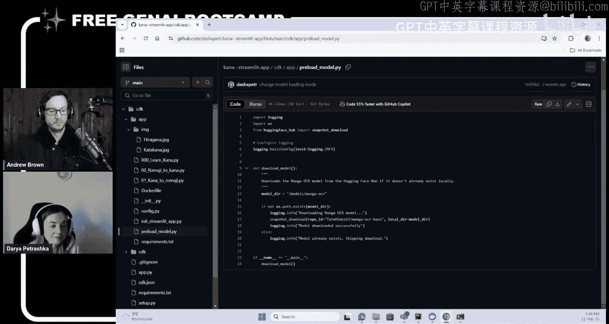

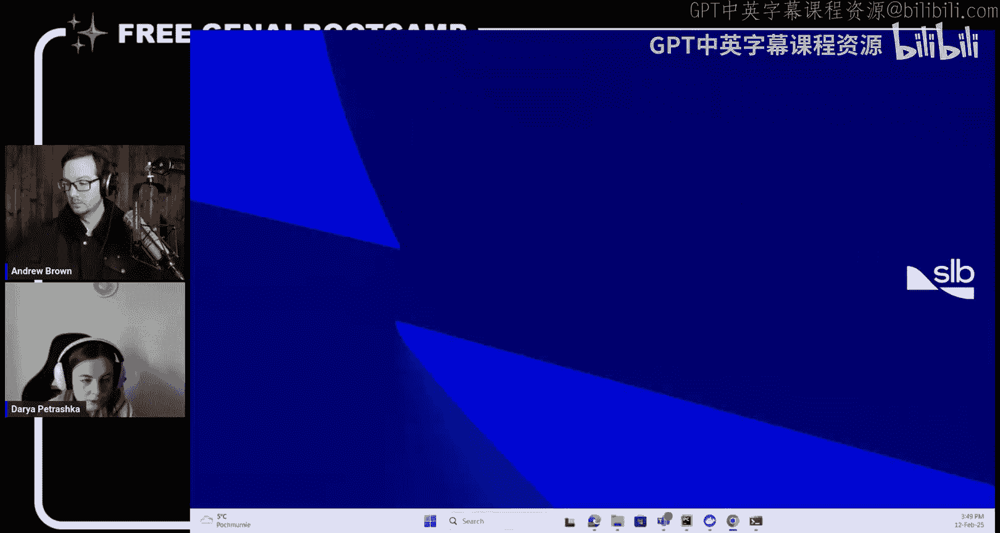

Yeah。They see that。

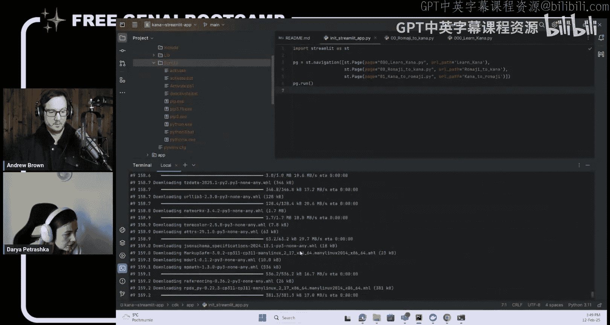

And it takes a little bit of time， I'm trying to think like what's taking because we have。

 if we go back to that architectural diagram， we have we have。Yeah。

 we have things we haven't talked about and I'm going to cover this。

All right now so all right I covered I talked a little bit about our docker what's going on here and I'm going to show you the actual architecture and what will go on when you deploy it to your AWS account So here the main like brain and the main place of action is your。

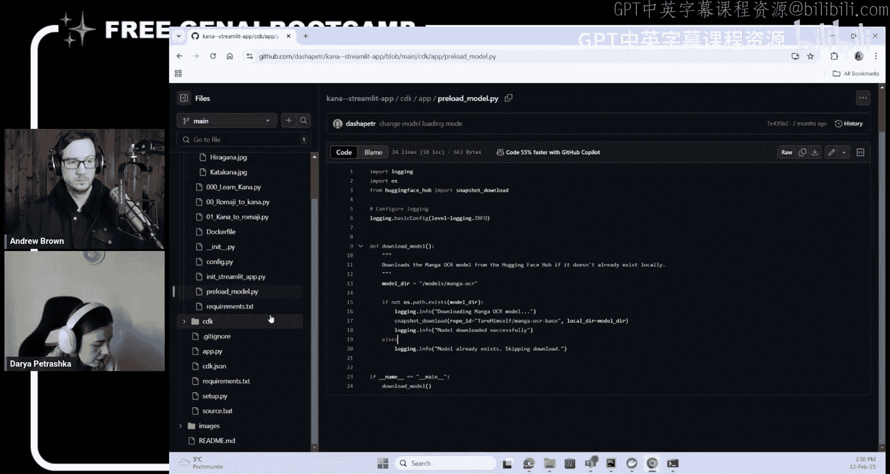

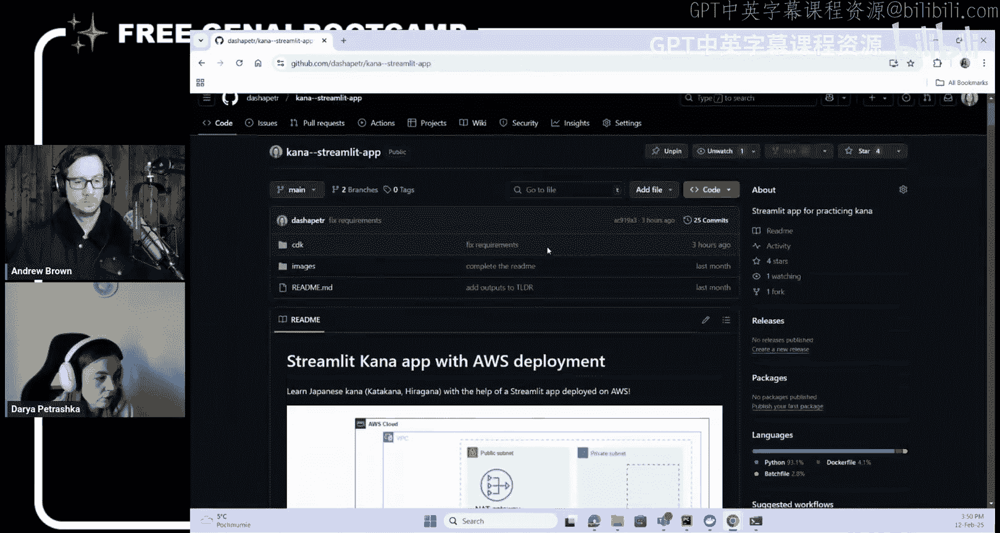

Stmlet application and it is going to be deployed as elastic container service for gate task so yeah it may seem like a lot of words here what is elastic container service what is for gate but。

You can think about this that when you run a like docker container on AWS you need to use elastic container service like servers that will manage the run scene and you have to options here one option is to use EC2 instances and to manage them and basically you will have more control over over your instances here but if you don't want to do it and you don't need like this specific low level of control you can choose a far gate type of running and a far gate is a serverless way to do it so it doesn't mean you don't have servers it means that you don't care about those。

Those processes that go in under the hood。And then。

Your application may become popular and like for example you will share it with your colleagues and then they will share it with some other people so it may cause a lot of like traffic and in order to handle such situations we have autoscale in here so it will be tracked based on a CPUU utilization and when it hits certain threshold certain level it will increase automatically as a like capacity of your application and when it's not needed it will decrease the capacity of your application so it's pretty handy because you don't need to bother about this either。

What else this whole application would live inside a VpC。 you can see this purple。

Prourple line and a purple container of VpC so it's going to be like secured and live inside virtual private cloud and the scene that will manage the balance in and distribution and traffic distribution will be application load balance and this would be your like entry point after the since got deployed to AWS we will have application load balance DNS name or DNS address we will copy this address and that would be that would be like address where our application would live inside your AWS account。

For boot campers that are following along， I do need to warn you that I believe Nat Gateway has spent。

 I mean not far gate has spent， but Nat Gateway has spent and so if you want to try to spin this up。

 don't leave it up for long or you don't if you can't cost if you don't have any cost for pennies。

Just watch There's another way that we could deploy streamamlit。

 but there might be other technical challenges。 Stamlit。

 Io allows you to host in the cloud the deployments if you want to deploy it。

 but there are a few things like that custom model we go okay you know maybe streamream that can host it。

 but could it download the hug face model I don't know if it could do that So there might be some tradeoffs but there are other solutions that might be free or less moving parts this also could be modified where we don't need a that gateway。

 but from a secure perspective you really want to deploy it in private subnet。

 I can't remember I think Fargate， you have to you think I would know because I did an entire bootc like boot campampers that did the AWs cloud project bootcamp。

 they know exactly all this stuff。But but I'm saying like I can't remember if Fargate only deploys in private or if it can do public and private。

 I honestly can't remember。 I think that I for sure I don't know for sure it's always I don't remember because like there's so much stuff point to us。

 but I know for certain that Fargate gets an I address assigned to it。

 It must it must be able to be public because it gets assigned a public IP address but there is there's a more unseecure way that you could do this。

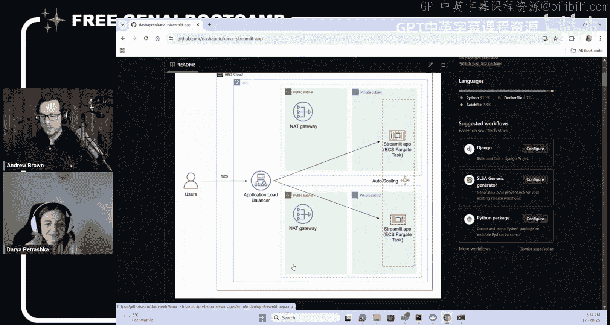

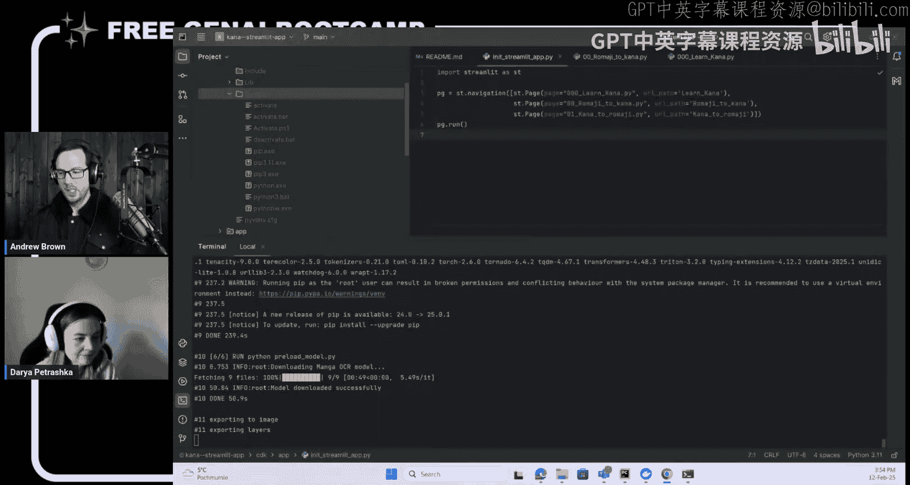

And the reason why you want the ALB there is because if if you only had an IP address and it changed when you deployed it then it's going to be annoying so that's why the alLBs there that's what I remember yeah that's exactly right so that's why it's there but you could do it in public but again there's security tradeoffs right oh sorry but yeah。

Yeah， yeah， no worries， yeah， because it's， you know。

 the deployment topic is like a separate topic and one it can be the whole boot camp about deployed and exremt or any kind of it could be an entire boot camp you say。

 yeah， I wonder if anyone's made an entire boot camp on just this。I mean， mean， if you start。

 for example， if you start thinkinging like the list level of。😊。

Let's say granularity is to deploy it to easy2 instance right but you need to do it right then you would possibly try to use containers then like I saw some you know when I was building this I also thought about why not why couldn't we just use something like severalless like Lambda but it is not the case with streamlet and people were asking about it but it actually would be funny to find this way deployment。

This way have deployment as well。😊，And if we go like over cloud providers and then to this tlet cloud as well。

 So there are like already， I mean， maybe like seven topics that can be covered， but。Anyway， yeah。

 so it's it's really， it's really where we we should say it depends and the deployment can be can be very。

 very different depending on your case in the last week。

 Gloria made a video where she got deeps deepse running on Lambda It was Lada。

 I'm like how did you do that she's like I had to do some strange things to get it to work And I was like that's impressive So like it's interesting to see when people put things on like it's not to say that they can't go on those things。

 but it's like overcoming those channels and see if it works like I'm trying to find a stream that ever runs on Lambda I can't find any any videos on it。

 but I'm just thinking like in my head I'm like oh maybe you could make I custom runtime right and then you look like there might be a way to do it but whether you should do it as a different story right So exactly what it should do it's a different story。

😊。

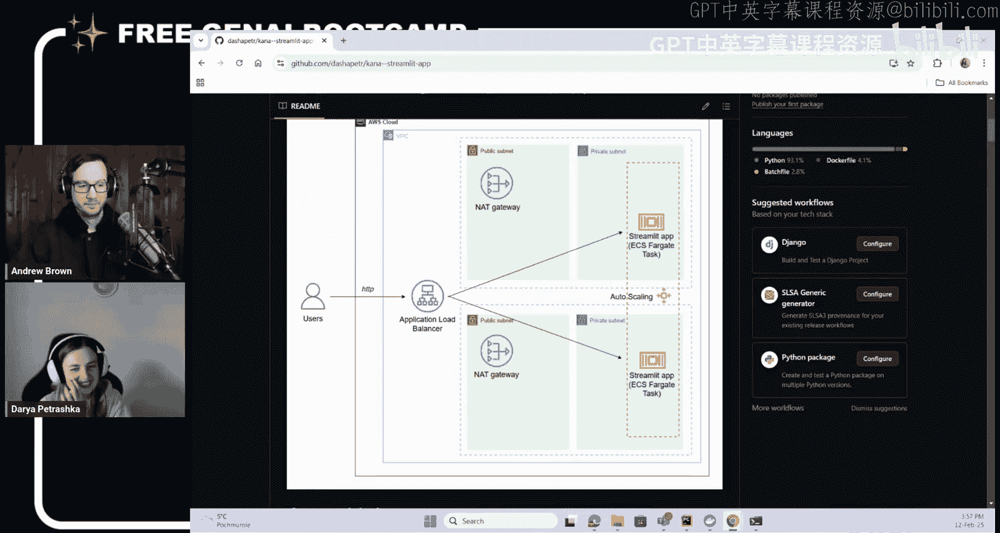

Yeah， so。

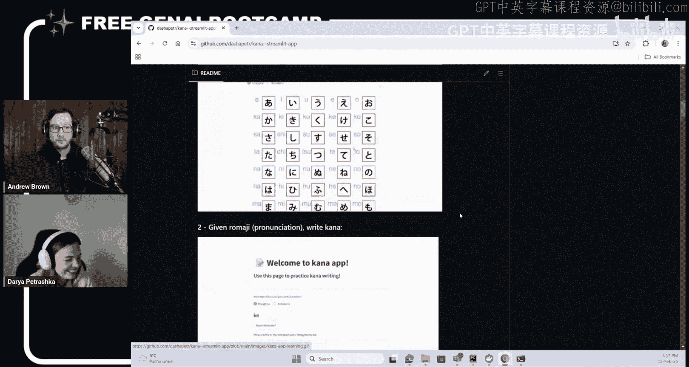

Going back to our stack I promise to explain a little bit more about this stack itself。

 as you Andrew already mentioned we have different programming languages to use in our cK and you already mentioned Tscript I guess JavaScript we have Python Javaharp donet go as well yeah Yeah so you can use your code to build like why why。

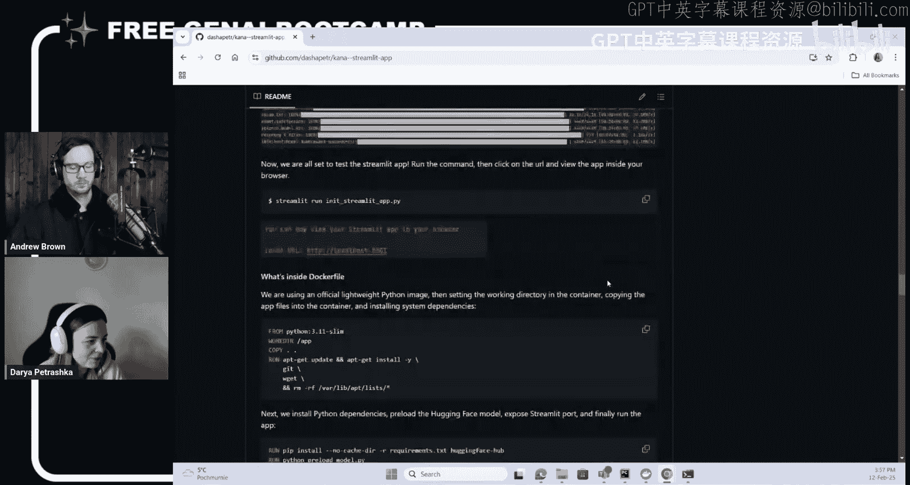

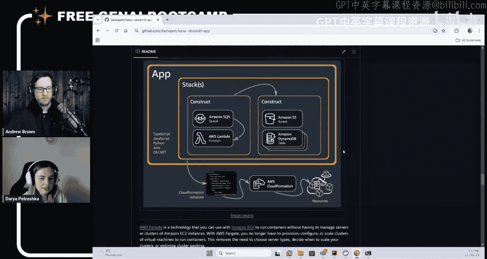

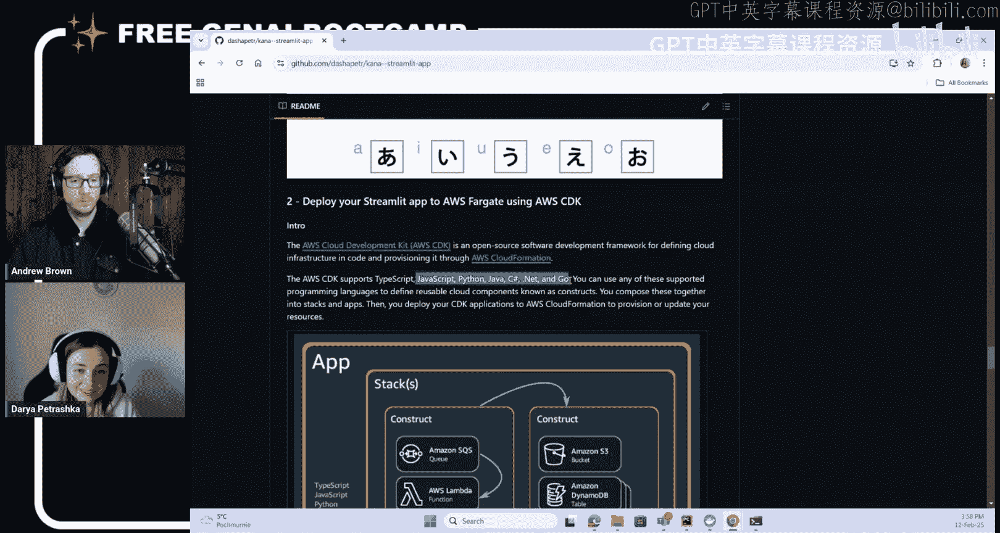

Why on earth this idea of using like infrastructure of code because it is fun if you try to learn scene and you will build them manually inside the console but it's not fun when you have 100 applications and you need to make sure that their deployment is consistent over the time so that's why you have this possibility to create constructs and to define stacks of your resources and then to create appss on top of stack。

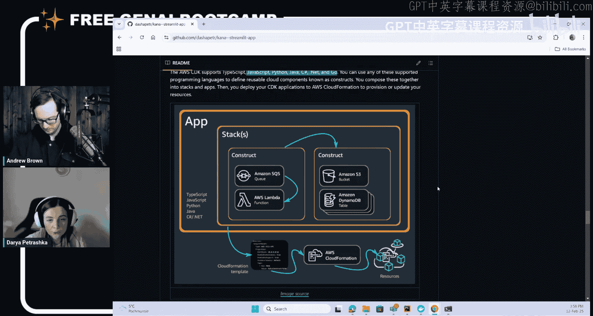

So but this example of our code is actually。

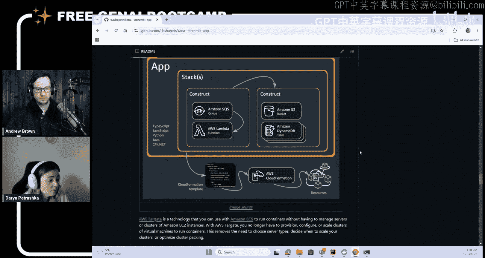

A pretty simple stock， and I will show you。If we go to CDK and we try to look what's inside our app。

 yeah this is our app it contains only one stack kind of stream it up and if we try to check what's inside this stack。

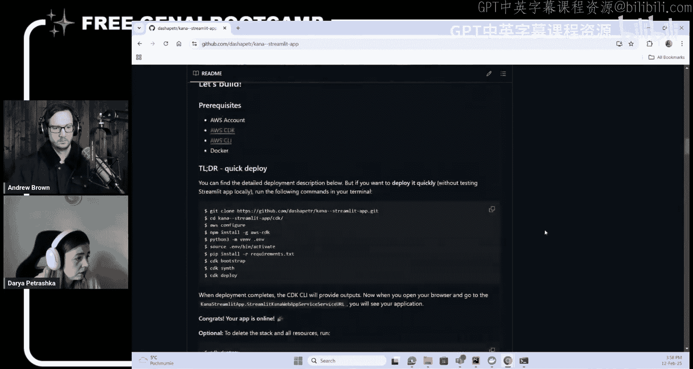

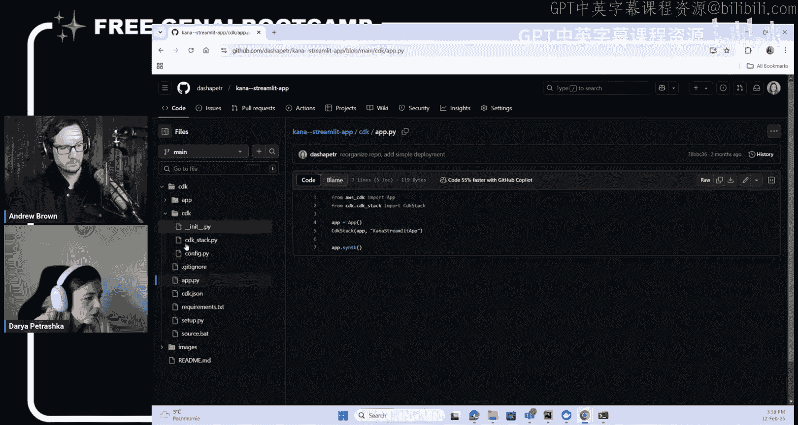

This is， this is it like 40 or not not 40，5054 lines of code and you have your entire application like defined in the bootc we like we use cloud formation and this took forever to write like this the same amount of code like because because I I don't know。

 I'm just I'm like， let's do everything in cloudform， but like。This is such。

 such less work than than what I did。 It's， I'm， you know。

 I'm wondering why didn't you see the K now。 Yeah， and and， you know。

 the real trick here is when you call the comment。CDK S。What is what it does。

 it just synthesize or it create a like Yaml file， a Jsuit file。

 basically your file that is going to cloud formation。

 so this part is already automated and being created instead of you so just by having this simple short code。

I think we're basically out of time， but how's the deployment going。

 I know deployments take it's hard to always kind of estimate how long they're going to take but。

Yeah， I see that We're still on a docker。Docker stage I see yeah。

 so I I have I have like several scenes to cover about this code Okay sure yeah yeah。

 and then I I just wanted to show you how the how we can observe the actual cloud formation the actual deployment pipeline inside the cloud formation so let's me let me focus first on the code and then yeahep。

So what the stock creation code does here， first it's created a VPC with two availability zones as you see as you saw an architecture diagram。

 then it creates an ECS or elastic container service cluster inside this VPC you already created。

 and then it creates a EM role was。Prncciple of list privilege。

 Then it is doing the container like building the container from your Docker file and pushing it to elastic container registry。

And then we're using we're using as already， as already explained， we're using for gate。

 we're running our。Containers using for gate so we don't care about service and we have custom custom defined amount of CPU and memory。

 which is defined in configt so you can modify this if you want to and we have public load balancer here so our output would be load balance DNS name。

And then we have auto scaling。Cre like we have autoscale configured here so。

 and it is based on a CPU CPU usage。So yeah， this is basically code。

And we're still waiting for the container to be pushed。

 I don't know whether you have another image of a Japanese keyboard。 Yeah， the， the container itself。

 it's going to， I guess it's building the container。 It's pushing it to ER。😊，Yes， yes。

 and that's why we cannot see I can bring you Oh that makes sense， yeah。

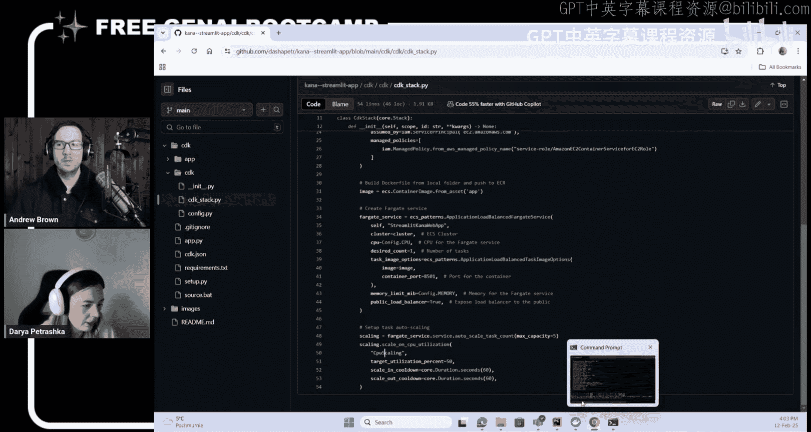

Yeah， I can bring you stocks for my stocks here and you can see that you cannot see the stock even here right now because it is still like doing pre pre processingces stuff。

Yeah， but is once it kick off， we will see kind of stream it up stuck here and we will see what events。

 what is in progress， what is already created and what we are waiting for Well as we're waiting like I would love to show manga OCR a bit more because as I was reading it was very interesting to me a little bit about it from a I'm not a data scientist but for me just reading about it was kind of interesting So here I have manga OCR and you know the boot campy part of this is that it's a constant endM model using transformer vision encoder decoder framework if you click over to here it goes the hugging face and it just starts to explain you know like how how one could work with it So I imagine that if you were trying to target another language maybe what you're looking for is your keyword is a vision encoder decoder model and so now I go okay let's say I want to do tokiona。

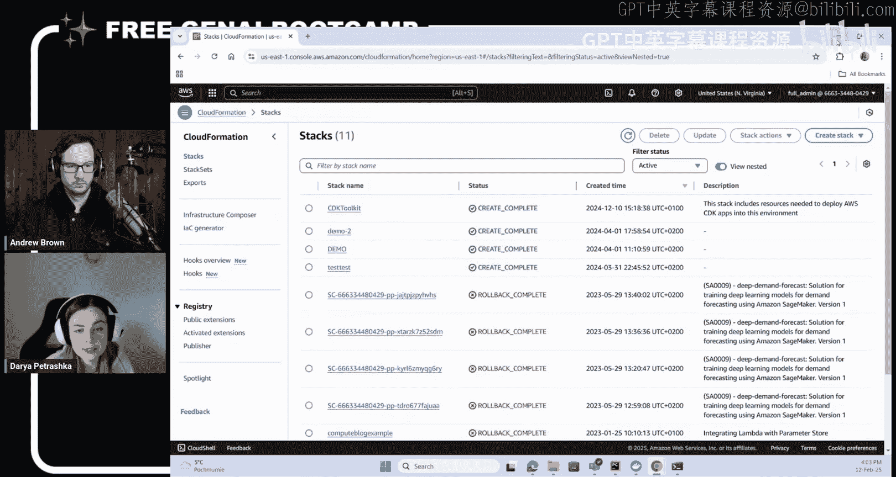

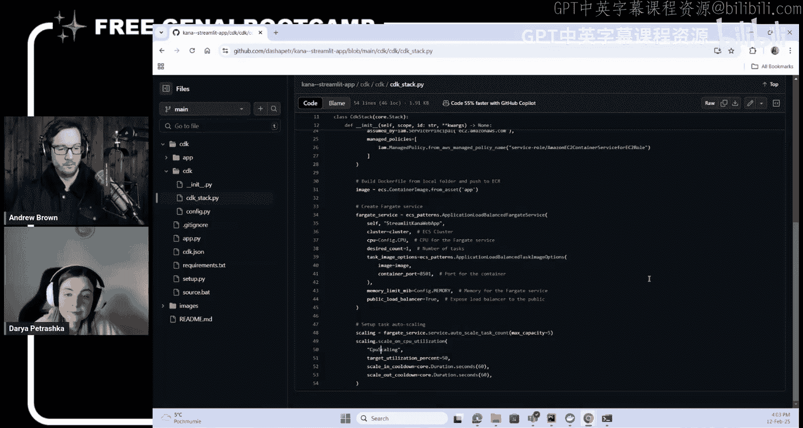

I'm not sure if you've heard of Tokiona Daria， but it is a artificially constructed language of 100 words。

 something like only 100 words， so okay the idea is that you can learn the vocabulary in a day right however the trade off with it is that because I don't care if it's safe it's fine。

I' I'm trying to get to this diagram but the point is that because the vocabulary is still simple。

 I think that the grammar can get really grammar simple too。

 but it makes really long sentences and they even created basically like their own character for each word so like if you want to say Kaa it looks like a fish I don't know if that actually means fish and then Liu here and so it's just it looks like nonsense but it works and so I'm going okay if you're doing Tokiona do they have a vision encoder decoder model right so go here and we'll go over to this one so it says that they have one here or maybe down below we see hugging face。

Right and so it doesn't exactly tell us what's going on here， we go to this one here。I mean， hey。

 they got a white paper so it must be good as soon you see a white paper right it must be good and so I'm going。

 okay， so now there's a model for this and they I guess they explain it so I'd have to read through the paper to figure it out。

You know like it looks kind of scary when you see these papers。

 but often they just read like human English and it's easy。

 but we'll go here and so this is just the paper。But oh， it says distilled G2 so。

They use GPT2 to make this and so you go through here。And so here we have something here。

 But my point is， is that even if you're not doing Japanese， if you're doing something like Tokia。

 there's probably somebody that's thought， what if I can try to recognize it and do the writing or if even you can't figure it out。

 It's just more interesting to go and find that out here。 I'm not sure if they're trying to。

Train a model to do this because this looks like just text。What I'm looking for is the images a。

 so yeah， this just looks like text， sorry。I just think maybe they if they use a like G2。

 they can find unit。 Maybe if we go over here， like they go tokia language go here。

 no files So someone was thinking somebody was thinking about doing that right？

 So maybe we go here and  typeping tokia but we have。

 we have boot campers and they're choosing some really interesting languages。

 and a lot of them are like looking for models to try to run right。

 And so there's a little bit of a trick to try to find something that might work。😊。

And so these might just be again， it it's hard right like a lot of people don't document their stuff。

 but there must be some way to make toki Poa work， but。Yeah， how how I don't know。

 I'd have to read a little bit more about it， but here。

RightAgain I'm not sure how deep you get into this kind of stuff but I just， you know。

 when I was trying to find a model for this character recognition I quickly realize that we need to use something specific and tailored to the use case because this model was based on a manga and that's why it's good at Japanese recognition and I just if you go you can just try to check it for yourself you just can for example draw a simple ka and try to use it like a CheGPT input and it would be extremely bad at recognition yeah so it doesn't I first I thought maybe it would be bad at you know recognition recognizing very similar characters but in fact it was very bad at characters at all。

So let me let me see if I can get a brush out here。 you know， I have a I have a tablet。

 I just don't have it hooked up here， but let's try to get I'm trying to look what would be more Japaneselike brush here like this oh yeah there we go So we'll get this out here。

 Oh that's big enough。 So I'm just trying to think of a character I know when I have to draw like every two seconds is ca。

 which means his or coninojo， which is heard when you're writing Japanese used it a lot they never speak it though And so that would be it would be like this and then we would go like this。

And that's that would be care so that's care and this is be a little bit better there and so let's see if we can actually bring this in as a test this to see like how did the generic ones work like if we were to use chat UT so I'm going to copy this we're sorry to cut this。

😊，Like it can OCR good rid things but it can it OCR terrible handwriting for me that's the question so we'll go here and I'm going to save this to my desktop。

 save it as a P&G。And we'll just do the off screen here。And we'll call this care。

Constantly writing care， and so I'm going to go over to Cha UBT。And we'll go over to a model here。

 You can see I'm always trying to learn languages here in the left hand side。

 I'm trying to see one that actually has there havet too many models Im getting so confused。

 which is which anymore these days。 Does this one take it because some of them don't take images。

 This one can take an image。 So it should be able to do OCR。 So I'll go here。

And I will drag this here。And by the way like I'll watch an I'll watch an anime and I'll take a screenshot of every single subtitle text because I can't dump the subtitle file I tried doing it's so hard to do it was easier just to copy each line but so tedious we'll go ahead and does it doesn't know what it is I didn't give it a description sorry sorry can you identify。

Yes， yes， okay， good。Please， please， please， please， please， please， please。But again。

 this isn't fine tuned， isn't specifically for this task。

 so it's taking a really long time to figure this out。Okay， so I did and I mess it up。

 I forgot the the first part of it so it still got it yeah I couldn't remember it's weird like when you have to think about things in front of folks。

A bit harder a pen。 but could， could you write simple ka like。 Oh， sure， Yeah， Yeah。

 are or something like Oh， yeah， like， like a word。 Sure， Yeah， let's try that。 So， well。

 car is just one thing。 It's Kma。 But what if we were to write it as just the Ka or sorry， the Hiraa。

 So I'll go here， I'm getting， I'm gonna try a different brush。 Let's see here there we go。

 So Kma Kma cou。 So we have cou。The Lou， so we have this the Lou。And then ma。

K ruma and usually you'd represent it as as kanji， but。We'll see if it can pick this up。

So I'll save this one here to my desktop。We'll call this on you know what I'm gonna I'm not going put the name in here I'm say Japanese somethingt don't give it away that's another thing right because maybe it's like oh yeah。

 its it's Saturday it's just like looked at the file name。

But like literally it can do that right so that's something that we have to be careful here I'm going to start a new chat。

 I don't want to even know that we're doing Japanese whiles say， you know can you。

Can you read this for me， please。What does it say？Like because it it can't be anything but Japanese。

 but we'll say here， Okay， so it guys Okay， it it recognize it。 I want to buy。

Well when I tried some like simple ka， really simple ka， it wasn't so good。

 but I tried it maybe one month ago， maybe it just really improve Well， it depends on the mall right。

 so like here we're on this one if we go and switch over to I'm so confused G4 Does this one take an image。

It does， so let's try this one here， we'll say， you know， read， what does it say？Also。

 the other thing is like they can update these models and we don't even know because like even if when they have G4。

 they have G4 and like a bunch of versions of it right you see， you see here？

So the character in the image you provided are are Japanese kanji for future。 Oh yeah， there you go。

 that makes sense。 I know one of our boot campers they were trying to they're trying to do I have a hard time saying it it's Uru Udu a and and so you know they're saying like like they couldn't handle it' like there's meta I don't know if Me can do but like metata couldn't produce anything that made sense。

 but but anyway yeah， so it has to come down to specific models but you know like the thing is it's like you might want a dumber model that's fine to because it's cheaper it's faster right and it's fine that like it's great that this one did it but imagine if you had a lot of text right you know and you want to run it locally or you want to you know just run it cheaply but。

Here is another point， if you just need， for example， a specific just like in our case。

 you need just a reading like pronunciation of Ka， it would be also like a challenge to restrict the model。

 yeah because if you do it like for one time， it could like follow instructions。

 but if you do it like prompt by prompt massively， it could like provide some explanations。

 descriptions and you obviously't don't want to have them。

Another thing I was thinking is that if this is this probably I would think that this is faster than any of these LM models and smaller is like imagine you wanted to build it where you could write in real time and then it would identify it because you'd have to hit it multiple times that this is where a smaller。

 a smaller， more efficient model would make more sense and so that would be really interesting。😡。

But yeah， I think， I think I'd probably try to use the optimized model here。 but of course， you know。

 clearly， if， if you don't have this， like， let's say you're using a target language， Oh yeah， Tokia。

 can it do Toki Poa。Let's go take a look。You know， like maybe can， right， So again。

 this would not be the most cost effective way to。呃。Do， but we have。U what to speak well。

 the problem is I don't know the land like I told everyone like you should learn it and then I didn't。

 I didn't learn it myself。But maybe I will at one point， but let's go take a look here。

 I'm going to try to draw what do we have here， we have this one。And I don't know。

 but we're just we're going to just hit。So。We should we should。

 it'd be really interesting if we could get like a tech conference。

 but everyone has to learn this language first。As they say it's really easy， right， Imagine。

 imagine that that'd be very strange。 We'll go here and I'll say， we'll say Co。

 I don't know what any of this stuff means because the language is so simple。

 I wouldn't be surprised if I I'm able to say something in here。 So'll do K Lape。

Finish this here and then we'll say u Laso not Casi Kasi。What do you think this means in？

It it's like， it's like steam。Um， lollipop， u flower flower， right， I don't know。I will'll save this。

 and I'll just。I'm gonna give it a little bit of help。 I'm gonna to say Tokiona。Image。

And all I should have done， is's okay。So we'll go here。I'm going go but it's not so new。

 right Tokipoa was it created I don't know like 20 I think in the last 10 years at least。

 but the thing is is that I think actually as are really good at like get the text version of Tokia Oh。

 let's go Grro。 So I'll say here like what what does this say in Toki Poa。Okay。

I mean I'm not in talkingky about it， but this is Tokiono， what does it say I'll process the images。

 so I'm just curious， can it do it？Because then no one has excuse that they can use any language they want。

ho says。Oh， okay， but can you recognize。So。Toki Poa characters。There are three in the image。

Cause my wording was a bit unusual， Like I said， what does this say in Tokia。

 But it's more like what this is an image of Tokiona， What are they right？

 So here it says Site Lane Poa， is that what we chose， We had you know， we had L La Lape Kia。And。

Oh sorry， still going， right， okay？Oh， weird。Oh， actually， no， sorry。 I actually drew no。

 I have read that wrong。 It'ssi Lapii， so here it says the image contains the。 but。

 but it's interesting， like， I didn't know could do this。 Oh。

 it's like using another program to try to analyze it。 it's， it's using up sleep。

 if I'm not mistaken。Yeah， yeah，'m not I'm not that familiar with math plot。

 but that that makes sense like it sounds like it's for plotting math I's I don't know much experience for that。

 but we have the third glyph is so slowly pe a pona and we said it is。Khan Lape Casi。

 so I would say that it has an accuracy of zero。But but it's interesting to see like why was it able to do Japanese but could it do anything else and it looks like a reason or three so maybe you could get it to do it if it had tool use and to reason based on the shapes or something。

 but it would be such a weird， indirect way to try to solve it and very be computationally expensive。

 I'm not sure if I would suggest that but。Now we know， right。

 so but at least I can use Japanese here， so。But well we'll see we'd have to do more of it and also the cost I'm not sure if the cost is worth it。

 but mango Ocr one thing I would be also interested to know is that in mango like a lot of manga。

 they have Fury Ghana which are the little the little things that tell you how to say this is for a boot camera to know how to say the kanji we can actually see it right here if we make this larger you see like there's these little dots。

 these are actually smaller herea characters to tell you how to say the larger kanji and I wonder if it would also extract that information out as well and put it in the appropriate area because like look up here。

 I mean they're using a thirdtll， there's furry Ga right there telling you how to say that but I wonder if the output would also pick it up and associate with it but I guess you wouldn't need those because it probably would know what the underlying ka is so I would think that it would admit it but I don't know so that'd be interesting but hows how's our docker bill going。

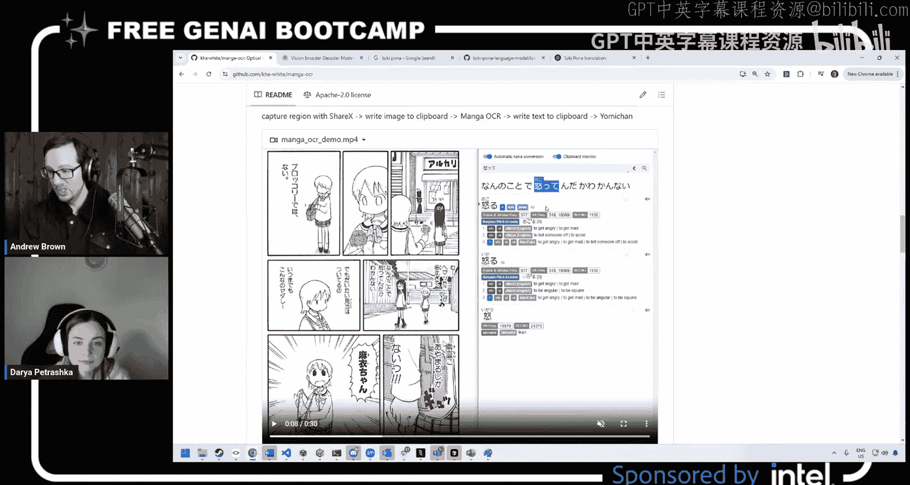

It is still pending， I can show you the my screen what's going on。

So here yep， we have our container pushed。And。 I don't know how far how much time we need to wait for it for。

But it's been already wild but you know what the thing is is that I think that we have all the moving parts like the most important part is like how is this OCR thing happening and is it actually using generative AI and I mean I would call this generative I because it's talking about a vision encoder decoder and even that's not Geni in particular it is a type of model I mean yeah it would be Geni because it's generating something right buts not this is not specifically an LM。

 this is just a component of the vision side of things if that makes sense but because it says transformers here if it says transformers。

 it's Geni that's what it is simply if it says transformers。

 then it's Gennyi it's included in the boot camp but in the Geni essentials we covered really early about transformers architecture and how vision encoder vision encoder I sound like I know more than I do but that these are utilized for it and we saw these words here like。

And stuff so therefore this is JenI but yeah I think that the boot campers have enough like we have the stream it app we can run it locally the deployment is a separate component of it。

 we have a general idea of like how you would deploy it but boot campers don't need to deploy this in this particular way but we do have one deployment project this bootc which is through containers and it's。

I would not describe it as easy， but。But yeah， I know I appreciate appreciate this being built to show our boot campers。

 But for folks that don't know it's like Dar just had already built it。

 it was awesome like it was like perfect perfect fit into the boot camp。

 So I was really excited to see this project concluded I also wanted to underline the importance of having this streamlit kind of applications Oh you see did it just finish Yeah we can soon we try to leave it's like oh no you know it's gonna happen。

 it's tricking us。's gonna it's gonna pull us in and then it's gonna say you got to wait longer too。

😊，Yeah but yeah I also wanted to maybe underline the importance of learning such things as a streamt or there is one analog of streamlet gradio yeah whatever you use。

 it is a great way to showcase your work because if you work on some kind of model it's it's very challenging for non-technical people to understand what is your model for and it is very easy to impress and showcase your work if you have something to touch and if you have something to play with so this is a main idea and I like yeah。

😊，Iins are different upon streamlit Yeah it is hard maybe to customize it enough for very specific use cases。

 but what is great about it that you can learn it in a quick way really quick way and you have even elements like balloons to fly and you can adopt it based on your need and show it to the verb so oh yeah I would say like you know I taught a bit about what I taught more radio than streamlit because I'm not good at streamlit but there are what I found is like you can use LMs to produce it like they're designed to be LMs are trained to in the data the data folks went we don't like writing frontends so we're gonna make it so we can just write pure Python with the least amount of stuff to make it and then they took it a step further and because they had so many examples LLMs are really good at just like say produce。

😊，The interfaces you want in these frameworks， but Stam up was interesting because I found that it was a bit more complex。

 but if you did invest the time to learn it， it's like a good builds really good interface is very quick like rapidly prototype interfaces for showcasing but for this did you write all the streamlit by hand or did you use a generative tool I used like for the structure I already had an example of structure because this entry point and this pages and it was mentioned some streamlet blocks I guess when I learned about this and then I just had an idea what should I do and I just create you know like a draft of different parts and I yeah actually I used to CheGBT for like create some kind of code and for brushing code you know like edit type hints and make it more。

More beautiful， essentially。 So every every single week。

 I have Japanese lessons with my Japanese teacher。 And every time the lesson kind of changed。

 I would try to try to。😊，M Max like making like efficient on my study time by building the app that I needed for that week that was specifically that learning and I kept using streamlit because it was so fast so like if if we were doing like you know like question and answer like I'm gonna be asked a question and an answer I would go build up that app every single week that's how I ended up with this boot camp I just kept building every week a different app and then my teachers like to study stop building app like I'm like no no I almost have the app work like I'd spend all week trying and get the app working and then I would get like two hours to study before the class and it was just like just study you don't need an app。

But my point is is that you can build like a new study app every week。

 but if you're going to have lessons， just have them two weeks apart so you have one week to build the app one week to use the app。

 yeah。Exactly that's a great idea and I also wanted to show quickly what is going on inside our EWS account so if you go to cloud formation you will see that this is our stack kind of stream it up and you can see that there are events being produced yeah some resource already created and some are still in progress you can see yeah this is more high level understanding what resources are there and our web app is still in progress。

😊。

But we already have our VPC， we have our cluster and here we would have the output so essentially the address would go to see our app。

So yeah， for this point， you just need to， you know， like sit and wait。

or just make a coffee and wait and it is tap it's on step 38 out of 42 and then if you just don't need this anymore you can run a command CD key destroy and it will destroy all the resources completely so and it is very handy to you know change some parts deploy。

 destroy so you won't occasionally forget about something and receive a huge bill。😊。

We have already had one boot camper that I mean， it wasn't a big bill。

 but they had unexpected spend with Sagemaker， which is no surprise。 But yeah， there's you know。

 cloud is great。 but you have to you know， just watch what you're doing right。

 so so you don't end up with a big bill。 But every time I've had a big bill。

 It has always given me the money back。 so but it doesn't happen to me often right。

 So like it happens like every other year。 And then， and there's a very specific reason for it。

 And I explain it to them in a very nice way。 But I've always， I've always gotten my my。Forgiven。

 right so。Yeah， because yeah because things happen， people just don't know。

 don't read to forget about stuff。 it's good that we have some kind of automation。

 but behind this always there is a human factor。I think of it like power tools。

 you know what I mean you can use a table saw， but you can also it can like make you very productive。

 but if you're not careful it can cut off a finger right so you have to be not that extreme with a cloud but you have to be you know learn how to use them properly right yes？

Exactly。So yeah， I guess we can wait for like a couple of minutes to show the output once we're here。

And yeah， I and also， if you want to， you know， like check what is going on， you're patient to see。

 you can go， for example， to。

To your resources and check what we're going to check， let's check our VPC here。

So if you go to VPC console， you will see that our VPC is created。

We can see the subnets through tables， connections here， so you just did in a console itself nothing。

 you just hit deploy in your locally and it's being built for in your AWS account。

And it is like amazing way to automate things。Yeah， and similarly。

 you can check other resources that are created。And yeah， basically。Basically。

 let's see what's going on。

So Daria， do you like anime and is there a particular anime you like to watch？You know。

 just yesterday I watched a boy in a hero， this was the latest T from Haammedzaakki。

And it is amazing， I mean they are produced in multiple words in a single single anime and I just amazed how how can they。

Even think about it and then create it in a such detailed level。😊，Yeah。

 I say beautiful I thought for I thought this maybe it wasn't Hao Mizaki。

 but I thought there was one， I thought there was a studio looks just like it though。

 but they said they weren't making anymore and now they're come back and they're making more so I'm wondering if this is the one here but I've definitely seen this this one in particular is this the same studio that makes the one where。

They have like u like like it's like these buildings that drive on wheels。

 what is that when buildings drive on wheels that's like the weirdest description I know， but。

I'm checking here， David mean the ge list to do？They look a lot same， oh。

 did they make weathering with you？No， wasbi is Makato Shiinkai。 Okay， so I。

 I really like those like that those particular series of ones because the little language they use in those。

 it has such common vocabulary and so diverse that for language learning， it's really good。

 So that's why I really like， I mean， I like all of them， it's just， those ones in particular。 Oh。

 is it up。 Yeah， is that， So you can see that from our。😊。

Our command line here， we have our outputs。And essentially it's the same one， yeah。

 we have our HTTP DNS name of our application load balance and if we copy and paste in our browser and we can see the same app that we run locally except that this is public so it can be shared with anyone。

And also， if you're curious and。You go back to our stack。 You can see the output here， and。

Let's check the application load balance itself。Then it's real。No scam。Yeah。

 you can see that it was created as well。So yeah， here is your app， you can learn。

And progress in your Japanese。Well， there we go。 And I think one thing we always have to learn if you want to be a cloud engineer is having patience Pat is key。

 you're just kind of used to like everyone's seen those comics where it's you know like my codes compiling it's my codes's my cloud infrastructure is deploying I'm sure there's a variant of it but I was I was just looking up that particular that particular artist or director and I didn't realize that they also made Nastica of the valley of the wind。

 which it from the 80s I just love this kind of this interesting aesthetic。

 it's based off some I can't remember this is based off another one which is based off another artist。

 but I really like the style of and then they also have whisper of the heart。

 which I haven't seen either。 this looks a lot like Kikis Kikis delivery service or something like that but now I have more to watch。

 So now you've done to my list but。😊。

as it's for study or for the boot camp I I can make the time。 but yeah， so， so it's deployed。

 do you want if you wanted to tear it down， do we have a second to show how you tear down that if Yeah。

 yeah， sure， sure， sure I forgot about this， but let's do it。

 So this is just in case people don't want to have spend。Yeah。

 so it's as simple as that I think right yeah you just type CK destroy and it will ask you if youre if you're sure or not and then all the resources are destroyed。

 but we are not going to wait until this but。Until all the resources will be destroyed。

 but they will be destroyed。😊，But yeah， so I would say that yeah。

 I' will take a while for this to destroy so we'll we'll just we'll just assume it destroys it all but yeah this was a great project。

 appreciate your time coming out here and walking us through it I think boot campers are going to be excited and you know maybe they'll learn a bit of Japanese or tokia。

But I still need a little bit more work with my tokiona， but you know， maybe next reinvent。

 I will have。Toki on it down and we'll see if we can get anyone else else if they say 100 words。

 she shouldd be able to learn it in a day， at least the words right。

 the the gram or everything else I don't know。 But anyway， yeah。

 appreciate your time here And we're gonna see boot campers in class soon and we'll just say A or or Saionara to everybody there So thanks。

