# ExamPro《生成式AI训练营｜Free GenAI Bootcamp》中英字幕（deepseek - P36：-36-Kana Writing App - Andrews Re-implementation.zh_en - GPT中英字幕课程资源 - BV1SFEWzLEab

Hey everyone， it's Andrew Brown and in this video， what we're going to do is we are going to take Dara's project and work it into our system because we have that application。

 or she has that application but it needs to be adapted so that it fits within our L portal so I'm going to go look for that repo there and we don't need the deployment side of it because we just need the the streamlit application or we can rework it for our use case。

 but we' I'm going open this repo up and so we have it over here。

 I'm going make my way over to my repo I think I already have a download it so I might want to do this in the local development。

 I'm just trying to think about this because this is just using that single library and so I should be able to run it locally。

So I think that's what I'm going to do。

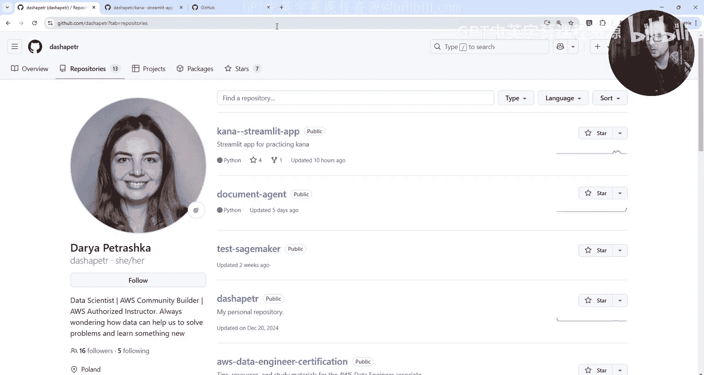

Okay， so I think I'll start with V S code。 So I have something open here。

 I think is is like the Pokey agent， which was something else I was looking at recently。

 But I'm gonna go and try to find， y my repo here for the freegen boot camp。

 I'm gonna make sure I don't have any commits that are in the way。

 I do have this front end technical spec。 I'm not sure if this this has been changed since last time。

Nothing really has changed。 I'm gonna to go ahead just discard this change here。

 And so what I'm going to do is make a new repo here。And I'm going to take a look here。

 This one's called Canna Streamlight app。 I'm going to call it。

I'm gonna give it more of a generic name as maybe you might want to adapt it for your specific language or something。

 but I'm going to call this。Writing。Writing practice。Right。

 so I feel like you could even take an image with your phone and then upload it as。

The way to practice for this。And so it was implemented in streamlit and streamlet's fine。

 I think we could work with that there。 All I want to do is I want to。

I guess the thing is like our app， our L portal has words。

 And so if we were to launch an application and it passes along that word group。

 we should be able to see。😊，The information for it there， right。

 So like that's probably a first step。 So what I'm going to do to get us started。

 I'm going to make a new file here called app do Pi。 And， you know。

 I could use Windsurf if I could use a bunch of stuff。 But what I'm going to do is go over to Claude。

 You can use whatever you'd like as well。 And I'm just gonna say Cla， you use Cha PT， whatever。

 I'm gonna say I， I need a basic streamlit application， which。

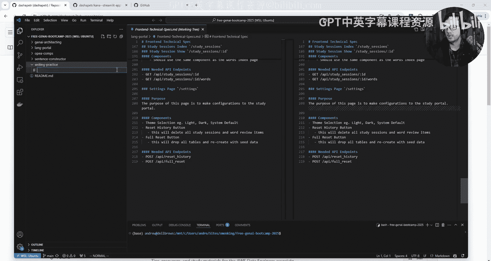

Is going to。I'm trying to describe this， so maybe we'll do。

And it really always comes back down to documentation。 But I'm gonna go over to。

 I'm trying to figure out where I'm going here。 But I'm gonna go to our。Criculum here。

 And maybe what I'll do is document what we should be doing。 So I'm gonna make a new one here。

 I'm going to call this one at a sub tabab。 This is going be I'll call3 level 300。

 as I think the finger spelling is a lot more challenging。 So'll say 300， as willll be writing。

Writing practice。Okay。I'm going to drag this one up here。

And OPA is over here will write this when I appear like this。

And we'll go into this one here and I need a bit of a reference。So I'll just grab some of this here。

s say writing practice。And you know remember that you know the scope of Darria's app was specifically just Ka characters。

 just Hiria or Kaaa， it wasn't even Kanji I know a bit more Japanese and so for me I want to be able to do full words and we can use OCR man going to do that but we could also use an agent if we don't have right a specific model for OCR then we can just use an LLM and it is a bit more computationally expensive。

 but it should still work right Bogo here and just say you have been task you know。You know。

 students。Have asked。If there could be a tool， there could be a learning exercise。

To practice writing。嗯。Practice writing。Lang， like language sentences。Okay， so。The idea here。

 so students have asked if there there could be learning exercise to practice writing language sentences。

 so you， you have been tasked to build。A prototype application。Which will。Take a word group。And。

It depends what we wanted to do。 Like， I could make it so like， okay， I see the word， like。

 it tells me the word， and then I have to write the word out and then confirm it's right。

So it depends on what it is， do you want to practice writing sentences or do you want to practice seeing the English word and then trying to write it in the target language correctly so since've been asked if they could there could be there could be a learning exercise of practice writing language sentences。

 you have been tasked to build a prototyping application I've said sentences which will take a word group and generate generate very。

Simple sentences。In English， and you must write。Then in the target language。Yuiz。Japanese。

 so we're going a little bit farther。 We're not even just doing single letters or single words。

 We're gonna do， we're gonna do like a sentence。 And that's what I would like to do。

 So we'll say technical requirements。Streamlight， we'll use streamlit。Manga OCR。So for Japanese。

Or for another language。Use。An like an AI， like a managed API managed。LLM that has。Vision， EG。

 you know， chat GT or GT。GBT 40， I think that it can do it， right。

 I'm not sure maybe we can use one from like Amazon bedrock or something。

 as I know that one has a vision model， but one of these APIs will have a vision model， right。

And so those are the only two things。 the other thing is like we need to be able to take photos。

 so you know， be able to upload an image。The thing that Darius has had is like you could draw it right in place right but I think that I would rather just write。

 write it out， take a photo， feed the photo into the system and then see if I got it write we could also just write it in paint and then paste it in and that would be another way to do it so let's think about what the design of this app should look like。

And。I mean， we could probably draw it in pain if we wanted to for fun。 I don't usually do this。

 but we'll try it。 So for the application here。You know， the idea is that we will have our sentence。

We'll have a spot to upload， so we'll have our target sentence。Then we'll have our upload。

This isn really worked well for prototyping， does it？So I'm going to go over to Luccid charts。

 even though my lucid chart's kind of a mess right now。At some point。

 Ive got to re recreate it recreate the diagrams。 So I going to go into the JP architectural diagraming。

And I'm going to make a new tab here and we'll call this one writing。Writing practice。

And so I'm gonna drag in a box like this。And it's blue。 I don't want blue。 I just want white。

 just want a regular box， Nope， still blue。this one there we go。 That's normal。 And so。You know。

 we have。Example sentence。Right， so that would be one thing that we need here。 the example sentence。

With thekiboab， right？嗯。I might even want to like， highlight， highlight a word。

 So I'm gonna go over here and say， like， give me a sample sentence using。呃。

The Japanese word for new， right， and we'll see what we get here。Okay， how about give me？嗯。

Give me a practice sentence。To use the Japanese word。For new， but give me an English sentence。

That I will have to write out。I mean， it's not like it's even that hard for me to think of one。

 but I'm gonna do that anyway， causeuse Ill have to write that prompt here in a moment。

So like maybe it's like， I want。We'll go here， like say。Ohoops。Have to controller her。 that's。

 that's a new book。Right。And I don't know keeps going blue， but I'm gonna go with it。 We'll just say。

 upload。Upload image。Right， and。Here， we'll have。Output。And。But I guess it'd be transcription。

 so transcription。And then。呃。We want to see what it thinks it is， right， so we'll have transcription。

So that's a new book I'm going to get my， I'm going to switch this over to Japanese if I have it installed。

Do I， I do。 Okay， So if it's， that's a new book， we're putting emphasis on the book。

 and we're saying it's a book。 So Atta Rahi。rahi， it is not。Come on。Give me Japanese， here we go。啊他。

Rashi。There's a keyboard I install and I switch over to it。

 you can also just type it in here and copy it over， but I want to write it from house app。新しい。Hun。

She's home。Come on。看。No， it's this a book。Oh， really doesn't want to give me the book character。

I'll put Nehn in there。 But that's not I wanted for that。 So we have Atrahi Hodes。And so。啊，对这是。

A new book。Anyway， so。That would be my like my attempt， right， So maybe I would have over here。

And I'll pretend like this is my scrap。Paper tape， I don't like keeps making everything white。

 that's really annoying。Well say over here， so。We'll do this and center this。Why is it not like home。

Hne is not a hard thing to deferred to write， but maybe doesn't like the font。

It's a little bit better for it。I don't know why we're getting this weird symbol over home。Okay。

 give me the。come on， get out of there， get out there。 get out of there。

 I'm trying to switch it back over to the original keyboard here。Let's go to US keyboard here。

 the Japanese symbol for Buck。Soll do that。Here you go ho。

And I'm hoping maybe if I copy it from here。We'll have less of an issue。

Cause it looks like it has like some weird version of a home。Nope。

 it just crosses out so I think this is an issue specifically with lua charts。

 so I'm just going have to ignore that or change the word， which I'm not going to do。 Well you know。

 I'll try one more word like Kudrua， give me the word for car Eji Krua。There we go， Kudruma。

 that's a very easy one to draw。And no matter what I do here。It's strange。 Its like。

What if I do on this one here。That one's fine。So let me go here。

If guess something did like the font or something， no it's still there。What is going on， Like。

 where is this coming from？I'm going to cut this out here like this。 paste it in here。 Oh， you know。

 why it's in parentheses。 So it's doing something weird when it has parentheses there。 Okay。

 so we'll take that out。And we'll just do kutruma instead。

Because our life will be a lot easier if we do that。And I'm going to say a new car。But grammatically。

 I don't think this is correct。 But because if it's that's a new car。

 it would probably be like Kurashhi， like put emphasis on the car by putting in the God。

 But I don't care if if it's not right， well， willll work with it as we have it here。

 So the idea is that we have this。That's the sample sentence。

 we're going to upload this and then from here we're going to get some output。

So here we will have the transcription。 We will have。The translation。So this might say。A new car。

And then we'll have grading， right， So we'll have grading。Here。

And maybe we'll give it like a grade score。 Soll say B plus and， you know。

 And here it would say like very， very close。 Or maybe the thing is like。

Because the other thing was we're telling like how good was the writing， right。

 So like it's not just about the sentence。 It's also about the writing。 So， you know。You know。

You know， something about your writing。And。What you need to change to make。It a good。

 a better sentence。 So the idea is like， or its either to that or we could score it a different way。

 We could say， like， the writing is good。 I don't know。

 So the point is is that we'll have these three components。 This will be our output。

 I really don't know why keeps doing that is。Like all these weird characters。 I never use these。

 So I think maybe。One of the boot campers have really messed stuff up for me here。

 but we'll go over into this。Again， it was my fault for making the， the thing public。

 but it has been a bit of a headache trying to fix it。 So I'll bring this back to the the back here。

 And so the idea is that we have this。 And so we got this right， And then from here， we have this。

 But the idea is that when this app starts up， we。I don't know how to fix this。They're all blue。

 That one's blue。 No， these are all different。 So maybe this isn't me。 Maybe this is just the。

Lo a chart changing something， but anyway， so the start of it we， we create a session ID。

And we have a word group that's coming in here， word group ID。

And so the idea is that we have these words。That are coming as a payload。 And this is。

From our database。 actually， it's two separate calls。 If you remember， we have a， it's like a review。

 No， not a review。 It's like the raw end point。 There's more to than this。 It's the raw end point。

 And then there's the， you know， sessions or launch。End point or see。We have like a session ID。

Equals， you know， number。And then we have group。I D equals number。Up here。

I'm trying to make that a query string。And that's when it launches our app， like local host。

 whatever it is。 We'll just say， it doesn't matter what the number is。

 I'm just putting whatever here。And so the idea is that we have this as our， you know。

 from the launch。 So like。Lang portal。Launch link。Right。

And so the idea is that that's going to set out that。And from here。Our app。Which is this app here。

 We'll just， again， I really can't stand those colors， but we'll drag this out like this。

And we'll send this to the back。And we'll bring this up in the top left corner。

And so this is going to be our learning writing writing app， writingri practice app。And。The thing is。

 that when this happens here。嗯。Maybe we'll get a box inside of here like this。We like。

 initialize app。This will have to go out。To that raw end point， which is on Lang portal。

 remember that gets us the raw group data。 So it's something like groups。Words。

 whatever it's going to vary based on if you remade the backend。

 you'll have to check your endpoints I have two backends I can use I'll probably just work with the Python one because I'm not 100% sure about my gol backend at this point。

 but it could work at some point and the idea is that it will initialize the app right。

And what the initialized app is going to do is it's going to pull in the words and it's going to then just produce a question or a sample。

 an example sentence， right？And so the idea is that。We will at。AnEx sentence。Here。You know。

Produce question。And then the idea is that at the end of this， it's like。You know。

 next like we'll go next question， right？And so the idea is that， you know， after this。

It's not really this like initialized app。 It's like initialize like。

 it's like whatever you want to call it。 But that's the idea。

 So the idea is like the Lng will launch this portal app。 It has to initialize with the rot。

 like the the group data。 It's going to need to produce a question。

 which will probably have an L M here。 So we'll need like an L M。LLM to create question。And。

Then from here， we'll have our example sentence。 We have to upload it。 And on this step， we need to。

You know， process。Process image， which we have multiple steps in it。

 And so we have a lot of moving parts here。 we can continue to keep diagramming this to kind of talk about the steps。

 I'd rather just kind of jump into it and get it done。 But you know， again。

 we're doing this so that we can kind of have a conversation about what it is that we want to describe over here of its technical requirements because the more we document the easier it is for us to produce the code。

 So we'll just like technical， we'll call this technical specs。 And we can write it in here for now。

 And so。I'm trying to think like， how do we describe this application？So the first thing is like。

This application needs to take in a session and group ID， so I'm going to just zoom in here。

I will say the first thing is like initialization。When the app first loads。First initializes。

It needs to do the following。Okay， it needs to。Fch from the。From local hosts， whatever it is 5，000。

AI。Groups。ID， words。It's just actually groups， it's not groups's words。

 I don't know why I wrote that earlier， I just got that wrong， I guess。嗯。

But it's probably sessions like sessions， you know， I D， groups， I。 It might be that。

 we'll have to take a look there。 But the idea is that it will be like sessions dot group I D or whatever。

 But we'll say groups right now。 I don't know what it is。 but we'll take a look here。

This will return a collection of。Words in a adjacent structure。This will return a collection of。

Words。With。It will have。Japanese。Words with their English translation。Okay。

We need to store these words。this collection of words and memory。Okay。

 so that's the first thing we needed to do。After we have stored those words in memory。

We should have a button to start practice。We'll say set initialization， So set。

The user will then see a button。To generate。Sentence。诶。When they press this button。

They will then see an example sent so when they press this button。

 the app will choose a word at random。And using an LLM， it will construct。A simple。Sentence。Using。

JLPT N5 grammar。So the apple choose is a word at random and using it at LLM。

 it will construct a simple sentence using GLPTN5 grammar。It should only use。Words。

Within the group or just the single target word。Okay， and maybe we'll have to think about that。

 but the apple is a worded random and using al will construct start a simple sentence using DLBTN 5。

 it should use words within the group or just a single target word。So an example might be， so。

 so let's say。Imagine we have the following words。So we might have like car book。New。嗯。

So the user will see a button to generate sentence when they press this button。

 the app will choose a word at random using the LM。

 it will construct a simple sentence using GLBT grammar it should only use words within the group or just a single target work I always kind to feel like what you need you need a bank of words that are so common that they should always show up。

You know what I mean？It should use。 It should only use。We have to really describe this a bit better。

 But the user will see a button to generate a sentence。 When they press this button。

 the app will choose a random word and， and the all will construct a simple sentence。

 So it will'll say， you know， sentence constructor。Okay。So the first thing is we wanted to。

Use a word。I almost kind of feel like what I should be doing is taking this here and writing this in markdown because if we're going to be feeding this anyway for an ElM to build that stuff。

 that might be a little bit easier for us。 I'm going to go back over to VS code where a codebase is here。

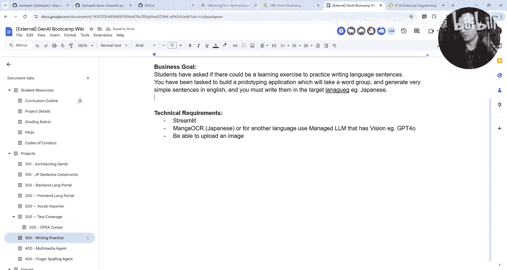

And I'm going go and make a new read。We'll call this text specs。

As this seems to be a really good pattern that I've liked so far， Tex。md。Okay。

 and so I'm gonna go paste this in here。And we'll go to the top and we'll mark this like this。

 and then we'll just say initialization step。So when the first happened is to。For the following。嗯。So。

 this is like。we call it the initialization step。 But then here， what we're seeing is like。

 what is the first page， So page states。Right。And so this would be this one。Page states represents。

The state the single page application should behave。From a user's perspective， we're kind of mixing。

 like， we're not writing a backend and the front end for this。

 We're just kind of writing a single doc。 You know。

 what we're building a more complex one it kind of make sense to separate out。 But like。

 just even think of like extreme light in the nature of it。 It's kind of like together。

 And so there's some way that we can do that together。

 Page states respects this page states describes the state of the single page app should behave from a user's perspective。

So that's called those are called user behavior behavior， acceptance， tests or whatever。 But anyway。

 the setup， the user will see a button to generate a sentence when they， when they。

 when they press this button， the app choose a the app will。We'll say the app will generate。

Will generate a random will generate a。Generate a simple sentence。Then over here， what I have。

Is LLM agent。We'll call this sentence。Sentence generator。LLM prompt。So here we have。Generate a word。

 generate a sentence。Using the following word。Word， right？Also include。Generate a simple sentence。

The grammar should use JLP 9，5 grammar。嗯。To JLP 5 on grammar， you can use the following。

Vocabulary to construct。Construct a simple sentence。So we have。Simple。Simple objects。 So E G book。

Car。Ramen。Sushi。You know， simple verbs。Drink。Eat。Meat。You know。To meet。To eat。To drink。And then。

Simple， simple。 Yeah， I mean maybe that， right， so like。And so maybe like simple whoops。Simple。

 simple times。So， we might have。嗯。More't like， we'll say like。Morning。Or like a simple， simple time。

 So tomorrow today。Yesterday。And we might even want to limit and just say only this like here it's。

 it's having a little bit more free rain， but I'm just trying to get it done。Okay。

 so generate a simple sentence using the following word。 the grammar should be scope to JLPT and 5。

 grammar and stuff。 But there's more than like another it depends on how smart you want this thing to be。

 But we could say like make sure that when you generate a sentence that you always use a different word from the bank and continue rotate because if it's random but keep pulling the same word。

 But I'm not worried about that right now。 That's something that if you want to do。

 you can absolutely do that。 I'm going to keep it nice and simple。 So says when the app initialize。

 it needs to send the following endpoint that makes sense page states describe the state。

 the user will then see a button to generate sentence when they press this button。

 the app will generate the ja will generate a simple sentence。Which when pressed。Will generate。

A sentence。Using the sentence。Generator LM。The we'll say state。Practice state。

The the user will then see a generate。And I guess we could write this as like behavior driven development。

 so if you look up BDD， BDD。

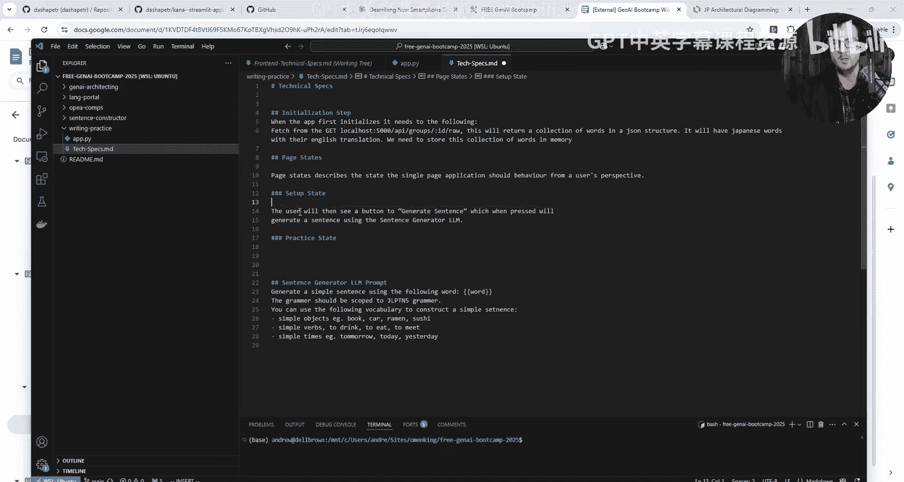

Not body dysmorphism， that's a very serious issue， but I'm talking about like jerkkins。Cucumber。

 and so this is like a way that you can write， use case stories。 And if you write based on these。

 it like scenario like given given I have this， then do that， right？

And so this might be a really good way that we could write them。

 I'm not sure why they just won't show us examples。Like here it is like scenario like feature。

 Is it Friday yet， Everybody wants to know when it's Friday。 A study isn't Friday。 given today。

 Sunday， when I asked this， then I should do that。 And so we can kind of work with that to。

 to do that。 I'm not expecting you to fully understand that。 but we'll say， you know， when a user is。

 when a user first。😊。

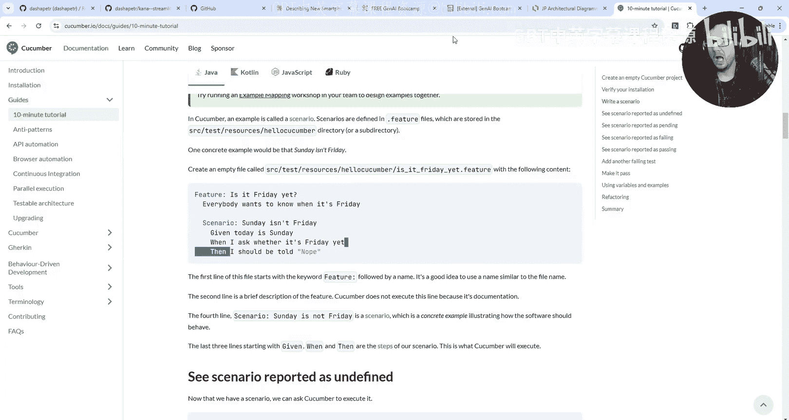

Starts up the app。They will only see a button called generaterate sentence。

When they press the button。The app will。When they press the button。The app will generate。A sentence。

Using the sentence。Generator LLM and the state will move。To practice。State。Okay。

 so now we're in practice date， so。When a user is in practice state。

They will see age an English sentence。Sentence。They will also see an upload field under the English sentence。

And they will。See a button called。Submit。For review。Right， when they press the submit。

They press the submit for review of button。So it says when a user first starts something they will only see a button called generaterate sentence when they press the button。

 the app will generate a sentence using and the state will practice state right when a user is in practice state。

 they will see an English sentence， they will also see an upload field under the English sentence。

 they will see a button called submitmit for review when they press submit for review button。

 an uploaded image。Will be。Passt to the greater。嗯。The grading system。

The grading system will return the following information。And there'll be three things we'll get。

 which is transcription。Of image。Translation of image。Translation of。Of transcription。Grading。

Describing。A letter score。And。A description。So we go here a letter score。

I'd be fine if we could make like S the highest level because for some reason。

 like how does Japanese grading letter system work？

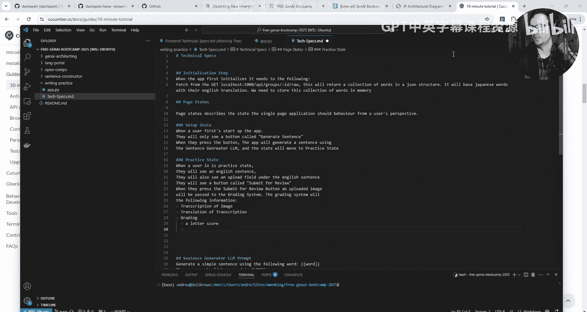

With the S。Lettter。Maybe like S rank。

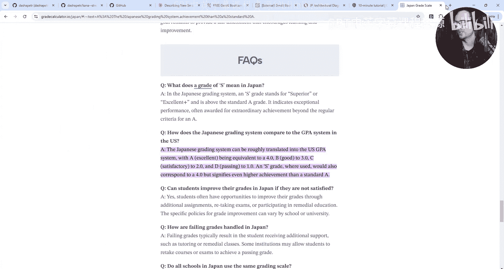

I think that's what it's called S ranks， so we'll go back over to here， so transcription grading。

Using the S rank。To score。A description。Of whether the great， whether the。The attempt。Was。

Accurate to the English。Sentence。And suggestions。Obser， you know， so we'll go to that。

 The thing is like， I wantna say like observe like， oh， looks like you're trying to write this。

 Maybe， maybe this is what you're trying to do。 I'm not sure how I would do that。 but we have that。

 So we have this called called the grading system。Right。

 so we'll describe what the grading system is。 What does the grading system do， Well。

 it has to take in an image， right？ And so it needs to first transcribe。 So the grading system。

We'll do the following。It will transcribe the image using manga OCR。It will。嗯。Use an LLM to produce。

AA little translation。Translation。Of the of the transcription。It will use another LLM to produce。A。

Grade。A grade， right。It will then。Return this data。To the， to the front end app。Okay。So we have that。

 So now we kind of know our entire process here。 So we have the setup stage， the practice stage。

 and so。The grave， somebody says when a user is is in a is in is in a practice state。

 They will see an English sentence。 They will also see an upload field in the English name。

 They will see a button called submit for view when they press the submit for view button and uploaded image will be pressed。

 The grading system， the grading will will then then follow。Will provide。

Maybe we should break this up， so submit for review when they press the submit for review button。

 an upload will pass to the grading system and。The app will。Transition。To the review state。

 And so I'll bring this into the review state。When a user is in the review state。The user will。

Still see the English sentence。The upload field will be gone。嗯。The user will now see a review of。

The output from the grading system。Okay。There will be a button。Called next question。When clicked。

It will take the， it will send。It will generate。A new question and place the user the app。

Into practice state。Okay， so we' basically described the entire application。

And so the question is like， we have this。We'll this work so。

What I want to do is I want to take this over and see if I can feed this over to to Claude， right。

 We could use whatever we want， but I'm just going to use streamlit to。

 to kind of stick with this with Claude。 It it's going to go over here and。

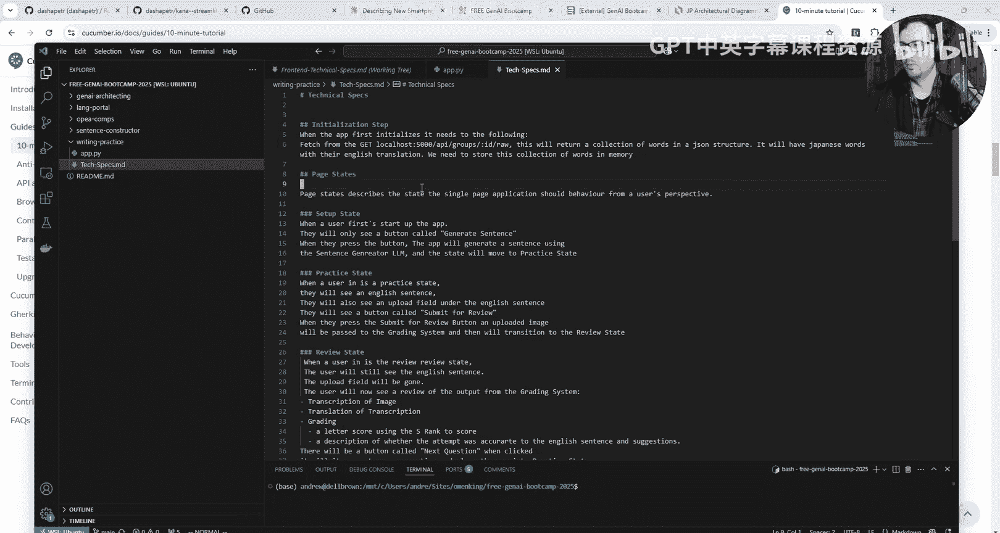

I'll go over to here and it'll say generate me a streamlit app。Okay。

 and so I'm going to paste this in here。That did not pay and right， but that's okay。

 its probably figured out still。

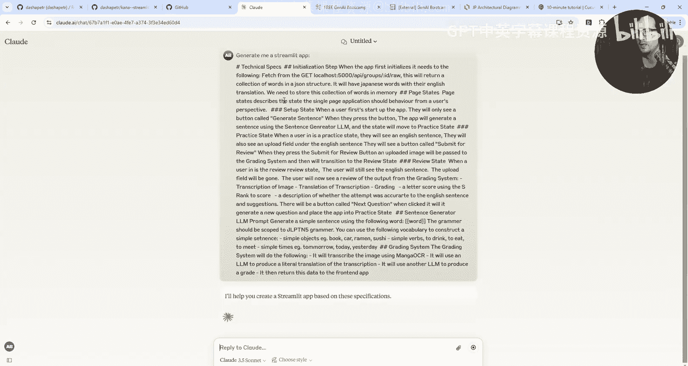

It's's taking those like literal expectations of those states right， so have streamlit requests。

 Enam， JO， typing， Open AI， Open AI is fine， I wouldn't mind trying to use this locally。嗯。

I do have opening eyes， so that's going to be really easy for me。 but we'll go ahead and copy this。

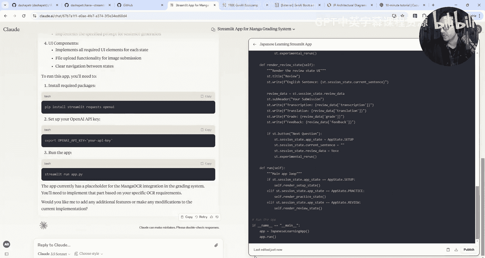

And I just want to copy it over so I can kind of see the code。 So I'm going to go over here。

 I'm gonna to paste this in。And let's see if we can make sense of what it's produced。

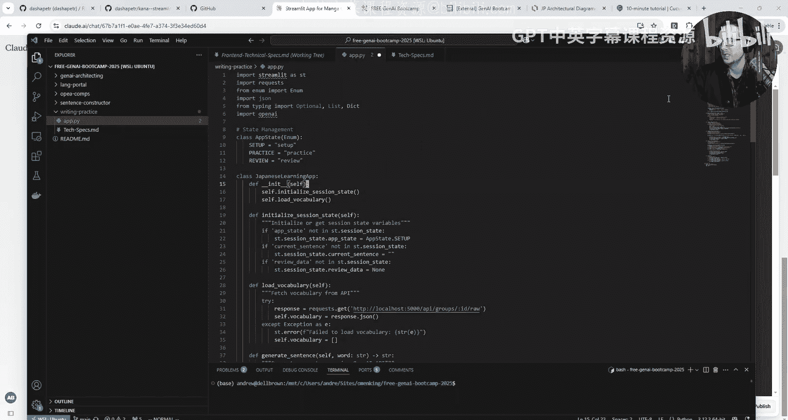

Okay， so here we have a class， Python class， and it has。And it has three。Constance in them。

 I'm not sure why I did it this way， but I I assume that would work。 I don't see why it wouldn't。

 We need initialize their app， So we have our initializing session state。

 and we have load vocabulary。 So addressing that comes afterwards。I'm going to scroll on down。

 just curious if there's anything else after this。Nope， it just has that。 So going down here。

 It does have a dot run。 So I guess run gets called last。Or no， that's the thing that gets， sorry。

 We go up here。 It first runs this。 So it's gonna to initialize this state the session state。

 So if the app state is not in session state then set it to this one。

 if the current state is not this and set it to that one， otherwise do this stuff。

 So it's initializing some stuff。That's fine。 We can have that like that。

 And we have load vocabulary。 So here we have request， get local host 5000。

 And so it's going out there to get it。 I'm noticing here that it's not。Replacing the ID here。

 which is kind of annoying， so it's supposed to do that。We'll look down here for generate sentence。

It already， I kind of want to open this up in windsurf because， you know。

 we can keep copying patient between Cla and this， but I have a feeling like I'm basically just going to be using using it directly。

 So I'm actually going open this up over here。

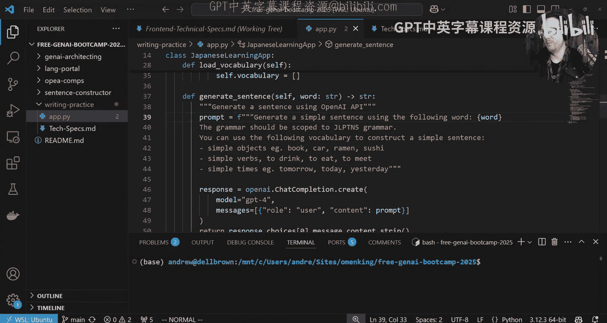

And I'm going to close out all these。 So say don't save。

 I'm going to go ahead and just open this folder。So I'm going into writing practice。

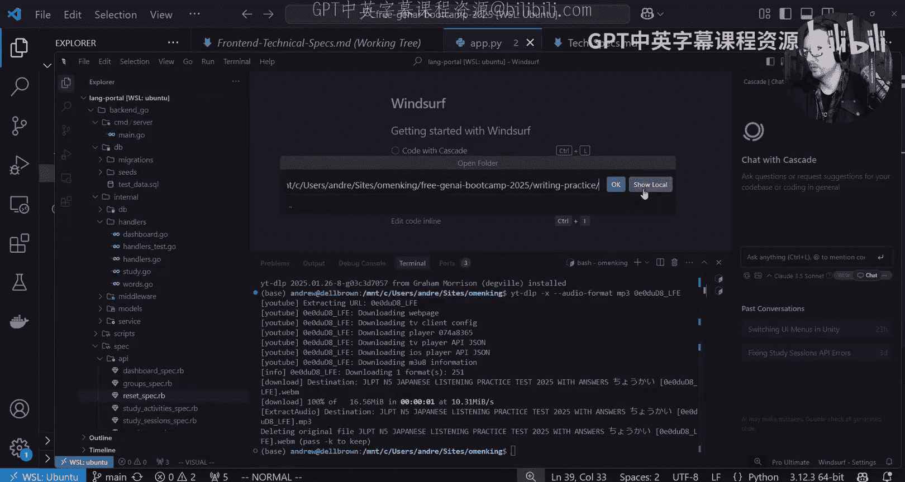

And let's say okay here。Oops， I already lost windsurf。 Come back， windsurf。

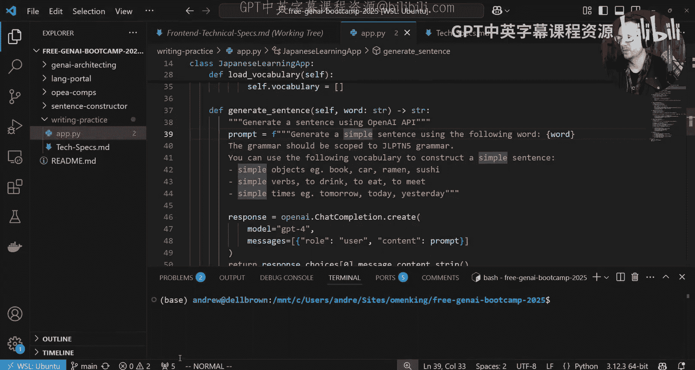

And。I'm going to open this up。And I want to help it out。

 So I'm gonna to say over here I'm gonna say right。 And so looking at here， I can tell。

 like right away， you know， in the， in the load vocabulary。Function， it's supposed to。

Pass programmatically。The I D。From the query string， when the app first loads。From a query string。

Called。Group I D。Okay， so that's something that's missing right off the bat。 Let's fix that。I mean。

 this code is so small， it's not like too hard for us to figure out on our own。

I have it set to write mode， so it's going to try to fix it。

So I've got to pay close attention to what it's doing。

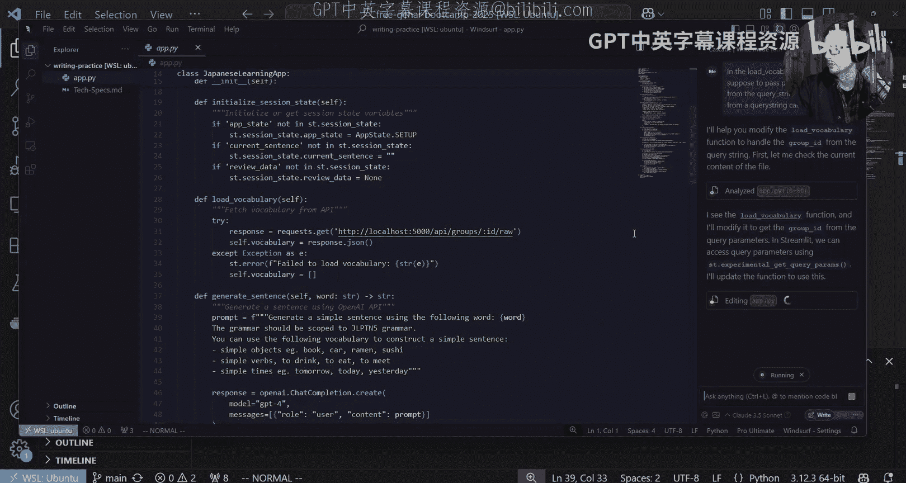

So let's take a look here， nothing below。Here what it's doing。 It's removing this from here。

That makes sense， well。嗯。Let's see。 Get the query parameters。 So experimental get query parameters。

 that's an experiment。 That's not even， that's not even new。

 So now I'm like kind of looking at this going， okay， what's going on here。

 So I'm gonna go over to the Internet。

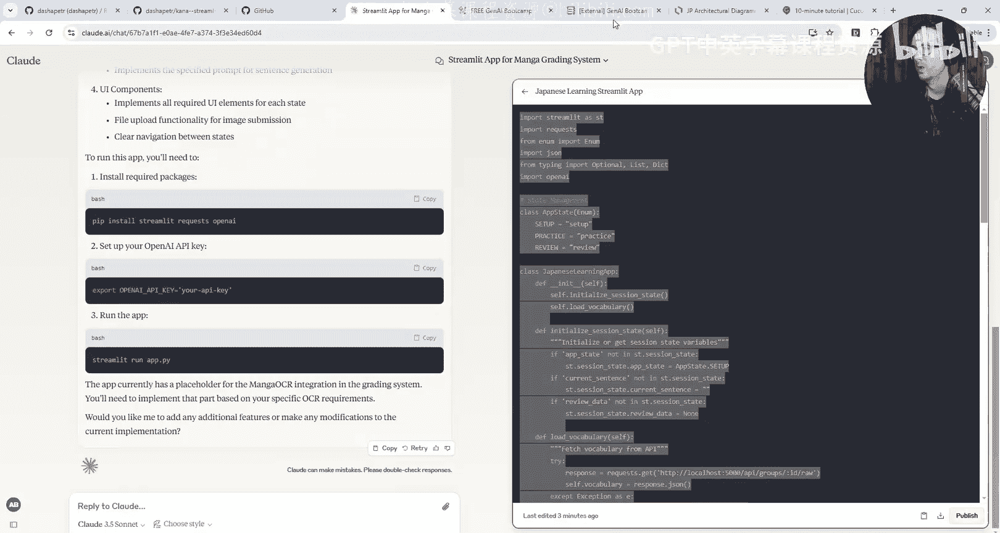

And I'm just going to go and paste this in here。So this says deprecation notice， right。

 so now it actually uses this。

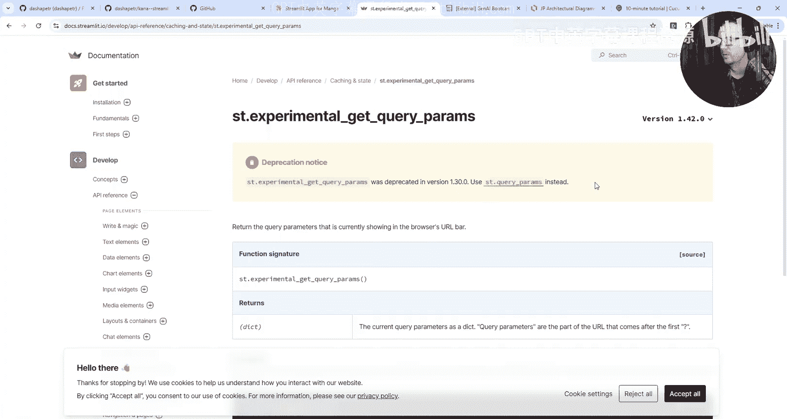

So I'm gonna copy this because clearly， clo is a little bit out of date。

 So I'm gonna go ahead and write this in here so it knows。I'm not an expert with streamlit。

 I just looking going， I don't feel like that's an experimental feature， right， So we go here。

 And now we should get the group I D。 If the group I is not set。

 no group I was provided by the parameter。 And then the idea is just to get a response with local host 5000 API groups group raw。

 So that looks good to me。 I'm gonna accept this code。 I don't know if it's gonna to work。

 But the point is， is that we will， we will work through this as we go。 And so it gets back response。

 It's going to store the vocabulary。 Now， it matters what format the vocabulary is in。

 or it needs to be aware of what the vocabulary is going to look like。 And right now。

 it doesn't know。 So that might be something that we might want to let it know。 Now，😊，Yeah。

 I'm just thinking about this for a second。I'm just trying to decide。

 do I want to continue to review the code here or do I want to bring in my other， my other。

 my other code here， So that one looks fine。

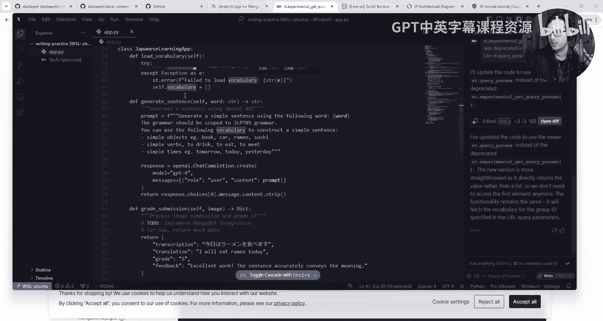

I think what I want to do is I want to bring in into this the original Lang portal。

 because I just don't want to be confused about like the new one。

 I don't want to have to try to work with my go Lang app as it is not what I'm the best at。

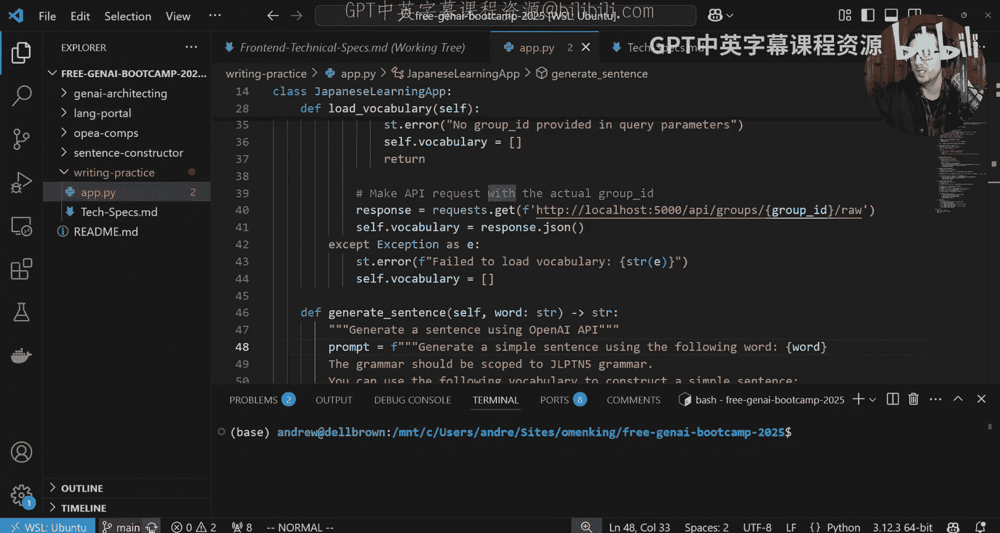

So I'm gonna go here and say Github dot com。 And we'll say exam pro code。

 And this is gonna to be the 2025，2025。Here， free Gen I here。

 And so this laying portal has some endpoints that are no longer implemented。 I'm gonna cheat。

 and I'm going go。To here， this is the commit that I want。

 So I wonder if I can download this exact version。Browse the repository at this point。

 So I'm clicking here。 And so now all I want is that code。 Now if I press period， it's up here。

 I think I should get that code。 Let's see if that works。

I'm logged in to do that pressing the period there。 And soll give it a moment here。

 we have laying Port。 and so I just want to make sure it has those endpoints are implemented。

 so I'm going to go into the Lib or the route directory because I got rid of some for Ryan when we were working on this here。

So that we had something to code on。 And if we look here in here， I'm looking for。Review。

 maybe it was here， study sessions， maybe。Yes， so this one is fine。 So this one's good。

 I'm gonna go ahead and download this。😊，Okay， and I'm just going to download this to my desktop for now。

And I'm going to have to， yeah， I doesn't like to download direct。 So what I have to do here。

I I need to。嗯。I'm just trying to decide because I have one called Lang Port。

 I think what I'm gonna do is go into the Omen King folder here。 and I'm gonna just rename。U。

This to go。To the go version。So I'm not confused。And doesn't want me to do that， so。That's fine。

 I'm going to just make a temporary folder here。 We'll call this T。I'm going to right click here。

 I'm going to download and I'm going to navigate over to sites in here。

 I'm going to go into the Omen King folder。 I'm going to go into this one。

 I'm going to go into the temp folder， and I'm going to select that folder to download it。

 And it says， yep， it's fine。 I can view it。 Yep， it can save it。

 And so now it's going to download all that content。 I'm going to give it a little bit of time。

 It might take a bit of time。 so I'm just going to pause here。All right， so I think I download。

 let's go take a look and see if it's actually there。 So I'm trying to find the folder。

 I got so many folders going on here and。We'll go back a step here。 back another step。

 reading the correct 1。 I can't even tell。 So I' gonna go and just navigate there manually again。

 So we'll go into Omen King here into this one。 And I have that temp directory。

 And so I'm just gonna rename this now to the Python one or flask。 So that will know。Which is W。

 which is wish， which is wish， which is which the difference between the two， right？

 And so'll just say flask react。 So now I really， really know。😊，That one there。

 And so I can go back over to my local host。 and we need to just get this started up。

 So I'm gonna go into the， I'm in V S code。 You'll see I'll be managing multiple ones here。

 which is how it's going go。 And I'm going to C D into。

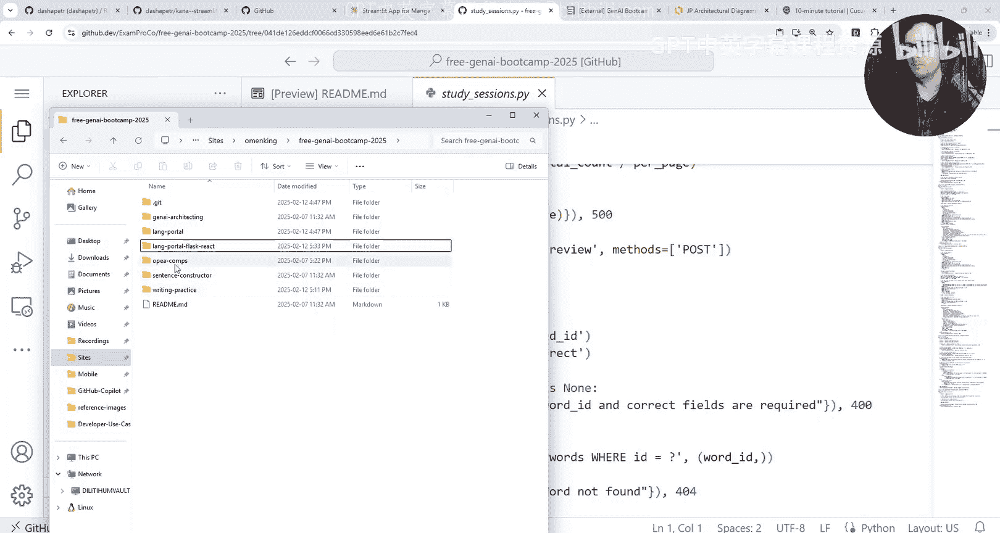

Blanang portal， fl reask。And， yep， yep， I don't care。

 And I only really need the back end because the front end， I don't really。 Well， I mean。

 if we want to launch the app， I guess that we will need that when we do that。

But I'm just gonna do a Pip install hyphen R requirements do T X T。

 I probably shouldnt need to do this， but just in case I do。Oh we gotta go in the back end， right。

 And then we run that。 Okay， and so now。We need to initialize the database。

 I think is invoke in it DB。That's because I have a whatever that task is called， if you don't know。

 get get the thing to explain it to you because you have。

 you have all these A codinging systems that can tell you how to do it。

 And so now if I want to run this， we'll do Python app do pi。

 And so now this is running on local local port 5000。

And so I guess we should really try to add the app。 So we're almost an hour in here。

 but I got to go eat dinner。 So I'm gonna be back and gonna pause。

 And I guess what I want to try to wrap up this video is to get the L like this application showing up in Lang portal。

 And then we'll figure out how to connect and bring the data。😊，Over， and then once we have that。

 we'll implement it。 But I don't think this is gonna be hard to implement it。

 We might be able to get this all done in the next， next hour in the next video。

 And That's what I'm hoping for。Okay， I'll be back。

 It's gonna to eat something and then we'll wrap this video up。 All right， that was a quick dinner。

 So we have the the back end running。 We'll have to get the front end running as well， I guess。

 because we need to see what we're doing。And I'm just going to go into that portal。

 that folder again， you have Lng portal， not that one Lng portal。Flack reask。

 we'll say front end here and this one's going to be NPm install， and then we'll do an NPm run dev。

So think we're gonna have to decide what we want the port to start on for that other application。

 which shouldn't be too difficult as that is installing it and go over to the the Fl reactact app app here。

 It looks like it started。 I'm gonna do MPM and dev。 I was going to start filling in that data。

 but that's totally fine。

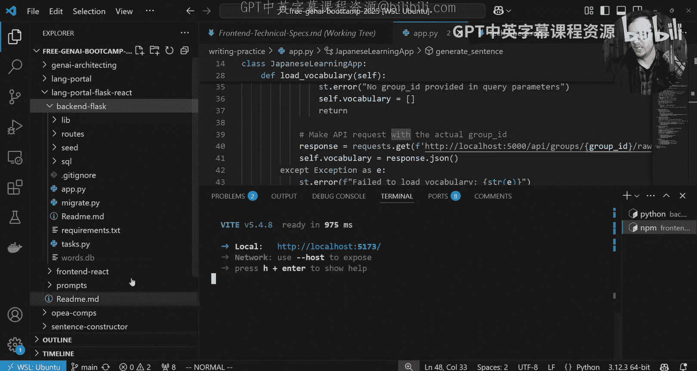

So I'm just looking for wherever that window is， we have so many windows open here。

 it's just getting out of hand。

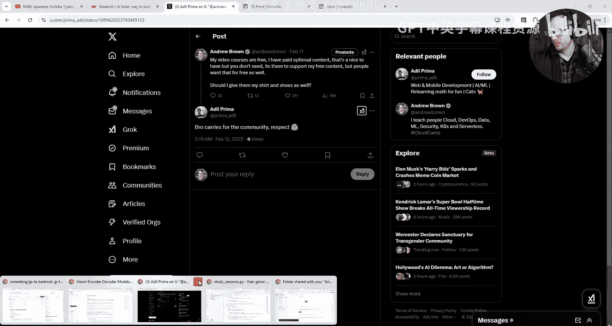

Let's just close a few more here。It was this one we were working with？No。Just give me a second。

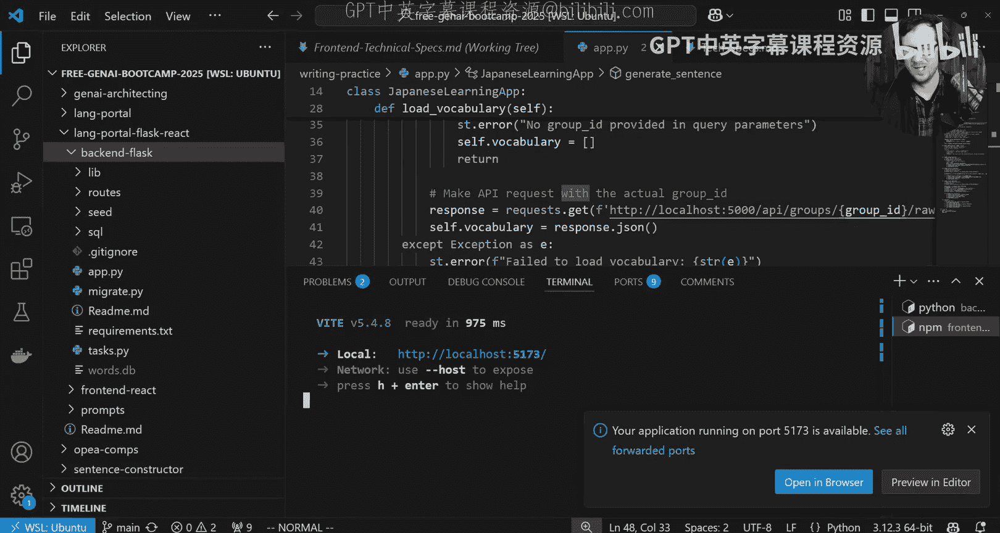

I basically lost it， but it's totally fine。 So what I'm going to do here one second。

What I'm going to do here is I'm going to go to local host。Was it， is it 8 os，5， No， it's 5， It's 5。

 something something。 Yeah，5，1，7，3。And right now it doesn't have that other app loaded in there。

So we're just giving that a moment to load here。 Let's take a look。 that says 517，3。 So that's good。

 It's just thinking。 And so if we go over to our study activities， we have typing tutor in here。

 Now I don't have it in this repo， I have it in the other one。

 And I did upload it to the exam Pro code repo so that people can download that one but I need this other activity to be here。

 So the way I'm going to add that is that we're going to go into our seed data here。😊。

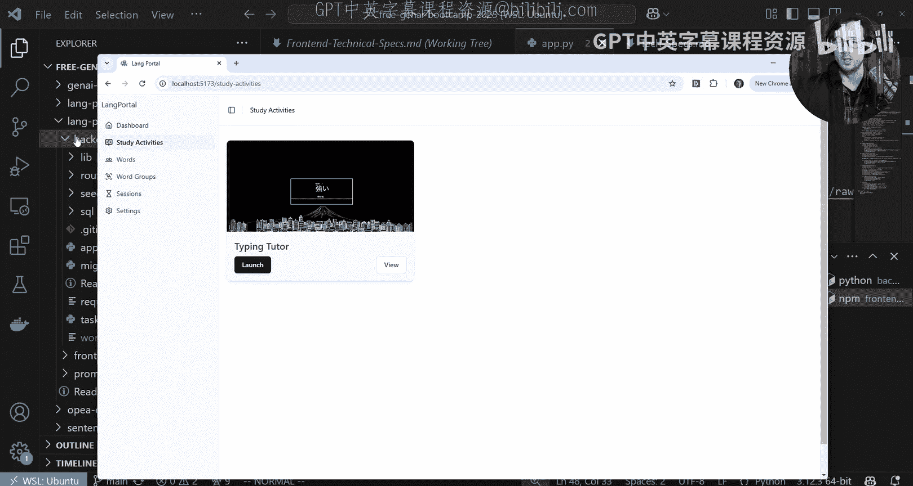

By the way， if you are not working with this Python one， you can code it into your own。

 but if you want to keep pace with these lessons，You might want to just get the Python one working。

But if we go into study activities here， this is kind of the adjacent structure I have for importing that data。

 So I'll bring that one down。 I're going to call this writing practice。

Writing practice and this is going to have a port， and maybe this will be port8。You know，880，81。

Right， and so this one here needs to have some kind of asset right now。 we don't have one。

 so I'm just going to let it be broken and we're going to remove that out until we have one for later。

 So now what I need to do is I need to get rid of this database。As this is not going to work for me。

 So I'll just delete this one permanently。 So delete。 and I'm going go back over to here。

 and I'm going to stop this。 and I'm going to go ahead and reinitialize this here。

 So we have a new database。 It is complaining。 I'm not sure why maybe I'm missing a comma。I am。

 there we go。 And so we'll try this again。 And so now it's re initialitized。

 I'm going to go back and run this application。 I'm going to go back over to here， and I have。

You know， this here， right， the local host 5173。

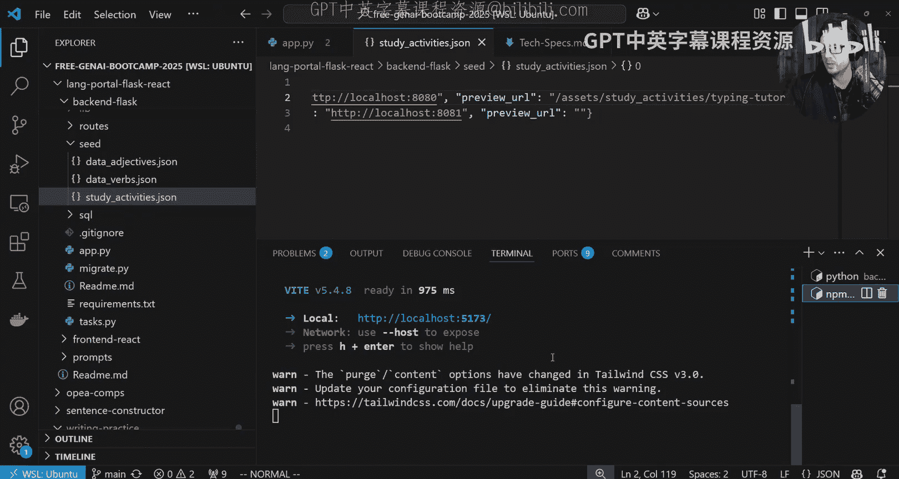

And if we go back and give us a refresh， we should now have this other activity。Right。

 so now we have the writing practice one。 and this is going to launch this other app。

 but our other app needs to start on a very specific port。

 So we are working in windsurf over here and。

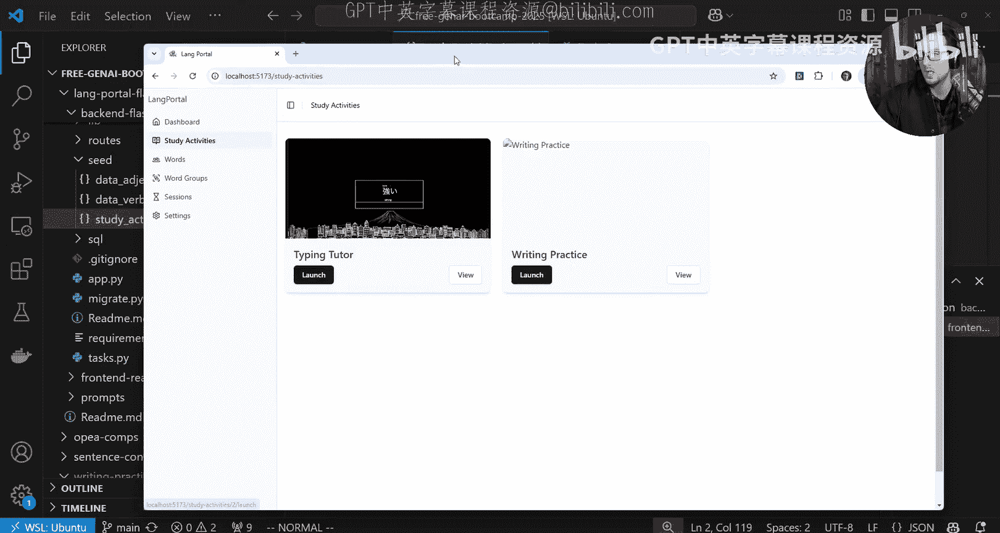

I mean， this is fine， but I need this to start on a very， very specific port。

 The other thing is like I need to make sure this is the correct endpoint API groups rawd。

 Now if we had the la portal here， we could probably ask windsurf to take a look between the two and maybe we could do that。

 but again， I like to just keep things simple and open things in folders。

 maybe I should just start working everything in one one repo， but I just don't want to。

 And so I'm going to go here and I want to make sure that that is the correct endpoint。

 so I'm gonna to look under groups I'm looking for that raw endpoint because I want to see what it's called。

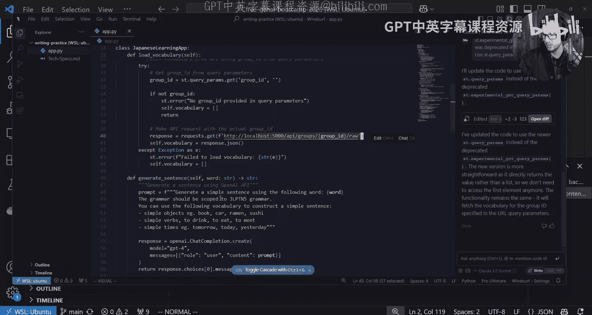

So it's called groups and it words raw。 So that's what it is group。E cetera， words raw。

 So if we go back over to windsurf。

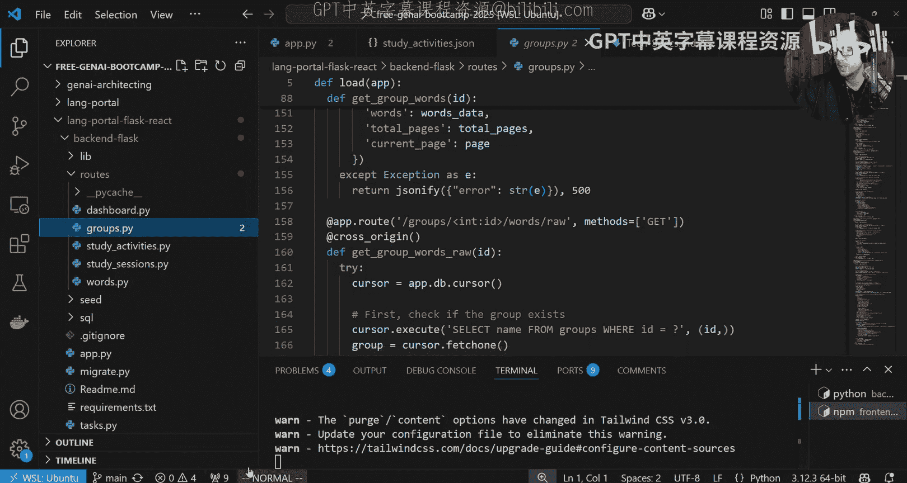

Groups。So it's pretty close。 It's just missing this words raw。

 And so that will give us back a response to some kind of structure。

 I'm gonna go ahead and do a console log here。 Oh， no， no， no， no， no， it's not We can't do that。

 It has to be。 It has to be this print。Response， Jason， right。

 So I want to see what Jason's being returned back here。 The other thing is I。

 I want to tell what port to start on。 So， you know， can we make this streamlight app start on port。

80，81。We're going to be more prescriptive about exactly what we want these ports to start on。Okay。

 didn't didn't， didn't need that。 Oh， yeah， I missed that。 That's my own， that's my own fault。

So this should start on port 8081。Now there's a lot of code here。

 and so you know we might have wanted to start with something more bare bones。

 but we'll see what happens now I want to see if this actually runs and it is suggesting to run it there。

 I'm going to just open up terminal here。And I'm hoping that this is in。 Yes， it is in the。

WSL side of it， so let's say run a。 pi。And we're now starting on local host 8885101。

 which is bizarre because we told it to start on this port 800801。It says this is not supported。

 so I'm going to go backward over to this。And I'm just going to say like， why did it do that。

 that's clearly the wrong port。AndI'm actually surprised they did that。

 So that's making a configured dotomil。 I didn't know we need that。

And so it's setting on port 8081 on this one。I can just stop it this way and restart it。

So we'll just hit stop here， and I'm going to go ahead and try to run this again。

That says 8081s in use。 What could be using 8081 right now， I don't I don't really know， so。I mean。

 yeah， I don't know， but maybe there's something we can kill killca I I don't know what's wrong 881。

 but。Whatever it is I wanted to stop。 So yeah， we'll just go ahead and kill that。And。

We'll say this here， I mean something's running， right？No， no， no， no， no， no， no， let's， let's kill。

What's running on 8081。 That's what I really want to happen。Okay， so we'll do that instead。

 I just wantan to kill that。I mean， we never changed it away from 8da81。

 som not sure what it's talking about。I'm just going to stop this here and we're going to go ahead and start this up again。

So now this is starting up on the correct port， I'm going to open this in the browser and so we have it and it says no group ID query parameter and that's totally fine because it doesn't have one right and this is actually what it should display。

 So if we go over to this here and this one here and we say launch。

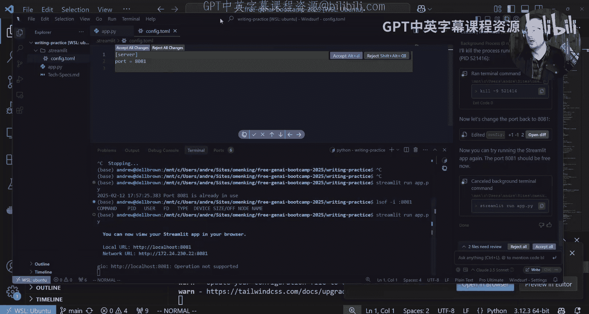

Right， we drop it down to verbs。 It's double loaded， which it shouldn't be， but that's fine。

 Now it's saying group I， et cetera。 And so what I was expecting was to get the the logged out information。

 So if we go back over to streamlit here。

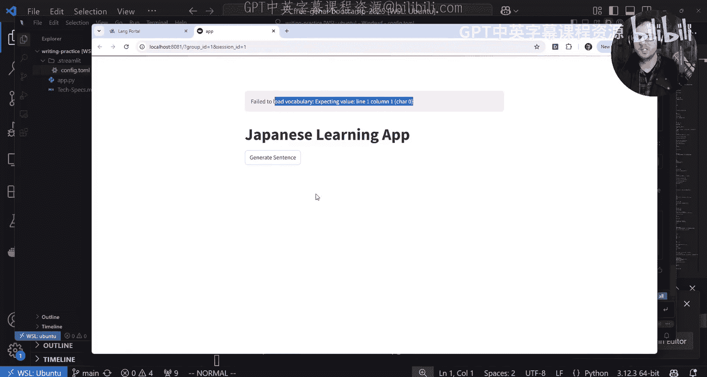

You know， it saysG， I'm not sure what Ge is operational not supported。

 but it's not showing out any output like。So go here my print statement。Isn't showing anything。

In radio。Or sorry， in the terminal for streamlit。And。And we have this error。

So we have a few problems。So for the print statement， we have to use the S T right。 Okay。

 so that's gonna be our first thing that we'll need to fix。

And then here it's saying the expecting value error suggests we're getting empty。

 let's modify the code， now let's update the app for better handling of the API response。Okay。

And maybe take a look at those disks， as it going here？Just fine。 Yeah。

 And then this will help us understand。 Try to run the app again。 We'll do this。 Okay。

 so we'll stop this here。 No it's like I don't really let it to run the app because that's where I run into issues。

 I don't still don' know why ever're getting this thing。 I don't know what that is。

But I'm going to go back over to here， we'll give us a nice hard refresh。

And so we get a 404 response， which is totally fine。 We go down below here and we get a 404。

And I'm still not gonna logging。 This is kind of annoying。 So I'm gonna go and stop the app。

 I just want to make sure。We'll just say we'll just accept it all。So accept all。

 And what I want to see is whether。Any of the stuff is printing， so we'll say， what was it ST dot？

Print。Is that what it said earlier that we could， if we wanted to get information it was S T print。

S T， right。I mean， it seems to be odd of completing that as too， right。And yeah。

 we'll write that there。 I'm just curious， Like， if I， if I run this， do I see it now。

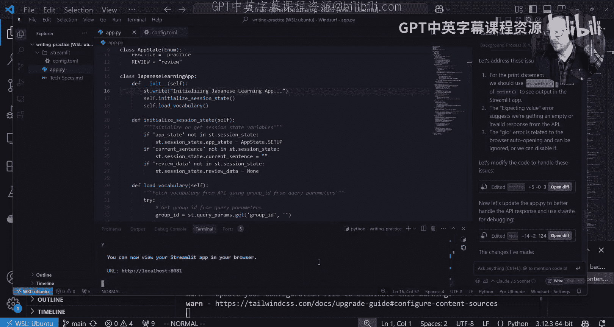

And so that's not working。 I'm going to go to the Internet， the the old Internet here。First。

 I want to know what this error is。What is geo， why do we keep getting this？

Could you provide a little bit more information， the problem exists in both PIip and Conda。

 I think the problem is with Python 312， the same as with this， I'm not sure what this happens。

So it seems like it's just a problem， but anyway， ST right。Streamlit。

 we' take a look at what that is。This is writing in the app。 I want to print like， so say streamlit。

 print two logs， print to console。 That's what I really want to。 That's what I really want。

And so here。

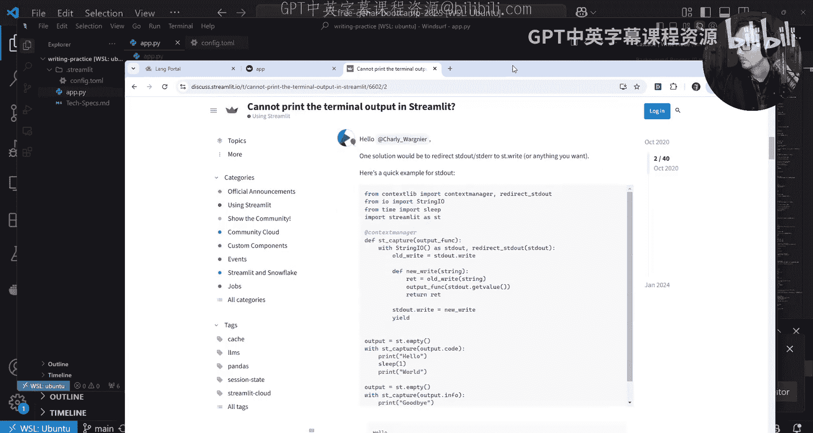

We're going to look the old way。So it's also suggesting os， right。

 Loging actually doesn't seem to show up anywhere Neither the browser of the file。

 found way to found a way and added it to the post。Okay， I how do I。So it was a streamlit。

Not printing to console。So that like if we need we need a way of debugging。

 if we can't print a console， we're going run into some issues here。

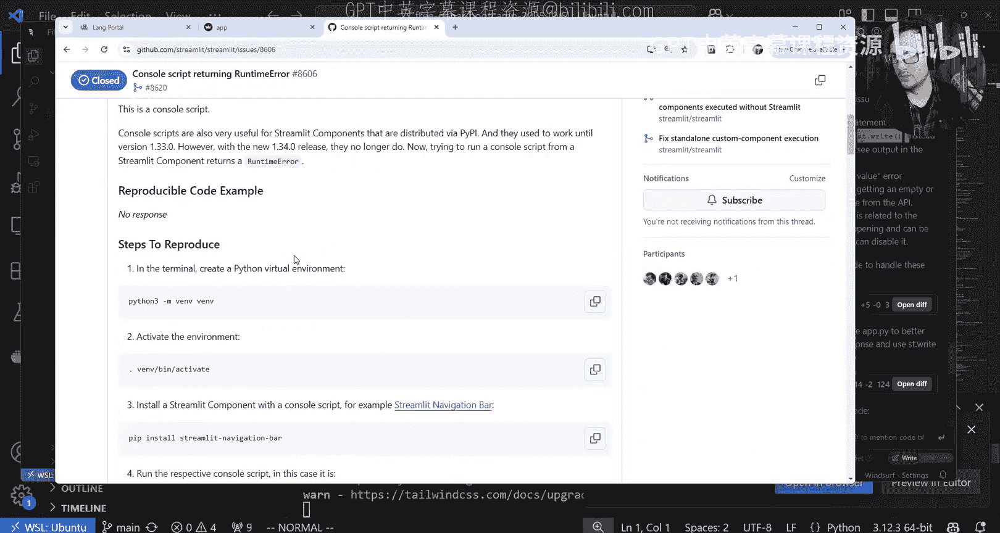

Just a second。 So I asked Claude and so it looks like ST W is more about clientin side and printing here should be server side。

 So maybe that's our problem is that were kind of expecting this to show up here and it's not。

 So and I also tried the OSs right with someone else suggested that didn't really help us。

 So I'm going to go ahead here I'm gonna to say print hello。 And so maybe this one will show up。

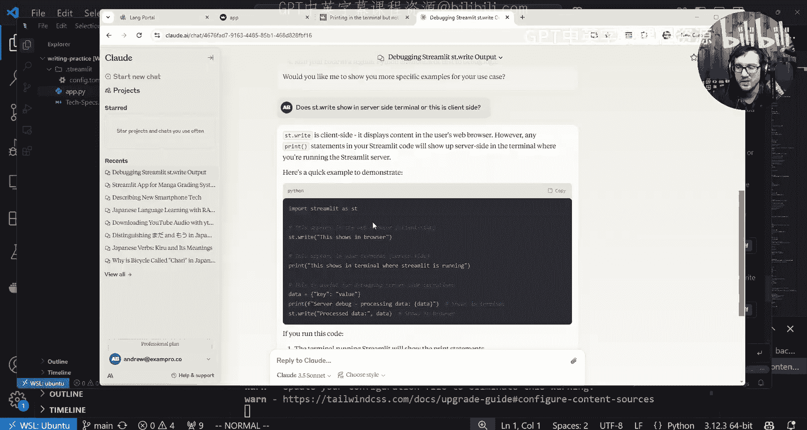

Even though we already did that prior， right， so I'm not sure why that would have shown up before。

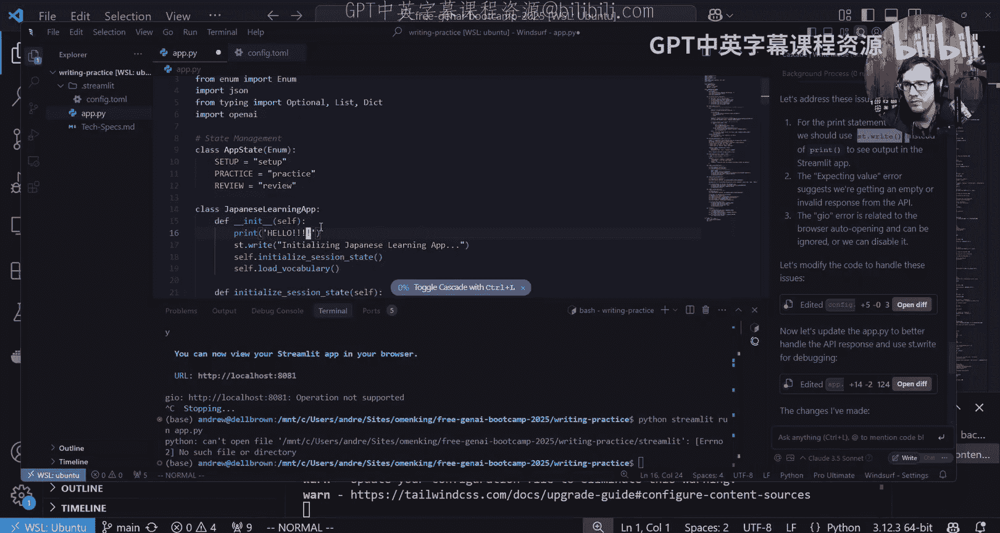

And we're still not seeing anything， right， So this is kind of frustrating， you know， print。

Print is not。Showing when。You know， could this be because。Of how we run it via streamlet， run。

 etc cetera。Because I wonder because it isn' its so binary if that would cause an issue with it。

So here they're saying， let me clarify the behavior print statement depends on how you're launching it。

 if you're running directly with streamlit， then the print should show in the terminal doesn't if running through a service container then might be redirected logs。

 you might need to access the logs。 I'm just running， I'll just show what I'm running。

It is a little bit frustrating。We'll go back over to here and I'm going to copy it like this。

But because I get this， this makes me think that there's some other issue that's going on here。

And so I'm not 100% certain。

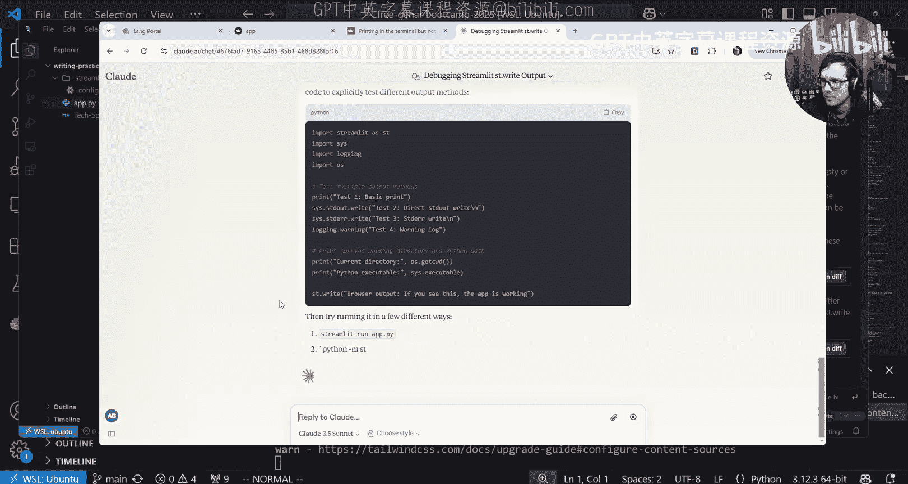

So I guess it has a few different ways we can run it。 So what I'm going to do to just rule this out。

 We're just going to make a a simple one here called。

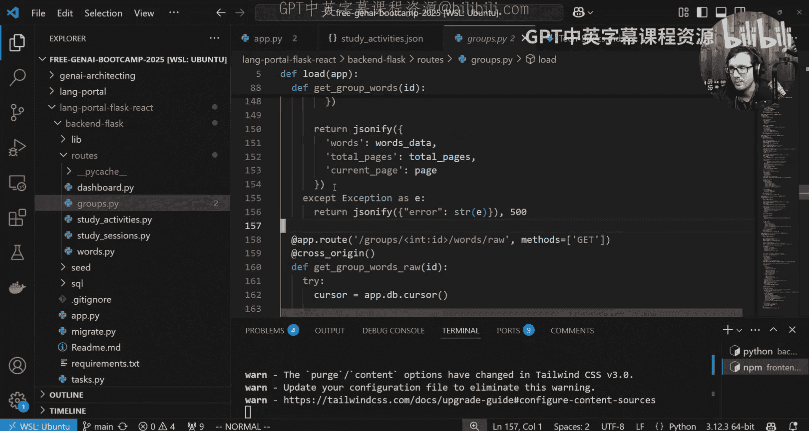

File， we'll call it。Printing， print dot pi。 And I'm going to go back over to here。And test。 Now。

 you don't need to。 I mean， you get this from the repo。 if you really want。 It's not cheating folks。

 if you grab for my repo。 as long as you're not grabbing everything， right。

 If you need to grab a little bit here and there， it's not a big deal。

 So we have a few different ways that we can run that According to what they're saying here。

 So we have these three， these three modes。 My thought is that what's going happen here is that this。

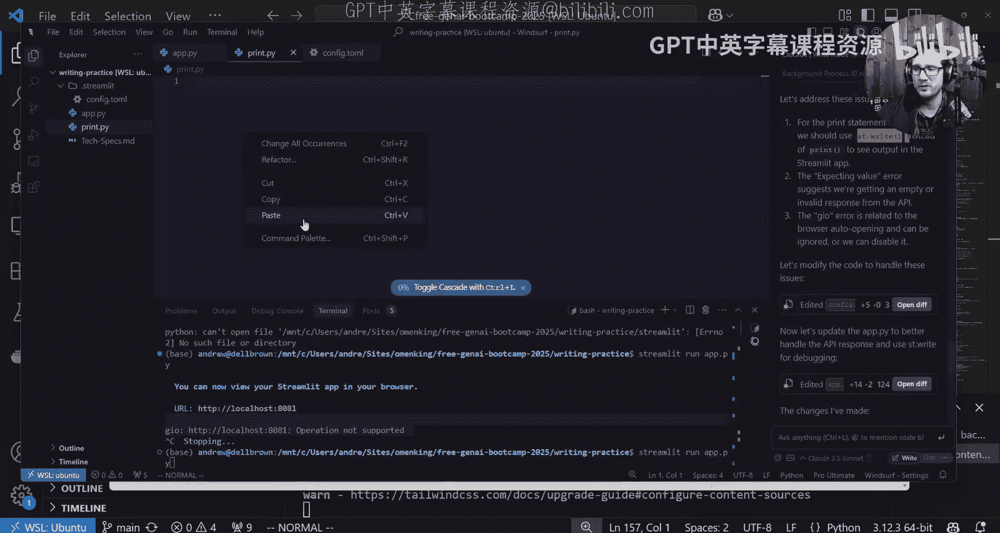

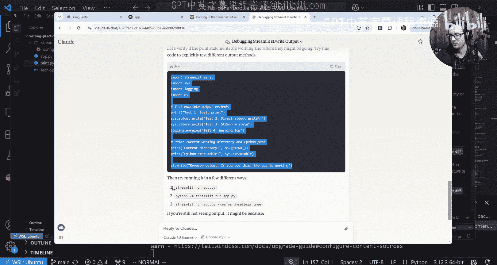

First one is our problem， or it could just be our code。 I'm not sure。

 but I'm going to go ahead and just copy this here， print。Pri。

 you notice there's like three different ways we can run this print。

 I don't really want to run a server header list， but we'll try this first one。So we'll solve this。

 We'll run this。No logging。 Okay， so we'll try the second one。No logging， right？

We'll try the third one。No logging。 so I would say that all three did not log。

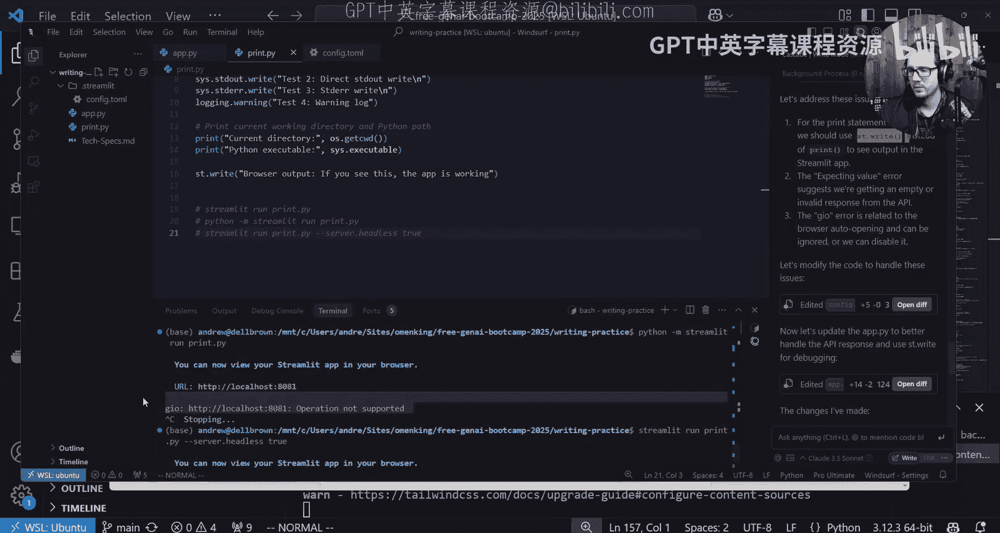

So we'll go back over here。All three did not log。We also get this error。Of the app， but。

Its related to print。 So， yeah， you know， we have to have good troubleho and debugging tools。

 or we're gonna have a really hard time。So it says this typically related to the G T K。

 It isn't related to the printing issue。 And let's try more robust logging to confirm the SDO capture。

 So this one here， they're doing way， way more stuff。 I'm gonna go ahead and copy this。

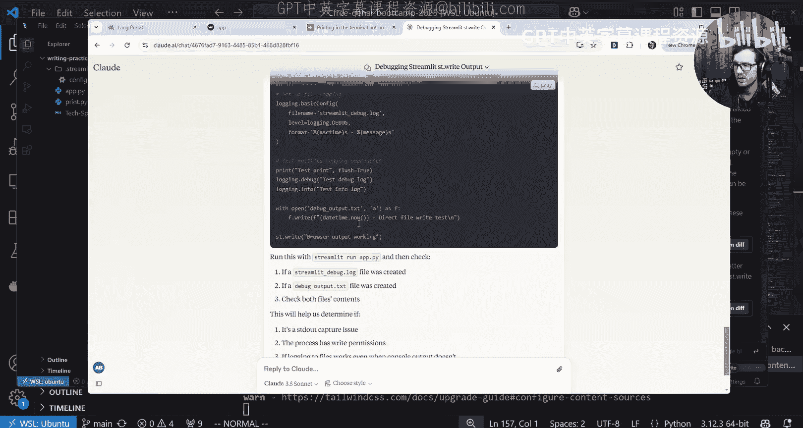

And we will paste this in here。We'll try this again。

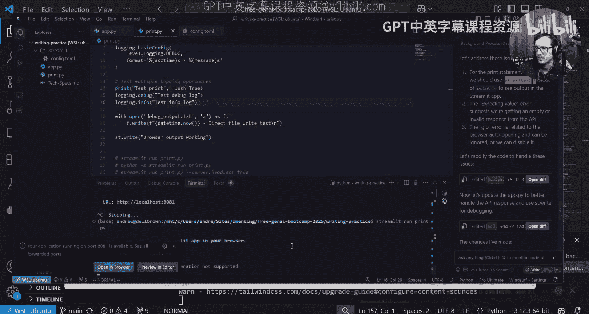

We can open in the browser。 like we can see browser output working here。

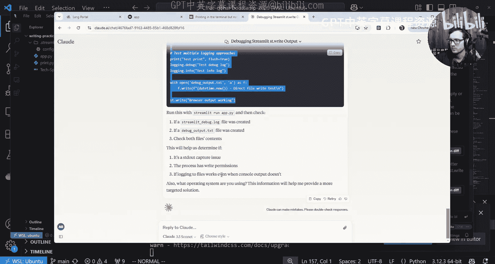

Run this in streamla click and then check if a log file was created。

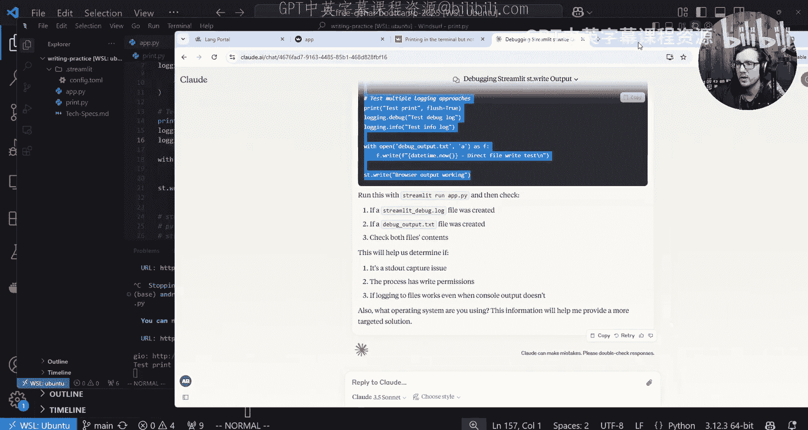

Let's go give a refresh here。It was。 Oh， so we have a deep out log and a streamlight debug log。

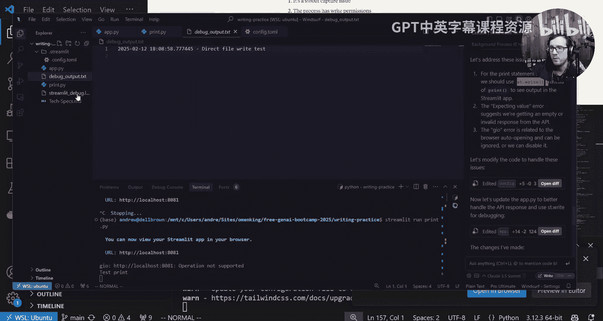

So， we have a。

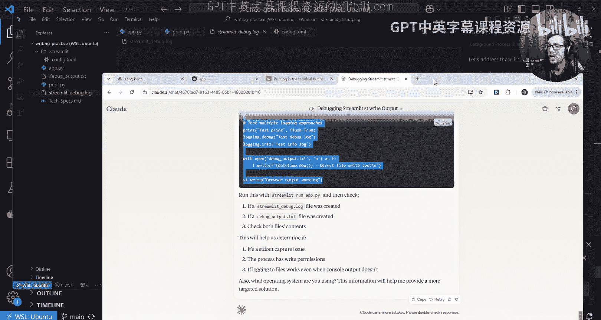

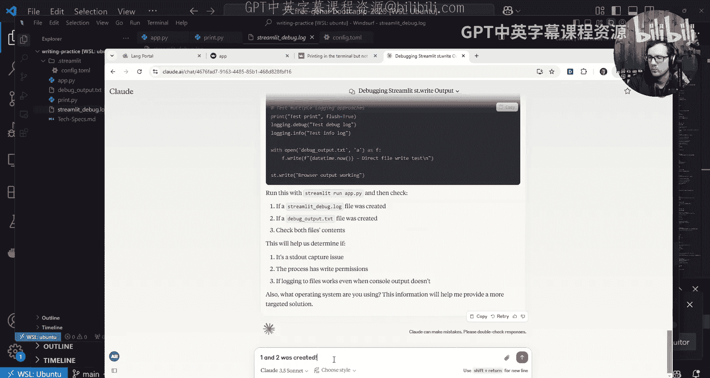

And I'm not sure why we can't read this。 We say open anyway。It's a little bit excessive。

 That's a little bit too much information。 So it seems like the debug output is something we can use。

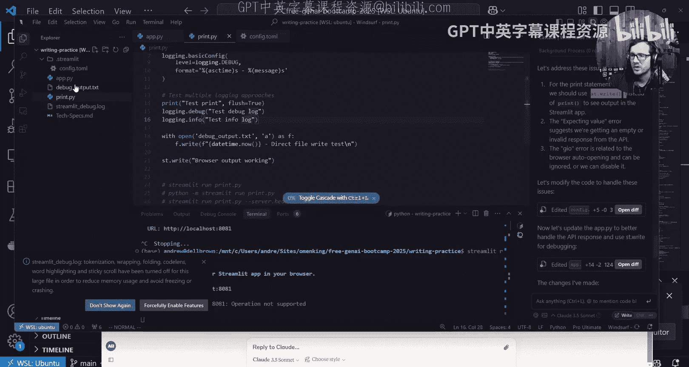

So I don't need to ask it anymore about that now we have a method that we can utilize so what we want。

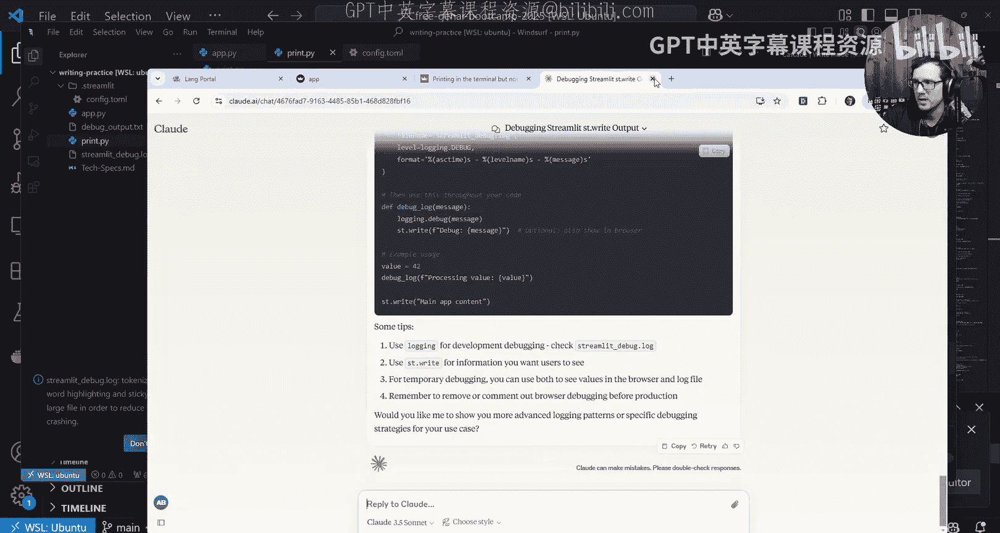

Is the debug output？So I'm just taking a look here， setup based configuration。

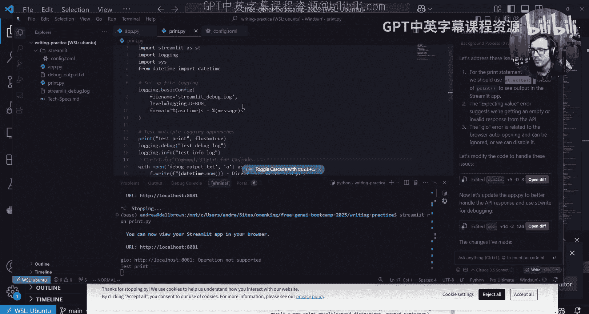

It seemss like we shouldn't have to do this。 but this is why I kind of like radio over I mean Stamlet's good。

 but I'm just saying this is kind of the reason why I prefer streamlit over radios because it works as expected。

And this one has more moving parts。So here we're configuring it， I don't really want this log set up。

U。I want to take this one here and I'm just going to replace it here。Like this。Okay， and。Open with。

Well， hold on。 I don't know if， I mean， that other loggged work。 that other log actually did work。

 It's just that it was very excessive。 And so maybe what we need to do。Here。

 this one actually did work。 It was just that we had too much output。

So I'm going to just delete this here。And we will work with this and we'll just say。App dot log。

 which is called app dot log。And we have different debugging levels here。And so what I want to do。

It say， logging。Info。Initializing。 So this will initialize it。 So if this works。

Then we have a way to debug。 You， You really need to make sure you have means tobug to。

 to be able to do what you want。 If You can't do that。 You're gonna be in trouble。 So we'll go ahead。

 I'm gonna give this a refresh。Did we get it here， Did it log。啊。I mean。

 maybe we need to open up the application， local host8001， I don't think we should have to。

We got a nice refresh here。And we'll go back here and give this a refresh。 And so， I mean。

 it's calling streamlit debug。 Oh， you know what。 did we start the wrong one， It's brandy。 Yeah。

 yeah， yeah。 So we'll go ahead and we'll delete these two。

My fault。 And so we'll try this groups。 We'll try this again。

So this one is going to be streamlit app， right， We'll keep that other print around here for debugging。

And so I'm going to refresh this。 I I was hoping that I would see something right here。

 but maybe it doesn't start up until we give it a hard refresh here。Now it shows up， okay。

 we go over to here and we end up with way too much output。

And I'm going to go back to Claude because I need it to be a little bit more manageable than that。

So it says here the log entries are showing internal file watching this happening because the default logging is catching all logs。

 including the streamlin internet let's modify it so only show your application debugging and so here。

嗯。I it's changed something， it's not very clear what it's changed。

 but I'm going to go back and stop this here because this thing is just making a giant log file。

 which is not going to help any of us here。

I'm going to go and refresh this。OhI think it's gone， oh no it's right here， we'll delete this。

L that and so I'm going to go back over to this file here。And。Create a custom logger for the app。

 That sounds a lot better。 So we'll go here。And。Do this。所以 app。Dotlo。And。We'll hold on here。

This was just called app。And then it's saying， set the debug level。It was confused it says。

 create a custom log for your app only and then create the file handler。I mean， I guess it's fine。

 It doesn't matter， so I'm going to go ahead and copy。The file handler， then you， okay。

 and then you do that。 Alright， so we'll go ahead and grab this。

I just don't know why it's called my app on here instead of app， but that's not a big deal。

So we'll go here， and this will be all of our。Set up custom logging。

I almost think like extremeill wasn't worth it because of this one particular thing。 But， you know。

 maybe on other people's machines， it just works。 And so it's less of an issue。

 But now we should be able to do log or debug。I mean， we have info， but we'll do log debug。

This one's called logger Now。 I guess we could have call it logging to make it consistent。

 but who cares。And we'll try to start this up again。 I'm going to give this a refresh。

 make sure there's no other logs in here。And let's see if that's a little bit more sane。

 So we still don't see anything here， but we'll go back over to our browser。

And we'll go back over to our app here。And， you， once we get the debugger working。

 we'll stop the video。 We'll move on to the second part of this video， but I'm。

I wanted to see any logs here。 Did a log， did a log。And now we get our single log。 That's perfect。

 So now， since we have that， it's going to be a lot easier for us to see what we're doing。

 We can also tail that log here。 So if we make a。😊，Another bash here。

We you just say tail was a tail F？Tale F app。t log。Or tail hyphen N app dialogue。

So that was TF。Was it live tailing， It's been a while。 So that's always hypphon F。

Using Ta command to tail a file live。

Yeah， hyp enough to follow。Yeah， that's exactly what I did。嗯。

Oh maybe it didn't auto finish the there we go。 so now we're tailing it so if there's any changes。

 we can just see it in here by on this tab right So what I'm going to do is go back over to here。

 this is like an old this old old devop。

So。We have the logger here， right？ And the the real question is like， we're getting a 404。

 If we go back to the app So said response 404， but we want to know what's going on here。

404 means that it couldn't find it。 So here。We can see the address。 And I might just say。

 like up here， URL。And I want to go ahead and grab this here like this。It's a bit hard to copy paste。

 but I'll bring it on to the next line here。And so we'll say URL equals like this。And。We'll do this。

 Okay， so now we have that there。 Oh， that number is wrong。 Why is it 4，9，9。Why it 499。

 there's nothing non499， maybe because we gave it something random before， so was it 5，0，1，7，3。

 what is it？No， it's 5000， right，5，0，0，0。 So I wonder if it changed it from that before。

 But what we can do since we have a logger。Loger debug。 I'd rather just print out the URL here。Okay。

And it's printing out the response in here， which is fine。 It's not exactly what it want。

 but we'll give us a nice refresh here。

And I don't know we have to restart our app for that， no we don't。

 but it's heading to endpoint so you can see it's going to 5。

000 API groups one raw word if we go back over to VS code I know it's a big little mess here。

 but if we check our back end here。

We're getting a 404 we're saying API groups one words raw does not exist。And so here we have， oh。

 you know why it's not API。 It's just groups。 And this is the problem。

 This is the inconsistency problem that I have with this one。 And the question is， like。

 do I correct it， Like， which order should I do it then， I'm not really sure， but。

Because if I change this here， this is going to break typing tutor because typing Tutor is coded to work with this one。

So， you know， it's up to you what you wan to do。 I'm gonna actually change this to be API。

 I just want to be consistent。 And so I'm gonna stop and start this。

 We probably probably don't have to restart it like that。

 But if we go back over to this and give this hard refresh。

Now we get a 200， and it shows the response data。 And we're using the S T right。

 and it's printing it out right here。 So now we have an exact idea of what the structure is。

 It's returning a lot of words。 Is that how many that gets returned back that many。

You know what it probably is is because the database is double loaded that it's。

 it's causing this issue。 But we we're at the start of it。 So now we're kind of in a working state。

 We have a means to debug。 And I think the rest here is going to be really easy。

 I'm going stop this video。 And then we're going continue on in the next video。

And finishing the implementation， okay？

