# ExamPro《生成式AI训练营｜Free GenAI Bootcamp》中英字幕（deepseek - P37：-37-Kana Writing App - Andrews Implementation Part 2.zh_en - GPT中英字幕课程资源 - BV1SFEWzLEab

Alright， so now that we are in a state where we can debug and we can see our API endpoint。

 this is where we are going to be able to。You know， continue on。

 So I'm gonna just drag this off the screen for a second here。

 We're gonna go back over to windsurf where I'm working again， use whatever you want。

 If you don't want to use echo code system， you can copy paste over， just get it done。

 however you need to get it done。 So the thing is is that this is bringing in that data。

 which is here。 and it's being printed out， which is good。 And so we do have。😊。

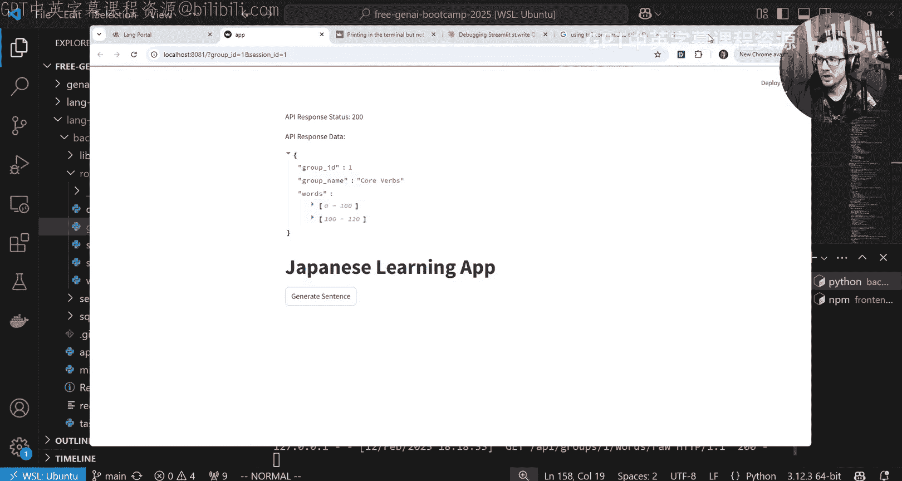

Our generate app button， right， so it loads the vocabulary， which is here。

And then we go all the way down the ground and we have our run state。 So in our run state。

 when it's in this state sets up the render setup state。 So we'll go over to this one here。

 we have the render setup state。 It sets the Japanese language learning app， which we have here。

 it's more like writing sentence app。 so really it should be that like writing sentence like Japanese writing。

Practice。So I kind of prefer it to be called that， that's totally fine。

And then we have our generate sentence。 So pick a random word from the vocabulary， import random。

 random word from the vocabulary， which is fair。 Here， we only need the this。Japanese word。

 which will be the kanji， which it really should be called Japanese， but I called it kanji。

 which is fine。 And these are all verbs， which is not always the most ideal。

 But the idea is that we want to grab that there。 So here it's saying word Japanese because it doesn't know anything about the data structure。

 And so maybe we should tell a little little bit about that。

 So I'm gonna to go ahead and copy this and say。

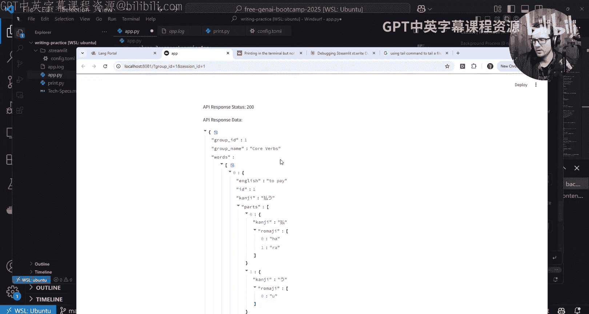

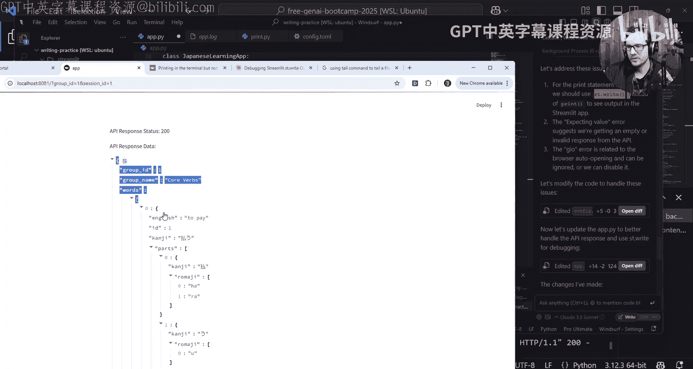

This is the J payload structure。That comes back。From the API。Can you update the code？

To work with that for the generate sentence。Budton code。Okay， so I'll just paste it in there。

 kind of gives it the structure。I could just give it a moment there to figure it out。You know。

 it has to go within words and then select the word from there。

 And so we're expecting this code to change。It's interesting that they're importing random here。

 We could probably just import it at the top。 I don't。

 I don't think we should be importing random in line like that。

 So I'm just gonna go ahead and fix that like that。 It's a bit silly。

And it's still thinking it's really taking us time here。 We have a lot of changes， so here。I mean。

 I don't need this thing to be like that。 that's a little bit silly。So I' going to change that line。

This one is kind of stupid well I mean， we'll change that well that's fine。

 I like you can accept each line here。And。Here， check if the response is successful and contains the data。

I'd rather， yeah， again， I would rather log it on the back end here。It' storing the group name。

We don't really need to do this。So I'm going to reject that， I don't care about that。Yeah。

 we could do that。 That's fine。I'm not really sure if it should be empty or square。

 it doesn't really matter here。We have API failed request， that's fine， this is fine。

 it might still need to be square。This is fine。 This is going to the logger instead of there。 again。

 this one again changed a lot more than I was expecting。And so here， generate a simple sentence。

Using the following word。During simple Japanese sentence using in the word kangee English。嗯。

We don't need to pass it the。We don't need to pass。Both。The Japanese word。And the English word。

Let's just。Past the Japanese。Word to the prompt。 Okay， I don't know why it's doing both。

 That's just overkill。And we'll wait for that to fix。 It is bringing in our prompt document。

 which is really nice， so I like that。There we go， that looks good。嗯。

You have more natural Japanese sentences is not being influenced by English meaning during that。

 I mean， I don't know if I agree without reasoning， but that's fine。 And so we have this。 It says。

 and then is the debugger。 This is using this。 This looks old。

 So I'm going to go over here and say the open AI。API calls looks old， I can tell。

 because it's using。Title case。Can you check the web and see what it's supposed to be？

Because that's totally wrong， so I'll using GPT4， which is really old。

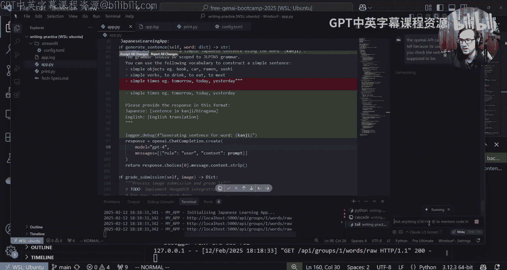

Bad Google， though，' this is open API Python。 that's not a good Google。But if it still finds it。

 I don't really care。I'm not sure where this is coming from， maybe it's just a document here。

It just keeps going， so I can't really see it。

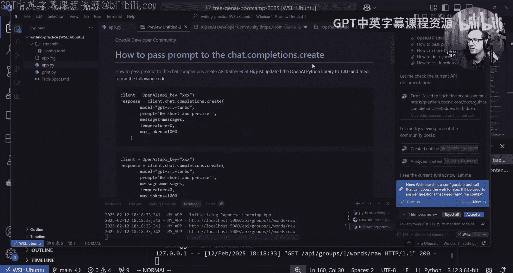

Oh， it comes from the internet， All right。Cancel， I'm not trying to close this。Just ignore that。

 I'm not sure what's going on there。 So it says I can see the the syntax now and let me update it。

 So now it's correcting because it went out through the internet。It's using GPG4， which is really。

 really old， I'd like a newer model than that。Dismiss here。 The matches the open A Pthon syntax。

 So that is correct。 I don't want G 4。 I want something a little bit better than G 4 because that is not very capable。

 So I'm going to go over to the open AI。Interface， I'd love to try to use this with local models。

 I' am right now just using a managed APIs。 But if we can。

 I would like to try to use my either my machine or my AI PC， but we will do that。 if I have time。

 I'll do that in a separate video。 So I'm gonna go back over。

 I'm going to log into the API over here on open AI。I always have a key。

 but I want to go to the playground。 Let's take a look at what we have for models。

Moll for step by step complex。Like is G4 going to be intelligent enough， I don't feel like it is。So。

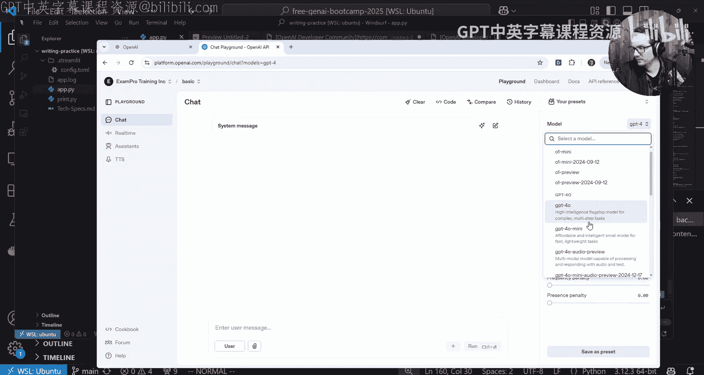

I don't know。 I， I'd rather use G T 40。 So that's what I'm going to use。You know， again。

 if you don't have GP 40， like if you don't have paid credits or whatever youve got to work with what you got。

 or you have to connect locally with whatever it is。But here this is G 40。 So I've changed that over。

 and here we can see the gradings。 So that's that anyway。 So we'll continue on to。The next part。

 so we have render state setup， let's look at that again。Which is here。And so。

No vocabulary loaded that makes sense， add the group header。And then when we press the button。

 instead of doing this。It's going to generate sentence。 That's better because it's there。

 And then we have the generated sentence there。 and then we have the sentence。

 And it's storing this current state that makes sense。 And so that will be the first step。

 I'm going to go ahead and accept all That looks good to me。 Let's go test that and see what happens。

 So I'm going to go back over to the Internet here。 Dr this on over。

 We give us a nice hard refresh analysis see what we get。

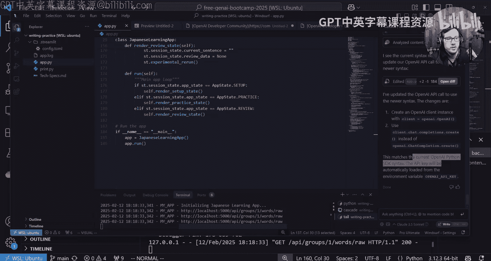

So here says the Japanese learning app has no object called group name。

 So it seems like maybe there's something that's supposed to be there prior because it does save that group name。

 I don't know why it does that。 I don't really need it。

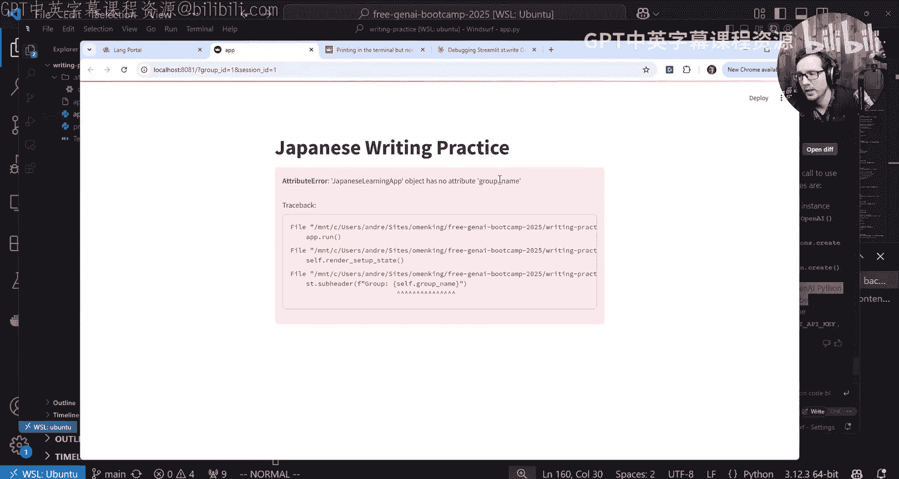

I'm just trying to search for it in here， group。

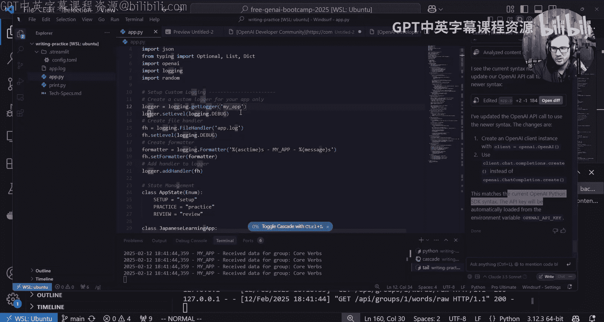

Name。I mean， it has it in that step there， but at that point it wouldn't know what it is， right？

It's supposed to get set earlier。Maybe because I rejected it， that's probably why。

So we'll go ahead and just comment that out。But， maybe we'd want to see it。Maybe that was my mistake。

 Maybe we should have had that there。 But let's go ahead and hit the generate button。 Now。

 this should fail because right now， we don't see anything。 but right now， there are no。

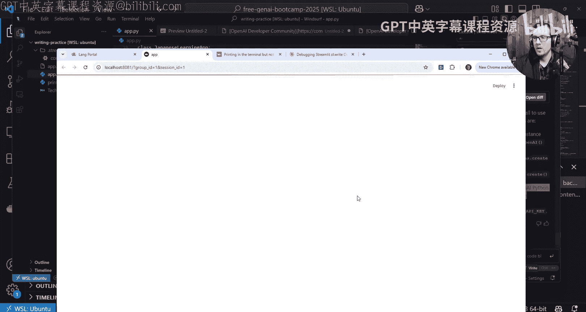

We don't have an API hooked up。And I'm not sure if this is still a problem。嗯。

Because I commented that out。Group name， I just want to see。 does that happen anywhere else。

 Group name， group name。Data do get group name。I'm not sure。

 So I'm going to just stop this for a second。 I'm going to restart it back up。

 I want to see if we keep looking at the same error。 I， I kind of feel like that's not our error。

 So hit that。And yeah， we're not getting an error there。 Let's go back over to our logs。

Received data from core group。 And so we get a blank screen here now， to be fair。

 the open AI doesn't go anywhere， right， So like， that's probably what's going on here。

So let's go and take a look。Should generate sentence。

We have log or debug generate sentence for word this。I don't see this being called at all here。Right。

 so。Yeah， before it even calls it， we should be seeing this logging here。

And if we followed this back to wherever it's being called。Here。

We also have selected word here as well， where it says English and Japanese。And here。

 this says no words found the vocabulary。 I， I think we would expect to see that。

But that's displaying over here。 But let's go ahead and see if we have any errors on this side。

 We don't have any errors on this side。

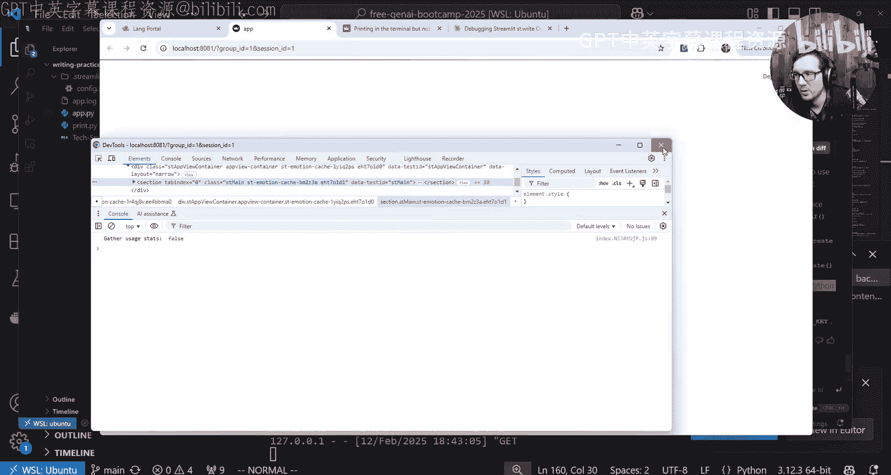

U。So maybe we should do is we should put logging here， like， say logger。Geneerrating sentence。

I'm going to stop and start this up again we probably don't need to do that。

And we'll bring back up our tailing here。And so we just got to really step our way through this project。

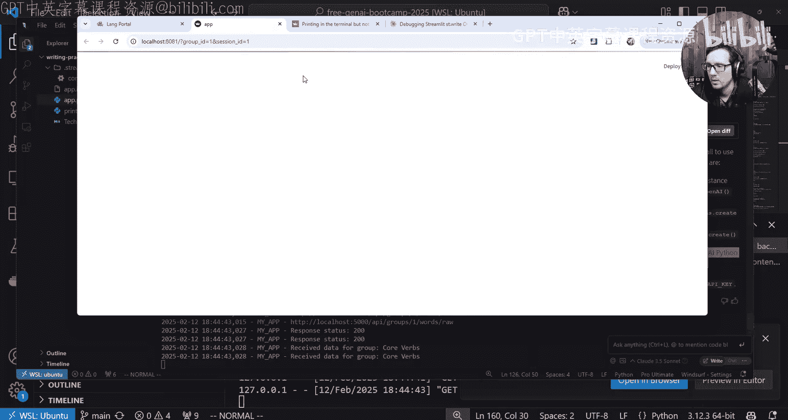

I mean， we did see something appear， right？I think it's kind of annoying we're getting a lot of these repeats。

 I'm not sure why received data from the group。But it's not working。 So I'm gonna say， like。

 when I press the generate sentence button。I just see a blank screen。

I don't see any the logging occurring。In in the log。The log file after the button is pressed。Okay。

 and we'll see if it can figure it out， I don't like how it's like triple quadruple logging。

That's not our problem。 No， no， no， no， no， no， no， no， no first。Look at why。

The logging doesn't occur。For the button。And the chat G is the G bottle is correct。

You're just out of date。Okay。It is working， okay， it's completely pointless sure。

But we don't see the January sentence log whens press。

 The click button is handle isn't being executed。 extremelyre is rerunning the app in a way the effects are logger。

 Let's modify it。Let me check if there's a missing issue， sure。Okay。

They'll start running the app again and generate the sentence but logger should now properly record。

 Yeah， just because you say it doesn't mean it's true。

 We're going go ahead and we're gonna try to run this again。Oh for Fs。 Oh， you know。

 that's over here。 That's why。And I'm going to hit stop and start。 We'll go and watch the logger。

We'll just tell this， sorry。And actually， what I'm going to do before we do anything else。

 I just want to clear everything out of here。So things are a little bit easier for us to see what's going on。

And I have it。 I'm going to give this a nice hard refresh。 We have it。 We'll press it now。And。嗯。

Generate， I don't know if it actually did it or not。 I want these out of here don't save。

 I don't know what that is。 Don't save this。But what I'm looking for here。Like。

 this is why I don't think radio is worth my time。 It's just like so much work to make it work。

 It's supposed to be easy。 it never is for me。 Alright， like。

 I really regret not just writing this in like， react or something。So。

We have logger dot debug vocabulary， generate logger。

 So what I'm trying to figure out is like when the buttons pressed。

It is Preo button state is clicked。嗯。I don't see this in the logs， so it's like the button。

Didn't get triggered。Okay， so we'll do that。Mmhm。😊，This in the correct place。

 but there might be an issue without stream lights handling the button and click or how the logger is correctly configured。

 let's modify the click。Add a unique key to the button to ensure the proper state management change the button click to use logger do info for better visibility。

 I don't see why that would matter。 Add a session state tracking for the click button additional logging。

 Sure， I don't think any of that's going matter， but we'll go ahead and stop it and start it up again。

 We're going go back over to here。 I'm refreshing off screen to trigger it here。

 and I'm pressing the button now。 I'm going to go back over to here。 We're looking for that click。No。

That's not doing anything。 Okay， we lets， let's think a bit more about the problem。

I switches over to chat。Because I don't want it to write。It's just going to work us into circles。

 I don't like that。嗯。I don't know。 I， again， Im， I really。

 I really don't want to use streamam look because of this。

And it makes me think I should just redo this in radio。

I'm trying to decide here if I want to do that or not， because I just want this to work， right。

And Gradio has fewer moving parts。嗯。Anyway， it says set up custom logger so we have to do more here to do it。

 that's so much work。Move the logger into the streamlight session state to prevent the reun in every rerun Add a console handler。

 this， I this， I this really the problem。Does it even know what the problem is， It's just。

 let me check what happens when the button is clicked。

 The issue might be with the vocabulary loading loading or the sentence generation。

We're immediately calling experimental rerun。Okay。I'm going ignore this。 Okay。

 we are going full in here， and we're gonna figure this out。

 If there's something experimental in here， I want it gone。

I don't want experimental I don't even know what that is， and we're not even at that stage yet。

What is experimental rerun is my first question。 Like， what is that， Is that anything。

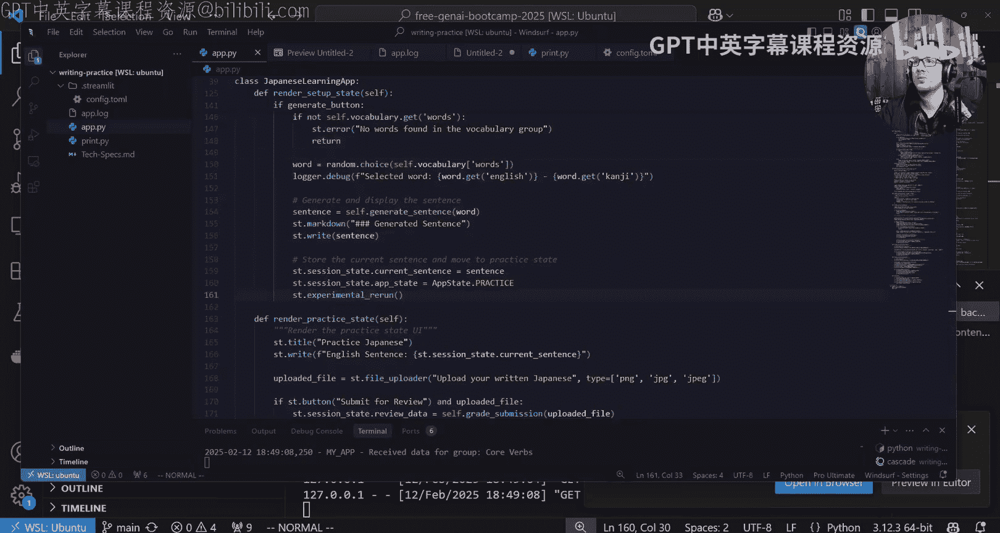

What does it do？What is experimental rerun？

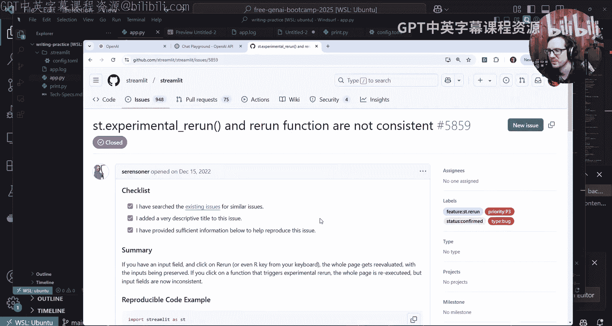

We don't even know。Oh man。 I， I don't like this。 I don't like this。

 It's just like too much of a pain。 I feel like we could try to get to work， but it's just like。

 why I， I don't want to spend all day trying to figure out streamlight。

 I just want to be productive in coding。 So I'm gonna switch to something else。

 It's a little bit more reliable。I'm gonna try to do this with radio instead。

 So I'm gonna go over here and say back to this。 I'm gonna say， can we implement this in radio。

 You know， this， this isn't working。Can we， can we implement this in radio instead。

Can you make it in a new file。Can believe the。As was reference。Okay， Ill， I'll give it right mode。

 And let's see if we have a better luck with graio because radioadio has fewer moving parts。

 And this thing is just not exactly doing what we want。Fun stuff。

Another thing we could do is we could just try to use like lovable or something and say， hey。

 can you generate up the front end for us。So we'll just wait a while see what it generates out。 Okay。

 I'll be back in just a moment。All right， here it's reached point。

 I'm going to say accept and let it run the up。This bit here。And so all it's doing is。

 I think it's just added radio here。 It actually swapped it completely out。

 It doesn't even have stream loaded anymore。 I don't care。Goodbye。Goodbye， streamreamlit。

 And so this one like， I'm not sure if like， they'veimplified it。 A lot of it looks to be the same。

Yeah， but they have this structure that's a little bit different。 Okay， the server port is different。

 So I'm not sure why it's that。Seems to be 80，81， though。So I'm going to go back over to here。

Let's make sure we've killed the old one。But this is supposed to be 80，81。

 So that's definitely one thing that's slightly wrong。Go ahead and change that。80，81。

And here it's suggesting us to start it。 So I'm just going to start it myself。So， did this。And so。

 here。Well let it bring back that into this。 Well， is this still doing ST T sub here。

 We'll hold on here。 Oh， we' we're not we're not writing the right one。

 So go say Python radio app here。At the end of the day。

 what's important is that we just get it to work。 So if we have to switch technologies。

 so be it must be set with either the passing API key or the client here。

 I'm going go ahead and add a dot was an E V file。 I'm gonna make a new file here called dot get ignore。

 And I want to ignore the dot E and V file。 We're going to bring in our open API key。

 So I'll say open API open AI。Was it called open AI API key。And we'll go ahead and do this。

I'm gonna go， I'm doing this off screen here， but I have open AI。 and you've seen me many。

 many times grab the API key。 Again， whatever LM you're using local or manage or whatever you'll have to figure out that implementation。

 We cover that all in the Gen essentials。 I show you how to use like so many different types of library。

 So just go ahead and try to choose one the best you can。 I'm gonna go over to here into again。

 I'm doing this off screen。 I'm just generating a new key out。And I am。Going to。

Going into this project here， It's kind of a pain。Manage projects， API keys。Delete this one。

 revoke the key， create a new key， calling this one， writing app。

I'm going to select this project as basic， createate the key， again， doing this all off screen。

 not that it's a big。 I could have showed it on screen because I'm going to show you the key here anyway。

It didn't really matter。 And I'll save that。And what we'll do is type in clear。We'll hit up。

And so that might fix that issue there。 The API key must option must be there。 Well， you know what。

 we did install Python。So I'm gonna go over here and sorry， not Python， but Python dot dot E And V。

 I don't need a fixed version。 So I'm just gonna do that。Just trying to make a fixed version。

 we'll do Pip install。

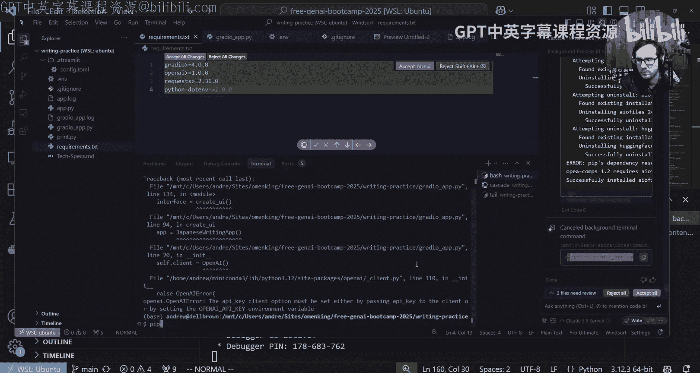

I R requirements。GXt， that's going to install it there。

 I'm going to go into the radio app in the top here， I'm going to say import。Dotie and V。

 And then we'll， yeah， that's the line I want。 dotie and V load。 So now that should load into place。

 When we run this， that error should go away。 There we go。 It's launched on 8081。

 We'll go over to here。 We'll bring in these values here。

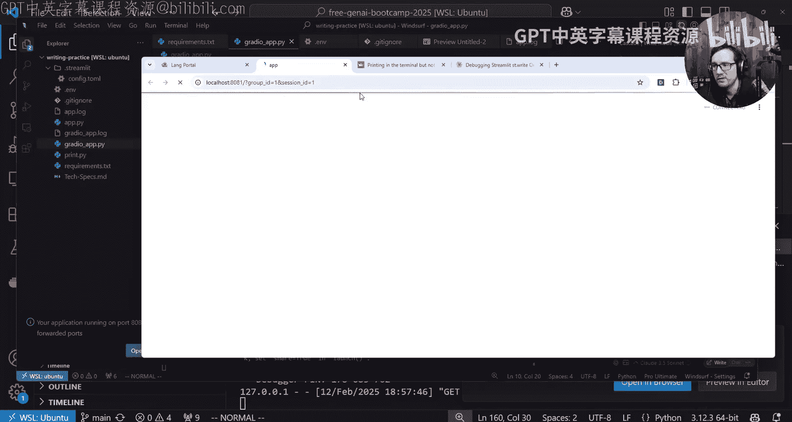

And it's loaded up。 looks different。 I don't care。 as long as it works。

 That's all that matters to me。 And so this is a little bit of a mess。

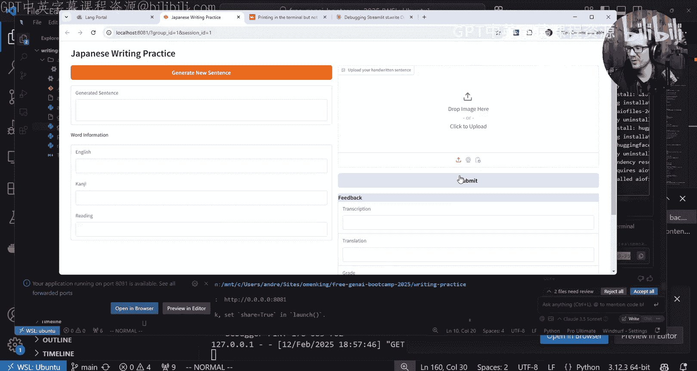

As。You can see we have。The sentence here generated the word information。Which that's fine。

 I guess is is the chosen word。 The image we're gonna upload in here。 If it works， who cares， right？

 So I'm gonna to hit generate new button。And so it went out there and this went to the LM， right？And。

 but it's generated a sentence in Japanese。あなたがその。realo， no， I don't know what this word is here。

So we might have to help it out there， oh。Yめる key us。

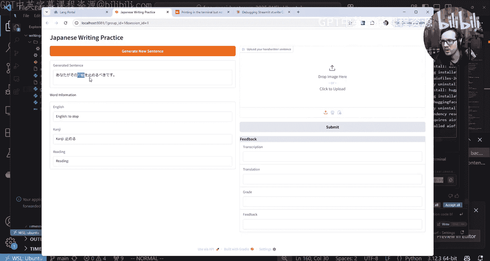

The word is great， but that was great。 So we'll say the prompt document。Is you know。

 can we load can we？The prompt documents。Can we？Refactoror it。So we are loading the file externally。

For the sentence generation， for the sentence generator。Okay， and so we'll do that one step there。

As I'd rather have it external。Why is it the yael。嗯。I don't know if I want it as a Yamble file。

I mean it's fine， it does work。Sure， it's not what I would normally do， but。That's fine。

 I guess how's it gonna interpret the， the， those fields there， That's what I'm curious about。

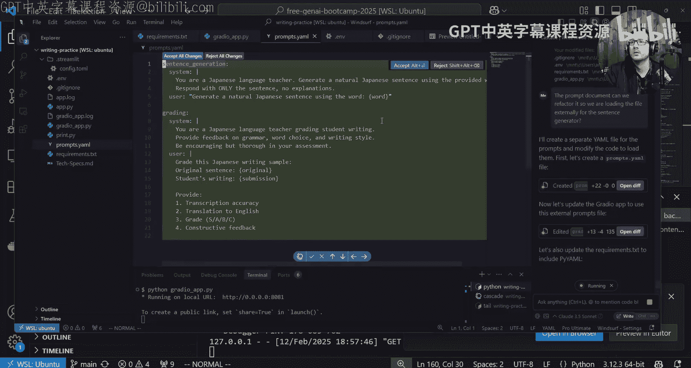

But you can see up here， like it chose the word English to stop。Y meou and it says reading， reading。

 I'm not sure why it shows that stuff there。

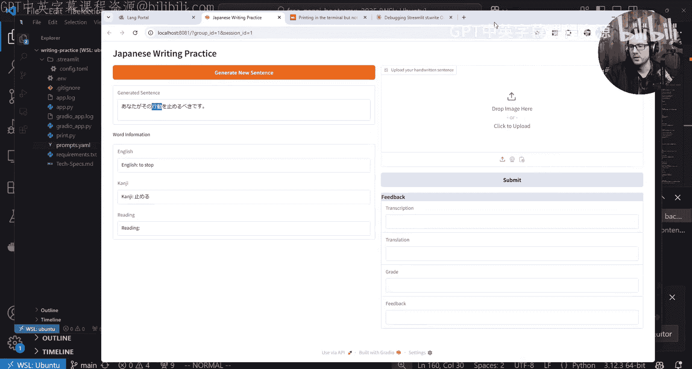

Let's see what it's trying to put in here。Pyamel， okay。And yeah， I will run that， sure I not？

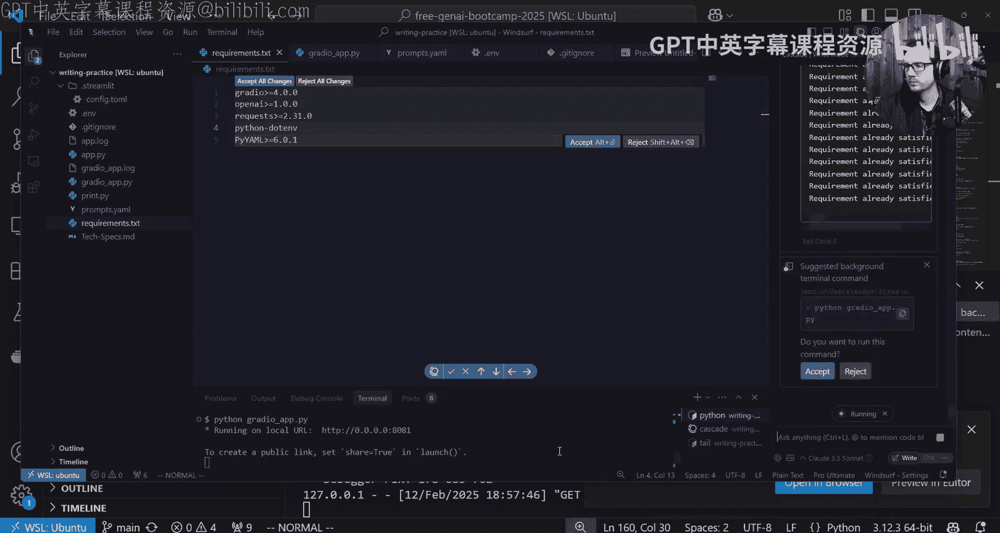

And we'll see if it still works， right， So if it still works， we're gonna to solve the same problem。

We'll give this a nice refresh here。 we'll generate the sentence。We have a sentence， this one。Kakku。

 I believe， Yeah， to read。 Oh， to write。 Yeah， it's right there。 So。

 but the problem is kind of giving it away， right， So it's showing us the word information。

 And that's kind of a problem。 So I would just say。

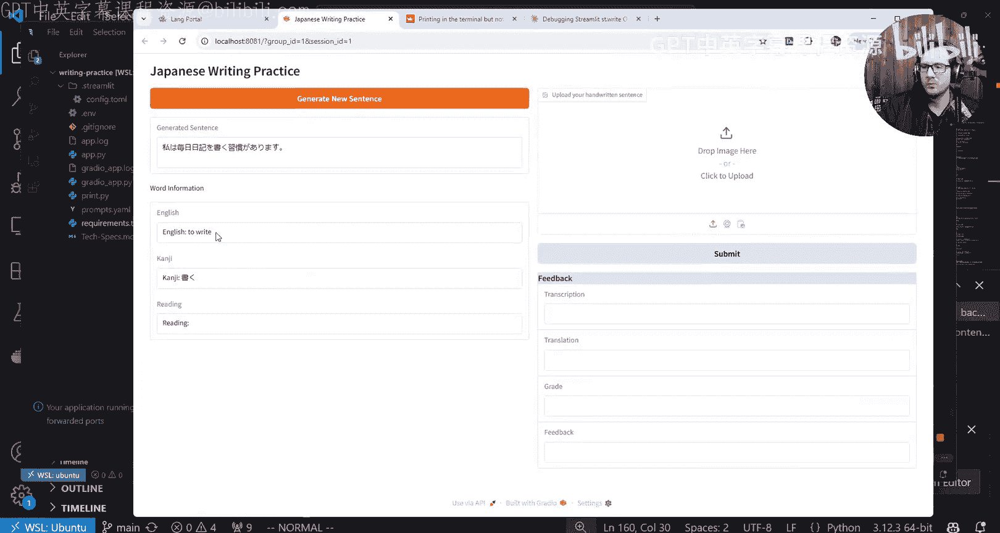

TheThe word generator is returning the word the sentence in Japanese。But it has to be。In English。

Because the student is going to try and。Translate it。I don't know。 Like it depends。

 I almost kinda wan to change the scope of this app because now that I'm using it and I've seeing the sentence here。

 it's too hard even for me。 Like， if I had to think about this。 Like， is this is whattahiwa mynihi。

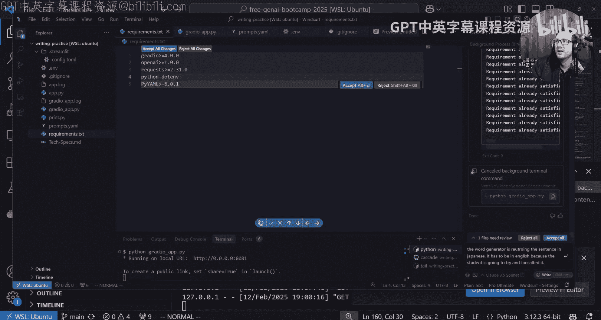

I'm not sure what the next thing says oh， kakku。嗯。Mas Ga Adias， something like that。

 And so my concern is that it's like we'd have to really work it to make it brutal simple sentences and give it a lot of examples。

 I don't want to do that。 Maybe what we'll change this into is just writing practice。 Okay。

 so I think it's fine how we're seeing this here。😊，嗯。Yeah， we don't really have to change anything。

 to be honest。Because if it's already producing the Japanese sentence and we see the word information。

 This is totally fine。 I would to say， I wish they could make the generate sentence larger。

 Let's go say， can you， can you make the generated sentence。

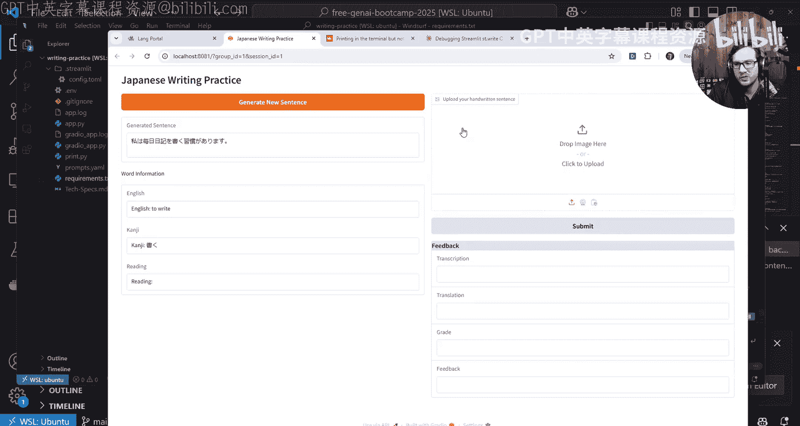

Larger like the text in the field， so it's easier to read。Let's see if we can do that。If it can。

 that'd be really cool。I should kind of dig in the Yal file， but。

Probably not the best way to manage prompts。So there it is working through it there。

And we'll give it a moment to see if we can do that。

I should really accept the changes so we can see what's going on here， except all。

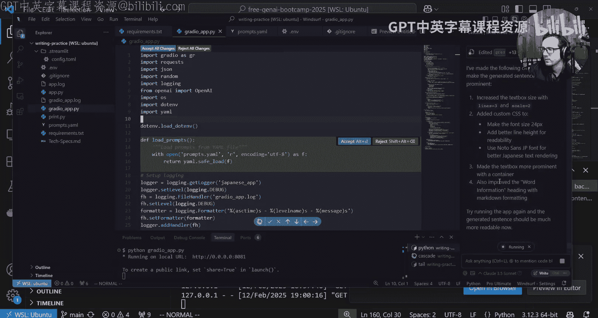

So let's take a look here and see what we get。Refresh。Generate new sentence。Okay。

 so let's see what it changed。嗯。Here。So I'm not sure if this will work， but I'm gonna to make it 40。

 I want it really， really， really big。 I like I was choosing notsons。 I didn't know that was a font。

 I feel like that's a Google font you'd have to install。But that's totally fine。

 We're going go back over to here， give this a refresh。This box looks bigger。Oh， there we go。

 That is perfect。Okay， so this is part one of it。And it is giving away the word O ku。

 but let's assume like we don't really want to try to。Make it as complicated as as previous。

 We just want to be able to write the word out。 Now， the next part is this upload part。

 So I guess the question is， is the rest actually wired。 Wow， radioio was so much easier。

 I'm so sorry， Streamline。 I just can't love you no matter。

 no matter how many times I try and all the features you do， you're just not the one for me。 But。

 you know， if we look here。

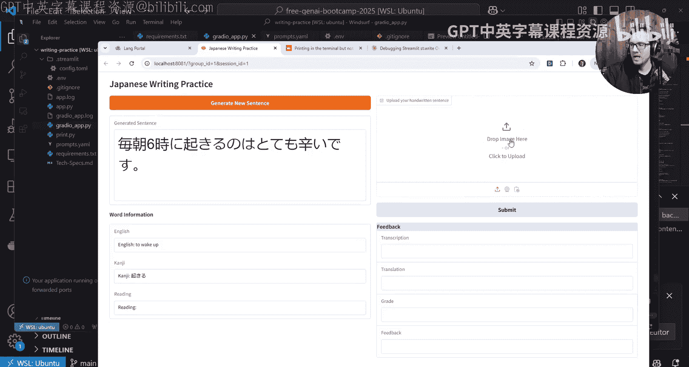

What I'm looking for here is the。嗯。I'm looking for。What happens next。So we'd load the vocabulary。

 which is fine。 We generate the sentence， which is cool。 get random word and word sentence。

 Great submission。To do implementation， so it's not fully implemented， right？So， it looks like。

Gade submission。Is not implemented。Can we go and implement that？Please。

Remember to read the text specs。And here， I don't think it says anything about what it's using。

 whether it's streamla or whatever。We'll see if we can correct that。let's see if it can install it。

's like man it's just a， yeah， manga or OcrR， but I don't know if that's correct。

 Let's go take a look and see what it has because I might not know manga OcrR。

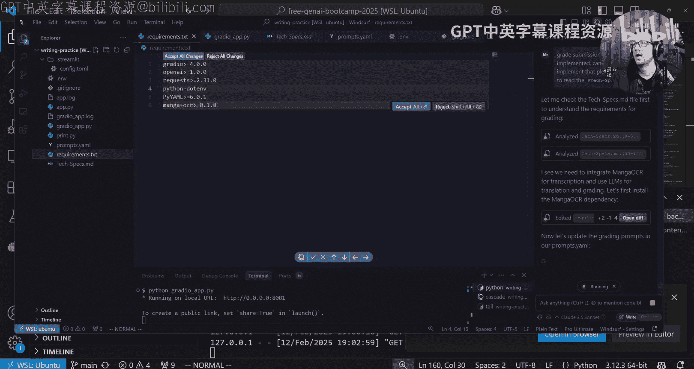

台山。AndSo if we go over to here。嗯。嗯。😊，Maybe。

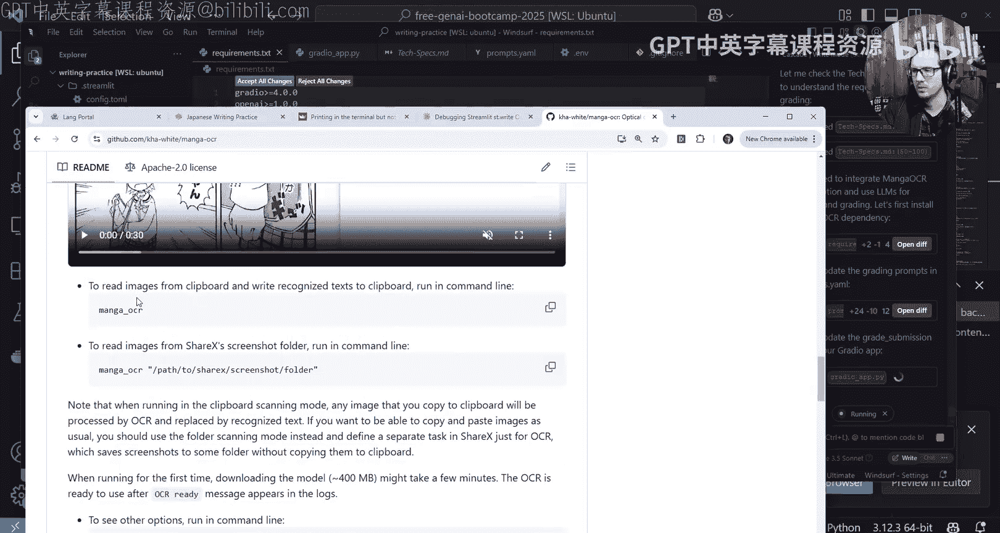

It doesn't say what the name of it is。 I mean， the name is up here。 so maybe it is that name。

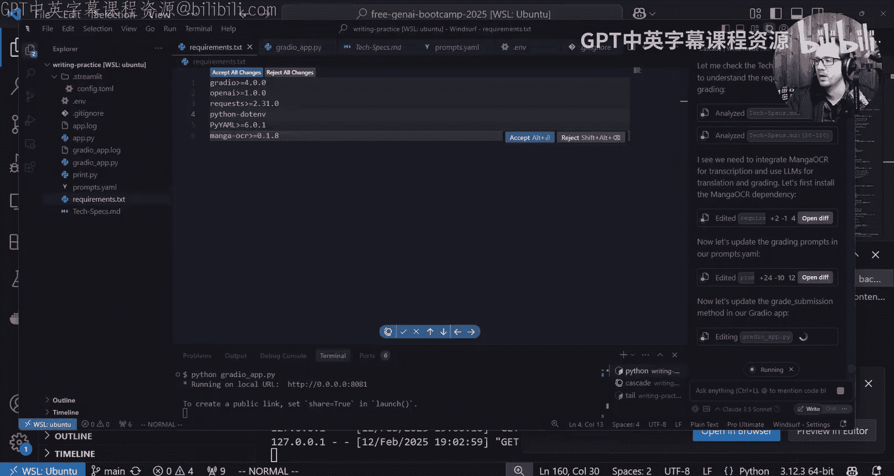

So I'll go back over to here。I mean this model downloads from Huging face， right。

 So do we need like a key to use this。So。It doesn't seem like we do。

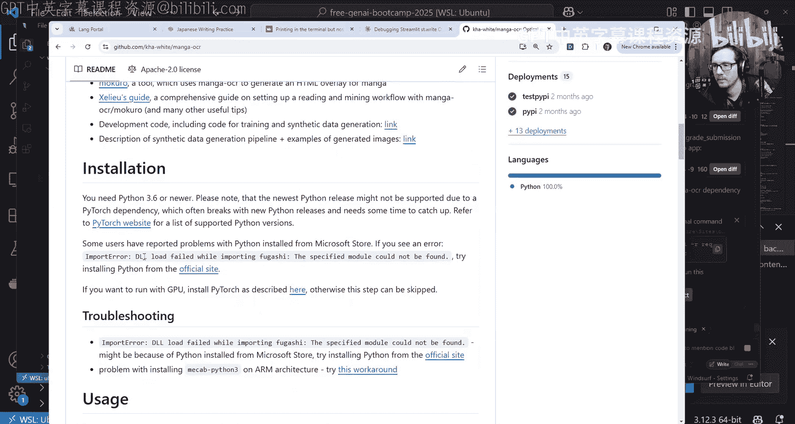

Because the one that。Dariria had like downloaded from there。

 but maybe it already has a model within it， that'd be really nice if it did。

But even if we didn't have the mango OR， we could replace that with another model that has vision and is able to do it。

 So it's up to you like， if you have another target language， you'll just have to do that。

 And you can see like how easy it was for me to get windsurf or any of these things to kind of implement the stuff for me。

I'm not sure what's happening to our output here， it's kind of acting a little bit funny。

But while I'm waiting， I'm just going stop this。I'm going wait for this to finish。

 I'll be back in just a moment， okay。This app seems to be having a lot of trouble。

 I'm seeing this one here doing a bunch of stuff on the other side。

 so I'm not sure if it's restarting the other application or if that one just died。

 this one is being a little bit confused。So I think I'm just gonna stop this here。

 It's really struggling。 I'm gonna go ahead and type and Pip install hyphen R requirements。

Let's see if I can just install this manually。 So here I did it。 So it'll say except， yeah。

 you were hanging。I finished the install。 I ran。Pip install， hyphen art requirements。 can you。

Can you continue？With what you were doing。I don't know what it was doing， but it was doing something。

 So， we'll let it try to do whatever it was trying to finish。Oh， now let's just run it。Okay。

 so maybe it was done。 well'll hold on before we do that， let's take a look and see what it did。

So we have the mangaR OCR that looks good， transcribing， we have the information there。

 load the prompts， get the little translation G4， it's using GP4 again。嗯。Okay。

 we'll change this over to O。It's all we got to do to get it to use the right one it just refuses to listen to us here。

I think the other one is O as well， right？No。And。I mean， it did work on with the Nano。

 maybe we'll just try it with the Nano， but I really don't like using it without the Nano。

And we have the S grade， so that's kind of cool。Okay， great， so let's go ahead and start this up。

The biggest challenge here is that I got to keep writing out what it is that I need to do。

 So we're gonna go over to。Whatever it is here， over here at the app。

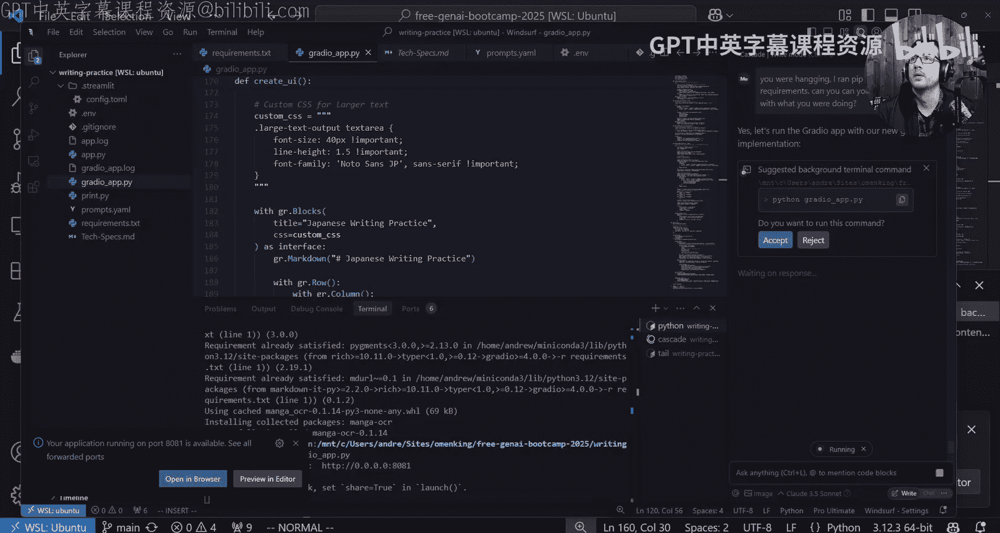

I'm going give us a nice hard refresh here。Okay， and we're gonna generate a sentence。

So now the goal is change。 I'm changing it。 It's going be， we just write it out。 So I got my。

 you can see here， I got a lot of Japanese on this。 I'm going to。Right on this， what I see here。

 and then I'm going to take a picture with my phone。Okay， send it to my computer。

 and then we'll upload it and we'll see what the result is。

 This is gonna be kind of frustrating because I have to do this multiple times it can get kind of annoying。

 But I want to see if it works And all the plumbings here。 So maybe it will。

 So I'll be back in just a moment， gonna pause and write in my book。 Take a photo and yeah。

 just give me a moment。 Okay， Allright， so I took a photo。 I got on my computer。

 It's a little bit too large。 But you can see it first。 I was trying to write the sentence。

 It was a little bit long。😊，But I was writing the letters too large。

 and then I was running out of room So I tried again。 I did a little bit better on the third line。

 So that's going to be our image line that we're going grab here。

 So I'm going to go ahead and paint and we're gonna to cut this out like this。

I'm going to make a new file here， we'll say don't save。That we'll past that in。

You can see this is a pretty large image。So。100，4，3 by 1，3，6。 It's probably fine。

 I'm gonna go ahead and save this。 So let's say save as P And G。 I'll save it to my desktop。

 I'm not sure what we have to have this as。 I'll just say sentence example。

Where this could be kind of interesting， it's like you could have let's imagine you had your phone and theres some way you could just show it on your phone or if you had a webcam。

 you could just hold it up and then， you know。There's， there's other integrations。 But for this。

 this is okay。 We're going to go ahead and upload this file。

 So I'm gonna to go find a desktop here in a folder。And I'm going to drag over。That sentence。

 So here's that sentence。 I hope it all just works。 Otherwise way I do multiple times。

 So now we have our sentence here。 Let's go ahead and submit it。And let's say we'll get back。

But this is the thing。 you've got to use the apps and try to figure out， you know， does it work。

 Does it not work。Even if you know this is not our target sentence。

 we could just keep using the same thing and see what happens。It's taking a long time here。

 I'm not sure because it has multiple steps or it's failing。

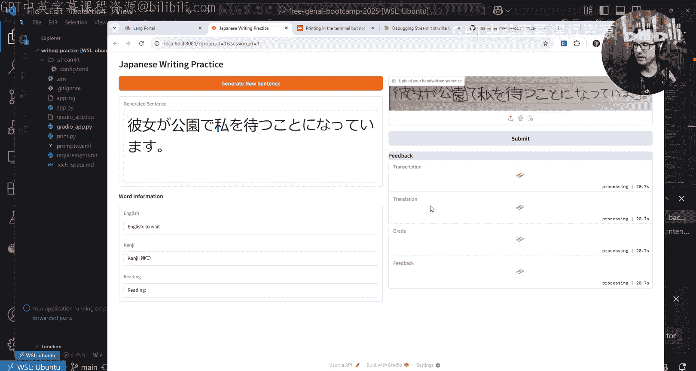

It's a little bit hard to say if I'm going to drag this off screen here for a second and we actually do have an error it says。

Can not name tensor from on torch。Okay， so。Lot's unfortunate。 Soll go ahead and。Stop this here。

 It's not gonna work。 So I'm going to go ahead and hit enter here and see what happens。

I'm not sure if this has to do with our。

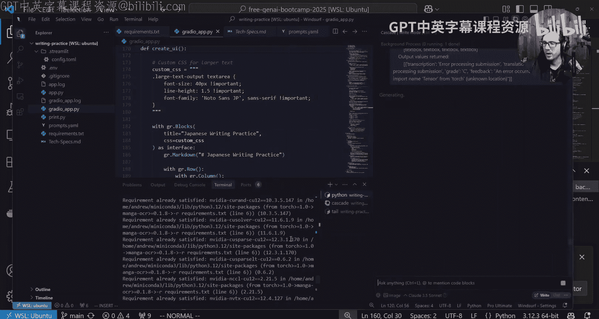

Ting here。 But see， we need to update the dictionary values in the return statement to mask radio's input out。

 is that really what it is。 It's not about pie towards and stuff。 I thought itd been something else。

嗯。Okay， fair enough， that makes sense too， y。Now that we're getting kind of in the pie torch realm。

 I almost kind of feel like I want to put this in a sandbox。 but like in a condo environment。

 as soon as that starts happening， anytime you have to install pie torch。

 that's where you want to do that。 So we might regret not doing that。

 but we're going try this anyway here to see what happens。And wants us to restart the app。

 so I'm going to go ahead and stop us and restart it。I am going to totally cheat。

And I'm just going to generate any sentence I don't care what it is。

And we'll this is obviously not the sentence we're readiness it says。Daikite， I don't know。

 This word is Dai Daiki。Daiike deu， and so I'm going to go ahead and drag this one on in here， right？

And we'll submit and we get it back， it says air processing cannot import from touch。

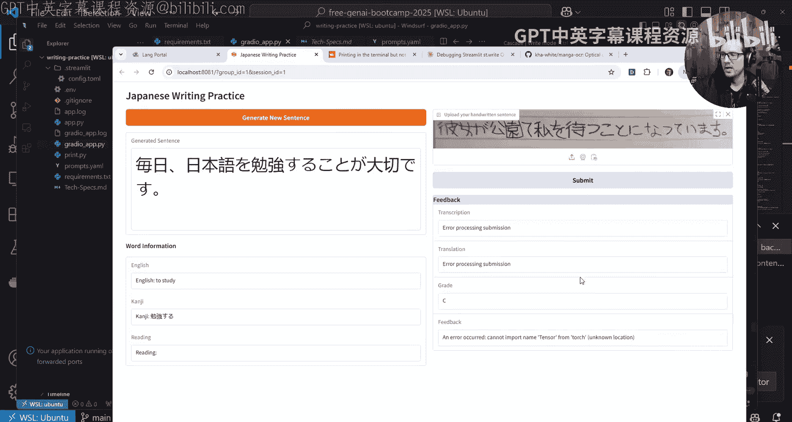

Okay。So。We'll go ahead and grab this。 We got a C grade。 I'm surprised we got any grade。

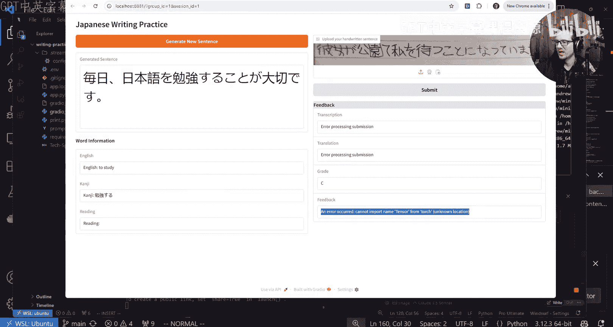

And we'll stop this。And this is where we might have to take over with the requirements。

Let's accept all here。CPU version， I mean I have a GPU， so I'm really curious what's going on there。

Is that what we had in there before which was which was this， now has both。Aor。嗯。

I guess this doesn't fully matter if these， if this one errors out。

 because I don't think it's related。

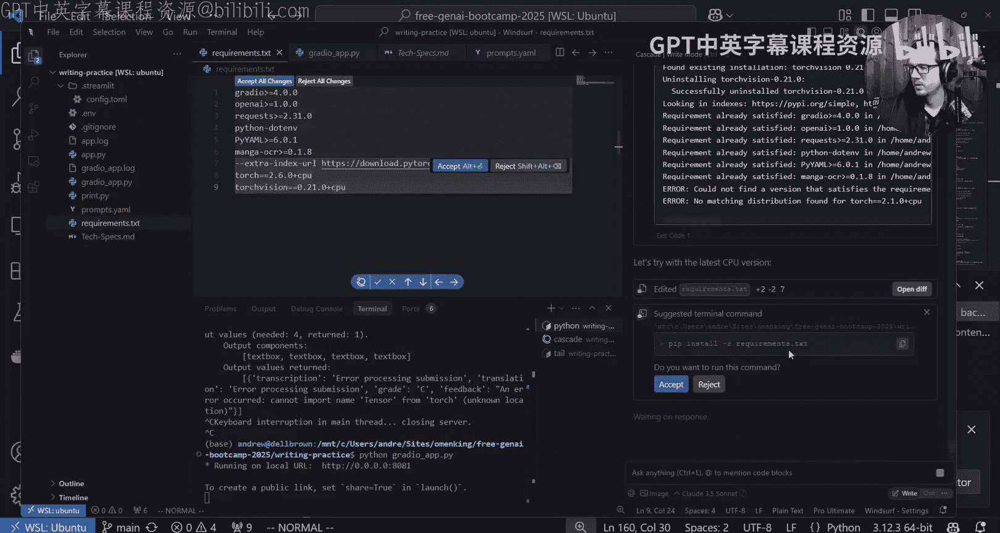

Okay， we'll try that。Pytor ispannic key。But， you know， if we're having serious issues。

 we can go back to Darius's code and see how， how she was working with it。

And maybe like because she would have a very specific version and stuff in her。

Requirements that TXT and a specific implementation。 And if hers works。

 then we could just use that one。 But we'll go ahead and start this up again。

I'll give this a refresh， generate。We have a sentence。明日は明日、私の友達があ。Hesoru。

 and I don't know what that is Deu， so Ashta tomorrow with my friend。

 we're going to play and come over and then there's something over here。

And and some of these are like， I don't know if this is really， really basic grammar。

 It doesn't seem like the prompt really was listening， but that's G 4。 If we upgrade a 40。

 it might return back English and it might actually give us a simpler sentence。

 The sentences seemed like way off in terms of simplicity that I actually wanted。

But it's fine for me， for my level of learning。And。Going a little bit slower。Ha。😊。

Name SD is not defined， does it think it's streamlit somewhere in here？

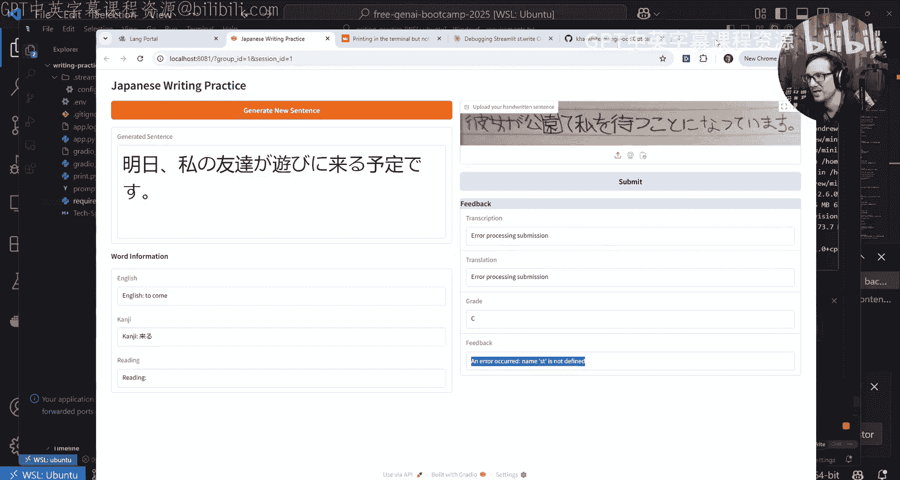

S T。Yeah， we'll go。Are you。Do you buy accident have streamlit code。In the radio file。Remember。

We're not we're not using radio anymore。Okay。So we'll give that a moment here。M， yeah。

 you shouldn't have those in there。We'll give it a second there to fix its mistakes。

But I feel like we're really close to getting something working here。 It's just this last step。

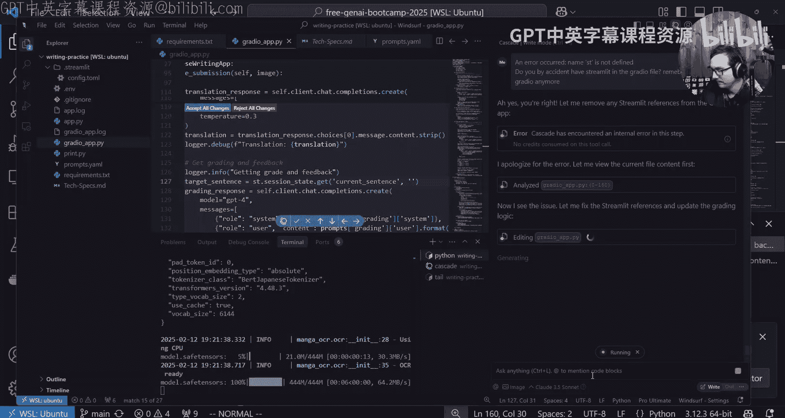

And if it works out that'll be enough it gets back our transcription and our translation and it's close enough。

 even if we're not。Really following it through and checking it。

 I looks up that it's done because then we have most of the moving parts there and it really just comes down to fine tuning the application and making it work the way you want。

 the only thing that we should do before we wrap it up is we should make sure that it sends back the endpoint to our learning applications so that we can use it for study so if it's going to tell us to run this again。

 we'll go ahead and stop and start this。Good。And we'll go back over to here。

 we'll give this a refresh。I'm going to run this again。I'm going to go ahead and do this。

And I'm going to go ahead and submit this。The other thing is like if it's grading whether the whole thing got right。

 the question is like did it find the word that was correct in it right so came back and now we have it。

 so we have Kaa Jo， it doesn't look like it matchesjo Kaana Joga。I。No， no。

 it does not match whatsoever。 Well， I mean， let's take a closer look here。

 It's a little bit hard because I can't see this one。Maybe we can make the transcription larger。

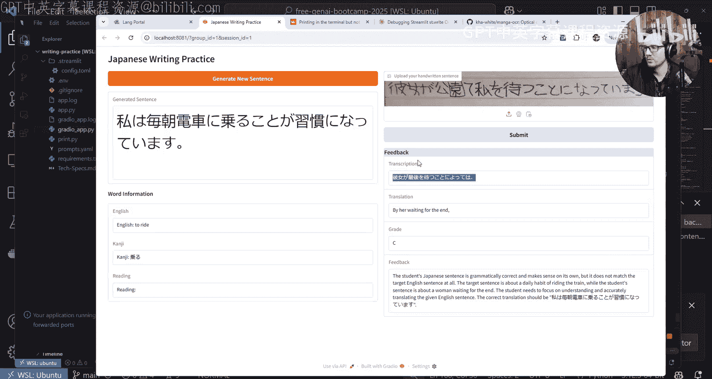

， can you make the transcription box as large as the sentence generated box。

I'll just stop that there Cause I'm having a hard time to read it， but。You know。

 we're getting an output back， and so that's really interesting。M okay， so it's gonna correct it。

 That's fine。Ill go back。Give it a moment here。So now now I'm really just tempted to break it back to a single word because the sentences aren't simple and。

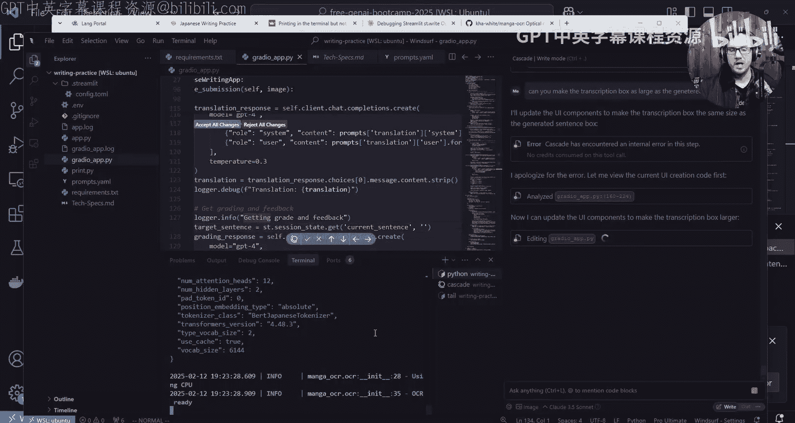

I mean， we can keep working in the prompt document。 maybe we should just have a single word。

 and we can remove the sentence step。 I'm not sure， but we'll say Python radio app。

 I'm going restart this up again。 We'll refresh this。We'll generate a new sentence。To wake up， Ou。

Okay， it right here。My。Maasa Roku。ロクジにオケることにしてます。オー。

That looks good and all we'll go ahead and drag it in。We will submit this。And here， I mean。

 at least it's consistent。So this character matches up， this character matches up Ga。These don't。

 I mean to be fair， those aren't written very well。I'm not sure why that messed up。 Well hold on。

 It did grab this and it did grab that。 So it seems like it got confused by these。 And to be fair。

 that is a bit of a mess， right， Koto Koto knee。N looks makes it he。Tay mos。

 so didn't get the whole end。Okay， and so。Here I would say that， well， first of all。

 obviously doesn't match。By her waiting for the end， right wow， that's a bit more of。

 And we got to see grades。 So the thing is， is that I would say that。

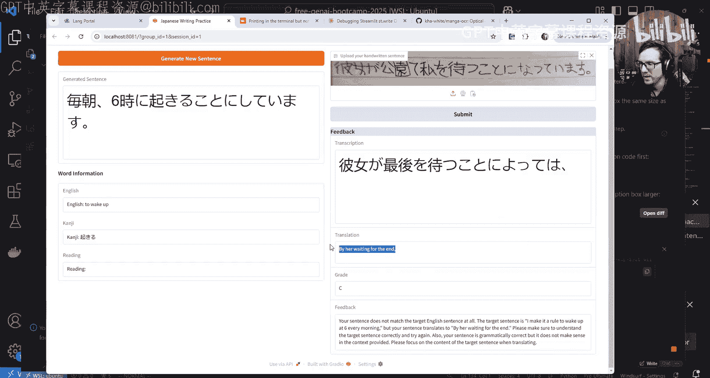

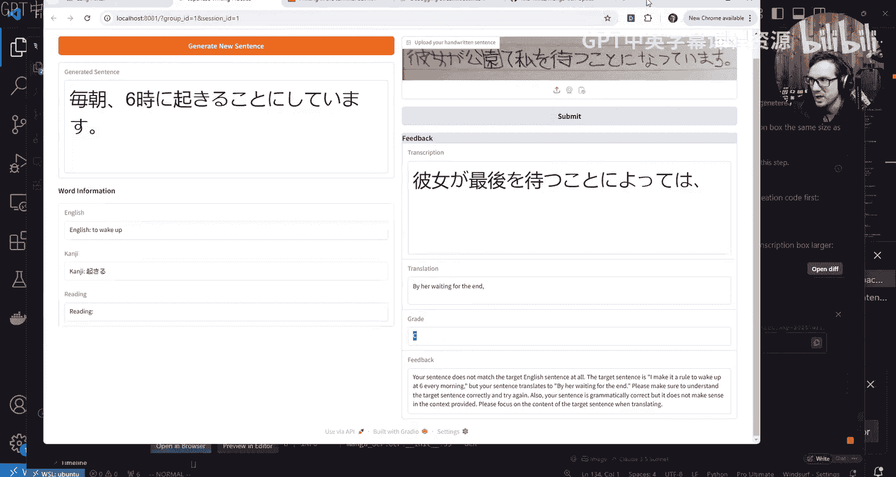

There's a few things like we have the grading yes， but the other thing is like if our if we're here to practice vocabulary。

 then。Maybe the app would be sending over target sentences that it has。

 and then that's what we should be practicing on because if we're trying to score points on writing。

 maybe that makes more sense， but maybe what we'll do， I'm just trying to decide here。嗯。I don't know。

 I'm trying to decide。As I made this a little bit more complicated than it had to be。 Like。

 I like the idea of writing out sentences。But I don't trust it to generate out。

Something that is concise enough。So what I'm going to do is I'm going to commit what I have right now。

 and I'm going to do an iteration on it so that we don't lose the code。Okay。

 so that's what I'm gonna do。 I'm gonna go ahead， and。

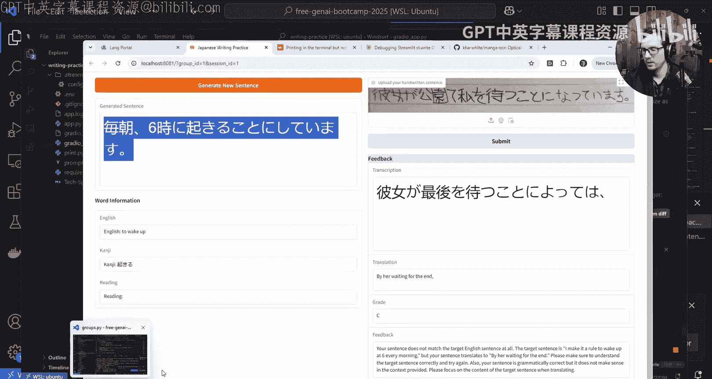

I'm mom。Well， you know what we could do。I could just keep the code around and make another version of it。

 So we'll call make another one here。 I'm going to call it radio。A simple。Like word pie， right。

 And so this will be that one。 And so I'm gonna go ahead and grab this。We'll just accept all here。

 except all， it's all fine。It's all good， it's all good， we'll just stop this here。Don't do anymore。

 It's good。 It's fine， except all， except all。 Great。 So we're going copy this app here。

 We're gonna copy this whole thing。 I'm go over this one， paste it in here。😊，I said。

 accept all just accept it。 Okay， so we're going to reference this one。 We're saying radio word。

 This has the same code as the radioio app。 But I want to change the way it works。

I just want it to pick a random word。And the user must submit an image。

This code does the same as the radio app。 But I w to change the way it works instead of。A sentence。

 it will present a single word from the list。We don't need。To generate a sentence。

The user needs to upload their image。And we still。Need the grading。But the grading is trying to tell。

If the user。呃。Was able to write the word well。Okay。So please， you know， let's go ahead and do that。

 So we'll let it to go do that。 And so maybe this will pa it down。

 I really hope it doesn't touch the other one。 There we go。

 And so we're just gonna simplify the code。 And we're gonna just go basically write it。

 So now it's closer to like what Daria did。 But it will just be the a word instead of a single。Kana。

 like the Heagon or Katicana。 And this will tie better into the app because it'll send it back。 But。

 you know， like， if you're doing this， it's like， you need some way to be able to write it quickly。

 right， and so。You know， maybe， maybe what we should have had is， is what。

Dria had the ability to write it in place。I'd rather just upload an image。 I'd rather just do that。

 but I can see how that workflow is not that efficient。

But we'll give it a moment here to update the code。 and then we will see what it's， what it's done。

 okay。So here it's suggesting that it's changed the code to do that， let's go take a look here。

So I'm going to go here and this is the same。So it's taking out generate sentence。

It's going to get a random word， which is fine。And the Great submission is still using GP4。Okay。

 the format's kind of weird。Which is fine。 The student is asked this。

I'm not sure why it's doing this in line like this。Okay。All right， let's take into see what happens。

 so we'll just go ahead and accept these changes here。Can accept all。So all changes。

 and I'm going to now start up this one instead。Okay， and。We will。Look for。

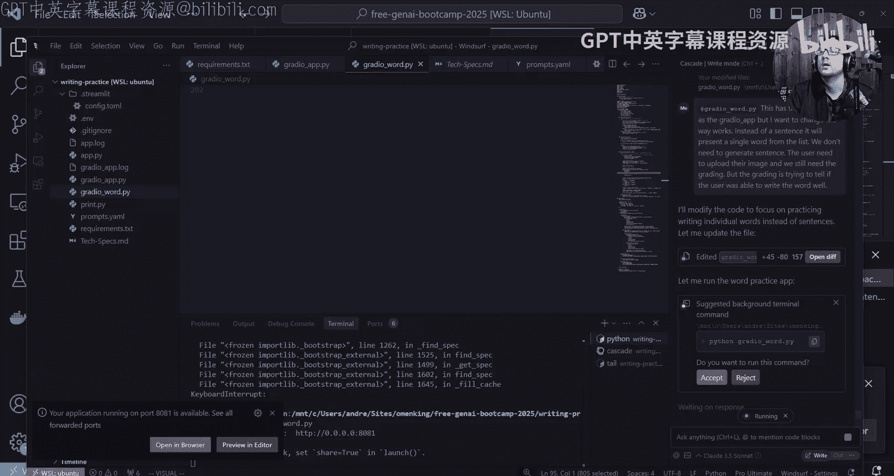

I'm trying to find my my Chrome window here。 it's this one。

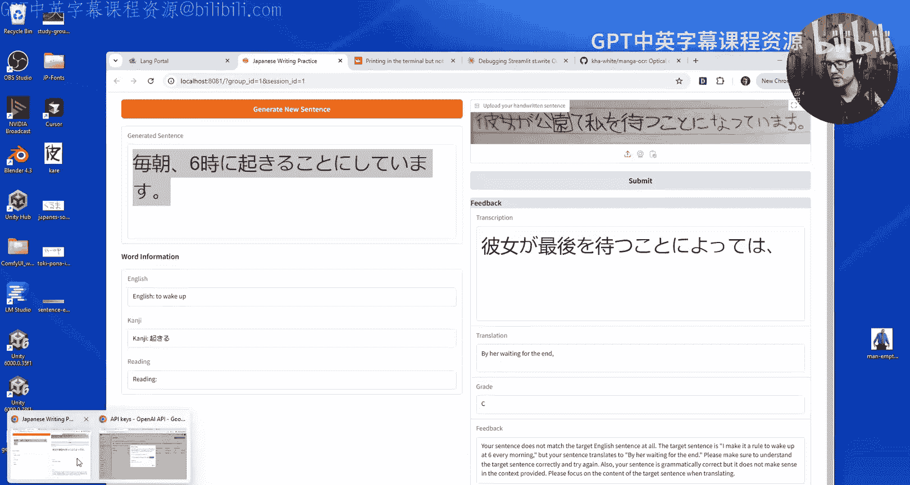

So give us a refresh。Very simple。 So get a new word。 So here is the word we have here。 It's。Ximeu。

This is to， this is to close。Smeu。Yeah， I think that's what it is。

 And so here it's saying to upload an image。Can we just draw it instead， I mean。

 it'd be nice if we could。We'll hold on here。Here's a webcam？Maybe。We've used a webcam。

 that might be interesting， let's try that out。So I'm just writing it on my pad really quick here。

Okay。嗯哼。😊，By the way， like， that's one font of kanji。 Like， there's lots of ways to write。 oh。

 my mechanical pencil snapped。There's many ways to write it。

 but I'm just going to go ahead here and do my best。Okay， let's try this webcam button。Webcam。

 click Access webcam。loud this time yep。And。That's one of them。We have。嗯。Obi S N Vidia。

I have a webcam right here， and I'm just trying to get it to work。 Let me see。

 Maybe I got unplug and plug it back in one second。Okay。And so I just。

Plugged in and unplugged in one of my webcams。I'm just trying to get it to work。

Here's a nice refresh here。Get a new word。 Now， I have to rewrite the word。 But maybe if I go here。

Not Eas。Yes， things junk。 I， I really hate this webcam。 It's a， it's a。😊，Egato webcam。

 And it's just like half the time it doesn't show up。

 So I was hoping that maybe we could pull that in there。

 So maybe what we can do So of having to upload an image。

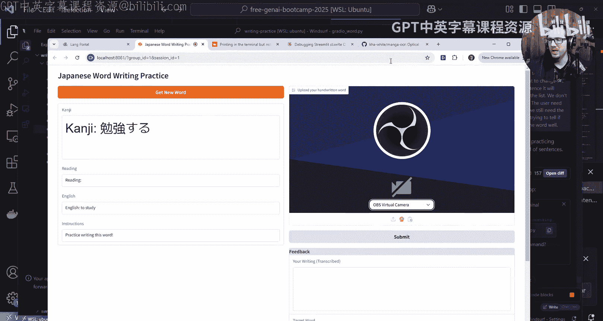

嗯。Instead of uploading an image。Fort Gio word。Can we just write it？In place。Is there a plugin or。

Can radio support。That， like writing。On canvas。Let's see if it can figure that out。

 because if it just replaces that。 theelle'll save us a lot of time。Oh。

 it has a scratch cap component， okay。We'll give it a moment here。

I'll just pause while it's thinking， oh wait， no， it's done， Okay， so it brings it in here。

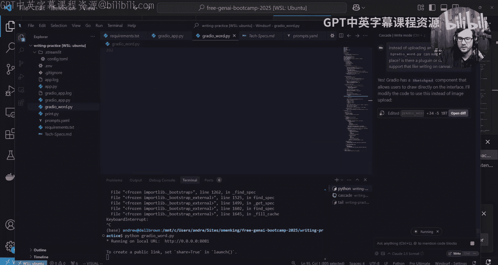

And this stiff。Okay， so we'll try it again。And we'll bring this down。Refresh this。But you know。

 imagine if you're a real language school， you'd have to have people to try the apps out and so it kind of makes sense if you can prototype it quickly and radio again。

 I really like radio， but we do have a little bit of a problem here。 it's complaining。

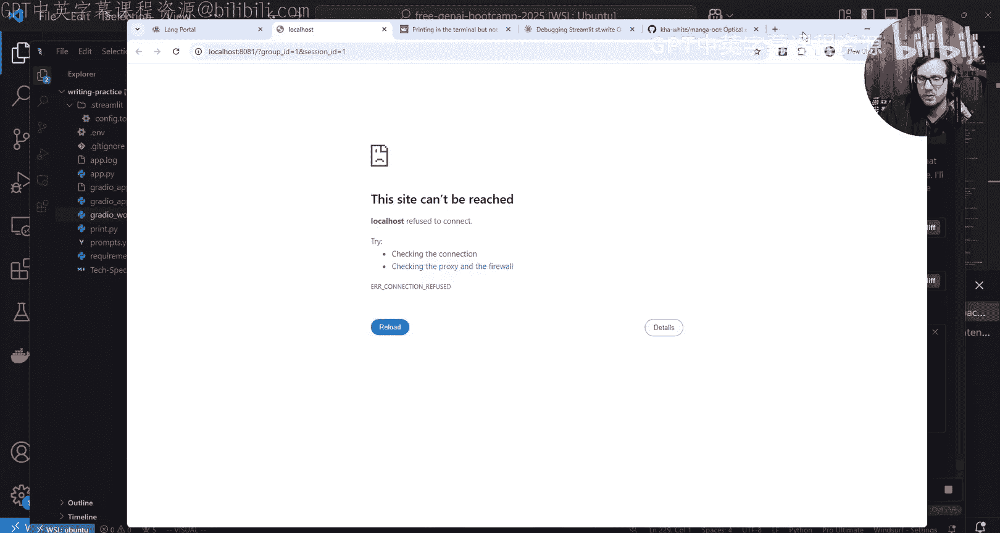

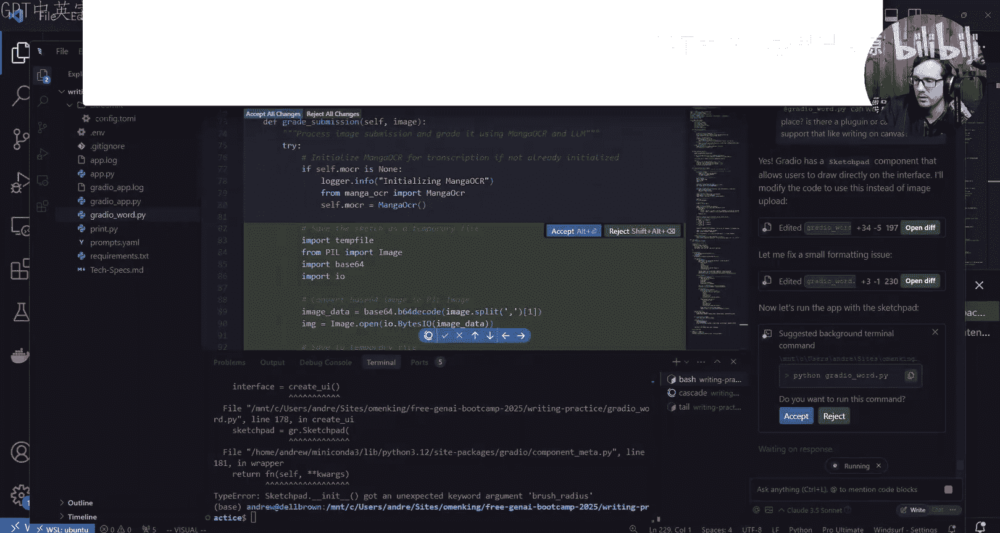

So let's just tell some stuff here。Yeah， yeah， it's changedhuh。

So I guess it's going to go and try to fix it。Seems it's changed。

 but it doesn't seem like it looked up how it changed， but if it works， I don't care。Okay， no。

 can you。Okay。Because it's getting confused。You can do it。

It' interesting like it'll create an outline， geeksforgeeks。org。Geeks for geeks。

I gonna look that up off screen。 here， geeks， for geeks。I think this is the blog， right？Yeah。

 it's just the computer science portal。What did it change？

Let me update the sketch pad implementation。 Okay， can I see what's different？

 It's sometimes annoying that I can't see the difference here， but we'll stop it here。

 We'll try to run it again。Geeks for geeks。And I'm gonna to refresh this。

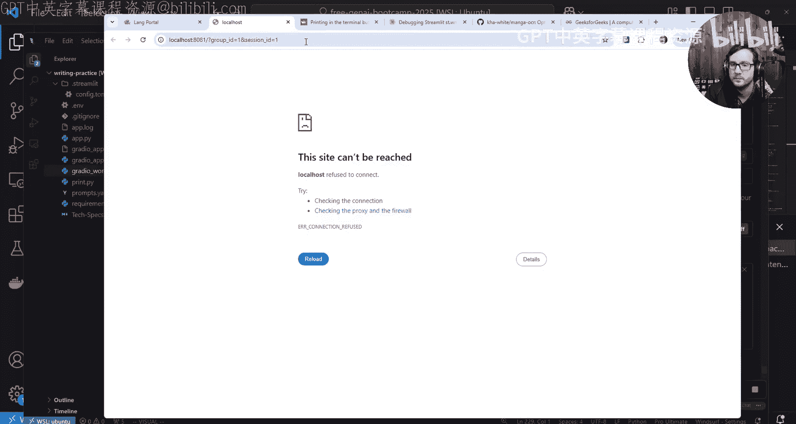

Still doesn't work。Radius， yeah， it's like it doesn't know its implementation。Simpr version。

 What do you mean simpler version。So sketch pad here。Okay。

This is where I might have to start like reading up on it to get it to work。

Oh， now iss running。 Okay， good。Refresh this。And so now let's try this。嗯。Tetsdao， Ttsdao。

 So we go like this。 Oh， that pan is way， way， way， way too big。But at least。We have something here。

 right， Tests it out。Smit。

Okay， well it's getting close here。 So that's fine。

 I'm going to go ahead and paste in that error so that it can try to solve that。

 While it's doing that， I'm going to look for the brushstr and try to make that smaller because that was a little bit too big。

I wan to see what that sketch pad is called。 We'll go here， sketcht pad。And。

It seems like it think it's fixed it。 but I'm gonna go look up sketchpad， G R sketch padd。嗯。Sketch。

 Pat， here we go。Brush。Okay， radio， sketch pad。Brush size。No， dear。

Okay。

Anyway， we'll start it， we'll start it up again。 We'll see if that fixes our our immediate issue here。

We'll generate a new word。Let's make another word here。That's like skating。

 I think I just want something easier to write there。 it's an easier one to write。And so。

 we'll do this。Oh， I did the stroke wrong， that's fine。

You can see that we really need a smaller brush。

It' would been nice to nobody but it change day。 So we still have error processing submission。

 It's still happening。Ifpon the dictionary with the image data， not the Bay 64 string。

 let me update the image， okay， great。But yeah， the one thing I think we need to do is figure how to get the brush smaller because that things really annoying。

And we will now start this up again。And we'll try this again here。Get a new word， sure。

I will do this。I mean， tell us what the word is down below， right。

 this one's a little bit hard to write again， those pens too large。

Oh my goodness， just does not work， come on。I thought this would be easier。And yeah。

 image handling is a very hard part of it， so I'm not really surprised that's our problem。

We'll go ahead and accept this。

We will stop this and run it again。We'll go back over to here。We'll give this a nice refresh。

 get a new word。 I don't want to write that。 We'll write this Suo。Which means to use。

So Cal submit that。Please， just work。

this is the problem， Like， if you wanted to work， I'd have to read it more thoroughly。Sure。

 you can do that if you want。

Generate new word， generate new word， there we go， me。Saay。R。Submit。

That's going to fail， which is totally fine。嗯。We can use the image component in sketch mode。Okay。

So yeah， we're just like trading one problem for another， which is kind of frustrating。

And so we'll start it up again。Nope， now we get this problem。We're just going in circles。

 It feels like。

Oh， boy。This is， this is frustrating。 This is really， really frustrating。Yeah。

 the parameters have changed。 Yeah， we know。We'll run it again。 We'll run it 100 times。嗯。

It's just going back to the whatever， let's just do this one submit。

It's terrible now， it's terrible。But， let's say， okay。Okay， okay。

 let's go back to just having image upload。嗯。In radio。App it was working fine。So just get that code。

Because we know it works。Okay。And so if we can just get back into a working state， that's fine。 And。

 you know， you see how this gets really thinnicky in terms of a prototype。

 like if we get the image working。Then if you want to develop it further。

 then you'd actually build it properly with like an API backend with flask whatever in a proper front end。

 and then that's where you'd do more fiddling around。

 but I feel like you'd have less problems that way。

 So here I think it's reverting it back to how originally was I'm hoping that's the case。

 we're going to stop it and start it again， we're going to go and bring this back over to wherever that application was it just had the window open。

And we' are going to go give this a refresh。

It should be running。

So。Yeah， except I didn't really revert it back。 Did like， is it sure that it did that。啊。Great。

Try this again。We'll go back over to here。 We'll refresh。 We'll generate our new word。

 It doesn't really matter because I'm just gonna drag in an image。From wherever that was。

 I just had the folder open。 I got too many folders going on here， and I'm looking for。

Wass it downloads， maybe。It was on my desktop。Yeah there is cool了吧。

Which I used when we were talking to Dara。Okay， there we go， So we have this。Great。

 and so I would say。

We'll just change the app so okay。It's working now。Let's change the grading。So， that it。

Just says if it matches。Or it doesn't。Okay， let's。Let's remove the grade and feedback。

Let's just show if it is。Right。Orrong。Okay， so we'll just do that。

 And then the only thing we have to do is hook it up to our app so that tracks back to Lang portal。

 And then we're done。 And so I would， I would think that the last part's gonna to be really， really。

 really， really， really， really easy because we just have to tell what end point we want it to be。

 And I'm gonna go look for it as we are working through this。 So in my study sessions。

 we have a review endpoint。

Somewhere here， forward slash forward slash review。Maybe it's under groups， I'm not sure。

I'm just going to zoom out a little bit so I can see what I'm doing。Some are in here， there's review。

The review here， review， review。Just tell me where the darn endpoint is， it's sometimes hard to find。

 so we have reset。And review， so this is the end point that we need。

Right， so I'm gonna go。Back to our other app or other thing here， Winurf。

And。Still trying to figure out how to do that。 That's like such an easy task。What is it doing。

Like all I， I asked for like very basic stuff。 I'm not sure why it's so confused。Okay。Alright， so。

I'm gonna go run this， I guess we'll stop it。 We'll start it。

We'll go over to here。We'll give us a refresh。 We'll get a new word。Kai mono suituter。

 that's like things to buy or。No shopping， shopping things to buy。 We'll hit submit。

 We'll see if that still works。Incorrect。Correct word。

So， you know， just。Remove the correct word box。Like， cause that has that doesn't do anything for us。

 We the correct word box。Okay， we're almost done。

I'm going to stop this， start it back up。I'm going to go and refresh this。

I'm going to generate a word， I obviously that's not my word here we'll submit it。And。

Kuruma， it's incorrect。 So now what I want to do。Great， so we have this。

 and we're very close to having this done。So the last part is that endpoint that we have here。

You know， when。When it's graded。It needs to submit。呃。To correct。True or false。To the back end。

At 5000 for this end point。Okay。It needs to pass the word I and the group I。I'm not sure what it is。

 let's take a look quickly。

If that's true。Just the word ID， the word ID in session the session study ID。

The word ID。Okay。

Because up here。The sessions should still be open here， right， So this is a writing session。

 That's active。And。

What we're hoping for is yeah， we'll accept here。Except all， except all。

Let's run it。If this will work， so we'll go ahead and come back over here。Refsh。We'll get a word。

 doesnn't really matter what it is。嗯。And that's to make yeah down there to make。So drag that in here。

 we'll hit submit。We'll give them a moment here。And the thing is， like。

 we don't even need the last grader。 Like， we don't even need chat U B T at this point， because。

If the last thing is just checking it， really， it would just match the word against it， right。

 because it's either one to one。

And so if we wanted to make this even more efficient and more proper。

 we'd actually remove the last one here and to be a lot more simplified。

 So I'll add the functionality to submit the gradientding into the result to the back end。

 So this one was wrong。 We'll go back or look here。 Did this submit as wrong。

I don't see anything there， so we'll go back over to this， back over to here。And we'll inspect。嗯。

So it didn't seem like it did it。 We'll go ahead and submit it again。It's not submitting。

 I'm going to stop and start it one more time。We're so close。 We're so close to being done。

 and we'll give this a nice refresh here。 We'll generate this out again。

 I'm gonna drag the wrong word in。😊，I'm going to hit submit。

 I'm watching here to see if anything else happens here。

Nothing's getting called。U。You know， it's。Not calling the endpoint。Submit results。

Mmhm。😊，Okay， so we will stop this， we will start it again。

We will go back over to here wherever that is。Refresh this。There some time it is。We'll get the word。

We're going to drag this over into here。 We're gonna go ahead and hit submit。

We have Krima， which is fine， it says incorrect。

嗯。I don't think that login's happening anymore。

Inspect here。Method， not implemented。Too many arguments for endpoint。

I'm not sure。I see no logging。In the console log in Chroe this。

It's kind of frustrating because the other one works。 So why wouldn't this one work， right？Oh。

 does the radiodio app have its own log？Oh， here it is。U。Well， hold on， theres hold on。

We're creating a study session in it， but we need to make sure we got a first word。

Let's modify the code to get the study session when getting a new word。No， no， no， no， no no， no， no。

 no， no， no no， no， no， no， no， no why， Why would we have to create。A study session。

We can get this study session。From the query string parameter。It's in session， I D。Okay。Well， I mean。

 it wouldn't even know that， so that's probably why。

 so probably that's the problem was going to nowhere， though it wasn't showing us anywhere。

 but maybe because the URL was incorrect because it didn't have a value there， it was messing up。

 and so that might have been our issue。AndIf that's it， then we're done， we'd have to check the。

 the correct。 but I would I'll leave that for you folks to do that。 I'm gonna go over to here。

 I'm gonna give this a nice hard refresh。

I'm going to go ahead and stop this， start this。嗯。And we have come on， come on， come on， come on。

 come on， come on， come on， come on， come on。What are you doing here， Like it has worked before。

 So why is it now messing up， right。嗯，哼。😊，Like， it got words。

 So why is it doing it weird for that one， right。Great。Get a word。Drag the in。Grade it。 S it。

We'll go over to here， refresh。哦。Inspect。Let's go check the logs， I guess。

Okay， so we go here。It's not like passing it along。 I don't know why the codes so stupid。

 But this is where like， it would be beneficial for me to spend more time writing the code than to let it to do it here because it keeps happening where it's like。

 it's making really dumb mistakes。嗯。Yeah， you got to pass it， otherwise it's not going to work。

I don't understand， like， it got the word I D。 So why couldn't get the other one。

And so that makes me just think， okay， I should open this up and see how they got the group I D1。No。

 no， you obviously can get。The group I D。 So you should be able to get。The session ID。

 we should not have to set。An enva。 Come on。Come on now。

 now it's just trying to finish the work without actually doing it。Okay， and if this doesn't work。

 then I'm just gonna debug it myself and make it work。

So we'll go ahead and we'll refresh this。Willll refresh this again。

 I'm going to drag in this one here。 We're going to generate。 doesn't matter。 I mean。

 needs it to match it against it， right。 And so now。It should work。 We'll go back， refresh this。

 Please， please work。 There we go。 We are done。 We are done。 It works。 It's good enough。😊。

What problems do we have with this application Well， first of all。

 I made it too complicated to begin with and we should want this simpler use case I still have the other chat UT agent in here。

 we don't need any chat UT agents whatsoever because we are matching the transcription you know Stamlit still kind of sucks。

 I don't like streamamlit。Graadio is really， really good。

 so I like radioio and we really need to be more involved in our code because， you know。

 we get to a certain point and then we're just now asking it to fix it And these fixes could be really。

 really simple， but we're just wasting tons of time on these little fixes where it's great to get the plumbing in place。

 but we have to just take over at some point。 I'm going to commit this code so that you all folks have this here。

But yeah， there we go。 It took a little bit longer than I was hoping， as per usual。

And we do have a lot of stuff in here， just making sure there's nothing I don't want in here。嗯。

I can't tell'cause we broaden in the big one， but yeah， so we'll just say writing app implementation。

 I should have really committed that stuff separately because I can't even see what my commits look like。

Nothing staged， let's stage it all， there we go。I guess I could to just fix it right now。

But're going to go ahead and that's all stage， we're going to commit that。I am done。

We will push that。Oh， my godness。ItIt's a nightmare when you have to pull when you have a big push。

So I'll go ahead and do this。 just please， please， please， please just push， please， please。

 please just merge。Please don't give me a complicated merge。 I can't handle that right now。Yes。

There's just the Spanish prompt。 Okay， get push。I don't why It's opening in nanono。

 I don't want nano。 I want to open a V code， but that is now pushed。 I am free。 And there you go。

 We'll see the next one， Okay， Co。

