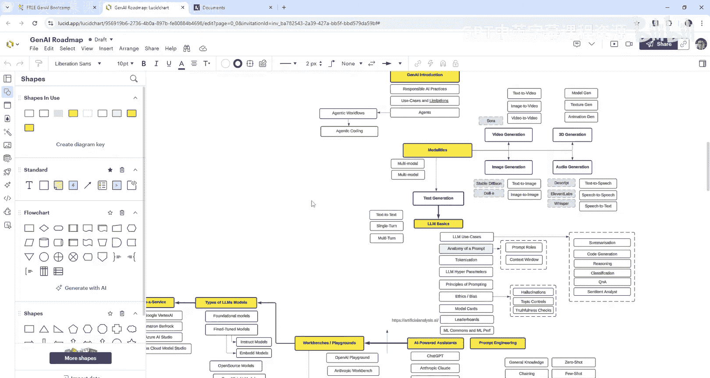
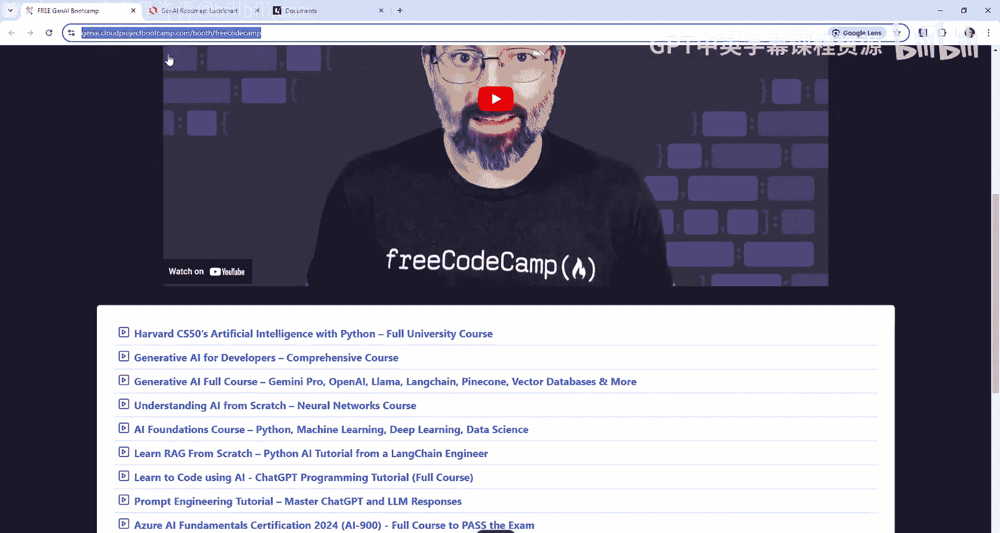
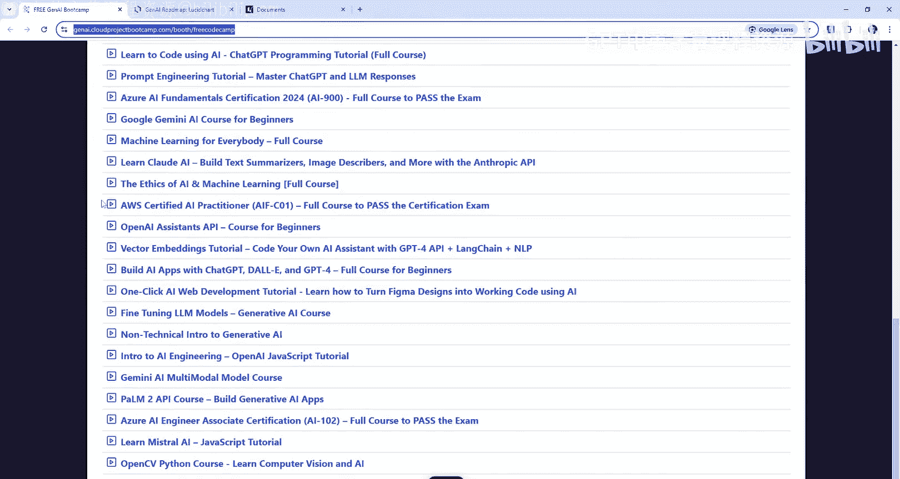
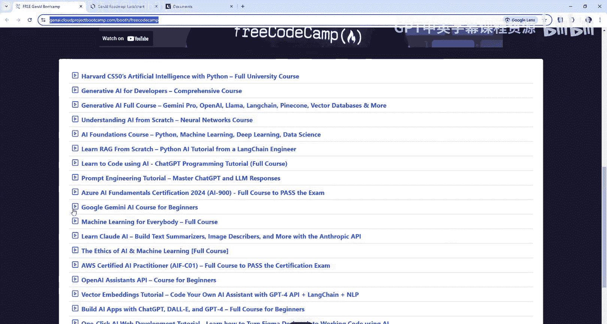
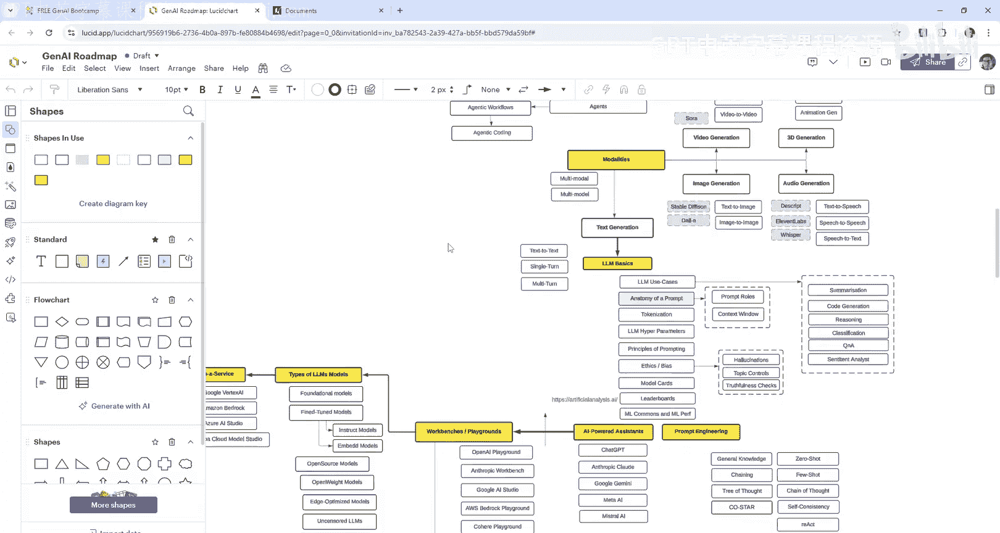
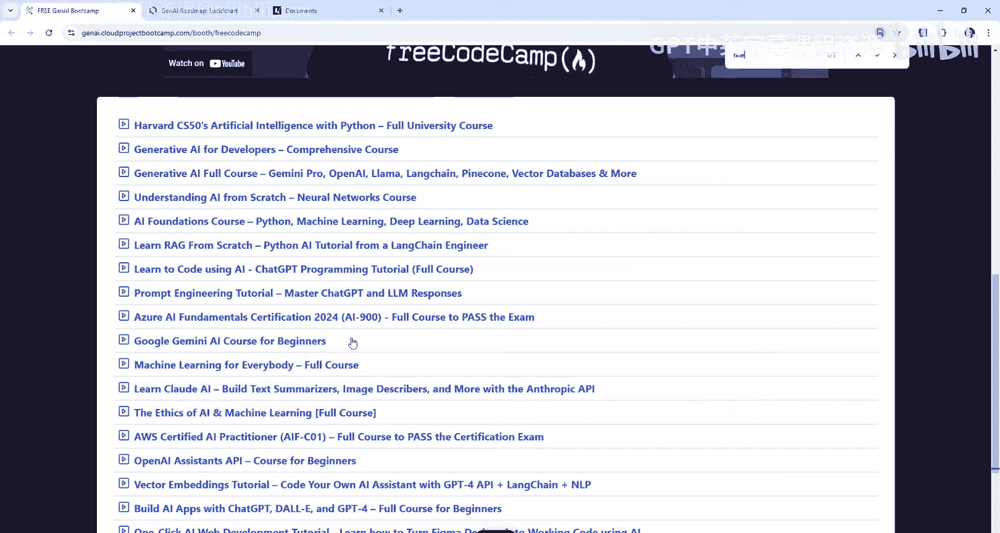
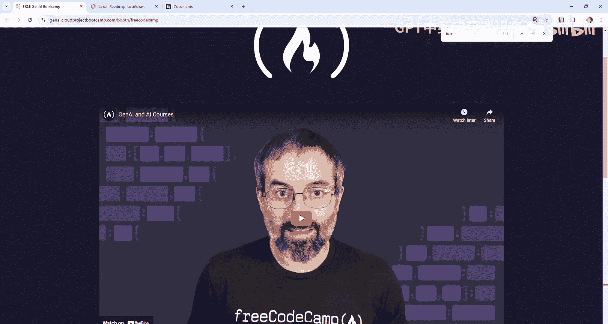

# ExamPro《生成式AI训练营｜Free GenAI Bootcamp》中英字幕（deepseek - P38：-38-Additional Resources from freeCodeCamp.zh_en - GPT中英字幕课程资源 - BV1SFEWzLEab

Hey， this is Angie Brown。 I just wanted to point out that there are some areas that I wasn't able to fully record just because of time constraints。

 but also there's just other really good resources out there that you can utilize to fill any gaps that you need before the boot camp starts or to make sure that you're successful if you're trying to get the certification for the Jennyi essentials course So I've compiled a list along with freecodecamp at Jenny cloudpro bootcamp co for booth for freecodecamp of a bunch of resources and we probably will keep adding to this list of things that you can utilize utilize to fill in those gaps。

 So for example， fine tuning was something I didn't get to do a whole lot about。

If you go over to here， you can see that there are ones on fine tuning， right， or， you know。

 Google's offering， I didn't get to do a whole lot about。

 But there's tons of things about here with the Google offering。 Some of these are my videos as well。

 And so。You know， I'm just suggesting you to take whatever you can to prepare。

 And that list is here at the Jenny do cloudpro boot camp dot com Fort s booth， For slash freecodec。

 So there you go。

