# ExamPro《生成式AI训练营｜Free GenAI Bootcamp》中英字幕（deepseek - P39：-39-Listening Comprehension App.zh_en - GPT中英字幕课程资源 - BV1SFEWzLEab

Hey， this is Andrew Brown。 We're gonna pick up where we left off in the live stream。

 So I have this repo， which is a fork from。Do one， but I really want to have this into my main repo。

 so what I'm going to do。Is I'm going to go to the Internet here。 Just give me a second。 Sorry。

 so I'm just getting things a little bit more organized here。

 So what I want to do is I want to bring in these files into the other repo into our singular one。

 So things are a little bit easier for us to manage。

 What I'm going to do is I'm going to go over to here。 And I'm going to open this。

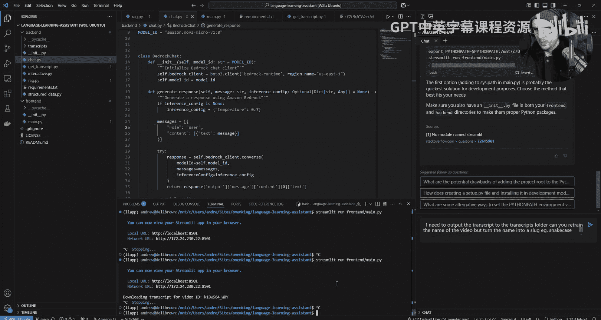

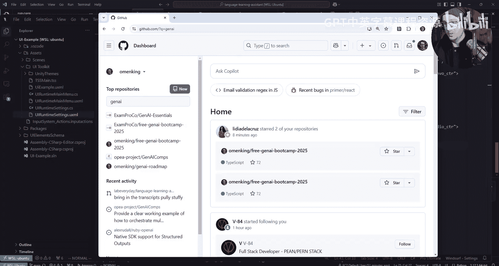

In my local directory here。 So I have some folders here。 We'll go into the Omen king directory。

 which is what I have。 And so there's this language learning assistant。

 So what I want to do is just get rid of the dot gett file and the get ignore file or I could just copy the contents of it。

 So it's this language learning assistant。 But I want this to be called rename to like Lng。

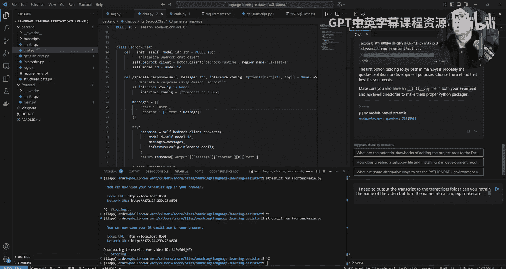

Lang。Listening。For listening comprehension， that's what I want to call it。

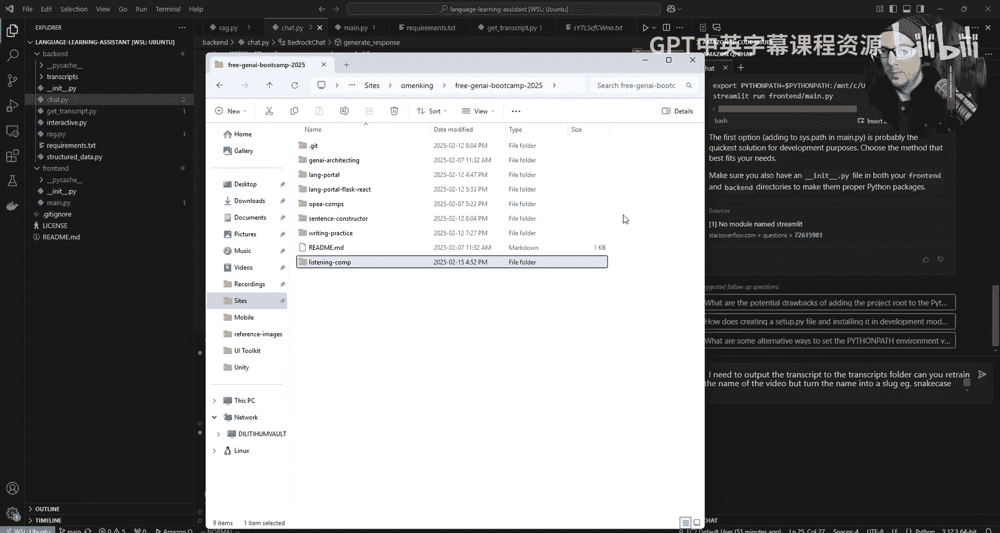

Okay， and so I'm going to open up another tab here。 I'm going to go back to this directory here。

 and I'm going to go ahead and copy the contents of some of this。 So I want this， this。

 this to get ignore。

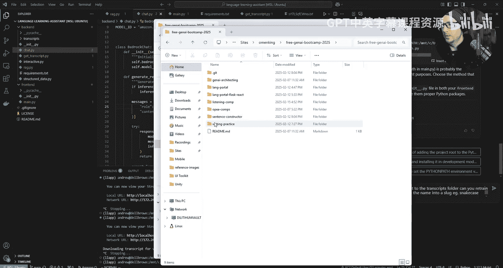

And we probably want to read me， and then I'll go into here and dump it in here。

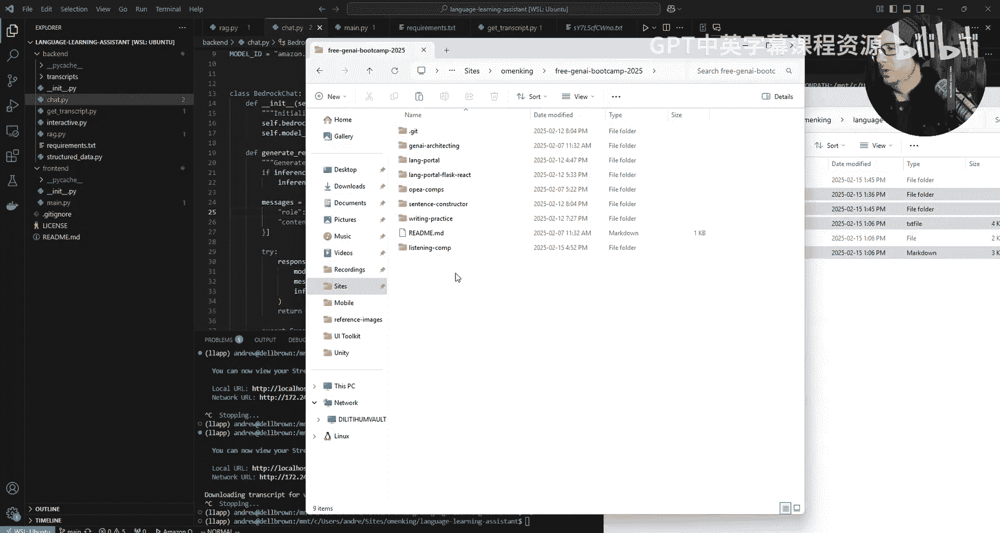

Okay， this repository here， Oman King language learning assistant。

 you can pull it exactly where I have it。 You can find it Github do com s omenking slash language learning assistant。

 But I'm bringing that into my main repository So things are more cohesive and I'm just gonna close out VS code here。

 I guess I could use Winsurf。 I could using Amazon developer queue。

 I'm just trying to decide what I want to do here。 I know that Duon wanted to use it it as transcribe and polyly。

 I might still use those。 I would like to see if there is an open source solution that we can use locally as I would find that really interesting。

 but I'm just trying to decide what it is I want to do。 I kind of want to use whisper。

 So maybe that's what I'm gonna do。 I mean， I could keep using Amazon developer Q， but。

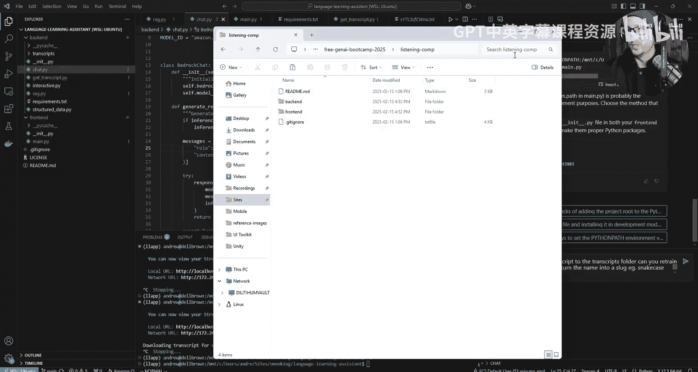

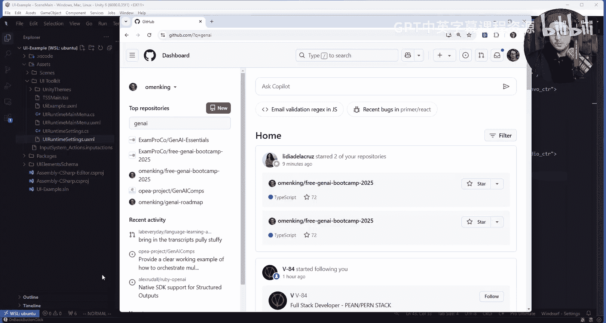

I'm just thinking like， because I' already am using this， I might as well go ahead and do that。

 So anyway， it's up to you what you want to do。But I'm just gonna switch over to whisper。

 And so I'm just updating my whisper here。 or I keep saying whisper， windsurf。

 And I'll be back here in just a moment。

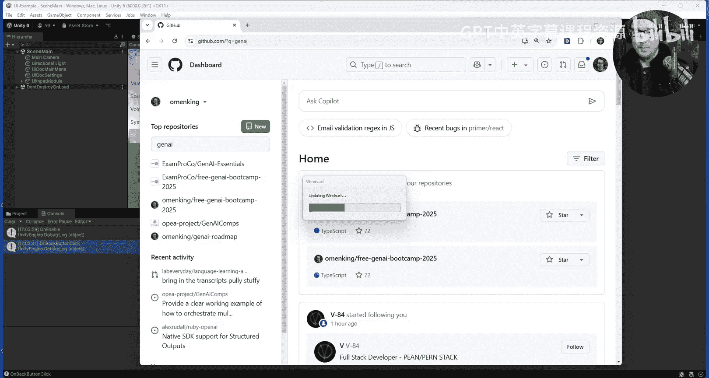

All right， we are back and this is reopen。 This has some other project open here。

 but I' going to go ahead and open a folder。And where I'm going here is into my site directory here。

 whoops。Here and then from here， we're going to the Omen King directory。

 and then we're going to the Free Jenny Ibu camp one， and then we're going into the listening comp。

 I'm going to go ahead and say okay。So what do we need to complete for this implementation Well。

 for the back end we we do have Amazon bedrock and I already have it hooked up and since it was so good。

 I think that I'm just going to keep sticking with it。

I probably would have normally used a different model， but micro again。

Very surprised on its performance。So I don't see any reason to change that。 We。

 the transcription is done。 So that part of the， the。The stuff that we're working on here is done。嗯。

I guess the next step is to get the rag working and since we're using chrom chromroa Db。

 we can continue to use that， it' also be interesting to use Zap。

 the thing that Ken Collins was referencing， but I don't know if that was a vector or knowledge graph or both。

 But what I'm going to do is go over to my front end here。

And take a look at what we have for our next step，What I'm going to do。

Is C into we'll do LSC will C into the。Front end。Actually， we don't have to go to the front end。

 We can run it from here， right， I'm going add some instructions here so my life's a little bit easier。

So we brought this in here。I don't need this in here， we'll just take that out。

So say how to run frontend。And。It's something like Stamlit。Run front and main。

 that is exactly what it is。Okay， and then how to run the back end。Right， we're gonna。

It's kind of that， but we'd have to see。The back end， your P install。Here。

 and then maybe CD dot dot back， you don't have to run from the main。

 but you might prefer to do it that way。And so now we have how to run the front end and the back end set up here。

City dot dot。Okay。The other thing is that you might want to create an environment。 So obviously。

 we've created an environment here。 I think it was called LL app or something。

 So' say Conda activate LL app。That is what I called it， I believe you can call whatever you want。

 But let's go ahead and see if we can run the backs with say streamlit front。Front name。

Just make sure that it's in good working order。We are not currently running the， you know。

 the back end code， we don't run it separately because it's just referencing the code it's basically a single code base。

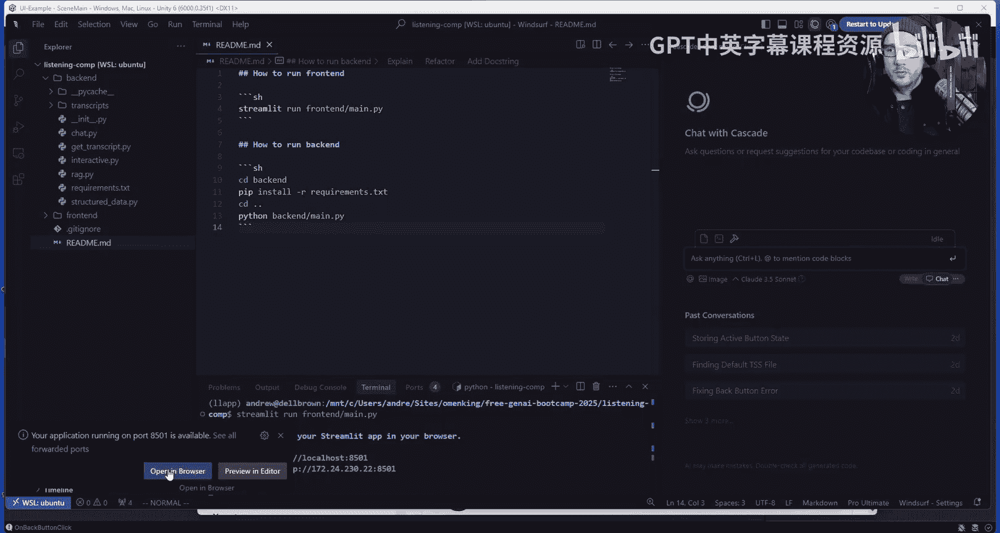

So you saw like in another weeks where we kind of had those separated。

 I we had to run them individually。 This one is all one thing。

 And so we have our chat with Nova here， then we have our raw transcript。Here。Right。

AndLet's make sure that still works。 So I'm gonna go over to YouTube。 Let me go find a link。And。

You know， if you're using Nova， make sure you check the prices for it。 or again， if you're not。

 you'll have to swap this up with something else。 But I gonna go ahead and look up。JLPT。

 JLPT and five。Listening。And there's a few different ones here， but I'm just clicking to anyone here。

I this one， this is the one I know really well this this this video right here。

 so I'll go ahead and grab it。And I'll go ahead and paste this in here。

AndThis might be something we already have。 So I'm going to go ahead and hit enter and then download the transcript and see if it works。

 So it's still working。 And we have the total characters， Japanese characters， things like that。

 It's dropping it over here。

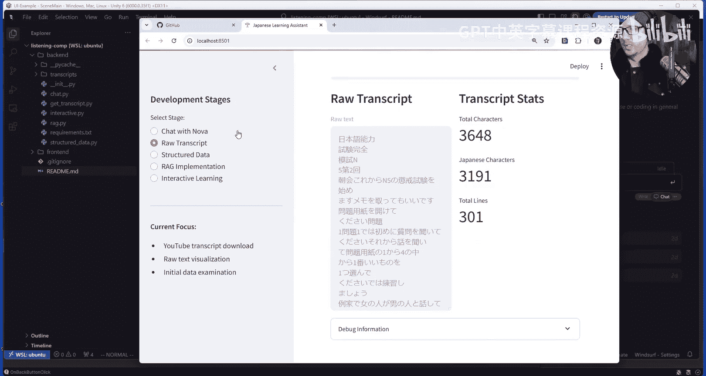

Now， so I mean that it would go the same thing because it's the same URL， I believe。

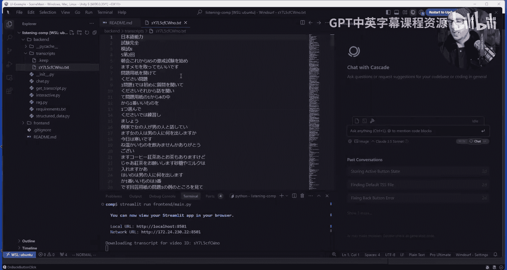

So we go over here and take a look here。This one is called what。It is this one's S Y 7。 Yeah。

 so it's the same one。 And so it would just replace the file there。

 we were having a chat history issue here with the top1。

 I don't I don't know if I really care about that too much。 but I do care about structured data。

 So he says transform YouTube transcripts into interactive Japanese learning experiences。

 This tool demonstrate base element capabilities， rag stuff like that。

 So the structured data processing， dialogue extraction will be implemented here。

 structured data view will be implemented here。 So we have this and this dialogue extraction。

 data structure。 So I'm gonna over to here and just kind of get an idea of what we're looking for。

 So。

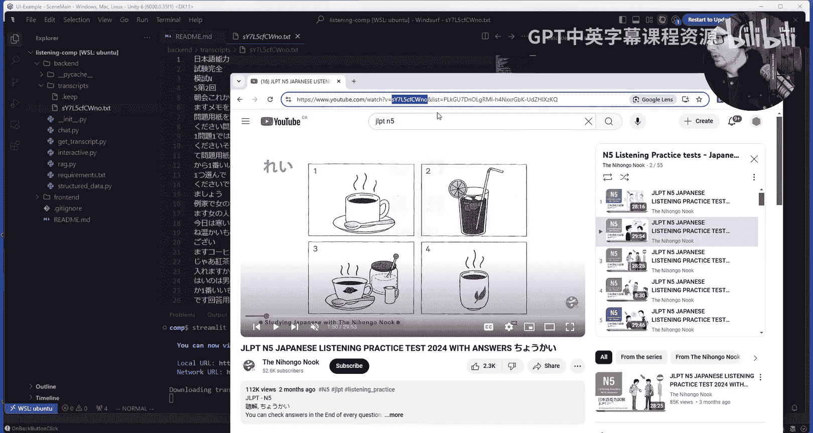

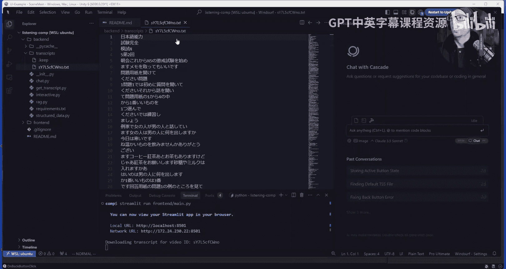

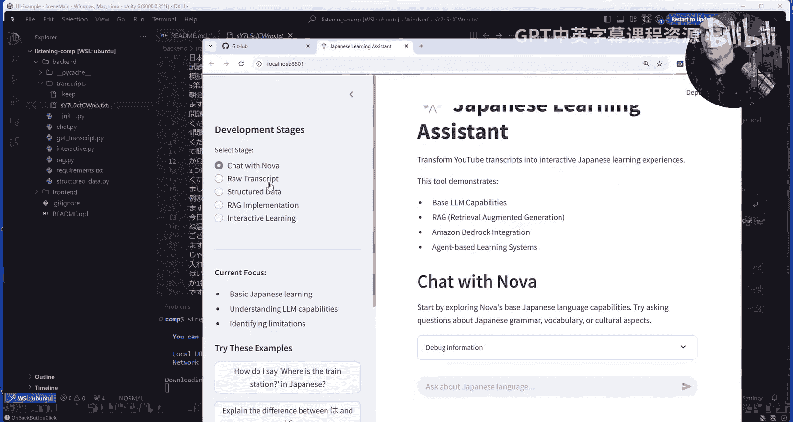

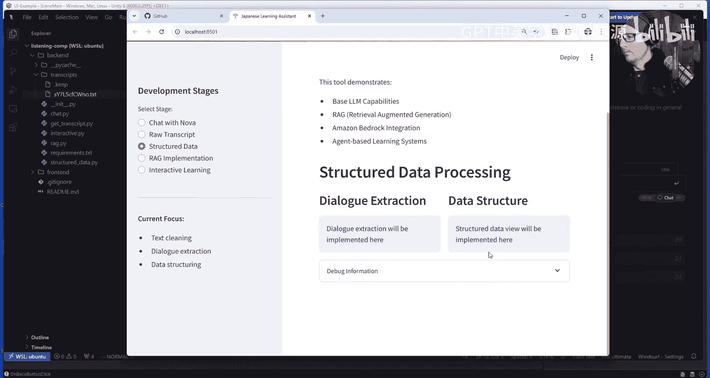

Maybe we can ask。Windsurf， what it is that it wanted us to do。 So we're going to here。

I'm looking for structured data。Because clearly， like， you know。

 we have the data and we could just dump it and so it reads it every time。

 but wouldn't it make more sense if we kind of structured it in some way？

Because it's just a big blob of text。 So one thing we might want to do， we have text clean。

 dialogue extraction， data structuring。 so we know that there is a pattern。There's an introduction。

To the， to the the audio。One second， maybe I'm gonna to get the audio sound in here so you can hear stuff。

 So now I have the audio sound turned on。 And what I want to do is I want to go just play a little bit of it So you have an understanding what's going on。

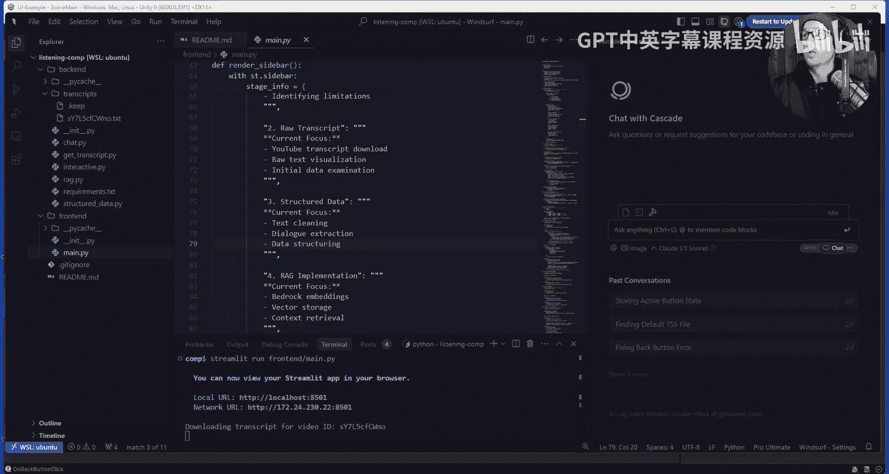

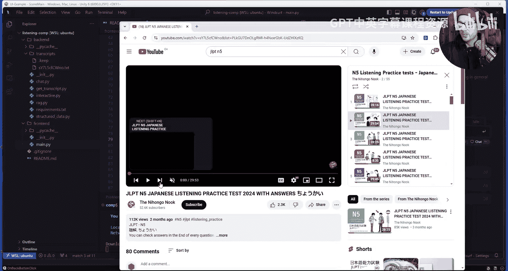

Okay。So we have this intro part that's going to explain。I don't see my audio picking up here。

 Just give me a moment to set the audio settings just one second。

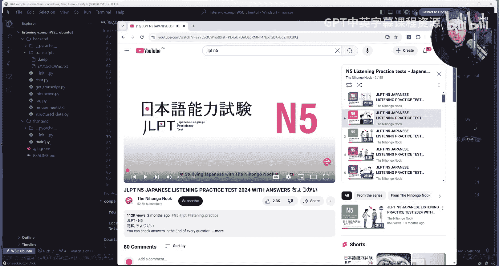

Alright， so now we should be capturing the audio。 I'm going to play a little bit of it so you understand the structure it。

 If you use something other than Japanese， you have to figure out what structure underneath here。

 You're supposed to listen for a second。

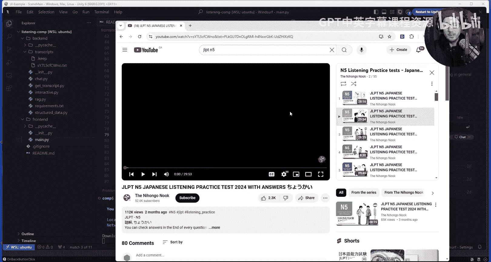

So it opens up the intro。日本語能力試験。完全もし。エヌ五。第二回。聴解。これからエヌ語の聴戒試験を始めます。メモ を取って もいい です。So like， oh。

 it's good to have a memo book for the test， right， They're just doing a slight introduction。

 They did basically read the title。 And then they're just saying like， you know。

 have a memo book ready for， for the test。 They're saying， let's talk about the first Mon Yoio。

 So we're looking at the first question。問題1、問題1では、はじめに 質問を聞いてください。

それから話をいて're saying're options容紙の1から4の中から一番いいものを一つ選んでください。では練習しましょう。

So now we're at our first question， right， So there's clearly stuff in the beginning that is junk that we want to pull out of there that we don't need。

 but it does tell us you know what the setup is。 And so now we're on to this part where we have these four options。

 And so it's always going to do the same how it's going to introduce something。

Have a conversation and then ask what the correct answer is。例、家で女の人が男の人と話して、います。女の人は男の人に何を出しますか？

今日は寒いで、すね 温かい ものを飲みませんか、ありがとうございます、コーヒー、紅茶、あとお茶もあり ます けど。

そ exact same thing talked scenarioじゃ紅茶をお願いします。砂糖やミルクは入れますか want milk want tea milk and。

shrug goes yes。 and now there's a beep。 And so now what's going to happen is' going to explain女の人は男の人に何を出しますか？

一番いいものは3番です。回答用紙 の 問題1の例のところ を 見 てください。Okay， so that's the pattern， right， And at the end。

 there's probably some junk there。 So there's some7 at the beginning the end of the transcript。

 which is not useful。 But what we need are those questions extracted out。

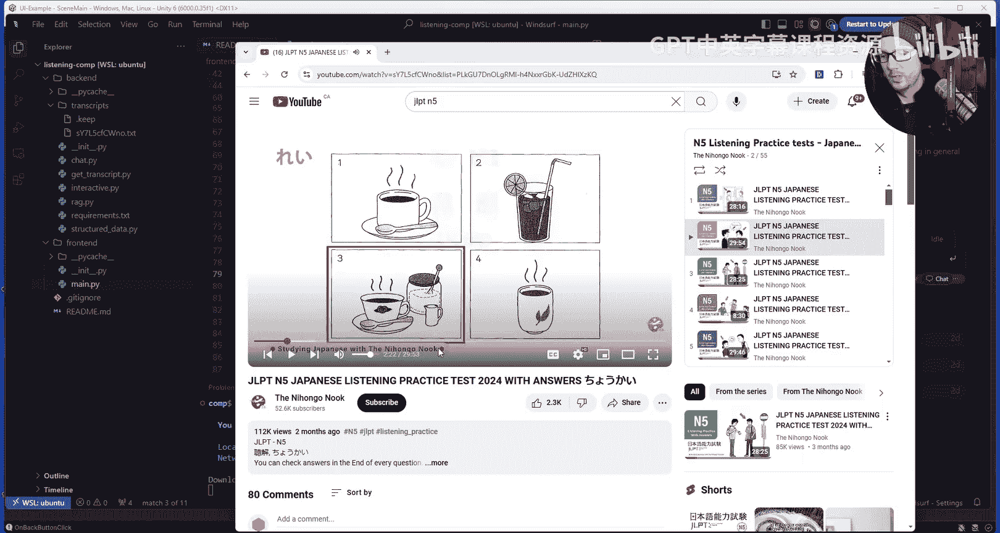

And so maybe what would be useful is to take the data and to break it out。

 So what I'm going to do is I'm going to go over to the structure data。And I'm going to say。

I need I want to， I want to， let's say， I have a transcript。And I need to extract。

I have a transcript of of a JLPT。Listening。Practice。practiceractice。Test。I want to extract。

All the questions out。嗯。I need to extract it。In the following way。We have introduction。Conversation。

And then， question。Okay。And then we have answer， I don't know if they they say the answer every time。

 let's go listen for a second。

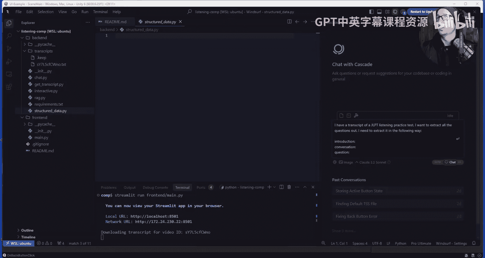

2 ページから 4ページ は 書問題で、4ページに は 漢字 の 問題 も あり ます。はじめに聞く問題をします。時間は十分です。では、問題を開けてください。学生は初めにどのページを開けますかページ？

三班。So they never said what the answer was， right， and that's fine， and so we'll go back over to here。

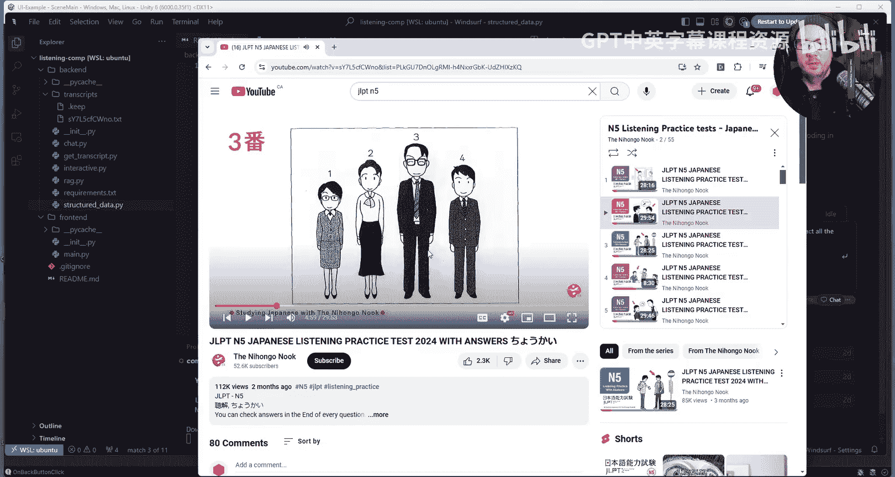

Let's say I have a transcript to the JLPT practice test and I want to extract all the questions out。

 I need to extract it into the following structure。For question。I already have。 I already have。

I want to use。Amazon bedrock。With the Amazon Nova micromod。嗯。I have。Other code that can be used。

To figure out how to write the code。Over in。File， get transcript。I want the implementation。

For the data。Structure to be written。In the structure data file。There we go。 And so we'll go ahead。

 and I'm gonna to put this to right mode。Can use whatever you want to accomplish what you need to do。

 And I'm hoping what it will do is it' going to go in that transcript and kind of follow the the coding conventions。

That's Duan produced， right？So we'll see what happens here。And。

You I'm hoping that this cascade will not create files that already exist， that's totally fine。

And so I'm hoping there it will go and produce that code for us， and then we can review it。

And then if it dumps it out into the extractive view will be a good place。 You know。

 I just updated when surfs asking me to update again so you know。I do update them。

 but sometimes it just ignores it。Okay， so we'll give it a moment to go through its implementation。

 I also noticed this is new。 Maybe I'm not sure NP PCC servers， I'm not sure what that is。

 As soon as I paused， I got code。So here we can see it's kind of following the structure。

 we have introduction conversation question。We have a dictionary。We have this format。

It's using Amazon bedrock。It's using anthropic clod。 so it's not doing what I asked it to do。

 It's using clod， which is fine， but I don't want to use clod。We have structured transcript。

 please analyze the listening practice test script for this。Formatted out。嗯。I guess that's fine。

 Invoke bedrock。And you， we're going to go here and be like， hey。Okay。

 you didn't use the the Amazon Nova micromod。You know， I don't want back， Jason。Make it text。

Just because Jason can be a little bit tricky and I don't know if we have any ways of formatttting that。

Str Jason is a very hard thing to do， and it's not what I want to be doing right now。No。

Its this Titan text model， Nova Micro keeps keeps talking about Titan text。

I don't know if it's like confused or not， but like， that's not what I'm asking for。

 but we'll see what it does， okay。So now we have something returned here and it's done some major changes。

 It's still not doing。 look， like I told it， like， look。You aren't listening。You know。

 in get file trip， get transcripts。Oh sorry， maybe like。Check the code in chat。

I think I gave it the wrong file。 so I was confused to see what I mean with my Amazon Novo microcro。

And please， review。To see how to best。Keep the code consistent。

I think it's because get transcripts just downloads it until I kind of give it the wrong thick。

 so let it try again， okay。

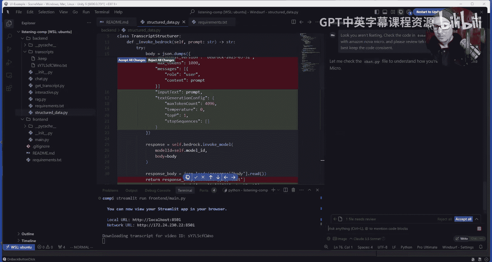

Allright， let's see what code we have here。 So if we take a look here。

 transcribe scul transcribe structure， which is fine。

 So here now we have it initializing Amazon bedrock the model I D， we have the structured stuff。

 So here's saying break down the GOP D practice transcript into into。

Into for each question format like this， we have question introduction， introduction text。

 conversation。呃。Introduction。Conversation question， Oh there we go， okay， here's the transcript。

And then we have the role user。We go down here。 Is it using the model we asked it to use。嗯。

I released the code is shorter， so I'll definitely take that。Oh and it's using Nova Microbe， so yeah。

 there we go。Now， I guess my next question is like。

 can we get it to actually calledton has saved the question and structured the transcript？H， okay。

 so let's go here。And。If we take a look at this one here。

 maybe we can try to follow the pattern that。嗯。Dwn has what's really interesting is you can put a man in here and I guess it doesn't trigger it。

 even if you import it。So it says bedrock chat， this is a bedrock chat。

 this is going to be called transcript structure。And then。We don't need a while true。

What we need to do is let's just say structure， yeah， there we go。啊。I mean。

 it's actually from transcripts。Bor slash。Here， and I'm going to go ahead and just rename this。

I'm not sure where it thinks it's gonna to say， but we just want to get the output。

So if we take a look at this for a second。This is going to produce an output。

 and then we can save it separately and I don't know if I actually care for its implementation for that。

But'm going go ahead and we'll just do a print on the structured。Text， okay， so now we have that。

I am going to stop this。 I want to go into the back end。I mean。

 you could also probably just run it from here or say say Python。嗯。Backend。Strucd data。

So it's saying transcripts no file here。That's I'll let it solve it on its own。

 but the file is clearly there。But maybe it's because it's within back end， I'm not sure。

Look the file already exists。Check the。The tree structure。

So we're just going to help it a little bit detail tell it to look for it。Okay。

 and so now it's kind of working through that now。And that was pretty simple。

 Just put forward slash back in there。 I don't know that it's going to affect this if we do it from other directories。

 But here you can see it was instantaneous output back。And so， I mean， we have stuff。

 but it's not formatting it。Right， so。Make me think that it might not be working。

 so I'm going to go up to here。So here we have the prompt。Here。And then the temperature set to zero。

 so it's super creative， which is fine， I don't care。And we get a response back。

And I didn't notice any difference。嗯嗯嗯。Okay。So what I want to know is like。有。Can you go to the web。

So say web。Can you go and find the model Is for the Amazon Nova models Because， you know， 1。

0 is good for like basic tasks， But for whatever reasons it's not structuring it。

 So either there's something wrong with our code， the way we pass this in here or this model is not picking it up here。

So I'm just gonna yeah interrupt the current one here and we'll hit enter。

And so I'm hoping what it'll come back with is those model Is， and then I can just swap them mode。

So let'll just give that a moment， okay。So here we go。 We have a few here。 There's also premium。

 but I don't want to use premium。 I mean， premium is fine。

 I just don't want to spend a bunch of money if it's expensive。 But anyway。

 so we have that one already。Then we have model ID， which is this one here。And then we have Nova Pro。

Okay， and so I'm going to switch it over to light。And we're going to try this again。

It's getting a little bit confused。 It's been a little bit aggressive here。No。

 I don't want that commented out。And。We'll go down here and we'll run it again。

 We'll see what happens now。嗯。Okay， so I'm going to switch it out again。

And this time I'm gonna do this one。I'm not sure what it's confused about， just it's fine。

 Just come on and accept it。There we go， so。I'm going to try to run this with Nova Pro。

See what happens。So I'm going to go back here and say you know， no matter what model。

I D I use the output from。S your transcript。Doesn't produce。嗯。The formatting。It just returns。

The transcript， as is。So there might be something with our messages wrong here because we have user content。

 but that's the user there so should reply with the proper stuff， right？Oh， you know what it is。

 It's loading the questions here。 Hold on。We have load questions。

So I would say like load transcript actually instead。It actually makes sense what it's doing。

And we'll change that out。And so here， this is fine。 This is just the transcript。

And then what we actually want to do is want to say structure。Structure transcript。

And we'll print it out。 So now we'll go back to the micro。

And we'll wait a moment we'll see what happens， okay？Now it's taking a little bit longer。

 I mean the other one was fast because we just loading a file it wasn't even hitting the endpoint。

But it did have a lot of data， and the context was pretty large。So let's say that's pretty good。

I don't know how many questions there are。17， its showing 17 here。So， you know。

 how would I know if that's all of them， I wouldn't。

At least it's being kind of consistent with the formatting。 I'm not sure why here it does。

Curlys around it。 But if it's consistent in terms of an output， then I don't really care， right。

 that's like all matters to me is that it's consistently doing the same thing。

 The thing that I want to do is I want to probably chunk it。 I'm just gonna to move to sitting here。

But。You know what I'm thinking is that we have it。But I would like to individualize the stuff here。

ok。I'll go to run it again， I'm going to see if it produces the same output。

But once our data structure， it's not like we have to run this multiple times。

 So it's not a big deal if it breaks。It's more just getting our data in our structured format that we want。

I just can't believe the conversation would be this short， right， so it has this。嗯。

I think it might not know that there's a start in a finish。 Let's go back to the top here。

And let me look at the first question and see if there's a problem。Yeah， so the problem is， is that。

Our prompt doesn't realize。That there is an intro。And an outro。Before it introduces。The questions。

Can we update。Are prompt。To not include these。And only。Extract。The questions。Okay。

 I can just tell it because I'm looking at it here。 And I'm seeing like。

 that's the first thing where they， they're， they're talking about。 I see N 5， whatever， whatever。

 This section also， I think， well， this says， no， this says two people。

 So that looks like it's correct。I we'll see what it's updated with。About the test。

 focus on extracting the actual questions。Yeah， and you can actually see that it always says the number here。

 I think。 Yeah， it does。So we go to the last one。嗯。I mean。

 some of these conversations seem too short， like， how can that be the whole thing。Okay。

 so we' go ahead and say accept all。And I'm going to go ahead and run this again。So， you know。

 as Kara said， garbage in garbage out， so if you don't do a good job format baing your data。

 then you might have something that's not that great。Okay， so I'm not really sure。

Here it translated it。 two people are discussing。 So the the LOM returned English。

We should only return。Japanese， because the whole。So， here。You know， it was a the situational step。

In the Japanese text。Of Japanese text。Of Japanese tax。Do not。Translate。The Japanese。

Text into English。Okay。And so we'll try this again， and then we'll see what we get。

And so now we have this。 But dont also like there was a bit inconsist。 So we have the question。 Well。

 the question is fine here。But we don't tell it to format the question like this。Right。

 so that's a bit confusing。Maybe what we can do is we can say like question like this。

 I'd rather like have this kind of selection around it。Like this。 And then maybe。This will。Help it。

 understand。Okay， so I'm gonna to change it to that format。We'll see what we get now。

So we're really trying to see if we can get consistent formatting here。Converation， conversation。

So notice another thing it's like repeating conversation， right？Why， why is it doing that。

So let's go to the first one， which I know really well will go all the way to top wherever that is。

嗯哼。😊，I'm not sure why。It's doinging that because there's not going be two conversations， right。Here。

 here， it's actually showing us。The possible choices， right？To me T kra mon題。

So what I'm trying to figure out。

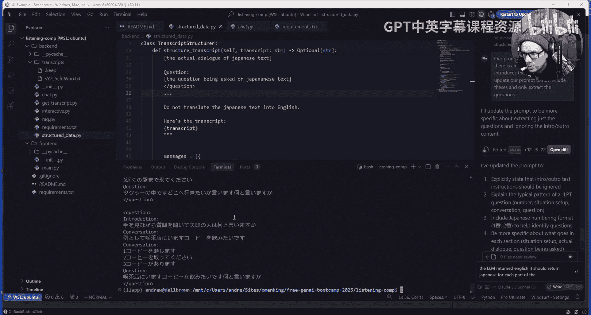

Like， is that the last one， If we go to this one here。This's only has three options too。近くの駅まで行きます。

コーヒーを飲みた。😡，うん、三の中から一番いい三要はじめいえあ好き。バスで行きますを。とても 遠い。Their law's a little bit weird。

 I think maybe because the format of the question changes。Here it is。 Oh。

 there's three types of question formats， the Mondayai 3。Right。

 so this is where we're running a problem because I didn't realize that there's a section here。

 This is manai one。 So like question one。 So this is gonna follow a particular format of one and 4。

 right。And so then in here。We have three， and this follows a different format。

 This is between one and three options。I think what it's playing is like it plays out a story and then you have to listen to multiple points for it。

 right？

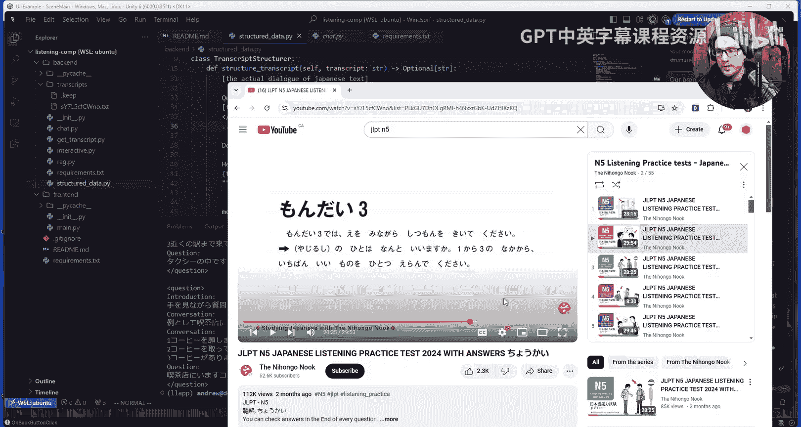

嗯。So this is where this is kind of messed up。 I'm gonna commit this right now。

 I just wanna kind of have access to this code before I change it。

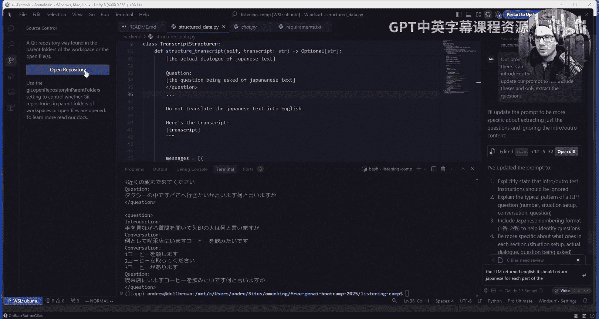

And maybe I'll just open this Vigil Studio code real quick。

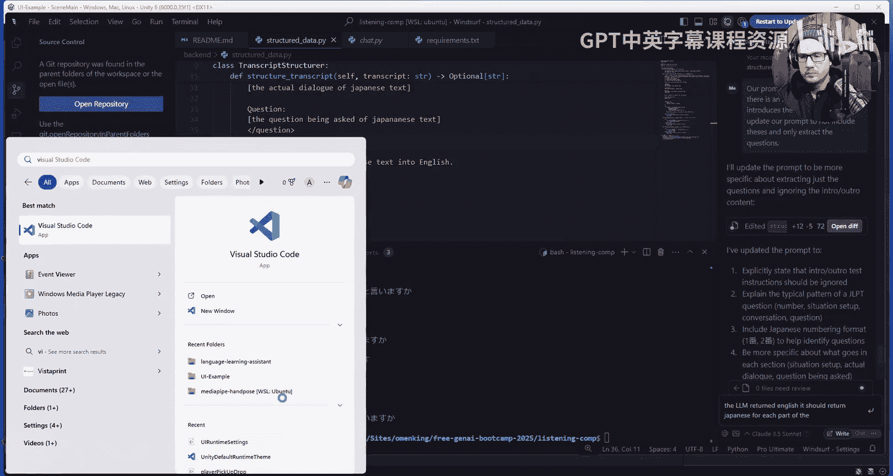

Or get X or a smart X。 Keep talking about using smart get smart。 I'm gonna go use it。

 I'm gonna get smart right now， and use it。And here it says evaluation ends in six days。

 and you need to register to license。 Oh， maybe I'm not paying for this。 It's kind of annoying。

 But I'm in the the， this is the wrong repo， But I'm gonna switch over to a different repo。

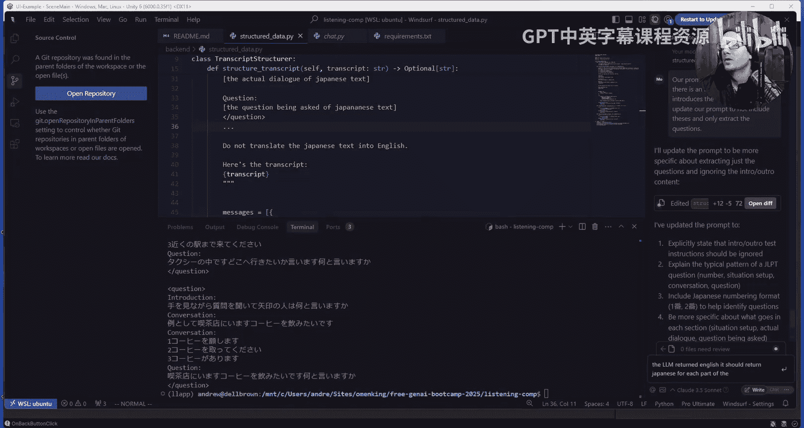

嗯。So remember how to switch reos in this file， or maybe just add it up here。That is the repo。

 There we go。And so these are all fine。 So I'm just gonna commit this。Working for the transcript。

Foratting， this is probably the hardest part is just trying to format the。

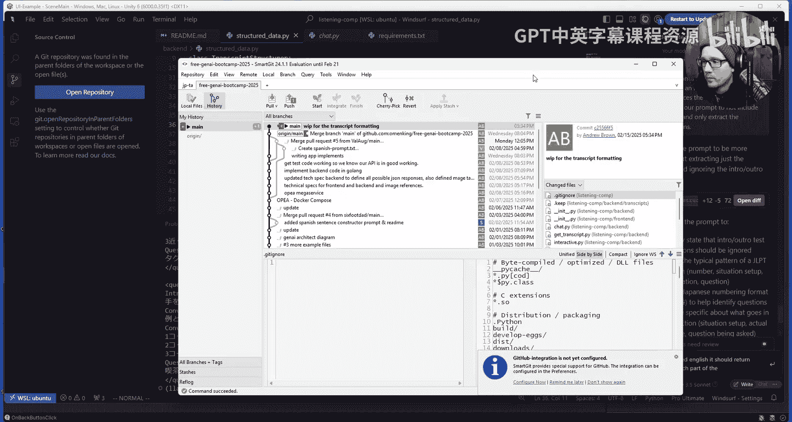

These transcripts。 and it really depends like we could use it to do it manually or what we could do because there's only 17 questions。

 But the other thing that we could do is we could also， I don't know。

 depends because there's a whole playlist。 It be sweet we can pull the whole playlist。

But what I'm going to do is go back over to here and I want to explain like。The transcript。

Appears to have three。Question formats。Fall three sections。With each section。Having a different。

Question format。And。Each section explains。The question format。So we need to change our prompt。

To extract out。Those three sections。The description of the format。And then the questions。Okay。

 so let's see what it does for that。And it'll take a look there。

But if we're getting inconsistencies with micro， then we might want to move up one layer and then try to use light as it might give us more consistent stuff。

 We also have it set to0。 So that means that it should be wildly consistent。

So you' suggesting section。Section format explanation， Japanese。Introduction。Situation。Okay。

So it's updated it。Exactly as is， ignore any practice examples。Marked with。That， I mean， I guess so。

I'm not sure why it's saying marked with that。I don't know what this character means。

 So let's go take a look at what that means。

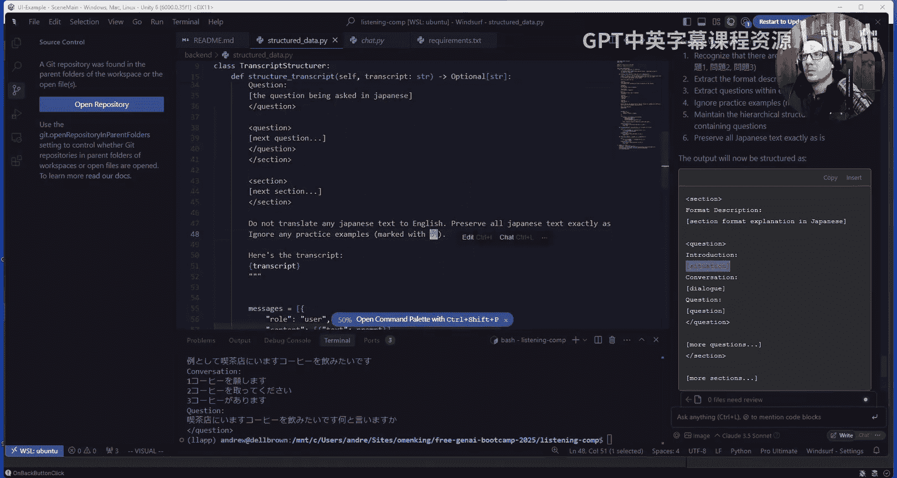

So I can go here， I'm going to go to G show。And we'll paste this in here。 and we'll say kji。

And so this is example customer usage， okay。

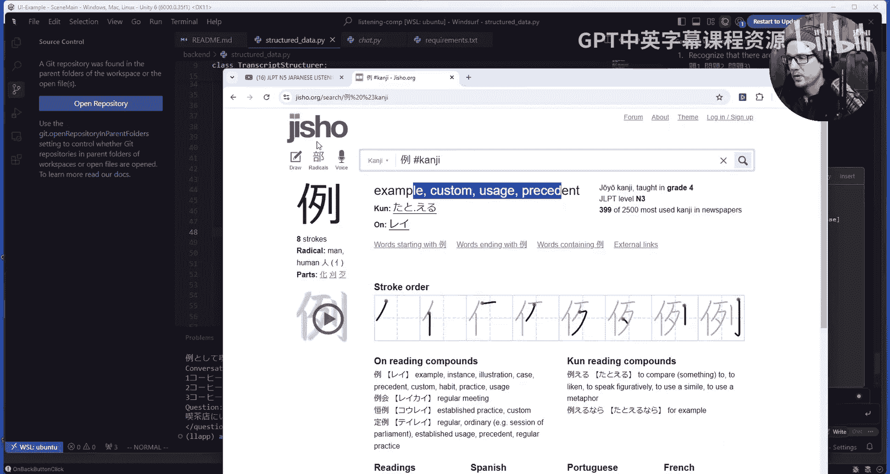

But why， why can't we use that， I don't know。

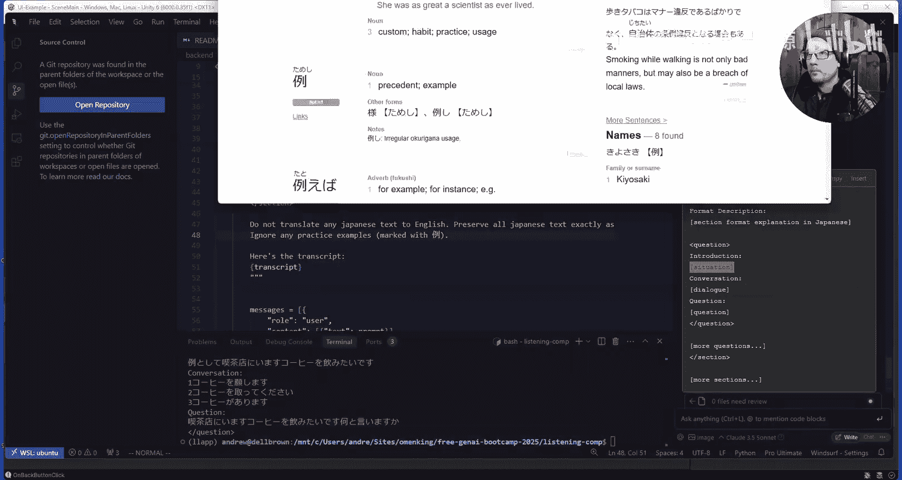

This is where you have to really be a domain expert of the content。 And I'm not。

 So we'll do our best here。 But we'll go ahead and we ran this。

 I think Did I just run this right now。No， but I'm going to go ahead here and just type in clear。

And we'll give it a moment here。And so now we have our different formats。

Let's see if we can make sense of it。So here we have a section it describes。The section 1 to4。

Does't how many hes going to be。Then we have our first question。Then we have a second question？

We have our third， fourth， I'm waiting for the next section to start。Question。Question。

Then we have a section here。Now， what we might wantan to do， and it it depends。 But like。

 if we wanted this to be a bit better， we might say， hey， like， tell it like， hey。

 there are three sections and only extract out section 1。But right now。

 I'm not sure if that really matters。 Then we have this one where saying between one to four questions。

Okay， so we have this one， which is fine。And then we have this section， which is a bit different。

Where we have a question。Question。Okay。So I guess Mike what like maybe we should dump the contents here。

 so what I'm going to do is dump this here， let's see if we can save this。It will say structurer。

Save questions。Back end questions， right， So that will be that。 And so this way。

 we can then analyze that file and ask if it did a good job。We'll run it again。

 and then we'll let it dump。We don't even need to have this here。 This can get out of here。

But this is going to be the hardest part is just structuring the data that's pretty much everything else after this should be really easy。

And so I'm going to go back over to。A transcript here。didnn't create it。

So maybe because it doesn't have that folder， it couldn't do it。

Here we have this I'm going to make a new folder here。 I'm going to call it data。

And I'm going to put transcripts in here？And I'm going to go here and make another folder。嗯。And。

Questions。And then I'm going to go ahead here and say data。Data， in this way。

 it should hopefully work。Because I don't think this thing can create folders。

 so it either has to be there or it's not。And we'll give it a moment here。And now we have it， right。

 so。Checking our output。Under questions。Under questions folder。

Did does the structure outputted structure。Makes sense。Does。Section 3。In particular。Makes sense。

Because again， what I understand section 3 is it's going to ask you a like information that you try to choose a series of questions。

And so we'll see if it analyzes that file properly。

It's not about matching phrases just to situational visual cues。

Means while looking at the picture illustration， the current format doesn't properly reflect this For Section 3。

 the current structure is forcing conversations where there aren't any。Instead。

 it should be more like this。Question situation， options。Question。Okay。

 and so it's gonna go update it。 Now， one other interesting thing I didn't think about this1 I was making is that we see an image。

 right， that describes something。Do we need to generate an image for this to work。

 Like to make it really clear。And so that might be something that we might care about。

Clude to distinguish between the different types of questions in each section， okay？Okay。

 and we'll take a look back at our prompt that we have here。And so it says conversation。

 but it has a situation set up contains a question， asks the question but the conversation。

 phrase matching questions， show a situation， ask what phrase to use in that situation。

 no conversation involved。Format the output like this。Okay， good。 So now we have improved output。And。

I'm going to go ahead and delete this。You can see how windt is are really easy because you can analyze the file in place and then fix it。

 We'll go ahead and do that and run this again and we'll see what we get as our output。

And so we'll go back over to here。 again， using a very cost effective model， which is nice。And so。

 we have。Very little data in here。 There's no way this is。 this is all of it， right。Okay。

 so it looks like。Seems too short。 Can we break up this task so that there are three。

LLM calls and three prompt documents。Each responsible。We're extracting out。The sections。呃。

Each your responsible for。Attracting one of the sections。Okay。And then， save the output。Of。

Each section separately。Okay， so let's go ahead and do that。So itll rework the code there。

 and we'll give it a moment。Now， will it be smart about refactoring the code。

 that's another story that we're not sure about。But， you know。

 we don't need to focus on air every single section。

 We could have even told it just to focus on Monday 1。Type format questions。

 because those are the first ones we're looking at。But we'll see what we get here in a moment。

Alright， it's generated an update here。 And so let's take a look at what it done。

 So we have the first prompt。 I'm just gonna accept it。 so I can easily easily see the output here。

 but we have prompts。And we have problem number one。Prompm number two。Prompt number 3。

We have invoked bedrock。 I'm not sure why I gave it an underscore， but that's totally fine。

And we go all the way down the bottom。嗯。Is using the converse API。 I， I don't know we， I mean。

 like we can use the converse API。 But since these are all single action， it's not really necessary。

But we do get a consistent API that we to use here。So， prompts。Try to make sense of prompts。Okay。

 so here it's running the sections one to four。Are there four sections？Is see three。

Maybe it stops on three， I don't know。But let's go ahead and give it a go and see what happens。

But yeah， and I'm wondering， like， do we need the imagescause if you don't have an image。

 how would you know what to choose。Right。And now we'll give this a refresh here。

And here we have section 1。Section 2。Section 3， so we have a lot more text now。Okay。

What's kind of weird is like they put the section up here at the top。

 but that' that's something fine， I guess。But now I'm just kind of thinking like， okay。

 we have this here。s where you need to say the appropriate。

 It's interesting that describes the format up there in English。This one's in Japanese。

 This one's in Japanese。 So it's not being consistent in terms of that stuff。 I mean。

 I don't really care about the format description。Because that doesn't really matter to us。

What matters to us is the extraction of these questions。

And so guess I care more about the initial questions。

 I'm not sure why it's doubling it up here on this one。It is doubling up on here as well。

So they'll say， you know， look at the outputted。I you delete eat this one here。Looking。

 maybe we can just take a look at the actual prompter。Back over to here。And holdold on here。 We have。

 Let's take a look at this prompt because it see me a little bit confusion here。 So we have question。

 introduction section。Format description。I mean， we don't need the format question description in the actual thing here。

I'm going switch it to what happened to our other model。 We'll go back here， saying model I D equals。

Amazon dont Nova。Light。And let's try to swap that out and see if we get a better result。We might not。

 But there's a few things we don't really need here。

 And so you can see we could be spending a lot of time trying to get this data to be the structure that we want it to be。

That's probably where you have to spend a lot of your time yeah。So we'll give it a moment here。

To generate。So now if we get this a refresh here。We have our sections。

I see no doubling up here anymore more。This one's not doubling up anymore。

It is going to a bit confused about what to show here。 notice this like it says a section here and。

We'll go here。 So， okay， so looking at the generated questions， generated out output。

 I don't need the sections。To be described。Within the questions output。Because we already know。

What they are。Based on the prompt， can we get that。So Kim。So can we only have questions？

In our outputted。Prompt data or output it questions data。Okay， we'll see if we can correct that。

And so， you know， some of the formatting looks wrong， but I'm just hoping if it removes completely。

Then we'll end up with that。 So then wet have to worry about whether this is English or whatever。

 And we can just kind of move on from that， like that。The other thing I'm not sure about is like。

 would a vector store even make sense for this Because vector store is for storing。

Highly relational data， right。Or not highly relational data like semantic data。I don't know。

 because this has a structure。 I almost kind of go， well， maybe it should not be that。

 but we'll see what happens。 I'll remove all three prompts。 I've updated all three prompts。

 remove any section formats descriptions from the output。

 explicit rules to not include any section description or other text。Should be only the output。 Okay。

 and so I'm gonna go ahead and try to run this again。 So we'll go ahead and delete this。

We really should check over the prompt， but I'm just going to go ahead and do this first。

And so this might just kind of solve our problem。So we'll give that a moment here。

And give us a refresh。And now it's outputted。 we're going to give this another refresh here。

 We'll drop this down。 We have our first section。So we have our question， introduction conversation。

Question， right。 Then we have our next one， introduction conversation， question。

Then we have our next one introduction conversation questions。 So this one's looking really good。

This is what I want。 This is perfect。 We'll go to the next one。Introduction conversation question。

 I don't know what the difference between the the first and second section is。

 We'll have to read that later。 Let's go to the next one。 We have question， situation， question。

 question。This one a little bit weird or formatted。You have a question。situation question。So， yeah。

 I'm not exactly sure what to do with that section。 I don't really care。 We' just first like first。

 the first and second section are pretty good。 But the problem with the first section again。

 is we don't have images to show them。Now we could show text， which is totally fine。

But we need to enrich it。So I what what we need is we need an answer or a description of what the possible answers could be。

 But if if it， if there's an image。Then we need to describe what that image is， right。

 And then we need to generate it out。 So I'm going to go here， and I'm going to say。Can you。

 I'm just trying to think about this for a second。First， we going accept all changes。And。

I guess what I want is like this data is incomplete。 I need it to have the the possible answers。Okay。

4our section1。We need to。So。The possible， we need to show an image。So I need an image description。

Of the possible four options。嗯。For section one， we need to show an image。

 so I need an image description of the possible options。The other thing is that。

 know if we don't have an image， we then we would have text。

 but the problem is that some of these questions， if you don't use an image and use text。

 you're kind of giving away some of the answer right。

 or you know now you're bringing them out of Japanese and English and so by never showing English text。

That might be a little bit better， but we could also just show Japanese sex as the possible options。

 but。That might make it a little bit hard。 So I'm not sure about that For section 1。

 we need to show an image， so I need an image description of possible options that is part of the questions output。

Can you update the prompt。And so let's see what we get。The only problem is like。

 how am I going to get a good output for that。Amazon Brock also has an image prompt。

 And so that might be something that we might want to try to play around with。

 I will probably log in Theyll use sample diffusion， I believe。

 but I'm going actually log in the bus。And we're gonna explore that together and see if we can even do that。

 like get what we want。As our output， I'm gonna just run this again。

 And I think it replaces it there。 So that's not a big deal。

 And I'm just logging into my As account off screen here。Okay。

 so we're generating out that structured output。We're going to go over to。Bedrock。ok。

And I want to see if that output is there now。嗯。😊，Options， so that's now it's saying options here。

 which is fine。 And this ones technical is right。 It's like pagee， whatever， whatever， whatever。

 whatever。 The only problem with this is that like these are technically the options that we have。

 and they're not that bad。But。Again， now you have to parse the Japanese text as opposed to a thing。

 So it's up to us whether we want to。Fix that。But like， I'm gonna to go over here for a second and。

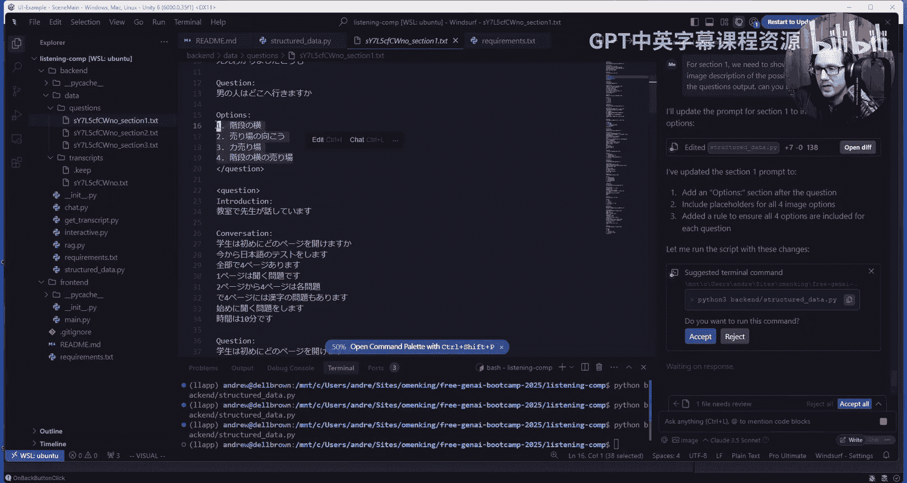

Copy this one here。 And I want to go over to Claude。This is a Japanese test question。

 the choices need to be displayed the four choices。Be displayed as an image。

Can you write me an image prompt。And so I'm going to provided this。

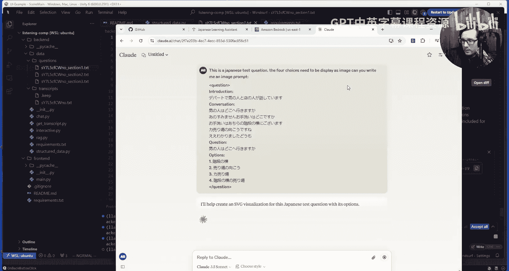

I didn't say make me it， I said。

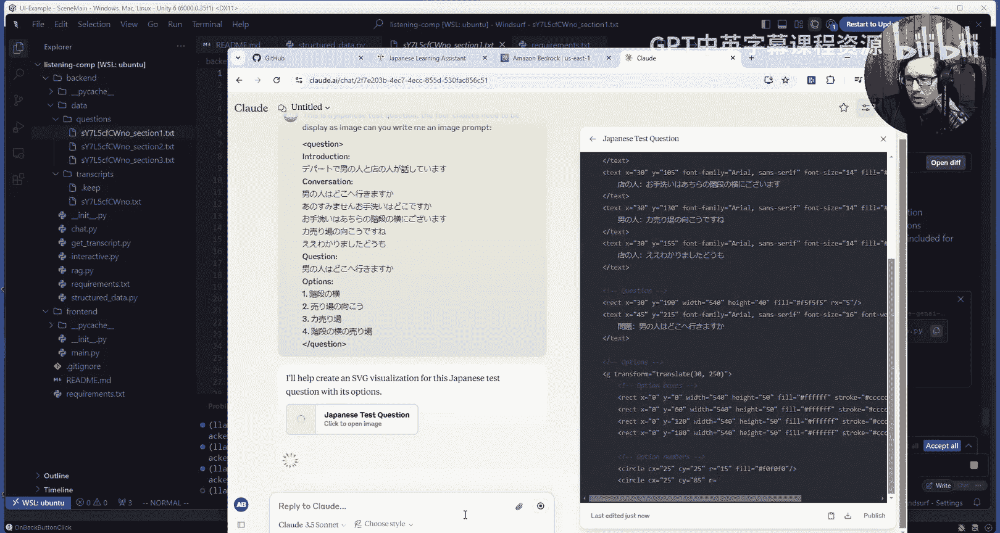

No， I said。Image prompt so I can create， generate an image。With something like。Stable diffusion。Okay。

So I'm going to go ahead and grab this here。And。Now that I'm long to Amazon bedrock。

 I'm going to go over to the playground for images。

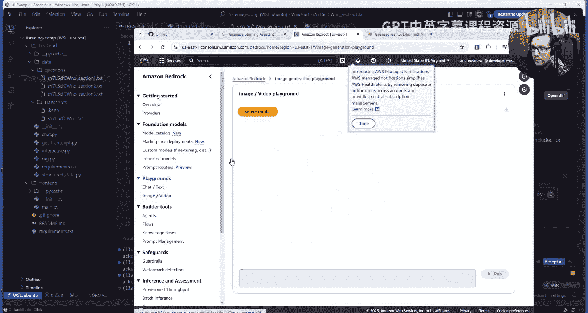

And we'll select a model。 We have。Oh， we have Titan as an image generator。U。

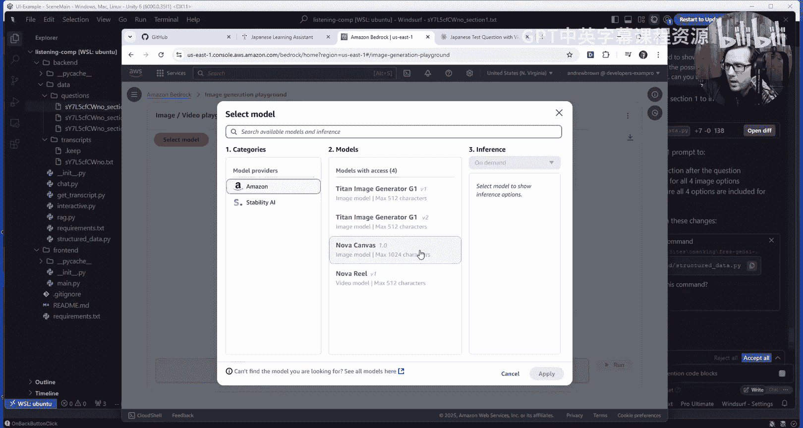

Canvas real is for videos。 Can like， if you're afraid of spend， don't do this。

 but I'm gonna go ahead and do thisca I don't care。

 I'm gonna go ahead and run this and we'll see what we get。Now， this is a little bit slow。

 So I'm not， again， if this is too hard， we'll， we'll just leave it on the wayside here。

 but it's something that would be nice。So that's no good。 That's， that's not going to work。

 So a minimalist education test layout on a clean white background displaying Japanese text。

 The layout has it a definition of the top。So I would say this output for the prompt is not good。

 so I go back to this and say， you know。The output， the output is no good。You know， it should be。

White background。Black and white。Line drawings。It should。Have four images， four boxes of images。Okay。

 no other texts around it。Okay， so we'll go ahead and do this。

I'm going to go ahead and grab this one。It's trying。 It thinks it's， it's using stable diffusion。

 And I actually have， or discor。 was it called。Mid journey and actually I have a minute journey account so I can go over there and try it out。

 I'll just try this out for a second here。

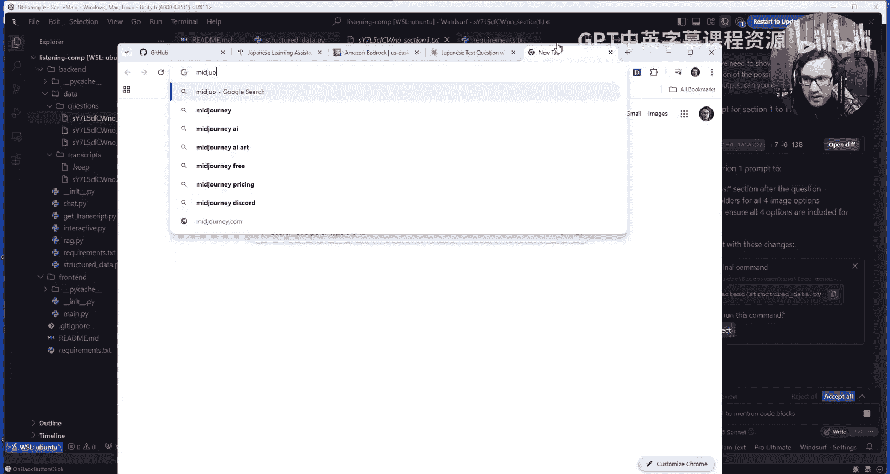

Midjourney。I was just logging， and I got to really cancel in mid journeyney。

 It's not not as good as it used to be。But I wanted to see what happens if I put the prompt。

 I'm doing this off screen here。 so you not see me do it。

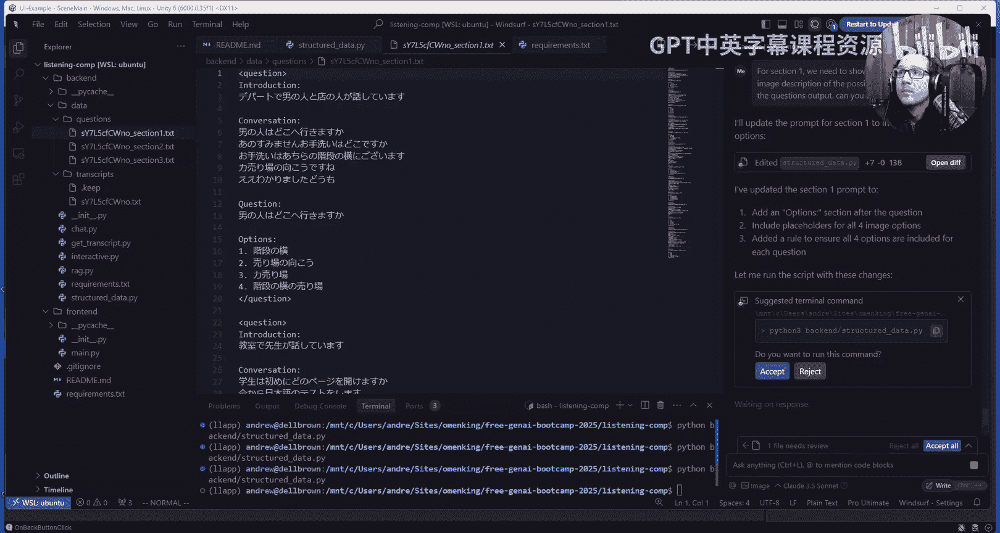

But I am going to try and generate out。This again， for Amazon bedrock。So try this again。

And maybe what it really should be is like generate four separate images。

 and I might have an easier time doing it。 So go over here。 And so this is actually not bad。

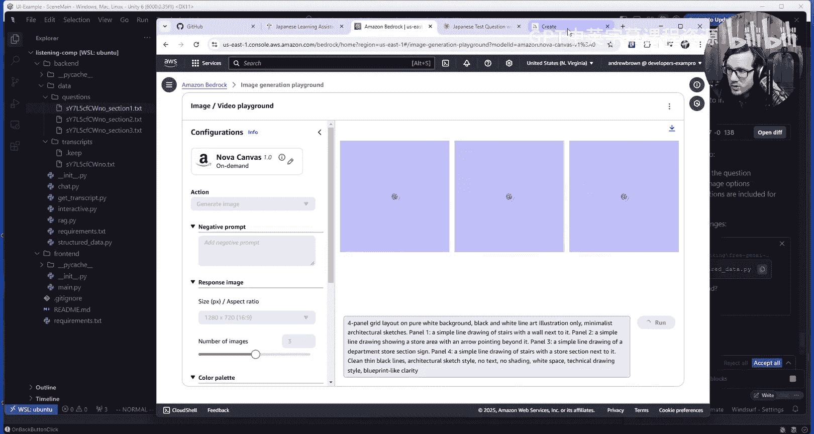

But the question is， is it descriptive it， So four panel layout of pure white background line art illustration。

 minimalist architecture panel， a simple line drawing with the stairs with an wall next to it。

 panel 2， a simple line line drawing of a store shopping。

A simple line drawing of a department store signed panel 4 clean thin back back lines。

 architectural sketch， no text， no shading， et cetera， et cetera。 So you have those four there。

And I don't know if it's really descriptive of what it is， you'd have to know what this says here。U。

But if I look， I take a look here。I'll make it a little bit larger so I can kind of read it。

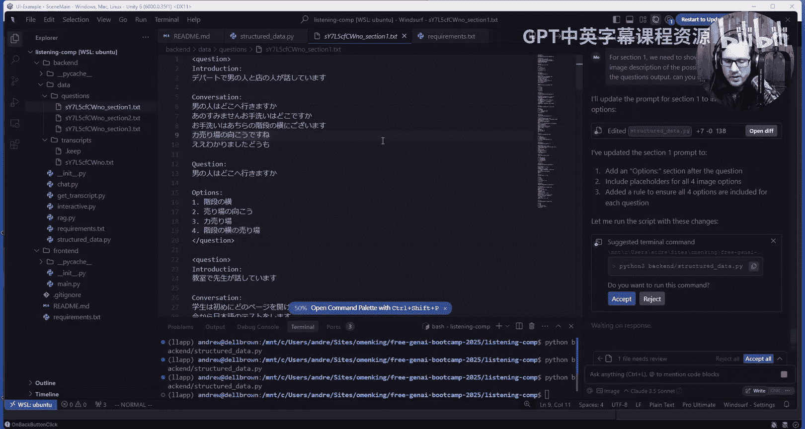

So here we have Departo， so a department， right。Onna nojito。 So a man。onの 히 on。

And then somebody that works at Mise Nojito， someone that works at a shop。And they're talking。

 Hanahi Tama， though they're talking together。 And so the man asks。是。Wtoko Ichimas。

 So he's asking where something is。あのすみまan。So it's setting up saying， like， the man's gonna ask。

 where is it， I don't know。 assuming we must send。O。 So he's asking where the bathroom is。

 Owa Doko des。 So he's saying like， where is the bathroom And the lady saying。Okay， well。

 the bathroom。Is over there。There's the stairs。Okay， so remember this。

 This actually has to have a map。 So there's really no way that this is any good。Right。

 so to to be able to draw this out， I'll show you actually what it's it's supposed to look like。

I certainly find that this doesn't work because， you know， we're we're finding the limits of it。

But this is the drawing of the， the， the thing that's going on。 So here。You see the stairs over here。

 right， And then over here， you have the bags， right， And so in the text， the it's going the toilet。

 it is。It's over there。 So if you look at the stairs， it is beside the stairs。Right。

 so sayings beside the stairs， Yoko。よ告に。Gozaaima so beside the stairs， I think this is Yoko。

And he says。Can abaの。うん、木こでですね。And so basically， he's confirming he' saying， okay。

 so she's saying it's beside the stairs。 he says across like opposite of。The bag store。

 And it's like， yes。 So this is where it is。So the question is， can we even get that illustration。

 right？ So that's kind of another problem where if we don't have this information。

Right from the video， there's no way。We're going to get the result we want。

 But what I'm going to do is copy this here。And we'll drop into cloud here。Okay， this is the image。

This is the original image。Can you describe it？So we can generate it。

And this is where you kind of have a challenge So you might have a question that is always about directions。

 right， and to get what you want， maybe instead of generating an image。

 you'd actually use something that would generate out a layout。

And so it's not like this is the best scope that we want here。

 But you can see this is where we're kind of having a bit of a challenge。And so here it goes。

 let me create a more precise top down architectural for plan with this， top downstairs， whatever。

I don't know if like it could even make that like if we go and ask this to Amazon bedrock。

 I don't see how it could even generate that， but I'll give it a try。

And I'm going to go back over to here to this。 I'm going to give a try here， but I can imagine。Yeah。

 I don't care about the aspect ratio。 Let's take that out there。Okay。

 and maybe the negative prompt should have went in the negative prompt if there it is one here。

 and there actually was a negative prompt over over here， they're actually providing it to us。

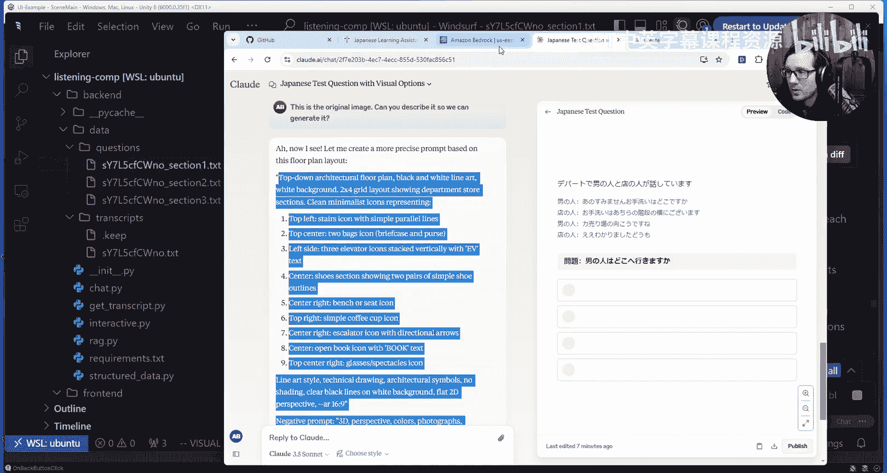

And I didn't paste in the correct location， but actually。Look at that。That actually is not bad。

But was it accurate to the description provided？Right， so if I take this here。

W want to make it larger。 Can I make it larger。

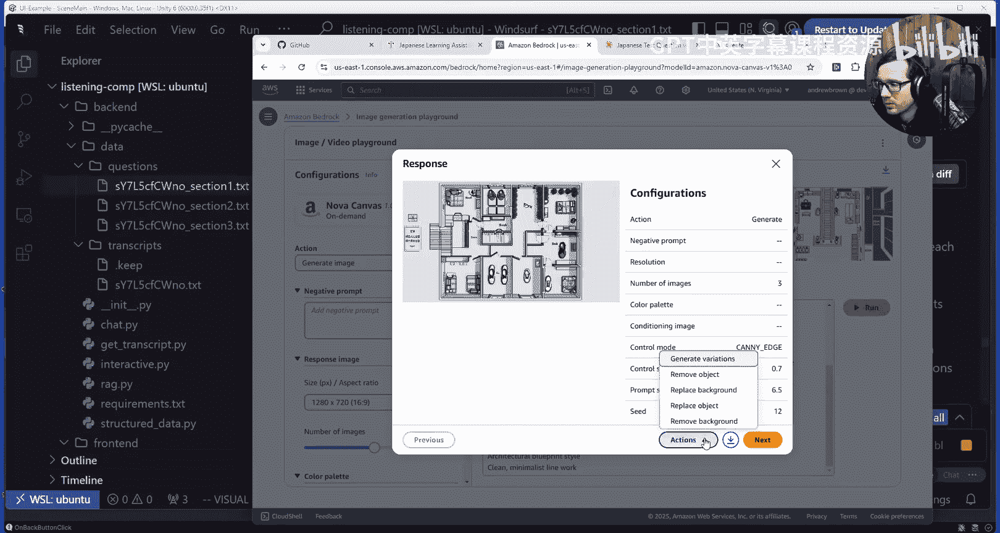

Download this here。And we open this up。Right， so we look at this。

I'm not sure why there's shoes everywhere。

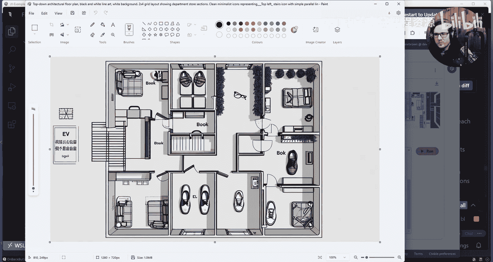

But we are。 We are getting an illustration， right， So this is where we kind of run into some challenges。

 But you can see that we have stairs over here。

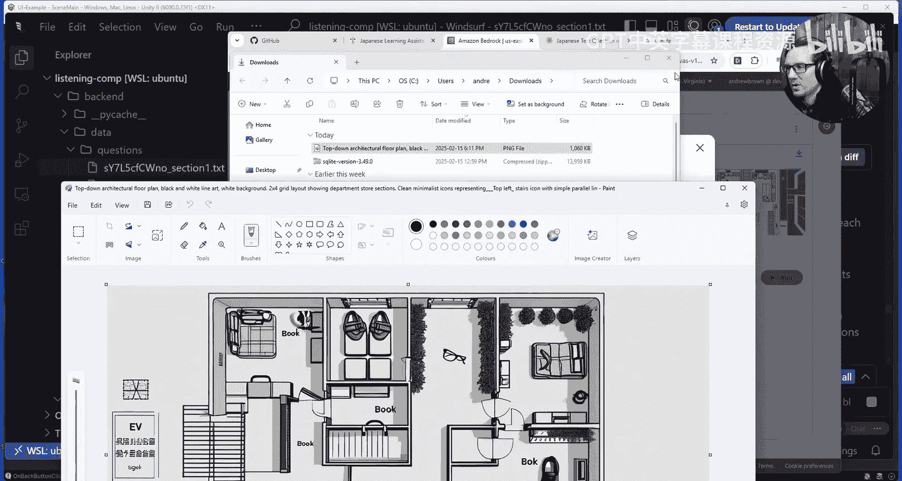

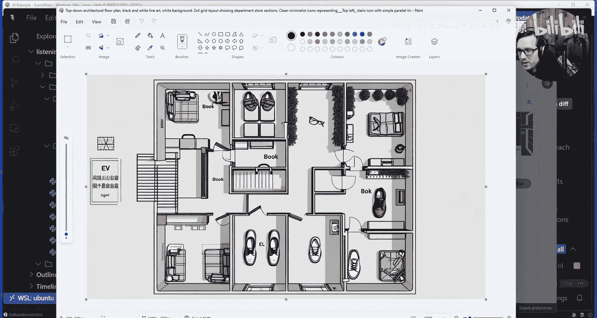

This is book， book。 It's just all weird stuff。

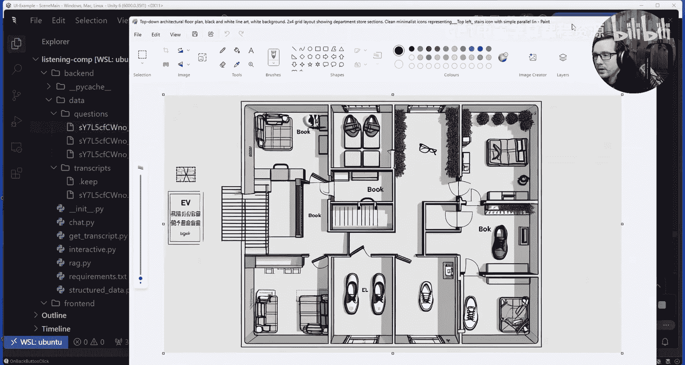

So that was not going to work for us。 Let's go to the next one。Again， I mean， like it's a thing。

But it's not accurate to what its output is， right， And we go over to this one。

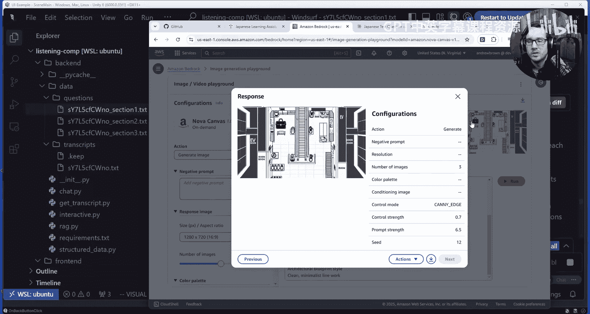

Again， I'm not sure if it worked， I had animals so I was trying to tell like a story。As an example。

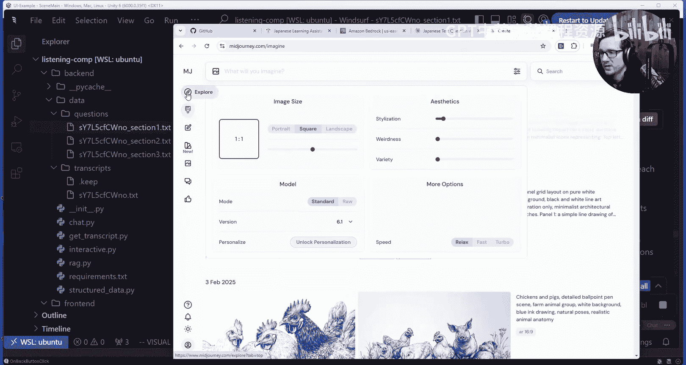

We'll go back over to here。And so we look at this one。That's a mess。That's a mess。 That's a mess。

 That's a mess。 So， I mean， it's cool that we have diagrams。😊，But the problem is that。

It's not reflective of the description。 So that's not going to work。

 So the only way this might work is like。We generate out an image。First。Right， and then。

We we frame the question around it， but then that kind of destroys our whole rag process here， right？

So that' that's where I'm kind of struggling。So what do we do， Because we want this to do something。

 But I don't think this is going to work。Unless we， we change the scope of it where we say， okay。

 we're not relying on images and we're just going have text。 But is that useful。I don't know。

 because if we can't see the image。Here。Right。We can't answer it。

 and so then the question fundamentally has to change。But we need the visual to do it。

So the next thing I could say is like， okay， is there a way to generate an architecture？ So like。

 you know， the image is generated。 So I'm going to go back over here， so。Is there a way。

To generate out a floor plan。With some visual mockup language。That's what I want to know。

Ising mermaid， Oh， could it use a mermaid？

Okay， that's。Yeah， that's， that's no good。Like real floor plan。嗯哼。

Now I'm trying to use SVG， I can't imagine it can do it。I really don't think you can do it。

 but we'll let it try。Actually， that's not bad。Okay， great。 Can you。

Let's give it something more advanced。So you're going to go back to the other one。

And we'll go back to our history here。I will say， you know， can you make a floor plan？

Based on this description。Okay。But the way this is the only way this is going to work is that we'd have to basically like。

 we'd have to make question types， like literally what we wanted to be and generate derivatives。

 So we wanted to show。

Like based on directions， we would have to really， really engineer that specific one because we just can't handle generic questions in generic image generation。

 or we have to creatively think about it and generate the image first as a result and then figured out there。

Okay， so like。Okay， but where's。Where's the rooms。

yeah。 But now it's like， this isn't gonna work if it has to do it multiple times。

Unless there's a way to self reflect to look at the images， so。I don't know。

I think we might have something that's impossible to do。嗯。So looks a little bit better。

 but that's still not going to help us。嗯。Okay， is there akechup language？For floor plans。No， no， no。

 no， no， no， not ask he。I mean， like a real thing。Yeah， but and yeah， but like。Architecture。Software。

4 plans。But open source。And programmatic。Yeah， it seems to be confused。

 I'm going to go here and ask perplexity。Is there any software， Is there any open source？

Software that can produce。Architectural floor plans。Be a code that look good。Okay。

 so that's what I'm asking。And so we're going through here。 and so。Free cat。

 I don't know if Free cat is a sick look here。So free cat is one。

An open source building information library tool is take a look at this one。 Ber。

 we're not going to use blender。 That's insane。

We'll go here。Great， say。Can you generate the floor plan？Ass a file。Or pre cabab。 can do that。

Or is that too hard？I don't know， like。Okay， but。嗯。Previously。You know， so here like。

We're going to struggle。 The the only thing I can think of is like four images or four options。

I don't know。So it does have a sta symbol stuff like that。 That's kind of interesting。I。

 maybe this is not the best thing to do， but I'm just curious。 I'm gonna see if we can do it。

Free cad。

I'm not suggesting folks to actually do this， but I'm just curious to see what if it can actually do it。

And we'll do x 64。Download that。 I'm going to wait for that to finish downloading。

I may not even run that。 So， you know， maybe we can do。 Let's just think about this another way。

 Maybe we can do is like， okay， you know， can you review all the questions and tell me which tell me how many。

Rely on an image。 and， and tell me and。Can you all the questions and tell me。诶。In a bullet list。

Single for each question。If it would rely on an image。To determine the answer。

That's what I want to know， because maybe there are questions that don't。Right。

 so then we just keep them out of the filter。And we'll give that a moment。Alright。

 so let's take a look and see what it analyzed。 So， yes， needs the image to be shown。 special layout。

 No， answer is clear from conversation。 Yes， yes， yes， yes， no， answer is clear from conversation。

 No answer is no， no， no， no， no， no， no。 And So the thing is is that what we really want。😊。

Is to know if they need that or not。 So 5 out of the 18 would benefit from having the images。

 This makes sense as section 1 appears to be testing spatial visual comprehension。 Okay。

 so basically， now what we need to do is we need to eliminate questions。From our stuff。 So， okay。

 how can we eliminate。Eliminate questions which require spatial。which require an image。To understand。

Was' sort of asking it。Because if we can do that， then we're back to doing good stuff。Cause I。

 I just don't think image， image generation is， is there， or it will require a very。

 very considerable amount of work to get it to do what we want。

And here I think it's focusing on part one。Okay。So we're going to go back over to here。

And I actually don't need it to run。 I don't know。 I did that。 I shouldn't have done that。

 So we'll just stop that for a second。 And so we'll go back over to here， Section 3。So I would say。

 you， can we apply that to section two as well？嗯。And so then we'll be in a place where we can。

You know。See what we need to see， right？It it likely won't remove any questions since they were already dialogue based。

 This is consistent with the typical format where Section 2 tends to focus more on comprehension of spoken information rather than visual elements。

 So maybe we shouldn't be doing。The first first section anyway， if the second section is more。

About spoken elements。Okay， but it does seem to suggest that some of them require an image。

 Let's go back up to here and take a look。Actually， no， none of them require a section。

 So maybe we can just skip section 2。 Okay， so， you know， can we comment out section 2 for now。

Because obviously， section 1 is just not going to work for us。Okay， great。

 And so I'm gonna go ahead and accept， accept all the changes once it's done。Okay。

 and I'm going to go ahead and do this。 I'm going to delete out these sections。

 Just make sure that this goes good here。 We'll go ahead and hit up。

 It seems like section 2 is probably our best bet。Right。Okay， we'll go back over here。So let's say。

 you know。You know， would we benefit。To storing our questions in。One second here。Alright。

 so now that we。You have the stuff， the question is like。

Will we benefit storing our questions in a vector store。嗯。Because the app we are creating。Needs to。

Reference。The existing database of possible questions。And generate derivatives。Vienna on。

Let's see if that works， because that's what I don't know。嗯。Semantic search。

 when generating derivative questions， we want to find similar questions based on their context structure and topic。

A vector store would allow us to perform semantic similarity searches。

We can use the vector store to quickly find relevant questions to use as examples。

We can store not just the text， but also the structure format。As metadata making it easier。

 let me propose an implementation using Chroa DB， which is what we're using。嗯。

But I think it knows it because it's in our code base， right？But really。

 we should be doing this over here in our vector and there， it says vector story。嗯。

I didn't really want to do that。Because we want to treat these as separate isolate stuff， right like。

We'll give it a moment， here。I'll let it finish， but I really didn't want it to be this aggressive。

 and this is my problem that I chose writing not chat。Or I told it， maybe don't change any files。

 let's just talk about it。

Butll wait for this to generate。All right， let's take a look at what it did。

So we have here vector store。I have to zoom out so I can see what's going on。It's using open AI。

I'm not sure why it's changing。I mean， we could use that for embedding， I suppose。

 but now we're kind of mixing， mixing stuff here。 I'd rather just continue on with Amazon bedrock for embedding models。

Here it's taking look at the collections that we have here。

And inserting them is adding the questions。So we here we have add questions。

 so only sections two and three are currently supported。

And it's going to enumerate through the questions。How does it know that it's going to break up each question。

 right so。嗯。I mean， this is fine at all。 But like the problem is is that if you have this。Right。

You know， like I， you know， I I， you know， I don't plan on like， I can see that。Example question。

 you want to parse from these text files。 So sections2 add questions to the vector store。

So I'm trying to make sense of this。 Here's， here we have example uses。 So here we have the storage。

Here's an example question。Add it， but it's not in this structure， though。Okay。

So that's kind of annoying。 If we go back up to over here。 It's just putting it back into a document。

 So， you know， I don't understand， like， you know， first of all。We are using Amazon bedrock。So。So。

 we don't want to。also， what did it change over in our other one our structured data here？Right。

 so it's parsing the questions， which I guess is something you can do here。Which is fine， I suppose。

 but。嗯。I mean， maybe just say like。Use Amazon bedrock。To do the embeddings。Not open AI。

 because then we'd have to use another one。 I't want to really mix things up。

I'm not sure if it would use the latest one here， but we'll take a look here and it's going to remove the open AI reference。

And you can see here， like we have， why is say video I。There is no video I。

 It's kind of weird that it， Well， I guess there is a video I up there。 so I'm actually not。

 that's not completely wrong。We'll give it a moment there to work Ifll be back in or just a moment。

 We's take a look what it did。 So created a new function class。

 Why does that to make a whole freaking class for that。

Ebedding interface uses Amazon bedrock Titan embedding。

 It really wants to use Amazon titan embedding。 so， you know。You know， is there。

 is there a newer embedding。Then Amazon Titan。Ebed text。For， well， I mean。

 we could just probably check。Because I know that I'm logged in somewhere here。TW S。

 give me a second here。So we just go look at the bottles。No we can find it that way。

Go to the model catalog embeddings。And so they have a version two。

What's the difference。Multilingual support with 100 languages。 We'll go to the other one。

 Does the other one have multilingual support。

Because if it doesn't， then we really shouldn't be using。The other one。

 so we'll go over to this one here。This says V2。G1 text。

Ball sports plus 25 different languages optimizeim protect retrieval。

And does it have Japanese in here？It does。 So we can use the the first one。

 I don't know how much of a difference it will make based on the beddings。

 embeddings will change how it stores the data， like to turn into the numbers。

But that's totally fine。 So here we have。The questions being par of like that。

 no need for additional APIs or services， tightentan embeddings。

Consistent infrastructure and this function now handles it。

 I wonder if I got rid of the old junk in here。I think so。Okay。So， I'm going to go ahead and。

I'm going to accept this， okay。Okay， so now that we have。That there's not in our rag file。

 this is kind of pointless here。 I don't really care。 We can go ahead and just delete this is fine。

It'd be nice to have it， but we can have it over here as well。Now， the question is， how do I test it。

 So if we go down below here， We have an example here of using the， the service。

So let's go ahead and see if we can do that。 So I'm gonna go ahead and say。Python。

Backend vector store。So the number of requests is five is greater than the number of the index one updating the results one。

Okay， just explain。 I don't know if this is bad or not， but let's just like can can explain it to me。

Because we're only bringing in once that makes sense。 So can you explain this。

Please don't change code。I'll move it over to Cha。嗯嗯嗯。😊。

We only added one question to the vector store the birthday question。 but in the search。

 we were asking for five results。Where are we asking for5。I telling us， we can't。T5 results。

 There's only one that's expected behavior。 I guess that would kind of make sense。

And so then here we have our text that we want to provide， right。Okay， where are we getting this N5？

So like， where。Where are we specifying？5 results。I see it now method。

 we have a default parameter of results n1。With five。And we can call it in the code in the bottom。

 We don't specify end results。 So use the default 5 since we've only added the questions to the database。

 And that's fine。 Now， I guess my question is like， we need to insert all the data。

 So let's go back over to structured data here。 And I need to figure out how to run this。Okay。

 so can we。And say， you know， can we。嗯。So what I'm trying to understand is that oh it does parse the questions。

 and it adds to the vector store。 so I don't really like how this is fully integrated because it really should be separated so the one outputs a file that imports it。

 and so it's pulling in the vector store， so I'm going go here。Accept it。 And I want to say， like。

 I want the vector store。Dot high and the。嗯。Was it called and the structured data？

Scrips to be isolate。You updated it， so that。So that the structured data is inserting。

Bsiness starting directly into the vector store。I would rather。Have the parsing being done。By the。

 by reading。The outputted files。From the。Vctor from the。Structured data。

I would rather that par can be done by reading the output from the structure data。

Buy the vector store file。Because then were coupling our code very tightly。

 and I want them to be decoupled， right。And。Please proceed。Did you couple the code。As asked it。

 And so we'll， we'll go ahead and ask that， because then that way。We'll get a better result。

 So we'll give it a moment there to fix that issue。 Allright， so hopefully it is remove that code。

 And so now those things are isolate。 We are still using light model。

 We probably go back to the micro， but I'm just getting good results of this 1。

 I don't really want to fiddle with it more。 So here's removing the vector store。

 If we go down below It's removing all this code。 As I did not ask for it to put it in there。

 And so now that stuff is an isolate， which is better。

 Let's go over to the vector store and see if it's added it。 And so the parsel is over here。And。

We can see here it's adding those questions and then chunking them there。

 And so this is a much better solution to what I'm looking for。

 So I'm going to go ahead and add that。 And the only thing is that this is going to both insert that stuff。

 but also do that as well。We probably want a larger data set to work with and we'd have to grab all the transcriptions。

It would be useful if the way that API worked is if it grabbed everything from all those YouTube videos and。

I suppose we could change it to do that。 I'm just trying to decide whether I want to do that or not。

 because I don't know what the consistency of the videos are between each one。 Now。

 normally they generally will follow this kind of pattern， but like those three sections。

 but you know， maybe we could pull all those questions and do that。And get rich data。

 But for now what I'm going to do is I'm just going to accept this。

I'm not sure where it's storing the data， by the way。 Oh， it's over here， okay。

And I'm going to go ahead and try and run this。 So we're gonna to go here to the back end as the front end is totally fine。

 we don't do sorry， we don't have to change the structured data。 We'll run this。

 And so what I'm hoping is that it's going to iterate through。

 So this parsing error with list object， not an iterator。

 I'm going to go ahead and copy this and paste it back end， I'm going just accept this here。

 And if we can correct this one issue， which is just apparently a formatting issue with objects or stops here。

Then we'll have data imported。 It's not again， not a lot of questions， but。

Maybe it's the start of it if we have more time and go back and update the YouTube stuff。

But even after this， we need to get the data， do the figure out how to utilize this similarity search in a useful way and then display the choices there as options。

Okay， so we have this here。We have some formatting things。 I'm gonna just run this manually。

Hopefully that works， it'd be really nice if it works。 There we go。 inserts the existing embeddings。

 index 6，5，6 questions and5 questions。 So I guess my question is like， when we want a type of thing。

We're chat here so。We'll stop it so like。You know。Are questions。

 questions  two and three being inserted。Into the same。Backter store。

Like when we do a similarity search。Is it going。Going across。嗯。All possible questions。

Or are they segmented。As each as a collection。That's what I don't know。

ca I' like I don't know what the concept of collection is。

 I assume it's just stuff within the vector store or another EsQite database。Okay。

 so they're in separate okay， so there're separate sections。So we go here。

 so look at the code it's segmented。When we search。

 we specifically query the collection for that section。Oh， so number two is section two。

 that's what it's saying in this code。Section 2 questions are only compared with section 2 and section 3 are only with three。

 that makes sense。Okay。It prevents irrelevant cross section matches as it allows for section specific optimizations if needed。

So that's kind of a start。The thing is like， I can't imagine we would have that much data in the third section and。

That might be kind of annoying， but section 2 seems to be the most reliable for us to search against。

 and section 3 would probably have to be structured differently for the thing。

 So just understand that Section 2 is our main section。

 All the other ones just don't really work right now。

So I'm just thinking about this for a second and we now have a solidlinarity search that we can utilize。

So what I would like to do is think about the next part， which is。The interactive part。

 And so they say it over here， but。Yeah， and I know that Duon broke it all in those parts。

 but I just want to get this done。So I'm really just going to focus on this last section。

 which is the interactive learning， right， because this is， this is implemented。 This is implemented。

 This is implemented。 I don't want to figure this out in the interface。

 I just want to focus it in interactive learning。 So I'm gonna accept this。

 I want to commit this code。As my WIP。I don't want to commit the vector store。

 So because that's kind of large。 So in here， I'm going to make a。In here。

 I'm going to make a dot get ignore。I want to ignore the vector store。Sore data here。

And I'm gonna go two levels in here so that it ignores that as well。

 because that's gonna be too much for us if we have to commit that。

I'm just going to commit this one individually right now。 so I'm just going to say add stage。

Add ignore。Okay。And then it should refresh this。We should ignore that。I'm gonna say ignore it。嗯。

Because of performance reasons is recommended to ignore by pattern， if possible。I mean。

 I certainly would love to that。

Yeah， I mean， like。We'd also just ignore the dot bins in the Es light3 files。

 that might be a better strategy here， so we might go dot bin。Dot ecuite。three。

There we go。 And that's a lot better。I'm gonna go and just commit。 So now it's a lot smaller， right。

 So I'm just gonna go here because I don't wantan to commit that entire database or that yeah。

 the entire database there。 So we'll say stage。And so again， this is work in progress。

 so work in progress， implement the vector store。Parsing questions。

And ensuring the structure of questions are。Correct， I don't know。 something like that。

 And so we'll commit that。 And now what I want is， well， I lost where I was here a second ago， but。

Back over to here。Local files， here we go。 And so now what I want is I want that final implementation。

Now， we still need audio to text。 And that's something we can figure out as a separate step。

 But I'm going to go and take a look at。This here。And we have render interactive stage。

And so what I want to do here。IsI think we can go here and say， if I select this here。Right。

And we say select。What it the select。 Is that what it is。E sign。Selection。

 this is probably from Gi Github Github Co pilot becauseuse I get them mixed up here。

 But the idea is that I want to go here and just say， we'll bring this into chat ands。

 it's providing the specific lines。 I'm gonna say。Now that we have。Our vector store。

Implemented with data。We need to implement。This front end code。So， we should be able to。嗯。

Ask for a type of question to be generated。It should use vector search。To pull similar questions。

And then use that for rag to。Generate the question。And then display it。Should still be using。

Amazon bedrock。With no models。Okay， so I'll go ahead and do that。 And I just hope that it does it。

 you know， because I just want it done。 There's one part that's not complete。

 which is the audio generation， but we'll give this a moment， okay。

All right， let's take a look and see if it didnt work for us。So I'm going up here。

 not exactly where we。 We need to， Oh， it does quite a bit。嗯。Use。No， that's not it。Nope。

 that's on it。Oh， you know what。Sorry， you were on chat mode。Please， try now。

To implement what you wanted to。And now we'll see what it can do。Al right， so now this is generated。

 Let's go take a look here。So created question generator dot pi。 I'm not sure。Where this was created。

Because here was going to do it interactive， right？呃。Oh， here it is， okay。Noble light。Invoke bedrock。

 So it's using invoke model。 it's interesting because anyone use conversational model doesn't really matter。

 I mean like。If we're having conversation， then sure， and the other ones we aren't。

 but we are using the Converse API。If we want to get tool use， right？But I guess my thought is like。

 if we want this to call out。And do Ra， wouldnn't we need to do that。

 or we could do that in a separate step。 So we'll go look here， generate similar question。Right。

 and so here we have this being utilized here。 But this is not the way that。

I think Duon wanted us to use this because， again， Amazon bedrock Converse API has tool use built into it。

 right， And so what we could do。That's get hard to say because like rag occurs before you do that。

 but if we want to we want to generate out。The voice stuff， and that could come afterwards。See yeah。

 I'm not sure， I mean， like this is still going to work。But， you know。

 should I stick to Duan's vision of using tool use and。嗯。Having that or continuing on this。

 And this is where I don't really know。嗯。Because like if we had an agent。

 then the agent would have been more powered。 So I don't know。 Maybe。

 maybe we'd have to re rethink this。 But as long as it works， that's all I care about。

A create prompt for generating a new question based on the following example。

 listening questions created a new question about topic the question should follow the same format。

Different examples make sure the questions test list comprehension and has a clear。

 clear correct answer。 The other challenge is like。

 how is this going to tie back to our learning exercises。

 Because unless there are key words that we know that are being used for。Or language portal。

 how is it going to grade that， And so we would have to then parse it and then determine if any of those words are used and then ping it back to the language portal。

 which we didn't figure out here。Let's take a look here and say generate a new question following the exact same as format。

 including all components， make sure the question is challenging but fair and the options are plausible。

 not the best prompt， but it's fine。 We go down here and we take a look that looks okay。

And so we're getting data here if we go back to our main do high。Is incorporating it？

And you can see we don't have the audio feature， which is totally fine。

 but we'll go ahead and accept all changes。 I want to now go and run this and see if it works。And。

We'll say back end， back end。We'll say front end here， sorry， L S。No， no， no， no， no， no。

 we'll do streamlits。That' already running on another tab。No， we're not。 So we'll say streamlit。

Front end。HMaine dot pie。You got put a run in front of it。 Always kind of forget to do that。

 So we' go ahead and do that。And I'm gonna go back。It's over here。To this one。

 And I'm gonna give this a nice refresh。And so here we see。Some import issues。

I it didn't import it。So go ahead and tell that it just needs to put the import statements at the top。

 probably。Yeah， I didn't import it。Hold on， no， no， are you sure？Didn't import it into main dot pi。

Because it was going really in the wrong direction there。Yeah， yeah。 see， that's what it was。 Again。

 you can't just let it do whatever it wants。 You have to check。

And even though I'm not looking at everything， I'm looking enough to know that it wasn't doing that。

So we'll go ahead and accept that change， and I don't need it to run it。

 but I'll go ahead and stop this and start it up again。

And we're going to go back over to our browser。

We'll give a refresh。Okay， and we'll go down to interactive learning。Which is this section here。

And so here， you know， we have daily conversations， shopping select topic。

 This is not what I really want。 I mean， it's fine。But why can't I choose my own topic， right， so。

I don't like the topics。嗯。Dialect practice phrase matching。

 So it's interesting now we can toggle between those two here。

But this is， even though I don't like these topics， I mean， they're just fields。

 but we'll go ahead here and choose。Restaurant， okay， we'll generate the new question。

 We'll see what happens。

I get nothing， we'll go back over to here。And we'll go ahead and grab this。

 And so it's clearly formatting wrong， and we'll let it try to fix that in the main dot high。

We'll give it a moment there。

WeGive it just a second。So here you might have corrected that format。 So， yeah。

 that's going to help it right there。 I'm going to go， yeah， it's using the old one。

 And so we'll go ahead and stop this and start it back up。 again， you know。

 if I'm writing this by hand， I'd probably get much better code。But， you know， again。

 we always want to get things done。 So we'll go ahead and give this a refresh here。

And we'll go back into interactive learning， we have daily conversation。

 we'll generate a new question。We're going to see what we get back。And。

Do we get an error？So really， it's just really configured wrong。Can we just use converse。AI， instead。

Like how we do in the。Chat。Dop high and fix these fix these API issues。Okay。You know。

 invoke model makes the most sense to use， but when its output isn't like formatted in a consistent way。

 and it's really annoying。And then even if this happens and we're going to be questioning like what is the output back from Nova Pro。

 let's just tell it to be consistent with the new one。

 even though invoke model makes a little bit more sense。wait a moment here for this to be changed。

Update the message format。 simplify the response handling to extract the text content should now work properly。

 Oh， yeah， you're right。 We'll see。We'll go back over to here。Refresh this。We'll go back to this。

We'll generate a new question， we're going to wait a moment here， we get back a scenario。

So we have Kaisha no。诶喺哋。男の会社員。To。Oh no， no， Ka shine。 So they're at work。Its a。

 a guy and a man at work and they're having a conversation， this is looking really good so far。嗯。

So I guess my question is like。

I'm gonna go to chat。 and I want to ask you， like， this is the result。 This is the result I got back。

Is this an original question？Or is it very similar to an existing one？

Can you check our questions files？Text files to determine。

Because I wan to know if the result that came back， if it's good， right， Like。

 if it's exactly the same as another one， it's fine。 It depends if it's a derivative。

 but we'll see here。 We'll give it a moment。

So it's here it's saying different setting， different food options， different conversation structure。

No， I mean， it's， it seems that it's suggesting。Okay。You know， again。

 this would take manual verification using it over several， several tries。

 Maybe I will find out as I use it。But here we can see we we have the conversation going。

 The other thing is that when there's hawking， it goes between two different people。

 So if we want good audio output， then the thing that we would probably have to do is we would have to have a if it was a man or a woman。

 we'd have to have different voices to play out that conversation that you'd have one specifically signed for the actual。

For the actual narration， because youd have to watch other when there's someone that narrates。

Then there is two people or three or four people having a conversation。

Similarly this and we have this one here。And then there is the question。Two people at work。

The man at work says。今日は何を食べ食べ？食べよが。Kga must。 K Gu must to think so。I'm guessing here。It's。You know。

 what do you think about？To eat， right now， like today。What。😡，You know， eating。对以。

Think about like what you think about。And so here we have。Pae。Ha。They。Pizza， pizza w。Do Desca。

 do you think we should have pizza。And then we have here。The woman saying pizza w Ydese demo。

 Waashhiwa hambagu， Stbut burger， ski deo。She likes pizza， but she like pizza's good。

 but I like a hamburger and here we have。The man saying， so。So， Desca。

So it's it's an inflection because soda is like， oh， it is。 So it is like as a question。Jia。

And then we have here。Pizza， to， hamburger， no。どちらいいですか？And then she says， pizza day。

And this is a word I should know。So that like an error word。I think it's to decide。Okay。

 so I think she says， you know， I decided on pizza。 And so that means the answer is pizza。

 So here it says。Carre was of they。倒食べる。Kotoni Shimasca。 So， you know。

 what are they going to be eating， And the answer is pizza。

So I'm going to submit that see if I got it right。And we got an error。 But that is the answer。 So。

 you know， when I try to submit the answer。

When I try submitting the answer。I get this。The other thing that would be nice is like。

 can we see the question we had generated before and build in the base of it？But clearly。

 like the question generates really good。 But the next layer of it would be like， okay。

 we need to solve how we would generate out the audio。

 And you'd have to split it up in the conversation。

 And so now you need more structure because you need to know more about who's saying what， like。

 who are the speakers in the conversation for the audio。

E's happening because our generated question doesn't have the options to feel properly populated。

Let me go fix that。

So it's gonna go fix that， okay。Alright， so we have here apologize for there。

 let me correct the tool， modify the prompt explicitly exactly for numbered questions。 Yeah。

 because it's always supposed to return four for those， but we'll go ahead and stop and restart it。

 I'm gonna make my way back over to the application itself and we'll give this another go。

 Now I would like to have more options or be able to choose a topic。

 but I guess because this is the JLPT。 We really should probably limit the amount of things that they can enter for generation。

 and keep it nice and simple。 Now it should be starting back up。 maybe I mess this up here。

I need to put the run back in here。 We'll go ahead and do that。

And we'll give this a nice refresh here。I'll go back over to here。

 I'm going to go to our daily conversation。I only say travel， we'll try this one。

And so here we have and really likes to do the boy girl thing because that's what all these questions have in them。

But we have the man and the woman real， so traveling。No， I'm not sure what that is。二一通で。話しっています。

So there talking about traveling。I'm not sure what that is。So， here。butu so butuはどu do he。

And we're looking about traveling Watahiwa E。干。E Iron， so I'm， again， not doing the best here。

 Maybe that's the location。 But we go through here， and then we have an option， so。

I can see here they're talking about lake location。 So down here we have France Su。呃。

Don't like go to France or or Germany。 So basically I think they're trying to decide where they want to go。

Right， oh， this is Koony。 This word coy right here。 So it says。Here。有。Yourron。Your own， Oh， Europe。

Okay， so the woman。In Europe。What country。Does she want to travel to？

 And so they're listening them out。 And so we'd have to figure it out。 now。

 I'd have to spend more time trying to read the question， but I'm not gonna do that。

 I'm going to submit the answers to see what we get。And we still get this。 Come on。

 It's not even trying here to help us。

You serious， come on。Did you Oh， you know what it's in right。Great， sorry。

 can you update the code for me。That's why。Were in chat mode。嗯哼。I was about to blame the tool。

 but the problem was the tool user。So we'll give that a moment to generate。 But yeah。

 the I could see the trick here is like we would still need。The audio。Rightright。

And we would need to extract it out so it could play the audio file and parse it together。

 We'd also probably need FFM peg because FFM peg would be used to like stitch the audio together。

And we'd have to install that。 I don't know why it's taking Sil freak and long to implement this。U。

Can we just accept allll change like what's going on here？Youre going or what。Let's stop here。

 Try again。Try again。It shouldn't take that long。

We'll give it a moment。When server cloud's a bit slow here。

 I've the code and sure questions have the three things。 We'll go ahead and accept that。

 we'll go back。 We'll stop it。 we'll restart it。 We'll take a look。 We'll see if it works now。

 And so now we'll go here。 I'll generate out another question。 by going to interactive learning。

 I'm going go ahead and choose restaurant this time。 We'll generate it out。

 I'm not gonna check what it is。 I'm just gonna choose one and submit the answer。 I just want to see。

Come on。

Like what is going on， We already told it to fix this， Come on。Fix it， fix it， fix it， fix it。

 fix it， fix it， fix it。 Come on， fix it。Just fix it。Because I'm almost two hours in here。

 I'm getting kind of tired。There is happening because were trying to access the correct answer from the feedback dictionary when it might be none。

 Let me fix it in the front end。 Okay， great。I thought that's what you're doing in the first place。

 Maybe because it edited this one。 And that's her problem。 Okay， I wasn't paying attention。

 Let's go and give it another moment。 It's still editing， I guess。But I'm just thinking like， okay。

 we get this working and then audio generation。 But audio generation， again。

 requires multiple voices。 It needs FFM payg to put natural spacing in it。

Now the feedback display should work without errors， we'll go ahead and do this okay。

So we'll go ahead and stop this and start this again。

And we'll try this one more time。 I'm going to go back up to the top here。We'll run this again。

And we will go here。And we'll generate out restaurant， we'll generate that out。We have a scenario。

And it doesn't tell us I just got it to tell if it gives us the correct answer， so。

We don't want feedback。 Oh， it's right here， right， We have this right here。

 unableable to generate feedback。So the correct answer is this。 You know。

 the interface is kind of confusing， so。

You know when I when I choose my answer， I get feedback form， pop up， feedback， which you can't do。

And it's not clear if I got。The you answer。Correct or wrong。 It tells me the correct answer。

In the side， but it's confusing。 Can you make the U I。Less confusing。 Okay。

 so we'll go ahead and do that。Okay， and we'll give it a moment to do that。 Allright。

 so it's made U improvements。 Let's go take a look here and see what we get。

 We're gonna run this again。 I'm gonna go back over to here。 I'm gonna bring this one down。

 We're gonna give this a hard refresh。 We are going to go down to the ground to this one here。

 And I mean， all this other stuff is okay。 But I really just need this interactive section now because it's in such a good working state。

 I'm going go ahead and generate this one out and we'll give it a moment。 And so now we have this。

 I'm gonna choose my answer。 Sub。

And now it's really， really clear， right？

So that was my answer。This is the correct answer。 right， That's perfect。

 So now the next thing I'd like to do is just say， like， rip out all the stuff I'm not using。

 So I'm gonna go ahead to back to get smart。And to say， like， refined。We're going to stage。

 stage all changes here， just say refined UI。

And I'm going to go back here and accept all the changes。 We're going to say， okay。

 we are only using the。We'll go back to the main。The render interactive stage。Can we rip out every。

 rip out everything else in the streamlit。In the main dot pi， including the sidebar。

 so we can just focus。On that stage。So we'll go ahead and let it do that。

We'll do a bit of cleanup and。I don't know。 We're two hours in。

 And I'm just deciding whether I want to do the audio part or leave it for you folks here。

 I think I'll do a little bit of it。 Well'll just give me a moment。 Alright。

 so I think it's ripped out all the stuff here。 Let me take a look。Reers chat stage。 No。

 it's still working。 So we're just gonna add。Let me try to clean it bit more。 Yeah。

 because there's still a lot in here。Weive give it a moment。ll be back in just a moment。Allright。

 let's see what it's saying。 Now， let me replace the old files of the new ones。What what old files。呃。

Oh， so try to simplify from the I sure fine， why not？

And so I guess it did like a full replay here。Okay， so let's take a look and see what we have。

And maybe our app will be just a bit more slim down here。 So we'll go back over to here。

 give us a nice hard refresh。And so now it's exactly that。 So we have dialogue practice。

 we can choose our topic， we'll generate it， make sure it still works。Is generating there we go。

 and we'll choose an example here and we'll click this。And we have that， so。

I would say what I'm missing now。 It'd be nice to have the history of it。

 So if I want to go practice the same one， I can do that。 But what's missing here is the audio。

 right？ But I'm gonna stop the video here and break this into two separate videos because this is getting pretty loaded up。

 So let me go ahead。 I'm just gonna go and commit this。

And we'll say stage。Stage， I'm just say clean， removed all all unused UI components。Right。

And so we'll go ahead and do that。And we'll do that for the next video。

