# ExamPro《生成式AI训练营｜Free GenAI Bootcamp》中英字幕（deepseek - P3：-03-Free GenAI Bootcamp Preweek.zh_en - GPT中英字幕课程资源 - BV1SFEWzLEab

Hey everyone， it's Andrew Brown and welcome to the free Jennyi boot camp。

 I hope you're as excited as I am as we've been preparing this boot camp for six months。

 but let's bring up our guest instructors and then we'll quickly go into slides to get everyone prepared。

 So let me bring up everybody here as they've been hiding in the background。😊，Hey team。

 so we have Roa Shaa and Chris， I'm going to hand it over for them to do their introductions。

 maybe we'll let Roa go first。So my name is Rodaddy， I am a machine learning at traffic scale。

 we serve the US market and I help companies build ML every day。And Chris。Hey everybody。

 my name is Chris Williams， I am the developer relations manager for Hashicorp for North America where I help people leverage tools like terraform and Bt and getting people into the infrastructures code Workspace。

 my capacity here I will be acting as an enterprise architect answering questions about architectural patterns and use cases。

And finally， Shea。Hi everyone。 So hi I'm Shala。 you may know me a skipped in La。

 I am here as the student advocate。 what I like to do is learn alongside all you all so that way if you're running into any questions maybe you're feeling overwhelmed or anything like that reach out to me I thought you will get through this and we'll have fun together So yeah if we start going off the rails。

 Shala is gonna to help pump the break so that we move at a normal pace。

 Roa here has a legit background in M and AI so we're gonna be deferring a lot of our expert questions to her Chris is our solution architect and I guess I'm acting as the developer and person your bug if you can't get to the discord。

 which we'll talk about in a moment， well let's jump into some slides here as I just want to cover some things before we jump into our lesson for today which is solution architecting and so I'm just going bring my screen up on here But the first thing I want to mention before we even welcome you folks。

😊，The boot camp I need to just tell folks about the fact that if you are deaf or hearing impaired。

 the best way to watch this live stream is on LinkedIn okay so the link is here we will put this link to the LinkedIn in the Discord announcements and in the YouTube so Baco if you can drop that in the YouTube there for folks that are looking for it it will be there but this is a common issue we find out later is that YouTube is just not great for providing real-time links and if you are looking for captioning。

 we are going to do our best to caption the videos as quickly as we can after they are published but anyway I also just want to thank our sponsors our title sponsor is Intel and my things ring telling me that the bootc is started but yeah so Intel is our title sponsor and they also have a really cool virtual booth where you can check out some of their stuff if we didn't have Intel sponsoring this I would not have been able to do it I wasn't going to do another boot camp。

But they had stepped up and said we're going to help help you support the community I have full free rain to show what I want and do what I want and so the things the Intel products that are going to appear in the boot camp are things that I personally hand picked and I think that they have community benefit and I'm excited to show some of those to you but again I'm going to show you everything in this boot camp so hopefully you're excited for it so what is the free Gen boot camp is a six weeks。

 six weeks of projectbased learning that means that we're focused on building things around a business use case our live streams are every Saturday noon Eastern and there is homework so after the live stream I will be releasing additional videos and more videos will appear out through the week and you need to watch them and because there's homework you have to submit it so that we can do grading and if you do your homework and we grade you then there are digital badges okay。

To point out that this bootcamp is free for you， but it's not free for me， but in this case。

 our sponsors Intel have covered it so that something that would be prohibitively expensive is now made accessible for you。

 so if you're watching this going is this too hard should I take opportunity to do it Yes do it。

 It's free。 It's not gonna be free later so take as much advantage of this bootc the six weeks while you can this is bring your own account So you bring your own computer bring your own account we're not providing sandboxes here but we'll provide as best guidance as we can so that you have free options or low-co options but you know the best way to learn is with the stuff that you have because you're gonna after this bootc。

 that's what you're gonna to have to work with and so I want to make sure that we make you as resilience as possible if you want a digital bad you must be registered okay if you're not registered。

 there is no homework there's no grading， there's no digital bad there's no access to Discord So register on exam pro co just sign up there and it's free to register。

 there's a bit of form intake。So I can collect some information and that's so that we know a bit more about you so that we can fine tune the content as the boot camp goes along。

 so what are we building？Well， this is our business business use case scenario because every big boot camp we do we want to frame it around a real world project and the scenario here is you've been hired as an AI engineer for a language learning school to augment the learning experience for students taking instructor led classes and so we have this。

Language portal that I built out and what we're going to be doing to it is augmenting it with Geni functionality。

 We're going be creating a series of projects that act as learning activities for the students that we will launch off of this and we will be preparing this company to be production Reny with Gen AI offerings。

 And the way I came up with this scenario was because I am literally learning the Japanese language language with a Japanese instruction teacher and I was trying to build something in between my lessons and that's why I got really into generative AI。

 So it's a real world scenario。 but I want to point out that you're gonna to see Japanese here。

 but I just want to make it clear that you do not have to use Japanese because it's a very hard language。

 It's a very complex language is a great use case for what we're doing here but I would I would suggest that you choose any language you want as long as it's a spoken language。

 not a programming language It's not going to work for you right unless you want to make it work okay。

I'm I'm not sure how that would work， but you know just asking my guest instructors if you were to use a target language。

 what language would you use？Rollola。I want to say Arabic， but that's a different language character。

 so I'm going to say French。B him Montreal Chris。Kichia Wahiwaus Hajimiashte I too am in the process of learning a little Japanese primarily because I'm going over to do a couple of talks so this is right at my alley I will also be choosing Japanese Shaa。

Korean， I've been learning Korean for almost two years now。 I can read it。 I can speak it。

 I watch Korean dramas。 Anyone who knows me knows like。I'm all about the Korean culture， so yeah。

 I guess my question is has learning another language benefited you in any way in your tech career and just before we do that。

 I'm just seeing some folks put out some things like German， Bengali， I see Gloria mentioned Catalan。

 I used to live in Barcelona so that was a language that I learned a little bit about， but anyway。

 asking our our guest instructors here， do you find there was a benefit learning another language in your tech career。

Rl as you want go first。Oh， sorry， Shelly。两个还唱。Oh I was just going to say for me it's definitely opened up opportunities I did get the chance to go to South Korea。

 which was awesome so it opens up doors for different places that I can work and who I can work with and it also in a sense。

😊，I don't know， it makes it easy when learning new programming languages for some reason。

 because it's just something that flips in your brain as you're trying to study that and for me programming language is a language you know。

Chris。I will have to agree with Shala I think that。Find that learning a spoken language。

Kind of primes your brain to， to pick up other language type constructs， especially languages where。

The subject object verbs are flipped around so that they're different from the way that you think of them like in French it's the trunk red。

 not the red truck in Japanese subject verb object not subject object verb or did I get that backwards Andrew and don't ask me I' it's verb blast that's all I remember but right okay so the subject object verb whereas English's subject verb object so so I find that that boosts my brain I guess in a way that。

I wouldn't normally have。 What about you， Roola。So my first language is Arabic。

 learning English definitely it's the tech。Language in a lot of ways。

French helps in that being in Montreal， a lot of companies require French， but yes， it is。

There is richness in knowing more than one language and brain science shows that the brain works much better when it knows multiple languages。

Well， and for me， I think the benefit for me is that by going through and learning a very difficult language I'm experiencing what it's like to be a beginner learner again and I think it's making me a better instructor more patient as people give me like the side I've like really you can't do this and' like no。

 I can't so for me it's been really exciting but you know again。

 use whatever language you want and I've been hearing really good suggestions in the comments and by the way。

 the person that's commenting the comments is me that's me and so I'm doing it in real time here as best as I can and we do have a question here。

 do we need do we need a prerequisite knowledge to take the boot camp new to tech。

 thank you for what you're doing Carlos ask and we actually have a slide in here that I will explain this in just a moment but that has a really really good question here but yeah。

One thing I would just say is that you know if you can't pick a language。

 if you're really like Andrew， I don't know what languages pick， then look at Tokiona。

 a few people are mentioning this， but Toki Poa is an artificially constructed language by a Canadian linguistic and there's like only 150 words。

 100 words， 150 words Can you imagine a language that only has 100 to 150 words that's going be it's going to be really interesting and what's really interesting is like they also made their own character set like look at like one of the words is heart。

What is that so I'm just telling you right now for those。

 if you don't have a language and you get Toki Poer to work and you can get the character set working。

 I'll give you a bonus points okay because that。But I'm just saying like， you know。

 there's no anybody that's watching here。 there's no reason not to pick a language because you can learn this in a couple days。

 Will you be good at it。 No， but you will know the hundred words。

 And that's that's not too hard to figure out。 But here's like an example where they have a word。

 We have This is where I'm gonna actually attempt to speak another language。

 but because it's constructed。 I'm not going to sound so I won't be so embarrassed。

 we have klu P Comama So Lee opened La To， which means What does it mean。

 group of learning marks the predicate beginner start of the boot camp now。

 So the boot camp begins now， I think that's what it mean。But I don' bizarre。

Co team So as the prererequisite was being asked by Carlloos earlier， we have a prerequisite。

 it's the Gennyi essentials where I have 22 hours of a prerequisite course and you can watch it for free and you can optionally pay to earn the additional certification if you do the proceeds go to towards STM equipment for kids in our local region I'm trying to teach our kids technology and upskill them locally here。

 but you don't have to pay， you can just watch it for free and when it's 22 hours。

 I just want to explain that the reason it's 22 hours is because I put so much time showing tools and what really matters to me is not whether you can do everything in this thing it's about exposure to terms and tools so that you feel comfortable and confident and you don't have to complete 100% of it just complete enough of it and then if if you find this bootc is hard to go back to this materials right and just pick and choose what's going to get you through it because that was a challenge of prior boot camps people said I don't have Python scale。

They don't have bash skills， they don't have AI skills， they don't have cloud skills。

 I don't got people skills， and so I threw it Im just the last one's a joke。

 but I threw it into this course in long formats so that you can pick through it and figure out what it is that you need in order to get through it okay so you know try to leverage that the best you can。

And I see Gloria has given me some praise here about the course and you know things that I couldn't cover we also have freecodecamp。

 they have their own virtual booth on the site and I listed I found a bunch of resources that I don't cover that freecodecamp covers and check those things out and especially if you're looking for advanced topics they cover really good ones like optimization。

 fine tuning things like that but for anything that they're not covering and I'm gonna to be tap and roll up for that stuff because she has the knowledge and we're gonna make use of the best weekend for that what is the schedule the live stream every Saturday noon to two Eastern okay at this time it's going keep repeating after class Q&A so after this live stream we all go to the Discord and we spend 30 minutes and it's basically a stage and you can ask me questions come up on stage and ask questions but we only have 30 minutes and this is just to give them more personal interaction as I am reading all of your comments here I just have to try to keep up with it。

Be be easier for us to answer those directly that way there okay we have office hours they are going to vary。

 I'm going to keep scattering them out throughout the six weeks and trying to adjust it so people have an opportunity to come if you can come to office hours that's your opportunity to check in with me I will literally troubleshoot in real time with folks there and it can be really good learning experience a lot of people found that very valuable to see that live troubleshooting there is homework there will be a series of videos or released least during the week and in fact I'll be recording videos ad hoc and and so you'll just have to look out for it and do the best that you can there's going to be weekly submissions we don't have the form in just yet but it's not going to be as complicated as prior I'm really looking for good journaling and demonstration of your skills we'll talk about that in a moment but you know you want to generally try to submit your journal weekly before next class and you know whatever you have just submit it and just realize what time that you have。

Work with and work with that okay， this is a really important phrase for you to remember because this sets the tone for the entire boot camp it's called building the bridge as we cross it Okay。

 Chris knows this。St knows this Roola is gonna learn learn the pain that we go through here。

 but this what's makes this boot camp real world。 Okay so here's an AI generated photo I try to ask for it to give me a mix of folks that's the best I could get but it kind of looks like they're building a bridges they cross it。

 So the live streams here may end up incomplete okay but it doesn't matter because what' matters is that we are showing what we can do with the real time we have。

 we're not pretending it we're not doing speedups and and polishing it whatever we can't solve or figure out here。

 I'm going follow up with videos if need be okay if there are emerging technologies that that are appearing because we're in the hottest space right now that's very imm we're gonna add them。

 So like deepse right that's been talked about all last week。

 I'm not sure if people saw the day that it was announced the day was announced I produced a crash course on it right people。

Andrew， how'd you make it so fast I'm like I don't know you got to move move with it and so just with this boot camp。

 if there's something new comes out or something happens， we are going to cover it。

Some guest instructors may drop out or unexpected guest instructors might appear。 It just happens。

 We have a lot of guest instructors， some of them don't know how much work is involved and there's a chance for them to fail and it's totally fine and then we might have new guest instructors but we're just going to work the best the way we can with the amount of people we have and itll turn out fine This is just like a realboard project so we are going to have ambitious scope and we're going to reduce the scope as we go to make it fit our time just like a real company they're like I want to do all these things and then as time goes on we go oh we can't get all these things done。

 let's reduce that time and and work through that it doesn't matter if we fail what matters is that we grow domain knowledge and gain technical certainty through experience and those two words we're going to repeat it somewhere else in these slides because to me that's what's really important when I'm looking for grading and evaluating your skills that's what I care about okay。

I just want to touch on my local hardware so this bootc' is a little bit different than the last one it is a cloud bootc。

 but I really want you to if you can try to use your local hardware because with JenI you can use it in the cloud but you can also use it locally and I want to give you all possible paths for you to succeed here and you can see I have a variety different hardware I have a really old computer but it has kind of a neuroographics card I got my Mac M1 I got my precision corporate tower Baco and let me get a gaming computers so that's what I got and and then I have this the core ultratra 200 V AI PC dev kit which is like the most modern chip that I have in my suite here and so I have a mix of stuff and whatever you have you have to work with but I'm curious what kind of machines do our guest instructors have and do you do anything locally or do you just leverage cloud and specifically with JenAI。

And Roa， maybe you can go for it first。So I am mainly on the cloud， we are an AWS shop for most part。

 we do build on the other two clouds。AWS for most part。I do build I do a lot of custom modeling。

 not in any ML space that I do a lot on my computer as well。Chris。So I do both。

 I run things in AWS Cloud of course， but then I also I a couple I have a number of systems locally。

 an M1 and M3 and an old crusty gaming computer that Ba will also not let me upgrade and so I play around with the different models on all of them to see you what I can get away with from the perspective of you how much juice does it genuinely really need and I'll like run prompts on all three of them at the same time to see how long they take and do timings and stuff。

 so I'm under about that stuff。And Chala， you got， you got a sip of gaming machine， right？

I do sadly I have not set it up yet for AI， I've been using AWS because I have credits。

But one of the things I do want to do is I do want to like。

 I don't know if it'll be this gaming PC or if I want to get like a separate dedicated computer and set it up。

 but that is what I'm looking to do next probably while doing this boot camp actually。

And yeah someone says I'm going to obliterate my 1060 GPUs， but you don't necessarily need GPUs。

 you can do things with these modern chips， but one thing I found out recently。

 I haven't tried it yet， but maybe I'll make a video on it， but there's actually a tool out there。

 what's it called Exo that allows you to distribute a model as long as you can hold a memory across multiple machines and I might be able to。

Run a model across all these four machines， I think that'd be really really interesting it's experimental though。

 so they're basically saying don't put in production。

 but I think it'd be really interesting because I would love to run like a 70 billion parameter model and maybe I don't know if I could hold that memory in all these ones but I would love to see what I could do with all these machines but yeah for those that are listening here you know I have a Mac M1 So if you have an M1 to M4 you're going to be in good shape if you have an older older CPU。

 you're going to struggle because they might not have integrated graphic integrated GPs or it's just not powerful now。

 but try anyway and tell us and and document this because that's what we're finding out we're trying to build domain knowledge of what we can and can't do and that's why I ask everybody when they registered what hardware they're using so we can try to figure out what actually can be done and we might surprise find some surprises here with folks here。

People saying is a 3070 T be powerful enough for the boot camp。 I got a 3060 right here， right。

 you got a 3070 That's better than my my lowest machine。 And I can run models on that。

 So you're gonna be okay。 if you've got an M2， you're fine。

 I got an M1 right people are say in the comments。 I got an M2 here So or M1 max Yeah。

 M1 max is 64 GB of Ram if it's Ram yeah， you're okay。 I got 16 on my here。 So just to show you。

 you know， you're gonna be okay shape。 but that crack at this point。 okay。😊，Okay okay okay okay。

 fair enough。 but let's move on here let's talk about the discord and try again the discord if you can if you aren't in the Discord and you're having problems with the invite links go email support it's support exam Pro co tell them your email that you signed up on exam pro or the user ID that you can find the type top right corner it's not it's not our fault。

 but it's discord Discord is just buggy with their invites it's nothing we can do about it we just have to fix it for you and give you another invite we can't just open the discord up publicly because we want to make sure that' it's safe and we don't have bots or weird things happening in there but my team will help you get in there just email them and they're doing it all day they're doing it constantly so just email support exam Pro co we'll get you in the Discord and you want to be in the Discord it's really awesome there but the Discord I got to lay some rules some house rules here but the Discord is not a techme cute dating service okay so stay out of people's D。

This applies outside to Discord and I understand sometimes there's miscommunications out there。

 but folks please stay out of DMs just keep it professional keeping the main channels and everyone's going to have professional good time screenshots from your computers and not from your phones actually have a specific example of this。

We have when you ask a question make sure you show proof of effort。

 no spaming multiple channels even twice posted the formss。

 Andrew and modators will review multiple times a day you know folks that are DMming me or doing F requests I really appreciate you reaching out and wanting to be friends with me I just flooded Chris what was your experience？

You you don't even want to friend me。 What are you talking about I've known you for years and I tried to friend you on discord。

 you just ignored me for you know why because I can't find you I can't find you I'm totally joking if you have questions do them in the proper discord channels if and you can add us in the channels as well but dont I mean。

 if if you start sending friend requests we're not gonna to get to it。

 it's not it's not that we don't want to， it's just that there are so many of them that we can't possibly answer individual questions over and over and over again because if you have that question。

 there's gonna to be 10 of the people I have the exact same question So we want to answer them in the most expeditious way possible。

 Well I would say I actually do try to check it I I just feel bad and I just want you to know to set expectations that I'm not ignoring you I just I can't see your messages。

 He ignores me but he's not going ignore you but some people will see it again if you want。

 you can message me， I might reply， but I'm just saying。I I feel really bad。

 but if you want to mess me on LinkedIn， I can see no problem there， but Discord。

 I apologize for that let's continue on here so for very serious issues if you feel that there's any violation of the codes of conduct。

Emailsupportex Pro。 CO I will see it we will we will have it taken care of we take codes of contact very。

 very seriously with a bootc we want to make sure it's a great space for everybody and we do have a lot of people in here and sometimes it's just misunderstandings and we want to help everybody clear up this misunderstandings if you have technical issues with the exam Pro platform email support Ex Pro code for question technical questions about the boot camp if it's anything about Jenny I in the Discord but if there's an issue like you're on Ex Pro a video is not playing or Discord linkss not generator something or you're trying to get your badge and it's not whatever email support Ex Pro。

 CO my team is there to help you and they're very responsive and my whole team sees it when you send out something support I see it the other Andrew sees it。

 my whole team sees it and we're there to try to help and be as fast as we can responsive as we can this is a bit of a joke because I think it was like a word that was used back early days but they said don't mess with the mods but we do have moderators in there。

And so if ah mod warns or asks you to do something。

Just do it Don't argue because that kid end up having you band or kicked And so just kind to kind of soften this message I got to。

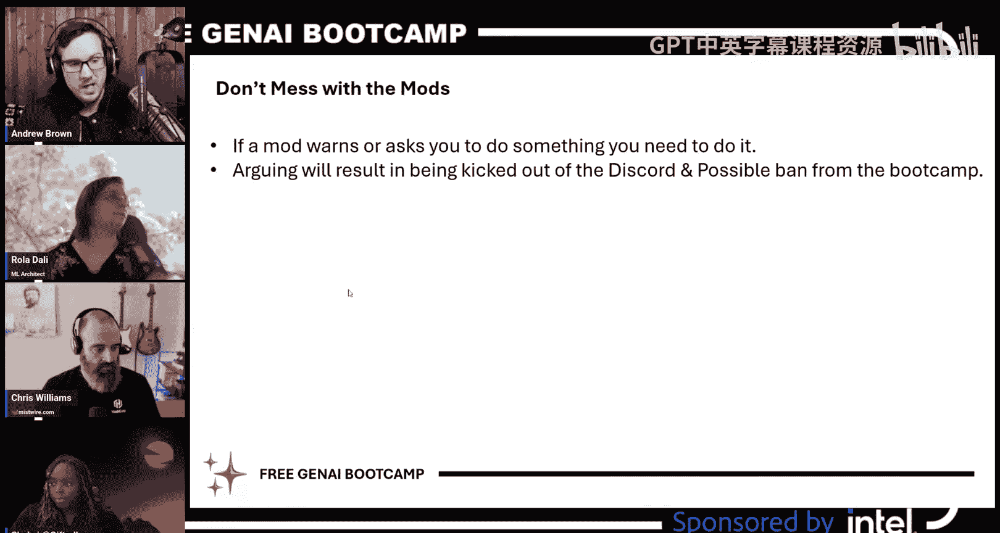

A funny graphic of what's the， what's that， I can't remember his name that that actor。

 but Does anyone know his name I'm terrible with actor。 Oh Does anybody in the。

 Does any of the like any of our boot campers know that actor。 What's his name。

I've seen his face a thousand times， but it's funny， though way。But。Tim Robinson， thank you， Tom Tim。

 okay folks know folks know。 I always like to use them for memes know。

 but I'm just gonna say like mods are here to help you to avoid being in the wrong place at the wrong time。

 And so if there is behavior that could be problematic。

 We're going help you avoid those issues And so that's what the mods are here to do for you What we should we should be okay everybodys pretty good at this point and we've done a few boot camps at this point。

 let's talk about proof of effort right So when we talk about proof of effort when asking for help。

 what does that mean did you post in the correct form form for the week you are working on we have some public channels like and I can just pull it down here for a second。

 if you can see it， but we haveops we have here you can see we have off topic in general。

 but we go down below we have this week。 So the week that you're in which is prewe right now。

 This is where youre gonna ask questions if we move into week and you're still on preweek then。

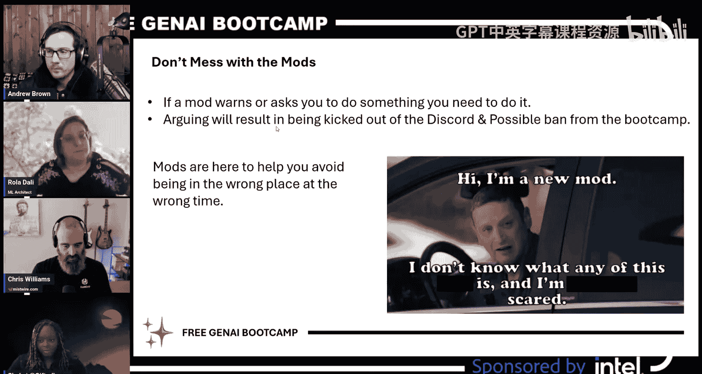

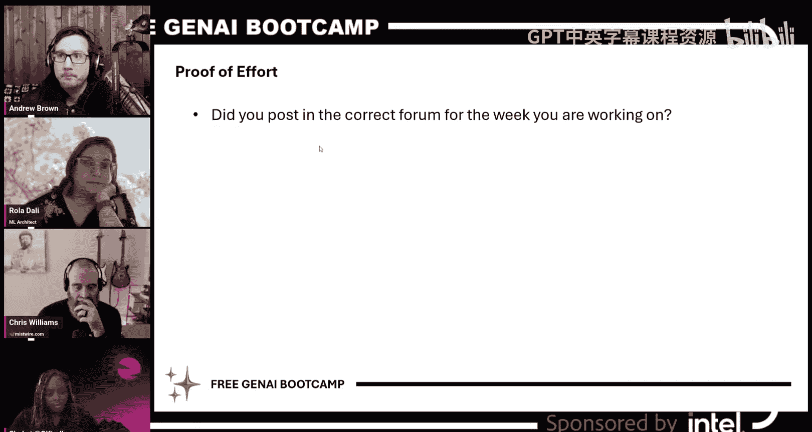

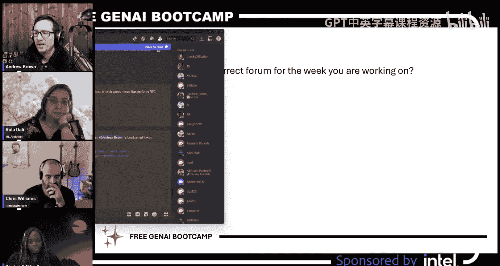

The message in pre week so whatever week that you're focused on。

 not the week that we're currently on， but you're focused on put it in the appropriate week and that way we can help you as quickly as possible and we check it。

Every day I check it twice a day and Bago checks it。

 my whole team checks it and if anybody wants to try to help out。

You know I greatly appreciate it and we'll notice it too， if you do do it。

 Did you take time to describe what could be wrong and not just say it doesn't work as a AI engineer or cloud engineer or SA you want to be technical you want to be descriptive as best you can and demonstrate that and I factor this into grading So as I'm working through all your stuff I also check discord and see how do you go and ask stuff and things like that and I make notes on stuff when I do final grading did you provide code samples。

 did you provide it in markdown format， did you apply syntax highlighting take the extra time to do it because when you show that you take the extra time people are more likely to help you because you can see that This is for folks that are just not familiar with the stuff because we have some newcomers new folks that I just want to help you out as best we can here Where's the location for submitting homework that's in the platform we'll talk about that here in a bit did you show possible steps to resolve the issue and their conclusions and this is also kind of part of the。

Journaling， which is like if you have if you have a problem。

 did you go out and what did you do like if you just asked JenAI you said oh I asked ChaGT that's not enough。

 show the line of thought and reasoning and why you think this thing worked or why it didn't work and that will help us a bit more here。

😡，We have also here sorry I'm just reading the comments here。

 but did those screenshots show key information some folks give us screenshots。

 but they're missing like the URL or the networking tab or the thing to help you debug it so think about what it is that you're sending and does it have the key information that we're looking for address year old network tab error console system logs the most common one。

 the common thing I get is people say I have a 500 error。Okay。

 you got to tell me why you have a 500 error if a 500 error occurs if there's an error on the server side。

 there will be logs to provide that information so you got to bring that you get a 403 error right it's going to be in the system logs or it's gonna to be the network tab so do a bit of digging and bring that stuff forward and then you'll get help faster you can you can simply say I have a 500 error。

 but the thing that's going happen is someone's going to say okay now go get me the logs right so just be aware of that as we go through here I just wanted to make this one really clear as this one is a bit of a challenge for me but when you are providing an image if you need to provide an image make sure not to use your phone to take a photo of your like if you have your phone。

😡，And you're pointing it at your computer， that's a no， no， no， no， no， no。

Because it's just hard to read like the only time you do that is like let's say you had a boot screen because that's the only time you can't do a screenshot when your computer is bidding up。

 but what you want to do is you want to take a photo with your computer as a screenshot because we get this nice clean thing but if it's just code that you can copy paste out the ears。

 do that instead only take a screenshot if you need to something I really learned that I thought was really interesting is that I guess in Japan they don't use a check mark they use a red circle。

😡，For correct， I that interesting？I did not know that。But yeah， that's interesting。 But still。

 still the red X。 that doesn't change there。 And yeah。

 some folks are suggesting command shift control plus4 for mat or Windows control shift and by the way。

 if you do post one like this。 It's totally fine， we'll just say like， hey， you gotta。

 you got to do that and we'll try to help you along there read the manual's easier to do a screenshot。

 It's like it's like it's like you're adding extra steps if you take one with your phone。

 then you gotta go in。 you got it's it's ridiculous。 Well， I don't know。

 people some really good I think it's maybe， I'm just really bad with my phones。

 So really good with your phones。😊，Read read the manual。 the manual is really fun。

 So read it and so everything is documented so look around we have an FAQ， we have an outline。

 we have codes of conduct， we have discord announcements， we have the discord forms。

 we have announcements in exam pro platform and all these are kind of linked from the Jennyi cloudprobookcam co So there's links all there that go to stuff and we'll continually to bring stuff up here Oh I didn't know someone's sharing the names of it So we have here Mau for correct and Batsu for incorrect I did not know that that's actually really useful thanks hey。

 if you want to keep giving me Japanese lessons here in the stream。

 I will take it anybody but or actually you know what if anybody wants to share any kind of language lessons。

 I'd love to see it in the stream here but yeah， you know the rules you know the song you know the rules。

😊，I won't say much more of it because it'll get stuck in our heads here and I know it's not fun。

 but you know， you got to you got to take that time and do that and I will I will do gentle pushes and say here's the links。

Go go take a look， but I will still answer people， I'll do the best I can。

Max Max Max picked up on my fun manual I substituted the word to make it more appropriate for here today this is another this is something that's a little bit different with this boot camp and we have to do it this way because this the GenI markets so new so fresh。

We have to use this model called we show you choose。Okay， so what that means。

Because that we are going to show you multiple GenI implementation approaches， tools and techniques。

 we're just going to show you a bunch of different ways that you can do it。

You need to choose your most optimal solution based on your time investment。

 like what time you have available。Cost considerations like what technology do you want to use or do you know how to use technical complexity your specific context and needs okay in prior boot campamps。

 we were a little more prescriptive we said you' got to use exactly this because it made it easier for grading gradings not going to be easy for this it's just not for me so I'm just going to I'm going to give you more freedom but that means that you have to put more effort in thinking about what you can do but the best part about this is there's no wrong way for you to do with it because you have full options available to you if it works for you then it works okay and the Jen AI market isn immature and so there are no experts yet yet except for Roa。

😀Ha。😊，So there's no wrong way unless Ra says it's wrong， okay。

 that's that's going to be the rule here。And so really we're bringing up that meme if it works on your machine。

 then you ship it to production because you know even the app I built the Lang port that we'll see I wrote it in Python I'm not an expert in Python。

 but I wrote in Python for you folks and I was meeting with one of our guest instructors and they're saying Andrew this is not how you organize files in Python but I'm like I don't know it works did it mean like it just has to work and when you work at a company you do want to do it the right way。

 but sometimes you just have to accept the limitations of knowledge you have and ship and go well it works but Roa。

 do you have any thoughts or comments。I think you have to build from the ground up。

 I think the point of this is to really get them going and to get going。

Just remove all the friction you need， just get your bases in and then as you go and you're comfortable。

 you can build all of the bells and whistles as you go along。Start basic。

So so I mean I guess the thing is like there's nothing wrong in the short term， but long term。

 you know you got to figure it out and work with your team for grading and journaling what matters through this experience is growing domain knowledge and gaining technical certainty I'm not looking for the flashiest demos I'm looking to see that you have documenting something if you have a real junk computer and you somehow make deepse to run on it and you were the only one to figure it out that's impressive right and you're documenting that experience that's what I care about that you are expanding domain knowledge and things like this and even your failures are successes because you are helping build domain knowledge so that someone behind you who's trying the same path you're making easy for them right and so that's what I'm hoping to see you folks do so when you journal you set up a hypothesis you say this is what I plan to do and I think that this is how it's going to turn out there's technical uncertainty you don't know how it's going to go you're like well。

what don't I know about it's like if you don't know anything about optimization or maybe you think like okay I know there's an MPU。

 this is something that a lot of folks， even I'm a bit well Roola probably knows it but like MPs are like neuralproces units and every time I talk to people about it we think that you can run anything on it but we're not really sure so we know we have this resource available to us there's technical uncertainty we think we can run LLM on it but then we find out oh maybe it's more for smaller models and not for LLM you know so you know you are setting up technical uncertainty and you're describing and then you're going to explore your technical implementations right and try to figure that stuff out and then you're going to have your final observations and outcomes I know that seems very vague but I will provide examples as I'm working through projects you have a general idea of this this is actually a method of Roola have you ever done shred in Canada the scientific research and that's for human humanities I did。

Sure。And NSSRC， I did NSCRC a lot。So you know we're asking folks to think of a very technical process here and again we do want you to try to ship things but if you can't the outcome is all the domain knowledge you're adding for the company what we don't want you to journal is basic explanations of technical terms so this is stuff that LLMs will spit out like like a ton of and if's for your own notes it's fine but try to separate that out so that if I'm going through it or somebody else is looking at it。

 it's very clear where the value add that you're adding in if that makes sense routine steps so there's things that like are very routine you can just leave those out and try to focus on on the little good bits here where you are are expanding stuff make your impression okay so there's a lot of boot campers in here and we have different grade levels if you want to get redSqua you got to make it clear what your homework challenges are we have some suggested you can define your owns I said in this video if anyone uses tokiona that。

They'll get you some attention that's a bonus challenge make a video showing the things work。

 you know make a blog post showing how it could be replicated， be active in the discord。

 be active in comments during the live stream show up to office hours because I will make note of this my team will make note of this and it just makes it very easy for us to identify who the top top top folks are based on your activity submit your journaling on time will notice that you can submit late but if you submit on time they'll be better and again I will show you how I journal in the videos as the projects go there so you'll figure it out as you go and don't stress out about like going back and making them all perfect just try to get better as you go along there are badges we have the four levels blue teal gold red the badge design is this。

It's not in my office， but actually this card here。

 I actually made a physical real copy so if the other ones don't have them， but the top level one。

 if you get to redqua there's only like a limited oh I have the cards right here what I'm talking about I got one right here here's a card I got a big stack of them so there's I don't know how I'm given out maybe 100 I got I got to limit how many I ship out but if you get to red Squa I'm sending you the red Squa Gen Dr if people like trading card games。

 I actually mixed Pokemon badge the gathering a Yugi all together and I use Geni to help me along there。

 not all of it but some of it but and for those who don't really like the badge like some people like they're like that's cool but can I just get like a normal looking badge for my LinkedIn yes there will be a variant there。

 this one's the work in progress one because really there's supposed to be four different colors of the Geni engineer but that's what you're trying to earn you're trying to earn the proof that you are able to do Gen AI as an engineer。

うん。I'm almost on my slides here， but we have two groups last time we had。The X clouds。

 and it was very successful。There were some suggestions I think it was Gloria suggested Shi genni's but we just went on with Shi Cloududs again。

 but Shi gen's was a very good suggestion， but sheCs is a private channel in the Discord and you can go join it there and it's women only it has enhanced codes of conduct enforcement and it's there to help you network with other women in tech and I'm going to try to encourage our guest instructor women guest instructors to come out there and say hi to everybody I've been adding there's so many women in the boot camp this year it's amazing and so I'm really hoping that there's really good networking outcomes and you folks started listening to some of these women in tech as opposed to me because they're smarter than me and we need to give them more attention there's also Jenny Epanuel and actually Gloria again is a guest instructor and we'll be talking about that here shortly but there's a Spanish discord channel and there's also a separate。

T all in Spanish so the expectations for the Spanish ones different。

 they actually have their own badge that we've created。

 but this is our first year doing the Espaniel group and so I'm really excited to see how that goes and no matter what the outcome is I hope that we're going continue on doing this and bringing in more groups for the espaniel one there's a live stream at 3 pm I believe I'm showing up for that one and Glor who's in the comments will be at that one and so for the Spanish speakers that are watching right now if you know Spanish come to that one。

Please come to that one。 I want to see you there。 And if if you're not in the discord。

 you can email support or register through there and we'll do the best there。

 I want to see some Spanish speakers there in our Discord so that we can have you folks helped out there。

 Do you speak Spanish Andrew you think I would because I lived in Spain for three years。

 but's it's very limited these days And I'm not even going to attempt it because I'm too embarrassed。

 But I might have to when we did the 3 PM Live。But my but anyway。

 we'll continue on here I'm too embarrassed to speak any language， be honest everyone you know what。

 Auguststo， who is the organizer， the principal coordinator for the the Spanish one。

 I was I was reading the Spanish out loud and he's just like he's just he's just like smiling and laughing。

Well。😀ははは。😊，But anyway， I do my best， okay？Amazing anyway。

 I did so there's are some questions that I just want to cover that that people have been asking quite a bit and so I just want to help I didn't finish the prere will I be able to keep up so the prere is not a hard requirement it's just there to get you exposure to terms of tools as possible The prere is there in case you can't keep up and and and you can reference those materials what happens if I join like can I still participate try and submit your grading on time there is time to catch up we know that people are going be late we bake it into the boot camp we learned our lessons we know people are gonna be two weeks late we just know it's gonna happen but try to keep it in scope because once you start getting farther away from the timeline at some point we're just going cut it off there。

And then we'll go over to here this is too hard should I quit and so I said if it's too hard do what you can。

 this is an all levels boot campamp and the purpose of the Gen essentials is that if even this boot camp's too hard。

 you can just focus on the Geni essentials and audit the bootcamp right even just watching along and trying to make sense of it is going to help you and if you set have to backfi those skills backfi those skills the best you can。

We have how do I get into the discord so you must be registered the link is generated in the Ex Pro platform if you're having issues contact support at supportedex Pro。

 co I understand the frustration of the Discord I wish we could just open it 100% but we need to make sure that we follow this stuff and and for those that have not been able to get a link into the discord email my support team we will help you the She cloududs Discord is the main discord it's a private channel there if you're in there if you're in there and wondering where the she cloud channel is you can reach out to Sam she's actually my twin sister and she's the mod Ex Pro is not down to better not Bacos Ex Pro down。

Yeah。He's checking he he's saying no I don't think so either So if you're it should be up I don't think it's down but anyway。

 yeah other people say not for me so oh it's so slow it's ex it's not it's up okay so again。Oh yeah。

 Baco is just saying traffic's really heavy。 So I think a lot of people are just registering right now。

 So it'll Peter out here。 It'll probably perform a bit better or we'll spin up some more compute。

 What if I missed the live stream， It's recorded and made available afterwards。

 So if you're not here at these videos， you can watch them afterwards and to be honest。

 we have to do that because for those who are deaf or hard of hearing and if we don't have live captioning。

 we need to then provide the captioning。 So you do have that stuff there。

 we have 10000 people at least registered for the boot camp and it's just still piling in here some point we might turn off registration but we'll see so it's going to be slow。

 but we'll do our best to mitigate those issues there who is the person named Baco that Andrew keeps mentioning but we never see and the answer is we don't talk about Baco。

Okay， who's Bako， I don't know what you're talking about so。He's a mysterious stranger still。

We're still going with the Tyler Dton。Oh， nice。 But anyway。

 I'm going to stop where are we at 46 minutes。 W， I had way too many rules。

 I got to really cut back on the rules， but I appreciate Rola and our other folks waiting through that so long。

 But I think what I'd like to do is I'd like to get some extract some information out of Roa as to fill in the gaps where I'm not as technical in AI and M。

 and then after that， let's see if we can do some solution architecting here with Chris and Roa。

 and so I'm gonna take my screen off of here and I'm gonna give Roa the opportunity to share her screen and see what we got。

😊，Can you see my screen？And I think so。 yeah， I'm just going to add it to the stage。 And by the way。

 for those those who haven't done the G essentials， Roa makes multiple appearances in there。

 and that G essentials， I'm constantly asking Rola right And if there's anything that's not good in there。

 that's my fault because I was in a hurry to finish it。

 but Rola has really helped out and and her friend Dan， Dan right。

 it was Dan Dan Yeah Dan Dan helped quite a bit。 So but anyway。

 Yeah we should be in the discord as well， we should walk people this for the six weeks。

 So if anybody needs help， we will be there。Okay so what I'm going to do is I have a few slides 10 minutes Andrew what how much detail can I you you got at least 15 minutes okay its20 so what I wanted to do here is just take you a little bit through architecting and GenI system this is part of the we show you choose model so I just want to show the main components of a system why they are there for you to have a better understanding of them Okay so。

The first question I think before we jump into GenI directly is I want to just talk about predictive amount versus Geneative VI we are here at the boot camp to learn Geneative VI but of course machine learning。

Before the。The GenI boom that started about two years ago。

 there's a whole field of predictive ML that that can solve a lot of problems。

 So what what do you choose or when do you choose which and。I just want to give a little bit of。嗯。

A contrasttra so predictive MLl is the collection of or traditional MLl is the collection of supervised unsupervised and reinforcement learning algorithms。

Again， I'm assuming a lot of knowledge that we talked about in the prerequisite boot camp so and we can answer questions after so excuse me if you don't if not all of it is clear but I'm going to try to fit a lot of things in 15 minutes and GenAI is of course a new class of models that generates new content Now what is the main difference the main difference tends to be in several things the three main things are size generative AI models tend to be a lot bigger orders of magnitude bigger they tend to create openended solution answers which makes it a little bit hard to evaluate a little bit hard to control and machine learning models。

Gerative A models， there's a lot of foundational models that are already out there， so that kind of。

嗯。Removes the need to train your own okay so these are the three main big things， I think。

Now there's predictive ML and GenAI， but there's also whether you train your own model or you use one from a provider like assess products。

 for example， and you can do either of these things for both flavors， but the more common approach。

 the pattern we see a lot more is that for predictive ML people create their custom models because。

It's more of a pattern it's you're customizing it for your own data for generative AI because these models are really really large training them is now。

Restricted to people with a certain set of resources。 So usually with Jen AI。

 you are calling you're using a foundational model trained by somebody else。 Okay。

 so these are the two things I'm comparing。 I'm not comparing。 it's。

 it seems able to orange use because I'm comparing a custom predictive model versus a Sa foundational model。

 But these are the patterns that are。More common， Andrew， you're on mute。

I'm talking to Baco about the performance issues。 It's okay， you're good。 Okay。

 sounds good Okay perfect so I'm just going compare the two things just to give you an idea of。

 you know ML is a tool it serves the business once you've decided that ML is what you need you can decide is it predictive M or GenI that I need and this is the slide for that so。

The main considerations are， of course， the size difference。嗯。

The models in predictive events tend to be on the thousands to million parameters。

 whereas in foundational models they can be billions and trillions and so there's a huge order of difference that of course requires a lot more compute that requires a lot more resources and in consequence that creates bigger cost so when。

When you're using a model。When you're choosing a model。You can get a lot faster。

 you can get going a lot faster with Gen AI than you can with predictive amount。

 but if your workload is really large or your project。

Scope is a lot longer in timeline it might be more effective to go predictive ML okay and there's a lot of other different reasons why you would choose one over the other but I wanted to put there out there and we can talk a little bit more in the question session okay so let's say let's assume that you know you've done your work you know it's GenAI that you need so let's let's architect that model。

Okay， let's see here。Okay， so at the heart of a GenAI model a system is of course a geneative Ro I to I just want to make a call out to folks here what Roa is going to show here is a series of illustrations and after this we're falling about social architecting so pay close attention to this because this is stuff that you can immediately use as our first day homework sorry Roa yeah no that's great Okay so at the heart of this system we're building is a GenI model right here okay and as I'm building the system progressively the new elements are in orange okay。

Now already with this system， it's very simple， you've got a user。

 they query a model that is provided by a model provider， this could be open AI。

 this could be anthropic or anything else through let's say bedrock or any other provider and then you get a response already this is a fairly powerful system right these models they can do a lot of things they can summarize they can answer questions。

 they can do a lot of really interesting things so already this is a pretty powerful system。

But you can add more to it。By let's say you need more information， your field。

 let's say is a niche field， you want to add more data to that knowledge or you want more up to date information because models have a training cutoff date。

 they're not aware of information past their training deadline。And so you can add this system here。

Where you've add you add your company information or any knowledge that you want the model to be aware of。

 so you've got your knowledge base right here and you can add a system that。

Fick enhances your context what models are the foundational models you have to think of them as a collection of a lot of information they've been trained on the whole internet and so they know a lot and what you're doing you're asking a single question and so you're trying to really prompt that model to give you a needle in a haystack practically right that's what you're looking for and so the smarter you are about your prompt and how you set up your query and how you formulate what you tell the model that kind of dictates your success right and so you add the system with extra knowledge and this context in prompt prompt engineering I have a couple questions for you from the audience here parameters so what are they I described it as more parameters。

 more brain cells。Practicallyically， so what machine learning models are are mathematical algorithms。

Right， and。They have parts of them that don't change the structure， for example。

 of the mathematical model doesn't change， but it has what we call parameters。

 it has numbers that can change that's what codes in the learning and so you think of parameters as knobs that the model changes to encode the learning and this is similar to how the brain works and that yeah you can think of。

Parameterters as the synapses between brain cells and that as you learn that number changes and sorry I'm not sure if you mentioned it earlier but Ro you have a background in neuroscientists Yeah so I have a PhD in neuro science bioinforatics so I was interested I'm interested in human brains and then became interested in but they're the same right that's a big statement don't we only have an hour left we can't do this what are you doing I got another question from the audience where for training data where is it coming from like where do you get the training data is like do you just scrape the Internet or they're scraping the internet yes they're scraping the internet they're putting and different companies the recipe for training is a guard is a guarded secret a lot of a lot of companies like opening I don't release their training data but what they do practically is scrape the internet all of the books that they can everything all the knowledge。

That is available and then it's it's not a trivial task to clean that data and make it available for these models。

 but yes it is。The content of the internet or human knowledge as it stands today。And is that good？

Yes， no yes and no， right？I mean， there's a lot of things that there's encoded。

Bias in there right there's Reddit posts and social media posts and just subjective opinions in there right so and different models do differently。

 So some models kind of exclude the social media a little bit and closer towards articles and pubmed and archives and so on。

 And so the the balance of how much。Of each category is in the training data kind of affects what the model knows and how it behaves。

 but again， some companies so open。Source models they reveal the training data open weight models and closed models they do not I've heard there's one model by IBM called IBM granite and that's an example I think of an open source model where all the data is available like end to end whereas a lot of these models we call them open weight models which i'm assuming we just don't understand how they're being trained right Yeah so open weight models means they release the weights to you you can run that model on your system you do not understand。

How that model came about， what what information did it see and what。

How was the process done and Baker is also the example for comments we was saying， yeah。

 don't just go scrape the Internet like were we're saying like where it came from。

 doesn't mean that you probably should go scrape everything right as there are permission a lot of people are using common coral。

 There's a website called common coral， which indexes the internet。

 And I think a lot of people use that like I were like don't scrape the internet's already done don't do's already do it but if you did is how if I did is how I would anyway' It's already done already done there's a lot of open source data sets as well。

 if anybody's interested I could put in a list on Discord but we'll let you continue on with our evolutionary models here sorry Okay so we've got our model we've enhanced it by enhancing the context of how and what were giving the model as context here in orange。

Then let's say。You're interested in compliance right one。

 so this model right here I should have said this is not in your domain right。

 this is in a provider's domain， Everything else is in your domain。

 and so data is leaving your domain towards a model provider and so you might be very sensitive about what information is leaving your jurisdiction to this model provider and so you can control that with guardrails。

 you could put guardrails which are in a sense you're fencing what can be done and you can put both input and output guardrails right and input guardrails kind of control what information leaves your company what is allowed。

 what is not allowed， you can put systems that mask or red PII for example or prevent certain information from leaving your company and for output guardrails what you could do is you look at safety is it is a bias is there anything offensive in it and then you can block those so now you can enhance the system with guardrails。

Now the other thing you could do。Is you can abstract model interactions by adding routers and Ga loops。

 what does this mean？Different models do different things right some models are really good at reasoning。

 some models are really good at coding， some models are better at answering questions for example。

 and so you might be wanting to use different models for different questions。

And so what you can do is you can add a wrapper around the model call where it can swap different models depending on the type of question it gets。

And so what that does is it makes it a lot easier。To use different types of models in the background。

RightAnd so this is an abstractstruction layer that enhances your system。Now。

 if we want to go one step further， for example， you can add caches for you can reduce latency and cost by adding caches and so you can add caches with your data retrieval。

 you can add caches。At your user level you could add caches across the system and what that will do is again。

 it'll reduce latency for the user， but it'll also reduce cost because you're not hitting the model。

 the biggest cost in the system is usually the model call。

And so what I wanted to show this is my last slide here and what I wanted to show is that if you had seen this from the beginning。

 if this was my first slide， it would be quite intimidating to see with all of these systems。

 but now that we've built it， I hope that it's a little bit digestible that all of these pieces serve a particular purpose you just need to understand as you architect the system。

 what purpose do they serve。And whether you need them or not， what are the pros of having them。

 what are the cons of not having them and can you take that risk and this is。

 I guess some of the work we're going to do with Chris。

And this is part of the we show you choose so you can choose the complexity of your system and you can add a lot more oh I have one more okay so one more thing you could do is you can add agents so agents are these systems that can go in and execute on your behalf and so let's say you've got a model here that returns an answer and you can you want to update orders or or send emails or do something specific you can have an agent that does that on your behalf you can also add these are software systems。

 these are computer systems so you can add of course you should add authentication and authorization state and session management so that repeated interactions have the histories kept。

 you can add monitoring and observability， pipeline orchestration。

 human feedback there's a whole set of things that you can add to these systems to make them as complex as you want。

And that is my last slide， I think yes。I got one of the best comments。

 Would Andrew give bonus points， if you set up an agent and make the agent go through the bootc all for them and do all the projects。

 I think you might give bonus points for that， but and also some people are asking about asking about like what can I do if I want to do something that is not based on the business use case。

 can I do it I want folks to try to stay as close to the business use case。

 if you start going outside of there， I can't tell if it's just you're just bringing whatever and dumping it in there。

 So for me for grading at the very least， I need to see that it's around the business use case。

 if you can work away to make it make sense。 then sure， but for the most part。

 try to don't try to fly too far away the something I don't know what kind of analogy I'm trying to say there but stay close to home here don't go too far far out from the business use case or you are it's making it harder for me。

 but if there's something really impressive that would be interestinging to see there I think what we'd like。

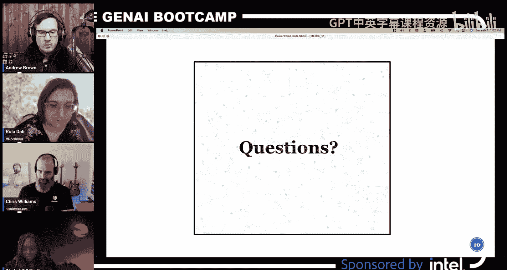

The you here is jump into some， are we ready for some solution architecting？I believe we are。

 I think that we should preface it a little bit so that we are all working from like a common dictionary of words so that when we start saying things as we're asking the questions。

 we make sure that all of the students understand the thing that I like about the boot camps that we do is that it's almost like a prep for a job because we're going to go through a project and we're trying to simulate as closely as possible a real life job like you walk into a company and you say。

 hey， congratulations' you're the brand new AI developer here build us this。

 and so what we're going to do now is we're going to walk you through the。

Overarching we're going to take a little bit of a step back and talk about some of the words that we're going to use as we're building the design for this we're going to go through architectural examples Ros I'm going to say the word conceptual design right now and you're going to understand what that means in a second because all of Rola's diagrams were fantastic conceptual designs of what we're going to be using to incorporate into our systems so。

WWhy don't we do that？Andrew， we have a couple of different options now。

 we can start talking about the business goal and then we can break it down into the different design patterns or we can talk about the technical considerations and then wrap that around the business goals afterwards。

 How would you like to do it dear sir， I don't know But since I have the doc open first。

 this would be a great opportunity to kind of show people these docs as the bootc's progressing This is a new feature in Google Docs。

 that allow you have tabs。 And so everything is consolidated in one place it's super nice。

 But you can see I've already started writing up projects there's way more than this。

Just understand that there is gonna be a lot of projects in here。 Don't get overwhelmed。

 Just do what you can。 You don't have to do everything。 Just do what you can。

 But on the left hand side here， we have 100 marking this as level 100。

 that means everyone should be able to do this but this is architecting Jennyi。

 This is the session right now that we're having。 and this is difficulty level 100。

 Let's walk through the business use case。 Okay as a solution architect after consulting with real world AI engineers you have been tasked to create architectural diagrams that serve as a teaching aid to help key or help stakeholders understand their key components of Jenny I work with。

 sounds like we're doing like exam like a certification。

 you know that's how I write things I' writing so many practice exam questions that comes like this is like a game day。

 This is great。The outcome is to help let stakeholders visualize possible technical paths。

 technical uncertainty when adopting GenI， we are guiding key stakeholders through the technical landscape without directly prescribing solutions so while fostering informed discussion about infrastructure choices integration patterns and system dependencies across the organization and we can use all levels of technical diagraming to achieve our goal what does it mean all levels Chris what levels are there I'm so glad that you asked that question Andrew Brown there are three different levels of art so。

If you get into the weeds of enterprise architecture or solutions architecture。

 there's a couple of different patterns of or thought methodology patterns out there there's one out there called ToGF TO GAF。

 the open graphph architecture I forget what the name it stands for open group thank you open group architecture framework and。

It is a fantastic model around which you can ask really good questions about how you want to stand up and design your project。

 what are the different kinds of considerations that you want to use。

 what are the proper questions that the solution architect needs to ask of the different stakeholders。

 both technical and non-technical， to make sure that we are encapsulating and solving the problem and not going off the rails。

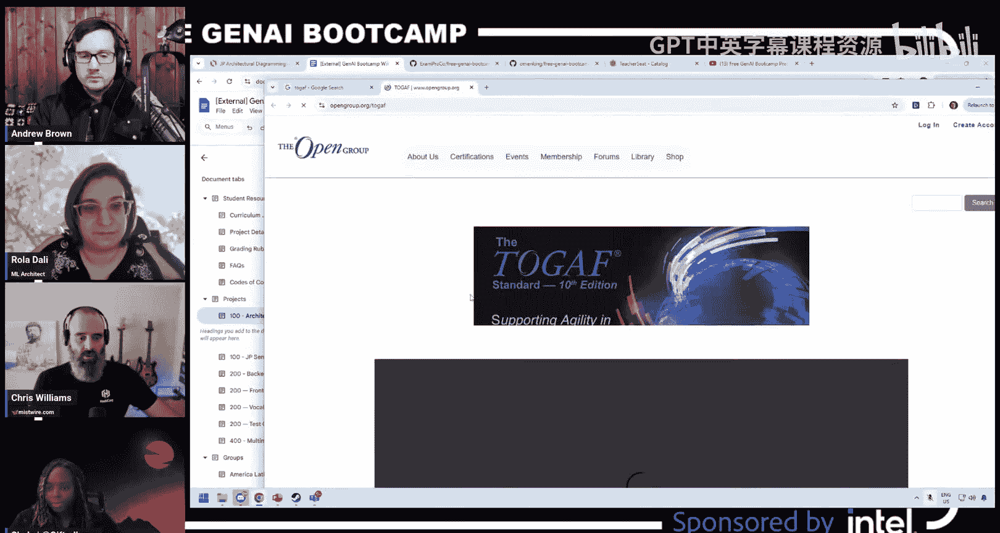

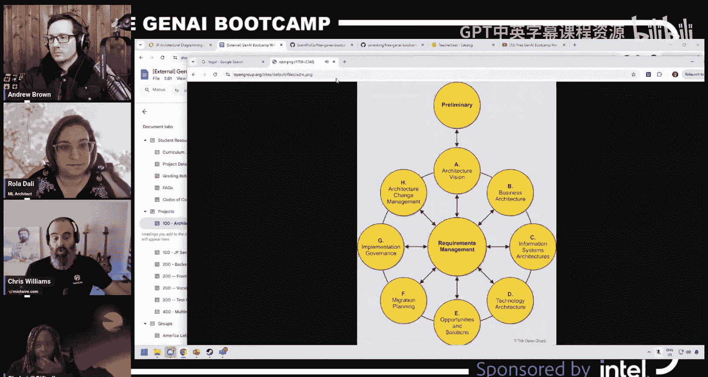

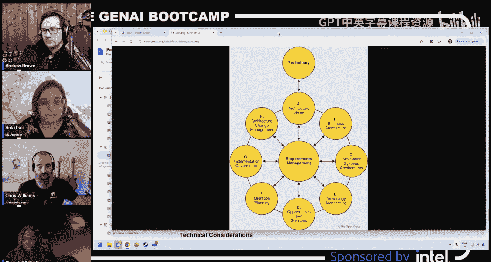

So in order to do that， there are three different kinds of diagrams， there are conceptual。

 logical and physical diagrams。Thank you for throwing that in there Oh some of the folks in the audience are asking if they have access to this to the document Andrew。

 I think isn't this publicly shareable it is so just to really show people where it is we're here on the main website Jeni。

 cloudcam co all these links except for that one this link here goes to the document this goes to the lucid chart here but there should be other ones that go there as well but if you click。

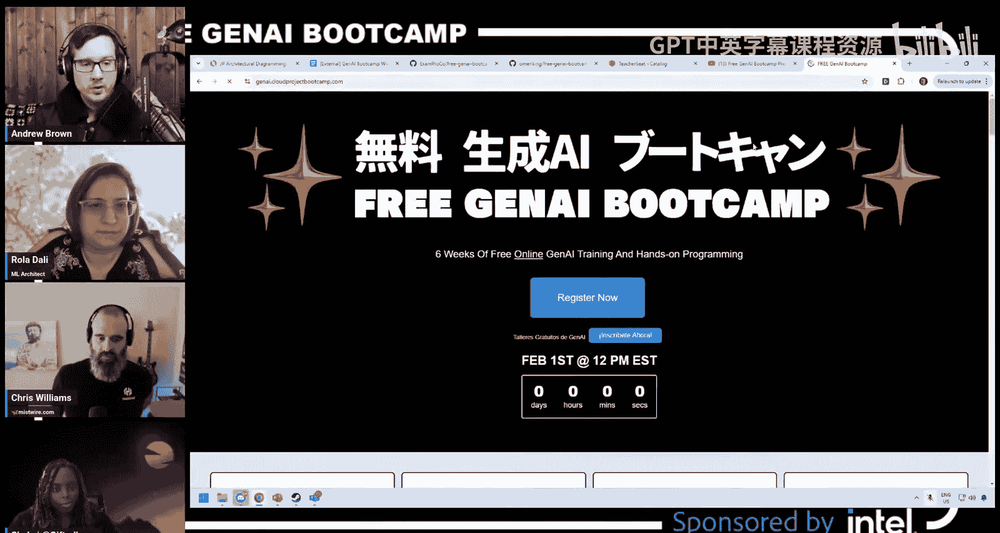

See the full curriculum， it goes to this。Same document， okay， perfect。

 so they can follow along as as we go， This is excellent y。

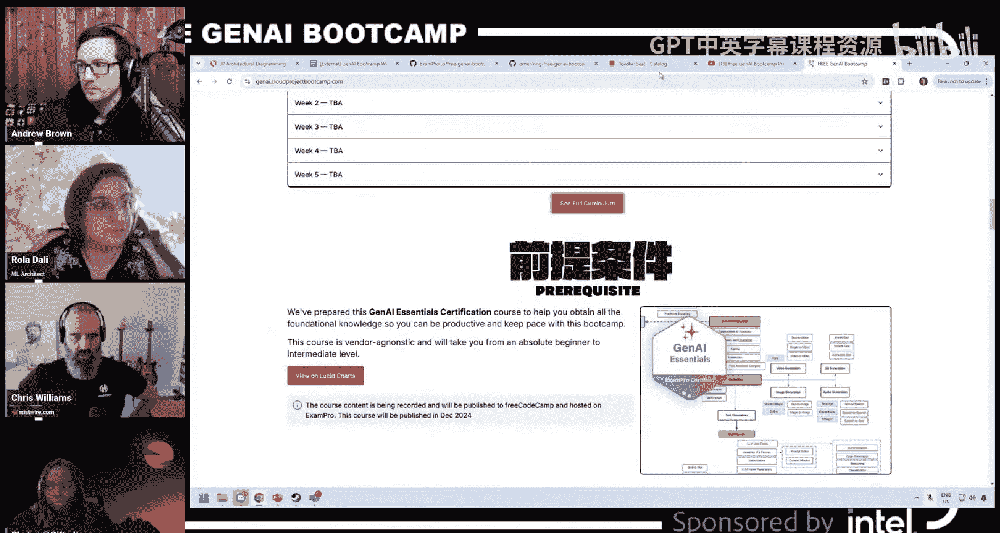

Cool， okay。If you wouldn't mind， share my screen real fast because I found a really good recent article about conceptual logical and physical design。

 and hilariously they actually use generative AI to create the picture right here。

 which completely misspells everything， I don't know which one they use， but that's funny。

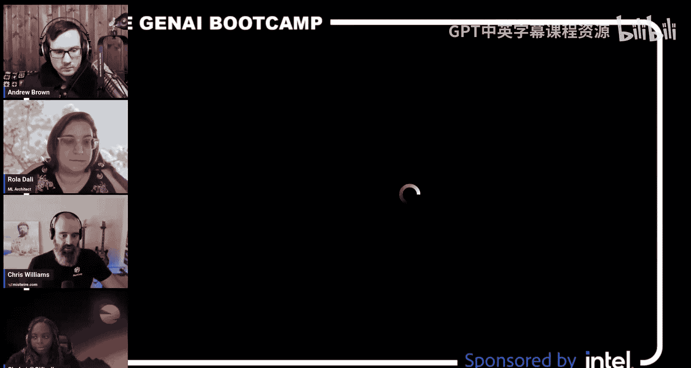

Conceptual logical and physical design， these address the different layers of stakeholders that you're going to be talking to when you are creating a project。

At the very highest level， there's the conceptual design and that is what I've always called the napkin scratchings of how you want your of the thing that you're trying to solve and it can a good conceptual diagram again。

 is roll as diagrams of how the things are wire frame together。

 this particular article right here goes through the stages of a house。

 which is a really good analogy for conceptual logical and physical。

 but at the conceptual level what you want to do is you want to explain at a very high level how things feed into other things where they lay out in comparison。

 where the arrows point to it Ro as diagrams are fantastic from a conceptual perspective because you can see exactly where the user starts。

 how the query routes into what everything you want to go is it going to the model or is it hitting something else first is it going is it going through an input router is it going through an output filter。

 what's happening with this thing that's a great design for that pattern。

The next layer down as you get more。Defined about how you want to stand this up is the logical design and a logical design in house terminology is the blueprint。

 the architect creates a blueprint of the house that you want to see another really good logical design was one that we actually created for a reinvent talk that I did last year and this is the logical design for a generative AI incident response query system wherein you see you can see the blueprint of how you want everything wired together it's halfway between a physical and a conceptual so you still see the broad strokes of how things are moving around but now we actually have names and measurements and weights and it's a more。

Grannular explanation of how things lay out。And then finally， the physical design。

 that is the actual bill of materials like so for a house it's how many nails you're going to need。

 how many bricks you're going to need， how many planks of wood you're going to need and the software example。

 that is the diagram that includes all of the names of the services， all the way down to the arms。

 like the IP addresses of your EC2 servers， I'm using AWS high apologizeologies。

 which's what we're all used to。The arms of the services that are involved in the design and what this does is it actually allows you to know。

What your physical implementation of your design has stood up so that when somebody looks at that design。

They can say， oh， okay， this is in US East one。 It is using these services。

 This is the name of the lambmbdas。 This is these are the calls that are coming in。

 These are the calls that are going out。 So it allows you to have。

One design for the business stakeholders and the C suite， the next layer down is for the architects。

 the logical design， and then the physical layer is for the actual engineers doing the implementations。

Okay。All right。For this particular article， could you grab that link and drop it into the document and so there's another I'm gonna just go back to my screen here for a moment and I just want people to know there's more than one way to diagram and so the way that I know how to do and this just has to do with my technical background of what I did but it's the C4 style of diagraming because I have a background as a developer。

 so I have a developer lens for that's why the boot camp so developer focus not because it has to be that way。

 it's just the way I think and stuff。 and so that's my influence there。

 And so we work with four different levels but you know I just want folks to focus on these three levels as they are I really like them as well。

 And so anyway the point is is that we have a bunch of stuff under here about architectural design does this stuff map over to toga。

It does。 Yes。 Oh， I didn't realize that。 Okay， that's cool。 I'm very sneaky that way。 Yes。

 I didn't even notice。 just slowly toega is slowly seeping in my every time I think a toega。

 I literally think of a toe and I don't know that feels like that feels like lovely we could use Jen I to generate an image Not now。

 but anyway， bonus points for anybody that comes up with the best generated image for toega as some weird thing。

 Okay， opening up the floodgate Andrew。 what are you doing that's gonna be so bad。

 Okay so we have here， I guess the toega model of stuff here the business stuff。

 we want to jump over and look at the diagram that I have quickly and then figure out how we can apply the stuff。

 Yes， yes， I'll do that So for those， we by the way， I haven't mentioned this earlier。

 But people were asking about it earlier in Baco was saying like， you got to talk about the repos。

 I remember making a video of it and mentioning a few times。 So it has to be in the outline。

 But if you don't know yet， we have a repo。😊，And people are asking， do you clone it， do you fork it。

 well， guess what， I changed the rules again。Because I just keep changing things。 And so this time。

 what you do is you just create the repo based on the name。 you create an empty repo。

 but it has to be called free Geni bootcm 2025。 and then I want you to copy and paste stuff over。

 So here we have the Lng portal。 This is the language portal。

 the main app that we're talking about earlier。 it's already in here。

 you can just copy and pasteing your repo or bring whatever you need to go over。

 but I have my own repo over here you can see I don't think have L portal in it yet。

 So I'm gonna have to go。 and at some point in the videos I'm gonna grab this and dump it in here and you'll see me do that in the videos。

 but I'm trying to make it really simple for folks and we're just gonna to do free Geni bootcamp。

 the only thing I'm not doing is I'm not doing feature branching I'm doing everything in main branch because when we did the terraform bootc I did not realize that feature branching would open a can of worms but I still want to use issues to track of where you are we're learning。

 we're learning right but like you should do you should do feature branching。

 but again I just want to simplify。So people can focus on the Jenningi side of it right so you do not want them to fork it or they can fork it if if they know how to I want to make it really clear you just create a new repo you don't clone it don't fork it you just create a new repo and call it free Geni bootcam 2025 and copy and then copy zip it pull it down and then copy the files into the folder and then push it up however you want when you need to bring them in right because at some point we will bring them in that's in week two my re I don't even have it in here yet right in in my local one all you can see is I have sentence constructor。

 which is the focus here the stuff that we have today that we're talking about right now I don't even have it as we're doing this architecting but anyway so I'll come back over here and so I have this architectural diagram now this is the Lng portal Lang portal is a backend app and a frontend app and as you can see I have a lot of stuff out here because I know that some folks out here like they might not have as much confidence。

Application development。 and so I just wanted to basically make a physical diagram and really spell it out what's going on here。

 you wouldn't normally go to this extreme， but again。

 I'm doing this for boot campers and also guest instructors so that they can learn as quickly as possible this I think would be categorized as a physical diagram is that right Chris。

Yes， yeah， you' you've got port numbers， you've got systems in here。 I mean。

 ideally if if this was actually deployed into an environment and then you had the actual you know the account number and the VPC that it was wrapped in and stuff like that that would that would make it a purely physical deployment is yes。

 this is close enough。I like the comments here they're saying they love the GitHub breakout classes we did a lot of that in the Terfform one and then other people saying the diagram is crazy。

 but I just wanted to make it really clear， I actually used a product called Winsurf to generate like I wrote half of it and then I used Winsurf but what's interesting is because I was too reliant on JenI and it all worked。

 I didn't notice that it made the API inconsistence with some here it says4 slash API and other ones it doesn't。

And then some of it here we have hyphens and some have underscored and I didn't notice because I got I was just like yes good。

 good good。 So you got to be really careful there and do your thorough reviews。

 But as when I diagram it out， I found it so that's really interesting that the more you diagram and the more you build documentation and exploration。

 you find these things again， it doesn't impact anything。

 but when you're trying to make things consistently it matters But let's talk about this here。

 So we have the back and fastask and the main app is the app got pie and we have a bunch of routes。

 This is an API right And so the way I did is I have a folder called routes and then there's a file for each group of routings and you can see their get their get requests and things like that。

 but we have a few that are kind of special you'll notice I colored them special。

 So we have post or sorry study sessions which creates a new session when you study something。😊。

We have raw words， which is the way the main those little apps that we're going to build they're going to get data。

 and then we have this one that's going to take this up and this stuff doesn't make sense right now。

 don't worry about it。 it will make sense as we go along。 But then on the right hand side here。

 we have a front and react app。The ASP。txs is the entry part。

Here are all the routes that you would put in your URL here at the top。

 these are the physical pages and these are the routes that are using those pages， okay。

 and then this thing's powered by an eQitete database。So I don't know。

 does this diagram make sense or is it still confusing， Chris and Roa？For a developer。

 I think that they would understand that for somebody that knows Python or I don't know frontend so react is a JavaScript right Yeah okay。

 so I understand most of half of it， Roa， what about you？I mean， I'm trying to abstract the same way。

 I'm trying to bring it up to the logical diagram right so there's a back end there's a front end and how it's all connected。

 Yeah， I think it needs a little bit more we can we do a logical I have to do a of course， yeah。

 yeah and so this people this is what you have to like the way these diagrams work is your whole team has to understand them if they don't understand them then they're wrong right And so we're going go here and I'm not going make another tab here but we're gonna mark this one is physical And by the way。

 folks， you can use lucid charts， you can use what's the one draw there's even one can call and show it to me' like how to draw。

Is that O X Kla draw， That's a free one， right？ Yeah， it's a free one。

 But there's also one that uses AI to， to make yours， which is reallyt trust。 Oh， no。

Go not but it's kind of interesting here， but we'll go up and so we're it physical and we're going go logical So we're goingep we're going one step up here。

 I also love the fact that you had AI write this out for you and it got the API routes wrong and you missed see everybody let's pay attention students even the experts get hung up and can and AI mistakes can catch us so so be careful of those use it as a helper。

Exactly， always。Check。I had a deadline。I don't know we're not casting asperssians this is a cautionary tale this is a good cautionary tale so I'm working through the logical diagram and so I'm trying to do this very。

 very high level and I should say I've taken a lot of these architectural things and I think Chris you've done you did it at a really good job better than most of my instructors's there's different views as well so there's the logical to physical to conceptual and then you can do different views of the system so you can use it for the full system you can zoom in on just the networking part the security part you can do different aspects of it so you're going to see different types here I think is this is a full system and what I talked about is the full system but you can do different views。

😊，Exactly so you can use this pattern of documenting for all of the different layers。

 so your security， your networking， your backup， your application itself， your infrastructure。

 all of them can be described in detail using this methodology。

 which is why Toga has been around for。Oh， geez， I don't know how 20 years now。

 it's it's it's a 40 is it 40 years， I think it was the 80s no， is it no？

I'll find out I'll find out so folks I've put the link right here at the top so it's very clear if you want to find it。

 you should be able to access it， but we'll go back over to here and so I have back in frontend and the database Now this isn't deployed anything so is this enough or do we need more put in the user how does the user interface with this and does what happens to a query so its think of it as bits in and bits out the user does what and then what does the system do and then what does the system sp back to the user。

Okay， so we have the user here and the users over here。

And the user is interfacing with the front end react application。 It's okay。

 So now what else do I need。What what is the user doing The user is on a language portal website and they're reviewing words to study or they're launching games to play。

 oh the game thing's not in here。We don't have L portal。

 so we have this has to come in here typing tutor。And so we'll go here and I'm going to give it。

 I'm going give this more human words because this stuff is not very clear。

 but I'm trying to do there we go， so this is learning game okay。

 so that's that's the other thing This thing here is the front end learning portal。

Learning portal slash， we call it a record store okay learning record store。

 LRS and they get to the learning game from the LRS， correct？Or from the front end learning portal。

 so create an arrow from the learning portal to the learning game so they see that it's not a direct connect exactly launch game。

We call them study activities or launch a study activity。Okay， perfect and this is the backend API。

And then here we have， it's SQL light， but'm going to just change it a bit here and we'll just say stateful data。

Let's just go here。We'll say relational single file database。Because really that's what it is。

 it's literally a single file you can put it anywhere you want and so I don't know the website is's probably not the best thing。

 anything else that might be missing。So they to the website。

 they go to the portal and they either are doing they're doing two different things。

 they're doing one of two different things， they're either playing a game or going into the learning record store。

That's right。Okay， so when they do either of those two things。

 is it the same actions going is it hitting the backend API and pulling information from the single file database？

Yes， the other thing that interacts with it is hold on I didn' I didn't do the arrow here。

 but this one here actually interacts with it this way。

 so everything has to go through the API end point。

 whether it's your games and your games might have have their own API so they might have。Stuff here。

They're like own API backend。Okay yeah， so it's a different back end right because the way you drew it。

 it doesn't go through the back end API， it's a separate system。Sorry。

 so well this game in particular that we're launching typing tutor is's just a front end and it just takes words and it it works with two endpoints。

 So like there's an endpoint for creating a session and then there's an endpoint for sending data back that they did right So those are the two endpoints but there are other things that we're gonna to build and I don't know this point that they will manipulate the database directly。

 but they really shouldn't So everything should go through our main backend API and it should act as a generic thing but this could have its own backend because let's let's say this typing tutor game has no genI in it。

 but like let's say we get a bunch of words that we want to practice on in a word group in this game we need to have the sounds for the thing who's responsible for downloading the sounds。

 This is the main app or is it this one because it needs more stuff formatted around it to make this game work Like how do we separate what we need just for our activity versus what should be stored in our main database And so my thought was like let's keep this at a middle。

Our main database in a minimal， and this thing might have its own little database。

And and files and backend if it needs it right but this one doesn't right now this one doesn't need either of those things it's just that that makes sense but this is an emerging design decision we have to make as we work and I don't know yet what the best scenario is and for the folks that are watching this is exactly the type of conversation that you want to be having as you're working through a project want you want to get the folks in the room that can speak aka the stakeholders to the different parts of the environment so I'm thinking of this from the architectural perspective and understanding it from a high level Roola is looking at it through the lens of an M expert and trying to figure out you know where we're going to be doing those things and Andrew is looking at it from the development perspective of how we're going actually physically build out the thing so this conversation is exactly what you're going to be doing in the real world so that's why we that's why we're doing this in front of you so that we're not。

Like making it up as we go， this is exactly how we wanted this pattern to work out so you could see it。

Okay， and the other thing is that， you know， there's only so much that you can spec out and at some point you have to draw a line and go。

 okay， let's go and figure it out because。there's only so much you can do upfront。

 but yeah prior to like this company， my last startup like I used to work with graduates of Waterloo that were going into machine learning right and they didn't know how to do any the other stuff all they knew was machine learning models and how to make them from scratch and all the math and stuff behind it but they didn't know how to deploy them but I knew how to deploy them and so we had to work together to do that and there could be a lot of value just being the person that tries to set something up but anyway so we have this here is there anything else that you want in this we haven't attached any AI to this but do we want to because like the whole point of this video is to think of the hypothetical of where we could attach AI and a generic load here so one thing that's interesting about this is that this frontend has no way through a GuUI to insert words or to update words and right now everything's loaded in so you know。

We build an AI workload that would allow us to have an internal interface and actually I have this here folks。

 and we're actually going to build it， but I have it over here somewhere here。

 I call it the vocab importer。Which is。this is the prototype of the language leading app is built。

 It already is built， but we need to quickly populate the application with word and word groups so students can begin testing the system。

 There's currently no interface for manually adding words or word groups in the process You' been task to create an interface facing tool to generate vab be able to export generate a vocab to adjacent format and import it later。

 we're not going to stick strictly to this， but I'm just giving an example of like this is something we could build。

 we could use radio or streamlit and say like I need a vocab about restaurant like like cooking cooking vocabulary。

 and so then it will go to an AI model and it will come back and bring it and then it will insert it into the database in the proper format So maybe that's something that we could architect out as our AI solution for key stakeholders understand what kind of moving parts because that is a real scenario that we might add there sorry。

Roer Christmas， yes， yes and。Yes， and should we quickly skinny out the conceptual so that people can see how this is how all this plugs into it because you are a true developer。

 you did it completely backwards you wrote out the physical first and then you went into the logical and we yet have do not have a conceptual design so that people can see what the heck we're going to be doing but it's right here。

So I got a like I did a microscope for a really long time and one thing that people try to do is。

You know， you're looking at， let's say cells right and you're looking at there's the 10 x， the 20 x。

 the 40 x and the 100 x And sometimes for like getting really fast， I'm like， okay。

 I'm gonna when I was younger， I'm like I'm to start at the 40 x， you have no context。

 You don't know how how to to。You know tune that thing you don't know where you are on the whole thing and then you as I matured I'm like okay back up5 x you start from the conceptual you decide where to zoom then you zoom。

 you know where you are， you know what level of detail you need and then you go one by one by one。

Because my immature self thought that if I go directly where I need to be。I'd be okay。

 but no you're losing metadata， you don't know where you are。

So thank you Roa I appreciate that so Andrew in the conceptual diagram the user is going to be what are we doing what are we doing create some create some big squares pop a user in there they want to go to a website and what do they want to learn a language how are we going to help them learn a language。

 what are the different pieces in that they're going to be able to interface with。

Take it like a business person。 Yeah， think， think like a business person for the conceptual。 Okay。

 so we don't care if there's a friend in the back And we just care that there's a app。 Okay。

 so I'm gonna bring this on over here。 Well， maybe， maybe we do， But we'll find out here。

 So we have our learning Lang portal， because that's literally what we call we call Lng portal。

 And then we have our student。 And we。😊，Have also a teacher。Teacher。

Right and all the teacher can do with this is to review what's going on so we don't technically have that implemented。

 but that's something that they could do okay at the we have lessons so I'm going to go here and maybe there is a probably not one for it。

There's like a stack or something of stuff。No， but we'll go here and this will just be like study activities。

I'm going to give this a different color for fun。Everybody always wants to gamify everything。

 so I'm assuming that we're going to gamify these activities， right？I guess so， I mean。

 like I would just say that there can be games， but there could also just be really boring stuff。

 you know。You know， sometimes， sometimes the most effective stuff is the most boring stuff， right。

 Like a study activity could just be like， you write on a piece of paper and you upload it。

 but you trying I was trying to give you a leading question， Andrew。 Oh， okay， Yes， yes， and。

 yes and。Right， okay， so we're going to have a bunch of different study activities we're going to have what we're going to have word memorization drills。

 we're going to have what are the things in our conceptual diagram that are going to entice students to come and use this learning platform we're given them like a sneak peek of a future projects okay。

 so we have a like writing detection detection app。So that's probably part worded。

 but we have a project where。In Japanese you have to learn how to write all the characters right so if you write the character and it will detect if you did it right or wrong right it's writing practice。

 so I call that writing writing practice app。We have。Text adventure。Imersion video。

wouldn't really call it a game video if it's text， but it's a text adventure game and it immerses you as you're playing through it how to do amazing we have a I I already love this we have a visual novel light visual novel immersion reading。

 So this is for like comprehensive reading or light。Yes， like manga， but if you。

 if you Google visual novel， just。Forwar。For a warning it's not that kind of novel。

 it's just it's just your regular just imagine a kids book novel Yeah。

 comic book novel that that but it's a little bit interactive so you can hear it repeat and stuff like that。

 We have like like the first thing we do this week is sentence constructor So we we build something that will guide us through building constructing sentences like a real TA or student I think someone's building like a flashcard a visual flashcard。

Visual flashcard， vocab。Thing so the thing it will generate an image based on the vocab word so that you are learning immersively so that's really interesting we got tons I can go all day here with stuff and what about what about a verbal the spoken language are we are we going to do something that help them say the words instead of just reading the words I do have something for that and actually this one might have it as well but we have speak to learn speak to learn so that we do have that Yes okay？

So this is all fantastic as the business slash architecture。

 I don't know why I assume the business slide here。

 but I super love this how okay so those are the study activities that are going to go into the language portal how are we going to store the information so that they can come back to it later how does the system add new words and how does it choose to add new words based upon so I'm assuming that the system starts off with a very minimal vocabulary this is hello this is goodbye this is all of the other basic words how are we going to。

How is the system going to adapt to the student so the student is going to come in and they might know like firsty Japanese or they might be completely zero and only know Koichia how does the system go okay。

 this person has has a couple of words's let's increase the pool of words and and adapt to their to what they know Sure so so when you're learning a language there's usually 2000 core words that you want to learn and if you learn them it's the most they'll give it can give you 75% efficiency in the language you could learn them you don't have to learn all 200 of them that's how it works except for tokia it's more core 100 because that's all there is but you're about to say Pokitona I was like there's a Pokemon language awesome。

Good。We could add payment to create a valid business model like strippe， Yes， you could and Tim。

 who's later in the boot camp in the boot camp， who's like， can we monetize this。

 we talked about her like can we monetize this projects people not your projects。

 but we'll cut you in， we'll cut you in Yeah，5% off the top what3% anyway anyway，😊。

We could all be fractional shareholders in the same startup， all equal。

That won't explode in our face， no， not even a little bit。But yeah。

 like we could add a payment gateway， that could be something that we might want to add and actually that could be something。

 but it's not something that I'm gonna to implement because I'm trying to keep it simple。

 like we't have even authorization here， but that could be a component。

 I'll just put that here off of the side。 But anyway， Roa， from your perspective。

 what other things do we need to add into the conceptual， what do you want to see。So， these。

I guess we can talk about like models and which model and so on。 But that depends。

 that's heavily dependent on each activity。 So we're going to talk a little bit more abstract。

 I think these are systems that are。Tenant based right every student has their own progress and their own system right right so we would need some sort of session management。

 some sort of memory for that particular student。Right， we have to have state。Preservation。

By students so we need some' going to go into the database with those core words too right。

 so we can have I would separate the database for the system from the session。

Management for the users， right， I would do that as an architect。I would have to one for my。Right。

I don't know。 like if you're building this out as an MVP like so there's a there's a way that you can separate out databases。

 especially well depends on the architecture you're using， but like for instance， a Postgres。

 you have a thing called a schema which is really just a namespace And so what you could do is you could put like some stuff in one namespace and one of the other namespace and then eventually as your app grows you can then launch them into their own separate databases but because the scope is so small like this is just literally a language school I would probably host everything in a separate a separate database because we can just treat。

 we can just do logical divisions of information within the database so but you're right。

 like we should logically divide stuff that is going to change。

Or or the other thing is like if this data is going to be changing constantly。

 you might not want to reset it， but I would probably keep it in a single database Chris。

 what what do you want to do？I want to do what is the cheapest for the business。

S all light That's why's why I've heard that response so many times when I've asked that question that I just had to say it out loud。

 No， okay， so what we what we should do is make I mean。

 whether regardless of whether or not it's in one database or split out into multiple databases。

 the tasks at hand are save session state for the learner Andrew we're designing this for a single tenant're we're not going go multiten on this That's going be single tenant。

 no authentication， no payment gateway literally like think of the most bare bones each person building this is going to be the user and they're not going have their whole family using it with different different block accounts。

 Okay it's a cardboard box that looks like a car that sits over type of a tricycle。 perfect。

 then I recommend that we stick with a database and then and then we'll just split out the information in that。

😊，One single database。the only issue and maybe this is actually where Roa is making sense but like one issue I'm having is as I'm working with this。

 I keep resetting the database because I want the vocabulary to change but it wipes out all my data and so this is where you might want to subscribe to separation but I'm thinking that what makes sense is to load the core 2000 words and in the language portal by the way we haven't showed you what it looks like and we've been just trying to visualize it this way first。

 but hopefully when we look at it later in a video people will actually be like oh that makes sense from what we talk through but the way we choose a study session is that words are grouped into word groups。

 these are thematic groups of like these are numbers this is words you use when you do cooking。

 these are feeling words， these are whatever right and so you choose a word group to focus on。

And a word can belong to many word groups， but the idea is that you just keep going to the study activity and just choose whatever you want to do。

 but you're working on that 20004 and eventually you will master a word which the system isn't really good at it it just checks whether you did the word even at least once and it has a bit of a thing there which could have some improvement but the idea is that if you get through all 2000 words and you're like okay I've had this amount of exposure or I've had this much practice and this is how much coverage I have of words and that's what we have that makes sense sorry yes。

Okay， yeah， no， that does make sense。Cool， okay， so。I hate to be the bearer of bad news。

 but we only have 19 minutes left on the live stream and you just said a lot of things that take a lot of time so do we can point the students at the so in the document we've got all of the questions that we were we're going to get to that we were going to get to including the architectural design considerations。

 the requirements， risk assumptions and constraints。

 the data strategy and we've spoken to some of these things。

 but we haven't spoken to model selection。We've kind of spoken about infrar design。

Integration and deployment we haven't talked about monitoring optimization haven't even gotten to。

 but we also want to show them the end goal so that they can understand this and grock it at a higher level so don't why don't we do that Andrew so that they can be like oh okay I see it because there are a couple of comments in here saying like。

嗯。No， it was， it was a little bit back And they're like。

 what's what is the purpose of Jen AI and this and and you know。

 kind of like what's what's what's happening， So how do you want to， how do we want to address this。

 The thing that the whole purpose of the session is how do we add Jen I to this workflow。

 And Roa has showed us diagrams。 And I want people to understand what the generic components that go into it。

 And so I would like us to focus on this part here for the next。

10 minutes and even if it doesn't really fit or make sense。

 I want people to be familiar with all those components by going through it。

 So the magic question works。 So the first thing we're going to have an LOM， right？ I mean。

 there's other things。 we're going to call it a model。

But it could be an LLM right because GenAI can be many different things and these apps can have different types of models。

 but we're going to consider this one to be an LLM So we have our LLM and I'm trying to work off the information that Ra showed earlier。

 but I have a poor memory and I was in the working on comments。

 but I know that we're supposed to have guardrails anytime we deploy any kind of models that right Roa。

You could I mean for security and compliance yes， you don't have to have anything in theory。

 but it's definitely a system optimization right so we can drive a car without a seatbelt but we really should。

Right， exactly the question， you can drive it， but should you？No。

 unless there's a country that there's probably a country where you don't have to have a seatbelt。

 but at least Lebanese Andrew， don't ask me that question， okay， we don't use seatbelt in way No。

 interesting anyway anyway。As I do， I knew there were somebl。

 that's why I was to say in some country， maybe。 But anyway， so。

Gardrails model guardrails output There's other stuff this is specifically to LLms because different modelss are gonna to have different components。

 but like they need something else。 they need what else do they need could so let me step back so we've got a model and what that is is let's call it a black box that can do magic things as you said and some of them have to do with language。

 These are large language models LLM and so you give them some input。

 they process it and then they give you some output and that could be summarization and it could be answering question。

 it could be a whole lot of things it could be image related right so you can give them a picture and they can describe it for you or you can give them text and they output a picture So a lot of what the LLM a lot of what the model component is。

 We need to see what is input it and what is output it that will help us decide where to fill that box right now。

Before that。The input that you give the model。Really helps in what it how it responds to you and so that's context management。

 context input so before that we put enhancement of context。Okay。

 somebody said agent and I really like that word I'm putting it in here so it's a bit more clear and then the other thing is context management。

 so I'm gonna to go over here， is that the same thing as prompt management or is that something else Yes。

 in a sense it's the input so its's it's a bigger term for how do you format the input and then what information is coming in to it so but it is in a sense。

 what is the input that you're giving this thing but the thing that could be formatting is the guardrails or something else。

That could be doing that。Sorry， so there for context management。

 this is the filters and that's something separate from guardrails no， so the in the。

Maybe we should have talked a little bit about the prompt anatomy。

So when you're giving a model input there's a question there's a query you wanted to do something and then but there's a whole lot of layers on top of that that you can add you can give it context。

 you can ask it to pretend to be something you can ask give it background information and so prompt engineeringarian context management is really that whole process of how do you。

Fix that input now guard rails are an added piece that you as a company can put behind that where the as the person。

Puts in their query， you can。Layer a security piece that says is this okay to go through right what can I do folks that are watching me diagramming I'm carefully listening to Roa and I'm adjusting where I'm putting things based on what she's talking and then I'm going to confirm with her sorry Ra keep going Yeah noise worries the agent is not part of this the agent is a separate piece right。

The agent is a piece of software that。Can do something else for you LLMs are really I guess the word I'm looking for and the other thing folks accept remember is like the terms that I use and the terms that Roa nose are different。

 and so I'm trying to figure out exactly what we're looking for because when I think of agent I think of that as the orchestration component I know it's also conceptual thing to talk about what it is but what would I call the thing that orchestrates it because we know we have an LLM and they can work with other components。

 I'm trying to group them together like， you know， like when we have we can call that the orchestrators so pipeline orchestrators Okay which is separate from the agent。

 the agent does a separate piece of。Separate system that can。Do actions right on your behalf。

 it can't。Which the LLM does not do Okay， and and for the guardrails。

 those sit outside the pipeline orchestrator because they're basically last in last out filters。

They could be part of the orchestrator。 so what the orchestrator is is a system that changed multiple processes and so that whole system of。

The user input， the user query comes in， we clean up。We package it， we make sure it's okay。

 we do a bunch of things， then we send it to anLM and then we get the response from an NLM all of that whole process end to end we can put in an orchestrator that kind of makes sure that that whole process is running to completion you can then run monitoring on this whole thing you can view it as it goes and so on so orchestrators kind of help you with tracing with just keeping state with a lot of things actually。

And so I'm trying to show here， so like Ra is it's a little bit complicated topic。

 but if we were to represent Reg here， would this be in contact management or would it be in the pipeline orchestrator before it goes to the LLM model？

So RegG is the idea of it retrieval augmented generation is the idea of adding a knowledge base to your system。

 so that's adding a database， you would put it before context management because and in my system I put it before because the information you retrieve from your knowledge base。

 you want to format into your context， right？So that then your input becomes a combination of the user input that the user wants and the knowledge that you retrieved from your knowledge base Okay and so like here in the pipeline orchestrator I've basically told it to talk to itself because we know that when you have an orchestra pattern。

 there could be other components moving there there could be tool use so there could be a piece of code。

That we have that does something， but I just wanted to show this part because I know that when we're talking about building agents that a lot of times they will talk to themselves and they'll have some reasoning and so I want to show that reflection there and that the model can also go to here again I'm just trying to show this at a high level for if I wanted to show this to like my CEO or some VP or something like this I'm just I'm not trying to make it accurate。

 I'm trying to make it make sense so there are systems where we've built systems for our clients in the orchestrator there' are several models so you would go the first model just doesn't give you the right output and so you can go in and send it again so you would take the output。

 let's say summarize it and then send it again to another call so you can do multimod calls you can do different models as well you can change separate models and so yeah orchestrators are neat in that they make the process simple。

嗯。The tool use is actually the agent right， That's what what is called agents is the use of an external tool that can。

Do actions on your behalf。We'll call this agency I like to use the word agency here just because an agent is when you have agency and so we're going to go here and I'm not sure if we have like a cloud here。

嗯。ABubble， I'm trying to make oh internet。 let's go internet。 I know it's not。

 we're not looking for internet。 I'm just starting to look for a cloud and I can't find one。

 so we'll just go do something do something。 And so I because guess agency is doing doing something。

 but I was talking to my friend， he's also in the boot camp， by the way。

 George And so I didn't fully understand agents until he walked me through it because I had made a workload where it did multiple orchestration steps but it was a fixed static workflow。

 He's like that's not what an agent is。 an agent is something that can continuously reason and and have a general task and make it to the end。

 And so there's there's a lot of variance in terms of the word agent and I get confused quite often。

 but I'm sorry Yeah you have to remember that this whole field is about two years old in the public eye right it started in what November 2022。

 And so a lot of the terminology is still fuzzy。A lot of people are using different terms to mean different things and so you need to really look I think what we have like eight minutes left I think what is really good and I just want to step back to say the diagrams that we're drawing and the diagrams that I showed are conceptual diagrams。

 how they become there's a lot of tools that you can fit in a single box you can take a box and implement it in many。

 many different ways and that's up to every student to do or every company depending on the requirements that are needed。

 but again's I think I feel that if you know what the main concepts are， you'd be able to。

To shuffle tools in them easier So so the takeaway here iss there's many ways to cut an onion。

 I didn't want to say the more common phrase there's a million ways to roam there's there we go that's a a million ways to that's a great one bit of another one and and I would just say that as to as boot camp we're going to hear the same terms repeated and we're going to use them differently there's nothing I can do about it and it's just because people hear the terms in different contexts and they might mean multiple things or different things we are pretty much out of time here I will see if there's more time that I can request to try to do a bit more of this but I will have to think about what I want for homework but let's go back over to our doc here and normally what I'll do I might have done this in another one Let's take a look here。

Maybe not in that one。 Let's go take a look at this one。 technical restrictions。 Yeah。

 so what I would like folks to do is I would like them to try and to make a diagram right and to do some research and do your best I know this is a mess。

 but I'm just showing you like do your best to go research what Jeni model looks like and try to find the components there。

 Roa， I believe is going to share with us her diagram so you have a model to which you can work on but I don't care how you do you can use dryo lucid charts。

 you can use pen and paper I think last time we incentivize people if they use pen and paper for fun at a high level。

 I want you to focus on the most high level diagram。

 which is conceptual and try to rework this and think about think about it through and explain to me your diagram people can ask where do I do this。

 I will do a followup video and will and I'll give information on how to submit this information but this is one part of。

that I need you to do by next week。 The other one is gonna to be the sentence constructor。

 which will be those will be a series of videos that are released after that。

 that is where we are doing prompt engineering。 So we'll be looking at that。

 I have all the videos after this class we're going straight to the discord to do after class Q A for 30 minutes then I have a 30 minute break and then I'm getting started with the Spanish Spanish version of the boot camp and then after that I'll be know I'm not sleeping I got a I got a borgalcove。

 I don't need to sleep。 I just got a recharge but after that after that I might be doing some supplemental videos but I will I will get to and I will make sure it's very clear what's going on there but just stay in the discord watch the discord。

Pay attention to the exam Pro platform list because that's where the videos will be best organized。

 It is a mess on the YouTube。 I will try to get my team to organize it。

 but really where it's gonna to be most organized on the exam Pro platform。

 I have Ashishish who has been with us in our previous I thing I said Ashwin in the comments。

 It was Ash， who was with us in the last big boot camp， he's doing security every week with us。

 So any security concerns。 He's gonna be bringing that stuff up there。

 No folks they don't need to sleep， It doesn't matter。 I'll sleep when the boot camp's over。

 But you know I want to thank our guest instructor is Roa， Chris and Sha Shala， did we go too deep。

I mean， I feel like it's always a fire hose， but you， not not even that way， I mean。

 honestly this is like very real world is kind of what happens， but it's just a matter of， you know。

 just keeping pace that's what we're all here for that's what the discord is for。Me personally。

 I think it's a lot of good information。 I'm having a b。 So and we have。

 can we get the info about the homework in the document。

 That's where I'm gonna be writing it right So I'll make it more clear in this document and generally what I do is I spell it out like this literally is the thing。

 It's like this is the technical uncertainty these are the technical restrictions in this stuff like this If I have time。

 I will try to record a video after this where I'm doing this more detail just by myself So there's a bit more focus here。

 or I might consult our friends here。 I asynchronous async to say， hey。

 did I get it right But folks pay close attention。 going to see everybody here in the afterclass Q and A in the discord if you don't have access to Discord go to support exam pro co will'll get you in there but make sure that you provide your email that signed up with exam pro or your user I in the platform just so we know that you did register and we'll see you soon。

And I'm going to say。

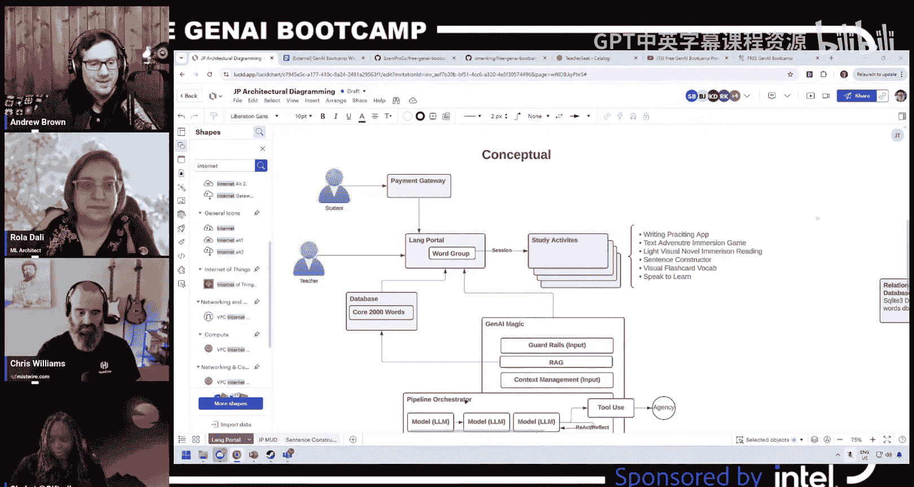

Jo's had everybody here。🎼Okay， hi team。

These farm flu causely fire in。N found of vis and don our pot be one that I that off。🎼没有一种。

🎼Fromm just gentle。Sherrys I has a lot with bro。Aid the hum of machiness。

 the glance swift jewels do so from that then the cast Mcweidows a tree lodgeched over favorless intotes。

Gly you and Emma that dances life to。Together we sway strongs in our eyes， proous wide。

 not whole skies left echo in the emptyI。😊，A clip by ch and a million andrye。

 a across assumedumed the first a sky。🎼Could your sandwich curl suffice。

To break the barrier does now be ice。Once Toize us often by its smile because we gently ex fame for just a little one。

The dirty lights in this humble place。Al mightighty probes can send the time in the space in its lunch not what was the。

Wight even she side by side front the young stars we。🎼Com。🎼To fallen peace with now。The clip spot。

🎼请我阮身。What do you know to our Sky for you with some which。😊，Suffice to break the various melty eyes。

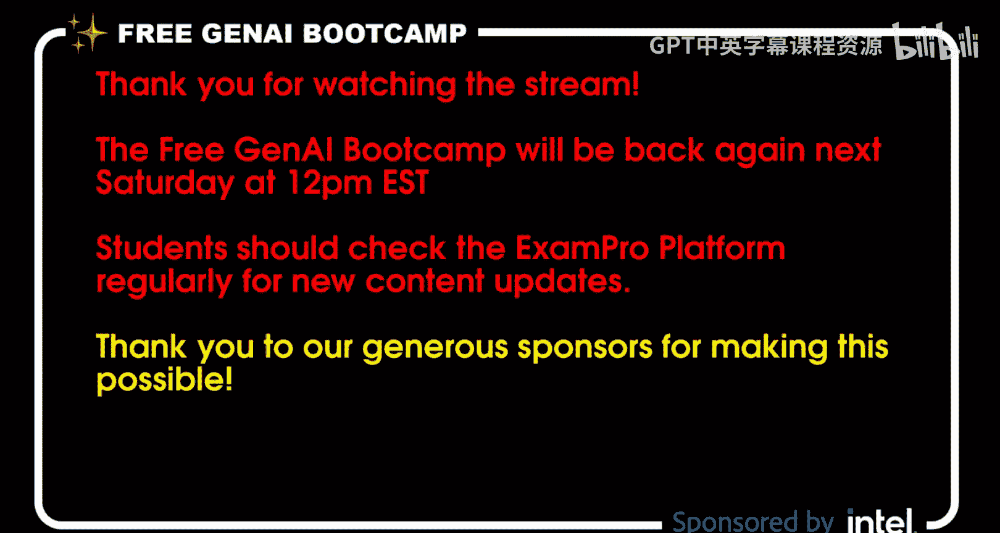