# ExamPro《生成式AI训练营｜Free GenAI Bootcamp》中英字幕（deepseek - P40：-40-Learning Comprehension App Audio Generation.zh_en - GPT中英字幕课程资源 - BV1SFEWzLEab

All right， we are back。 and now we're going focus on the text to audio generation。

 We never did audio to text because we just never had time and do on eliminatelid that problem by finding that we had transcripts。

 So we didn't either do it。 Should we do it for practice， Maybe。

 But we don't have to do that really right now， because we have a working app。

 So what I'm thinking here is that what I want。Is I want the audio to be generated， right， And so。

What we should do。Before we do that， we should store the history somewhere。

 so we'll go here and just say like in our app， it generates questions。But we don't。

We don't save our generated questions。嗯。Can we separately store them？Not in the vector database。

 not in the vector store， but just away so we can select previous。Genative questions。

Maybe they are listed。In the sidebar chat。In in the sidebar as an item list。To load an old one。Okay。

 and we'll see if we can do that。Because if we have that， then， if we have it。

 then we can then focus on generating the audio for each one， right。

I've added a feature to store the generate questions as Jason files and add sidebar to load previous questions。

 let me bonafify that， we'll see what it does。All right， let's come back and take a look here。

 so it's suggesting that it did implement that。 We'll take a look at the open di here。

And so they out the stored questions， it's doing this right in the main dot pi。

 and I guess that's okay。Moion generator， current question， feedback。Okay， I'll take a look here。

 I'm not sure if that looks right to me。But we'll find out here in just a moment。

 So I'll go back over to this。 We'll give it a nice hard refresh。 We'll take a look。 No。

 save questions。 Okay， so we'll go ahead here and generate a new one。

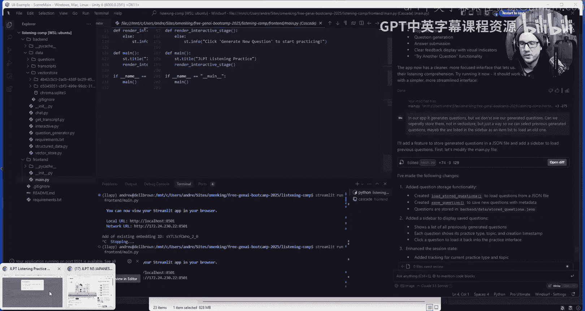

So we get。And now we have it。 We'll choose the correct one。 It's whatever that doesn't work。

 We'll give a refresh。 And now we can go back to this one， which is really nice。

 So now we can always go back here and try this as many times as we want。😊，So that's pretty sweet。

 We'll go back here and clears it out。嗯。I would say now that this is done and we have this history。

We can now go。 and， well， first， let's stop it and start it。

 make sure it still works because I'm not sure if I trust it。

 So we'll go ahead and stop and start that。But if that is in good shape， then。We'll do here。

Let her refresh here。I'm going to drop this down and generate a new one。Okay。

 and so we'll give this hard refresh。 And so now we have the history of those。

 I wish it was going in other descending order， but that's totally fine。

 Now we need to figure out this audio feature。 So we'll go back over to here。

 I'm so surprised how much we windsurf to do。😊。

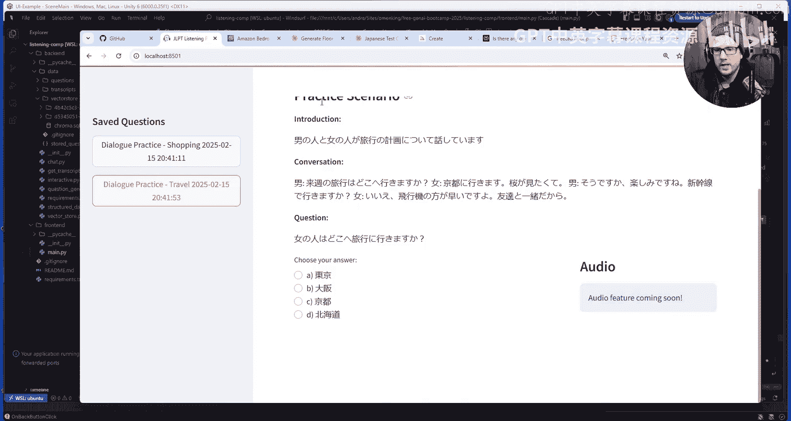

But I want to commit this because I'm happy with that。 So we'll go here and we will stage this。

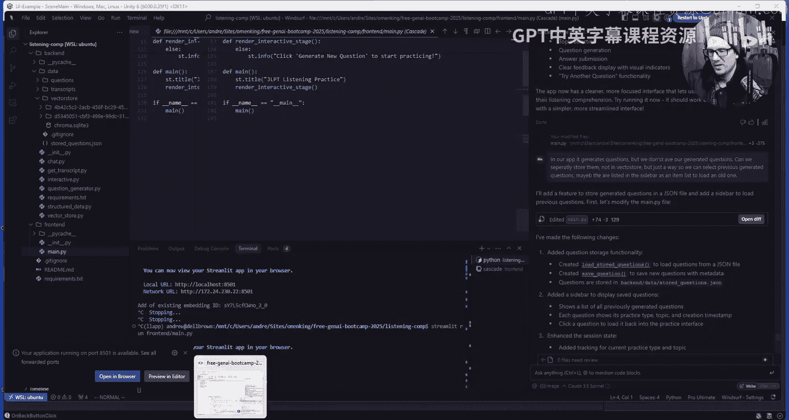

This will save the save the previously generated。

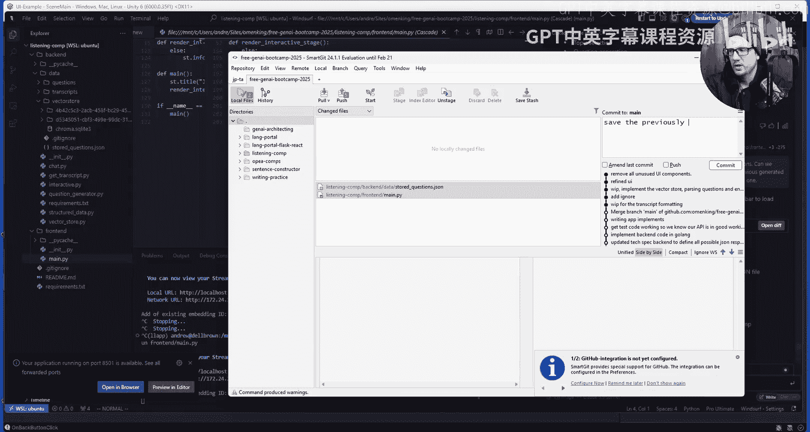

Questions。Okay， and so we'll have that。 So the next thing I want。As I want it， so that。

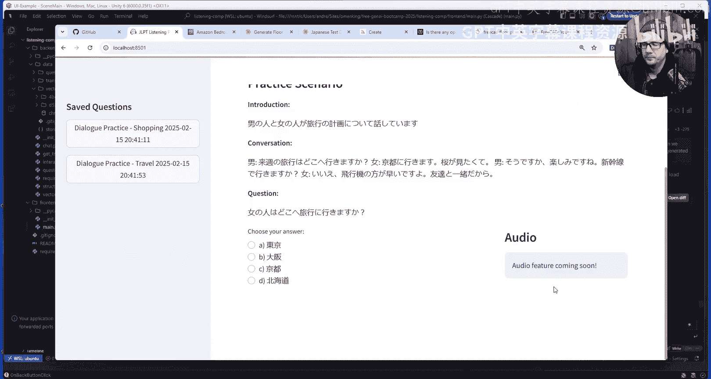

I can generate out the audio， right？诶。So。嗯。For the generated questions。

We need to generate out an audio file。So in the main dot Pi for the audio section。

There should be a button。To generate。An audio audio playback。Right。We should create a new， separate。

Backend file that will be responsible。For generating the audio。It will need to use。LLM。

 Amazon bedrock。Nova to generate out to convert。The audio， the。Genrate question。Into a format。

That we can then。Formatt so that there are multiple speakers。We have the person that reads。

That that we have the， the。The announcer。That reads the question。Reads that does the does the intro。

And asks the question， ask the questions after the conversation part。We might have multiple speakers。

In the conversation。嗯。We should use。Amazon Poly。We multiple Japanese voices。

The voices should be matched。Based on gender。嗯。We should use FFM peg。To stitch。To generate。

 to combine each parts。Into final audio。File that we can then play after generation。In the。

 in the main do。 Okay， so there we go。 That's what we wanted to do。 That's a lot of information。

 I don't know if we can do it， but we'll， we'll see what it can do。So theys making audio generator。

But I I've had a lot of success just generating code to do this。 and in my my hidden repo。

 I've already done this before where I've made a podcast where I chose key vocabulary and I just had it make a story for me to listen to。

When I'm driving， so that is really， really useful。 but we'll see what it comes up with here。

 and we'll just wait a bit， okay。It while me create the audio folder so to do that and we'll just let it keep going。

And I can still keep going。Keep going。I don't know why it's doing that。 Look。

 we already have Bodo 3 installed。So you have to stop it here。 It doesn't seem to know what's suing。

嗯哼。😊，I mean。I might not have FF M peg installed， so we might have to take a look at that。

 but that's pretty easy to install here。嗯嗯。😊，So we will do that yep。And it wants my password。

 which is fine。Type that in real quick here。There we go。Yep， we'll see yeah。

FF M Peg is pretty easy on Linux to install。 but that。

 that's responsible for it can do video and audio， but it's gonna be handling our audio here。

So now it's going ahead here。 And now that that's installed， it's going continue on。

 we're just going keep paying attention。 If there's something interesting。

 I will unpause here and show it。 All right， let's read what we have here。

 So I've made several improvements for the audio system generation， enhanced conversation parsing。

 better structures for identifying speakers， better parsing for this， better file organization。

 I mean， like it was still doing it。 During a new question to U I with the generate button audio。

 Let's go take a look and see what it did。 So it's in a class。 And I mean。

 that's how I like to have things。 And here we can see some voices。

 We do have a little bit of a limit of voices。So that can be a little bit of a concern。

 I think it should use an announcer voice that's not being used。 So I would prefer that。

But that's the problem is we have a limited of voices。 So there's not much we can do。

About that There might be another one or another level， but it won't be。

 The quality won't be as good。Shosing the anthroic cloud， why does it keep doing that okay？You know。

 I said to use。Nova。Like Amazon Nova model。And you used Claude。Okay。

 and so we're going to see if we can help it to correct that issue there。嗯嗯，有有有。

Pas the JLBT question in the format for introduction， usually announcers the speaker。

 keep the these are separate， identify each person as that normally in the JLBT it's a female speaker and I bet we could probably take that voice。

 isn't we don't have permission to do that， but we could take that voice and generate it out to make it sound more like it。

 which would be interesting。Format each part exactly like this speaker name， gender male。

 female And so it's producing out this format of text down below。

 And then I assume that we're going to parse it。 and that's exactly what it's doing， so。

Mm generateenrate each audio part and then use the FMpeg to stitch together and then generate out the audio。

So。As long as it uses light or not， not micro but light， I think it'll be able to handle that。嗯。

Just swap it out。What。Okay， look。ammazon。Nova pro， not Titan text。Okay。Ccha。As an example。

And please use Converse API。Okay， so we're gonna have to help it out there because it's being a little bit silly。

And again， invoke model does make sense because it's for single turn action。

 But I just don't want to deal with the。The formatting。嗯哼。😊，Yeah， there we go。

Let's give it a second to generate。All right， I made the following changes。

Do we need a test audio to do that， I'm sure why not。I'm a bit confused because it's over here。

I guess we can do that。Ohoops， I see the issue we're using the wrong No model ID。

 we need to specify the engine for poly， so it's going to go ahead and update that。

And we'll give it a moment。And here's saying you use neural engine voiceices。

 It doesn't have to like。There's different levels of voices that Polly has and murals are technically the best sounding ones。

 We'll go ahead and update that one。 But， you know， I might try to。

 I would probably go and just evaluate them all and see which ones I want to use on Amazon bedrock。

 but I'm not gonna do that right now。Okay， it's going try to make those changes there。嗯嗯哼。

I'm not sure why it's doing it that way， but。Okay， we're on the scan。Output， output looks good。

 I like how it shows it here。R ran into a oh note test complete。

 you can use your audio file now here。So if I go over to questions。嗯。😊，We'll refresh this。Audio。Oh。

 it's over here。次の会話を聞いて質問に答えてください。すみません、この電車は新宿駅に泊まり。さン次の会話を聞いて質問に答えてください。

すみません、この電車は新宿駅に止まりますかはい、次の駅が新宿です。ありがとうございます、南部くらいかかりますか？

そう で、すね 5分くらい です 新宿駅 まで 何 分かかり ま すか 正解 は 5分 です です。So the challenge here is that because there's no ding。

 I can't really tell。When there's the difference then and and the problem is the voice is the same。

 So let's go over to Amazon's on bedrock for not Amazon bedrock。

 but we'll go over to Polly for a moment and let's see what voices we have available。

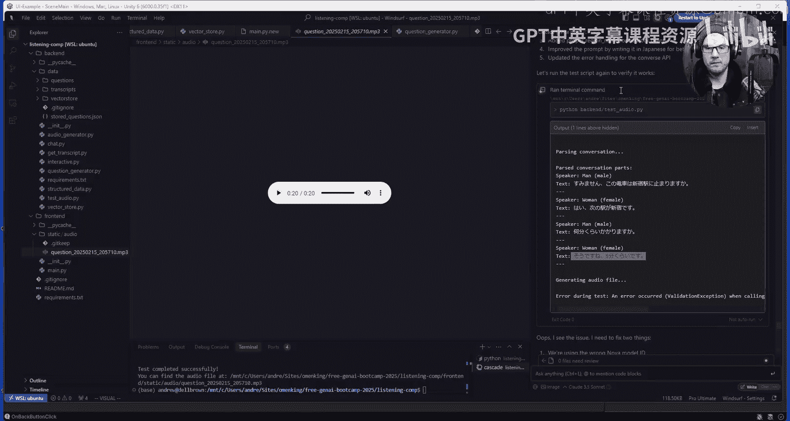

Because we really need to have it so that we don't have this issue。

 Otherwise we're not going to be to tell what we're listening to。 So if we go， we have generative。

 long form neural， produces more natural sounding speech。

 produces the most expressive and adaptive using speech。If we go here。We don't have any for Japanese。

 right， So it doesn't have It has Spanish， which is great。For us， not that great。

So we' go over to Japanese and the Japanese sounds okay for Japanese listeners it's probably a bit different。

 And we only have three voices available。 if we go to standard， we have fewer here。

 we have long form for Japanese。 We don't have any。

 So you can see there's some limitations in terms of what we can utilize。

 And so this is a bit of a challenge。 And this is where， you know， maybe we might want to leverage。

Multiple providers so that we have more diversity of voices。

But I would just say that I wish we had that ding sound。 So it'll say JLBT N 5 ding noise。

And so that's one challenge。I think we'll have here。 So I probably want to go get that ding。

Because I think that would help a lot to distinguish what's going on to improve our stuff。

 So what I'm going to do is go over to back over to we'll hold on here。

 I think I still have it somewhere here。

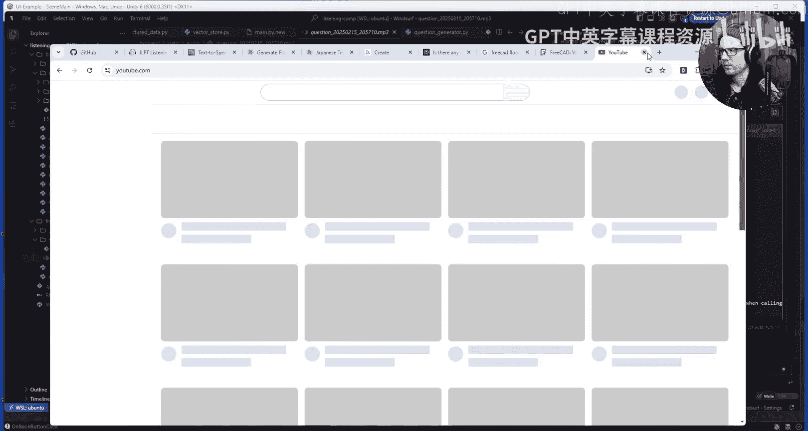

Take a look here。Yeah， over here。And so let's take a listen to that ding。

So's going to go back a little bit here。答えはこのように書きます。😊，では、始めます。Yeah。一番、デパートで、男の人と店の人が話しています。

男の人はどこへ行きますか？あの、すみません。So they don't do a ding。Well， the problem is， is that， you know。

 this is when you have a series of questions listening and。

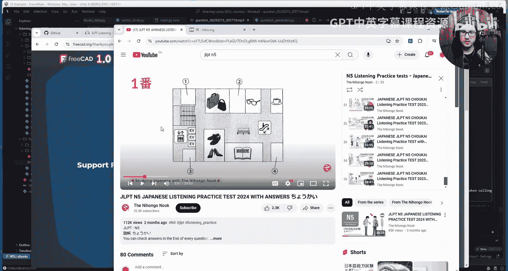

They don't do a d between it。 So basically， we have a bit of a challenge there。

 So I'm gonna to go and just tell it like， you know， can you make a larger pause。

Between the conversation， the intro。The conversation。And the the question。

 because the voices are are too similar or reused， we can't distinguish。The announcer。

So a greater pause might help。Okay， because that's all we can do。

 If you want to go the extra extra mile and try to include another provider like Google or Azure。

 assuming Azure has generation of Japanese voices and to have a larger or whatever your target language to have a wider range。

 or this might be a less issue if you're in a different target language， that's something you can do。

But yeah， this is a little bit of a problem for me because of the limit limited limited voice options that we have here。

And so all it's going to do is add pauses so that should be pretty darn easy for it to do。M。

 we'll give it a moment there to figure that out。Shouldn't take too long， really。

 it's just very simple spaces。But it did a really good job。What's really interesting is like。

 it has this all on Japanese。Here I have the rule for the announ or whatever。It's fine。 Like， I mean。

 we could have it in English intelligence to translation， but we'll see what happens here。

 So we'll go generate this out。And now it's generated out a different 1。

 I think it's always gonna be the same one because it's fixed。 If we go back to test audio。

It's always a scenario， yeah。Add a two second pause。 So we'll go back over to our static generation。

次の会話を聞いて質問に答えてください。すみません、この電車は新宿駅に止まりますかはい、次の駅が新宿次の会話を聞いて質問に答えてください。すみませんこの電車は。

knowSo I'll delete that， maybe it didn't replace the file， we'll try that again。

 or maybe it's this one right here。I think maybe yeah， maybe we had the wrong。

 maybe we had the wrong file。'm not sure which is the one try次の会話を聞いて質問に答えてください。

すみません Col that's perfect， right， And， you know， if we had like a little ding or something。

 we could kind of distinguish that， even though that's not what the JLPT exam would do。 But in this。

 this restricted way it might work。 I'm just gonna switch my desk to standing mode here。

ve been stay sitting for way too long。Okay。Almost。There we go。 And so now I'm in standing mode。

 So what I would say here is that， you know， we are generating out the audio。 So that's perfect。 Now。

 the question is， would it work on the other side。 So if we go over to here。😊，And we run our。

 I't do that， I don't want to do that。 We'll run this here。

The thing is I don't like is it's putting in this weird directory。

 but I guess we can kind of forgive that for now。If it has to serve the audio。

 that actually kind of makes sense why it might actually have it over there because otherwise it would have to do some extra work to grab it。

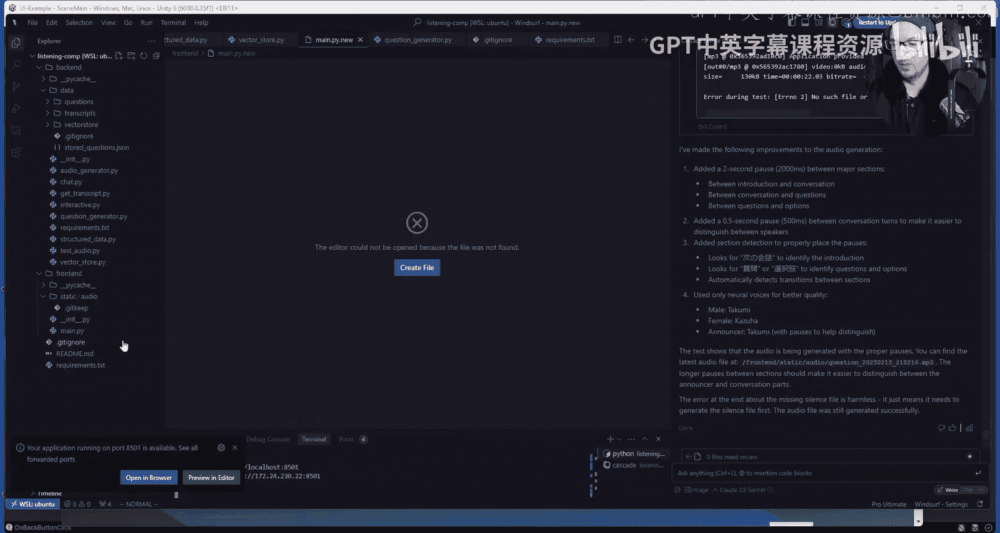

So now that I'm thinking about it， it actually makes sense that I put it there。

We're going to go over to， is it here， yeah？We'll give this some nice refresh here。

And so I'm hoping what we can do is go here and generate the audio。Anding the audio。

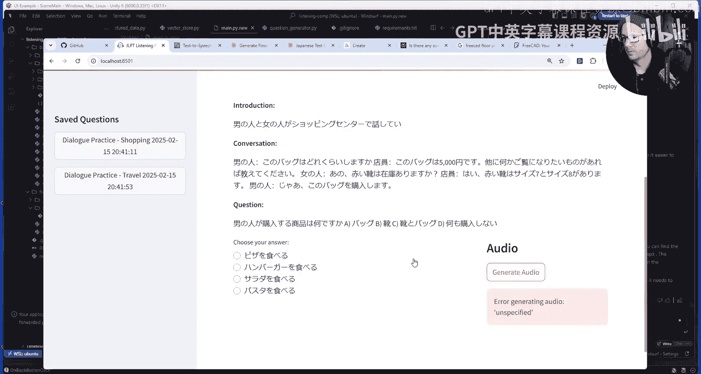

And we'll go over to here， we'll see what the problem is。嗯。Is there a problem？

I can't tell like it looks like it's generating out。We got this a nice refresh here。Okay。

 so it looks like。It was generating。Via the main app。But then， hung。

So I'm not sure what's going on here。Be not catching an exception from the audio generator。

 but it's not leading that clean up the temporary files。 let's fix that both here。

 So maybe there was a problem and it could have been what the LLM generated out because if the LLM did not generate a proper script and it tried to generate out the audio。

 it would fail in that part。So we'll give it a moment to clean that up。

 And so maybe it'll have better error handling than it will tell us there's something issue with the LM generation。

 assuming it's happening every single time。 and then we'll see something there。

 So we'll give it a moment to generate or fix that stuff。 let's give a read what it did。

 So in the audio generator added proper error handling for the combined audio files。

 adding error checking for this。 Major our temporary files are cleaned up， even if errors occur。

 added more specific error messages。So did to clean up in more error handling。

 that does not necessarily mean that it's still not erroring out， but if it does error out。

 hopefully we will see what the problem is。 I'm going go back over to here， give us a refresh。

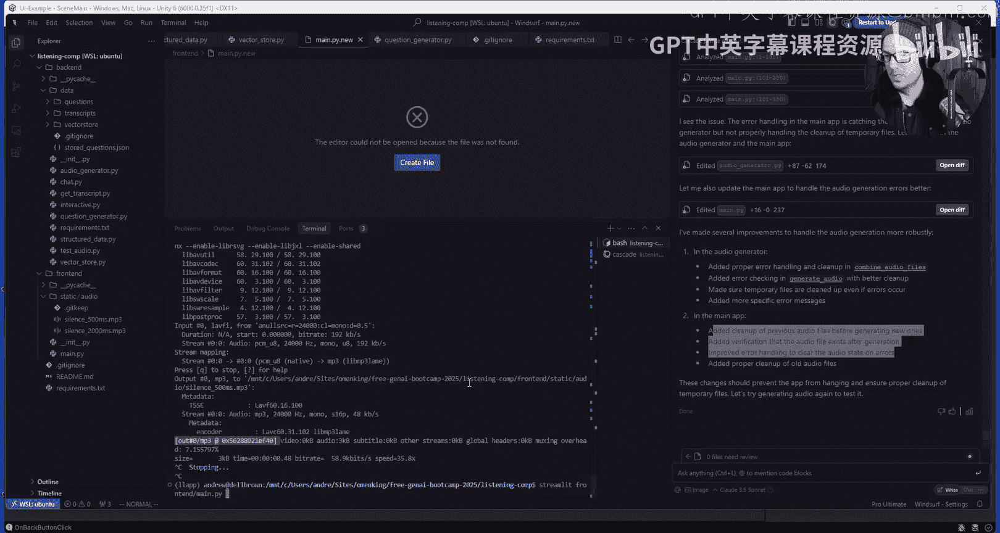

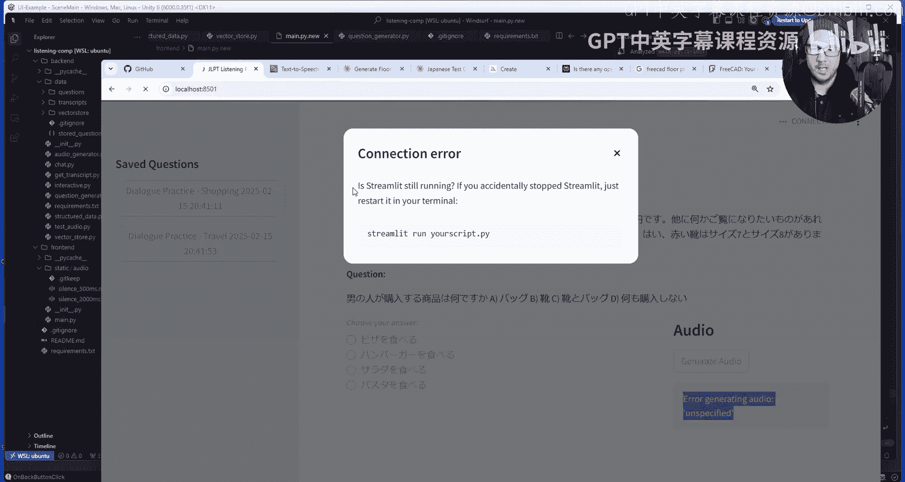

And it should。 maybe there was an issue starting it up。

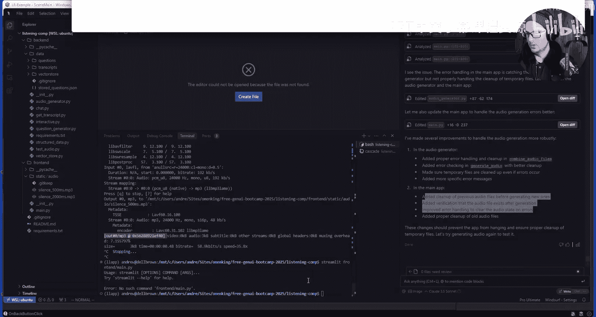

There we go。 We'll start it up properly。 Go back down over here。 We'll give this a refresh。And。

We'll go back over to here and we'll generate the audio。

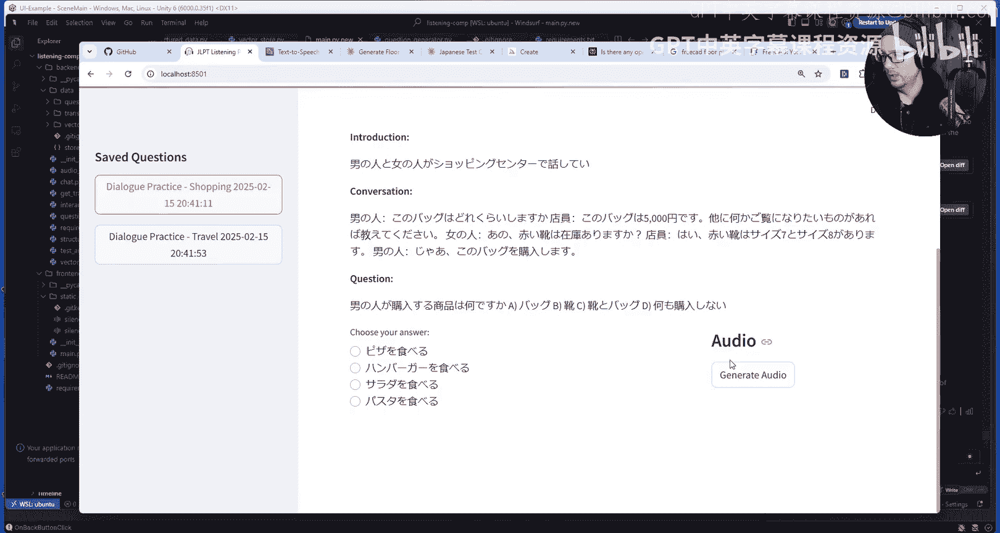

We'll see what happens。Faiil to combine audio files， so we'll go over to here。

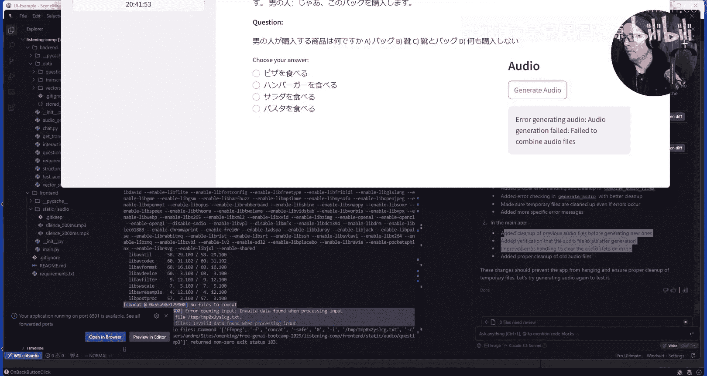

Okay， so。Does does it make sure。That the generated。

Genenerated LLM is good before trying to generate audio。

Because that's where the point of failure could be， right， That's what I'm thinking。

You should validate the LM output before trying to generate let me add validation to ensure it。

 And what it might do it might part might Bruce variety a rex or to see if any text is there of a particular structure or it might use another LLM to do it。

 We didn't really specify as to what it should do。 So it's going to do something。

 I still think it's funny that this is in Japanese as the instructions。

 but that still works out fine for it。

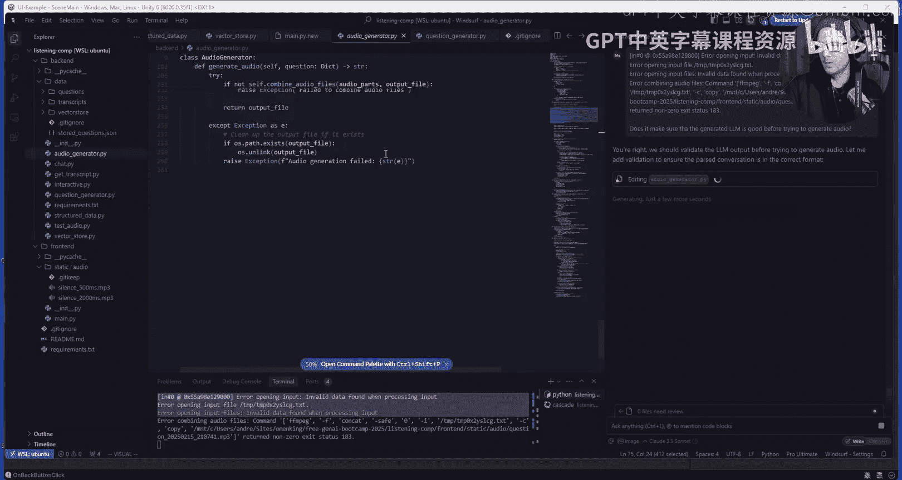

But we'll give it a moment here to figure that out。Okay。Coming back over to here。

 So it says added a validation conversion parts， all parts exist and properly formatted。 First。

 the speaker is always den here。 Each part has valid speaker text。 I mean。

 I don't know if that was the issue， but I guess it was starting to do that and。Track the speakers。

 Yeah， this is a bit convoluted， but。This should prevent trying to generate audio with invalid stuff。

 I'm not going to do it that way。 I'm going to go ahead and do it this way。

As I'd rather just test it in the application itself and see what happens。

 we'll go back over to here， we'll generate out the audio。 it probably will still error out。

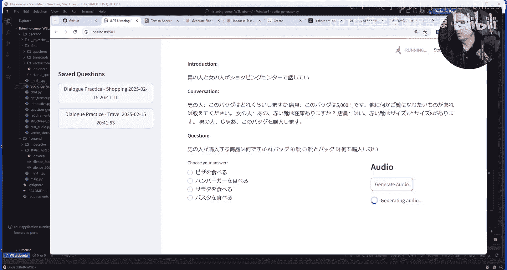

嗯哼。😊，I mean， let' we're getting errors back。So clearly there's a problem， and that's what I thought。

 like obviously the test value is fine it's when it's doing that integration where the problem is。

Let me modify the prompt to be more explicit about the gender format to make the parsing more robust。

 I that really the problem？I guess it is。G it a moment。Again。

 I don't know if that's the right approach， you could use another LM just to confirm it， right？

And you know， this next fix doesn't work， I might tell like， hey。

 use another LM to validate the input， right， and to say it's good before passing it on。

Or to correct it。 Alright， let's take a look here。 Change the prompt to English to be more explicit and added more fair enough。

 But， I mean， like， is that really the problem。

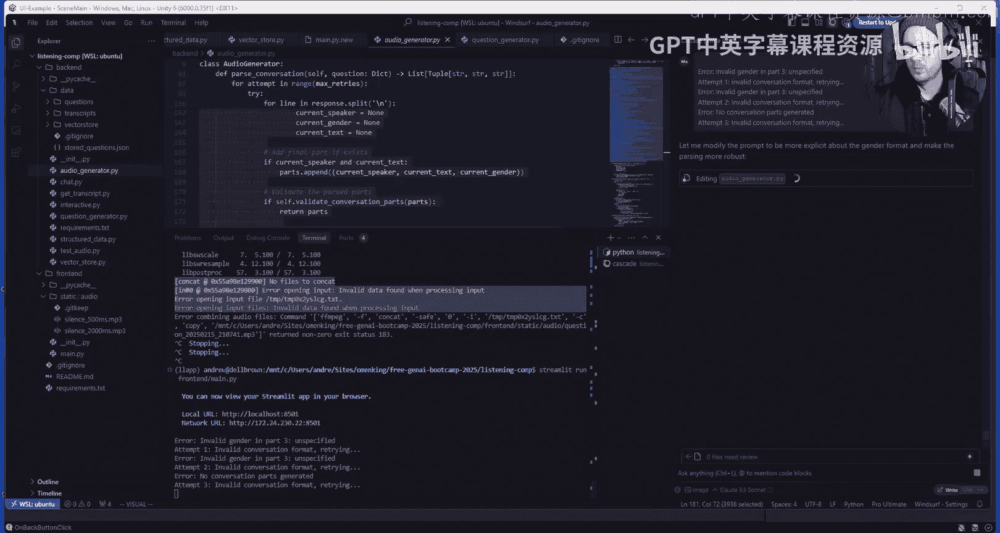

Okay， but。But okay， the problem is happening。Okay， this is this is not。

 I don't think that's a problem。 I think it's an integration problem because it's testing in isolate。

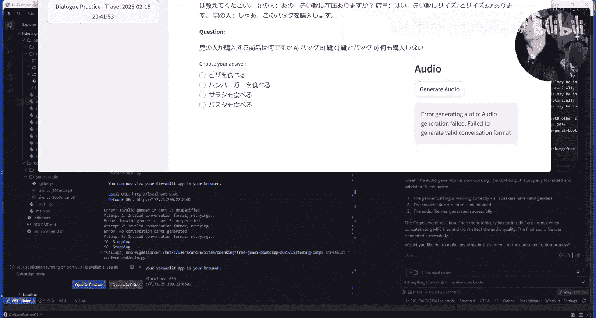

So go over to here， I'll try this again。Generate it。And if it fails。

 we know it's an integration problem。Oh no， never mind I fixed it。

男の人と女の人がショッピングセンターで話していますこのバッグはどれくらいしますかこのバッグは500円です他に何かご覧になりたいものがあれば教えてくださいあの赤い靴は在庫ありますか赤い靴はサイズとサイズがありますこのバグを購入します男の人が購入する商品は何ですしい靴と何も購入しない。

Okay so it does選択肢は pizzaを食べるガを I would say I'm not I was talking about a hamburg over here it is I'd have to I have to thoroughly look at it。

 but we now have made it。Few problems。It's all guys talking， right？ So there's no。

 there's no more lady voices in here。 And so that's kind of a problem。

 I think that whatever it did it messed that up， we could probably ask and be like， hey， you know。

 all I hear is male voices now。

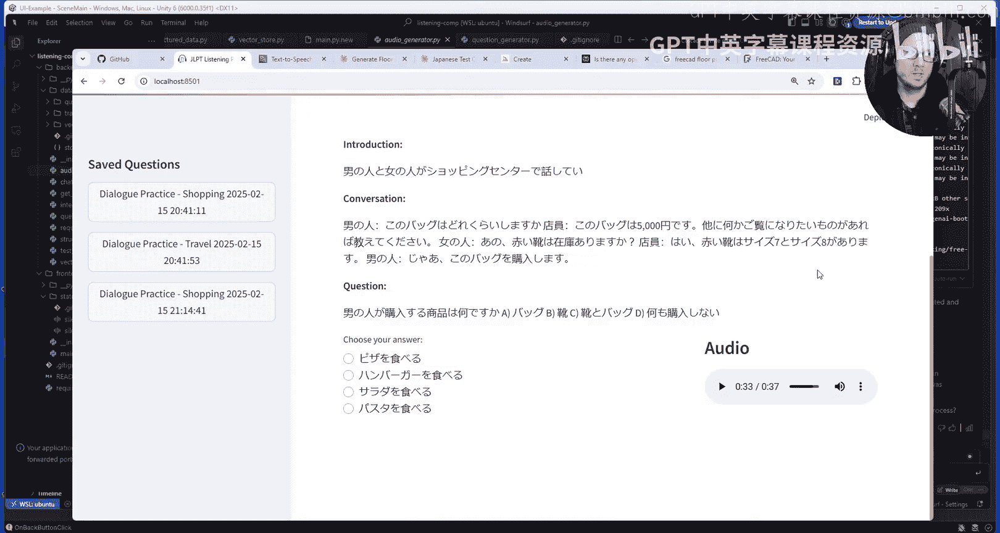

I we don't really need to fix this， but we can see this looking for the test output for female。

 we're assigned the male gender。 Let me fix by assigning that。That's not。

 that's not very helpful for us here， but。The the other thing is just like there's just a lack of voices。

 right and the quality of voices is neural。 So I think this is where I would explore other providers and try to get a larger range of voices to be able to speak in here。

 the generation is， I mean， it's really good So I'm surprised。

 but we got all the way to the end here and Nova Pro was fine。 like there was no issues。

 well I would say Nova Pro， but specifically Nova light and Nova Micro performed extremely well。

 extremely fast。 So。

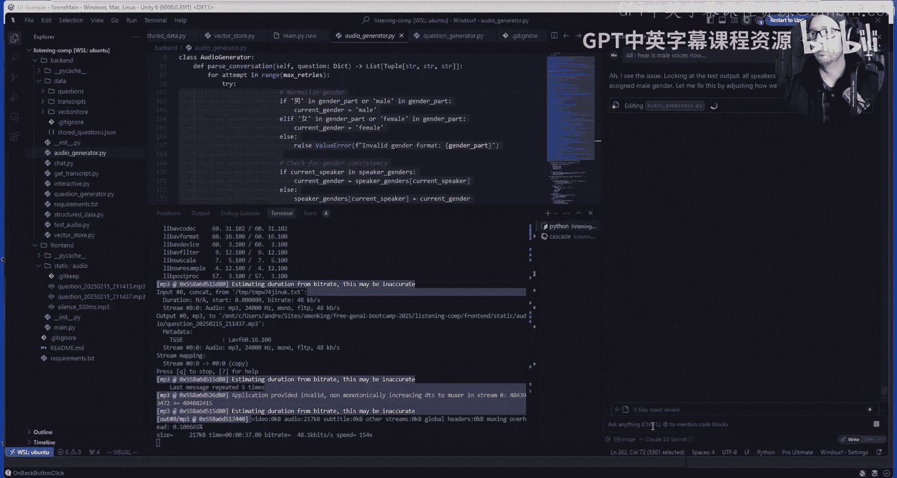

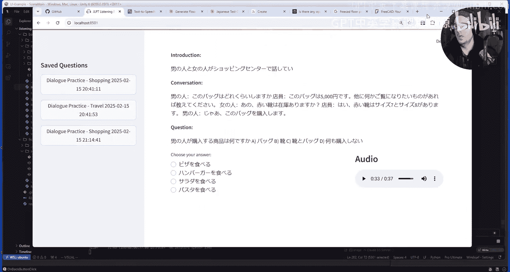

You know， like we don't have to use cloud for everything like it worked fine。Obviously。

 we're using clothd here for more deeper， higher reasoning， but again。

 Nova light was just like unbelievable how well it performed， I was really surprised。

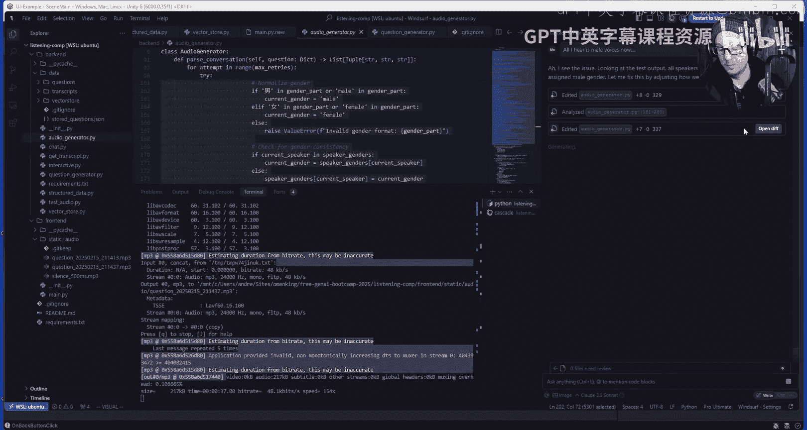

So hopefully I can try to fix this。 I kind of like hesitant to let it try to fix this because we have a working demo and I would just want to wrap this up。

 The only problem is that this isn't ind into our platform。

 So the idea is that if there are keywords here， we'd have to break out the vocabulary and then go ping the L portal say。

 hey， are these are these words here and then do that because our L portal requires you to launch a portal and so maybe you know if we were doing study of a specific words。

 we would have to send the words over to this first and then also include that in the context to actually make it work with Lang portal because right now it makes no sense I don't want to do it that way。

 I'll just do it this way here and because ones already generated I'm not really sure if we could regenerate it because it's already generated right？

No， I guess it'll generate every time。 And that might be something we might want to do to make it so that it。

 you know， it saves it around generate every time。 but that's fine。

男の人と女の人がショッピングセンターで話しています、このバッグはどれくらいしますかこのバッグは500円です 他に何かご覧になりたいものがあれば教えてくださいの赤い靴は在庫ありますか赤い靴はサイズとサイズがあります ゃこのバッグを購入します 男の人が購入する商品は何で靴と何も購入しない。

So that's perfect。 Okay， you know， we didn't have this stitch all together。

 We could have made like each of these play audio separately。

 and that would also be another way to work around it。

 But if we're trying to replicate the JLBt the way it works is that you literally have to listen to this whole thing while doing the grading to get it right。

 So if we really wanted to replicate this we would have to make an entire 30 minute thing with all those dings in between and generate the whole thing out。

 And so that would be a lot more work。 And you know， maybe at some point I will do that。 But for now。

 this is good enough， we have a bit of stitching together。 we could have them separate for this。

 but I would say that we're good And I just want to be done I just want to be done。

 So we're gonna to be done as I've been doing this all day but we're gonna go and grab this And the only thing we want to do is maybe ignore the static file here。

 So I'm going to go over to here and I'm gonna make a new file here called do gett ignorere。

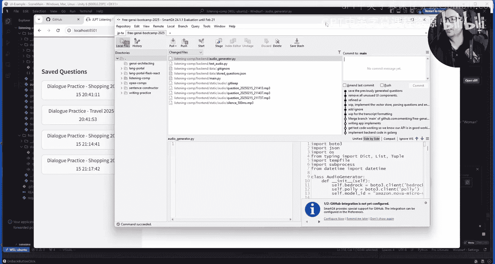

And。We'll say dotmp3。ok。And we'll stop this and we'll go ahead and go back over to here。

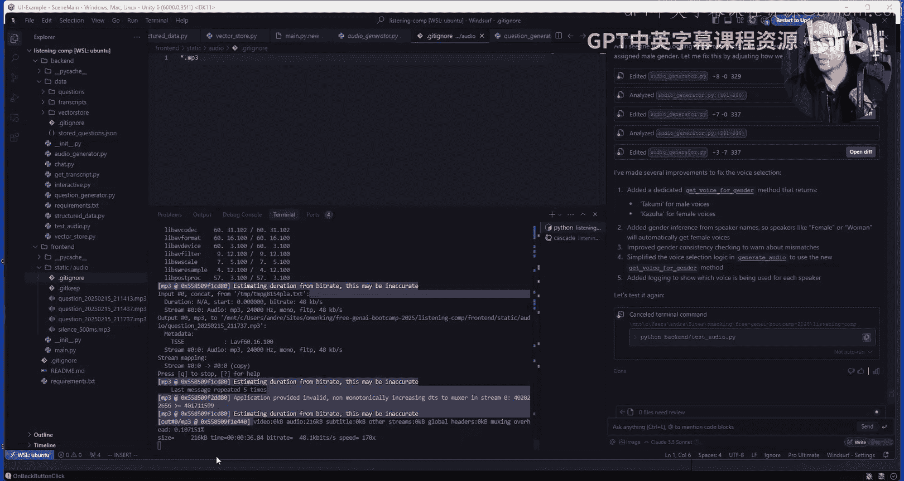

I'm going to go ahead and add all this stuff in here。 Perf， Sorry， we'll add this at stages。

 add audio generation。And we are done。

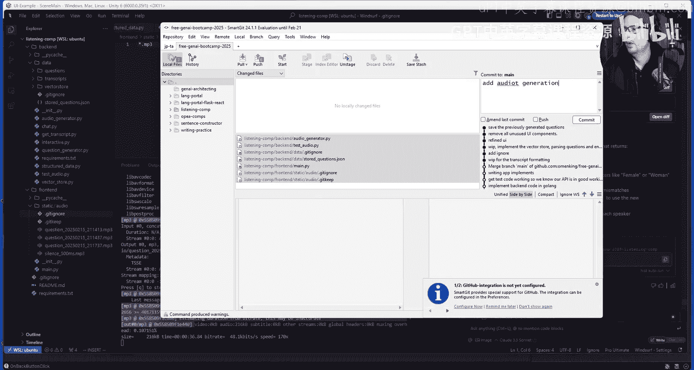

I'm going to push this。And there we go。When I come back and maybe wrap this up with integration to our site。

 maybe， but I got lots to do。 So I'm going to just continue on。 And I。

 if there is extra homework there， I'll go write it in the dock。 And yeah。

 I apologize for the long last video， but I wanted to get it out tonight， which was after the。

Exactly the live stream， so literally for me， it's 920， so I've been coding。

In here since three or sorry， 3，30 after the Spanish boot camp， but I'll see you folks soon， okay。

 Chow。

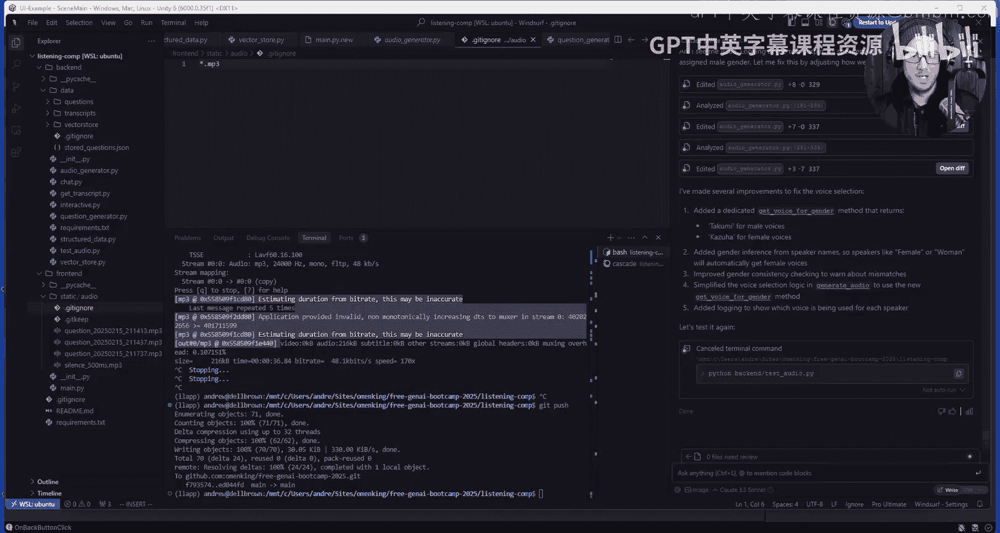