# ExamPro《生成式AI训练营｜Free GenAI Bootcamp》中英字幕（deepseek - P41：-41-Torc Developer Profile.zh_en - GPT中英字幕课程资源 - BV1SFEWzLEab

Hey， this is Angie Brown。 and we are here on the torque do dev website。

 And what I want to do is go ahead and create myself a new account and create my developer developer profile。

 The purpose of torque is to help connect you to possible jobs。

 and they do that through an AI power talent delivery engagement platform。

 And so we'll go ahead and create ourselves and account。

 So I'm going to go to the top here and click sign up。 Now I have created accounts before。

 but I'm going have to create another one。 So I'm going to choose something maybe I have not used。

 So I'm going to go ahead through my Github。😊。

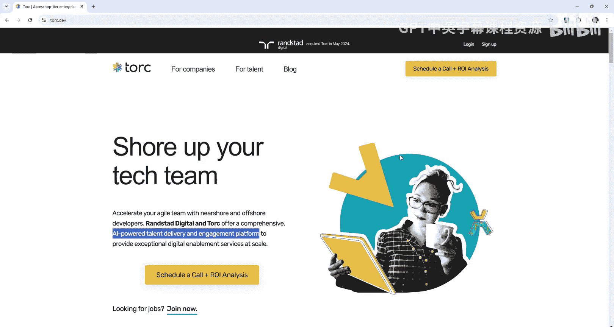

And I'm going to connect that way and create myself a new profile， so I just give that a moment。

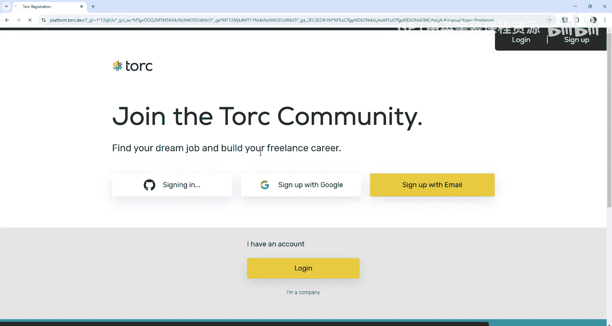

To connect。Okay， and so here we are in the start。 So let's start with your resume。

 upload your resume。 will'll automatically populate your profile。

 including skills and work experience to increase your chances of getting hired or skip to manually complete your profile instead。

 of course， if you already have your resume that is going make it a lot easier I probably have a resume somewhere that I could put together。

 but I'm going probably fill this in manually。 So it's up to you whether you want to import your resume here。

 I'm just going to skip through and I'm really doing this to show you how to make a good developer profile。

 but we're gonna to go ahead and skip the step。 And if you want to import it， you can do that。

 So now we have a few steps where we can choose select the rules that best describe you well。

 I'm a full stack developer and I'm an AI engineer。

 Those are the two main ones that I would say I am I could even put solution architect。

 but here we have some some architectetypes。 but I'm going to select these two here today we'll hit next and here it says be sure to list all your skills and increase visibility and help recruiters and companies find you more easily。

 So clearly there are skills here that。That might matter to folks that are trying to match you。

 And so here you know we chose full stack and AI engineer and we have Bt cloud services。

 deep learning。 So I'm just trying to think of what I can add here。

 I know like my background is Ruby on railils。 I'll go ahead and type Ruby on Ra rails。

 Let's see what we get。So here I have， yep， Ruy on rails， and I have five plus years in rails。

 I also have。If you go to Ruby， I have five plus years in Ruby。I know8 of us very well。

 So we go here and say8 of us。 can we say8 of us are Amazon Web service， Amazon Web services。

So we'll go ahead and do this， I have5 plus years in Amazon Web Services， Google Cloud Plaform。

Same thing with this。 I can go ahead and put five years on this， aszurere。

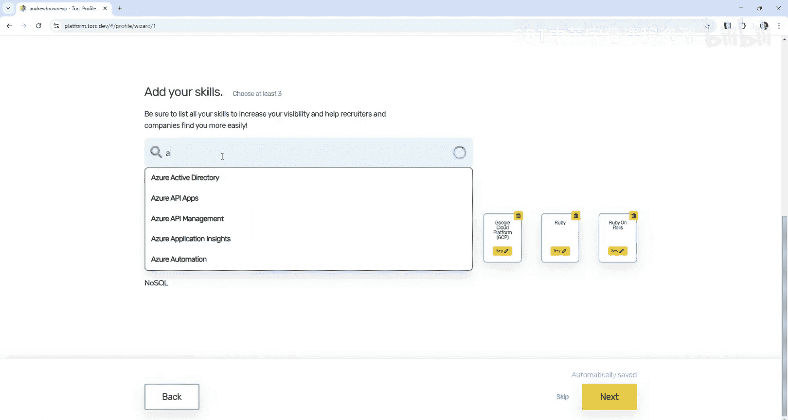

Azure， Microsoft， Azure。

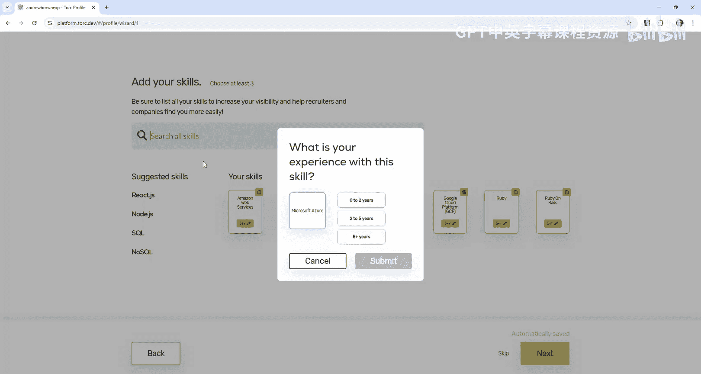

Okay， and not gonna be doing this all day， adding these things。 But you know here I have some here。

 and it's up to you what you want to do there。 but we'll take a look once we get a profile。

 we'll go back and refine。 we'll go ahead and hit next here we have different levels。

 So we have fully fluent English。 I like how we have Japanese and Spanish here and actually I actually do have basic levels in both。

 which I'm not sure how it new。 but that's cool that it pulled that up。

 maybe because my Github that I'm connected to it notice it。 but this is technically my levels。

 that's perfect。 What we'll use。 We'll consolidate stats based on your top languages issued created PR submitted issues。

 So this thing will happen if Github over here we have codeal like So are you ready to truly understand productivity and code。

 And here we can create our account to that and here it's using my monster box。

 that's my old company email because I use my Github。 we'll go ahead and hit next。

 So we are looking for full time or part time。 we'll just say part time for now。 I mean。

 I'm not looking for any work。 but you know what I mean， actually we'll go back。 We'll say fulltime。

'll say full time part time El。😊，But you know， or I will say open to offers。 Why not？

 We're always open to stuff， right？ One is as soon you could start working。 I don't need notice time。

 but again， I have my my full job here。 And then this is where you might want to decide what you want to do。

 So the question is like， how much is you fill in here。

 please enter the requested yearly salary in the box。 if you're beginning out。

 and it's gonna be lower if it's higher。 But this is the USD equivalent。

 So what I'm gonna to do is cheat。 I'm gonna go over here and say Claude。 And so， you know。

 what is the average pay。For an AI engineer or full stack developer that has you know，15。

15 years experience， not maybe not AI engineer， but 15 years experience。We'll say。Let's say。

 what is the average pay for an engineer of， you know， two years or a full stack developer and。

 and a full stack developer。Of， you know，1520 years。 I don't like saying 20。

 but it has been 20 years。 And if we go back over to here for a second。You know。

 yearly salary in USD dollars right， so we'll go ahead and put that in there we'll see what it comes up with。

Sos $110 to 150 at the medium with 13000。 I mean， that's a little bit low for me。

 But that's for the AI engineer。 Oh， that makes sense。 A engineer， Yeah。

 if you're early on with the level experience， we have 150 to 20000 because it's showing more years of experience。

 So the medium salary， 17500。 Let's go 150000。 That's still really good。

 actually already set to that。 So we already have it set to 150000。 So I'll go ahead and hit next。

 So that was perfect。 So we have some details here that we want to fill in。

 I do not live in Thunder Bay。 I live in  Scrir。😊，So I'll see if I can put that in there。

 but they don't have it。 So we'll have to go with the next closest one。

 I think this is where you know if you're live in a small town。

 you just do the closest town to you and my LinkedIn name is Andrew WC Brown here it says provide a brief that great text is hard provide a brief heading or catchy phrase that best describes you for example。

 all things Android addicted to Gatsby reacting pizza not sure why we need that。

 but we'll go ahead and I mean， no， I guess that makes sense because LinkedIn has those headings there。

 but you know mind is I teach cloud right So I teach all of cloud right and you know was I was know previously CTtoO of multiple startups。

You know， all right， well'll just say like I teach all cloud。I can do anything。

 Is that a good heading not necessarily， But I was I gonna fill for now。

 We have this provide a summary introduce yourself。

 This is your chance to self yourself up for the future。 So， you know， you know， I have been。

Working in the tech industry。For 20 years， with a focus oned tech。嗯。I've held roles。Rolls of CTO。

 principal engineer。Solution architects。Full stack developer。嗯。I'm very good at。嗯。

Providing mentorship。Mentorship。Leading， leading projects and。

Deliveverring on time time and in scope。There we go。

 And you can put something even personal if you want down below here。

 We have this and that I don't know。 I don't think I uploaded that， but if it's already there。

 that's great， you'll have to choose what you want。 But I don't know where they got that from。

 but we have this here。 I don't like that。 It has this this here thing。

 I'd probably pull up another one。 But here it says open for sponsors clearly that's from my LinkedIn。

 And so then there's my phone number。 And now I have to。😊，Bluir it out， so that's unfortunate。

 but we'll go continue on。Down below here。 we have Twitter。 So still call calls it Twitter。

 but we'll go ahead。 and this is just Andrew Brown。 I do have a sack overflow。 I don't care。

 I do have a hash note。 I don't care。 I don't have a portfolio website because exam pro code is my portfolio website on my channel。

 So I could include that there。 but I'm not going to do that here today。

So we go here and we can see C O， CT TO， founder， C， T O， CT， T O， C， I have a long history of CT TO。

 And that's kind of okay。 I， I feel like this must be connected to my LinkedIn because prior when I did this。

It didn't have all this information。 So it must be pulling it from there。

 And I have a couple projects here that's interesting。 We'll go ahead and it done。

 And so my profile is mostly filled out。 You'll have to see that have to obscure my phone number there。

 But that's not too hard to figure out。 So down below， we have a rubby assessment。

 That might be actually kind of fun to do。 But let's go take a look at our profile and see how it looks。

 I'm gonna to go over to here。 and we have Exandra Brown EP at the top。

 So this is clearly I clearly collected my LinkedIn here prior。

 But you can see that it has my Github history。 So you know actions over here。

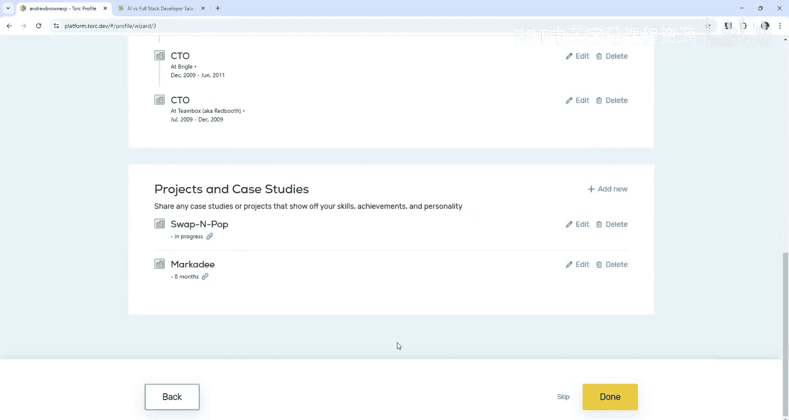

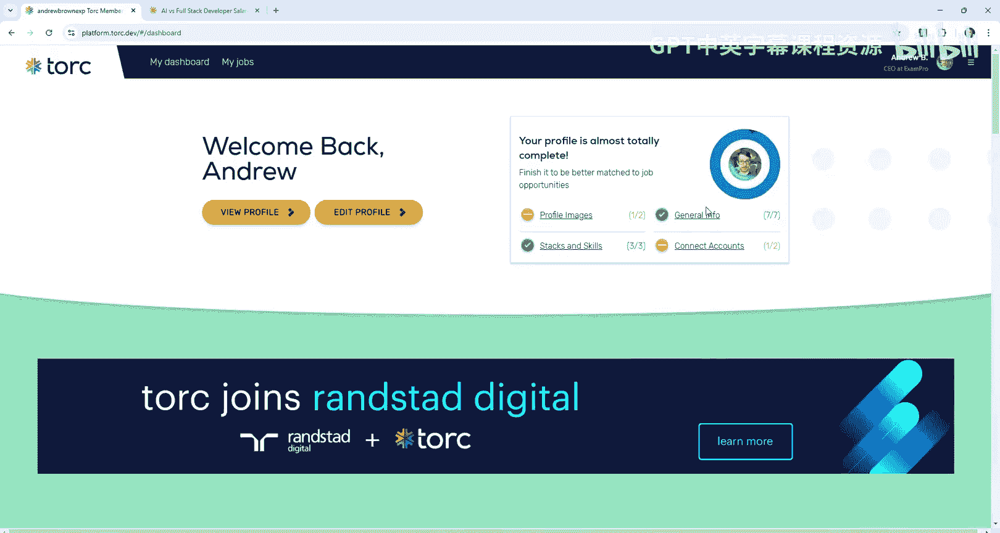

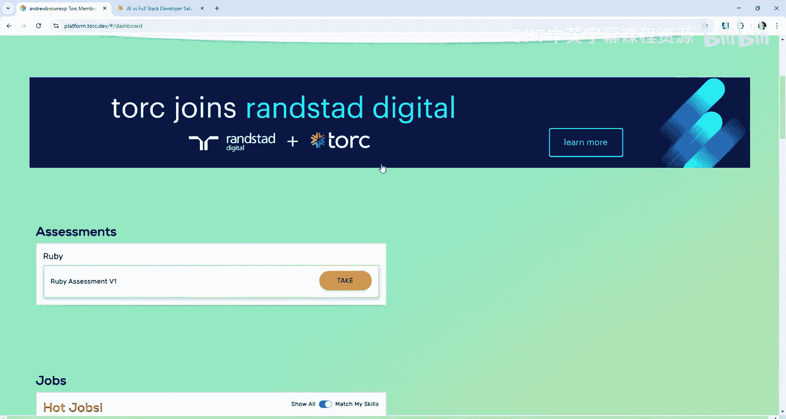

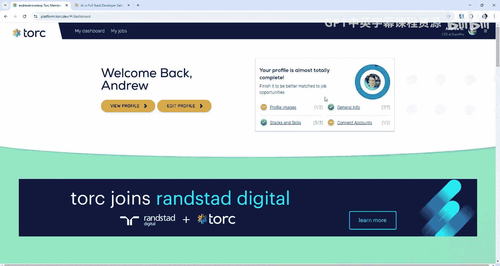

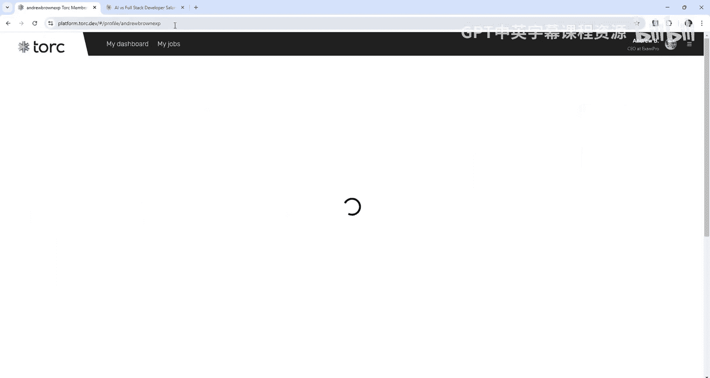

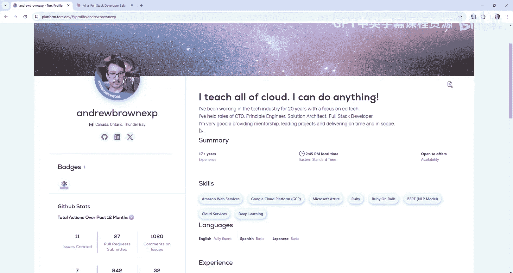

It shows Rubys， jascript， CSHL and Shell。 Now， remember， I have exam pro code。

 So I have a lot of code over there that's not being pulled over here。

 You can see it's poll in my descriptions from all my previous work and there's my projects。

 You can see we have English， Spanish and Japanese and a bunch of things that I'm good at。

 And it says 17 plus here。 That's not sure I have 2020 years of experience。

 but maybe this isn't perfectly listed because actually started prior way prior to 2009 I've been working in 202006。

 So there needs to be a little bit of update here， but you can see my links are in here。

 Ive got my torque badge。 So it shows that I joined January 2。

 So clearly this is bringing in stuff from my had before。

 but I have no other way to make a new profile from scratch， right。😊。

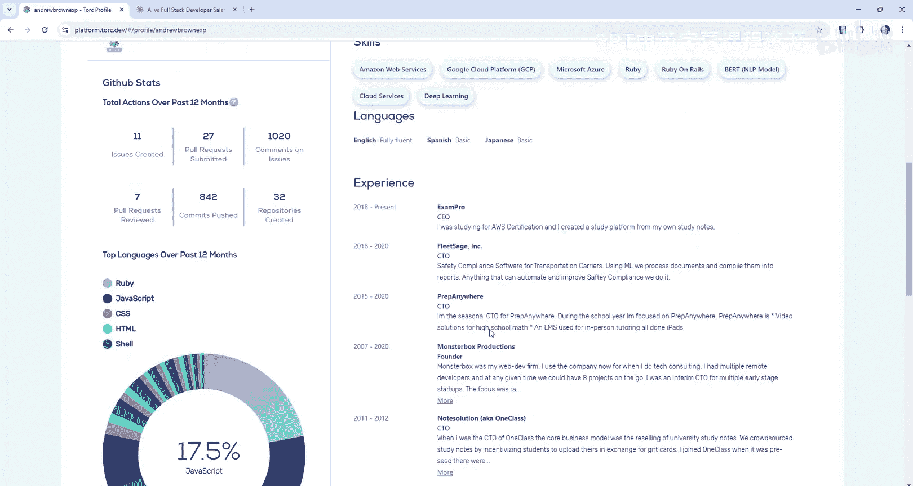

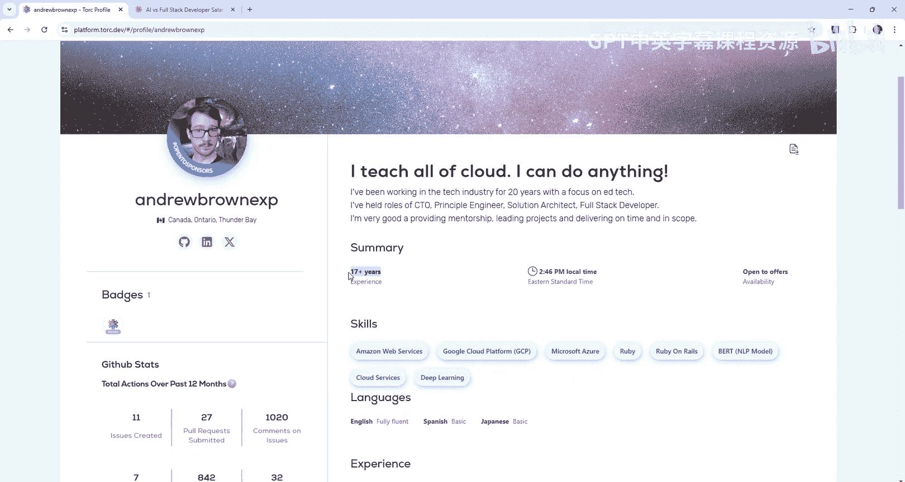

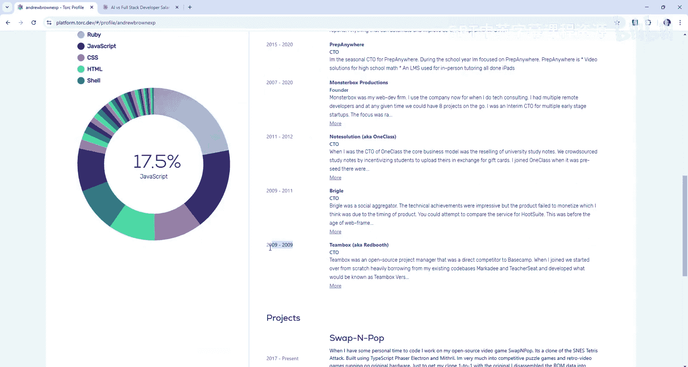

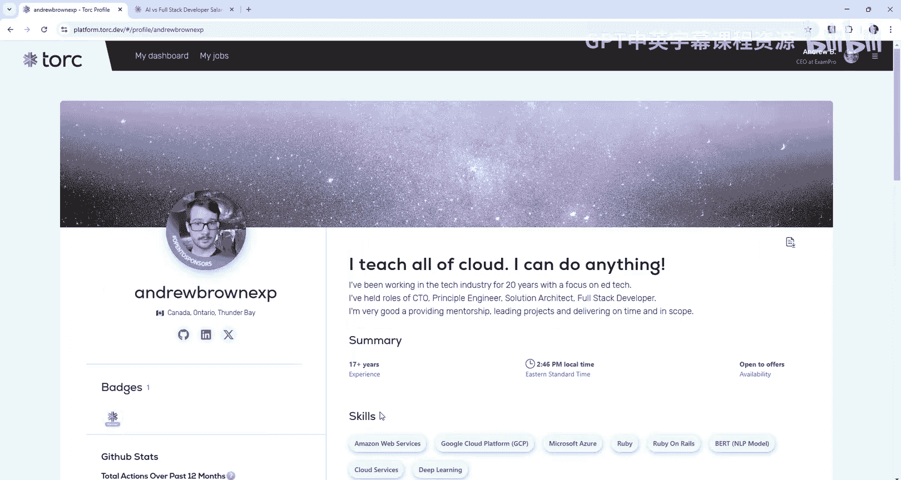

So here that is the start of it。 But yeah， there we go。

