# ExamPro《生成式AI训练营｜Free GenAI Bootcamp》中英字幕（deepseek - P42：-42-開発者が責任を持ってAI技術を活用するということ＂ - GPT中英字幕课程资源 - BV1SFEWzLEab

皆なさん、こんにちは、私 から はですね 開発 者 が 責任 を 持 って ア 技術 を 活用するという こと。

と いう 題目 で ですね こちら のお 届け した いと 思 います、よろし くお 願い し ます。

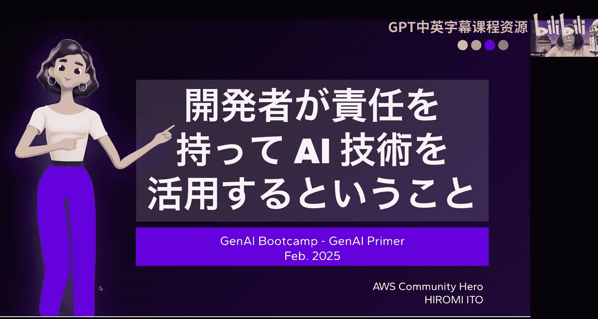

はい最初 に イントロダクション と して お 伝え させ て いただき ます。開発者が責任を持ってエーア技術を活用するということとは一体どういうことなのと思われた方もいらっしゃると思います。

まず、本題 に 入る 前 に 実例 を 上げ て 一緒 に 考え ていき ながら 進め た いと 思 って おり ます。

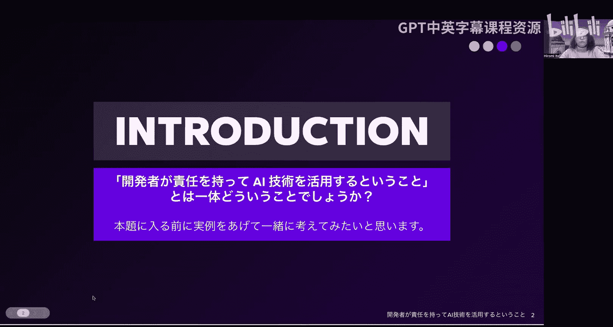

最初にですね本セッションでは、これからの開発者がを責任を持って活用するために、最初のステップとして理解すべきアイガバナンスの基本をお伝えします。

この 考え 方 を 学ぶ こと で より 良い 開発 が できる よ うに なる こと を 願っ ています。

もしで すね さらに 深く 学び を 続け たい なと 思 われる 方 は、各 分野 に 特化 した リソース が 豊富 に あり ます の で、興味 に 合わせ て 探求 して みて ください。

きっかけ に な ったら はい、非常 に 嬉しい です。

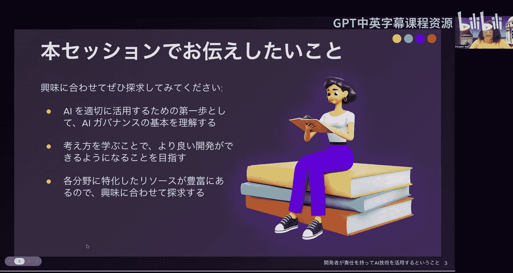

はいでは戻り ます。実例ですね2018年のロイター通信で発表された記事になりますアマゾンが採用打ち切り、女性差別の欠陥路呈でを例に挙げますご存知の方もいらっしゃるかなと思いますアマゾンがですね採用システムアマゾンが開発した採用システムがですね。

特に女性 候補 者 を 評価する 際 に バイアス を 持っ て いたこ とが 報じ られ て、います。

エーアイは過去十年間にわたる履歴書データを学習した結果、男性が多くを占める職種に特化して最適化され、女性の応募者が評価されにくい傾向が生じましたとこちらには記載があります。

それ で、アマゾン は この アイ システム を 運用 停止 して 再 設計 を 検討 する ことに なり ま した この よう なこ とが 報じ られ て おり ます。

これを受けてですね技術を社会に実装することの影響力の大きさだったりとか、それを適切に運用するための倫理やガバナンスがいかに重要かを強く感じます。

で、まあ問題点ですね問題点があることに気づくことができて、まあ再設計を検討することができたこういった締めくくりであのお伝えしております。はい再再設計を検討することができる。

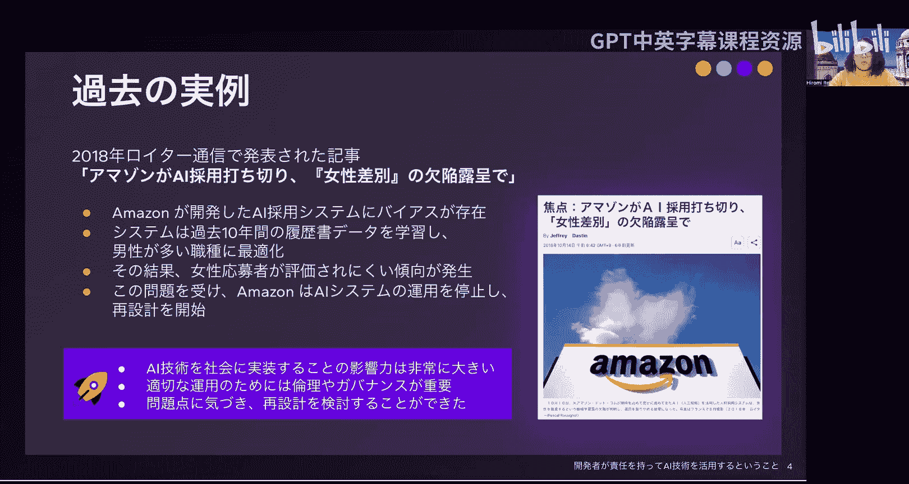

これ は 素晴らしい こと ね。はい。ここでまあ、あのその本題に入る前ですねご紹介くれました私、伊藤博美と申します。よろしくお願いします。

はいエダリスコュニティヒーローとしてこのような素晴らしい機会を与えていただきました。ありがとうございます。

2014年以来ですね日本だけではなくてですねは国内外問わずダスユーザーグループを中心としてテック系のコミュニティのファウンダーだったりとか運営登壇など活動を積極的に行っています、よろしくお願いします。

で は、本題 に 移って まいり たいと 思います。まず 一つ 目 で、すね  ガバナンス 基本 概念 と して お 伝え させ て いただき ます。

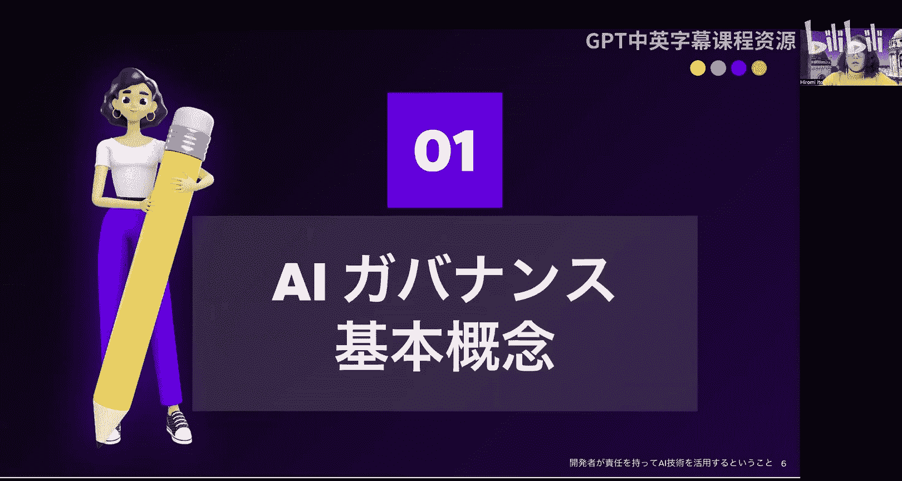

イガバナンスとはねガバナンスとは簡単にお伝えしますと安全で公平なア技術を用いたサービスやツール、プロダクトを作るためのルールや考え方になります。

これ を 意識 し ないと 冒頭 で お 伝え した よ うに 予期 しない 影響 を 与え て しまう 可能 性 が あり ます。そして で、すね 開発 者 とし ては？

これを未然に防ぐためにエアイガバナンス取り入れる必要があってですね とても重要なポイントだと思います。はい。

続いて で、すね アイ ガバナンス に おける 基本 的 な 原則 につ いて お 話し いたし ます。

まず透明性で、すね アイ が どのよ うに 意思決定を行っ ているのか、開発者や 利用者 が 理解 できる こ とが 重要 です。

例えば、 が なぜ 特定 の 推薦 を した のかが ブラック ボックス に な って しま うと 信頼 して 活 用する の が 難しく なり ます。

そのため にも、説明可能なアな どの技術 を 活用 して、意思決定プロセスを 明確 にする こ とが 求められ ます。次 に 恒正性 ですね。

アが バイアス を 持た ず、すべて の 人 に 公平 な 結果 を 提 供する こ とが 大切 です。

例えば、採用やローン審査にアを活用する場合で、すね特定の性別や人種に不利な結果を出さないようのデータの偏りをなくす取り組みが必要になってきます。

三つ目は説明責任義務ですねアイが生み出した結果に対して誰が責任を持つのかを明確にすることが求められます 例えばエーアイが誤った判断をした場合、それを修正する仕組みがなければ、問題は解決しません。

責任 の 所在 を はっきり させる こと で 安全 で 信頼 できる アイ の 運用 が 可能 になっ てき ます。

つまり で すね エーア を 適 切に 活 用する ため に は、この 3 つの 原則 を しっかり 考慮 して 実践 する こ とが 重要 になっ てき ます。

はい、続いて で、すね 開発 者 の 役割 ね。エアイガバナンスは単なる方針やルールの設定にとどまらず開発者がシステムの設計や実装段階で積極的に原則を反映させることが求められてきます開発者は倫理的な側面を技術に組み込んで社会や利用者にとってですね安全で公平な結果を提供できるよう心がける必要があるかと思います。

はい。で 、はですね 続 いて 開発 者 を フォーカス に 当てた 話 に 移 って まいり ます。

そこではですね全般的にですねデータガバナンスやディスクの管理、イのライフサイクルなどを広く含んだアイの話を進めてまいりたいと思います。

ですので、のまあ昨今ですね盛り上がっているエルエルエムですね大規模言語モデルだったりとか画像認識に限定した話ではなく、引き続きイ開発全般における話をしてまいります。

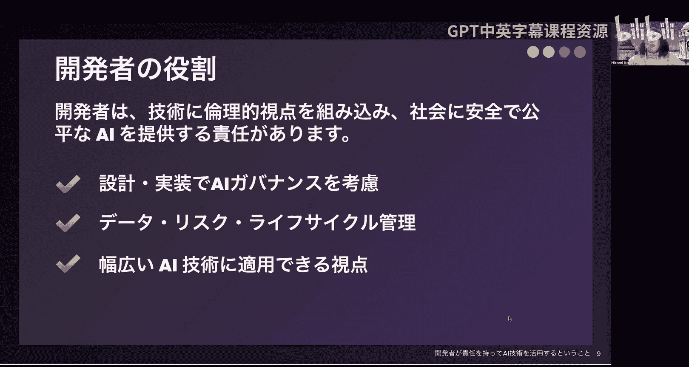

はじゃあ開発者が取り組むエアガバナンスとして、さらに進んでいきたいと思います。

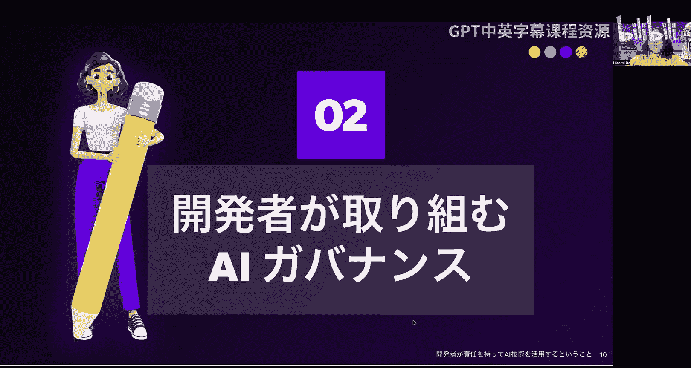

は、愛発者 が 気 を つける ポイント と して 大きく 4 つ 挙げ させ て いただき ま した 一つ 目 が バイアス の 問題 二 つ 目 が 説明 可能 性。

はい、三つ目が継続的な監視と改善で四つ目が セキュリティとプライバシー 大きくこの四つに分けて話を進めてまいり ます。

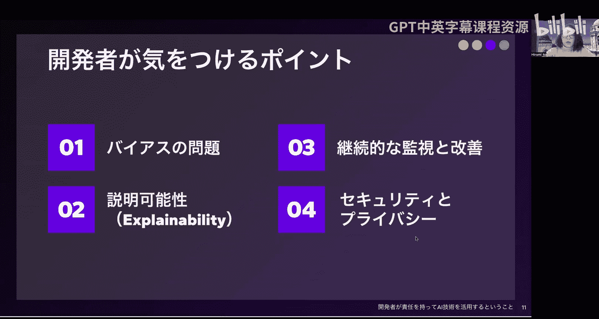

はい、まず一つ目ですねバイアスの問題ですバイアスとはですね冒頭に挙げた事例でお伝えした性別に偏りが生じたようにデータがバイアスを持っているとエアイの判断にもそのバイアスが反映されます。

これを防ぐためには多様なデータを収集して、常に監視することが大切です。ここ で はで すね バイアス 問題 へ の 対応 と して 2 つ 分け させ て もら って ます。

まず 一つ 目 で すね 多様 な データ の 収集 です。一つのデータセット に 依存せ ずにすね多様な 属性、性別や 人種年齢などなど カバーするデータを 収集しましょうとえさせていただ いております。

二つ目に定期的な監視と評価ですねデータに潜む偏りを検出してですねが偏った判断をしないように定期的に監視してフィードバックを行っていきましょうと定義させていただいております。

はい、バイアスの管理やですねあの監視、フォーマンス工上に向けたツールは多様です。でこれらを適切に組み合わせて運用することがま必要になってくるかなと思います。

様々なツールがでね市場にありますので、プロジェクトの要件だったりとか規模に応じて選定することが求められてきますので、皆さん状況に合わせて探索ですね調べたりとかツールを探してぴったり合うものを使っていただければなと思います。

はい。続いて で、すね 説明 可能 性 とい う ところ です。はい。え？エアイのですね判断をユーザーが理解できるようにすることは、信頼性に直結しますねで例えばクレジット審査のロ審査とかですねーアイではエーアーがなぜその判断に至ったのかを説明できることが求められたりとかします。

愛 の 意思 決定 プロセス を 理解。できるようにすること、つまりえと説明可能性ですねを確保することが重要です。

で、そのためにはあのここに記載のある二つのアプローチをお伝えさせていただければなとはい思います。まずは透明性のあるモデル選択ですね ブラックボックス的なアイではなくて、どうしてその結論が導かれたのかを理解できるモデルを選択選ぶことが大切です。

例えば、決定期や回帰分析などは、どの要因かどのよ うに影響したのかが明確になるために、透明性の高いモデルとして活用でき ます。次 にで、すねエーアイの 判断 理由を。

ああ、ユーザーが理解できるようにするためのツールを実装することも必要です。例えば。解釈 可能 な 可視 化 ダッシュ ボード。

だったりとかと特定の予測結果に対する影響要因を示す説明機能を用いることで、ユーザーが安信してエーアイを活用することができます。この よ うに で、すね。この よ うに ます。

エクスプレイナビリティつまりはと。説明 可能 なアですねを 確保する こと で、アイ の 意思 決定が より 透明 で 信頼 できるものになり ます。はい。では、続いていき ます 3つ目はい。

3 つ 目 はですね 継続 的 な 監視 と 改善 に なり ます。はい、エーアイはですねあの動き出した後も常に改善が必要です。

はい、特に運用中に変化が生じる可能性があるために定期的なパフォーマンスチックだったりとかアルゴリズムの再評価が不可欠です。エア システム は 一度 構築 し たら 終わり で は なく て で、すね。

他のシステムもそうですけど、運用中も継続的に監視改善していくことが重要で、すね のために二つのポイントを検討事項として挙げさせていただきました。運用 中 の データ の 追跡。

もう 一 つが 定期 的 な アップデート と ヒードバック。まず は運用 環境 で の で、すね アイ パフォーマンス を モニタリング して、データ の 変化 や アルゴリズム の 改善点 を 見つけるこ とが 必要 です。

例えば、予測 精度 が 低下 して な いか、バイアス が 発生 し な いか を 定期 的 に チェック し ます。

続いてですね継続的に改善できるプロセスを組み込んで、定期的にエアイを再訓練とか調整することが必要かなと思います。

新しい データ やで すね フィード バック を 活用 して、モデル を 更新 する こと で 精度 や 公平 性 を 保つ こ とが できる と 言え ま すね。

この よ うに で、すね エア システム を 継続 的 に 監視 改善 する こと で。長 期間 にわ たって 信頼 性 の 高い パフォーマンス を 提供 できる ことに なり ます。

4つ 目 で、すね セキュリティ と プライバシ です。はいエーアイシステムが扱うデータやえと結果。がまあ適切に保護されているということは、あとユーザーの信頼を築く上で重要かなと思います。

セキュリティ反や プライバシー侵害 が 発生 する と、企業 や 開発 者 の信頼 を 損ねる リスク が あり ます。エアシステムを安全に運用するためには、データの保護が欠かせないかと思います。

3つの セキュリティ 対策 を ここ で は実施作 で すね お 伝え できれ ば なと 思います。まず一つ目がとデータの暗号化です。

はデータは保存時や転送時に暗号化することで、第三者による不正アクセスを防ぐことができます。例えばエーエスなどの暗号化技術を活用すると安全にデータが保護できます。、二つ目にアクセス制御です。

データやですねシステムへのアクセス権限を厳格に管理して、必要な人だけがアクセスできるようにします。それ で不要 な データ の漏洩だっ たり とか 誤操作 を 防ぐ こ とが できる か なと思います。

最後にで、すねプライバシー保護で、すね個人情報を取り扱う場合、ジピなどの法規制に準拠した処理を行うことが求められ ます。

例えば、ユーザーの同意を得てですねデータを収集したり、不要な個人データを適切に削除することが重要かと思います。

これ ら の 対策 を 実施 する こと で、ア システム の セキュリティ を 強化 して 完全 に 運 用する こ とが でき ます。はい。ではとあこちらはですねあのま補足としてと。

こちらで紹介するのは特に大規模言語モデルエルエルシステムに込み込む上で、今特に対策が求められているプロンプとインジェクションについて取り上げさせていただきましたはい。

エーアイシステムに対して 悪意 のある 入力 を 防ぐ ために、プロンプとインジェクション対策 に対する。あ、失礼とプロンプトインジェクション攻撃に対する対策を講じることが重要と言われております。

はい、これによってシステムの挙動を不正に並行されるリスクを減らすことができます。はいここではですねプロンプとインジェクションの対策の実施ということで3つ挙げさせていただきましたいまずは入力検証をですね不正な入力を排除するために厳格なチェックを行います。

例えば、特定の攻撃パターンを検知して、エーアイに悪影響を与える入力をブロックします。はいと次にですねあのサンドボックスの導入です。外部操作を制限することって、安全な環境を確保します。

で、例えばとエーアイが意図しないエーピーアイやシステムにアクセスできないよう制限をかけることで、えと悪用ディスクを軽減。できます。軽減するようにいたします。

はい最後にモデル監査ですねーアイの集中力を定期的にチェックしてですね不正な動作を早期発見します。例えば、特定 の プロンプト で 異常 な 回答 が 出 な いか を 継続 的 に 検証 し ます。

はい。ここではですね具体的なですねはいと対策の方法だっ たりとか、あとはですねと。ま、具体策を講じる必要性の有無についてですねまあのモデルによって大きく異なります。

同じ事前学習済みのモデルを使ったモデルでもですねのエスエーで振る舞いのチューニングが独自に施されてるためですねの特性に応じての対策を実施する必要があります。こちらについてはご理解いただければと思います。

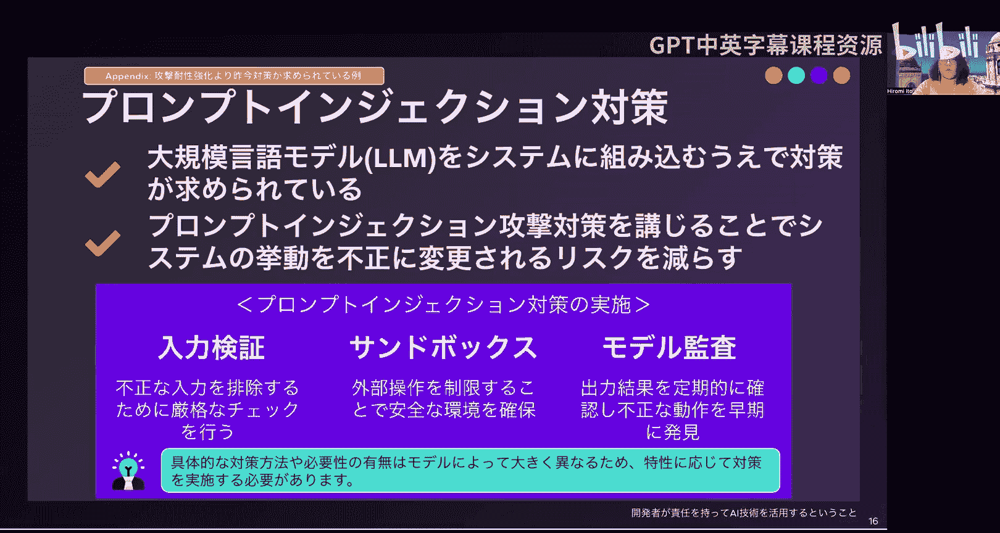

はい。とこちらはですね開発者が考慮する開発プロセスとして三つに絞ってみましたい一つ目が設計段階でのガバナンス統合ですね二つ目がモデル選定と開発の進行管理三つ目がリリース前の検証等テスト。

はい、まず一つ目ですねエーアイシステムを設計する際にバイアスの回避、データのセキュリティ透明性を早期に組りみ込むプロセスです。

はい、こちらはですねあのし初期の設計時にあのデータ収集方法や前処理の段階でバイアスを取り除く手法。を組み込んだりとかあとまたエーアイのですねあの意思決定プロセスが透明であることを確認するために説明可能なエーアイのアプローチを適用しましょうとまあこの部分の一つ目のプロセスですねはいで二つ目ですねどのようなアルゴリズムを採用するか。

はい、エーアイの学習プロセスの評価基準ですねを設定しましょうというふうに記載させていただいております。適切なモデル選定を行うためにエーアイが提供するインサイトの透明性を保ちながらどのアルゴリズム。

をまあ目的に最も合致するかを評価していきます。で、定期的にモデルのパフォーマンスやバイアスのチェックを行っていきましょうとそういったことをあの進行管理として書かさせていただきました。

はいと最後にですねリリース前の検証とテストおなじみかなと思いますがい実際の運用データに基づいて弊のパフォーマンスを検証してセキュリティやプライバシーのリスクをテストしましょうということです。

特にですねバイア性セキュリティリスクに対するストレステストを実施して想定外の挙動を防ぎましょうと。こちらで記載させていただいております。はいご参考ください。

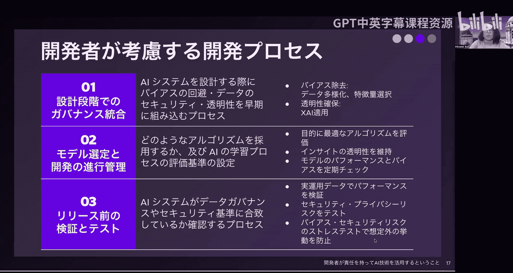

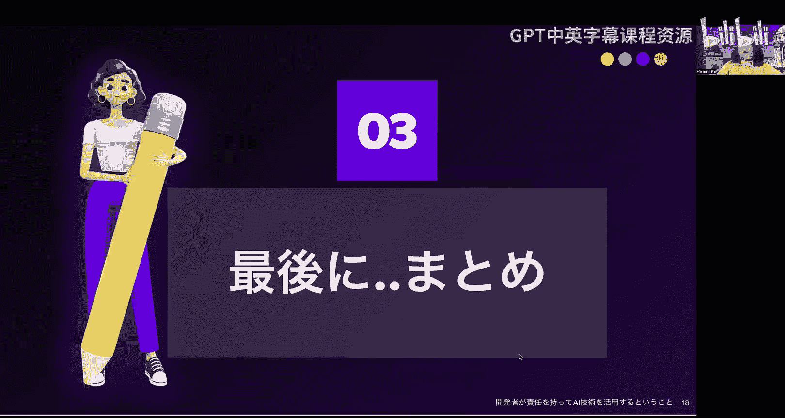

最後 にで、すね はいまとめ と させ て いただけ です。と思います。はい。ここまでですねエーア技術を安全かつ責任を持って活用するための重要なポイントとしてお話させていただきましたはここではですね最後にまとめとして開発者が意識すべき三つの点をお伝えしていきます。

はい、まず一つ目がエーアイガバナンスの重要性で、すねはい、エーアイを活用する上で、透明性、法正性、説明責任義務がまあ欠かせません。

これ ら を 意識 する こと で 信頼 される エア システム を 構築 でき ます。意識 して いき ましょう。

はい二つ目開発者の役割ですね開発者は設計や運用において倫理的な配慮を行ってですね常に改善の責任を持つことが求められますがいとしない形で誤った判断をしないよう適切な監視と調整が必要ですねなので責任を持っていきましょう。

最後に社会への影響です技術が社会にどのような影響を与えるかを理解してでねその責任を果たしながら開発を進めることが大切かなと思います特に誤った理用だったりとかバイアスによる不公平な判断が生じないよう注意することが大事かなと思いますので、責任を果たしながら開発を進めていきましょう。

はい。エアイ技術をですね適切に活用して、社会に貢献するために、私たちがですねどのような意識と責任を持つか持つべきかを考えることがまずは第一歩大切かなと思いますこれからの技術発展に一緒に役立てていけたらなと思います。

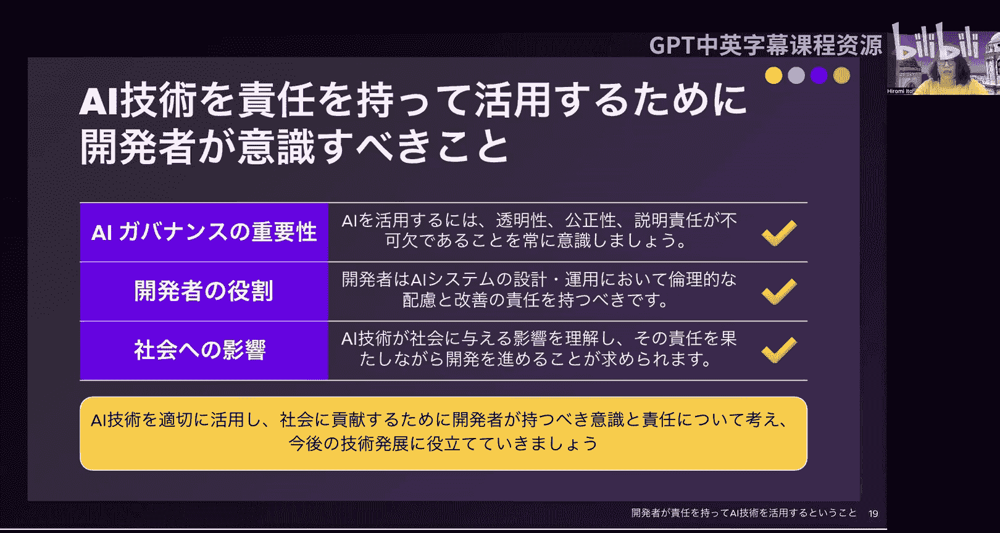

はい、ご清聴 ありがとう ござい ま した。