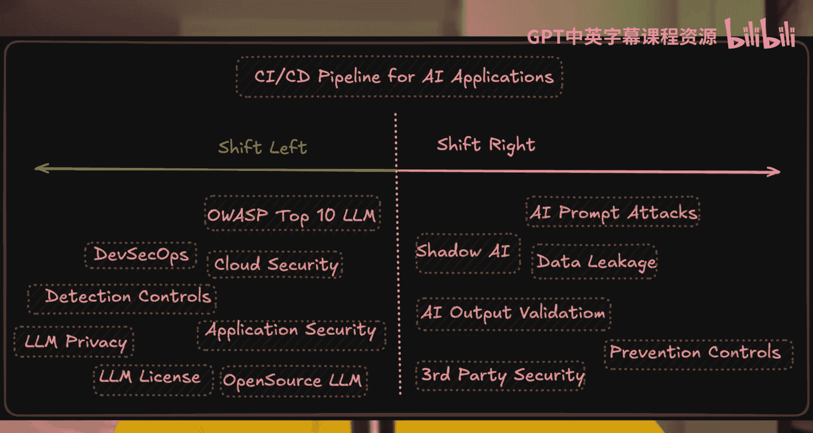
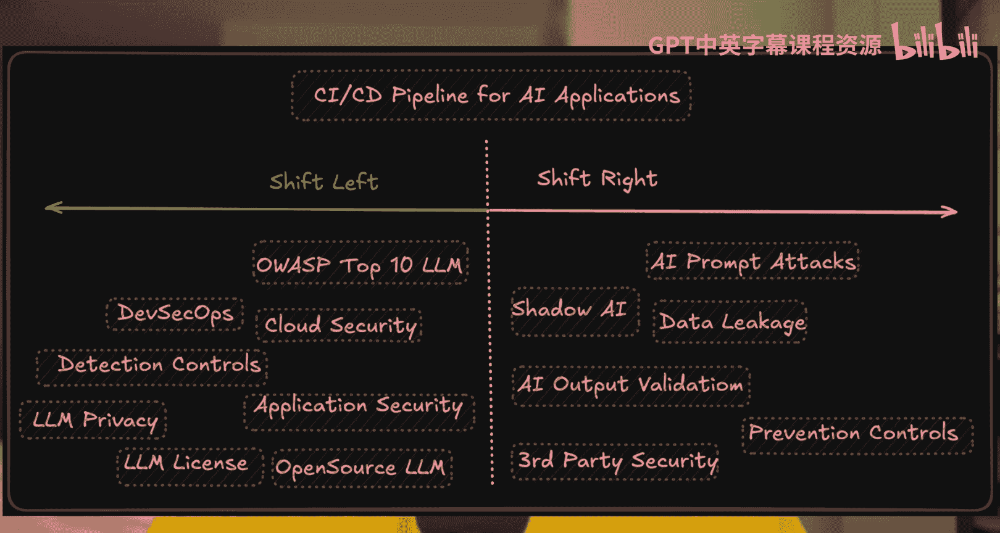

# ExamPro《生成式AI训练营｜Free GenAI Bootcamp》中英字幕（deepseek - P43：-43-TOP 2 AI Security Mistakes to Avoid in 2025.zh_en - GPT中英字幕课程资源 - BV1SFEWzLEab

There are only two ways to look at AI security。 And if you're not looking at these。

 youre probably leaving yourself wide open for an attack。

 The first way is to identify which area are you more concerned for cybersecurity。 For example。

 if you already have a lot of AI applications are running in production。

 What you're really concerned about is runtime security of AI And there's a whole indepth video on that Ill do later。

 but that's essentially what to about that's the right side。 Now that is different to predeployment。

 which is on the left hand side， which a lot of us have done for a long time。

 if you are using AI applications， then what you concerned by is primarily the entire pipeline that's being used by applications that you're deploying with AI capability。

 Now either these applications are making A calls to other existing LM models like open AI and troic deepse maybe or you may just be trying to integrate security into an application that is natively using AI within it。

 And perhaps requires an understanding of O top 10 for LM models for you to know security or that better I there a third way to secure AI。

 let me know in the comments if you're。

Deep into any of these topics。 Otherwise， keep subscribing and following for more AI contents you can make smart decisions using AI for your organization。

 I'll see you next video， peace。