# ExamPro《生成式AI训练营｜Free GenAI Bootcamp》中英字幕（deepseek - P44：-44-Generating PR Review with CodeRabbit.zh_en - GPT中英字幕课程资源 - BV1SFEWzLEab

Hey， this is Andrew Brown in front of me。 We have code Rabbit。

 and we want to get started here by creating a new free trial account。

 I want to point out that it's a 14 day free trial。 There is no credit card required。

 and it's a two clicks sign our process。 So you are going to need to use either your Github。

 your Gitlab or Azure Devops account because if it does Github。

 it's gonna to be able to do Azure Devops as well。 I'm going to use Github here today。

 let's jump into it。 And so we can go up here in the top right corner or here in the middle to get started。

 And we actually before we do that， let's just take a quick look at pricing。

 So imagine we really like this product and we want to continue on with it down below here。

 we have our our free free tier right now， which gets us summarize summarizemarizations for each poll request includes 14 days for usage of the pro plan。

 So this is what we're getting when we sign up for 14 days。

 But even you know if you do not plan to continue right now with code Rabbit。

 youre still going be in this free tier。 and then you can decide later if you want to up。

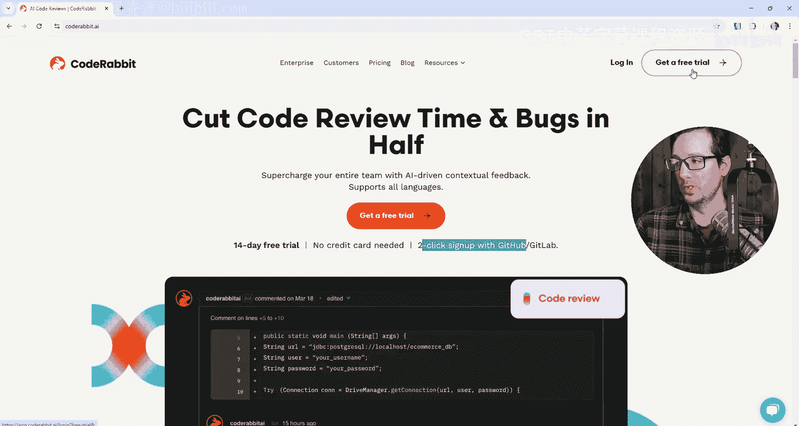

Great so there's no reason not to sign up if they have a generous free tier with something。

 But let's go ahead in the top right corner and get our free trial going。

 you'll notice we have Github Gitlab Azure Devops， as I said before and B bucket Good to see that that's in beta bit bucket obviously being very popular because a lot of companies use JRA and end up using bit bucket but again today I'm going to use GiHub。

 it looks like they also have selfhosed。 so that is also really good as well So if you're connecting to your own Gi server that is either Gitthub Enprise or Gitlab then you can do that as well。

 let's go ahead and sign up with Github and you'd see I have multiple accounts。

 This is my other account when I like to work between two accounts we'll go ahead and connect to my primary account。

 It's asking for some access read only access here and it wants my email Nothing too crazy and we'll go ahead and set up our account So now that we're in here it wants me to create a new organization I already have one called exam pro code will'll go ahead and hit continue and I am set up Now I don't have any repost。

Connected or anything else。 but we will do that in the next step， okay。Allright。

 so we are inside of code Rabbit and you'll notice right away。

 there are some features that are locked currently and that's because we have yet to start our subscription of our pro plan。

 our 14 free trial。 So if you look in the top left corner。

 just make sure that you have the credit organization。

 it does appear to bring it all my organization。 It's not a big deal for me。

 but know I noticed when I first came in here it was on monster box。

 I want to be on exam Pro but yeah if you go over here。

 if you click this you'll see that says unlocked by upgrading pro plan。

 they say it includes a 14 day free usage of the pro plan。

 So no credit card required and we're going to make sure they make good on that promise。

 if we hit upgrade now here， it's going to want us to pay because that is just the flow of these links here。

 however， if we go down here to subscription here it says get started down for free。

 no credit card required， just choose a monthly or annual plan below select the number of seats and click subscribe you can adjust or cancel subscription anytime ready to get started。

 So no credit card required。 That's what it says。

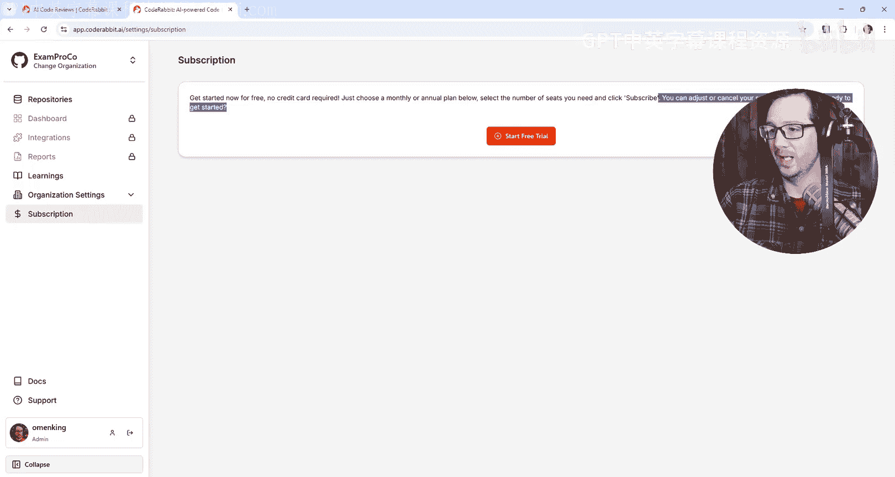

So go ahead and click it， we have two options U or Indian rupees， we click this button。

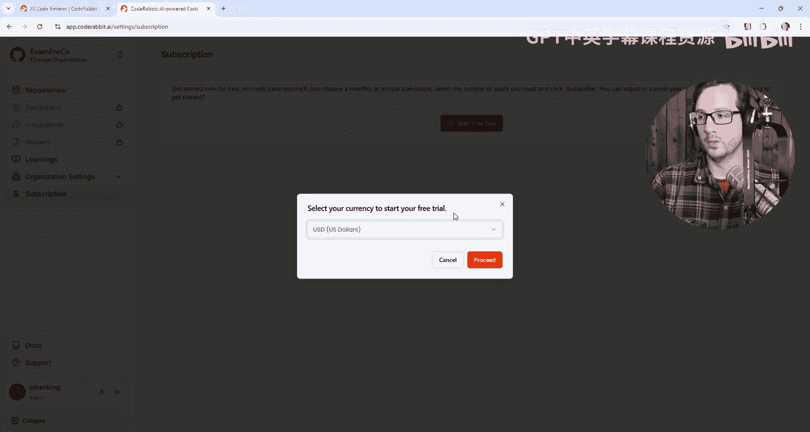

Right。And right away， we see start a free 14 day trial with code Rabbit。 No credit card required。

 It repeats it again。 I'm gonna make it a little bit bigger as I know the font's a bit small。

 But again， no credit card required。 get fulllaxis and posttri。 It's only 30 day30 a month。

 contributing developer， no commitment， cancel any time。

 So they're making really clear that it's easy to get started， easyy to cancel。

 And we just have to choose our seats。 So I'm just doing one here today。

 But depending on how many folks you're using。 You'll choose more seats。 I think it's。Yeah。

 it's$30 per month per contributing developer。 So it's gonna be $30 per person you add to your team。

 So it depends on the size of your team that needs to go in here and to generate out code reviews If you're a small team。

 That's just one person。 If you're larger than you need more people involved。

 let's go down below here。 It says you will be charged after the 14 day trial。

 But notice that I'm not entering any credit card。 And so I think that this is just a。

I missnomer in terms of the flow。 probably probably it's， it's hard to code that out。

 I I make payment gateway， so I understand what that is there。

 but we'll go ahead and proceed to check out。 we're gonna fill it a little bit of information。

 So this is optional to fill in any of it。 But I'll go ahead and fill it in here because it's not a big deal。

 We'll say Andrew Andrew Ex Pro dot co。 We'll say exam Pro Tra Inc。 as that my name of my company。

 We'll go ahead and hit next。And now it wants us to add a billing address and the question really will be。

 will it ask me to provide a credit card because there's no credit card， no big deal。

 So I'm going to go ahead and fill in our business address。

 And if you ever wondered I'm buying a church， so it's public information where my business address is but St。

 Andrew's church。In Scr， I don't even know the address myself， to be honest。

 And so there that's our actual headquarters unusually enough。

 And so I'm gonna go ahead and grab that in here。😊，And I'm going to。Drop this in here。

 Don't even have to put my phone number in， which is really nice。

And so I'm going to see if it can autocomplete to my town， it can， there we go。

 fills in the rest of the information， and I'll put it in here exam Pro training innc。

And I'll go ahead and hit next。And so we have our information for billing if we choose to attach a credit card。

 I'm going to go subscribe to code code Rabbit， light or Pro plan。

 we want to try out Pro because why not？And now we upgrade again， no credit card it added。

 and there you go。Alright， now that we have our subscription turned on and the locks are gone。

 we can go ahead and add a repository So I'm gonna go ahead and click repository here。

 I'm going go into my Omen King account， and I specifically want to add the boot camp repo here because I'm actively working on it and it's probably the best candidate where I'll be using it throughout the week and getting full full chance of showing a really good example if I come back here with it。

 but I'm going go ahead and authorize this specific repo you can't authorize all。

 but today I'm just going to you know be good about。What you call it security and and only do that。

 we'll have to log in with GiHub mobile。 So just give me a moment。

 I gotta get my phone out and confirm that。

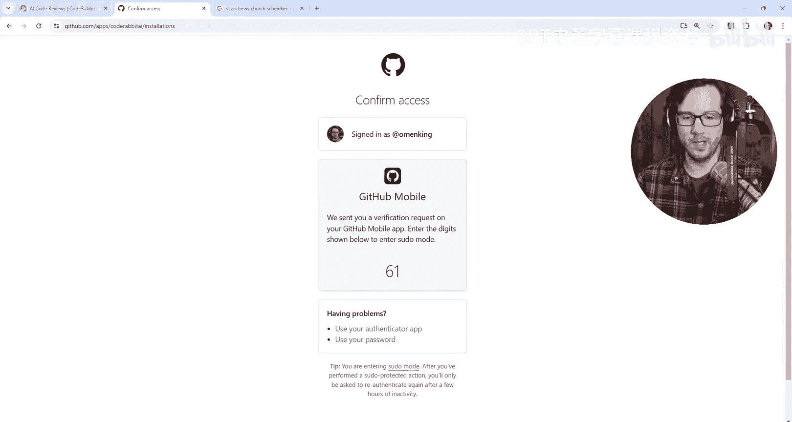

Al right， so just confirm。 it says complete your sign up。 So it's asking about my primary email。

 This is because my old company name was Andrew atmonbox com， but it's showing it here。

 My email is actually Andrew at exam pro do co。 But we'll go ahead and fix。

 I actually like that it asks that because I don't like the things go to my old one。

 even though I've updated my email。 How did you hear about this。 Well， actually for code Rabbit。

 I wanted to see if I could use it to review my students' work because they're submitting work。

 And I got to do so many， So it'd be really cool to be able to get some summaries。

 but I gonna say referred by me。 how do I do that。 And I'll just say， you know。😊。

I was looking for AI code reviews。I was looking Well to say I was looking。

 there's a bit of a limit on what I can type there。Oh， enter a valid source。 We'll just say LinkedIn。

 Sure， why not LinkedIn。 Actually， can I just choose LinkedIn here， We can。

 and then we'll proceed forward here。 So congratulations。

 Coderait is now installed in the reos you've chosen。 createate a pull request， as you usually do。

 And coderait will monitor the chosen reos。 and I actually review any new pull request。

 So what we need to do is get up a very simple pull request now。

 And so I do have the repository here in Winsurf。 You can use whatever you like， but I like windsurf。

 And I'm actually going to open， make sure I open the entire folder here， which is here。

 And let's say I want to add a feature。😊。

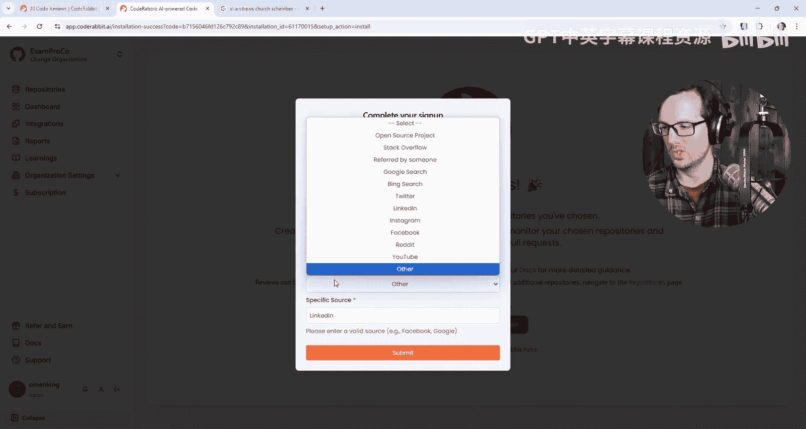

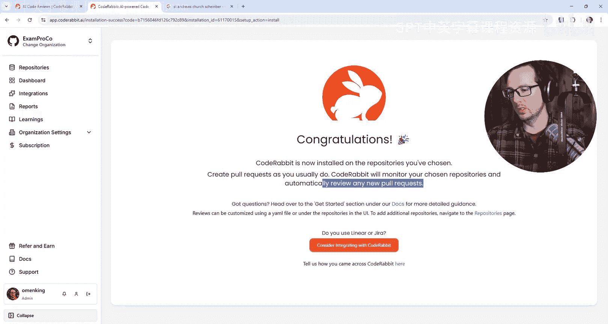

I'm going to use generative AI so that we can just find out find out quickly what that looks like。

 but I was last working on this listening comprehension。

 And in here I implemented integration specifically with AWS。

 And so I have a limitation of voices that I have here。

 And so what I'm thinking is that what I'm going to do is ask it to modify the code so that it includes another source for Azure right And so I'm playing the coder and the PR reviewvere in this case normally you wouldn't know what's going on here。

 but I'm going to just quickly implement this and I'm just going pause it here and we're going to just skip over where I actually have the code implemented。

Actually， before I skip ahead， I just want to show you what I'm coding。 So basically this thing。

 what it will do is it will take a formatted transcript in a very specific format and it will generate out multiple voices and then stitch together。

 But the problem is that I have a limited amount of voices because I'm just using eight of us and I'm using Japanese and they have limited voices for it So I'm asking it to extend this by including I know it's really hard in small to read here。

 but I'm saying bring in Azure voices and Google cloud voices and try to make one uniform API here。

 So I'm gonna go ahead and generate that。 And then we will speed up。

 I'm gonna to put it to write mode be back in just a moment。😊，All right。

 so here we have some changes and we can see what Windsor had changed， but。

I'm not gonna thoroughly review it。 I would rather commit this and see what code code Rabbit picks up on the other side here。

 If this is gonna be PR， then， of course， it has to be in its own ticket。

 I kind of forgot before I started this to do that。 So what I'm going to do is go get at all。

Right Im going to get Sa save。For a moment here。And I'm going to make this a new branch。

 I'm going to go get， check out hyphen M， and this will be multi。AR， because that's what we're doing。

And then I'll do whoops here。Multi ASR， good check out， Oh branch， hyphen B， multi multi ASR here。

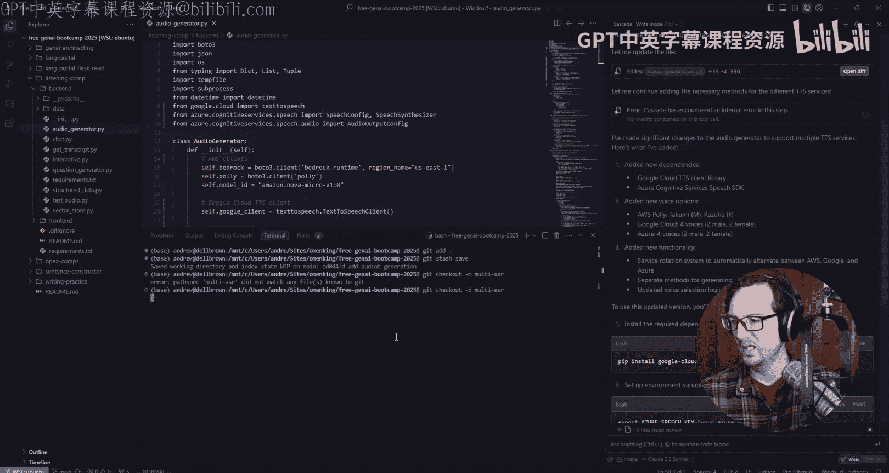

And now we are checked out in this new branch， then what I'm going to do， and by the way。

 I realize the fonts a bit small， so I'll bump that up so that folks can see what I'm doing。

But now that we have our multi ASR branch， we need to push it， but before we do that。

 we need to do gi staash apply so that will take off the top of the Git staash。That there。Okay。

 so now we have that modified audio generator。 and then I'm gonna I'm gonna go ahead and now do my commits。

 So'll say git at all。 There's only one file being updated here。 but let's say git hyphen M。

 And this is gonna be update the code to support multiple ASR systems。诶。

And I'm not going to say exactly which ones because I want to leave that alone for now。

 so we'll go ahead and we've now pushed that upstream。 and so if we go back over to GiHub。

 we should now be able to create ourselves a PR。 so over here。嗯。You know。

 we go over to our actual repo。We should have that there and be able to trigger it。

 So I'm gonna go over into free。Gennyi bootc 2025， and we'll go over to pull request here。

 and it says free Jennyi Oman King。 So that's not for me。 That's somebody that created this。

So I think somebody just made a mistake here。 but we'll go ahead。 I'm gonna make a new pull request。

 Butm just give me a moment here。'm just gonna close this one out here。 Alright。

 so I got that one of the way。 We're gonna create a new pull request。

 and we created that in a different branch。 So if we go here， we should see our branch here。

In this one here， I could have swore I pushed it， did I not， if I did not I push it。

 let's go back over to here。And。Oh， we committed it that。 We didn't push it upstream。

 So we'll do this。 get push。 And I guess I've never，'ll。

 we'll have to run that once to push it upstream。 So there we go。

 And so now if we go back over to here， we should see。A branch。Right。

 so I'm just looking for that tab Here we go， and we'll give this a hard refresh。

 And so now if I drop this down， we have our multi ASR option here。

 So we'll go ahead and create our pull request。Okay。

 and notice that I have not described anything here。

 I'm just going to go ahead and create this pull request。 So the question is， like。

 will this work if I'm the only one that is committing on this。

And so that's what we're going to need to find out here。So I guess the next question is like。

 where is code wrap we going to appear， And I don't know。 So give me a moment to figure that out。

 Okay， one thing I'm noticing is that on my repository page just not listing the repo。

 but I thought I added it。 So let's go back and take a look and make sure we added it again。

 because maybe there was a small issue on my part。 And so we're in here。

 and it does have readrite access。 And I selected specifically this repo。

 So it does have access to it。But I guess my question is like， why don't I see it there。

 so just give me a moment to figure that out， okay？I just have to log back in here to get back in。

tryry to keep the tab open。 It'll save you a bit of time。 But， you know。

 what I'm expecting is to see that repo here， and I don't。 So just give me a moment。 Okay， you know。

 I was thinking about this a little bit more。 And right now， we're in the exam pro co repo。

 and that account is specifically under my personal account。

 So I'm thinking that it's showing repooss that are specifically to this organization。

 So if I go over here and switch it over to Oman King。Then maybe we'll see the repo。 Oh， there it is。

 Okay， so now we can see it。 if we click into this configuration， let's see what options we have。

 So here is， we can choose our review language so we can use a different language if we want。

tone of instructions。 If we want to access early features， enable the free tier， which we are on。

 enable free tier features for non for users not on the paid plan， which is really nice。

 We can see we have a lot of options here for changing what it is that we want to see。

 But I guess the question is， why am I not seeing the integration and running。

 Now I did notice that I had nettlify enabled。 And so I'm not sure if another extension might interfere with it。

 another question is is this not working because the person that's making the PR is the same person。

 And so that's what I'm trying to determine right now。 but at least we found where the repo is。

 And so we just got to be really careful about that organizational switch to find it。 But yeah。

 just give me a moment to try to figure out why we're not seeing that there。

 but at least we confirm that coderabbit is definitely definitely has access。

 One thing I had is maybe what we need to do is add reviewers because right now there are no reviews。

 And so I'm wondering I can add Baco here。 But I guess the question is like。

Could I add this code rabbit as a reviewer。 And so that's kind of what I'm wondering about right now。

 Also， if we go to settings， I don't think there's any options over here to set it。 And so again。

 I have two， two questions。 if I commit my own code。

 will I get a if I'm the person that commit the code。

 will it still generate out because I'm the owner of the account And the other part is。

 do I have to add as a reviewer and there's additional configuration。

 Now I did go over to the repo here and I checked as best I could for any options to see if there's anything we had to configure。

 But all the default seem fine。 and I can just keep thinking that maybe that nettlify was an issue。

 right， So what I'm gonna do， just to rule it out is I'm gonna go ahead and delete out this pull request。

 We're going go here and I'm going to close this out。Okay， as if it never existed。

 and I'm also going go ahead and get rid of that branch。 And now I've uninstled nettlify。

 So now there should be no conflict with it。But we will go and view all branches here。And。

We should see and here， oh， this is Oman King。This is the omen can。 Hol on a second here， Oman King。

So maybe this is where I got my confusion because there's this repo here。

I wonder if I added the PR to the wrong place。That might make sense。

 So let's go ahead take a look here and try this one more time。 So I'm gonna hit new pull request。

 You got to pay close attention to what you're doing to make things work。

 But notice here's going from Oman King to the exam Pro repo。 So that's my problem。

 I want to merge it into the current one。 And that makes total sense why it didn't trigger。Okay。

 so we're gonna to choose multi ASR。 And so now it's going to go from this way to that way。

 I'm gonna to go ahead and create that pull request。 So I'm not filling in anything。

 Now you're supposed to like if you're the person that is submitting this pull request。

 you're supposed to do it。 But if you don't。 and a lot of people are lazy。

 that this is where I think code Rabbit is going to help out the director of engineering。

 the CTO the senior the senior developer that's responsible for reviewers to review stuff。

 So go ahead and create it。Okay， and so now I'm hoping that we're going to see code rabbit appear here because it does have access to this repo。

 we'll give it a nice refresh。 Oh， there it is。 It started already。

 And we can see it says it's currently processing new changes in the PR。 This may take a few minutes。

 and it can see there is a commit。 It's literally just one or two commits。

And we have some files generated here and says Jurassic Park would have been a lot shorter with me around。

 And is it what is it， I mean， that's okay， Like， it's fine that they put that in there。

 But I'm not exactly sure what it is for for For Min。 I thought maybe there was a  velocity of Rator。

 but now， I'm not sure。 but we will wait a little bit。😊，For this to go here。

 So I'll be back in just a few minutes and we'll see what we get， okay。All right。

 after a few minutes， we have our generation。 remember I did not put in anything here and so it looks like it's gone back and it's updated my summary。

 which is great because I was lazy and I did not put something in there。

 So it says new features expanded the text speech capabilities with integrating additional providers with Google Cloud and Azure enhanced voice selections now offer multiple voice options for richer audio experience a flexible introduced。

 a flexible service rotation mechanism to seamlessly utilize available providers that sounds very accurate to what was coded there。

 the pull request updates the audio generator class to support additional text speech services alongside AWs Poly。

 it now initializes clients for Google Cloud TtS and Azure TtS using their respective SDks and environment variables The constructor is modified to set up these new clients and their voices so that makes sense here down below we can see what follows changed and it's provided in summary what was changed we have a sequence diagram Is this useful for me。

 I don't know let's take a look here。We have the audio generator， it has an initialization step。

 which is true。 it will update the voice dictionary。

 that is true it'll set up the TtS service here if we generate audio if AWs as likely it goes AWs polyly if it goes to TtS Google TtS it goes there if it goes to Azure TtS。

 it goes there and I would say that's an accurate description and it shows us the pipeline so。Yeah。

 I' would probably have to use it a bit more to really determine how useful this is。

 but this was a thing that I coded very quickly。 and well it generated out quickly。

 and it does give it a clear explanation。 I don't care for the poem， but we'll read it anyway。 Oh。

 what a hop code today。 The new voices to sing in a playful way AWS Google aszure're joined the choir rotating tunes that never tire。

 So that's fine。 We'll go over to hear。😊，And so we have that and we have tips。

 Now I understand that somewhere here there is an agent that we can speak to。

 and the other thing with Code Rabbit is that it can learn So the idea is that it's not just that it's generating this out。

 but I believe over here we have learnings and it can learn things and store insights So over time。

 it gets better at reviewing because of course you could generate this with LLM。 but again。

 they've coded the agent in very specific ways to bring you the sequence diagram to give you the summary。

 but it's more gonna to be the benefit over multiple PRs and commits that you're gonna to get that advantage。

 there's some integrations here。 So it'd be interesting to see what it could do with Jra。

 I don't have Jra connected with this today。 I do know Jra quite a bit。

 So that would be really interesting to find out about that。 I'm not sure what reports can do。

 but I believe this would only be useful if we have multiple PRs but here it says the report will be generated。

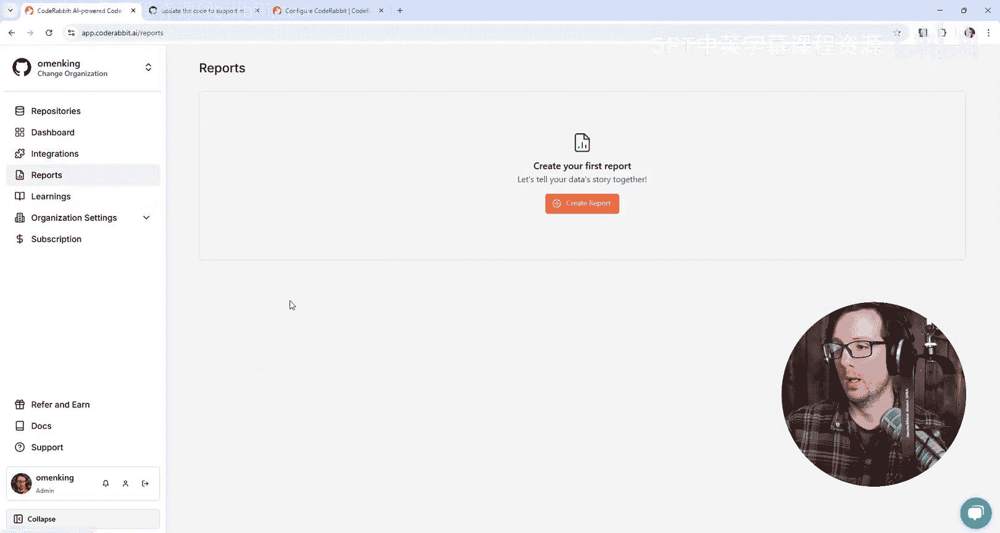

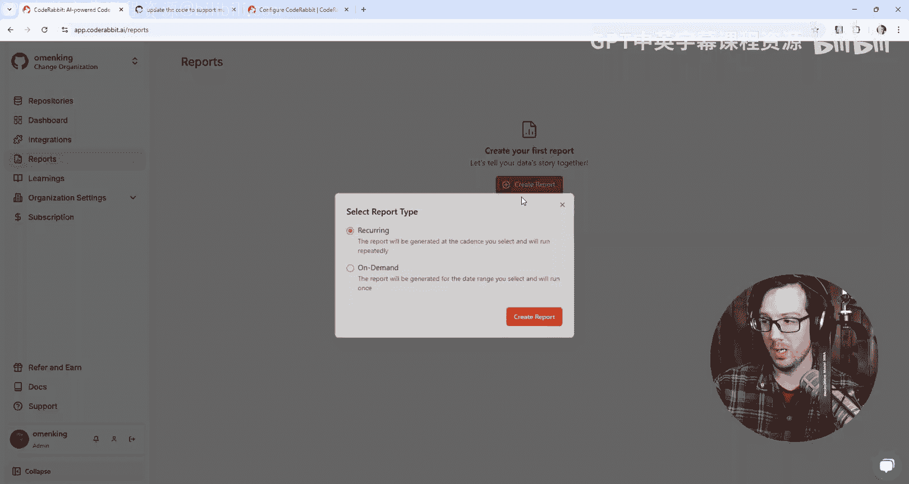

The can of select will do on demand here and we'll see what we get。 again。

 we might not get useful data just because we only have one one date range。

 we'll just say example report and see what we get generated down below it says daily standardup report。

 Oh this actually could be good because imagine you have your team。

 and this is a hard thing is getting your team to tell them tell you what they did this to me as a CT。

 this is what I want because I wanted to know what all my developers doing and and what they've changed。

 And so this could be really useful。 And looks like you can even push it out here。

 So once you set it up on a recurringring thing if you slackla discord Microsoft Teams。

 we use Microsoft Teams。 or just email then that could be really， really useful。

 I just want to see it generated to be honest， but it seems like it would take another day for that to generate out。

 and I didn't enter a discordinating。 That's right。 But I'm trying to think here。

 go group by repository and。

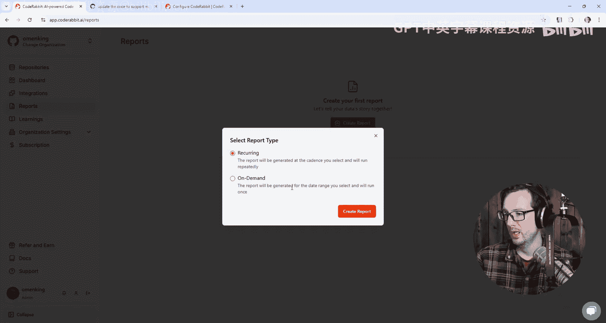

Subgroup none。 I'm just wondering if I can generate this on the fly here and really wants to go somewhere。

 So I'm gonna go down below。 I'm gonna enter my email in here because it needs something， right。

I will go ahead and save report。But this， this to me is really， really good， really。

 really good if you're managing multiple multiple developers。

I'm not sure how fast that will generate， it looks like that was pretty quick， I mean。

 we don't have a whole lot of data there。Let me go check my email and see if we have one。 Okay。

 Here's our summary。 So it says example report， developer activity。

 So here we have a PR updated the code code to support multiple ASR systems enhances the auto generator by integrating additional T TS services。

 So we have the sense there。 This will make a lot， a lot more sense if we had more contributors。

 But right now， again， it's a very simple thing。 Let's go back over to here and look at this just more carefully。

😊，嗯。And see the grouping because I could see the grouping be very useful because if you wanted a group by user saying。

 like， what did each person do， tell me that， or if you had teams， what did each team do。

 if you had very specific labels that you that you kept track your， I'm assuming it's in Github。

 That would make it really useful。 Or if you want to go by reos。

 Maybe you have multiple reoss that are being worked on。

 So you can kind of change the scope of what you want it to be。 And yeah， I mean， it's good。

 It's straightforward。 It makes sense。 And， I mean， that's all I want to show here today。

 it would be interesting to find out where the agent is。 I don't know where it is。

 There is this one down below here。 But I don't believe that's the agent that they're talking about。

 But yeah， there you go。 That is code Rait。😊。

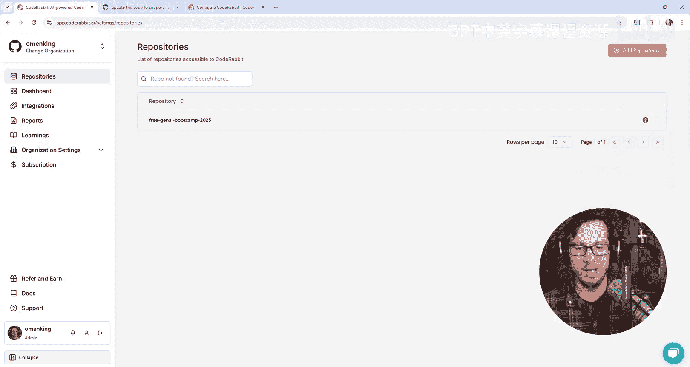