# ExamPro《生成式AI训练营｜Free GenAI Bootcamp》中英字幕（deepseek - P45：-45-OPEA Troubleshooting Handler.zh_en - GPT中英字幕课程资源 - BV1SFEWzLEab

Hey， this is Andrew Brown。 And in this video， what I want to do is get my mega service working。

 So we left it in a prior week before we go build up more mega servicesice。

 really should get this one working。 And since other boot campers were able to solve it。

 that means I should spend a little bit more time trying to figure out the output。

 And once that's solved， then I can go on and I can go make a more complex mega service for other weeks here。

 the question is like how do I run this because I forgot。 And folks might say， well Andrew。

 can't you just I don't know read your docs。 And maybe I can。

 maybe I have it all here if I did a good job here。

 But what I'm going to do is I'm going to CDd into my OPA comps directory into my megaservice。😊。

And I mean， if this is just a Docker file， it should just be Docker compose up， right？

And it should just work。There might have， we might have required because we're using llma 3。

21 billion。 We might have required to have environment variables in order to load it in there。

But I don't recall having to do that。 If we're using  lama， then the model。Oh。

 we went into and then pulled the model。 Let me take a look here， just a moment。All right。

 I'm looking around。 And so， yes， So we do have our Oma service running over here。

 So we have Docker compose all Oma server。 And so now remember is that we basically took。😊。

So this on the outside runs the comp。 And then this one is able to infer from it。 right。

 So this is not necessarily the mega service。 The mega service would need to， Well， actually， sorry。

 No it is because it it's utilizing the code within here。

 but it's not a mega service and that it's all containerized， which I'm hoping when we have。

Our friend James， who's really good a docker。 He can kind of help me out with this kind of part with it。

 So I guess what we need to do is run Docker compose up。

 And what that's going to do is run this part here。

 I think I had to manually go in and download it because it was eem。

 It'd be really nice to store that locally。 there's probably a way to do that。

 But I'm gonna wait for that to start up here。 And if we don't have installed。 I am in windsurf。

 So I might have to install the separately here。 But I go ahead and install Docker。

 so that will allow me to be able to debug and see things like that。😊，Okay。

 so now we have it running over here。 So what I'm gonna to do is I'm going to go ahead and just connect to this。

 So I'm gonna say attach shell。And I got some other stuff in here that is from another week。

 but I'm just going to go ahead and close them off real quick。

It is for a video you have not yet seen， and it's for the next week over。 I'll close it out。

 So I have a little bit more Billy to see what it's going on here。 And so， actually。

 we don't even have to shell it into it。 Do we， We just need to， I'll close up the terminal。

 We just need to， oh I didn't shut it down。 Did I know it's still running。 Okay， great。

 We just need to run these commands and make sure it's pullinging。

So what I'm going to do is make a new tab here。And we need to the pull the model。

Which will make the model pull down first。So here， and I realized the fonts a bit small。

It's really important to always revisit your code and make sure you can run it。

But here we have this curl， right， and。Are we missing the closing bracket It doesnn't look like we are。

Faaiil to connect to port 9000。Is this not running， Let's go back over to here。It is。

What part do we expose， Let's go back over to here， Docker composeose。And this says 8，0，0，8，1，1，4，3。

4。 So this is not port 9000。Maybe we changed it earlier。 So which port is it being mapped to。

 So in this case，80，08 is on the host machine that we can access for whatever reason these say 9000 up here。

 Maybe later on， we changed it to 9000 in the code。

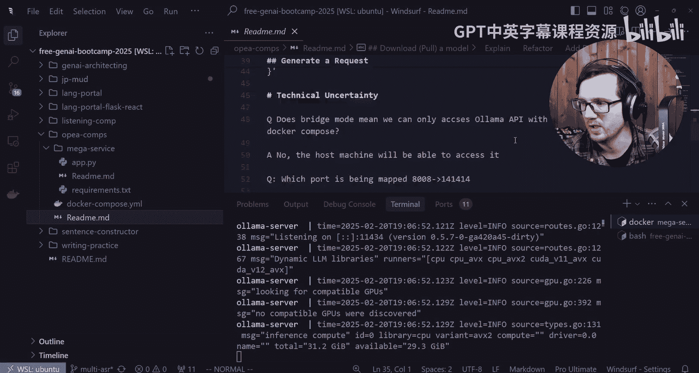

I mean， this one says 8 Oh yeah， it is 9000 over here。 service port。 Okay， so basically。

 what's happening is maybe my codes a little bit。 These are a little bit out of date because this one here is starting。

 obviously on this port。 But then over here。Why doesn't that one say 8，0，0，8 or it's。

 or the other thing is that maybe we're running La Laama。😊，O Lama manually。

 and we're accessing it that way。Because as long as it's on a port。

 you could be you would be able to access it， right。Just give me a second here。

 I just don't remember why I was doing。Honestly honestly don't remember。

 but let's go take a look and see if we have Willmo over here。And's saying a is not installed。

 Why llama and never installed on anything here。 Oama could not be found。 So， I mean。

 we could install ama this way and run it。 And I was wondering if maybe this defaulted to port 9000。

 but this one over here is saying 80，0，8。 but then in our application configuration。

 it's saying 9000， which is the LM service port for where it's coming from and then we obviously have embedding one here。

 So what I'm thinking is unless we overwrote it when we started it。

Because in here we can set the LLM service port。So maybe it is 80，08。

 it just depends on how we start our application。But what I'm going to do is I'm just going to change this over to 80。

0，8 for now，80，0，8。Cause if that's what it's running on， that's what it is。

 And we'll just go ahead and do that。 And that's fine。

But we'll have to normalize this to something here in a moment。Yeah。

 I wants to change it over to there， as well。Okay， another thing we can do is just map it to 9000 but I don't know。

I think maybe the original port was 9000 or the other one。 And so we never mapped over this one。

 And so all we'd have to do is change this to 9000。And also does say LM end point port here。

 So if is， if this set is set， it will set this one。 Otherwise will'll do 8，0，0，8。

 So maybe just because we didn't actually。Set that value when we started it up。

 And so if like we were to stop this for a second。 and I was to go LLM end point。Poor。

I know we just downloaded it， but I just want to see if this does what I think it does。

And we run this agad。Did this bind on that port。 And we could probably find out by doing a Docker P S here。

And now it's saying 9000 Okay， so that's what we needed to do。 So I'll go back to my docs。

And do we explain actually how to start that， We don't。

So we'll go over to here and oh I actually have a read me in here， okay。But doesn't explain anything。

 so。Let's， let's give us some explanation。 So how to run the how to run the the services。

 the service。So here。say we are using O Laama， which is being start being delivered。

The Docker compose。Okay。This is why docs are so important， Even I forget constantly。

 So what was the command that we wanted here， It was。I'll just stop it here and grab it。

So go back over to here and we'll just say。This here。

We are using llama which is being delivered via Docker compose。 we can explicitly we can set。

The port that the LLM will listen on。9000。Is ideal when looking at many mega service architectures？

existing。Default ports。This will default to。8，0，0，8，0，0，8， if。Not set。 Okay。

 And so that's how we can start up Docker compose， right， or sorry， like up the that model。 And also。

 if we had our， if another model， we could probably run it also in this Docker compose file and then just connect connect that way as well。

So how to run the LOM service， and then we'll say。How to run the mega service。For example。

 So I'm gonna assume this is just。Python app Pi。I don't remember， but I imagine that's what it is。

 There could be other environment variables that we might want to set here。 So you can see。

We have these ones that we can override。But at this time， I don't want to override them， right？

And then this will start up on port 8，000。So we'll go back over to this one。

 That's pretty clear what's going on there。 I don't really need that much code to explain。

 at least for me。 But we'll go back over to here。 And again。

 it'd be nice if this poll and and did other stuff。

 We could probably update this to do those actions if we were to just call those things here。

 So maybe。Well， the problem is that there's no curl or W get inside of it。

 so we still would have to curl and do those things。But that's okay。

 What I'm gonna to do is go back over to the， to here。 and I'm gonna go ahead and。This is to use it。

We need to， we need to download the mega service， right， I mean。

 we can go ahead and just curl it initially to see what happens。 I。

 this one is 8000 This must be 9000。Oh no， no， no。 its 8000 for the app。 So like testing the app。

Okay， so， you know， when you start start  laama， it doesn't have。The model downloaded。So。

 we'll need to。Prop it。downloadownload the model。The the。The API for。For a la， right？ So that's fine。

 So what we'll do is we'll go ahead and just like download， download pull model。 And， I mean。

 that's technically correct。 So we'll go ahead and use that。 Just pulled it for my other code there。

 And so we will go ahead and just， well， in this case， it's gonna be 9000。

Because we started up on  port 9000 there。 we'll go ahead and hit enter。And we'll do this。

 and we'll do this。 Okay， so now it's pulling that。 And so when that's pulled。

 our backend should work。 And where I last left this software wasn't working unless it was working was I was having issues。

With the handler， I did not realize that this would be such a complicated thing。

But I could have swore that I did not finish this， but maybe I did。

 but I just want to make sure that it's in a working state before we move on。

So now that that is pulled， the next thing is to actually start up the。呃。The actual thing here。

 Soll say Python app pi。And we'll go run it again， I've already installed this stuff。

 So I don't have to do Pip install。 but if you don't， you might have to do that。

 It's now running on 4800'm going to go open it up over here。 So this detail is not found。

 That's okay because right now it's just there's no interface， right。

 And there are mega services or sorry components that I think that they can deliver for that。

 if they don't， we'll figure it out because there are definitely mega services that have an interface。

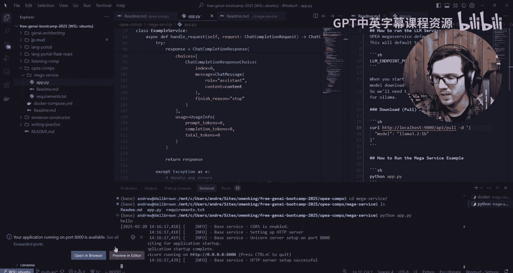

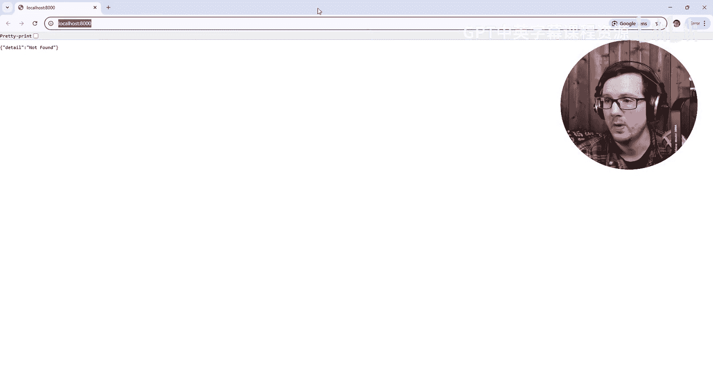

But what I'm thinking here is I want to go test test this here first， we'll go ahead and copy this。

And I'm going to go ahead and paste it in here。Did it enter。

And so this will actually produce output somewhere。Wever we're running， so maybe it's over here。And。

🎼We didn't get anything here。 So I might as well just update these commands。

 I don't want response to be dumped everywhere permanently。 So I'm gonna to go ahead。

 and I'm gonna be a little bit more explicit of where I want this to go。 So I'd just say like。Output。

And maybe we'll just say new file here or new folder， new folder here， sorry。Oh， by the way。

 I'm gonna get my head a little bit out of the way。 I just realized， or I'll bring it down here。

Right， so you know， I'm still here， right， I don't know。

 I just want to put it down there because we never look at that taskbar anyway。 but anyway， so。

What I want to do。Is I want to， yeah， make a new folder here。 I'll call it output。

 I'm going to put a dot keep file here。And then I'm going to make another file here called gett ignoregnore。

And so I spellelt it right。 And then we're just going to ignore all the Json files in here。

 And that way， we can dump files here and then look at them when we want。

 And it's not so much of an issue。 So， but we are not in the correct folder。

 So I'm going to go OPAga mega service。 And then I'll run it here， right。

 So I'll just make sure that before we run it there。 We'll say C D， OPA comps mega service。

Right and that way this will jump to that location。

 we could even take this one here and do the same thing。But I don't remember what that one does。Okay。

Are these the same？I mean， this one's formatted this way， and this one's formatted that way。

 So this has a little bit more information。So I can't remember。 Well。

 the thing is like it should already run the one。 So it's probably this one here， I would think。😊。

Because this one is。This has a very simple message， and it might take that that that interface。

 but I think it's the second one that is actually what we want。

This is what happens when you don't document yourself， and you don't know what you're doing。

So I'll go into here。Now giveive us a refresh， and now we have a response here。

And I really wish this would do like a pretty print。

I wonder if there's a way we could do that with a query string。 So Im gonna say a pseudo app。

 get install。Query stream or JQ。JQ is a。Yeah， it's called JQ， right？

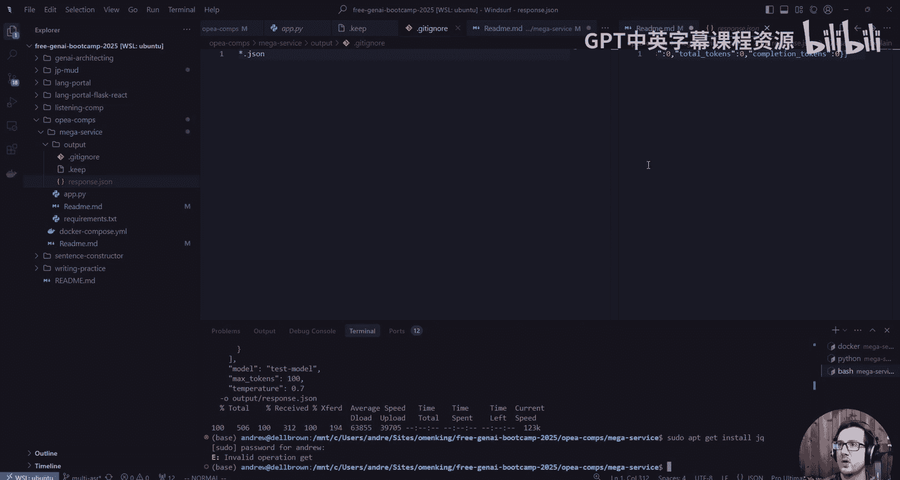

I have a mini course of this somewhere。JQ。Command line processor。

So this thing can be really useful if we want to format our output。Right。

I need to figure out how to install this， download。

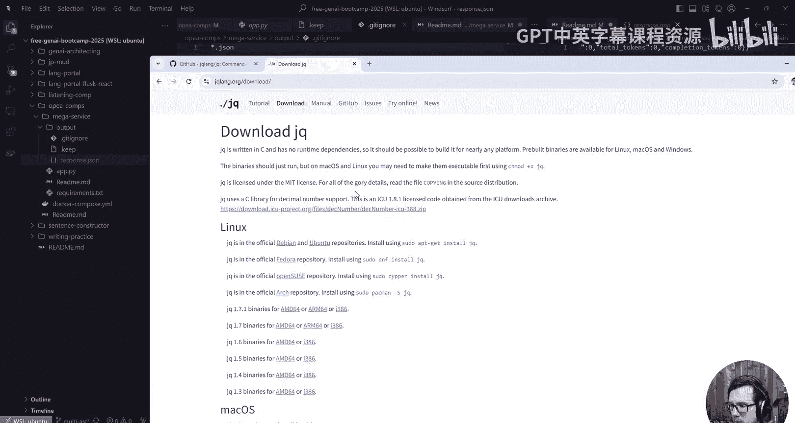

Co Appcat， JQ， that's what I did。 It did not pick it up。 Let's try this some more time。There we go。

Im go back over to here， and we'll just say。Install JQ so we can get pretty we can get pretty pretty adjacent on output。

Okay， and I'll just put this here so other folks can do it。

And I believe all we got to do is you pipe JQ like this。Actually， we might be able to do。

 I'm going to copy this here， I'm going to ask for， I'll do this one actually。

I'll go ask and serve here。Windsurf， you know， I want to output。Jason， in a more readable format。

Can we use JQ to do that。Okay。And it's right now set to chat mode。

 while I can't switch it while it's doing it。And。Will just tell like， can you。

 can you update the file。I gave you right access。Okay， and so it'll just try that one more time。

Cause it's like pipe it。 We have to pipe it to it like pipe JQ period or something。Yep。

 that's exactly what I thought was gonna be okay， perfect。 Okay， so what we'll do is we'll copy this。

And now we will run it again。And if we go back over to here。Now， it's way easier for us to read。

 right， That's really nice。 So now we can kind of see what our response is。

 And so we see chat completion test model。 The model is test model。

 That is not our model that we want to use。 Maybe that's why I wasn't working before。

 But we'll go down below here。😊，I'm going to go paste it into here。Right， and。

No response content available， so that's totally fine。 We'll go ahead and just delete this。

One other thing I'd like you to do is like， can we time stampamp it。 So this。

 I think it's like dollar sign time or something。 So like for the response name。

 can we add the Unix times stampamp。E G， you know， E G time response， Jason。

I think it's just sign dollar sign parentheses time or something like that。

Or maybe a format like that。 There we are date。 There we go date。 So if we do this this way。

 I can keep continually running。 And I don't have to keep deleting that single file out。

 which we get kind of annoying。 So now what we'll do is just copy this here。Will it enter？

And we go here and take a look refresh。We now have this time stamp。

 and so we can clearly see what's going on。 So here we're specifying the exact model says no output or assistant here。

 We can also turn these into batchsh scripts。 That's normally what I do Right now。

 I'm not doing that。 We might do that in a second here。Boo campers definitely know how to do that。

 They've they've done that a bunch here with me。Like previous previous boot camps。

 but we'll go ahead and we'll copy this。 I'm gonna go ahead and copy this command in here。

 And I'm just gonna test it becauseuse again， I can't remember what I did last time。

 So'll go ahead and hit enter。It has a bit of an issue with the formatting。

 So I'm just gonna copy this last line completely here。And we'll do this。Okay。

 and I'll go ahead and copy this again。 it'll hit enter。Oh， my goodness。This。Looks correct。

What's the problem？Oh no， no， it downloaded okay。And so it says no response content available。

 So what I'm going to do， I mean， we did download the model。 We never really tested it。

 So I'll go back to our other readme file here really quickly。

And I want to go ahead and just test the model。So there's this command here and。It used to be 9000。

So the model is downloaded on our computer， then this should work。 At some point。

 I'm gonna to move over to my Intel IP PCC， because。

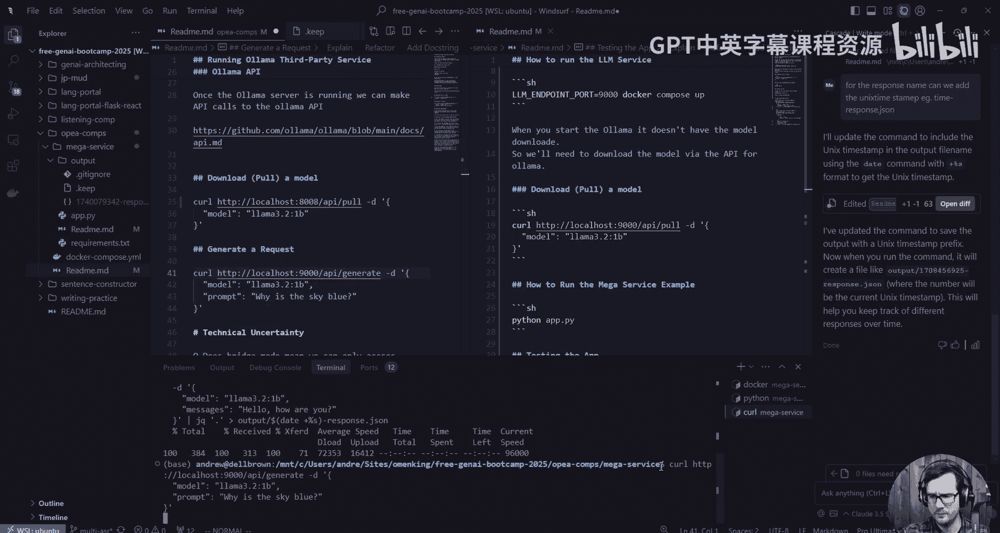

I'm kind of sharing my compute with this。 And it's kind of annoying。 But anyway， here， So it's， it's。

 it's streaming。 So it's clearly working。No， this one is model and prompt。

 I don't understand why this one is model and message。 Oh， because it's going to 8000 first。Right。

 okay， that makes sense。But like， what format does it expect it to be。 So if I go back over to here。

Right， and we scroll on up for a second。 I'm going to just collapse this so I can see what's going on。

And we scroll on down to the ground。We have the service。Right， and we have the handle request。

 I remember this。 The handle request is what is passing it， so。

There was a thing in here that was response。 Oh， here， it's right here。 So say add routes。

 self endpoint， self handle request methods post， okay。And then in here。

 we can see how it's trying to handle the request to  laama。 Now。

 what's interesting is that we just ran it and the structure and it perfectly worked this way。

 But the structure was a bit different。 If we go back over to app no not not app。This， read me here。

We can see that we did model prompt。Right， and that worked totally fine。 But here。

We have a request and we have model。 It's， it's fine It's defaulting that。 when that makes sense。

 We have messages， roll content， stream。And then it's a little bit different。

 And it's streaming content， so。That's something that I'm kind of wondering。What is going on？

So you know what I'm gonna do， I'm gonna， I'm gonna see because I know David was able to get this to work。

 I'm really curious what his handle request looks like。

 But I would imagine that we'd have to use prompted and his instead。 So let， let me go take。

 take a look at his code base。 Let'll be back in just a moment。Allright， so I found David's repo。

And let's take a look and see if we have a similar implementation or something else。

 this is the advantage of the boot camp is that we're all doing together。We can do stuff， oh。

 we got open Pmetry nice。嗯。So what I'm curious about if we go into app dot Pi will also what was the implementation here that was being utilized。

 I'm still seeing allma so 400 bad requests， there was a 400 bad request error when the application attempted to communicate with allma serverver。

Okay， so there might have been a bit of issue。 There was a primary issue within correct formatting the message with the first payload was sending a message list containing dictionary content key。

 The message field should be formatted as a list of dictionaries。 Okay。

 so I wonder if this is going be related to our issue as well。

 But this is saying a 400 error with the O integration。 I don't remember what I got to be honest。

 but we'll go open this up here。 Id like to again， open telemetryries implemented。

 This is something that I should be doing。 They actually have it a little bit in the docs about open telemetry and utilizing Prometheus and things like that。

 Well， actually， you know what， that was a problem。 I was going open telemetry issues。

 And I was just ignoring it and not running it。 But it looks like David just ran it。

 And so they didn' have issues with it。 That's totally smart。 So what I'll do。 I was just lazy。

 I didn't want to have to figure it out。 But what we can do is say oal in here。And。It is， y。

 it's the same one， and then we will set the port as， I don't know if it's actually that port。

Let's go take a look here。嗯。It's not exactly the same one。 This one says 4，3，7，1。

 I don't know what port is supposed to be on， but let's go find out。

 So if we go over to the OPA docs。Okay， and we go into。嗯。Gen examples。

What I'm trying to figure out here is。In the documentation here。

 I know it talks about open telemetry。 So and I'm just wondering if they have a very specific implementation of how they're using telemetry。

 open telemetry。Or yeah， we'll go here。🎼，Telemetry。So it says here， oh， there we go。

 see if I just read the docs， I would have found it too。

 but David Cl took the time and read the docs or just figured out how to start it up。

And it looks like that was part of the requirements here， but this is in the mega service。

 which is up setting up a generic one， which I never really did when we did it in the gen essentials。

But this one actually has a composed file in particular。 So it's not actually the same。

 So David's was a little bit different。

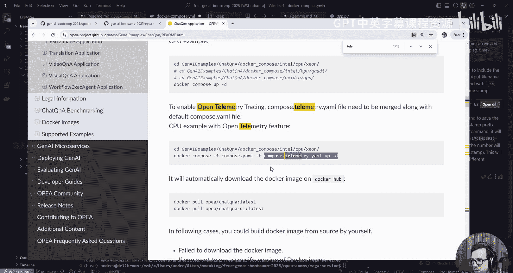

But what I want to know is。What port does it have to be， I know David has that specific port。

 but I want to take a look here。 And so I'm gonna go to the OPA OPA project on Github。Right。

 so we're gonna go over to here。I'm gonna go to projects。This is in Cha QA。

 So we're going to go into examples。And we'll go into Cha Q&A。And in here， we have。

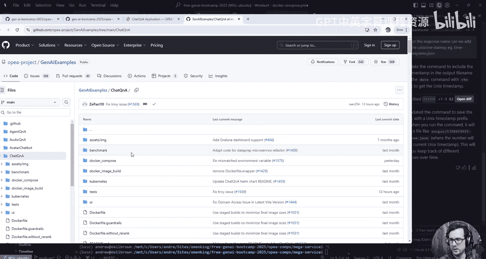

Is it another level down？Composed telemetry， right， Oh， it's in the Intel Zion CPU section。U I， no。

 no， no， no， no， no， we not U I。 But school they actually have。

 I didn't know they had different implementations of U I。Selt react Docker。 Well。

 Docker is not really particular implementation。 We'll go Docker compose。We'll go into Intel。

 We'll go into CPU。 We'll go into Zon。 And in here， we have telemetry。And so， here， it's running。

Hotel where。I mean， I see T T the T I bedding。Okay， TGI service。Jaager。

 I've heard certain things called Jagger before， but I'm not sure which this one is。

Open source distributed tracing platform， okay。Now。

 I'm kinda getting my Kubernetes brain coming back here。 But this isn't run。 This is a run hotel。

 Does it distribute tracing observability platform as Yager are essentials for modern applications。

okay。Does Jager run I mean， maybe it does， it's a cloud native project。It supports open saltry。

 But Jagger is Jagger is limited in terms of U I does not only。 Okay。 So but what's jagger versus。

I guess it's just the interface to interact with it versus hoteltel causeuse it probably hoteltel is just a protocol。

 right。 And so Yager would be the interface。Right， so。Yeah， here we have Otel。嗯，哼哼哼。😊。

Tracing platform。 Okay， so if we were to start this up， would we get。That with it， hotel with it。

Well， again， Otel is just a protocol， right？It's just a protocol。But it has to go somewhere。 Oh。

 okay， so， but let's go back over to what David had here a second ago。So if we go back to。David。

 we have open telemetry collector。 So is that just like a really basic collector that goes somewhere。

I think that's what it is。Offers a vendorgnostic implementation on how to receive process and export telemetry data。

 okay。And then in order to， so it says， in addition， it removes the need to run and operate。

 maintain multiple agents collectors in order to support open source Tele data formats。

 eager promotemetheus to multiple open source commercial backends。 Okay。

 but we still might want to actually read it。 And so I like that David's done this。

 And he hasn't on 4，3，1，8。 But if you go to this implementation here。They don't list that one。

 but maybe you can do that， maybe that's the default for the for Otel collector。

 maybe that's what it is。Hotel collector， default port。No， it's still that， but that's okay。

We're going to go ahead and copy Yeager because if we can just get yaggger to run。

 I don't like I know of Yaggger， I covered it in my KC&A。

 but I wouldn't say that I'm an expert of it， so what I'm going to do here is I'm going to go ahead and just replace the OT collector here。

 which we could use and that would just have somewhere to send the logs for。

 but this might be more interesting because if this just works， it runs。That'd be really。

 really good here， I mean， we want to be no proxy because we're not going to prox anywhere for an environment。

So I'm not exactly sure what we want to set for that。

 But these are probably this is no proxy comes from the。The mega service that we set。

And this is something that we did in the Gen essentials。

 remember have to set environment variables for it。So。Yeah， and it's down here as well。

 So it'll pick up both of them， right， So this is going to be fine。Should we be sending to both。

 Probably not？ No， I guess it's fine。 Yeah， it's fine。

 So I'm going to go ahead and restart this mega service and maybe we can get yager working。

And then I'll be like， oh， look at me。I could run more cloud native stuff。 We really， really need。

James， James， again， like he's just a wizard at this stuff。 I'm terrible at it。

But I'm good enough to teach the basics。 So we'll go over to here， and。

I'm just waiting for it to start， right。 And so if you give us a refresh。

 I'm waiting for Jager to start up。It's starting， right。Oh， you know why I didn't save the file。Okay。

 so we'll hit up again。And so now it's pulling aggger。I think it said things weren't set。

 I don't think it matters because it's going to default anyway if we don't have the aure set to use no proxy。

Defaulting to string blanks。 I'm not sure again， if that's going to be a problem。

I don't think that's going to be a problem。But I'm gonna go ahead， and。Oh。

 I think they're both running now。 They are。 Okay， so now that we have yager， how do we access it。嗯。

I'm going to go check the logs here because maybe the logs might give us an indication of what it's running on or what to do。

So it says G GBC。 So that's the whatever Google's RPC protocol。

 I I don't I think it's called Google protocol， go protocol because it probably is written in go。

 but I know what RPC is or go routine RPC， What is it called。I have a slide summer for this GRPC。

 What does the G stand for。What does the G stand for？General purpose， there it is。

 General purpose R PCC， but it is made by Google。 So to be fair。

 you can see why I might thought of that。 But it's saying here that it's starting on 1，1，6。8，6。

So I want to see if there's an interface here。We do this。 Oh， look at that。 We got an interface。

We are like full blown Dev office people now， so。

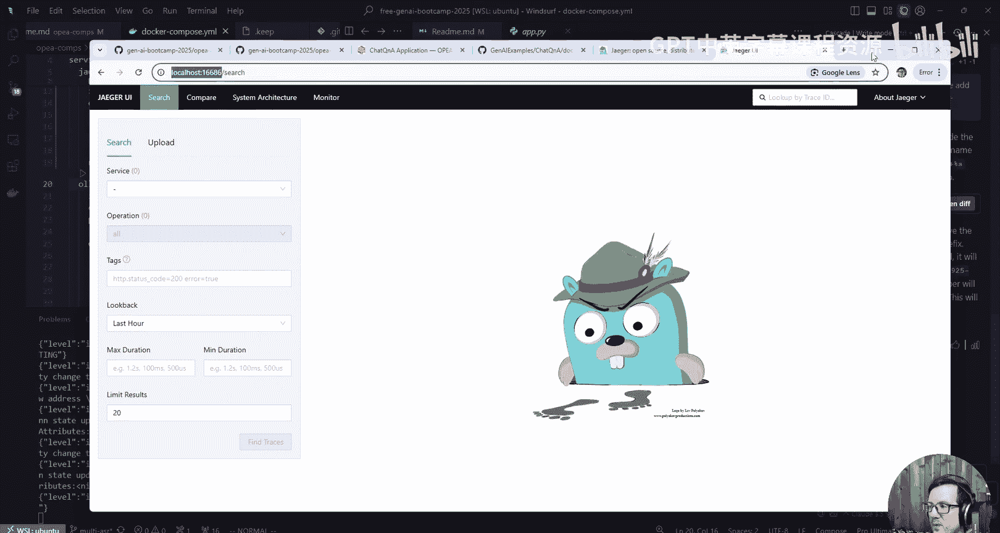

We'll go over to here。This is fun。 Okay， so。😊，We have how to run the LM service。How to。How to access。

The yager U I。When you run Docker composeose。It should start up。Yeager。Okay。So we have that now。

 And so that's good。 If we go back over to here， I'm just want to make sure we're not running it twice。

 We're not okay， good。 And so this is。The front ends。

 so we'll try to get the front end running up again here。

And I can't remember if I tried to disable in my code， the telemetry stuff。

I think I might have just started to ignore the errors。And。We saw our orchestrator。

But that's not telemetry。 Oh， telemetry end point is right here。 So what did David said is his。

 Maybe he overwrode his or it said as the default。

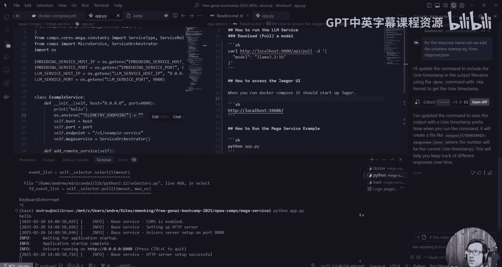

Cause I don't remember。 And I'm， I'm not gonna watch my own video back because I gotta move。

 I gotta keep moving forward with you guys。😊，And gals and other folks。 So over here。

 we have the hoteltel。 Oh， so he actually has the hotel endpoint right in here like this。

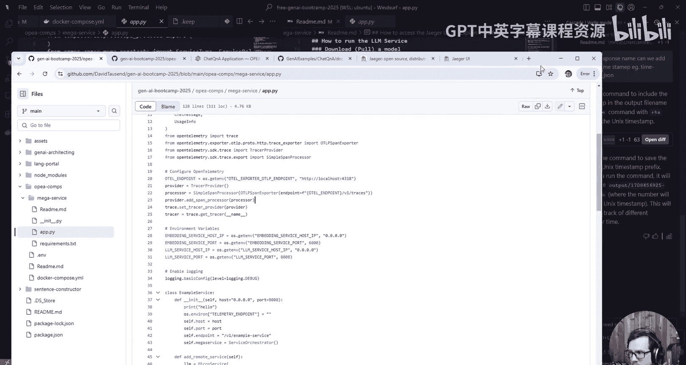

And we bring this down here， that's his telemetry endpoint。HSo that's how he configured。

 and he brings in all that stuff。 I can't remember if I ripped that out or not。

But the nice part is that if it's， if it's here。Right， then we can get it this way。 Oh。

 and down below here， it sets the telemetry endpoint as telemetry endpoint。

I don't think that's very useful for us here。 But let's go ahead and。Yeah。

 that's not That's not gonna help us too much。But in here， this is the， the other mega service。

 Somewhere in here， there should be that app top pie file。 I think it's weve got to go back a bit。

Checkc a。Here， and so in here， it should have that open telemetry stuff going or or at least yaggger。

 right。So we'll type in telemetry。🎼Hotel， nope。WellHere we have a bunch of endpoints， right？

Meegga service port， guardrails， Rer， LL M。Sorry， I know the fonts really small。 I just。

 sometimes it's just hard for me to see all the text quickly。So in here。

 I'm looking specifically for。Makega service port。Allign items， align outputs。Service orchestrator。

嗯哼。I mean， this one clearly uses yaur， but。Where is it。And we do have a handle request here。

 which is we might want to pull from later， but it has a lot more going on here。

 which might make it a little bit hard。O。Pser。So I don't have anything about hotel。Or like， yeah。

 O tell。 So we'll go back over to this level here。And then we'll go into the wrap or maybe one of these habit。

Okay， let's go back to that example that we had on the OPA website that actually showed us。Here。

 if I go into。Where was it， Gen examples， examples。Was this it。No。Ding Geni。Developer guide。Very。

 very hard to find here。Some are in here。We had an example， maybe it was getting started。Nope。Nope。

Nope， nope， nope， nowhere error here， Gene eye examples。I feel like it was under here。Nope。

 give me a second I go find it because I think it had Otel code。Right。Alright。

 I actually found one right on the comps page。 So some are in the docks。

 But this is basically the exact same 1 I kind of remember from before。 I mean。

 it looks almost exactly the same。Where it's a little bit incomplete。

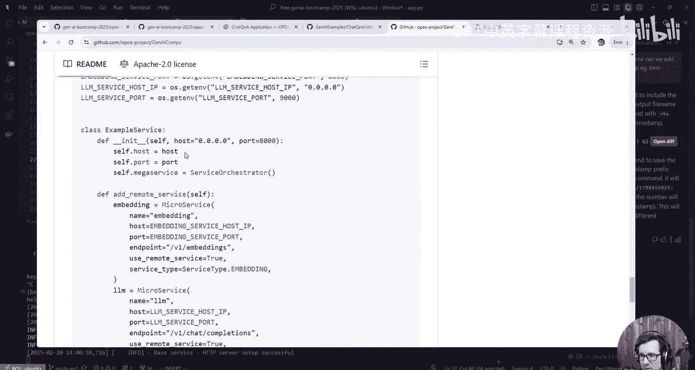

But we don't have the hotel set。 And the other one doesn't have it said either。 So what I'm gonna do。

For now， I'm not sure if this's gonna break it or not be utilized。

 But what I'm going to do is I want to。Over here， and I want to disable。

I thought I had in my code here I。That end point。Where it was empty。Didn't I just have it here。

Let me try， telemetry。Right here， oh， example service telemetry under here， okay。

So if we go back over to here。Oh， you know what。 I think what it was was that we added this to try to clear it out。

 right， So we don't need to set this because it probably already has a default and whatever it is。

 we're going to find out。Now I'm remembering， okay。So go back over to here。 and I'm gonna go and。

See this one here。 This is on 48000。So we'll bring this back down。

I don't know why like when I drag down， you'll notice like it'll just sometimes it just snaps to the right。

 which is kind of frustrating。

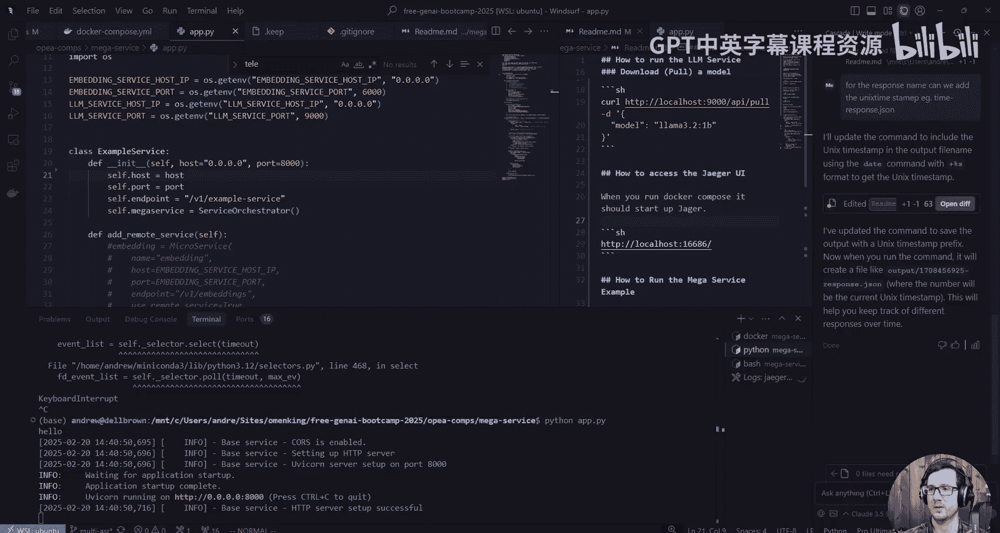

I have no idea why it does that。We'll go over to local host 8000。

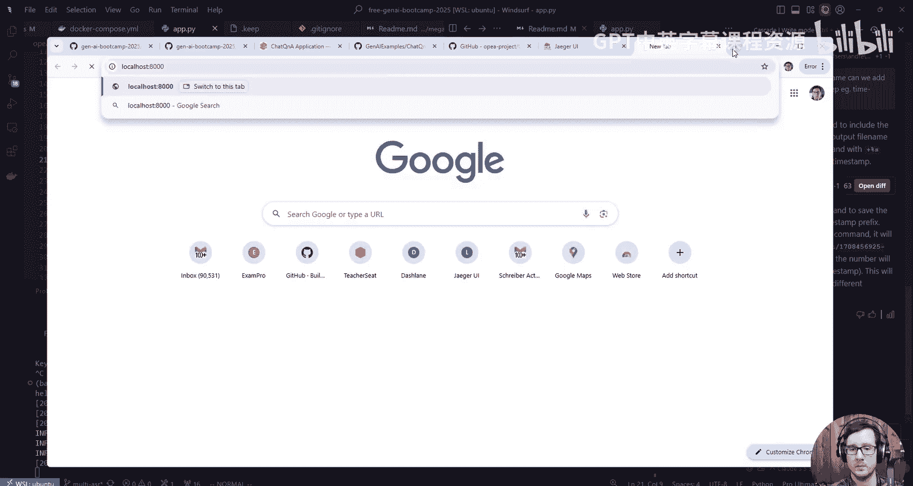

Okay。And so not found， that's totally fine。We got a 404 we're supposed to get that right If we go back over to here。

 we'll go ahead and we want to curl that 8000 and it kind of make sense why that structure is a little bit different here because you know we're doing something a little bit different so maybe we want to take this one here。

 I can't remember which one was again documentations key and I just didn't do it。

And so if we go back over to this one， we actually get a 200， which I'm surprised。 Well， I mean。

 that doesn't just necessarily mean it worked。 This means it didn't throw an error。

And so if we go here。🎼I can't tell which one's the new one。 So I'm to go ahead and delete this。

Dewete。I'm going to go back over to here and we'll hit up。 This is on。 No， that's not port 9000。

There we go， let's 800。 That's when we want to ask。 we'll hit enter。

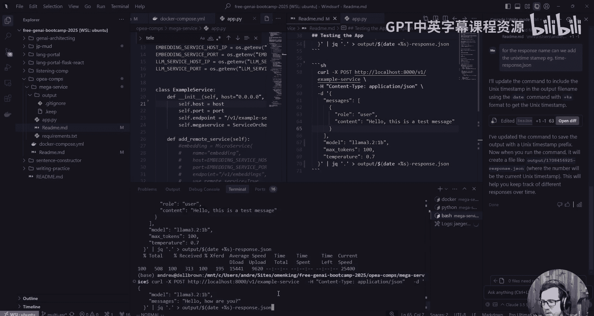

And we'll refresh here， we'll check。Assist no response content available that's totally fine。

I'm curious if， we got anything in Jaggger now。And so。OPA A here， we'll find。And。嗯。😊，I do not。

See anything。

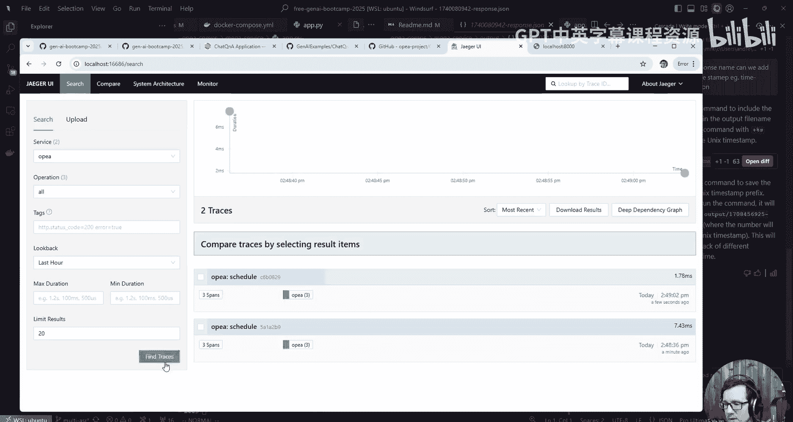

I we only ran a once。 So， but the point is， is that if there's some way we can collect that hotel information there。

 we can。 I just don't know if I've really buggered up my my code here or I don't have it properly set。

 But normally the way we would know is we， we saw those errors before being thrown。

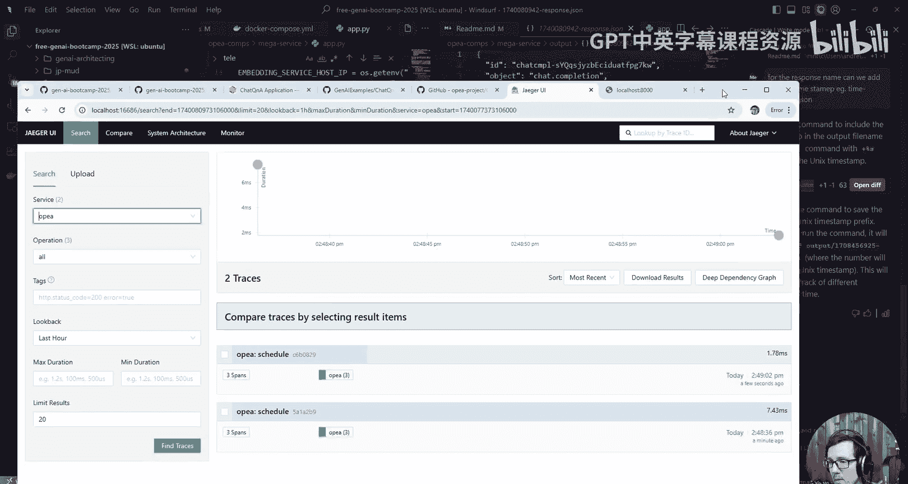

And so I'm looking for those hotelel errors。I don't I don't see any。But again。

 I might have done a really good job at suppressing them to begin with and。

I don't think there's anything special that I'm not importing here。

That we might need to get that there。Or maybe it was on the the this one here that was the issue。

But that's okay。 So what I'm going to do。I I want to figure out。I want to figure out。

 what was this example model up there。W why it does that？嗯。I mean， it could also be based on yeah。

 I'm not sure why it does that example model， but。I'm just thinking here。 So we get a 200。

 It says assist no content available。But that can't be true， right。

 So what I'm gonna do is I'm gonna go back over to here， and we want to do some troubleshooting。And。

 yeah， in fact， we could get anything。 even a hello， I'd love to see that。

So I'm gonna to go ahead and stop this。 I don't expect this to print out。

But we will try it and I will go back over to here。And we'll run this again。Go back over to here。

 And we actually do get a hello。 So clearly， it's printing out the。

 the request the request information。 So I want to go here and debug the request。Really。

 that's all we got。I mean， if it works， fine。Would that be a little bit more sophisticated than that。

 I'm kind of getting tired of。Constantly copying and pastcing are worrying about that big bash command。

 So I'm going to make a new folder here called bin。 And then we're just going to call this one test。

Right and then I'm going to go ahead here。 we need the Shaang。So what is it， Shaang？

I'm going go rename this to dot S H， so it knows。It is not autocomp whatsoever， for some reason。

I will go back over to。 I mean， if it's a dot S H， we don't have to worry。

 but I like it when it doesn't have a dot S H on it， though。 And I just can't remember the chaang。

 despite writing it so many darn times。I can't remember everything。

 but we'll go over to here and I'll copy out this one here。And I'll paste it in here as such。

And I mean， I'll still work in that format。And so now， if I go here。Chma U plus X bin test。Okay。

 I really don't want to have。Maybe it's called a message， your message。And if we go to the top here。

There goes。 not all kind of。That is not the way I do my commands。 We'll go take a look here on。

One of my reos， so just give me a second here to find one of my folders here。

I got two chromumbs going。 Let me close one。There we go， I found it。

 and so we'll go ahead and we'll paste it in here as well。AndSo now that's what I really want。

 That's usually the proper one to execute。 And so now what we can do is we can just do bin message when we want to execute this。

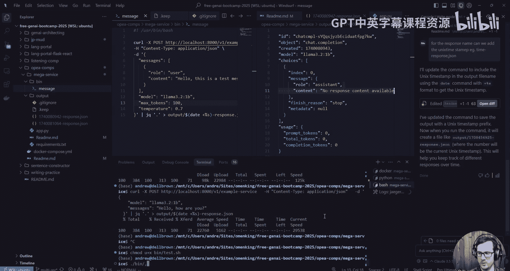

And it'll do the same thing here。Right， I'm not sure if this is showing alphabetical or not。

 but you can see no matter what we do here， neither。

 neither provided the result that we want them still delay these out manually， which is whatever。

 But we'll go here。And yeah， no， no response content available。

 That's totally okay because we're doing this for the debugging。 And so we do have the message here。

Okay。It says， hello， this is a test message。Right， so that looks pretty good。

 I'm going to go back over to。 I'm going to save this here。嗯。And。We are getting。

 we are able to print out the request。 so I mean， it's pretty clear what the request is here。

But then here we have O Laama request and we're formatting the request and then。

We're usinging the mega service to schedule it for the orchestrator。So again。

 we'll go back and take a look at what David did。I want to see where his code deviates。So yeah。

 we have a bunch of tracing in there， that's good。We have logging turned on。 That's good。

 I see that he has his telemetry endpoint cleared。 You probably。David。

 you probably can just remove that now at this point。But I saw that you set the hotel collector up。

 so that's really good。So that makes me wonder， like， did he get it to work or not， but I mean。

 he was on the right track with the telemetry collectors so that was really smart of him。

We'll say add remote service。 I like how this is。 Do we have that isolated there in our own code。

 I'm not sure if we do， but I like that。

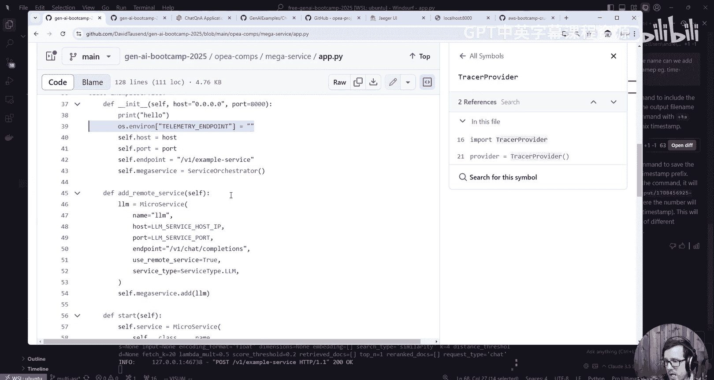

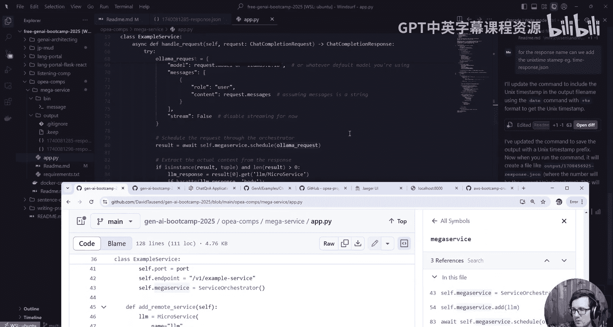

Oh， we do。 Okay， okay， okay。And。We have a head request。4 better best， O laama request。

 So that's looking a little bit similar to ours。And。

I'm trying to make this a little bit easier for us to read here just close that out there。

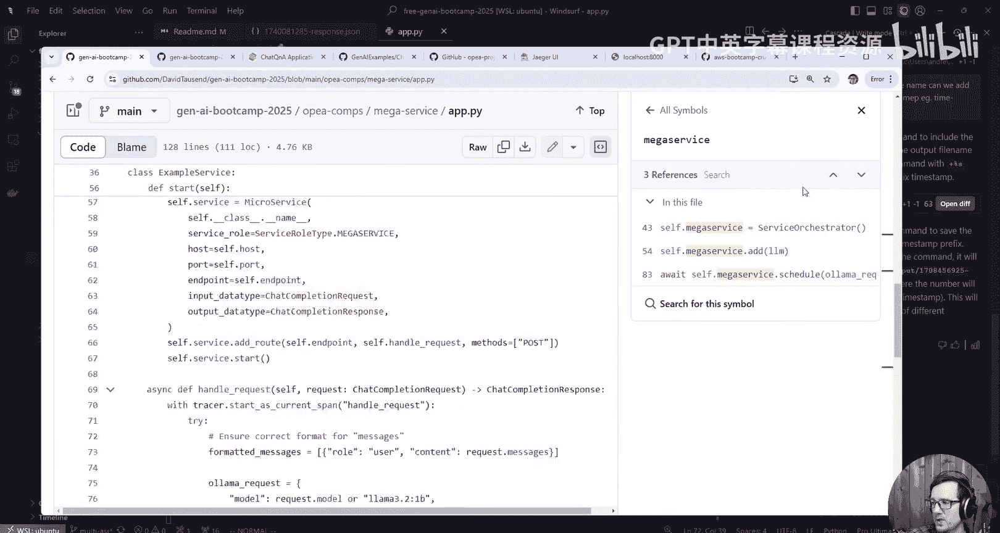

So we can do more of a bit of a side by side comparison。And。We'm just gonna drag this over again。

 just trying to make it really easy so we can kind of match them up。

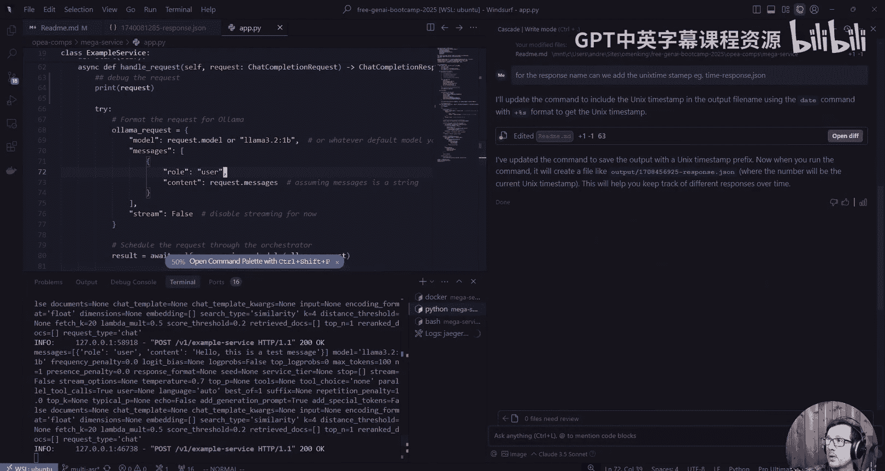

And see， where did we go wrong。So we have with tracer。 Okay， cool。

 So you're actually putting a trace and so you can actually trace the request。

 Maybe that's why I don't have any tracer information because I'm not actually tracing anything。

 that probably would help。 And that's probably why we're not seeing anything。But anyway， we have try。

Fort a message。So， here。You can do it that way。 That is fine。

 And then the formattted message goes where。I was thinking maybe that it would go inside the request here。

But the Olaama request has the model， which is here。 That's the same。They have messages。

 messages requests。 So we're not using this line here。 This is just going straight into here。

 which if that works， that's totally fine。 But there's also this formatted way of doing it。

 which I think that we actually do when we do test it。

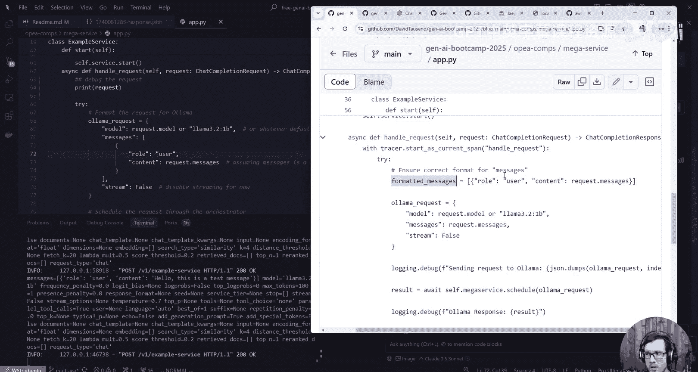

Let's go check that really quick。So if we're looking at the top level， read me here。Actually。

 we just do model and prompts。Yeah， we're not doing anything super fancy here。Well， anyway， that's。

 that's okay。 Well， hold on， hold on， hold on。 No， that's to generate it。 That's not to。 No， that is。

 that's to generate。 Yeah， yeah， yeah。Okay。So if we go back down here。It's being passed。

 streaming is turned off right now， so it's not using streaming。Here's the question。

 am I using streaming。So we go back over to here。Streaming is false。 So disable streaming for now。

 right， and streaming is kind of a pain to figure out。 So that's totally fine。

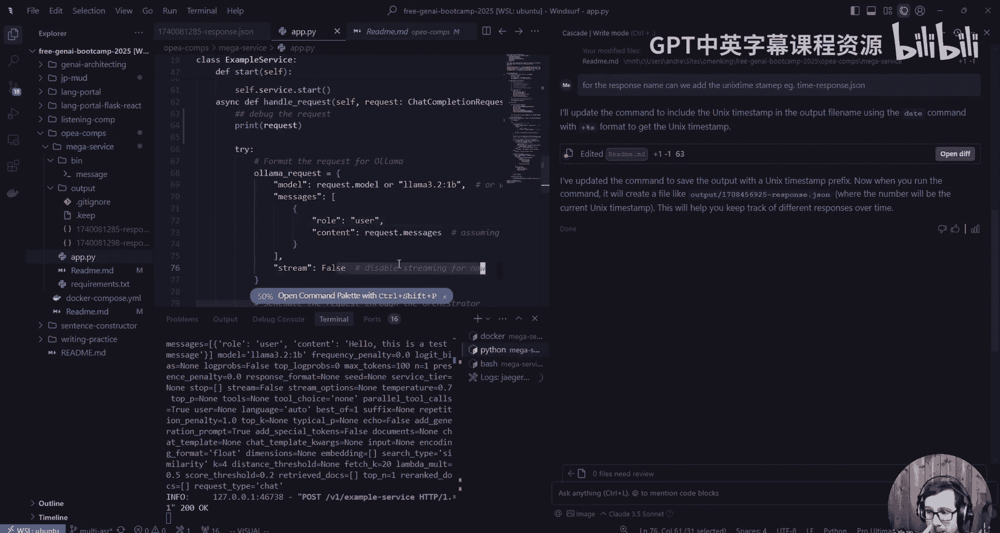

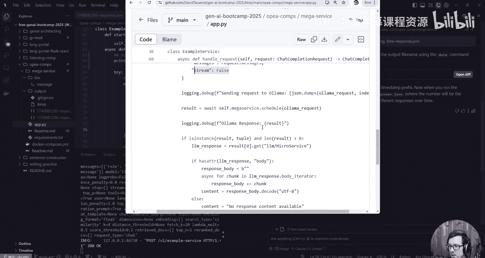

And then results wait for the scheduler to Olaama。And it sends that request there。

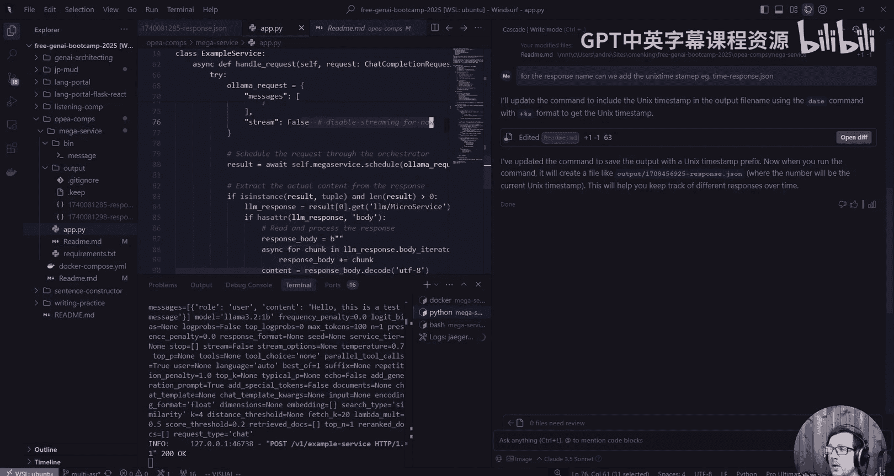

And then if we go to here， this looks very similar。嗯哼。Okay， that's the same。And that's the same。

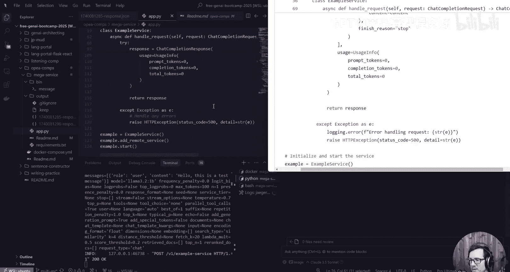

And that's the same。 So， I would say。it's pretty similar to what I had。Hm。

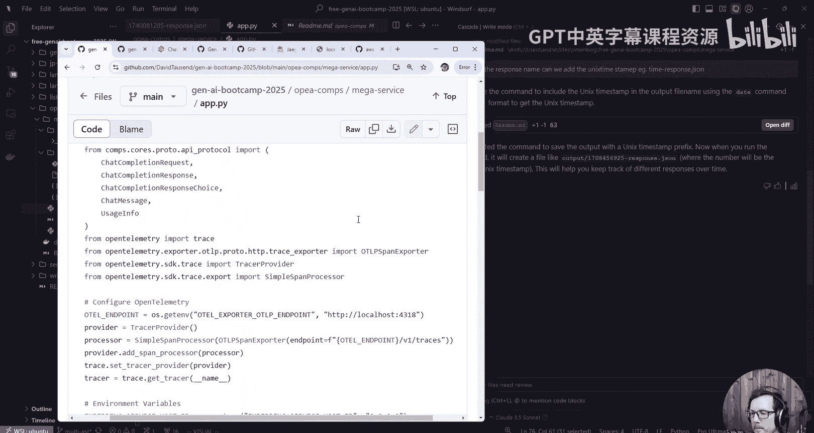

Mhmm。Okay， so if the code is exactly the same， then I wonder， let me go take a look here。 One second。

 Allright， So I think if we take a look here， the way David got into work。

 he just passed the request directly to。 And he just skipped that whole process thing。

 which is really interesting。 So I guess the thing is that the messages are already formatted。

 So I think this is the problem。This is our problem。 Like， look here。 look at the payload。

 It's already formatted in the format that it needs to be， right。

 It's already in the format that it needs to be。And then we go over to here。

 and we follow it through。So I trying to think like， why would that work？Here we have the o request。

 but it's already formatted。Right， it doesn't have。 if we go back here。

It doesn't say like streaming false， but this is all the stuff that that's going to get passed in。

Or at least the messages are， right？So， then。And then we have requests some models。 That makes sense。

And like， it wouldn't be this。 It would be。 It would be request on messages here， right， like here。

 that's where it should go。嗯。And we still have false on here。Okay， and so there you go。

 you just got to carefully read。 And because I was using LMs， I just was turning my brain off。

 and I wasn't taking the time to look。And so maybe this is what will actually solve our problem。

I'm also just interested to try to re hookook up the telemetry code and see what happens。

 We'll go ahead and start Python do app。

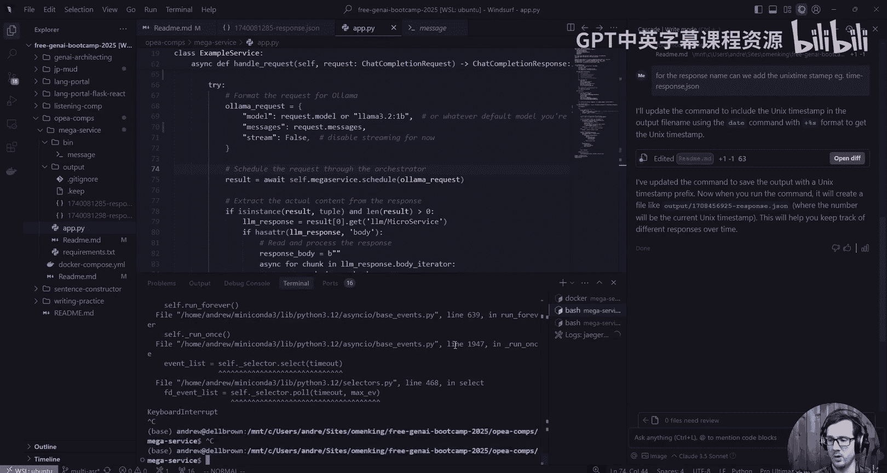

And。It is now running on port 8000。So I'm going to go ahead and。Pull us down。Well， actually， no。

 we just need to go hit that end point， right on that other tab。

 So go over to here and we will try message。

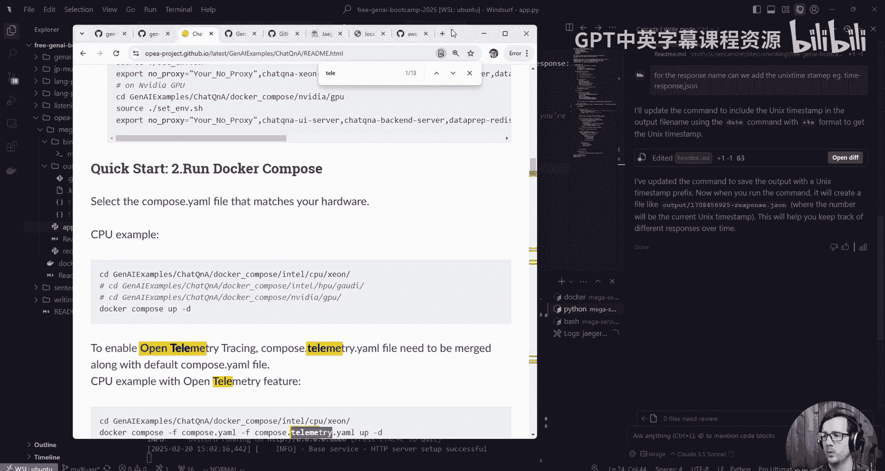

And if we go back over to here。嗯。It still doesn't work， but I'm not sure if I saved it。 And， and。

 okay， I saved this here。 Did I actually stop the app and restart it。I don't think I did that。So。

 do this。Maybe I did。 I just don't know。And we'll do bin message， and we'll check our message。

No response。Okay， but at least we know like that makes more sense， right。

 that the reason it didn't work was because we actually weren't passing the messages along at all。

So we're getting closer。To this here， what we're going to do is before it actually passes in the。

The results I'm going to go ahead and say print。Result， now I got the result。 let's say， print。

Olama request。 because I want to see what it looks like。

Like what is getting passed along before it goes？And we'll go ahead and we'll just run this again。

I'll go back over to here。And we can see。Well， it's printing out two things。

 So it's a little bit hard to see what's going on。 So I'm just going to take out that one because we already have the request。

 That's fine。 I'm going to stop and start it again。 And we're going to run this again。Okay。

 and then we're gonna go back over to here。 And so we can see exactly what's being passed。

 model Lama 3。21 billion messages， roll， user content。

 So it's technically in the format that it's supposed to be。 We've got a 1 or a 200 coming back here。

We also have the results so schedule the request through the orchestrator。

 but I don't think this would give back the result， but maybe it does。So it'll say print result。

And just to make things a little bit easier here， I'm just gonna go ahead and do a few of these。Okay。

H on request。 Yep， that's nice。Response。We'll go back over to here。So here's our request。

Here's a response。So we're getting back here some kind of object， a streaming object。Which is fine。

That's going to make it a little bit hard to see what's going on here。

That we have is instance result and tuple result0 dot get L M service。

 And so this is supposed to be the actual response。

 So what I'll do here is we'll go ahead and do a print here。And we will print that out， as well。

And we'll stop this。 start this。 We'll run this command again。We'll go back over to here。

So now we can see that we're getting， we have the O Lama response。

 and we have the L M services that we selected。And now we are focused on just this streaming object。

Which， again， isn't telling us much。 But then inside of it， does it have an attribute called body。

 Yes， then let's read the body。Right， so now I'm going to go in here is a print。

Eella and body response。And we'll print that out。 really curious to get this hooked up with Otel。

It' be really cool to do that。And we'll go ahead and run this again。

I'm going to go back over to here。And oh， sorry over here。 and then we'll run this again。

 We'll go back over to here。And。We now have the。That there。So I guess we're getting closer。

But it's a streaming object， right， So we would have to iterate over it to get each chunk and then assemble it together to be able to read it。

 So that's what it's doing here。 right， So says read and process it。 So it starts an empty string。

And here it's iterating over each one， and it's getting it。 So if we did print。

I'm just going to print chunk。Like， we should see a bunch of stuff in here if it's working as expected。

Right， so bring that up， we'll go back over to here， we'll hit up。We'll come back over to here。

And now we have nothing being under like under here， right， so it printed this out。

I'm not seeing any chunks， for some reason。Hm。So if we go back over to here。

This is the body response。About response， body。Hold on。 This is the body response here。And。

I'm trying to match up it here because we have LLM response。W is here。

And then we have L M response body。we do that up there。 So yeah， we don't even。

 we don't even get the， the next one， right。Sometimes it's a bit easier if we number these。 I know。

 like， we shouldn't have to do this， but I'm gonna go ahead and do it because I'm。Sometimes I'm dumb。

 so this can kind of help me see where I am。And so I think we're not even getting step 3 here。

We'll go ahead and run that again。 We'll go back over to here。 We'll hit up。

 We'll go back over to here。 And now we have 1，2，3。 We never see 4。 We do have three here。

 And inside of that， we have our response body。 So we have starlet responses， whatever， whatever。

And then for never prints， because it's saying that there is no attribute here。

 We don't see any attribute here called body， right。

 So I'm going to go here and show the output here。

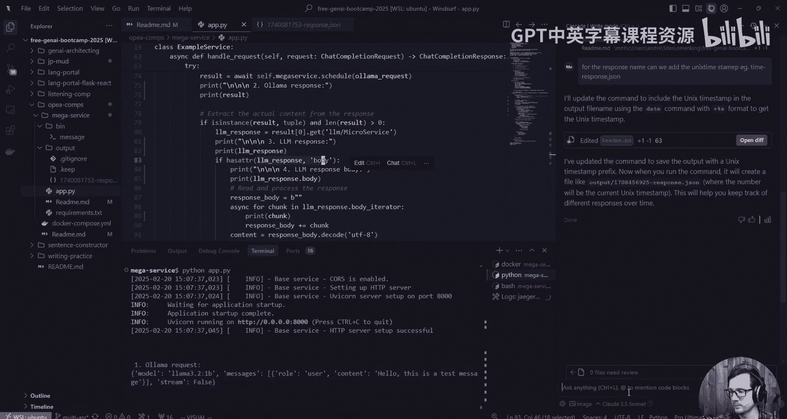

Okay， so I am not getting it。 I am， I'm getting。Nobody back。 It seems。Handle request。

Parer is not correct。Okay， and maybe I should totally like。

 figure out what the structure of that data is before we do anything else there。

 And maybe in the docks， there's， there's somewhere that it points out that tells us that， right。

But I'm just curious， I'm gonna go back to David's code because he got it working right。

 And if we go down here for a second。He has this here。His goes， is an instance of a tuple。Yeah。

 same thing。 El respond。 His ghost， has a tribute body， checks for a body。Right。

 so then why why don't I have a body attributee。Okay， what did it do， Okay， so we go up here。

 Look at the response structure there。 It seems we need to modify the response handling the handle request method。

 the response is coming back with a streaming object， but we're not properly handling。

 Let's modify the code to correctly handle streaming responses。 I mean。

 we know we're getting a streaming。 We told it not to stream， which it still did anyway。

 which is fine。 I don't care if we get streaming back。But the challenge here is that。You。

 we have to carefully read this。 So it says remove has body check since we know we're getting a streaming response。

 Okay， fair enough。 Add a proper Jason thing。 So maybe。Maybe when。David used it。 This worked， right。

 But for some reason， when I do stream false， it's still returning back a streaming object。

So there might be something I'm overlooking that I don't realize。

Or it might be something in the structure here that's that's wrong。 But you know， if his is working。

 that means that he's not getting back a extremelying object。 He's literally getting back a body。But。

 I mean， streaming is what we probably rather support。 So we should try to figure that。

 So add a more detailed error hand in logging， add missing Jason import。

 read the streaming response chunks。 I don't know if Jason import was missing。

Read the streaming response chunks。 try to decode the UTFA。

 attempt to parse the adjacent extract response field。

 fall back to using raw content adjacent process fails。 This should help us better understand。

 So here， instead of doing this， which is fine。It's just going to。Iterate over。The buy。

 is that right， Let's check this for a second here。So two， three。It just is Bob iterator。Okay。

 but what was the old one， Was it not doing that before。Yeah。

 but this one actually checks out the tributes there。 Oh， but it's suggesting that if it's not there。

 still iterate over it， But how will it it iterate over it if there's no body iterator。 We'll try it。

 and then we'll ask questions， but I have questions。

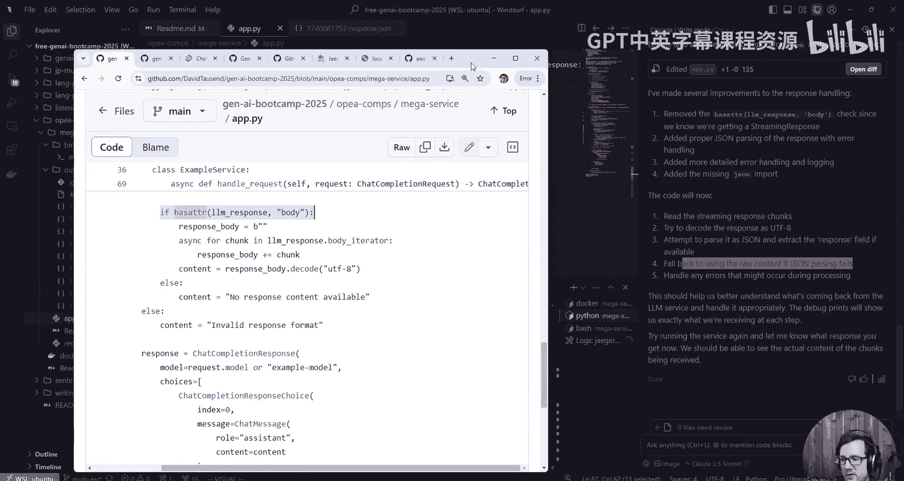

Right， so go over to here， I'm going to try this again。And。We don't get it， right， so。

I'm going to switch this to chat。For second。And。How do you know that body iterator。

Works for the streaming response。Okay。If go， oh， you might be， yeah， good point。Well。

 searching the codebe is nice。Now， we could bring an OPA like the thing and go ask questions about it。

 If we open up up another1。 I just don't want to do that right now。

 I apologize for making the assumption about streaming response interface。

 Let me check the actual response。The mal producing invalid tool will call trying again。Yeah。

 it doesn't know It's in chat mode right now。So here what it's doing is it saying。You know。

 I don't think I actually had this code。Oh no， I do， okay。If your response。

So bring this over a little bit so we can see what's going on here。

But we have here the album response。Then does type in dictionary。Okay。

 so first what I'm gonna do is I'm just gonna copy these out and just see what kind of format we have。

 I know Ruby a lot better than I know Python。 So we'll just have to kind of step through a bit better。

 But the data structures is in Python。 I'm not the best at。 We'll go ahead and stop this。

 Start this back up。 We'll go back over to here。 We'll go ahead and run this。

 We'll go back over to here。 And what do we have。 We have。This starlet responses streaming response。

 But what's interesting is that it's showing us the attributes that we can call here。

So these are basically functions。 I would imagine。 we do have body iterator。Okay。

 so body iterator is there。And we don't， we also have stream response。

So I'm going to go ahead and just give it back the the input here so I can see what it is before it actually does all this other stuff。

Okay， so， yeah， so the response is， is indeed a streamy response from star Letti。 It has a。

 what the heck is star Letty。 I don't even know what that is。 Let's go find out。

 I don't know if that's like a standard Python thing。 Python folks probably know。

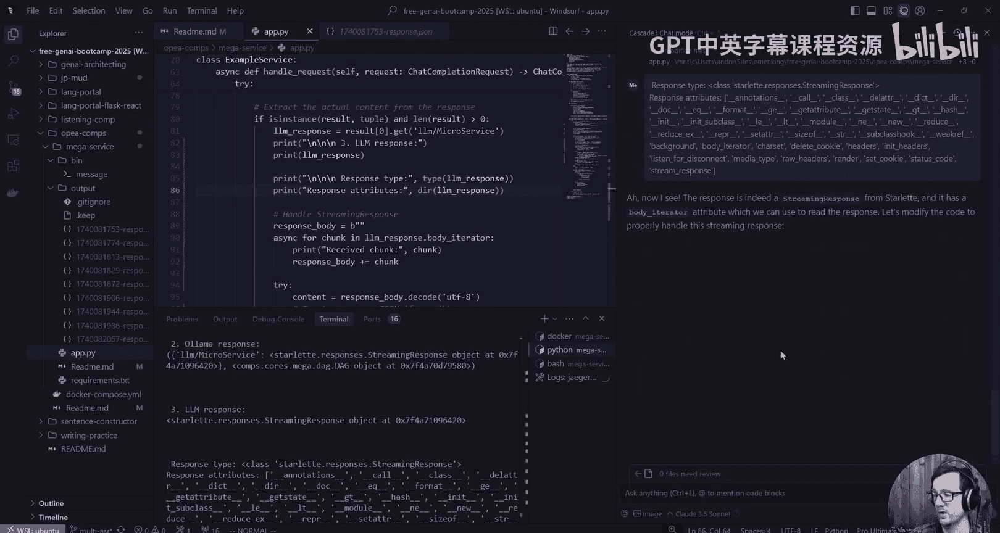

It is a A SGI framework。 What's that。A synchronous server gateway interface， Fair enough。

A lightweight， low complexity H web framework， web web socket support and process background。

 et cetera， et cea。Oh， this is kind of looking familiar to me now。 I mean， again。

 I'm not from the Python world， but。

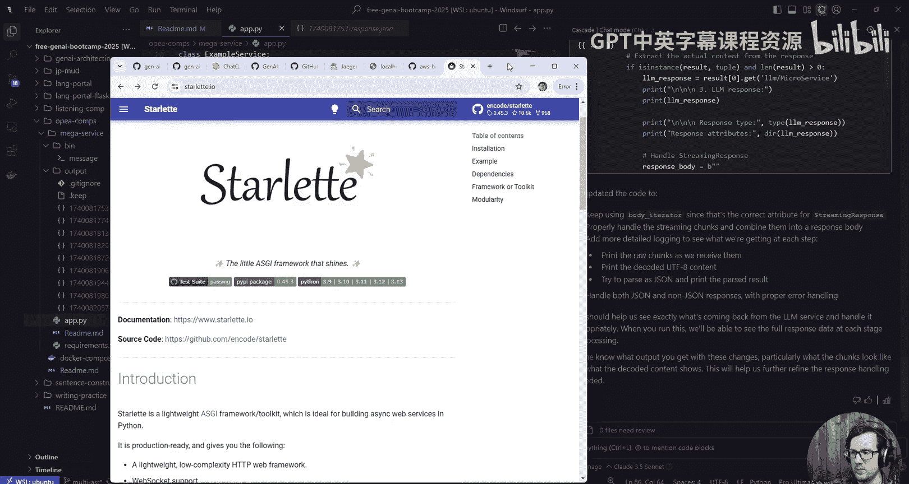

Yeah， I'm starting to make sense of that。 So keep using the body iterator since that's the correct attributee。

Properly handle the streaming chunks and combine them into response body。

 Add more detailed logging to see if we're doing that。 Is there a way。

Is there a way to determine if the。Stream is empty。For parsing before iterating。

Because that's what I'm trying to figure out， like。Looking at attributes。

 we can check a few things before attempting to iterate。 That's what we should do， right。

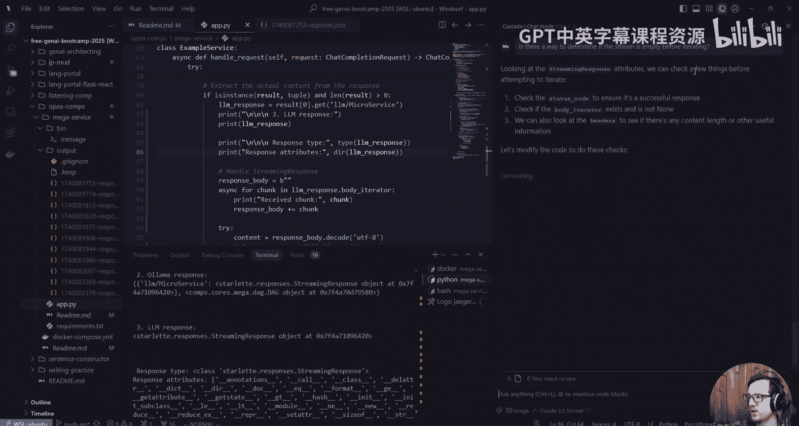

The status code， the body ititer exists。 I don't think we need to check that。So， and I mean。

 it can bring back 0 200 response。Mmhmm。😊，Okay。ふふふふふ。Yeah。

 so I'm just thinking about this for a second。Let me think， okay。All right。

 looking at this a little bit more。 all I did was put a status status check in here with the 200。

 And I just carefully was reading through this。 And basically what happens here is that。

 you know we do this， we iterate through the chunks， we gather them together， we need to decode them。

 But if it doesn't find anything， it's just going to assign it no content available。

 So that's a predefined error from our system that is saying that， saying no response。

 content available as if it's not even talking to Oma right so。

That's where I need to figure out the next step。 Okay， so maybe it has something to do with。

Understanding the makega service schedule。 One second。 All right， So。

 so what I did is I went over here。 I don't say I have it working。

 but I found the service orchestrator， which is what's responsible for it。

 And you notice that it's peppered everywhere with open telemetry。 And the scheduler has it as well。

 So I imagine if we could get Oal configured， maybe jagger would show us something here as again。

 I'm， I always have an issue getting started with this stuff。 But if I can get anything visible here。

 Oh， we actually have some generated results。Oh， it's already here。 Oh， we have traces already。 Well。

 look at that。 So I guess it's already configured， and it must be already leveraging underneath what the stuff is。

And that's cool。 But what does any of this stuff mean， So we have schedule。

 execute and then the stuff like that。 So the thing is that we want to see actually connect to O Lama。

 But the thing is that O Laama is not rigged with Otel。😊。

So I'm not sure if we'll get any information based off of it， right？But here we can see schedule。

 execute。Async generate。Okay， so if I go back to here。😀嗯哼哼哼。

This is where we used it in our other boot camp。 I I remember the name of it， honeycomb， honeycomb。

But it it actually made this a lot like this is totally really good， too， but I'm just saying that。

What I need to see is where the traces go through and we are getting some tracing here。But， you know。

 it's only going under here to schedule， execute and whatever。

 It's not like it's going to that other service and coming back。 And for us to be able to see。

 But at least we have this here。 So that's kind of a start。

 But that's not going to solve our problem。 So I'm gonna do the old fashioned way。

 I'm gonna read the code。 Manda， this is what what happened。 If I didn't know what was going on。

 I'm just read the code till it made sense。 And I will be back in just a moment。

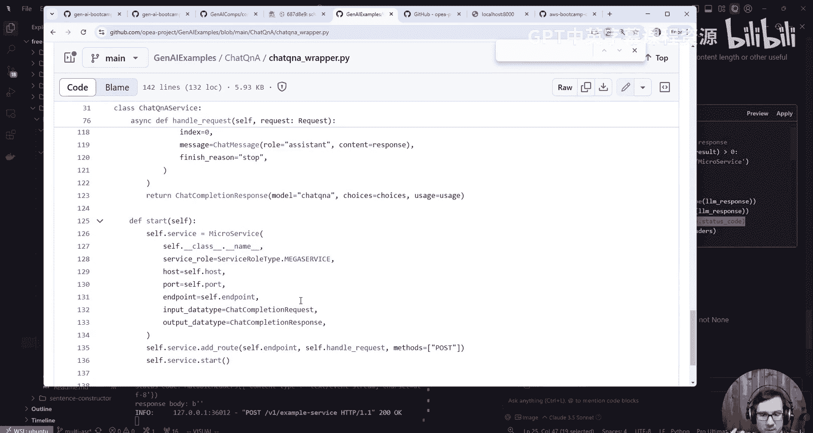

All right， so I did read through it a bit more， and I had an idea。

Like I was starting to read through it and I can see there's a da and stuff。

 but it's just like all I want to know is like when somebody goes in the scheduler。

 how do I debug it if it failed and it looks like it's just doing it's just making an async AIO call。

 IO asynchio， it's using Asychio which is the Async framework for Python and somewhere here。

 it looked like it was just doing HTP call and asking what would come back。

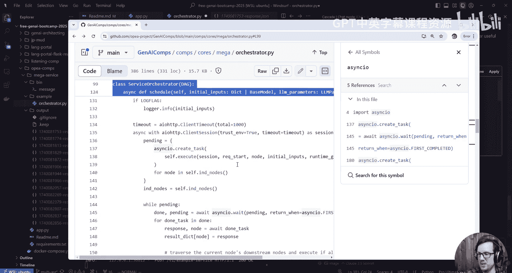

What I'm going to do is I'm just going to take all this code here。 I went to RA。

And I just copied it and pasted it in here。 and I'm just going tell it like。Put chat mode， say。

There is no content coming back。Our Oama is running on port 9000， right。I can curl。

I can curl and get data back from my host machine， my host machine。I found the underlying code for。

The mega service schedule， and I've copied it。Here for you to see if there is way I。Could debug。Why。

I get no data back。With more rich。For reporting。Ricd Richardicd logggs might be able to do it， but。

The code for it is here。 It's orchestrator。And we'll see if that helps it at all。

Or might just give me a bunch of dumb prints again？

i see we can enable the detailed logging by setting the log flag environment variable。

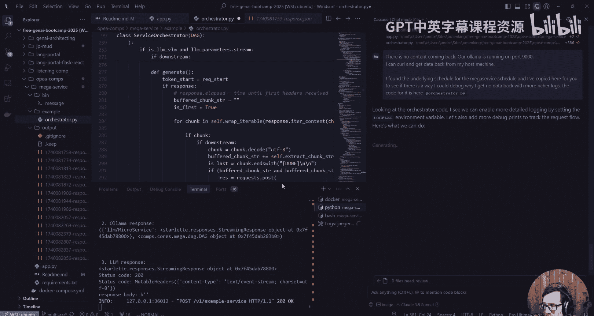

Oh， really。Let's take a look here。And I'll be back in just a moment。

 I'm going to try to fix my desktop every time I drag down。

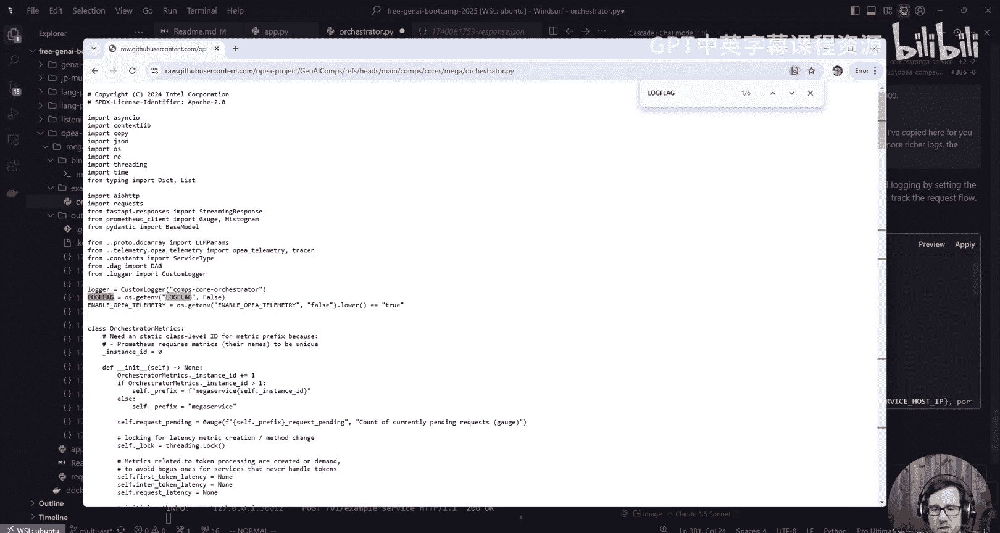

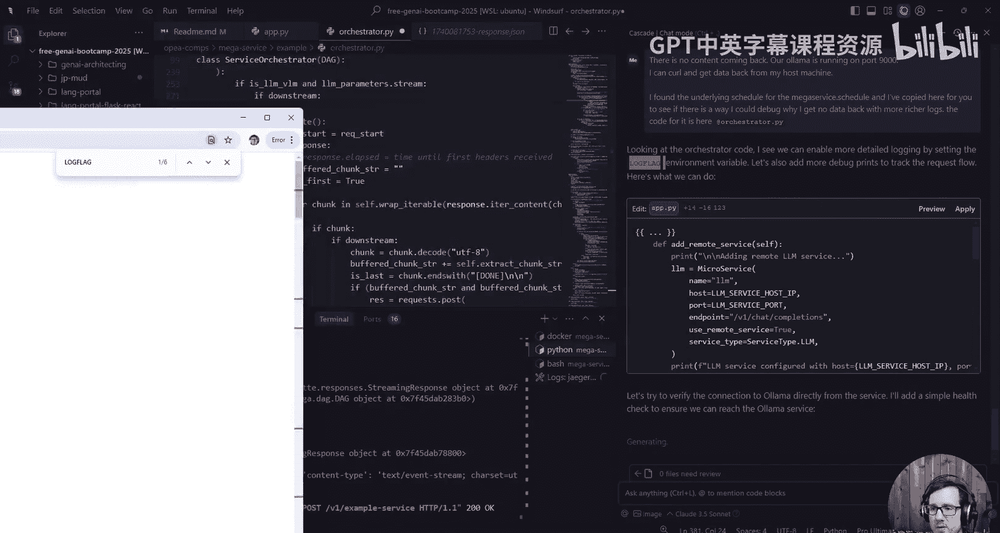

Yeah， it does that。 Does is like weird snapping。 So give me a second， okay。There we go。 I fixed it。

 I not， no， not the code。 my display。 I dragged this off a little bit like this。

 which is more like what my monitor looks like。 And I just told it to stop easing as that keeps messing up my movements。

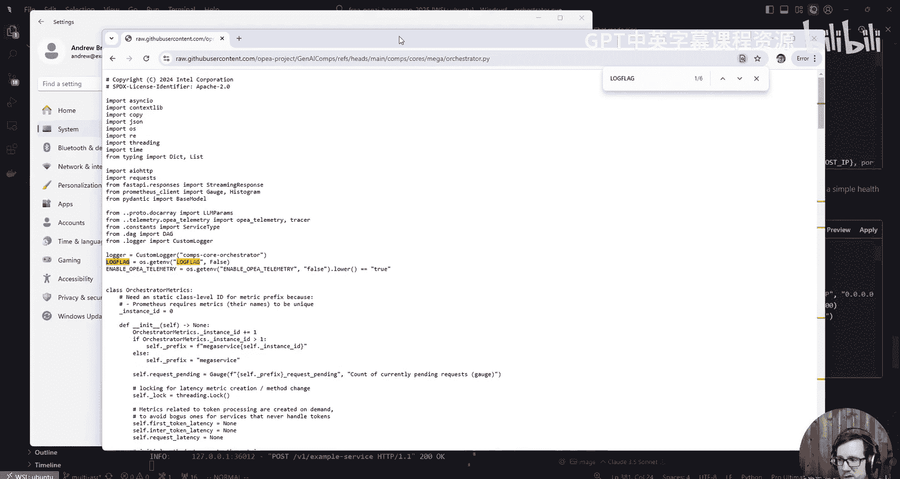

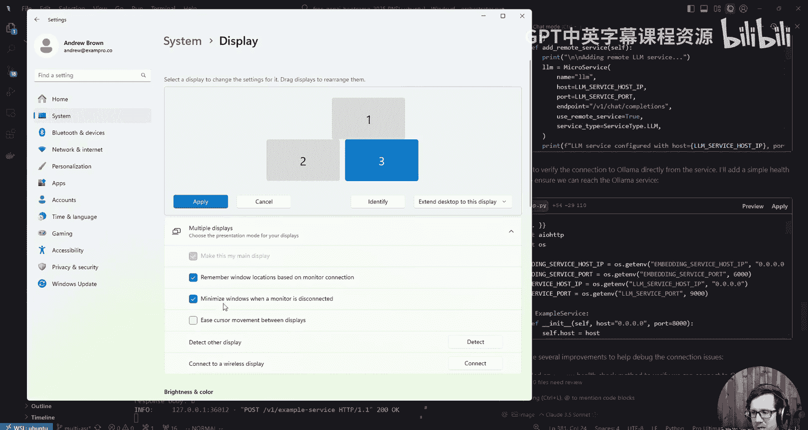

But here we have a log flag， and it's set to fall。 So maybe we set the log flag to true。

 We'll get more debugging information。 And that could be really， really useful。 So I'm gonna go。

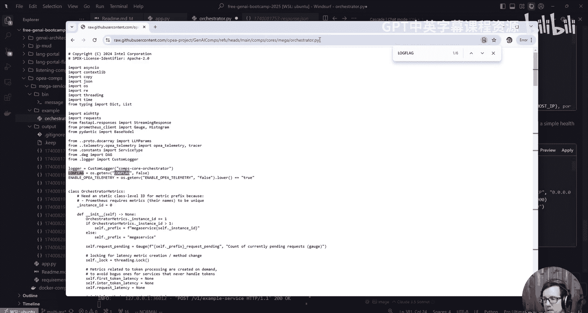

Over to here， I'm not sure where that's going to log， but。I'm going to go， and。Stop this here。

And hit and hit up， and we'll say a log flag true。And let's see if we get。Well， I'll hold on here。

 I'm not sure if it has to be like this， like tea with the true。

We'll see if we get more logging this way。I don't know。 I didn't put any of this code in yet。

 I haven't even read what their output was， but they just said that one thing there。

 And so that seemed like a good start。嗯。Doesn't look know like we're getting more info。

Let's go take a look here and see what they said。We can we can flag the log flag environment variable。

 Let's add more debug print statements to track the request flow。Add remote service。 We don't。

 I don't think we need that， no。嗯。I mean， if there was a configuration problem。

 that might be actually useful to do。So maybe we should do some of this。And。

Just carefully looking through these logs here。I'm not sure where PowerPoin's open。

 I did not tell it to open。 Just all of a sudden decided that it wanted to open。

Received Chung's response。It barely added anything。 All it did was add。This print statement here。

Which I guess we can put that in and take a look。But we need to find out where the HP request is is occurring within that schedule。

 I almost kind of wanna like load that the OPA here and load it directly from the files just to try to figure it out。

 because that's kind of how much of a pain we're having right now。 This。

 I'm going to just say it that doesn't really matter。 I'm gonna go to。Here。

 I really don't think this is going to do anything for us。

 but in case all we we find out that this is not set， add remote service。啊。Where is it。Start。

Add remote service here。Okay， we can。Check those first because if they're blank。

 that would make sense， but I really don't think they're blank。And we'll scroll on down here。

 Let's verify the connection to Oama directly from the service。

 I'll add a single health check to ensure we can reach Oama。 See that sounds useful。prereview。

So here， oh， it added it right in here， but that's actually smarter because then it will definitely get set。

 Check the o on the connection to nobody you could do preview。 That's really nice。

So AI O client session。 and that could be another thing。 like， it could be like。

 it could be container to container。 Maybe there's a networking issue that's causing it here。

 removes that， which is fine。 We don't use the microservice。 We don't use those either。

 I wasn't expecting to kind of wipe those away right now。

 but because I might want to bring them back in a bit。嗯。嗯。

It's a little bit aggressive with some of these things。Yeah， that's all fine。

 And if I need that other code， I can always just bring it back。 So it's not a big deal。

And I'll just hit it。Yeah， let's apply it。 So apply except all。 And so now we actually have。

 I don't know if it's gonna work， But it now has a means to test it that way。

 We'll just take out this。 I don't even if this log flag is working as expected。 So we'll take。

 we'll do this instead。And I'm going to go here and we'll try this again。And so， now。

If we go back up a step here。We should have more information。嗯。Not sure why this one's so darn big。

Did this actually apply or what？I can't tell。 let's go back to our file here。Which is。And。

Where to go。Right here， right here， okay。Did it apply it。 No， didn't。 So we have to go back here。

 I guess， I guess preview doesn't actually apply afterwards。

 I think I might apply to the existing the other file。 So say apply here。 We'll say except all。

 And so now。Is it not going to。A it。All right。Apply。It doesn't look like it's applying the code。

Reject， we'll just reject it。 I'm just gonna manually paste it in。

 It's having a little bit trouble here doing that there for us。 So we'll go here。

 It's not a big deal， but。We're dont have to read from scratch。 That's for sure。 That's nice。

 So I'm gonna grab this。 This is clearly new。😊，And we'll put this here。

And then we'll grab this asN connection check。Okay， so this is now in here。

We will scroll on down a little bit more。 This is the ad service remote here。

And we have much more detailed printing。So I'll add that in here as well。That's good。嗯。

I'm checking the start， and so what I want to see is。You don't need to see the example starting。

 That's pretty obvious。 I want to see that endpoint check。We could put this in here， as well。

There we go， so that's now in here。And so it's doing this check。First。Okay。And。It seemsms fine。

 I mean， there's more stuff down here。But I don't really need it。 So now we should have。

We should now have the that connection test， because that's what I really want to know。

 And we have andenttation problem where。That's the frustrating part。

 when we copy all this stuff here of that one right there。 There we go。Is that it。Nope。Oh boy。

 wheres it， is it here。What is going on with our indentation？ Why is it acting crazy here。Okay。

 so we got that。 That should be fixed。嗯。This it just that one line。 It was， okay， great。

 We'll go back over to here。 We'll hit a refresh here。 We'll go back to here。

And it's saying we didn't import it， did we。We'll have to say import。

I'm not sure if that's part of the standard library。 if it's already installed。

 I would think of it's already there because if we're using。

 if the underlying libraries using it must already be accessible。So we'll go back over to here。

 We have a internal 500 error。Okay。So we see service configure with endpoint testing Obama connection to 9000 API404 interesting。

Okay， so。Now we're going somewhere。 Okay， so is there， can you， can you write me。

 Can you write me a curl command to health check the ma command from。From my host。

Because if it's not connecting， then that would be the initial problem here。There we go。 Okay。

 I mean， is that， is that actually gonna work。We'd have to look up the API。

 but I'm gonna go ahead and just check this here。I don't know if that is an API endpoint。

 So it'll say like O Laama API。

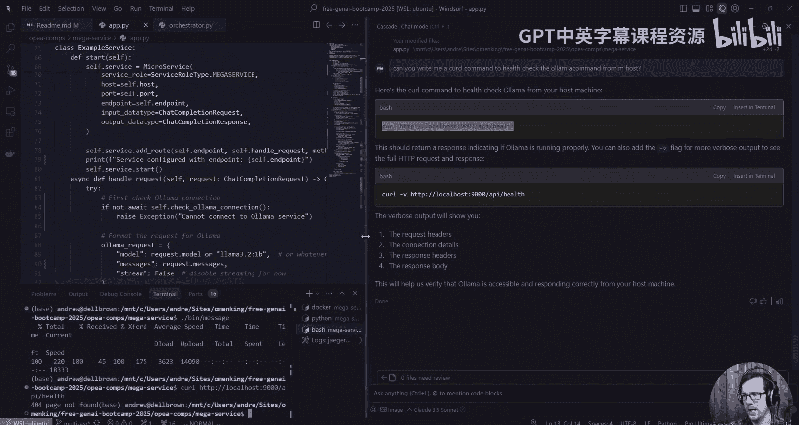

And we go to the docks。 We found this the other day that there are endpoints。嗯。Like。

 how does it even know that that's。A thing， right？

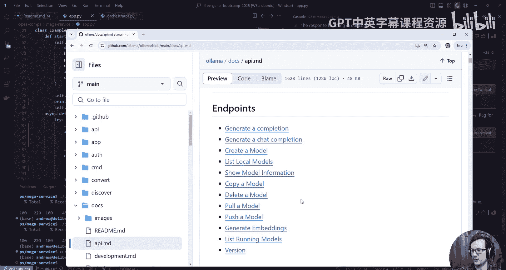

That doesn't make sense like， okay， is that。Is that a real endpoint for the Oma API？

Because I'm looking at， I don't see it here。Oh， you have to check the docks first。 I see。

I don't think it is。It's going to the same place that I just went。I mean。

 maybe we could check the version instead。Okay。So while it's figuring that out。

 I'm going to just write inversion here and test this one instead。

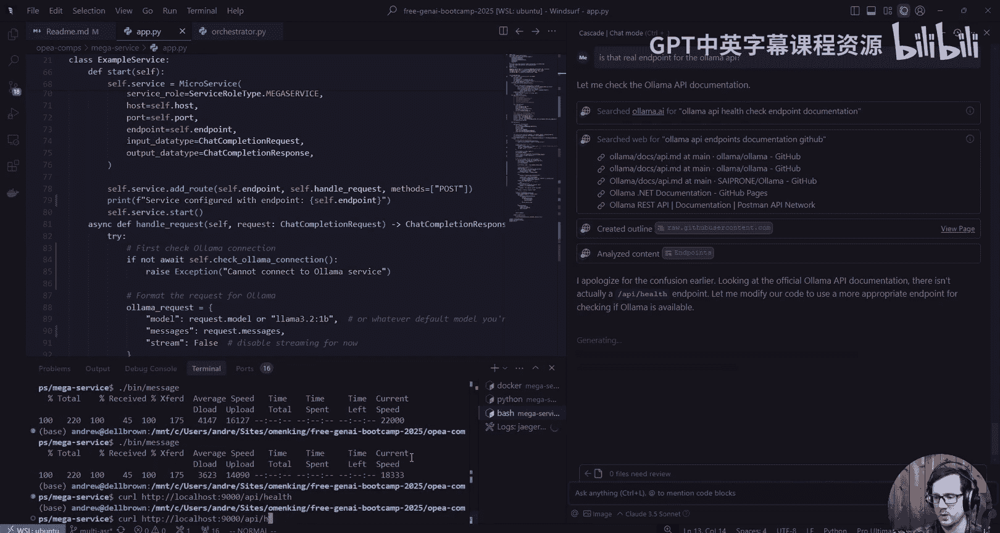

And we do get a version back。Right， so here。Says apologize， there isn't it actually。

 let me modify the code to more appropriate endpoint for checking it。

 And so here it's checking for tags。I don't know what tags are for this。But we'll take a look here。

 I'd rather probably just do versions。Tags。L local models。 Well， actually。

 that might not be a bad idea because then we would actually see。

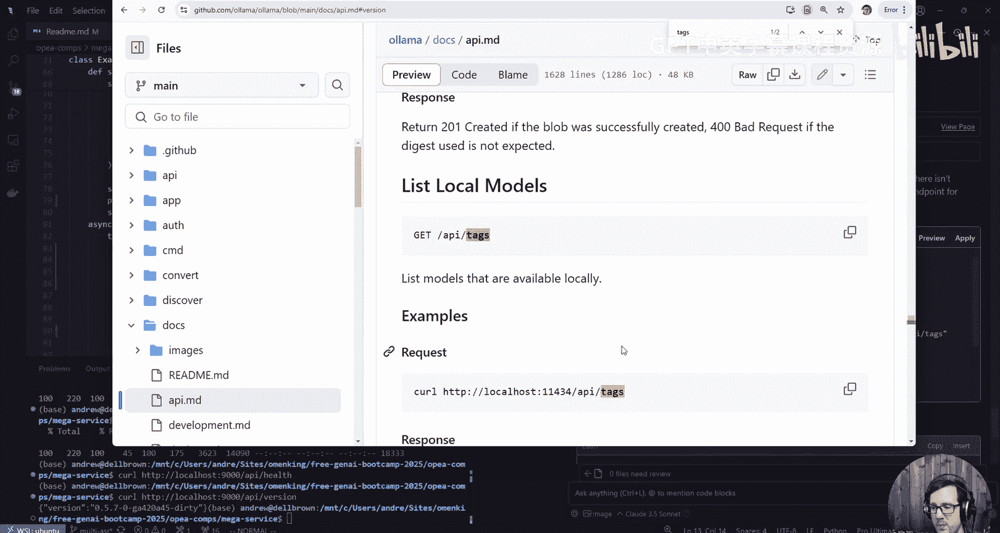

What's going on here？So go here and say tags。嗯。I mean， that's definitely an end point。

So maybe the model's not available。Oh， sorry。 There's a V in the name， isn't there。So we go here。

And we can see， yeah， the models there。 So， yeah， you maybe we'll switch it over to that。

So I'm going to go over to our health check。And。Or Oama connection check here， there it is。

And here I see tag swapped out， but it might have it has more available models here。

 So we'll go ahead and grab this here。And I could see where like。

 you might want to have the code to say， like， hey， does this model actually exist before you do it？

 And so now we have this code in place。And so that's good。I mean， yeah， of course。

 you can try the request。 We don't， we don't get that one back。

 but we'll use this one to see if we get anything back here。 And this one's not streaming。

 So the results should be a little bit more easier to deal with。 So go ahead and stop this。 Well。嗯。

What's the problem。This block is kind of acting weird， I noticed。Maybe it's supposed to have that。

 I mean， this one has it。Maybe I just didn't copy it， right。 That's probably what happened。

 So if we go back over to here， we're going to go ahead and hit up。Okay。By the way。

 I notice my mic's a little bit hot。 I'm going to bring down the audio a little bit。

 I did a podcast the other， I kind of forgot。And so， we'll go ahead and。Mi command。

And we'll go back over to here。And so now what do we have？Okay， so。

Now we now we know that from that that container， the other one， that it definitely can access Oma。

 So ama is running。 We get a status under check。 We can see available models。 It absolutely is there。

So that is a different problem now， so。O。So we'll go here and just say like， yeah。

 so we are getting a。200 from the app。For tags， and I can see its output。So。Maybe there is。

An issue with our payload being passed when it's scheduled。Okay。

 because what else could it be at this point。And down here says version 1 example service。 Oh。

 is it Well， that it should be example service， right， because。It's named that somewhere here says a。

 no， no， this is our end point。 Yeah， this is our end point that we have for the 8000， right。 Yeah。

 yeah， yeah。And so here it's saying， yes， let's examine the payload。 we're sending in more detail。

 looking at the orchestrator code。 We need to make sure our request format matches exactly one expect。

 Let's add more detailed logging the around the request formatting schedule。 I mean。

 I'm not sure how much more formatting we need on that。 Look like。Oh， let's see。 Okay， here goes。

 Also， let's。Verify the exact format OMM expects， according to the API docs， it's this。

The only that's different is that the stream is a lowercase F instead of a capital one。

 but I would imagine that that would parse that data when it gets passed， right？So， and， I mean。

 one thing we could do is we could test it。 Yeah， here first。Right。And。We check this。

That went to our output， right。No， it's printed in place。Yeah， we get an assistant back， right。

 so here it's printing back and it's getting back the result。嗯。Interesting， so。

it still isn't disabled。 So maybe if we change this to F and then make this a string like this， like。

 would that fix this problem。嗯。Or maybe the messages is passing messages within it。This is messages。

 Did we， Did we hold on。 Does this payload partsse before we actually pass along， Like。

 is this even adjacent payload or structured data before we move it over。Like。

 what's the format of messages。I I don't know why it also is asking that stuff when were we're printing out the request right here。

So go back over here for a second。And。So we go here。't doesnn't this output tell us。

If our format is correct。Almost kind of like want something here to validate it like， oh。

 format is correct before you move on， right， this matchs exactly what a expects。

 The format is correct and will and all requires are there。Okay。

 let's examine where the request is being sent in the orchestrator。

 sending it to the execute command for orchestrated to not buy。I found the issue。

 It's a non streaming case， which is what we're using。 that code uses sessions dot posed。

 but it doesn't set the content type header。 Let's modify the orchestrator to ensure the header is set correctly。

Sorry， now that， you know， we， we can't modify。Orchestrator。We need to do this。Via the app top high。

Okay， it doesn't understand。 It's， it thinks that it's part of our code base。ok。

But like we shouldn't have to set any kind of header because it should automatically already do that。

While that's generally out， let's go take a look at the chat Q&A。

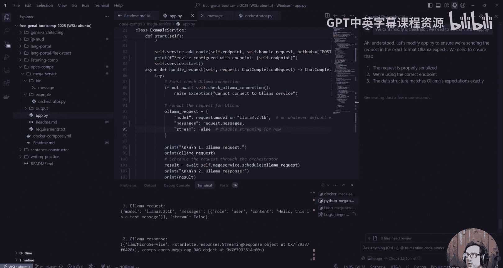

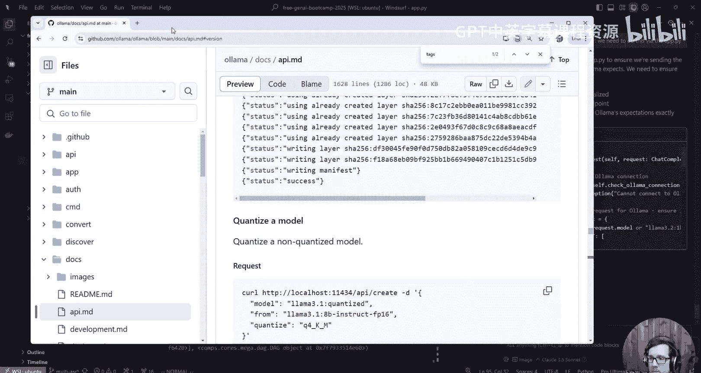

So'll say here we'll go to。We might still have it open somewhere here。

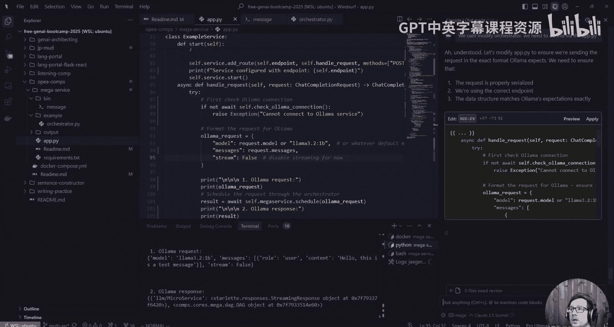

We bring this on down， and we make our way over to Jeni example。 Oh， I already have it open here。

We have handle request。It also has this。Could we just use this to parse it？Because like。

 why are we doing all this handling？If it could just do it this way， right？

So you have data requestquest。 JSO streaming object get true。啊哈。Why can't we just use this。

 Maybe we can use this。Pramers L parameters。Rettrive parameters， re rank parameters。

 Maybe this is our problem that we're not consistently using the built in stuff that would just abstract us away for us and not deal with it because we did say。

 like， hey， go implement this handle request because we didn't read through all that code。

 And maybe that's part of our fault。

Right here， they're doing this over here。 I'm just going to ignore this。

 And I'm just gonna carefully look at this。

And maybe this is what we need to do。 We need to implement。These functions。

 if we go all the way to top here， we have check completion request。

Right here because that's what we're getting back right and it says input data。

 check completion request here right， and then output data。

 so it is expecting that that structure and format。

 so maybe when we use these is' actually parsing our object to be in the proper format that it expects it to be in。

That's probably what it is。So what I'm going to do， I'm going to just copy。

 like I'm just going line by line and copying this stuff over。

 It's just hard to show it on screen at the same time。So they have like data， await request dot Json。

 I don't think we need that， but I'm going to go ahead。 I'm just going to comment all this out。

I don't care if it breaks。But we'll comment this out。 and I'm going to bring this one over first。

Right and then I'm going to bring over the stream opt。Like this。

And then I'm going to bring over this the chat request like this。And I want to print。

Each one of these will say print data。We have stream opt。Says data dot get stream。

 which it would actually。I see。 it's like， it's， it's parsing it and getting it。

 And then it's saying whether it's streaming or not that makes sense。 And then we'll say print。

Chat request。 Oh my goodness。 This might make it super easy。If this works， like。

 if this is starting to get us on track， that's gonna be really， really cool。 I'd be really。

 really excited if that， that is where we need to go here。😊，Again， you know。

 relying too much on not reading is our problem， so we'll go over here。And here， it's fine if it。

Okay。But I don't get any logs here。Oh， maybe because I went to the other one。

 so we got to go to our message here and we'll go back。And we'll ignore those errors for now。

 That's totally fine。But what I'm looking for here。Serveer exception A A S T I。

 So there might be like some。Object can't be used in the await expression。Okay。I mean。

 this one's an async up here。嗯。And maybe it has to do with what we're passing along here。

 Noosis says request check completion。 It already is this object that it's suggesting。 But over here。

 it just says request。

Why is that。This is the raw request， maybe。 but if we go up to here to our actual service。

 these are this is us adding our remote services， right？you can see that this。Our LLM， wheres our LM。

 it takes in。Oh， it doesn't say here， says use remote service true。

Let's go back over to here。Let'll scroll up。And we have in here。

Input data type， output data type， they don't even set these here。Ours is different。 Like。

 if you look here。Sll up here for a second。

We have。An LLM， which is a service。 We call it a service for some reason。Service role。 Okay。

 host port。Endpoint。Okay。Input data， output data。Why is ours so different from this one。

And if we go back to comps here。For the example， service。I mean， theirs looks like that as well。

Okay。So then why， like， where did we get those for I don't even remember。

Okay， so what we'll do is we'll take a look at the micro service。

 I think I'm starting to get somewhere here with it。 I think I'm starting to figure this out。

We go into。

Cos。If you're in， and we go to comps here。We're going to go into core。And inside of core。

 we have our mega and inside of mega。I mean， I don't know if necessarily that comes from Mega。

 let's go back and take a look here。

We have here。Oh， it's from cops。No， no， it's from the API protocol under core， comp score， okay。

So in cores。Would they say proto？AI protocol。 So in here。We have。

 but we were looking for the service， right。

Which is actually comps。

Microservice， is that what we did。 We did。 Comps microservice。 So that's actually where we need。

 we need， we need to go。 We need to go to comps microservice。Is it common， no。

What was it。It's hard to remember。

Comps is just this comps microservice。 That orchestrator came from the mega orchestrator here。

Microservice is right here， okay。So on the right hand side， we can see what we have。

The microservice here is an HB service。 That makes sense。 It does have input up。 Oh。

 I remember less reading this now， yeah。So here we have input data type and output data type。

 we have provider， provider endpoint， use remote service。

 I think what we did is we told to read and figure it out。Okay， that makes sense。

It seems like if we don't even said that。 it would already do that。 So if we go over to here。

 let's see if we can compare this down a little bit。

So the first thing is。The service。Oh I thought， I thought this one。 Oh， we have one up here。

 and then we have one down there。 Well， what's the difference。Oh， this is setting up the actual， Oh。

 right， Right， Right， Right， right， right， right。 So this is our actual main end point。Wait。

 we'll hold on。 then what's the sound here。No， this is our service。 Okay， so this is our service。

I know it's a little bit confusing， but we'll go back over to here。 I think I'm。

 I think I'm figuring out， okay， so。We set up our mega service as our service orchestrator。

Here， okay， so that's the same。And then。Under our ad remote service。

I don't see the same thing they have here， but they are defined endpoints， right， Retrir reraker L M。

 So this part is。Similar。But do we have like a generic service one。啊。Okay。

 so I think what we're seeing there is that I think this one's fine。 This is the service。

That。I'm gonna mixed up here。 Give me a second。 I'm gonna just try to figure this out for a second。

 come back。 Okay， Allright， okay， so the start function。 They have a start function too。

 This is where they define the the the service， which is our end point。

 And this one has check completion request and response。 That totally makes sense。 Okay。

 so this one makes sense。 And then the other one here is the L M， which we have over here。

 And we have that as well。 right， So we go here。 We have our L M here。 L M， et cea， et cetera。

 et cetera。 in terms of the settings。 They're looking pretty similar， right， So we have L M。

 host I P， service port， check completion， user user remote service true service type L M。

 So that's all the same。 That's all fine。😊。

So there's no issues there we're not doing flow to because we don't need it。

 we're just going to add the service， which is fine。 there's nothing to， I mean。

 this one will add them all like here they'll say add add。

 add add and then here it says flow to embeddings retriever。

 flow to whatever but it's just going to go straight to the LM because there's nothing else to flow to。

So the part that's really different is the handle request。 and for whatever reason。

 their thing that they're returning here is just a request。 They just say request here。

And the other thing is that they're not even specifying that this is a check completion response。

 They actually don't specify anything as the response。So， they just have。This。Okay。

 and so now we're not expecting back a check completion response， which is confusing because。

This one that that other one here， we don't have to parse the object to do it。

 So is it just a different way that we could do it And the the way we have it is more efficient。

 because if we do this and we match other code， I bet this is going to return the data now because now it's just a raw Python thing。

嗯。But then it says here， request is not defined， which is fine。So request is defined in fast API。

 So they're bringing in fast API。Which we can do that， I suppose， like that。嗯。

Is that how we want to do it while we can try it？I'm I'm going to go ahead and stop this。

And I don't know if we have fast API。 Yeah， we already actually have it there perfect。

 And so I'm gonna go back over to here。And we'll start this up。And we'll run this here。

 we'll hit message， and we'll go back over to here， and I want to see if I get any output。

Maybe you didn't get it。 try this again。And so now we're getting some output。And so here it says。

 okay， so we're getting the results， we have the data。We have the stream POT。

It says the parse object method is deprecated， use model validate instead。

 deprecated since pyedantic version 2， to be removed in version 3。

 I don't know if that is the exact same thing， but I really hope it does。

 I guess it's using pyedantic underneath， which is our data validation thing for Python。

So we will go back over to our code here I'm kind of getting deja v as I feel like we' were doing that before。

 We'll go ahead and say model， model validate。 Okay。

 And so I'm gonna to go ahead and stop this and start this back up again。

 We'll go ahead and run this again。 We'll go back over to here。 And we do get back a chat request。

 Hopefully， that format is the same as the other one。But we do have model validate。Okay。

 and we do get back a ta request for an object。 So now we're starting to get something on the same track here as the other one。

 Okay， so I'm gonna go down to here。

And we have this line done。 And then we now have chat request messages。

 which will get us our prompt back。 Okay， so I'm going to go here， and I'm going to paste in this。

 We'll say print， prompt， prompt， right， also， just to make this a little bit easier to read。

 I'm just gonna do this here。 and then one here。

We'll probably do two here like this。Yeah， that's what I want。有。Same thing with this one。 Yep。

 thank you。 Thank you very much。 And I'm gonna stop this。 Start this up again。 Go back over to here。

 Run this again。 I'm gonna go back over up to here。 And I'm gonna take a look again。And。

Maybe that wasn't ready yet。 We'll go back over to here。 Yeah。

 Sometimes I'm just going a little bit too far ahead。 So we have data， stream pot， chat request。

And then the next one， it complains about handled message is not defined。Here， oh。

 because there's a this is a function。

So in somewhere here there's a handle message function， let's go take a look at it。Oh， it's up here。

Oh， it's part of the core's megauts。 Okay， great。 So now we'll go back all the way the top。

I'm going to go ahead and paste this in here。 I'm going to go ahead and hit up。

And we will wait for this to start running。And we'll go back。It seems like that's the big problem。

 like there's clearly good key libraries， but they're not， they're not documented。

There's no documentation whatsoever on these things。 And that's what makes it really hard。

 Now we're getting our prompt in the proper format。 Again， we're just following the existing example。

And so now we have the LLM parameters， which I guess is a way that we could set up our parameters。

 Is this specifically for LLMs。It is。And this is another thing that we can import。

 Let's go ahead and bring this in here。

And I'm going to go back over to here。And we will go ahead and bring this in here like this。

Okay。And I'm going to go down to here。

AndWe'll copy this。 we don't need all of this， but let's take a look at what is here。Okay。

 so now we're just step by step。Copy and pastcing from the main one。

 Just figure out what' stuff going on here。 And they have a really simple one here。

 But I'm gonna to paste in the big one。 Since I say I knew what to do next。

 And so here it looks like this is just allowing us to overwride any parameters。

 So it's saying this is the max tokens Otherwise， said it to this。 If it's this and set it to this。

 And it says chat request。 So the idea is that if the payload has the stuff。

 And and the stuff aligns。 it can parsel from here。 Stream op is getting passing here。

 that totally makes sense。 So that is really simple。 These are just normalizing。

 I guess the responses that are coming back here。 We're not using a retriever。

 We're not using a rera or。 We're not using a results。

Well'， actually hold on。 this is the schedule here。So it says await makega service schedule。And。

It's scheduling multiple things。 How does that work？Self。megaservice。chedule。Text。

 past the promptton。LLM parameters， parameters。Okay。And I suppose we could try that。 And we have。

And then if it's a streaming object， it's going to do this。嗯。Well， were again。

 we're just gonna walk through this individually， but we don't have retriever parameters that we're using right now。

 We're not use a re ran right now。

So can we just admit those？Right。So we have schedule initial inputs。

Which I'm not sure why it' wouldd be anything else。

But we do have that orchestrator right here so we can kind of look at the code。

 We don't need it in here anymore， but。We can just take a look at the service orchestrator。

And so here it says L M parameters。 And then has K W R。 So it can take more stuff。 Okay。

 so that's why I was able to do all those other as。

 How can par parcel those other as is another question。

So we'll go here and we can see it creates a task at which it executes。

 And I guess at those other things that can execute and these the parameters that can do that。

 And here it's actually expecting element parameters。 We never pass that before， right。

 we pass it some other kind of structure， which is really surprising that it ever worked prior to that。

 And then it wants its initial inputs。 I would probably say I don't like the wording of some of these things as it's。

 But I mean， as long as it's going to。Normallyormalize that， that's all that matters， right？

So we don't obviously need those two。 And they're probably optional。 We probably don't need them。

 And so I'm going to go here。 And we're going to say print and see what the results there are there。

 We're going hit stop。 We're going to go hit up。 We're going to go back over to here。

 We're going to go over to here。 We'll flip back over to here。 and we were too quick。

Now we'll go back over to here， we're getting a stream a starlet response back。Which is good。

 We can also go over to here and see what we get。 We actually haven't been checking O Lama at all。

 Maybe it would have helped if we saw what O Lama was receiving， right。

Maybe that was part of her problem。 We never， ever looked over here。嗯。

The last one here provides a 400。That doesn't sound too good。 I'm not sure how long ago that was。

 though。At least it's reporting over to Yagggers。 So that's interesting。 Oh， so， okay。

 so Yager is also reporting to O as well。 That's cool。😊，嗯。

I'm just curious if we go back to our search here。

Oh， check this out。 We got some reds。Latency issues。Of all in one。I mean。

 before we were focused on OPA， maybe that's why we didn't see the other ones， right， because。

This is all， this is all specific to。So this is is the microserv one。Nope。

 I'm terrible at going through traces。 We'll go back over to here。

And so now we have a lot more going on。Hman traces。Lots of stuff over here operations。 Yeah。

 I'm not sure what I'm looking at， but at least we're getting output。 So that's kind of nice。

嗯。So。We have the starlight object， which is fine。 We're going to go back over to。That code。

 I'm just going keep on copying over。

So here I'm here now， right。 So I'm just again， I'm just going down the list and figuring it out as I go。

 Hopefully， folks， you are seeing that。 I'm doing that。

So the next part is to grab in。

This part here， right， So we're gonna grab this part in next。Actually。

 I kind of want to grab up to here because then we get a response。

Here it says if the response is streaming， then return the response now。

And then last node， grab that。 Okay， so we'll go ahead and grab this。

And I'm going to go back over to here。I'm going to paste in this part next。是赔是3。And。We'll say print。

Yeah。And so it'd be really cool if we got a response back here。 But now I kind of feel。

 well I didn't mean to stop that。 But now I kind of feel like we're now providing it the proper formats of what the schedule is expecting it to receive。

 right？ So go ahead and run this。😊，And we'll go back over to here， and I'm going to hit start here。

And we'll go back over to here。And so， now。Well， I don't see the response unless it's there。

 and I'm just not seeing it。So we have the result dictionary。But then after that。

We don't see anything。And we clearly have items。Right， but why wouldn't this one print here？So。

 like prints。Just like anything here。Oh， if instance of streaming response， return term response。

 Well， what if we do print over here， we just say print， streaming response response。

 because it is actually a streaming response， isn't it。

 We're not supposed to get a streaming response back， but it's sure as heck wants to make one。

 So we'll go ahead and do this。 And again， it might be the way we're passing stuff in here。

And then well， we'll just try this one more time。 We'll go back over to here。

And here we have streaming response， so it is a streaming response。Okay。嗯。苦。But then。

 if it stops there。

Right， and we go over here。 Then how does that work， right， because。We need this to。

Good her stream response。So four node response result dictionary items。 So whatever is in here。

 iterate over it。 And if the instances of streaming response return the response immediately。

Otherwise， it will continue on。 It will do a runtime graph， all leaves， -1， whatever that's doing。

 It's going to grab the last text as the response。 It's going to do choices dotend。

 And it says check completions choice responses choice。

 I think the response's choice is because sometimes L Ms return more than one thing back as a response choice。

 right。And so the rest of the stuff is probably fine。If you have a chat completion。Stuff there。

 But here， this actually returns the proper response。But if it never gets this other side。

 how would it ever return that， But maybe there's another part to parsing this。

 So I'm gonna grab the rest rest of this。

And I'm going to paste it in。After this。ok。And so this other stuff， I'm not expecting it to run。

 right？ So you would just say。Not a streaming response。Again。

 I don't know why it's streaming when we told it not to stream。

Maybe like can Oama be set to not to stream？

Can Oama be set not to stream。How to disable streaming in the rest API。

And so here it says I try to work。 I assume you're referencing it。

 It adds an optional stream false pram note that I didn't use just using curl。

 So here' suggesting that if we did a stream false， it would do that。

 But I haven't seen that work as of yet。 So if we go back over to here to our。

 we'll call it like oama test。

O lama test， let's go up back over to this one。I believe that this one is going to stream the result right。

 if we copy this one。And I'm just gonna paste it in here。 And it's fine if it streams， initially。

But maybe we should just test and see if we can get a not stream first。 again， ideally。

 we wanted to stream， and we've got to figure out how to handle that。

 That's kind of the hardest part。But we'll go back over to here。 I'm going stop。 and I don't even。

 I don't even need that running right now。 That one doesn't matter。

 but I'm gonna go here and do a chaode， a chaode U plus X bin message， okay。And。

I'm going to go ahead and do。Ben。Olama test。And so here， while the port's a bit different， right。

 I think we're running on 9000 right now。That's why。 And so we'll go ahead and hit up。

And so it's streaming。 That's， that's fine。 That's fine。 We don't care about that。

 I'm gonna go ahead and say stream。 and we're gonna say false。Because if we pass that payload。

 it shouldn't stream， right， we shouldn't have full control of what we wanted to do。

And so knows that it's delayed。 That might be a good thing because it's， it's trying to generate out。

 And so now comes back with a single response。 It's not streaming now。Right， so clearly。

 the stream flag does work with O lama。 So there's no question about it that it should be able to take that。

 But if we told it not to stream， it should not return back a streaming response。

 And so we should really focus on that。 But here it's set to true。Okay， so， I mean。

 that kind of makes sense because， well， I mean， doesn't make sense， but I。

 I kind of understand why that's an issue there。This says get stream true。

 Why would it say get stream true。Oh， maybe like， if it's not set a stream， then make it true， right。

 That's probably what it is。 It's like， if， then， then do that。 That's probably what's going on here。

 So if we go back over to our message。We don't have stream false in here。

 So we'll go ahead and just put stream false。And maybe that's what it wanted this entire time to stop being such a jerk。

 I mean， again， we should still make streaming work。

But now we're just going down a different route right So now instead of going to the streaming part。

 it's going to go to this other part of the code。 So here it's obviously killing at this point saying oh。

 you're streaming a response， we'll do this and you have to handle that there。

 And we obviously are having issues with that。 I can't even get the components out So that has to be handled a certain way。

 assuming those parts are actually being returned and assuming before that we were giving the payload correctly now that we're now using the normalization。

 So now we're onto this part of the code And so we're expecting a not streaming response。

 and we're expecting this to print out the proper thing right So if we go here back over to here。

 this is running good。呃。Okay， there's some other stuff there。 That's cool。 I'm going to go back and。

We'll just take out this log flag through Does' matter there。 We'll hit up。And we'll go up。

 and we'll hit。Give it a moment there。And it's not all on the test。 We wantan to do the message。

 right。And there's something wrong with our code here。It looks fine to me。

 maybe because it wants it to be like this。Like， why is that a problem？Literal line。

I'm going to try to take the cell for a second。Now， it's fine。We do。Stream equals false。

 It should be able to handle those。 It can't。Are billions not part of。

 I thought they were a part of Jason。That's fine。 We'll get， just give it like this。

It still has a problem。 We take this out。Now it's not a problem， what am I doing？We go here， right。

 We say stream。False。Maybe it's not an issue with this。 It's an issue with this part of the code。

So if I go here， I'm just gonna comment this out for now。Internal base error。呃。Well。

 we'll go back over to here。Oh， well， this is the response that comes back。 Sorry， sorry。

 So that's the problem isn't this。 Okay， the problem isn't， there's no problem with this。

 This is fine。 the payload that's coming back from this is complaining。 And so at this point。

 our code problems over here。 that's why。 And so if we go back over to here。

 it's saying it has an issue with this part here。And it's actually repeated twice。

 so that's maybe part of our problem。So we'll just take that out。

I'm not sure why it wants to cross this one out。I'm gonna to ignore that  one。

 I don't think that there's anything wrong with this one。 It really wants to get rid of that line。

 I don't know why。We'll run this again。We'll go back over to here。

It says error text doesn't know what it wants from there。We， we go up a bit。

So it says no streaming response， which is fine。This is the result dictionary。Which is here。

It has a problem with the run time graph。So we'll go ahead and grab this here。R T graph。

 runtime graph。 There we go。So maybe that will tell us a little bit more about our code here。And。

So we got a Dg back。Okay。So， then。So this is actually returning back the dag， okay？

It says runtime graph all leaves negative one。 Maybe it has to do with the fact that we only have a single node。

Because when we， when we add things to it， that's probably where we're having some issues。 So let's。

 you know， what does this code do。

Right， it has something。To do with a dag being created。We only have one node， so will this code。

Cause issues。Because that's what I'm thinking， right？And that's just checking the DAg implementation。

Dag is a diacrylic wth。We'll give it a moment here。So it says here。

A it's from DAg runtime gets the last leaf node in the graph。

 A leaf node is a no with with no outgoing edges， no children。 In our case。

 we only have one node in the graph。 So all these will return just one node navigates the single node。

 This code is safe to use， even when the code is here。Okay， but if that was the case。嗯。

Maybe we should do is print out what the last note is。Well here we have last node， right。

 and then we have result dictionary。Oh， okay， so let's go print。 We will say last node。I see。 I see。

 I see。 O。And then we'll stop this。 We'll start this back up。 We'll go back over to here。

We'll give it a moment。 You can see it started up。 We'll go back over to here。 We'll check。

 And so now what I'm looking for is the last node。 What's the last node。So， here we have。

Chailt request prompt result dictionary。 So you have result dictionary。

It must it must mean to select this。Like this is what Laso must return and it does。

So whatever is in here is what it can do。And it's not text that it's getting back。 It's。

 it has an error。It says error message blank is two short messages or whatever。

 so we go back here and the problem is it doesn't do error handling on here。

So it says message is too short。 So here I go here and say， you know， I have an error issue。

 so I need error handling。For the re， the results。Dt。Right， so we go here。

And we don't have error handling。 So that's why it makes sense。

 because it is collecting the last node。But there is no。

 it has to check whether there's a type type invalid request error first， right。So。

If we go and take a look here。Last node。Yeah， it should check。Okay。

 you're gonna give me a little bit more code here， buddy。There we go，Last node， result dictionary。

 Check if it's there， check if we got an ear response， right， because if we did。Then。

 handle the air otherwise。We'll process it as per usual。And then we go along our merry way。

 So that is， that is what we need， right。Okay， so I'm gonna go ahead and copy this part。

And will'll go all the way up to here， right， and we'll copy that。 And then from here。

 it'll go all the way to here。And we'll paste this in like this。Right， so now。We have error handling。

 Now is this error handling good。 I'm not sure。 I mean， it is checking on this one。

 There could be more errors that we have to handle。

 And is this a good way to bubble up errors at this part of the code I don't know as this does return back an HP request。

 So clearly that would probably work over here。 Well actually is that the code we copy and paste it it is。

Becauseuse over here， they have chat completion response。So if there was like an error。

 is there like a special one that we're supposed to use for that， I'm not sure。

 But let's go ahead and see what happens when we do that。We'll type in clear here。

So I'm just hitting up and running our message again。 and we'll go back over to here。And I'd rather。

 you know， so we get actually back to 400 bad requests。 perfectfect。

 So now it's doing what we want to。To do。We can't exactly see the area here。

 we'd have to go back over to here。And look at the dumped data。Well this one didn't return anything。

 It didn't tell us anything。Because I think we changed it， No， no， we still do the response output。

I I kind of wish that the the output folder was a little bit easier to navigate。

 maybe justca I'm not sure which is the latest one。 I guess the bigger numbers， the latest one。

 are they doing them in order。They are。 So then the one at the bottom is going to be the latest。

Here message is too short。 Okay， so now we know how to check your messages。 blank is too short。

 So clearly， something's not getting passed in here。And。

So now we're getting really close to actually getting this to work。

So I'm going to go back over to here。And so， you know， I get this。Is there something wrong with。

My payload， I am using the message。File to send a curl。Okay， hopefully I can reason it。

 Really gotta give more detail than that， but。Okay， so hold on here。

I don't if you can hear my stomach just keeps growling， but all you can hear is that。

 So stream false there there were they the way we're handling the request。

 we need to see what's happening in the request。 Let's add that。But you might need it。

 I don't need to see it already know what it looks like。And here goes validate required fields。

And I mean， really， we should， I mean， the other thing kind of already does that， but。I mean。

 we already have。Let's go back here。 Let's go back to our code up here。And so the thing is。

 is that the message is too short is what it's saying。 The message is too short。But， I mean。

 it can see what's being passed here， and the data is being printed out here right here。

So I don't understand。 I mean， I can't see our logs。 Maybe， maybe if there's a way we could say。

 look at our logs， that'd be really useful。Maybe windsurf can do that。

 I just haven't figured out a way to bother bother to learn how to do that。

So we have our endpoint example service here。This is the data。That is being passed here。

Maybe it's the structure of this data here， right， Maybe this is this is what's wrong。

The request state is correct， but we need to modify how we're handling。

 The error is happening because we're using handle message。

 but not properly formatting the request for the LM service。

 I thought we were formatting it properly。 We're following the check Q And A for it。

 So here it's suggesting。嗯。What is it suggesting。It makes me think that there's something wrong with。

This。Right。嗯。User hello， this is a test message。 Now。

 what would be really useful is if we went back to the Chaune if it had an example of what it was expecting。

 because if it had that， then we would know， right， we'd be like， oh okay。

 that's an example of request that's coming in here， but we don't know。

So we don't know what it's expecting to parse。For this here。

But I guess the other thing is like if we get the chat request back。

 wouldn't there be like a way to validate that？

Properly convert the string falls to boan falls。Okay， I'm not sure if that's our problem。

 but format the message into a prompt string that Oama can understand。

 createate a proper request format the album service that includes these things。

 So let's take a look here and see what it's trying to do。

I'm gonna to just pause here and see if I can speed through it。 I mean， something we can do。

 I keep thinking that doesn't like that。 but we can just make this ability to rule that one particular one out just so that it it stops complaining。

 I really don't think that's our problem。 but we'll go ahead and just test that just quickly here and see what happens。

Now we got to run it， maybe。And。Yeah， we still get the same problem， which is fine。

Let me continue on here。 Let me see what else there is。 One thing I was thinking is。

 why don't we just try to figure out on the  Lama side what's happening。

 So I just looked up that error as message is too short。 I'm not saying I have the answer。

 but says trying to use a custom function with opening eye agent。 It's not  laama。

 but it's using the standard API。 and it comes back here and what do they get So it doesn't tell us fully what's going on here。

 but maybe what we should be checking is。

Ohoops， is all lava。Right， so here's a question。Do we get back here。嗯。Like。

 do we see any calls here that's occurring， right？ So here we have this one here， right。

 This one is 21，3219。 I'm going just copy that。 So I don't have to remember。

 And I just want to see that this is incrementing， right， So we'll go back over to here。

 We're going run this。And yeah， it's incremented。 And so here we see a post。It's。

 it looks like it's using， well， it's obviously using go lay。 Well， sorry， that might be jagger。

 actually。Is it it says Jin， maybe O Laama runs， maybe it's a go program， didnn't think of that。

But here we can see that it's running。 So I guess my question is like， how do you debug。O Lama。

 maybe that's a better question。How to debug Oma API calls。

 like is there a way to have more robust troubleshooting？

And so it says sometimes all I made not perform is expected。

 One of the best ways to figure it out is what happens to take a look at the log files。 Oh， well。

 let's do that This entire time。 we've never tried to open this up and take a look。

 So let's go ahead and view the logs。

And。Oh， I mean， I'm just viewing the logs， but I I we really。

 what we should do is not the logs of the container， but。Yeah， that's not gonna be useful。

 Let's actually go into the container。 So we'll attach the shell。 And it says here to cat。

 And is there along the directory。 There is logs。 I don't know how this would not be the same thing。

 though。I don't have any。 I don't have any server logs。

I I don't even have a logs folder。But here， this is where they say it is。

ok。M， so say O laama。谁欧啦吗。Container logs。Where。The allow the server logs are saved under your mounted jetson。

Direct it for What the heck is that。

Is that the one we're using， I'm not even sure if that's actually it。 This is  laama O laama。

 But this could be a fork of it， right。

This says dusty envy version of it。So like what if we do， O lama， O lama。

 well get more information here。So this is the one that we're actually using。It's a sponsor to O。

Let's increase the size here for a little bit here， we'll scroll on down。Configure the repo。 Okay。

 Nvidia， that's cool。 Confire the repository。 configurefire Docker to use Nvidia drivers。

 Start the container。😊，Add GPUs， run locally。Okay， could I， I。

 could I learn a little bit more about what's going on here because。

I don't understand where the logs are going。I mean， if there are other logs for us to check。

Because here it has， why maybe we could try this。Yeah， journal， sometimes journal works。

No， journal command doesn't exist When you run， Oh， right says right here。

 When you run as a container， you get the SDF。 So that's all we're gonna get。嗯。Alright。

 so we actually are already getting the logs。 I thought maybe because I might thought there might be more detailed logs。

But is it like way to get more detailed log。 So Do。 P asked， if you're manually running serve serve。

 the logs will be on that terminal When you run it on Windows there are a few different locations。

 Don't care about that LM libraries。Experimental LLM library override。

 installing this here and video troubleshooting。GPU troublebyshooting M D troubleshooting。

 Windows terminal troubleshooting so not enough information to figure out like what our problem is because that error is just very generic。

 but it seems like we should be pushing on Oma apart because it clearly is receiving the payload we're clearly using the proper formatters that is expected via the chat Q A example and so our issue is more on the Oma side I think our mega service is configured correctly。

 So let me see if I can find more。So one thing I was saying is like can we see what the payload is and I keep thinking like maybe we get that through traces right and something like does ama have support everyone saying please please add add OT to llama right and they talk about like oh yeah。

 we're going to do this and that and it's a feature request right now So this is open there is a working implementation。

 but because that's not what we have， I can't use it And so basically we don't have visibility into ma maybe that's why Oama doesn't make sense as a production production use case because it's missing this key component to be able to debug and see what's inside of it So right now we're debugging blind because we're trying to get as close to the source as possible And so we don't know what like we can see maybe on the outside of what schedule has because there's so much stuff so many layers there we can't clearly see what payload is being sent and we can't clearly see what payload is being received。

But we can tell that we're getting that darn error that doesn't tell us a whole lot。

 So I'm going to have to just bash my head against the wall till I it bleeds and the answer comes out。

 So give me a moment。 Okay， Another thought I had is that we have the prompt and it's in a format here。

 But we have this text prompt area here。 And I wonder if this is our problem。

Okay， because when we use。This one here。Right when we're using this one here。

 it is orchestrating to multiple services。 so it says embeddings， retrievers， reranker LLM。

 what format would the embedding want as its input， right？ Maybe that's what it wants。

 It just wants text。Right， and the problem here is that it's saying， hey。

 you didn't give me any messages。 So maybe this is our problem， right。

 because it's going to go to the first one and it's expecting this to be in a very particular format。

 So it's either we just pass the prompt along or the messages along here。

So here it handles the handle message。And we're going to pass that along here。Right。Oops。

Or we might need to like， tell that we're passing a message along。 So let's try this。

 We'll try a couple things here。 But this is where I think we're getting kind of closer。Okay。

 and so I'm gonna just， we'll get out of that for a second。You know， and then。We'll go up to here。

 and we'll hit up。And so that's fine。 We don't care about that。And so， here。

It didn't like how we passed it in。 Okay， so I don't think we can just pass promptton。Right。

 I don't know it's going to work， but let's try。Again， this is just me guessing。

But let's say it wants messages as its input。 So we'll go and just undo this for a second。

's say messages。Maybe that's what it wants。Right now。

 I'm not sure if it just gets a single message or not。Who says handle message。

I'm gonna go ahead and do this。 Hi up。We'll go here and hit up。I'm not sure if it took it。

 so I'll do that one more time。 and we have 400 bad requests。 That's okay。

And so now we have user Hello test in it message。We're not getting any super bad stuff。

Is this actually the same one， Let's go back and go all the way to top here。 Messages is too short。

🎼Delete permanently， delete。So go ahead do that。All the way like that。

 I I can't really tell what's new or old。 So we'll go ahead and just clear this out。

And I'm going to run this warmer time and we'll take a look here， we'll give us a refresh。

 we'll check。A different error。 A different error。 How about that cannot unmarsial string into go structured field chat G P T request messages of tight message。

Okay， so maybe what's going on here is， you know， we have that format here。

Right， of whatever that is。Propped。But what does it want here。嗯。

What is initial input supposed to be。So this is where we're got to do a little bit morere digging because this is our problem。

 This is where it is。 We have。 we have narrowed it down。So I need to go into comps here。

 And in here in this。So the mega service。Thatt was in the orchestrator。 We'll go back a step。

And the orchestrator。It is， we have that schedule function， right。

 which should be here on the Ray hand side。Their schedule。And here we have initial inputs。

 and it takes a dictionary。 So clearly， we can't just pass the string like there before that totally makes sense。

 If we had log flag on， then it would show us the initial inputs。

 So that would be really useful to see what's being passed in we have it set to true。

 But we're not seeing it。 So maybe it's logging to a file or wherever the logger is。

 And maybe we haven't configured our logger and that's why we're not seen our output or it's somewhere。

And so it goes to the execute command， and it does initial inputs here。

 So now we're following through to the ex execute。And so execute is here。Okay， where。

 where's the function defined？ That's what I wan to know。So where is death。Execute。

 let's look for execute。Let's do it this way。Here it is。And so。It takes out a knit。Input。Inputs here。

 is that what it was。 Let's go back here。So we have one，2，3，4。

 I wish they used the name so we could just tell what they were。We have one， two， three， four。Oh， no。

 no， no。 We ignore self 1，2，3，4。 So now we're on inputs。RightSo we're carefully going through here。

And here's where we get to some codes that we have。

We have our LLM dictionary that we're grabbing out of here。Right。And then we have if。

 if this is a VLLM。 So it's detecting if it's VLM， I'm assuming this is VLM or is it VLM。

 I'm not sure if is LM VLM， What is what's this supposed to be。We don't know， it doesn't say。

But the point is it'll say LM parameters， get the items iterate through them。We have inputs here。

Then we have pre process so self align inputs。We still want to focus on this inputs here。

 because I'm trying to figure out by looking at the code what we can understand。

 So it goes inputs dot get field。If the get field does not equal that。

 So iterate through each one and then set the fields。 Allright。

 so it's maybe student a transformation of the format of the thing， right， I don't know。

So you have align inputs。So we pass the inputs here and it's doing some pre processing。

 so this could be doing something。Take a look at this one。

I says override this method in the mega service definition， oh， okay， so if there's a problem。

 we could override this。Also， we could also use this as a debug point to figure out what's going on。

 Now we know how we could debug stuff。But says override this method in the mega service definition。

I don't know how to override in in Python。 I know how to do in Ruby。 So if I knew how to do that。

 that could be really good for debugging。If it is L L， VLM， again。

 I don't know what this means as V LLM， but VLM。Still leave it to this。 Do the logging here。

 Do whatever。 go down here。Go downstream。Where is this game called。So we have inputs here。

 It's logged here。 Oh， here it is。 request op post。 So it's making a request。

 and it's dumping the contents of inputs。 That's all it's doing。 This is it right here。

 This is the magic line that we're looking for。 If we can do Jason Dt input and see exactly what it's here。

 Then we can debug it。 That's what we needed this entire time。 Let's go over to here。 The magic。

 It's no longer magical。 We know exactly what's happening behind the curtain here。

 So I'm going to go ahead and do this。 And we're going to take the inputs。

 And'm going to print it here。😊。

And it says that。 But I'm going be a little bit more dramatic here。 And I'm just going to say。

 this is actually prompt。And。I'm going go above here， and we're going to say。

 don't look behind the curtain。Or is it man， ignore the man behind the curtain。It's a。

A reference to Wizard of Oz， folks。Okay， so we'll do this a few times。 We'll do this a few times。

And we'll give this one go。 I think it already does a new line break at the end。

 I just can't remember anymore。 And so this， this is what we've been trying to find this entire time。

Sometimes you just crawl through the code。 That's， it's fine。So we go here。And。It says user hello。

Input message。 So this is what it's doing。What payload does it want to work to make it work。It wants。

Promppped。I mean， we could make it just that。But I guess the question is， like。

 could we do this in the， the other structured message， Because I think it can。

 So we're gonna do like。O lama。Test messages， because we can send it this way if we want to。

But if we want to send it like a chat history or something， I thought that's something we could do。

So they can continue on the conversation。 But I'm going to paste this here。We're can grab that。

 not this curl。 We'll go down here and grab the other code here。 becauseuse remember。

 we have both this one and that one， right。I don't care if they both work。 That's great。

And this is testing the app in the mega service。 So I actually want to go to this one here。

Is there another way to generate a request。

Let's go back to the API and take a look here。So say OPA API。And。Oh， not。Oama API。

We'll go to generate。Create a model。 generate， generate。I don't want generating beddings。

 I just want to generate。Will have generate a completion。That's the API generate。

 and that only takes a prompt。 That's what we've been using。

 but we actually want to do chat completion。

We actually haven't even been testing check completion this entire time。 We just been doing message。

 So this here， if we go back to， we'll make it really clear， this， this test。

 this test is not no good。 It's not actually testing what we want to test。

So can delete this out that one。 and we actually want to go to the chat API。

 This is what we've actually wanted this entire time， and we haven't been doing that。

So now we're using the tag completion endpoint。And here we'll go down。

 I'm hoping they just have an example。 They do。 Per。 This is what we want。

So， go ahead。And。I assume we can also set it to stream false right or whatever， maybe we can。

 I don't know， but we're going to go ahead and paste this in。So this is why is the sky not red？Okay。

 and so I'm going to go back over to here， and we're going to test our  Laama message。And here。

 if we can get this to work， then then we can get the other one to work， right？

So invalid character after object， valid， valid pair， key pair。

I'm not sure what to tell you。 I useded what you told me to use。

And so we'll go back and take a look here。嗯。😊。

I can copy the whole thing， but I I don't want streaming， right。Oh。

 maybe we're just missing the comment。 You know what。

 I couldn't see it because it was feeling what I thought it would。

I didn't realize it wasn't there because of the auto completion。

 It made me think it was already there。 So it's getting mixed up。 So now we'll run it。

And it's thinking， it's coming back。There we go。 Okay， so the， the inputs back。 that's excellent。

 Let's go back over to here。And。So now we know what structure has to be。

 We don't even need to run this to find out。 But this is what it wants， right。

 And so we have messages like this。 But the problem with that， that handle thing is that it。

 it distorts the stuff。 So I think what we should do。

we should have a little bit more conversation here。What if we have more than one going here。

 So here's， here's a stream response。 Here's a stuff。 But this only has one user and whatever， so。

Open AI， open AI Me format。So I need to just see a little bit more than what they have here。

 So we have。Roll developer。 No， no。 What's the other role for it。Assistant， Okay。

 so I just wanted to make sure it wasn't that or bought or something else。 So here I might say， user。

 hello， this is a message。

And then what I'm going to do there we go。 And then now I'm going to go here。

And so now it's a little bit more complex。 But the reason I'm doing that is because I need to see what happens。

If like for our output， right， because I want to know what it does to that。

 Does it only grab the last question or does it pass the entire history because if it doesn't pass the history。

 it's not going to act in a way that we want to act， right？

 So're going to go ahead and stop this here。 We're going start this back up。

 We're going go over to here。And we are just going to do a message。A plane Jane message here。

We don't care what it says。 Well， there is a little bit of a problem here， I think。And。嗯。😊，嗯。

Is this a problem。Don't know。Doesn't look like there is。

 but I'm going to go over to this side here and see what it says。I don't think it's even sending yet。

And。Yeah， this is where the LLM kind of gets in your way。So there's some formatting issue here。

 I can't。 I can't see it。Give me a second， okay。Oh， here's the problem。 It's because of this。

 this one heard here， see。So what's the suggestion。Backslash it。Is all we' got to do。suggesting this。

That it's really bizarre to me， about if it works。That doesn't seem right to me。

 Let's just take it out。What is the weather today， There we go。

 That'll just make our lives a bit easier。And so now what we'll do is just close this out here。

We'll go ahead enter。The message happened there。 We have a ballot request。Well。

 that's okay because we we want to see what the output looks like when we go， go validated here。

 So now we have is user。 What is the weather like today， Assistant， no response content available。

 Notice that it didn't pass along。Oh， well， maybe that's fine。Oh， no， this is the last one user。

But we have three messages， right， We have content， hello。Oh， we're missing a curly here。 No， no。

 it's there。Why don't we see all three， though。User assistant。Ha。Why do we only see？2。That's unusual。

We'll run this again。 We'll， we'll hold on。 We'll just stop this for a sec。

 and we'll start this back up and we'll check this again Cause if there's three there。

 we shouldn't we see all three， right。And we'll go back over to here。And。It seems like， well。

 we're getting all the messages passed along。 So that's not our issue， obviously。

 of what our problem is。But I don't understand。Cannot unmarsial string into go structure for this stuff invalid request。

 no PRms code none。And I again， I'm not sure if this is a really a problem， but I。

 I'm confused why we're not seeing all three here。If we go more to the top here。We see， hello。

 this is a message。Okay， roll assistant， no response content available。What's the message here today？

We're here and says， hello， this is a message。 It's here in the chat request， it's in here still。

不 then。Why is it formatted like that？ What is handle request。Trun it out。

ThereThere's probably a reason， but they don't document it so we don't know why。嗯。

So maybe there's handle requests somewhere in here。We have handle in here somewhere。 Hand。 Oh， no。

 this isn't the wrong one。Do handle in here anywhere。Request。

I think that was under if we go to Cos here into Prodo and maybe it wass dock array。Do handle here。

 handle。No。Maybe it was under API protocol。

Handle。No， where， where did we get this handle function， Is it our own implementation。Handle request。

Oh yeah， it's right here， Hand request。Oh， but that's not the one we're worried about。

 It's handle message， right， Where does handle message come from， Hand message。

Megie us。So we go back over to here。Into cores into mega yourils。And then， we need handle。

So we have this over here。Handle message。 So if an instance is a message of messages。Okay。

Then return back this。 If， instance， is messages is a string。 Okay， so if it's a string， just return。

 turn it back to the prompt。 right， If it's not， and it's something else。

 because we actually have formatt and done stuff with it， then do some formatting on in here。

 And so what is it doing， It's going to go through the messages and check for each rule。

 If the rule has a system， then it's going to set the system prompt here as message content。

 If it's a user， then it's going to do some stuff here。If it's an assistant that's going to do that。

 but what I understand is like why is it truncating to the last two messages？If it has images here。

 then it can do that。So I'm going to go ahead and copy this。

Right， so I have， we'll go to here。 and we just ask you to do some code explain。

 So Ill make a new conversation。 that conversation going on forever。 You know， I have a curl that。

Delivers a message payload。Here。Message。I have this code that formats the messages。

Why is it not returning all three and only。Message message in the messages。Okay。

I really understand messages and the messages。So it says here in your code。

 the message is being built using a dictionary where the key， the keys are role user assistant。

 The problem is that when you have multiple messages with the same role。

 like two user messages in your curl， the later message overwrites the early one because the dictionary can't have duplicate ones and your co request。

 first message is this second， but in your code it will only contain this to fix this， but like。

The key changes are replace the dictionary message and go here when these are changes。

 the output should now include all three messages。Okay， so I think I found a bug with OPA。

 unless I think， do， do you think it was， it was intentional to only have。2 messages。

cause it might maybe it's supposed to， maybe it's supposed to be。

It was intentional to only have two messages in the the code is being used as part of a chat completion。

 looking at how messages are processed in the app dot pie stream this conversation context。

 where we typically want the most recent user query。 The previous assistant response。

 The query response。 The dictionary based approach while it may seem a like a above could actually be intentional to maintain a sliding window of context。

 keeping only the most recent message from each role type， However。

 if you do need to preserve the full conversation。 My previous suggestion about using a list based approach would be more stuff here。

 So I don't know if this is right or wrong， because it's not document if we don't。

 if it's not document。 we don't know what the intention is。

 So what we'll do is we'll go to handle request and just we'll put a big warning here。

 So I'll just say to do ask OPA。If it's intentional to only have the last two messages。

 because the dictionary。Because the dictionary keys。Overrite。Previous ones。

 so you won't get full history。Okay， and so this is something it like， is this。If the handle。

Message is intentional to only have that。 because that's something we need to know， right？

 Now it's fine。 If it's only last two。 I can work with that。

 but we need to know why things are happening the way it's happening。

 So now here we have messages impro。 And this is the thing。

 And we said that it was going to take it and then stringify it， right。

Because we have that debug line here。Did I remove that debug line？Oh， well， we have the prompt here。

 but we never。No， I think that's fine。 But we need to go back over to our O code here for a second。

 So in our OPA code。Not the u， but go back here。你这是买一个。Into themic， the orchestrator。

We need to find in the schedule。Right。And in here。We know that there is a response happening somewhere in here。

 right？It it's opposed。Here， it's just dumping it。 That's all it's doing。 It's just dumping it。

 So whatever this dumps is what we get。 So Jason dot dumps， it dumps it to a string， I believe。

 right。Jason dumps， Yeah， I think it's just a string， right， Jason dumps。We'll convert into a string。

 so that's exactly what it's doing。So whatever dumps is what we're going to get。

 So if we go back over to here。

呃。Right。And we have messages。 That's fine。 And we print it out。We get user assistance。

 So we have the two， which is fine。And we want to match the structure of this one， which is messages。

And then it's an array。 So I think that's what it's doing。

 The way that we can absolutely know that it is the structure that we want。Right。Is。

We'll go to the initial thing here。 right， We'll grab this here。And then we'll say。呃。Initial inputs。

Here。And then I'll say， initial inputs。Prince Jason dot dumps。Okay。

 and so now if it dumps it and it looks like the format that we're expecting it to be。

 we can debug it from there。 and we're getting closer。So I'm gonna to go ahead and do this。

 We'll go that。 We'll go to the next one over here。Oh， I stopped the wrong service， didn't I。

So stop to start that。Oh， we got a lot of cool stuff in there。 That's cool。

 We'll go all the way down the ground here。😊，So this one should be started。

 This one's been restarted。 We'll go ahead and run this。And so now what I'm looking for here。Is this。

 And so it says messages， user， look the problem。 We see it right in front of our faces。

 says messages， user Col。 what is the weather like today and assistant。

 So it's formatting it as a string。Okay， but then the other part of it is going to do a's dump。

 So it's doing something that we don't want it to do。Right， and this format might make sense if are。

 if we are inputting this as the embeddings。Right， because that other one's following a chain of stuff。

 And so this one here。It says， okay， so。Note， I think， handle message。Should not be used。

When you are directly。Passing。To an LM， I think this is for formatting for a earlier model。

In the pipeline， which we don't have。Okay， that's probably our problem。So， instead of doing this。

We have chat requests。 Let's just take a look at what chat requests are now。 So instead of this。

 we're gonna do。Chat request messages， right？And。I mean， this is just a repeat down here。

 We never actually did the thing that I， I said we were gonna do， which was， was。

 which was actually here。 We we did do it。 But right here。

And so I want to see what that is because we might not have to do this at all。

Well actually probably do it because we're getting dot messages， right？So we'll run this again。

 and now we'll see what we get。We'll hit up。We'll go back over to here。

And it has a little bit of problem。Because it's not called that， right， It's just called this。

One second。 S there's this noise outside my door。 But anyway， this is the response back here。

 And so it's just gonna be chat。Request messages。 And that's， that's what it needs to be。Okay。

And we'll leave that dump in there。 But I don't think we need this anymore。 We're going to stop this。

 We're going to hit up。 We're going to wait for this to start。 We're going to go back over to here。

 We're gonna give it a refresh or sorry， like hit the endpoint again。And we solve a prompt issue。

 I thought we got rid of prompt。 This it still in here。 It is。It's supposed to be chat。Oh。

 this not even because we're not passing it in here。 That's why。 So we say a knit inputs here。Okay。

 we're gonna stop and start this。And we'll hit up。We'll go back over to here。And。

We'll scrap a little bit。Scroll up， yep。And so， here。呃。We have。 we have this。

But we're also going a bunch of stuff we don't want。Yeah， so， well， no， that's the chat request。

 That's actually fine。So we're having error here somewhere。 Where is it。Tple dot no tribute stocket。

 Okay， so we'll go back up to here。And。What is there comma here， Maybe that's our problem。

 The comma is not supposed to be there。So well go here and we'll get head up。Do this again。

 Go back over to here 500 internal errors。 That's okay。 We have result dictionary。 That's fine。

 No streaming。 That's fine。But what I'm looking for is this dumps。 I can't。

 I can't tell if it's actually doing it or not。 We have chat request。

So let's just make this way more clear。 Let's just say print。Stringified。We'll just call payload。

 payload。你冇食。And， and， and， and， and， and， n。And then we'll do that here like this。

And then we'll go after this。And， and， and we'll go ahead and do that。 We'll stop。 It。 We'll hit up。

 We will wait for that to start up again。 We'll go back over to here。 We'll hit up。

 We'll go back over to here。 And I'm going to scroll up。Here's our payload。

Does their payload look correct。I think it does， right？Carefully looking at it。

 I think that's the payload we want to happen。 So that's fine。So now our payload。

 I'm pretty confident that it's correct。 So now we have the results of the dictionary that come back。

 It came back pretty darn quick。And so we have API error model is required。2。

So the model is not being passed along with our payload。Well， where were we using it before。嗯。Okay。

 so。Yeah， so this is value the model。 Make sure the format is correct。 We have chat request。And so。

I mean， this comes back with a prompt。And then in here， we have this。I see。

So now we're just reconstructing it。 Now， I don't know if we have to do that。

 Maybe there's another helper function I'm just not aware of。 But for now。

 we'll go here we'll say model。And then it will be chat request model， that's right。

And then if it's not streaming， we'll say， well， does that said it's， well。

 has it over here in the options here， right。So if it has it there。

 I don't think we need to set it other places。Unless we could put them in the LM parameters。

 that are no。But this would definitely fix our problem for that part。So I'm going to go down here。

 I'm going to stop this。 Start it up。 The question is， is it going to stream now。

 We're getting really close to solve it now。Real， real close。We'll go back it up。

We'll go back over to here。We got a 500 internal error。We got our payload。We'll go down here。

 model is required， it's still complaining but model is required。 we're passing the model。

We're passing it。 it should be， well hold on， let's take a look at our payload。Models right here。

 right？What is it one over here， model， same thing model is being passed。

 So it makes me think that the model has to get passed a different way。Right。

 so if we go back over to our LM Rams。Let's take a look at this specific thing。

 Maybe the model is supposed to be inserted here somewhere， or maybe it gets inserted somewhere else。

忙了忙了忙了忙了忙了。Hown to know what model it's supposed to be？To here。Don't see nothing。

All I can think of is it gets past the LM Ram。 It's either that or it gets past into the schedule。

 but it must be in the LM parameters。 So this is something we need to go look up。

 Where is L LLL parameterss。 It's here。 It's in the docker array。

So what we're going to do is go back over to here。 We're going to go to cores。

 We're going to go to what is it。Proto dockerate， proto。Doay。 And in here。We have。LM prams， right？

Here it is。Model optional。 We don't have it set。 That's where we need to set it。 Okay。

 so that's gonna solve our problems。 Also， stream gets set in there as well。

 which we actually do set， I think。

So now what we'll do is go down here。And。We'll say model equals。Chat model。We'll take this part out。

 So now the input type should be correct。ButYeah， the other thing is like。

 if it adds it in that other spot， then why does messages have to be in this format？

Right so but anyway， we'll figure that out here in a second。

Maybe we're not 100% correct with our thing。 Maybe we don't have to wrap it in messages。

 I don't know。 We'll see。 So I'm gonna go here。 I'm gonna go ahead and hit up。

I'm going to run this here。 We'll give it a moment。It was going really slow。

 that's actually a really good indicator。We we came back。 We have a 500 error。

 but it says I'm not capable of providing real time weather information hover or whatever， whatever。

 So we got a response back。 It says unexpected response format。 So the response came back。

So now we're hitting the L lamb。 That's really， really good。

 But now it's saying that it's in a format it's not expecting。WhichTo me is a bit of a surprise。So。

Some are here unexpected。 so check if we have a text field。Okay。

I don't know why it would expect a text field back。

Maybe because the old code。But here it's message， right， So we'll go here。

 And I think that our error handling is wrong here。I will say here and it's saying。I think。

 our error handling。Is wrong because we get。A payload back。嗯。And for some reason。而。

Air handling is checking for。Text， I'm going just let that think for a second there。

 But we're gonna go back to the chat Q And A example here。Wherever that is。Your summer here， right。

 Cha QA， Cha QA examples， OPA。And。We'll go here。And I'll go into here， and I'll go into Intel。

 and I'll go into。 No， no， we don't have to go that far。 It's more top level here， right。

 It's in the Chaune right here。And so what I'm looking for in here in the Chaun A。Is。Oh。

 we got some Chinese characters nice。嗯。down here， what I'm looking for in the chaune。

As I want to see。It's handle request。Here。So here we have LM Ramms， Rer parameterss， you rank Rams。

 and so it goes here。And we get a response back。And this one just checks text。

Why is it looking for text？ Why does it want text。I don't know why it normalizes on that。

 maybe there's a reason。

I don't know。So go up to here and says I seriously is expecting text。

 but the format we're getting is an open AI stock completion response format。

 The actual response is nested under the following。That's right。Let's just apply it。We'll say。

 accept。Just accept， accept， accept all， accept all。 just work。Maybe I'll regret that in a second。

We'll go here。We'll hit up。Okay， we'll go back。We got a 200。We got a 200 folks。

If we go back over to here， it's not streaming。That would be another challenge。But， we are now。

Somewhere。We weren't。 We're nowhere。 now we're somewhere。 We come back here。

I'm not able to provide it worked perfect。 so we don't have streaming working。

 but through trial and error， we were able to dig through all of that code。

 understand where code is coming from。 old techniques still when。

 you can see that the LM let us astray， it did not have enough context。

 If it had enough example code out there like if there was more articles online and stuff like that。

 if this bootcamp generated up more articles Then we would be able to stand this up a lot faster。

 a lot better Whatever I was doing was not clearly working。

 But now we have something that is working。 And this was three hours。 and it was almost three hours。

 and was painful。 But we did get through it。

I think we all learned that OPA needs more documentation around their core components that would make things a lot more easier and more examples of stuff。

 But if all that stuff is in place， it could be really good and more stuff out there。

 then we could use LMs a bit better。 But here obviously。

 you have to really be thinking about what is going through the pipeline and what is receiving and what's accepting it。

 We can't cheat ourselves。 And we still have to keep thinking in our head that entire that entire web of where things can go wrong。

 And LLms are clearly or these AI power systems are making me turn my brain off and not exercise the skills that I know I'm supposed to have。

 And yes， it took a long time。 but we would have gotten it done the first time around。

 So we hit a level complexity where not Winsurf， But you know these agents are are are not meeting the needs of it。

 but we'll call this done。 I do have some other code in here that's not supposed to be in here。

 Well it is。 But it's not committed。 But I'm going to commit just see the stuff that I worked on here today。

 So if I look for this。Whereever it is。It's nice refresh。 I just wanna commit the O stuff。

Where are you， OPA。Docker composeose here will add that。Will update or read me here。

We'll update this one。This one。This other thing is something I was working on with Tim。 and you'll。

 we'll have fun when we do that one。 But it was a little work。 I wantan to ignore this one here。

And we want to add this one。 I's gonna carefully make sure I got that。 Oh。

 we have a few up here as well。 So we have。Oh no， these are what's added， right， And so let's say。

Get OPA mega service。呃。Yeah， handle request working。Okay， so there you go。嗯。Right。

 I'll make sure I push it too。But now that we， we've done the digging， we've done the the work。

 I'm very confident we can now do whatever we want because we figured out the hard part。

 which was troubleshooting。Right， but I'll see you in the next one， Okay， Co。

