# ExamPro《生成式AI训练营｜Free GenAI Bootcamp》中英字幕（deepseek - P46：-46-Free GenAI Bootcamp - Week 3.zh_en - GPT中英字幕课程资源 - BV1SFEWzLEab

Co it。Hey， everyone， it's Andrew Brown， and welcome to the free Jenny Ibu camp。

 We are on our week3 counting from  Ze。 and this week is going be a fun week。

 It's either going to be fun or it's gonna to be our week of hell。

 it really depends on how things go after this live stream。

 but hopefully it's gonna to be a good week。 But before we get started here I want to bring up our slides and do our usual reminder that if you are deaf or hearing impaired。

 the best place to watch this is to live stream this on LinkedIn。

 I'm gonna get my pen tool out here to make it really clear。 live stream is also on LinkedIn。

 So if you want to go over there then if if you're on YouTube will'll drop the LinkedIn link in the description。

 So check it right there， we'll do our best to follow up with videos with providing captioning。

 we might have a guest instructor today， we'll see it's just。😊，You know。

 there's some things in flux here today， but if our guest structure shows up， it'll be really。

 really fun。Wors case will'll just hang out with me today， it's totally fine。

 have we don't have Charlotte today。 she's a bit busy with family。

 which is okay but let's run through our sponsors here as per usual and then we'll jump into it so we want to thank our sponsors Intel as you know Intel is being featured some of the software we're using is being featured here at the bootc in fact OPA is related to Intel it is technically a Linuxx Foundation project originally created by Intel and we're gonna do quite a bit of OPA here today obviously IPCs at Openveno are two other options and I don't know why but my watch always rings at noon and I always forget to turn it off here Rapy OPA are you are not alone well luckily I was able to solve。

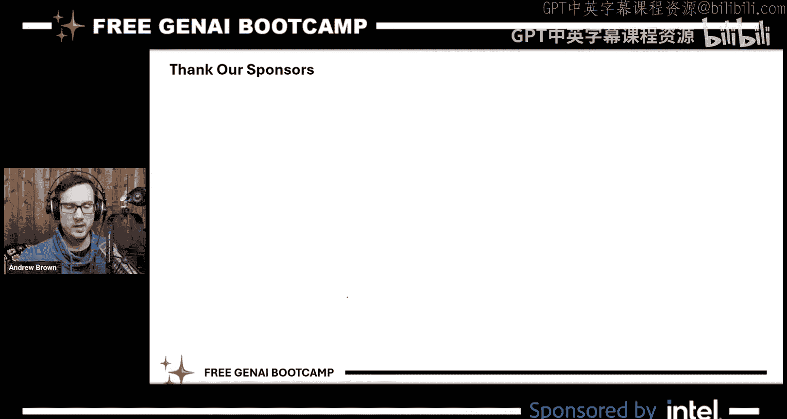

The OPA troubleshooting issues I had and I actually have a very long video that is already released for this week and it's optional。

 you don't have to watch it， but if you want to get deep troubleshooting and see how I worked through and solved it itll give you like super deep knowledge in OPA and you'll be able to do anything you need to do with it but there were some challenges but now that I know how to do it it feels like OPA is super super easy but we'll continue you on here I got my pen here it's I need to turn it off here。

 there we go we also want to thank Torque so for those that have you yet to do so if you can go create your torque developer profile we've added a career builder or career career guide section in the boot camp and I recorded videos more videos with。

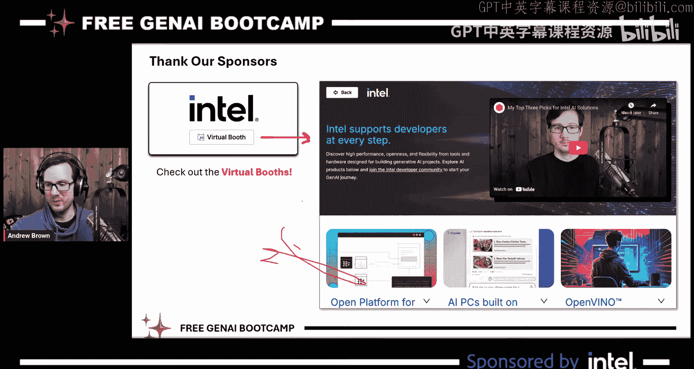

I don't know if it was more， but anyway I've recorded more videos for the career side of it so I go through Ken Collinss resume and I talk about optimization before you import it into torque and we take a look at torque and so that's their stuff is there as well there's code Rabbit which we have yet to use but we are going to use it today。

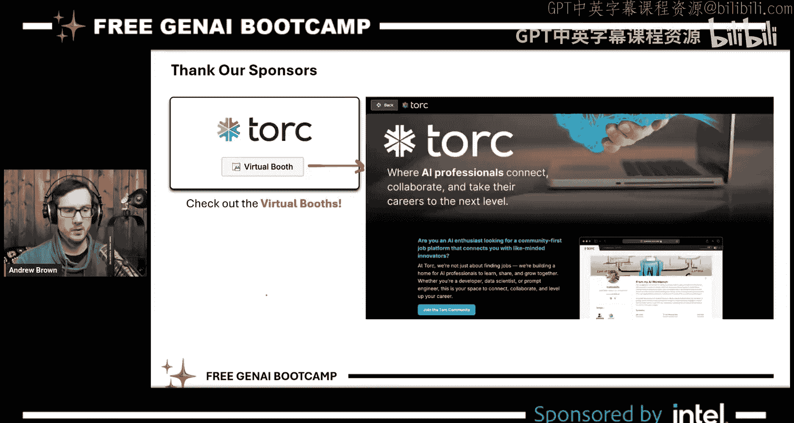

And my interest in code Rabbit was because at the start of the bootcamp。

 I wanted to see if there was a tool that we could use that would generate out PR summaryaries so that way I could use it to review。

 I wasn't ready to use it just yet but now I am and so we're not going really get to use it in its full capacity but I would like everyone to get a chance to use it and the start of this video we're going to try out code Rait because I have a branch I need to merge into my main my main repo so we'll give that a go for FAQs。

 how do I get my torque developer profile reviewed by Andrew submit the form in the week Andrew will person review possible optimizations optimizations。

 you can apply that sentence doesn't make sense， but the point is that you can tell I wrote it it's not chat UT writing these sentences but the point is is that I have a form if you submit it I will review your developer profile and so import your resume and stuff like that and I'll make some suggestions if there's any optimizations that you can do there can I build my own project that a scope to the business use case to get Redquad this was asked。

AsIn office hours and the answer is yes， you can build your own custom thing around it and to quote Baco who might be a real person or not。

 it needs to be shockingly awesome around the business use case right so if there's something that you want to build this can make up for any deficits for every single week that you've done but it's a gamble right you can either focus on extending the existing projects they here or go full off script and deliver something completely crazy there is buffer time at the end of the boot camp to try to build something or deliver something or just to catch up and that comes to how late can you be you know look at our final final due date。

 there's technically a final final secret final due date。Derek is saying Baco isn't real。

It's just it's just it's just you know maybe's just me with a sock puppet that'd be really strange but you know look at our final final due date in the calendar and then there's a secret final due date which I'm not going to tell folks about but the idea is once we issue red squat it is issued right if if you miss after that there's no getting into red sququa but there is still opportunity to get in as we're being super flexible this boot camp around because we are covering something that is very different and I'm trying to get out of pen mode here。

As you can see。Just going erase that there。 There we go。 Are there other ways to make a redqua。

 you know your community participation can factor into Redqua， Some people build great things。

 Some others are great help to others at the expense of their own work right I notice this throughout my career is that there are some people that they are so key to a team because they help out everybody that they end up not doing their own work。

 but they help out everybody else。 We do notice these things Okay and so we are factoring in your activities in Discord and within the Discord and outside of that I do look for that stuff and making that decision and we go through like three rounds of checking before we issue at Red Squa So you know just consider that what is this week。

 it's containers and agents So it's going to look really。

 really thin here but we have OPA So build a custom mega service。😊。

Agents build an agent that has its own agency and code Rabbit。 try and generate a code review of VPR。

 These are the three homeworks assignments。 And we got James， James is our surprise。 Go instructor。

Sorry， some technical difficulties there I'm glad to join you I've got the emergency headphones on。😊。

For those that don't know James current studio is under renovations and so it was a bit of a challenge。

 but we did get James which is really awesome I mean in my living room but but so so you'll just have to tell the kids to keep the TV down but that's okay。

but anyway， so this week is containers and agents and now that James is here， James。

 you want to you want to do a quick introduction for our boot campers。

 some probably know you from our first boot camp， but for those who have yet to meet you。

 can you give us a little rundown。Yeah sure， my name is James Spurin。

 I specialize mostly in the Cloud native space， so Docker， Kubernetes containers。

I'm a CNCF ambassador， I'm a Docker captain and again in that cloud native world I do heaps of things with the various different projects so if any of you actually go to CubBconn in particular a lot of the keynote events the project updates I spend a lot of time helping and working on different things so I'm actually doing this at the moment for London and've we've actually got some keynote exhibitions which are going to be going on before the crowds come in and I'm working with the different teams so yeah that's kind of my space and oh and outside of that my company dive into。

I train I create content mostly on Kubernetes and I have courses on Kc&A and Docker and so on if anybody's interested in that and just to help help James plug a little bit more because you know it's always hard as to con creators to plug it but here's James websites dive into co and you can see he's covering the KcA and other cloud native stuff James is like extremely better at containers that I I just pretend to know containers where James actually knows what containers are so strong recommendation for his content one question I have for you James is what do you define as cloud native because we had Ken Collins here and Ken Collins isn't from the Kubernetes world and so he was defining cloud native as someone that builds on the cloud natively using managed services like A ofs Azure GCP things like that。

 what would you describe。A native to be so that's a great question it's actually one of the first parts in the KCNA course and a lot of the time when that question gets asked of what is cloud native people typically focus on the infrastructure side and that that the architecture is very much an important bit of it。

 but I actually like to rewind back on that and think of it sort of speakers。

Many different areas it's almost more of a philosophical discussion。

 so for example one of the ones I really like looking at is cloud native personas so to speak so where you actually have a culture in your work where you're actually operating in a way which can actually build into that so。

😊，Driving change， driving things like DevOs， automation， efficiency。

 all of those different things in terms of the architecture side and containers in particular。

A lot of the time。When。You get that question。Right。

m my application is running in a container so that。My application is cloud native。

 it's one aspect of being cloud native， it's an improvement。

 but what about other things that you can actually do do you have this where you have self healing。

 do you have this where you have automation。How do you react to different events？🤢，And。

Cubecon's a great example。 Cubecon actually has that the the name of the event is Cubecon。

 It was the first CCF graduated project。 Now you've actually when when you go to Kubecon you see it's actually named Kubecon and。

Cloud native con and that other bit， the cloud native con is really， really important because。

All of these different projects are at that same level as Cubecon in terms of being graduated。 So。

 you know， various things you've got Promefius projects like Cium and。

These all integrate into that cloud native space。😡，SomeSomething I did recently， which is really。

 really interesting is the。The CA， the certified Kubernetes administrator。I did the update exam。

 so this updated on the 18th of February and this is one of the most sought after exams in the Kubernetes space。

And historically， that exam would very much test you。On a Kubernetes basis。

 a lot bit the core was Kubernetes。I took the beer exam which went live on the 18th。And。

It was tremendously hard， it really had me thinking on my feet but something that they've actually done this time round with this。

Is they brought in more of the cloud native side， So I have to be careful what I actually say here with the ND and what I'm stating kind of corresponds to what I posted as my update on it。

 but it is now a lot more focus。On。😡，The cloud native aspect。

 bringing in other projects which which are graduated projects and rather than it be。

 you know you troubleshoot Kubernetes or you're just doing things on this it that's a great slide。

It's bringing these different ones in。😡，Some challenges like installing certain projects or config in them have become part of that exam。

 so yes in a long way round on your question cloud native now is very much you can look those different philosophies from an architecture side it's bringing in many of these different tools and adapting them in different ways in the to achieve the best possible outcome。

And so you know for a very， very simple way of looking at what cloud native is and this is not a good description is if it's Kubernetes。

 it runs kind of like Kubernetes and it's probably cloud native but I think that a lot of people gravitated towards things being Kubernetes early on because it was the mainstay project but obviously there's a ton of stuff in here。

 but I guess it's more like here's a bunch of projects that work really together in a cohesive way in the same space if that makes sense。

 and as you said those other points like it's distributed it can auto restart or self-heal and things like that when I got into cloud cloud native was a term that the big providers just used in a different way that I don't know why but like but you know what I found out cloud native actually existed before that term so I don't know I was a roll plug on the big vendors sorry it still gets used tremendously and especially。

notice again， at these events， you notice many stores and exhibitions。You know。

 they they have the cloud native flag。 Yes， we're doing this。 some of them are some of them aren't。

 but just on that note of。Of Kubernetes。When you actually look at that and you reverse out and you look from the 10。

000 foot viewpoint， you've got a system there which has actually been designed from the ground up from a Google perspective and all of those individual aspects。

 like you look at something simple like deployments。

And you've got that cloud native pattern in the actual design of it。 So for example。

 when you roll out a new。Contain image。Deployments can actually do the mechanics behind the scenes。

 where they will。嗯。They create a new replicaette that new replicaette will roll out those images when it successfully rolled that out。

 it will delete the old replicasette and that's just one simple aspect。

 but across all of the infrastructure there's a lot of smarts and there's a lot of things which if you're a little bit older like me we used to try and do ourselves and typically didn't do as good a job。

I like like when you mentioned cloud native flag because in my mind I thought is there like a real flag that I can fly at my tech center church and I would be like what does this like it's like the Kubernetes look like what does that that might be fun this is brilliant so where you actually have this the landscape so so typically where I've been referring with Kubernetes and you have graduated projects there's actually three main stages you have with with the CNCf and get into that graduated level So the first it's very hard to see but if you were to zoom in on some of those ones in that landscape some of them are gray boxes and gray boxes ones which are there were some I think you really like vault Db was one of them just。

😊，citrix citrix is is a gray box well， let's look at the databases you said in here。

 there was volt Db， yeah。Oh there， bottom row。So yeah， you see where you see that one volt Db。😊。

That's where you have that gray box in in the landscape。

 that's where something is actually associated with the cloud native space。

 but not necessarily a CNncCF project， so they will be crossover in some shape。

 then the free main categories you've got。You've got the entry point， which is Sambox。

Smbbox is very easy entry。Typically projects which are early on。As those projects actually。

Become more and more used then your're， a， yeah， maybe that top one in the maturity model。🤢。

These I don't I don't because I recognize soundbox。

 but I don't recognize these terms right do this if you search for cloud native and then put CAsm C ASM。

C H AM。That is a hard word to spell， I know， I know I that's it cross in the chasm。

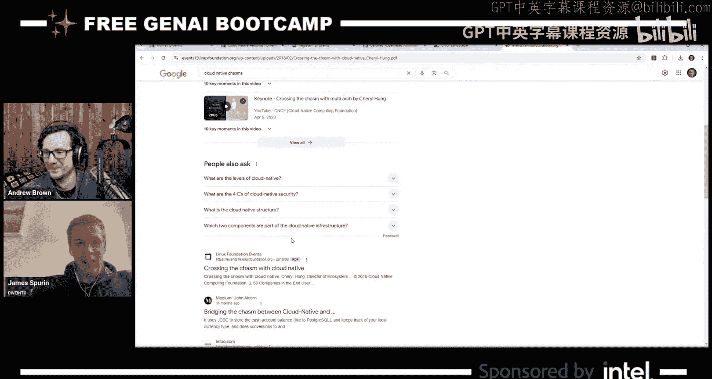

And scroll down and you might find that's it that's the image I was looking for。 This is a good one。

 So this is the the project maturity and what you actually have there everything in the CNncCF typically comes in at that sandbox level So then you get your early adopters who are actually using this picking it up at this point。

 this is typically techies who are a interested in the project or B have a problem that。

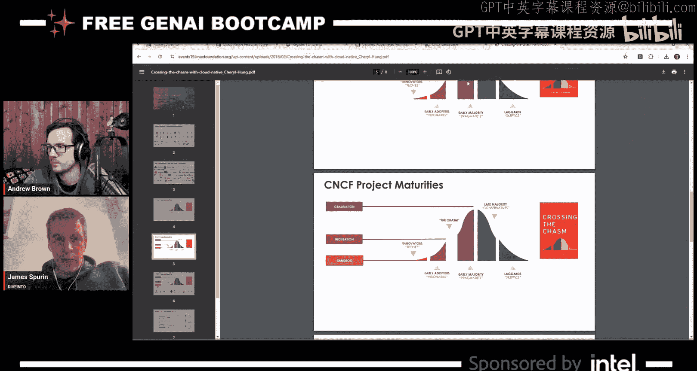

Get solved by this project。 So projects come into this space when they then pick up adoption become more and more used。

 then you have this， what is known as crossing the chasm。 So that's where the the the the the big。

Hll is there in the middle。 it's， it's actually very difficult whilst the sandbox in sandbox area is very easy to actually come on board。

 Get in into that middle space。Which you see there， the early majority， etc。Incubation。Yeah。

 is is a lot more。Difficult well。And you can actually see I freeze this a little bit wrong you go from the incubation across the chasm to the graduated aspect。

 but yeah all of these if you get project in the CNCF and you get it into that sandbox state it's very impressive if you actually get it into incubation that's huge but graduate it is massive and something you can actually do on that landscape on the side you can filter and you can actually see the I think it's yeah yeah there you go on the left you can actually choose the so if you pick yeah nice。

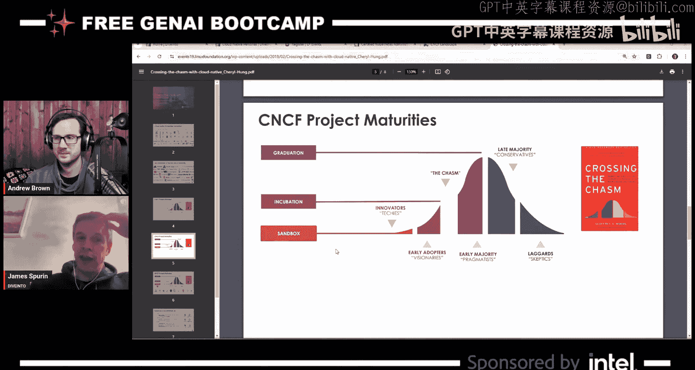

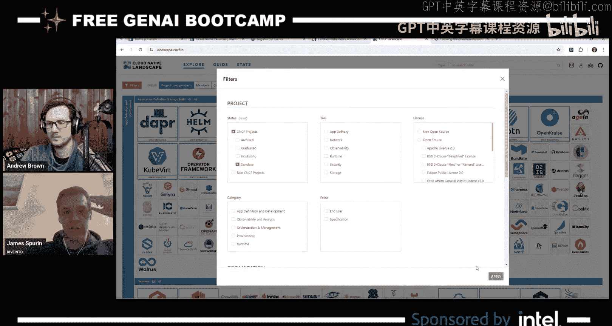

Let's see。 so quite a lot of ones。😔，Which are new projects。

And then if you try that out and actually do the graduated ones。Your see， or have a load of others。

Alongside。Kubernetes， so Kubernetes is there under scheduling and orchestration。

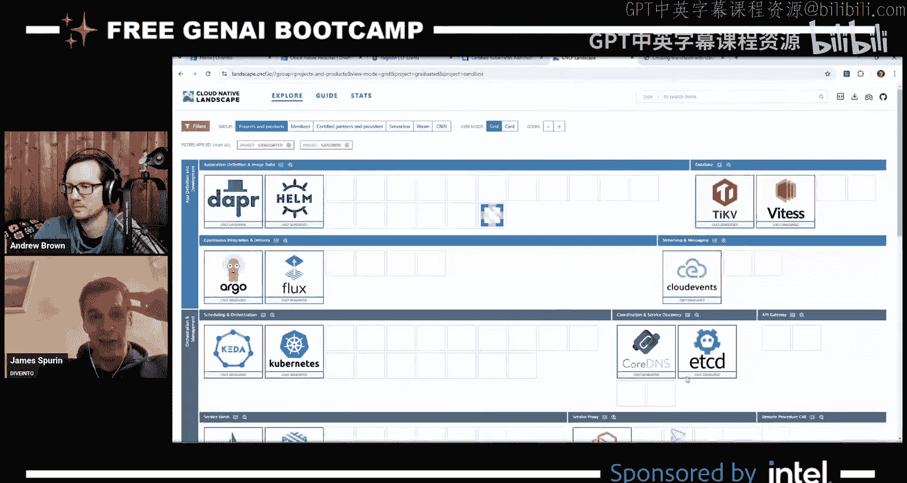

And then you've got all of the different ones。So what's interesting is that there's also the Linux like so for those that don't know。

 there's the cloud native the Cloud native Foundation。

 but above it is its parent company or I don't know Guardian company I don'm sure we won't call it Linux Foundation and so OPA which we're kind of focused on in the bootcamp on I say cloud native side。

 but it doesn't necessarily have to be cloud native like it can use Kubernetes。

 but it doesn't necessarily have to so maybe the reason it's on the Linux Foundations product side is because it's not itself is not does not embody the things that are like a cloud native project but it enables cloud native projects if that make sense so like I don't know why。

 but it's over on the Linux Foundation side right yeah so what you actually have this so the CNncCf the parent Company of the CNCf is the Linux Foundation the Linux Foundation are responsible for various things most notably the Linux kernel。

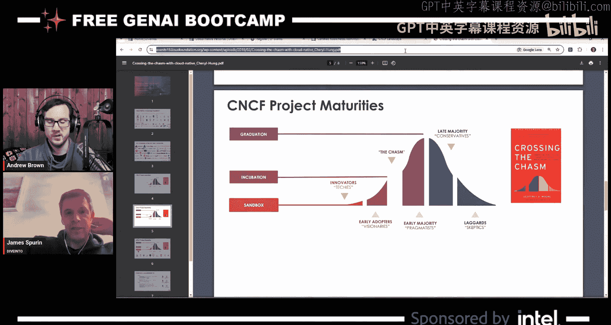

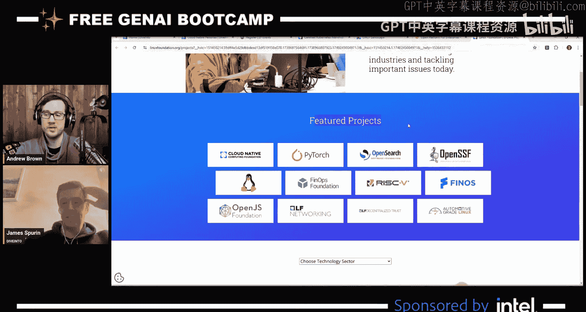

AsWell so that falls under the realm of the Linux Foundation you can actually see it there so you've got the CncCf which in turn then manages Kubernetes it's huge it's hard sometimes to keep up with all of the different areas that fall under that Linux foundation space Well I mean cloud data it's weird that they list as a project because it's really its own giant umbrella of things right where these other ones I mean I'm sure they're big projects like Pytor is a big project of the kernel Linuxx kernels obviously a big project but this has a ton of tiny boxes in it which is really interesting and something about this as well this is only the featured ones someone reached out to me at one point and I can't remember the name of it but I mean there was another one which is like。

3D gaming， which again falls under this Linux foundation umbrella。

It seems like some of the CNncCF projects are being bubbled up here。

 so it's a bit hard to distinguish at this level， but yeah。

 they obviously are there's a lot of stuff going around there， which is really。

 really interesting but。Yeah， maybe we could take a look a little bit about OPA so I have I have some graphs and I've been working through it I want to show James so that we can kind of get an idea like together what is it that we're looking at as two technical people trying to figure out something so I'm going to go ahead and I pulled up lucid charts。

And I'll go over into here and I did it in my Geni architecting diagram I don't have to share with bootcaers yet one reason is because my previous diagrams were destroyed and so I just don' I'm just being a little bit careful about those there but I have this model and bootcaers cant you tell me if anyone's seen this model yet。

Can I get a plus one if you have seen this diagram yet or a plus zero or sorry negative one if you haven't seen it yet？

We'll just give a moment for boot campers to fill in some numbers here。

 It's better if people say negative one because then I know that we're showing them something they haven't seen。

 but well we haven't definitely haven't explained it yet So negative one， no one has seen this yet。

 Okay， so now my second question to boot campers is the prior a week or two ago。

 we did OPA like the most basic components of it and it was hard and it wasn't hard because it was complicated It was hard because there was a lack of documentation And so some people are able to do it。

 some people almost were able to do it that was me And then some people know they really put the time and andd it So know my question to boot campers that attempted OPA how hard was it from from zero to 100 being incredibly hard 10 being super easy。

I don't know。 I probably should have done the other way， but anyway，0。 So no， no， no， no， Well。

 too like， I can't change the number。 I can't tell I make to confusing easy0 if it's super hard or 10 if it was super easy。

 So1t， like how easy was it， I should say。So we have a 10， we have a two， we have a four。

We have a seven。- 100 minus 100， so I guess my question to you， James。

 like you're obviously stellar at the cloud native side， how's your how's your AI side？Yeah。

 extremely limited at the moment。 it's an area I'm looking。 I'm studying a little bit at the moment。

 but yeah， but you know what， what I'm finding out is like there is stuff specific to models but all the stuff that we already need to know like working with containers or Kubernetes or stuff like that。

 it's all the same stuff right and it's just it's just application integration you can build stuff。

 but a lot of stuff is built for you and it's more just rigging them up together and having good sense of Linux networking and and things like that。

 And so I'm telling you you're probably farther along than you think you are and I kind of need you because I don't I'm not good at containers so with our two where we can work out we'll work it together。

 right。😊，So I'm going to just show the code here for a moment and for those that found and I don't if people are giving eight as hard or eight as easy。

 but I'm going to say everyone thought it was hard。

 but we're going to go over to the the OPA GitHub here and in here we have two reos。

 there's more than one， but there's two that are important， we have Gen examples and Geni icons。

So comps represent components of a GenI workload。😡。

What is confusing initially is that when you are using these components。

You might think like LLM brings in an LLM model。you might think， oh， if I use LLM， it deploys an LLM。

 if I use embeddings， it brings in embeddings。Nope， that's not how it works。

 but you think that so the way it actually works is why you use a component。

TheseThese components here are sitting in front of whatever it is that you want to run。

Right so let's say you want to run O Laama， O Laama is a it's a server to serve up an LLM。

 just like you have a web server to serve up a website， Engine X or Apache or something。

 we have TGI from Hugingface， we have V LLM from some other company。

 We have O Laama which is very easy to use for local machines and so you have to run this yourself in your own Docker compose file or Kubernetes and then this thing that you're launching that's actually in the comp is just sitting in front of it。

And it's basically just acting as like a gateway or as a rapper to the reference of what you're utilizing and so initially I was confused because I was like oh。

 I thought these were all the the things that actually launch them up but no。

 you actually still have to make your own Docker file and we can see that if we go over to here into the chat Q&A。

😡，And we go into Docker composeose and we go into Intel CPU。

 we'll do Zon doesn't matter if do AIPC or Zon， we go into the compose file， what we can see here。

And this is we have Redis。We have it says data prep Redis。

I'm not sure what the difference so this is an OPA specific one here yep。

 then we have an embedding service， so that's running an embedder。 This one's running Redis。

 This one is running specifically the OPA retriever， which is just a Redis server。

 So there are some specific containers specific to OPA I don't know enough yet to know here we have a reranking service。

 which is another text embedding model。 that's all it is。Then we have VLM。

 that's a thing to serve the model。We have some we have a back end backend server。

 so this is an OPA specific container that is running。

 but some of them are containers that run there and some of them are are ones that you don't necessarily run。

 They're just。There are open source models that you're just running there。

 but the thing is that these open source models， you don't want to just use them directly。

 you want to have something in front of them to work with them to normalize their inputs outputs to put guardrails to do whatever you want。

 And so OPA is this big orchestration that sits in front of it right。😡。

And this thing is kind of like our chat QA so J examples。

 this is basically components put together in existing archetypes so that you can start working with them and the one they always focus on here is chat Q&A so chat Q&A if we go look up for second here OPA。

gov。And we go to the technical do， actually it's right there， I think。No， not that one。 And I see。

 I got to make the full diagram for it。 I will make the full diagram for it。

 But if we go here and we go to check A and we get an overview。

 It should have a graphic somewhere here。Yeah， we'll look at this。 Why this is kind of it。Okay。

 I'm just going to make it a little bit bigger here。So this is the mega service， right， and so。

What we're looking at， my diagram is a bit similar。 But the thing is， is that we have。

See this stuff on the outside。the TI and Betting service service， TGI， these things here。

 these are the things that are running in Docker composeos。And then on the inside here。

 the sinks embedding， retriever， reranking， TGI service， those are the microservices。

 the components that are basically acting as gateways or whatever you want to call in front of those external ones if that makes sense。

But this check Q a has more moving parts。 So like first， you have a Ui web server。

 which that is being served in the container。 Then you have the Cha Q a on port 8888。

 So I think is port 888 like a special port in Kubernetes for like ingress for controllers。

 I'm not sure Do you know if it is。 No， it's just it's。

It's a common port typically that in the eight range you'll often see things used without I don't。

It's， it's not anything specific。 Okay， so I don't， I was talking to Ezekiel。 and he's over In。

 He's like， oh， you got use port 8888， It's the the important port。 I went。

 but is it because I feel like you could set whatever port you want。

 So that's why I wanted to ask you， like， if there was some magic number。

 So I think it's more like they just settle on that number here and you can use whatever number you want。

 maybe， Yeah， I mean， from experience， typically。😊，Most web based containers in some way。

 I see them either use in 808080。They they just call friendlyriend ones okay and so so the thing is like they have this concept of a like the mega service is not just the fact that components are put together but they distinctly define the mega serviceice being if we go back over our diagram here。

 its it's two things the mega service is actually a microservice that is is a fast API that that has an external endpoint that you can hit right and then also the mega serviceice is the service orchestrator and all the service orchestrator is it contains a dag and it allows you to define the flow like lets you register these microservices。

 but also how they flow from one service to another because you're basically setting up a workflow you're saying go from like this is not the exact same app the idea is like。

We first want to do embeddings。Right， and then we want to then go to an LM and then return our result。

 But when we look over here， this one's a bit more complex。 This one first has data preparation。Yeah。

 maybe data preparation， sorry， but we have embedding retrieval reranking and then it's serving the model like this is the LLM。

 So it's going through embedding retrieval reranking and stuff。 So it has four steps here， right。

This vector database has probably redis right like we saw there earlier and just a quick question yeah that is the ports on all of those so the 60700。

800 okay。But I think you're allowed to make whatever port you want right like they have default ports。

 but I was looking at them I'm the thinking Im like it doesn't matter you can make whatever you want。

 but I don't I just don't know of anything being standardized。

 but I think' what's being misrepresented in this diagram is the fact that well。

 first because they're being abstract whether this is Kubernetes or Docker。

 but to make it really clear。You know， you know these things all run in a docker container。

 even this runs into， well， this runs in a Docker container and then the mega service itself could run in a Docker container。

But just the way it's illustrated makes it confusing， but now that I have it in my head。

I'm not sure if it's making sense for for James yet。

 but we will no this this is good and I mean typically with with with a good design pattern on all of this。

 you should。You should be able to have that flexibility on the port side and it run on a default port or you actually specify that。

As an environment variable or so so that you can have that flexibility and。

Bind accordingly as you need。The it says oh Josh says Josh says。

 you think In would wanted to use Port 88088 I don't get the joke。

 but if there's a joke I'd love to hear it the do you have any strategies when diagramming complex。

 I mean， maybe it's not complex for you， but like I feel like there's lot of moving parts。

 do you have any recommendations on how you would go about architecting the diagram to make it really clear？

Not really to be honest。 I mean， this looks， this looks pretty good to me。 Okay。

 good one thing here that my diagram that's not really good is that here when we have our microservice。

 you have to define a handle request and this is doing data preparation。

 And so it has something called Dockerate API protocol which here we don't necessarily see here。

 but they call it here for whatever reason。 but let's go see if we can kind of step through the code and as we go through we'll keep referencing back to the diagram until it starts to make sense。

 So down below， I actually do have windsurf open and I actually have a little bit of homework I have to do first before we can get this working because I installed。

Coode Rabbit and code Rabbit is a it's a it's an AI tool that allows you to when you create PRs。

 if you don't write your PR， it will write your PR for you as a summary so the person that's reviewing it can understand what it is you also happen to be a sponsor I wasn't try to slot them in here。

 it's just that I installed it and I can't get around it unless I make a PR So I'm gonna show it off it sounds really good though well。

 you know what I mean and especially because most of them end up as as typically like one lineness。

So so what I'm going to do is I'm going to go over here and I was actually going to see if boot campampers wanted to do it because then if they send me their PR in homework。

 I want to see if it's like an easier way for me to view it because in a real company you'd be making a PR and someone would want to review it before it gets accepted。

 I'm not saying that it has to get accepted to merge it in。

But here I'm on my Oman King free Jenni I boot camp and I'm going to go ahead here at oh。

 we got a pull request， update the code to support multi ASR systems And that's something I did last week。

 I think I actually was specifically made that's just show off code Rabbit。

 but I' gonna go make a new pull request here。And I've actually I have some code that I accidentally committed into this repo。

 this branch that has to get in here， and so I've gone here we have multi ASR and it's going from Oman King。

 but notice where it's going I don't want it to go to the example of one so I just will go here and drop it down。

 be very careful about this。And so now I'm bringing my multi AsR into my main。

 So I'm going to go ahead and I'm just going to create that pull request。 How do I。HmAble to merge。

Where's the O， because there's already a pull request， that's why。

So I'm just going to close this one here quickly。You can you already kind of got a preview of what it was showing here。

 but I did add some more code here， but we'll go over to here and I'll create a new pull request。

And I'm going to。Again， select this to be Omen King from Maine to not mainine to Maine。

 but multi ASR domain。And so I'm going to go ahead and create this pull request and what it should do is it should generate a summary for me。

So it should show up here at some point。Folks， if you don't know how to install it I got a video in the the boot camp that I I backfilled into it Code Rait is free for individuals Code Rabbit is free for individuals。

 but when you sign up you can turn on a 14 day pro plan that gives you additional stuff。

But the free one will do summaries， right， and I think I don't think there's a limit on it。

So it's going to be this in use now that I see the logo there， I have come across this， I think。

 in the wild。I think they raised quite a bit of money。

 but I could say like if you had like if you had a team of developers and they weren't writing good commits or or you just wanted you wanted another version of it。

 then that could be really useful。

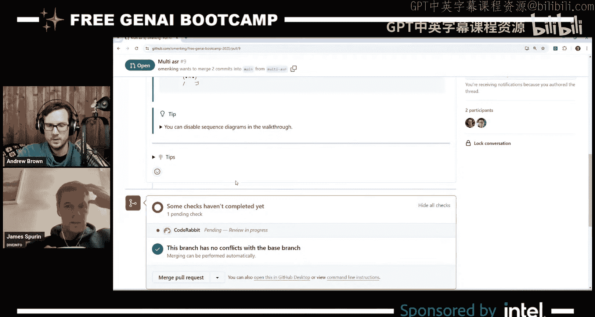

And then saying 80，88 proceeded 80， Oh， you know what， I think， I think I get the joke。 It's。

 it's with the chip。Right because there's the it's 8088 chip， right？Yes， yeah。

 you think I would know because I actually have one of these Well， not this。

 but I have a derivative of it so I like Iots， like I have a bunch of I Os on my desk。

And I like building microcomputers and so I should include in that that was what we were talking about in Intel watching this right now like。

But it does take a little bit time for this to generates not it's not that slow I guess。

 but we'll see here。but yeah， it'll generate out here in a moment， but while it's generated out。

 let's go take a look at some code and just try to figure out what we're looking at。

So I'm going to go over to here to GitHub。OPA。Examples。

But let's just take a look if we can look at the chat Q&A。So in the chat Q&A here。

AllAll the code here is happening in the chat Q&A。t Pi。

So this could actually run in its own container and I think that that's probably what you'd want to do if you ran this in production。

 you'd probably want to run this in a container I'm actually going to confirm that right now and see if that's the case。

So if you go over here to Zion and we go to composeaml。I want to see if that's there somewhere here。

 so we have OPA data prep。I'm looking for that check QA here。嗯。Is it in here， it's right here Okay。

 so it's saying chat chat Q A Zion back backend server。

 but this is the actual thing that is running the that piece of code， right？

And so we're going to go back over to that piece of code for a moment， which is here。

And so we're going to take a look at this code。 So the first thing is that。Not first thing， but。

There should be a class here called chat Q& A service doesn't matter what the class is called you can call whatever you want。

 it just happens to be called that probably if you make a service or make a service。

 you probably want to name it what it is。Is Code Rabbit something similar to Atlantis for terraform no because Atlantis is specifically。

Derek， Mr。 Terraforms and Mr。 Terform， if you want to speak up and answer this in the crowd。

 but Atlantis is。It's like before GitHub actions， it was a way to automate GitOs to do GitOs。But。Mr。

 Terraform' is still here， he can he can correct us here。 Oh yeah So here's our summary by the。

 I know I'm all over the place。 But let's take a look here。

 And so we have it enhanced audio generation with support with multiple text to speech providers improved service service So in this code what I ended up doing is I use chatt to say。

 hey， can you make it so you can generate voices out in Japanese with AWs Azure GCP because I only had AWs and so it wrote the code for me。

😊，And then it gave me this diagram。 but the other problem is。

 is that I also committed my OPA code in here as well。 So it's kind of a dirty commit。

 So this should really should be two separate ones。

But what's interesting it actually shows us a diagram for well we have the audio generator。

 but then we have the other one that's actually really interesting that it was able to do both。

 but here we have the OPA so we have the user send it requests for example service it schedules an initialization here。

 it goes to the service orchestrator which goes to the microservice it comes back and then it goes to other microservices and then it returns and so that kind of is exactly what's happening there so that's nice that it did that。

And it has some summaries here down below， the only thing I don't care is that it gives us a poem。

So maybe people like that， but but you can see it actually has both of them it talks about the TTS so it says。

Coing a rabbit， hopping the night， dodging bugs with a skip and a bite。

 new TTS saw voice sings a delightful tone， microservices orchestrate never alone with Docker and scripts。

 our code takes flight， carrots and commits， making everything right。But anyway。

 that's cool that we get it And so Derek saying to us， Atlantis is specifically for terraform。

But it's like a giop solution， right， Derek？And so pretty much the first terraform automation collaboration software along with terraform Cloud。

 Okay， so it's a tacos， it's a tacos。

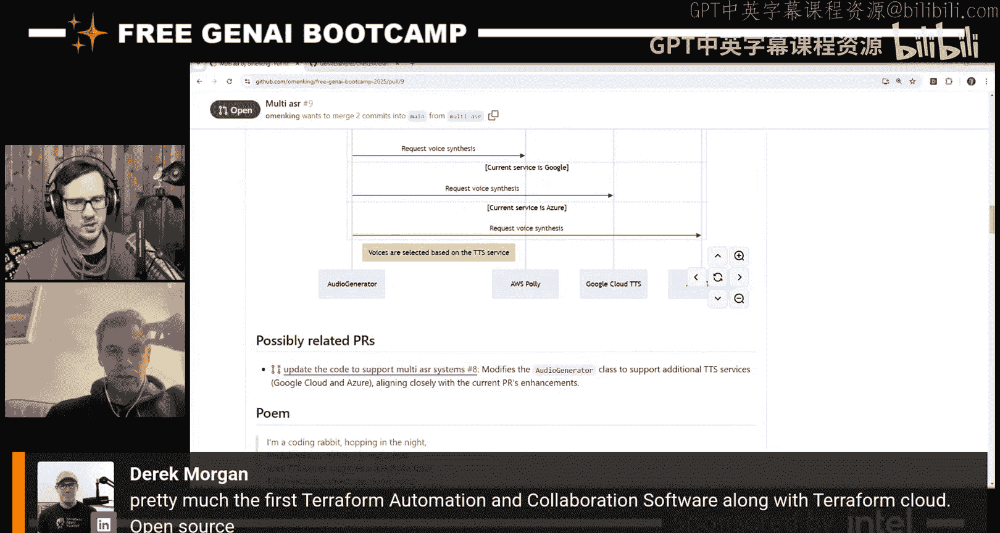

For those that know what tacos are， they're really tasty anyway。

I just wanted I wasn't really trying to show code Ra but I just wanted to merge this because once you install。

 you have to do everything via these and it's the only way you can work around stuff so now I'm in my main branch I'm going go ahead and do I think I'm in my main branch kit branch。

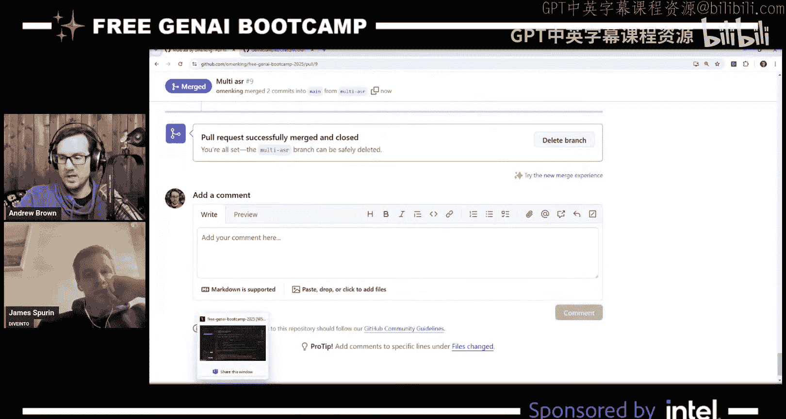

And I'm going to do a get pull here and hopefully I don't get conflicts。

 please don't give me conflicts， please don't give me conflicts。And we will。

 I don't know why Na set here， it's very frustrating。

Are you a nano or a vim vim or what do you use for merging your commits I I use。

 I use vim all the time actually， one of my one of my first jobs I was using it was like a nano precur。

 I think it was called Pico or something like this at the time and my boss told me to stop using it。

And and I didn't and I I came into work and it was free BSD at the time he had taken off。

And and and essentially he'd done some smarts， I think like BSD used to use the ports collection and he'd removed it so I couldn't install and he said to me。

 he said，If you ever want to be taken seriously in this profession。You need to learn them。

No at the time。 Yeah fun fact， my my first flavor of Unix was freeBSD。

 So there was a fellow at our computer store that really liked freeBSD。

 And so he showed me how it gave me the gave me the handbook and that's how I learned how to work with Unix and Linux was and by the way。

 the handbook for freeBSD is still really， really amazing so you can definitely do that。

 The reason James was late was he was stuck in。😊，That's it， I couldn't exit。😊，anyway。

 I cannot not use Vim so I'm at a point where if I'm typing and I don't have Vmkeys I get kind of flustered do you use vim bindings in VS code as well anywhere I can use Vim for not in my browser I've stopped that that's not efficient but anywhere where I can I installed sometimes there's conflicts with certain AI tools so I' have to turn it off but with windsurf with Winsurf they're not sponsored。

 by the way I just really like them but windsurf windsurf it works seamlessly with it so it's one of the AI coding systems that I can leave on when I decide to use it but now that my repo is up to date what I want to do is I want to walk through a little bit of the code of chat Q andA and let's see if we can kind of reconstruct it a little bit to get a better sense of it so anyway we have our chat Q&A service up here。

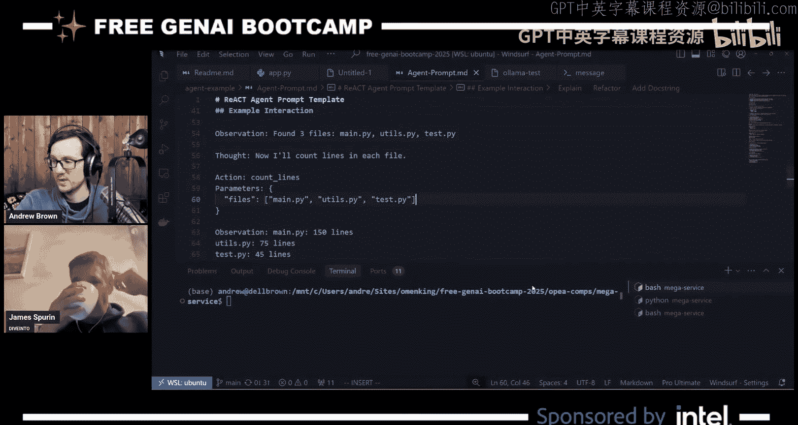

Right， and the first thing we do is we initialize it。

 So if I just split the screen here in half for a second。And you know what。

 it might actually be easier to look at the code if I open this up in Github。 dev。

 so I just hit period on my keyboard to open up Github。 dev， I'm all over the place。Um。

We'll open this up and then I can just do kind of a split screen so we can kind of look at the code in two different places at the same time。

But yeah， we have the Cha Q A here so I'm going to split it。And we'll bring this over here。

So I'm going to go all the way down the bottom， if my fonts do small folks just tell me in the comments there。

And so。This is the main， and so for。For this， I think it's like if you were to try to execute a Python script。

 it would try to execute this as far as I understand。嗯。So we have some args coming in here。

 we don't care about that。But here we have the Cha QA service。

 So we say we're going to create the Cha Q A class right That's the first thing。

 and we're going to say what port the megaserv starts on。 And from our diagram before。

 I think that was port 88888 is what they wanted to do there。 But you can see it's customized。

 you have some different options if you want to enable these things。

 we're going to ignore that stuff， What really matters is that it's going to do this。

 then it's going to add the remote service and it's going to start it up。

 But let's take a look here at the init phase。 So if we go to the init phase of this。Here。And。

Fund is fine。 Can't can see。 can see well， Thanks， excellent。 If we go here。

 what we can see is it creates a service orchestrator。 So if we look at our diagram again。😊。

I've kind of lost that， I've got too many windows now，' I'm all of a mess。I maybe was this one。

 here we go。I'm going to bring this over here if we look at。Uh， no。

 that doesn't have diagram in it either， let me pull up another one。Maybe it's。here it is。

 There we go。 So， you know， if we look at our diagram here， the service orchestrator。It shows up。

 they don't even show it here， but it's in this megaservface， but if you look at our architecture。

It is this thing so it's defining this component right here Okay。

 so we have my chat so imagine this is just chat Q a and in here we have our service orchestrator okay。

Which is here and it assigns it as the mega service。

And then over here it assigns chat Q&A endpoint to this this thing here all this thing is is I think it's just like a string so like you can make us whatever you want but if you wanted your your API to be like API hello world like hello。

 then this is what the the entry endpoint into the megaservice would be right it would be then sorry yeah and you can see its interest in there because where it's actually so you're in the constructor for the chat Q&A service。

It's creating。's it's doing that within that。Checkack Q and a service object。

 so it's it's kind of like a sub object which I think relates back to that diagram if you go back we can see。

Yeah。Yep， so you've got the green box as the mega service and then you've got that subbox in there。

Yeah， and so this this my chat do pie is really the class like whatever our class is And this is why I wanted to talk through through this with James because then if there's parts that don't make sense。

 I can I can quickly make them make sense here because I made this diagram for me and it's hard to say if it makes sense for anybody else we'll just say check QA it's not check QA obviously because we're missing some components Well we pretend that this is that and I'm just going to reword it so it becomes a little bit more clear as we're going through this So I'll go here and I'm going bring this down a step。

Here， and I'll call this Chaune。Chat Q&A。And so the idea， yeah， we have this mega service。

 but really we've just defined that part there。And then we had a we had a question how does how does the service how does the services scale in is OPA production ready well it's the question is are containers or Kubernetes production ready because this stuff is just going to be running containers right and so the main stuff that is running is those things like Oma or。

I'm going to go back here and show my graph here， but it's like。

These things here like Oama or the embedding thing。 In fact， they don't recommend to run ma。

 I was just using this as a simple example， but I found out why people might not want to use Oma as as your LLM server。

 and it's right now they don't have OL integrated into it so like if you are trying to make sense of what's going on and something's wrong with your thing it's very hard to tell whereas TG or VLM does have OL integrated。

 but VLM it can work with something called Spk Ser。

 which allows you to distribute it across different loads of so if you just use Tgi it can only scale on one machine。

 whereas if you use spark serve it can distribute oh sorry I'm saying Sp serve I meant to say。

It's an it's the competitor to spark， it's called。Ray serve。

 Ra serve have I don't know if you' ever heard of Ray James。

But it's I think it's for like it's for data folks。 So it's it's a bunch of data libraries。

 but one they have there is called Rayserv and so it can it can distribute compute specifically Lm stuff。

 So you know there's tradeoffs there So it's you have to make some choices here。

 But the idea is that when you go into those options。

 those different configurations for OPA they' they're choosing the best things for production for you So like if we go back over to the Gen examples here and we go into the Docker compose and you choose Intel and choosing。

CPU like what kind of CPU are you going to use to production You're probably going to use a Zon processor right There are obviously other processors and those aren't implemented here just yet。

 but if if you do need to deploy you and and you want to be CPU CPU heavy right then youd use a Zon processor and you go in here and we check the compose and you can see like it's using it might be using TGI or VLMs but you can kind of swap that so you have to have a little bit of knowledge of your choices。

😡，But for the most part， they are making pretty sane choices for you。

But we'll go back over to here and so getting back my diagram here。

 so we've defined our service orchestrator， right？And over here we've called chat Q&A so this part's done。

 then it goes over to this part right so add remote service so if we scroll here， oh。

 it's the next function， which is perfect。Here we can see that we're starting to create microservices。

 so we have embedding microservice， which an end point it has four slash inbed。

We have a retriever microservice， which has a for slash v1 retriever， We have a rerank microservice。

 which has a for slash rera。 We have an LLM1， which has a V1 check completion。

 which the reason they made it this specific one like this is because when you use。L Ms。

 a lot of them standardize on the open AI API。 So if you've ever。

 if you've ever used open AI Chay PT or bedrock or anything。

 they all just kind of standardized because because Chay PT was so popular like or we're just going to stick with the same endpoints that they have and so。

Most LLMs that are being served are going to be on V1 check completions， so that's standardized。Okay。

 and so so we define all these microservices， Each of these microservices inside inside the code is just a fast API app。

 and I was surprised。I thought there might have been like more magic happening behind the scenes。

 but there wasn't， so I went here at OPA comps。Right。And if we go into comps here， like。

 where's this microservice thing coming from？ So if we go all the way to top here。We can see。

That we are importing。Microservices from comps， Okay， And if we go to the comps directory。

 we have comps。 and in here we have cores。And then， I believe it's。Coma， no， no， no。 it's mega。

 mega service stuff。 And in the mega service stuff， we have microservice。

 So this is the actual class that's being loaded。 I just want people to know that there's no magic here。

 You can open these files up and read them and you can make sense of them pretty quickly。 And if you。

 and if you look here。😊，Okay， like initializes some properties。

 so like it's initializing some properties that you might utilize。Well when I'm going through this。

 all I see is Uv unicorn。And somewhere in here， there's a fast API， so if I go to the top here。

It should define oh sorry， you know what it is， the way I notes it fast APII is because it extends from HttP so when I went to this one。

😡，Then I could see that it's just a fast API， so it's like a really simple。

 simple fast API app and it just adds it like a few endpoints here， so it go down here。

 has a health checkpoint， V1 statistics endpoint， so boot campampers。Remember like that we use flask？

Right even in the first boot camp， we use flask we built the entire app in Flask Flask is flask and Fast API are very。

 very similar。Right， and so I just want you to know， like there's not a lot of code in here。Okay。

 and the other thing that they have in here that it's a little bit different is something called Uv unicorn。

 So UVI server or Uv unicorn。I come from the Ruy world and in the Ruy world。

 we we came up with our own server called unicorn and unicorn was known for being multi threaded and zero restarting stuff like that and asynchronous。

 And then the Python community said， hey， can we have that too And they just ported R code to their thing。

 So I'm just saying like this is where being a rubist。

People say it's like a dead language is garbage， whatever， whatever， Python copied it， okay。

 and we got the better one， but I'm not going to get into that。

But I'm just saying like there's no like you look at this and it's no magic here。

 this is just this is the actual web server that serves so fast API when we say fast API is a web server。

 it's not it is a web server， but it's more a web framework so the fast API is the web framework to define routes and then the actual web server is this Python flavor of unorn。

😡，But like you can see there's just a few endpoints。

 I think there was some like in like maybe some orchestration in here for。It's not in this one。

 but they have in here， this brings an hotel。Open telemetry。But anyway。

 we'll go back over to our other file， our。Our microserv is here。

And so we go through here and there's not a lot of functions like there's just register microservice and so what this will do is it will add it to the Dg。

The diacrylic graph。Are you a big fan of daggs， James？

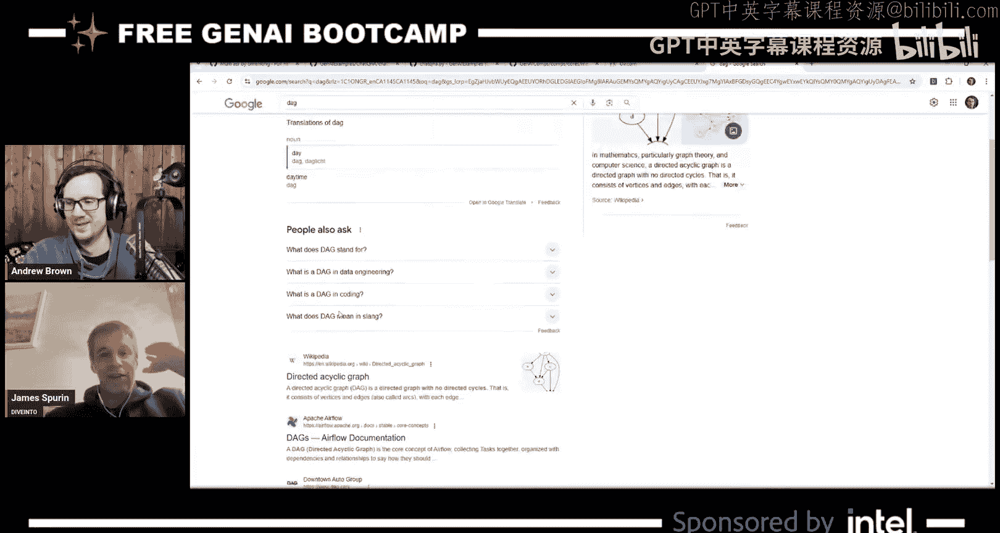

this is a new one on me。Yeah I know right， it's just all it means。ADg。

 all it means is that it's it's basically this， it's just like it's just an F statement to say like if a go to B。

 if B go to C， you know what I mean， but it can self reflect on itself。

 so it's a I guess computer science people would say this is a tree。

Is that do we have any compsey folks in the comments， what would you call a dag？Or you know what。

 let's go last Nik dogs。

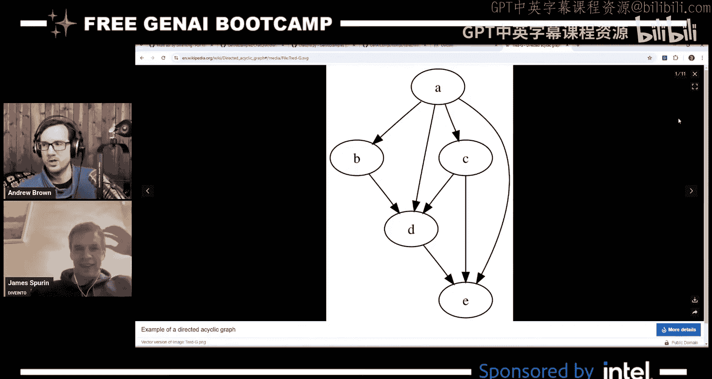

You like tags？Is a D and a tree algorithm？It doesn't care if I spell it， right， it's totally fine。

No tree， There we go， no tree。

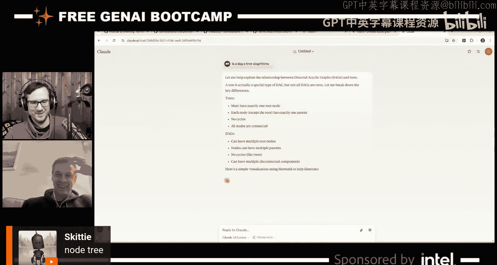

It's not a tree。 state state diagram。 So see it and says it's not a tree。

 I like how it made one for us。 That's pretty cool。

 So let us explain the relationship between a da and trees。 A tree， Yeah。

 I guess I guess a tree ends at some point， right， Think of a tree growing or like roots。

 It probably ends at some point where this one's self reflection。😊。

So it says it's a graph but not reverse ditic graph， I mean it's right in the name right。

 it's a ditic graph it's not a tree it's a ditic graph。

But must have exactly one root node oh so let's describe the difference so must exactly have one root node each node has exactly one parent no cycles。

 all nodes are connected， can have multiple root nodes nodes can have multiple parents node cycles whatever。

 but dags are really popular for describing the state machine or the states like what state you're in and what you transition to for LLMs there is debate whether dags are good or not I think Lama index kind of argues this so like Lama index。

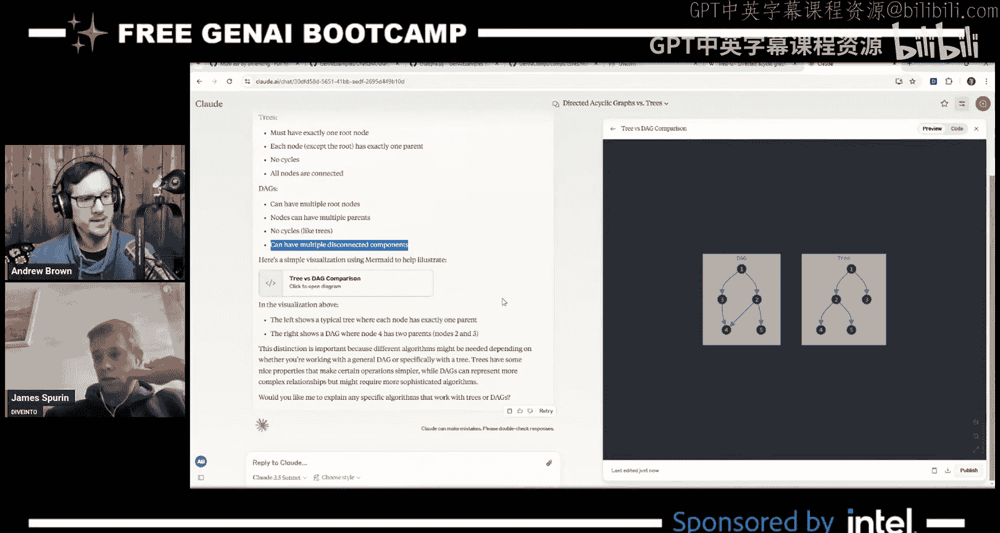

嗯。Is we didn't really use Lo index much， but they talk about maintaining state and so they have some words about DAg somewhere in here。

 I'm not sure where it is。But they might have chosen a different way to do， it I'm not sure。

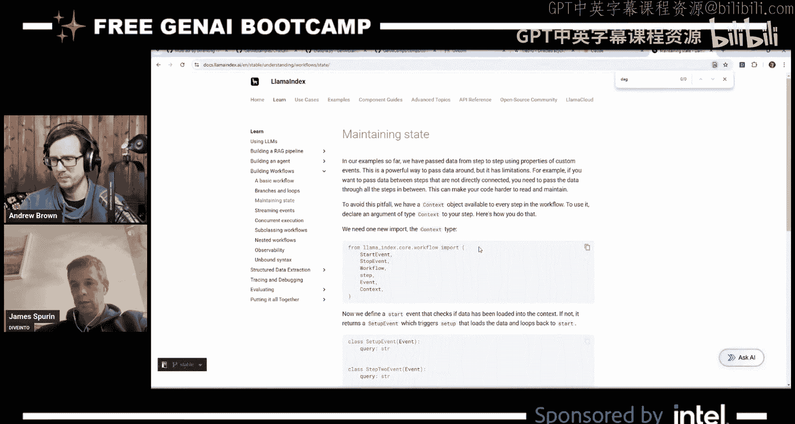

And Lang chain might do it and so I don't know what the trade offs are。

 but my point is that you can use them， you can you can use them or not use them if you want Dgggs are probably data engineering pipeline too that's the only reason why I know what Dgs are because I made some data courses and I can pretend that I do everything。

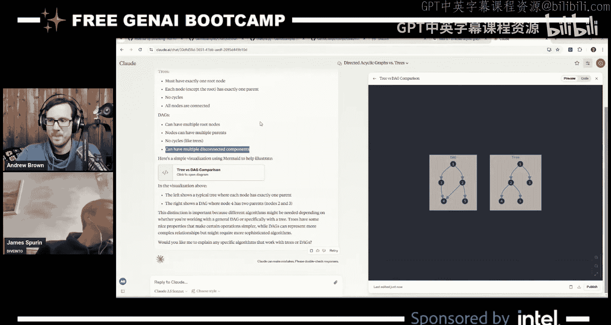

But anyway， that's that's what a da is。 So the point is is that the the microservice gets added to the Dg and the Dg is implemented by the service orchestrator。

 We can even go into our code here and take a look at the service orchestrator。

 So if we go up a level here， it has it right here orchestrator。And some are here yeah。

 it says import De。Right so it reportss it， and I actually never looked at it。

 but here's the da over here， here's the dag。It'sThere's nothing complicated here。

 it's just you have you can add a note。嗯。And you can delete nodes and stuff like that。

 so it's a very， very non complicated implementation to say yes， Apache airflow and DBT。

 so they're giving me examples of where dags are used。So。You know。

 we have a Dg implementation here a very simple one and then this thing's registering and it's adding it to the service orchestrator and if we go back over to the orchestrator。

 you know we got code in here so you can see you we pedantic and other stuff like that。

But somewhere in here， if we go on the Ray hand side。You can see we have add， so add the service。

 flow to schedule and execute。 and we don't ever use this。 but really。

 there's only like three commands of this entire thing。 It's， it's very， very simple。

 I know the code looks complicated， but you don't need to know all the code。

 The point is is that there's these three things。 So we're going to jump back over to the code over here。

RightAnd so anyway， the point is is that these fast APIs all get spun up。

 so they're all little apps that are running。And then you have the megaservurice。t ad。

 which is adding them all， I guess this is actually adding them to the tagg。

I guess you could register them the other way。So I'm not sure why it has register microservice。

 maybe that's another way to do it， but here you can see that it's adding each of them and then it just has flow to so it says。

You knowFrom here to here so this is actually defining the direction of where things are going right so and I think that the first flow is going to be the embedding。

 but literally the order that it's in is what it's going to go So our data is going to come in iss going to go embedding first then the retriever then the rerac and then the LLM which is defined with the stuff down below and I believe the entry point is going to be the embeddings because it's the first thing added。

Because it doesn't really make clear what's added first us， but。

ButBut my point is is that because the underlying code is so simple。

 if you wanted to add additional functionality， you could literally open it up and say hey。

 I want something that has a bit more complexity and you could say windsurf do that and that's what I mean when I say that this stuff is really simple once you know all the moving code that is underneath it。

😡，But anyway， so we add these four services， right？Right here。

Which is here and then we start up the Cha Q a。 So if we go all the way back up here。

 there should be some start function， some are here。That's a remoteote service。

That's without the rerankkers， just alternative， that's another alternative one。

And we have handled a request， which is not we're there， then we have our start function。

So what does the star function do now it adds another microservice as a type megaservice。

 why they made it also a microservice is beyond me。

Like I think like as a distinction they could have called it make a service or they could have called it something else to make it less confusing。

 but it serves the same purpose as everything else。But in here。

 we define a microservice that's a megaservice。And we then add a route to the service and handle request。

 so if we go back to our diagram here。Okay， this is that other service。

 That's what I call the microservice megaserv， which does not sound confusing whatsoever。

 the microservice megaserv。 And so these two things conceptually make up the mega service。Okay。

 and that that add to route that we did here。 That's this thing right here。

 So where we did this part here， where we said add route and then we said self handle request to the post。

And this is self endpoint， we could define it whatever we want。

 we defined it earlier as I define it in mine as example service， we call it whatever we want。

 give it whatever port we want。But what it's going to do is that when。

 when an incoming request comes here。 So here's a curl to port 8000。

It's going to go to this endpoint like right， and it's then going to call this function。

And so this is the handle request， This is where a lot of boot campers might have felt pain。

 boot campers， if you felt pain。From a scale to  one to 10 or zero to 10，0， no pain。

1 10 to 10 to really painful for those that got to handle requests。

 how much pain did you feel trying to figure out handle request？Every tree， every tree is a graph。

 not every graph is a tree， a da is a graph but not a tree where there is no cycles perfect。

I'm so glad we have some compsai folks here to help me here。 I'm terrible at compai knowledge。

But we have 10。 So everyone saying pain， pain， pain， pain， pain。

 The reason we felt pain was because for the handle request， I put， I let everyone down the bad path。

 It's my fault because I tried to use windsurf without reading the code。 And I just said。

 go implement it。 And it didn't work。 Because I just kept saying， go implement until it worked。

 How many people here also。Tried to to implement the handle request using AI coding system and not reading the code how many tried just implementing it AI coding system give me an I。

😡，Plus。Yeah， give me write an eye if you tried to implement it using AI coding assistant and give me M if you tried to manually implement the handle request。

😡，We'll give it a moment here。So we got I。I am， M， okay， M， okay， And so for me。

 it did not matter how much I used windsurf。It just kept spitting out the wrong stuff。 And like some。

 some of it was right， some of it was wrong。 But once I just SAT down， I read through all of it。

 I went， oh， it makes sense。 And I also had to dig in the code because if I did not dig in the code。

 I would have never been able to debug it。 They said， I until my windsurf trial request ran out。Um。

James， have you been using any AI coding assistant yet？I'm a big fan of G， but again。

 I'm a little bit old school in that I'm just going back and forth。🤢，Well。

 I think the trap that I'm falling into is that I just sometimes I want to turn my brain off and let it to the work。

 but then I realize that it would have been the same amount of time if I just walked through the code myself。

 but I definitely see I definitely see help in certain areas in other places some harm。

 but that's okay I use it a lot， so I find I'm often。

U especially more since we've had this AI space coding in areas。

That I'm not that familiar with so I've done quite a few projects where they've been low levell C and in those cases rely on it quite a lot on the Python side。

 I still do a lot by myself Well I think was statically typed languages。

 there's just so much boilerp stuff that you have to look up that it takes that pain out of it but like if I'm writing Ruby。

 I don't need like even Python right it's high level so sometimes it's more in my way or I just I wouldn't even notice if it wasn't there because of my proficiency and the flexibility of the language and I would rather just go to GT and so when I need code it's a gi me code example and then I might might manually write it in the way I wanted it but you know depends on what it is but like in this bootc I took our Python code and I ported it completely over to go using windsurf and it worked and like I find these these tools really。

 really good for statically typed languages。I noticed there a few people mentioning cursor and at the last cubeecon was running。

Cud native University and cursor got mentioned quite a few times there have you have you played much of that Yeah。

 cursor is I have I have it， but I I generally uninstled because it takes over my code like when I typed the word code I always want VS code to open it but then it overtakes it but cursor was the first to release an IDE that like that was it like a fork of VS code that made the integration experience a lot better and it had more flexibility models you could use。

I like Winsurf which was originally made by Kodium and they have a really good talk there's an AI AI summit where they talk about the back of their infrastructure and how they implemented it。

 but the products are very similar the difference with windsurf is that there's less configuration so like if you want cursor to work really well for you you have to know how to configure it properly and it's tedious to configure there are some UI choices that I do not like in cursor whereas like if I have windsurf down here right and so in windsurf。

The whole point is this agent thing here on the right hand side and so it has different modes right in chat right means it will actually try to change my code and chat will just have a conversation with me and so I can toggle between these two and I can retain my my history but with cursor if you swap between them they're like treated completely separately and so that kind of breaks my flow but I mean for the most part they're pretty much the same it's just like they one's marginally different and it comes up to your preference but I would just say that yeah they work really well。

But we'll use them a bit here if we get to some code implementation so anyway we want to hear we want to go ahead and say service start right and so this will start up the service which will start up the fast API which will serve this route that will then pass it to our handle request。

I say just a moment here that said I tried cursor for a while after listening to Lex then went back to Vis Studio code I think cursor took a lot of system resources and yeah I mean for me like I think what really made me not like cursor was that when I was trying to type code myself it was aggressively overwriting my code as I wrote it and I was just like can I just turn that feature off and I couldn't but when I used windsurf I could just use the agent and it basically did everything and it never mucked with my code but again they're not perfect they're just they're just tools so let's go up to this handle request because this is the thing that was is really complicated or I mean it seems like it's complicated。

Cursor has a very is very good and has a good agent mode。

So here we're looking at handle request right and so this thing is the thing that's going to handle the incoming payload right。

 and so in my example I'll show you what my payload looks like。If I can find it here。Here it is。

So this is my payload right here。Okay， it says。It's its messages。 and then the stuff， stream false。

 model lambda 3。2， max temperature， whatever， whatever。 Pre standard template to send an LLM。

's this message format is standardized because of the open API。 So many people have adopted it。

 So pretty much most modern ones use that format。And then everything else that's additional here can be whatever they want it to be。

So the idea is that we are going to bring in the request。Right。

 and then here we got the data and so this is just checking this brings it as a I think a dictionary or something I'm not sure what the data structure is。

 but the point is that we have a request， we get it back。

 we get the JON back and we dump it here as maybe a dictionary。

 it's going to get the key called stream oh sorry it's going to get the key called St and if there's no value it's going to set it as true。

Right， and so in my code I said， I'm going to set it to false。So it should be false， but if it's not。

 it's going to set it as true。And so。They have the thing called chat completion request。

The one thing like there's not a lot of boilplate， but the one part that OPA has for brotherplate is standardizing the inputs for the LLM okay and so chat completion request。

 all it's doing is it's taking the data and turning it into an an object or a data structure so that it can be used in other places so if we were to open up this chat completion request。

 which I believe is in maybe it's in I think it's in common。Common components。No， it's not here。

 let's go back for a second。Prototype API protocols。And I'm looking for chat completion request。

We all just type it in look for a chat completion request。Here it is， and so you look here。

And it's really just a class that holds some data。 So it says hold the messages in a structure。

 hold the model。 Here's a bunch of different options that you can have because it's trying to normalize based on different kinds of。

LLMs or target locations。Okay， but you can see there's nothing really special here。

 It does have a couple extra functions。 So like if you want to add a generation prompt。

 you can do that add special tokens， documents， chat template。

 but really it's just a data structure Okay that's pretty much all it is probably probably right yeah so just read the comments here。

So， you know， there's no， there's no real magic behind this。

 I thought there was like more stuff that was happening， but really is just a container for the data。

 It's just taking the data and transforming into an object so that you can easily reference and say like dot messages and dot stuff as opposed to treating it as a as a。

As a like a lower primitive like a dictionary， I guess you could extend it and do more processing if you want。

 but you look at these things。 there's barely anything in them。 So there's that part。

 But then there's another part where we have LM parameterss。

 So there are stuff that's defined in the API protocol。

 which are just really dummy classes that hold data。

 But then if we go over to proto here and we go into doc array。

 these are dummy classes specifically for doc array。

 I did not know what doc array was until yesterday。And I still don't know that much about it。

 but I know enough about it because I read the one tagline of what it was。

 And I'll pretend that I know more about it。It says the data structure from multimodal data。

So from what I understand is that this library was built so that if you're working with multiple types of ML models。

😡，That it will standardize the inputs outputs or sorry， the inputs for them， right， So like that way。

 if we have an L M， like we want to input to an LM。

 that input's going to be standardized across it and it just normalizes it right。

 And so this is where I say， like， there's no magic in OPA。 It's just using。😊，Oh by the way， James。

 when I say OPA， I'm talking about OPAEA， not OPA， which is a cloud native project and it makes it really confusing。

 but that's not my choice for naming I love OPA。Which one。I'm beginning to love this new one but yes。

 I'm a big fan of Opper'm actually I'm in progress working with Charlie so Charlie's doing the video for that one for Cecon so it's kind of a parallel at the moment。

😊，Well， if we could work in if we could work in OPA with opPA， that'd be really interesting。

 So I mean， this would probably be interesting to read a little bit more about so we can understand it。

 but let's take a look here and say in essence， I've never looked at this part of the code。

 but Docra facilitates data representation in a way that mirrors a Python data class， which。

Which machine learning being which machine learning。Machine learning being an integral part of it。

 right so here we have Doc array。😡，We define our data model and that's all that other classes is do defining data models。

 and then it goes import from Doc vector doc array。And then we pass it our。

Instance of our class into a doc vector， and then it does this and we have this。It's doing something。

Okay， it's doing something will， oh， Derek， you're mean。😀Ha。😊，Oh OPA is the worst， yes， op， op。

 he's he's been at war with it recently， oh has he I've seen too many messages from Derek and Op。😊。

Well， I mean。I，You know， I think， I think it what Derek， what's the， we're not talking about Oppa。

 we're talking about OpPA folks， OpPA is。See if we get it here， open open put CNncCi on it， yeah。

 open policy。Similarly to name but OpPA is a policy based control for cloud native environments。

 so it's it's a DSL so you'll see a video that Derek and George are in and it actually mentions opPA but opPA is like this DSL domain specific language that allows you to validate the like was it like guardrails or it's a policy it's policys like to make sure you have conformance of what you expect your configuration to be is the best way I could describe it maybe pronounce opPA。

So OPA， OPA。I okay， listen， I call， I was calling it OPA originally becauseum。

 I'm dyslexic and I just kind of drop letters。Right， but then I， but then Derek， who's here。

 was saying， were you talking about。OPA， like OPA because he said he calls it OPA right， I said， no。

 no， no， no， I'm talking about OPEA。Right， and so I was saying O P E A。

 And then someone at Intel was like， that's not how it's called。 It's called OPA A。 And I'm like。

Okay， so my original wrong pronunciation was correct。

 but if I call it OPA can confuse cloud native folks and anyway， so so I think， yeah。

 I'm not too sure how Derek was using it where I know it is is as an admission controller。

In Kubernetes， so essentially， you can bolt this on and。

If you attempted to deploy a pod or a deployment， which。For example。

 didn't have a specific security setting on it， it would reject it at point so。

As an admission control， it's very good， I think Derek was doing something。葵。Different。

 I think you were doing staying on a low level with it， Derek， maybe in the comments。Well。

 all I know is thatOPA can be hard to write if you're not familiar with it。

 it requires a little bit of investment figuring out。

 it says I used a lot of GitOs pipelines for the Terraform IAC right？But anyway。

 we'll come back over to the code here wherever it was。

 and so LM parameterss is just a class that is defined over here。

 so if we go into Dock array and we look for LLM ops。

It's kind of one of them there it is you can see it's just like model max tokens， top K top p。

 whatever whatever whatever right and so then it's doing whatever this is like it's doing whatever it is I'd have to read more about this what it's doing。

 but clearly there's a bit of standardization underneath with it I wonder if it uses pedantic in some ways says's coming from pantic but I wonder if it uses that at all to validate the inputs。

But when we go back to the original diagram that was over here。

 this one here once that says data preparation， I think that's what it's talking about it's talking about the request handler and how it's putting things into。

Data classes， and it might be using Docker array to kind of format it into a way that it works there。

 Does the embedding model。Does that use the embedding model underneath I need a few more words there。

 but oh， the song oppa， opa。Exactly。But I would say that。Yeah。

 we need a little bit more information about the embedding model。

 but we're going to step through here and we might just might answer this here in just a second。

So we'll go back over to here right and so that's what's happening here and same thing with the triple parameter。

 same thing with this one just making objects， the magic happens with the schedule function。

 So we do megaserv do schedule all this is doing is it starting the process of I said schedule。

 but really it's executing the first step in the process it's passing it to the embedding level because remember earlier we said add we added it and embedding was first and then we said flow to So this is kicking off the process and again we look at the code for here in the course into the proto not sorry it was in the mega。

And we go into orchestrator， right on the right hand side， we can see。Schedule， okay。

 if we look at the schedule， you can see it's getting the Dg， it's making a deep copy of the da。嗯。

And then we have asynnc create task， that's for it's creating asynchronous task。

 and then it's calling execute。Right， and so。Here it's doing that and。So。

I guess the thing is that it's just executing the first step of the graph。

 so whatever like when you add when you add those things to the dag。

 they're getting inserted there and so whatever is in the start of the da I think is getting executed based on that runtime graph。

And so then it does a bunch of other stuff that I don't really care to know right now， okay。

 but it does something and so that code if I wanted to step to record figure it out。

 but actually returns back the runtime graph and so we can actually see what structure is expected and so here we have the runtime graph that comes back。

And we provide its initial inputs。And then down below here， we get a response。

 but the thing that made it super easy for me to figure out was when I had a problem。

 my biggest problem was that when I was trying to run my model。In this panel request。

 I just kept getting bad like like obscure errors back from the LLM I didn't know Ave it was reaching the LLM。

 so if we go back over to the this graph here， right？I was trying to mine simpler。

 I don't even have the embedding model， but it would just go from here to the to this one right away。

And then it would talk here and so where I was having a problem。Was in between here。I could not tell。

UmWhat was going on here， because I would get some obscure error。

Right you have to figure out like where your pain point is。

 but here I would get an obscure error back， and I didn't know why。

Okay and it had to do with like the fact that Oama has very limited debugging on this side。

 So like I went to Oama this is where if I had spun it up， I' be like hey James how to debug it。

 but like I went here and I checked the logs the logs are really simple if I went into the ma container I didn't have much information。

 it didn't have OL I just had kind of obscure errors that were coming back And so I had to think okay what's wrong with this。

 it has to be the format of the input and that's why I had to learn about what was being passing and how is it passing here because if I could observe at this point here what the payload look like like that was being received by ama。

 I might have a sense of what was going on but I didn't because I didn't know what kind of transformation was happening to the model as it was on route to this thing。

So。I actually， oh， you'll be proud of me， James， I actually used Jaggger。

I didn't even know I could get younger to run it and actually observe tracing， but I did it wow。

 yeah， but I still don't know how to read traces so。

But like like do I think you're supposed to see like payloads and traces right or maybe you have to actually set the data to show it that it'll be in the thing but I don't know。

 so that might be I don't know if we'll run out of time here but if I get to show it then that would be fun to peek at but anyway this is where my problem was between here and here right and so I just had to keep breaking it down and saying okay what like what's actually being passed along because maybe there's some kind of magic that's happening within service orchestrator。

And so I had to go back to the code。And I went into。We's a little friend here it is our。Ring comps。

And we're going to go back into。Common， or do we have it over here one second， I over here still？

Yeah， do orchestrators So I said in the orchestrator something magical must be happening at the schedule because the schedule is bringing in these initial inputs and doing something here。

 And so I just carefully looked at the code here and said， okay。

 what is actually passing things to that microservice Like what is it doing And so I was carefully looking through this。

😊，And eventually I found it， I think was under execute but we go。

 like obviously the execute must be the thing that actually executes to the service to pass to it。

 and so I skipped over to the execute function here on the right hand side。leftft hand side。

 wherever it is here， here it is， and I carefully looked it here。Right， so careful， careful， careful。

And boom found it。Okay， as soon as I saw this， I knew this this was the thing that did it because request app post is the most low level way that you can send something in Python。

It's going to send a post， and so this is exactly what it's doing to the data。Nothing。

It literally takes the payload whatever you pass in that stop。

 it just dumps it as Jason and passes it along。RightAnd so the huge value here if Tony's listening。

 Tony， this is the big Tony loves troubleshooting stuff that I find here。

 this is the big golden moment and you'll see that if you watched that 2。5 hour video。

 this is the moment that we built up to。But here we're passing the the initial information here。

 So this， whatever this is。Just dump it Jason in here， you just go here and say， you know。

 print Jason。 dumpumps。Whatever this is。And that's what the payload is， right。

 And so then all I had to do was go， okay。What Paload does it expect to be， right？

 So all I all I did is I went back to our diagram over here， where was it。This one here。

And this one's running on a port 9009 or whatever and so you know I can from my host machine just hit this port with the right data structure which I did so if I go over my windsurf code here for a second。

And I， and I go into where I was working on this， the mega service。

 I may have been here to have olaamas。 This is directly skipping。

OPA and I said go to this directly So this says 900 might be documentation probably wrong。

 but 900 is actually the port runs on and so this is the structure this structure if if this was being passed in。

 this is what it needed。Right and so here at this exact point I made sure that that was the input that was happening there right so if I go back over to here。

 I made sure that that was exactly the same as that and then all of a sudden everything worked and they're all clicked I went oh。

 I get it now there there's no magic happening whatsoever but because you think that there's magic happening and there's no docs around it。

 you have to dig around it。 but what I was surprised was windsurf didn't figure that out or help me with that it was it was like it wasn't going deep like I was going。

 it was just superficially giving me code and going。

 maybe this will work maybe that will work and I'm like buddy。

 the stuff isn't working I just kept working in circles because it can't do that kind of digging like a human head It's not gonna do that。

嗯。😊，But there's that， but these elementM parameters actually kind of get merge in that request。

It little bit different， but after that it was very clear here it came back to results。

 so whatever it would normally come back with， then I just stepped through and it said， okay。

 iterate through the document， if it's a streaming document， return it right away。

 I never figured out how to do streaming。U。Booot campers， did anyone solve streaming。

Give me a plus 100 bonus if you。If you figured figured out how to get streaming working with this。

 I'm just curious， did anyone get streaming to work？Or if you didn't just say。

 just give us a big end。Or if your folks are sleeping， give me a big S。There's an end， there we go。

Okay。There we go。 And so yeah， streamings hard。 like it's not hard。

 but I have to think about it anymore。 But we at the end of the day， we want to sanctuary sleeping。

 you know， there has to be a way to do it。 But this to me。

 this was the hardest part right was this thing and and not knowing that part of the code。

 But once I figured it out， all this was pretty clear like the run time graph is just the representation of the dag you can kind of see what's coming next。

 An N plus an N minus and S。Didn't get it and with sleeping that's awesome and so I think this chat completion response choices this is just here because chat UT can return multiple choices back and so this is kind of just a choices filter and then returns back the final thing and so in that long video 2。

5 hours。I'll show you how to do it。 But now that we got 30 minutes， let's do something in craz。

 Let's see if we can just build a megaserv from scratch now that we have this new knowledge。 Okay。

 so I'm going to go over to Winsurf。😊。

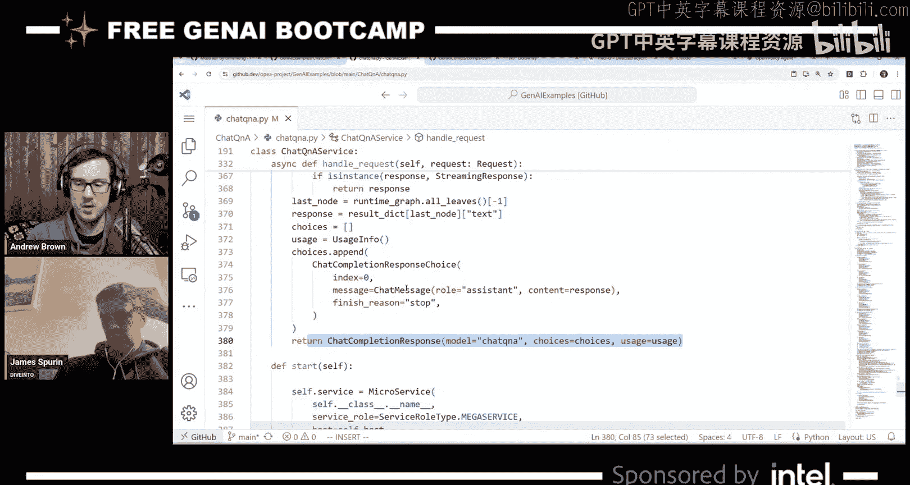

And I already have the code here。 I've already done it once。

 but let's see that if we can build it together in a streamlined way because if I can do this in 30 minutes or 20 minutes。

😡，Then you folks don't have to watch a 2。5 hour video， but if I can't。

 then you're gonna to be watching that 2。5 hour video or you're just gonna be copy pasting my code and going okay。

 I think I got it but I don't so I'm going to go here and make a new new folder here I'm going to call this mega service new okay and in here we're going to make a new file I'm going to call this one chat dopi。

😡，And so we know that we need to define a class and so in here we're going to call this chat yeah。

 it was called chat and there's a couple of things we're going to need we're going to need a knit here。

😡，Right， and we're also going to need a start function。We also need to add our remote services。

 add remote services。So that's another one that we're going to need。

 So these are our three functions。 So I can say print and its。And it'll have add remote。Services。

I think there'll be some container stuff for us here soon Jay。Soon， James。

So and we'll go start right and there's something about like death Ma， what was it it was u。

 how do we do that it was like Maine。

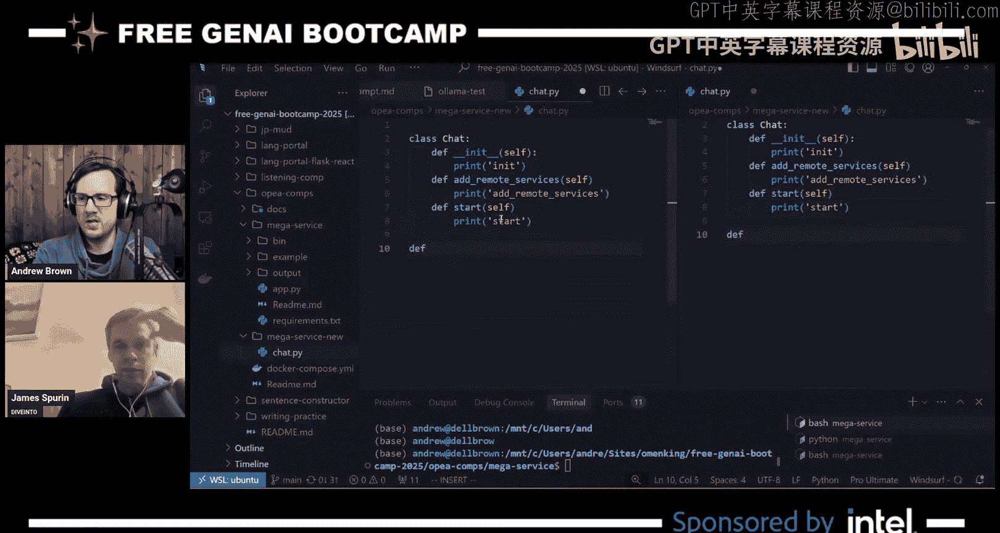

If。Name mainine， I'm not， I'm not a Python person。 So I'm doing good。

 So that's that's our basic selton that we need right， So we have we're going to initialize it。

 We're going to add remote services and we're going to start。

I'm going to go back over to the OPA example and we're just going to kind of bring stuff over here one by one。

Okay， so I'm going to go to here and we're going to go into our gen examples。

And I need to go back to our Cha QA。Have in here。And。I don't need all this stuff。

 but let's go take a look at the knit first。Function， Okay。

 so we're sending ports and stuff like this。 All I need is this mega service line。

 So I'm going to bring that in here。Right。And so I'm going to go here。

 and I'm going to dump that in here， right， We can also define our endpoint。

 our endpoint can be whatever we want。 So we'll call this James James is great。

 That'll be our endpoint。😊，And so those are two things that are defined in our class。

 so we need to bring in this service orchestrator。So I'm going to go to the top here and we'll just go grab that。

And。I think it's coming in from here。It's， well， it's interesting because I yeah。

 we're gonna really break it down here， make it real easy。

 But I we had to walk through all that stuff。 Like otherwise。

 there was no other way we could do that。 So I really just want that one single line。

 It's it didn't really paste， right。So I'm just going to undo that。

 I'm just going to write it up manually。 Oh， there it is perfect。

 So now we're bringing in the service orchestrator， right， So this point。

 the app's not doing a whole lot。 We have a service orchestrator。

 but I'm going go ahead and just make sure I can start this up， even though it doesn't do anything。

 So we'll say requirements dot T Xt。😊，And I'm going go over to here and we'll grab these two things OPA comp should contain fast API。

 but since fast API is a hard requirement， we're going to include that in here anyway。

 so go ahead and do that I'm going to CDd into our correct directory here， our mega services。New。

 I'm going do a Pip install hyphenr requirements Txt。 And folks， I'm speed writing right now。

 so don't expect to try to copy this。 you're just going watch and enjoy the speed writing。

 So go ahead and write this。 It's installing O comps and fast API as a library。

 So now we can reference comps up here。 This should do nothing right now。

 but it should initialize that service orchestrator。 So I'm going to go ahead here。

 I'm going to type in Python app。嗯。Python app or sorry， chat do high， and so it doesn't do anything。

But I didn't see initialize this either， so I'm going to go here and just say print main because I want to see something。

 right？And will try this again。And it has a slight little problem here。 It says unexpected here。

 I'm missing colons on the end here。 There we go。 So thats should fix our problem。 We run this。

AndSo now we have main and it at services Start。 So our our template is now set up。

 We have our initial thing set up。 We have no containers whatsoever。

 This thing could run into a container， and we could containerize this in a moment。And Gloria says。

 Netflix is no longer necessary， enough video content for the night。😀Ha。😊，That's funny。So anyway。

 we have our we have our bare bones bear bones set up， so now that we have our orchestrator。

 we need to have a service end point to work with， so we'll go back over to this and we'll look at the start function。

So here's our start function and it defines its first microservice， I'm going to copy this code here。

Okay， because we're really just going to pare this down to the most bare bones thing ever。

I'm gonna go ahead and paste this in。 And so now what we have is our first microservice。

 which is a megaservice。 So microservices by default are microservices。

 but if you wanted to act as a megaservice and you said it at this and it kind of acts on a little bit different。

 It becomes the entry point of the app。 And so we can a host to whatever we want and our port to whatever we want。

 I'm just going to oops I guess I'll set these up here really quickly。 So we'll say self dot host。

 and I assume it would be 0，0，0，0 for binding if James， you disagree。

 tell me I'm terrible networking。 but I best where I would go for especially if you're gonna be running this in the container yeah okay。

 good。 So right now it's not running a container， but we'll move it there in a second。

 So we have the host， we have the port， we have our endpoint right So we have James is great 8000 we can make this whatever we want if we want to go based on Intel's recommendation48 for their fun。

😊，And so now we have that set up notice we have the chat completion request and chat completion response saying the input data output data。

 I think what that means is that when it receives an input it's I'm actually going wrap the input into those formats even though when I use the handle request I don't ask for that back so I don't fully understand that and I don't really care because I have a working example but I might have a bit of craft to my code here that could be a bit better so let's bringing in the service role type which we need it's bringing the microservice and chat completion so that's working really nice。

 I like how it's doing that for me And so now we have our microservice and we should be able to hit that endpoint will it do anything no。

 it should probably are out but probably what we need is this handle request in so let's bring that in so let's say de handle request。

And notice it's like here wanted to do check completion request because it assumes that that's what it wants back。

 I don't know if this is the case， this is originally what it generated for me。

 but then it gave us kind of different code。 So what's working for me is request。

And i'm not specifying this， but it totally could be that it totally could be that and this is where I say where I'm just using what works and I need to get more clarification or dig a bit deeper for that so now we have our handle request right。

😡，And so yeah， we wants to auto to complete there。 So let's go ahead and start this up again。

 we'll say Python chat。And if we go up here， I expect an error because we're not returning something proper。

 says no module name cores。Comps cores megaserv microservice。Okay， so if we go up to here。

I think the problem is， is that it's doing this。 So I think we import mega。And then。

This one's probably fine。We'll try this again。It doesn't know， it's just kind of guessing， right？

So I'm not sure what's happening there， but I'll go take a look at the code here and we'll look at the exact imports。

And so the imports here are from comps。So it's top level。So here we can just instead of doing this。

We can just say from comps。This probably has to do with how the knit works。

 I'm not an expert at Python， but I think if we go into here， into the comps。

 there's probably a knit file here， and it's defining what's top level right。

 so even though there are sub folders， I think these are what are not maybe those。

 but this is the stuff that's being exposed at the top level for comps。

 so we don't have to drill down。

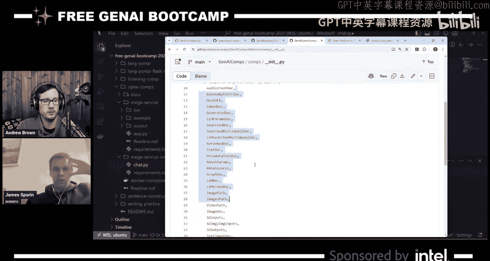

That's my guess， but anyway， so we have the service orchestrator。Go back over here。

 I'm just looking off screen here， but we have the service orchestrator and then this thing is actually in comps as well。

Even though it's in a subfold。We have this here。And we also have our microservice， which is here。

And then this here is kind of right。supposedposed to be import。It is right。

 I think it's just that if you want to do a multi line， you do this。 I don't know much about imports。

 but I think this is how you do multi line。 I probably， I think we could do that for that as well。

 But that's okay。 So we'll go ahead and run this again。And so now saying request is not defined。

 and so the trick that I have here is I'm bringing a fast API here。

 this is actually what this one's doing。And we probably need both of these， well。

 we don't need streaming response yet， but we'll go ahead and copy this。Okay。

 and that's probably why we had to import fast API if we。

 if we didn't have this one piece of code here。And used it here。

 we probably wouldn't need to even require fastS API because it probably would be acquired another way。

So if we go here for a second， down below， I think we now have all of our requirements。

So we'll go ahead， we'll hit up。Run it again。And so now the app is running。

 so we can go ahead and hit this on a port。So I'll go to another tab here I'll just close these other one。

 so it's less confusing and I need to。Write a curl for this， right， so I'm going to cheat。

And I'm going to say， I need a curl command。To test the mega service。For the。Chat。Pie。

 and I have to check to make sure I'm selecting the right one here。Okay。

 read the code and make me a curl command， okay？So I'm doing a little bit cheating here。

While that's going here， I'm going to make a new folder called bin， and we're going to call this。

You know。We'll call it message because really that's what it is initially。

I don't want this to be that， but we'll go ahead and do this。And we'll go up for a second here。

I just will tell it to stop。 I don't need all that stuff here。 And so now we have something here。

 right， So I'll paste that in。 and it's kind of probably pulling for my other code。

 It is pulling old stuff in here。 So like G 3。5 is really， really old and we're not going to use G 3。

5。 I'm probably using。Lma。Lama 3。21 billion that's what I like to use and so we have our data structure here and this is going to James is great on port 8888 the only that's missing here is our chaang so I'll go up here。

😊，And that's not how I like to write my shaangs。 We'll go here。 And that's what I want。

 It's only doing this because I have other code。 If I didn't have other code in the repo that looked like this。

 it probably would keep giving me the wrong thing。 So now we have our endpoint here。

 I'm going to go ahead and sha this。And we'll do a U plus x here， I'm going to say bin。

Am I in the right directory？ I'm not。 So we'll go into the correct directory here， which is the。

OPA comps， and then we'll go to makega service new。And in here we'll do a chama U plus x。Ben message。

 Okay， and so now what well do。It was a do biddden message。And so。We're getting you allll。

 So we're not getting the error， which is good。 but if we go back over to here。

 notice that it received the input。 This is actually fast APIs format。

 So it says post James is great。 It's returning back to 200。 We get back a thing。

 So now we're kind of in a working state。 We haven't added any models yet。

 But now let's try to add some container stuff。 So I going to do and this is where I might need James help because I'm terrible at Docker。

 but we need to make a Docker compose file。 I think that's what they're called。

 iss a dot YMl or dot Y AMMl or doesn't matter。I'm a big fan of spelling out Yaml in its completion so Y Y AMl the person that created Yaml。

 they say the same thing always spell dot Y AMl and that's actually how I always do it when I even other folks want YMl。

But like when you see me right Cloud formation， I'll always do dot YMl because things are more standardized on it and it's the original recommendation from the project creator at one point yeah I was looking into the same thing and I think I came across that same reference that you mentioned。

So what we need here is we need to bring in like I want to get this running as a container。

 I want to get us down the path of being containerized right away here and so I'm looking at the old the old one here and we have in here if we go to check Q&A we go to Docker composeose we can run this on Kubernetes I don't know how to do Kubernetes yet。

 I'm sure I could figure it out we'll go to CPU and we have AIPC Zion。

 it doesn't really matter at this point because the difference between these versions is that if you use Zon it might choose like the LLMs to be like CPU specific。

 but right now we're just bringing in the backend server and so in here somewhere in here。

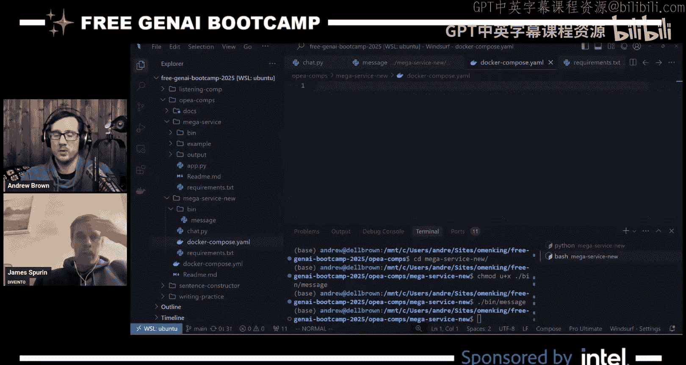

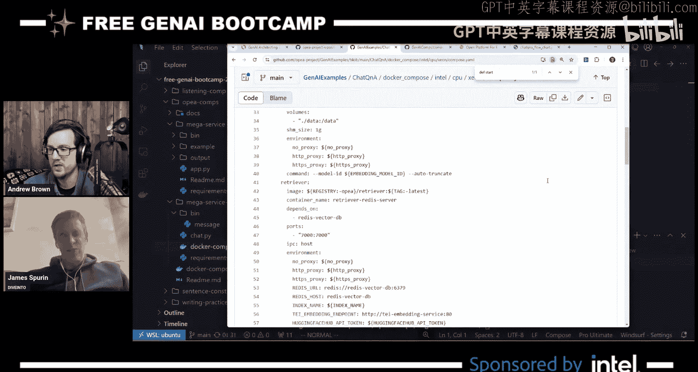

We have in here chat Q and A Zion notice it's 8888 right and it has some environment variables we could set those I'm just hard codinging the variables to keep them really simple right now。

 but if we were smart we would probably want to pass environment variables just something in the comments there really actually says yet another mark language I actually used to go with that myself and then someone corrected me and that's where it used to be apparently but now it's Yamo ink mark language。

That's what Shaza saying for those I actually have a crash course on Yaml somewhere。

 but I don't know where it is in my I have too much content。

 So here we can see that saying OPA Cha Q A tag latest。

 whatever it's going here right and since container name is this but we'll call this the mega service because it'll be less confusing and there are these other ones like when we need them we'll probably have to define them right now we don't actually have any of these things。

Okay， and we have IP what's IPC hostsse？Is that like a networking thing or？Yeah。

 inter process communication。So I'm not too sure exactly what that's doing。Okay。

 and so the image would this， would this have to point to a Docker file or this would actually be the built image。

So that would be the， yeah， that's the bill well。It it's an image reference how that's being interpreted。

 not too sure。 So I'm going say here， Docker compose。The new mega service on this one。

 how do we reference a local Docker file？For the container and you probably know what it is off the top of your head。

 but let's see what it produces here。And is it just build， let's see here？

There it is and we're on we're on right mode right now。

 so it's injecting it here I think that's correct that looks right。

I think it's good I'm personally I'm not。I'm typically not a fan of views in this。

 I usually actually reference the name as you had it before。

 and I go through the cycle of actually building and using it。 But yes， you can actually。

Reference alive and build live on the fly。Well， I think for now。

 I'll do it this way or or maybe we'll switch it here in a second。

 But now we need a wonder runner container。 So I'm gonna go see here and see if we can do it。

 So now we'll say Docker file。Um， and I well， actually did I get the right one we say Docker file。

This one here， no no， no， that one here and say I need to run my chat or my chat dot Pi。

 can you write my Docker file？Willll write a good Doer file， that's a different story。

 but it can do something。Should you let LLms write your own Docker files， I don't know。

I typically always let。LLms write my doc files now。

 I mean you get 90% of the way they most of the time。

 but I think the thing is like you know what you're looking at。Right， so if you're。

 if like you've read a lot before， you know if everything's okay， but like we have this here。

 so so far， so just looking at this I'm。Let's have a look yeah'm I'm happy with the top line it's okay I was initially worried about line 14 but at the time I couldn't see line5 so you do have a work directory so it change everything to slash app。

Justs copy the requirements do txt into there。We've got our Pip in store。 Yep， absolutely fine。

 Copying the rest of the app， so。How it looks on your screen now when you when you showed it initially。

 I couldn't see the work directory and copying everything in would have been bad there but I'm assuming I need to move this otherwise if I did copy when it bring in everything that I don't want and so it would be should it be like this maybe sorry so we show directory strict termm a bit confusing the lockdown side but this was just in the top level directory and I just threw in an app directory So I think that we'd want to have this code here because if we did period it would then bring in itself into the own thing and you probably don't need to copy the Docker compose Docker file into the container itself Yeah。

 for sure like that's like you shouldn't do that right。No， like it won't hurt anything。

 but it would be it just be no no， no you want， you wanted to keep that as clean as possible okay。

And I mean， this is actually external script。 So it's make the message executable that's not in here。

 So I think because it was confused at the time it pulled it in here。

 exposed the port here to port 8888。 We're obviously hard coding things here again。

 try to keep it really simple。 And so this should start up our application。 So let's go ahead And oh。

 I think I can really cheat here。 I what I can do。Do we have two but do we have two document proposed files？

This one， and why do I have two？Oh， that's， that's what you were doing before。 Was it Jacob Trason。

 I see。 So I'm in this one here。 And I think if I right click it here。

 If you have the docker thing installed here， you could do a compose up。嗯。

Youd also just write Docker compose up， but you probably have more flexibility to pass environment variables and other things that you want。

 And if we go here the left hand side tab， see how I was running Jaggger。I wasn't lying。

 I can I can kind of do jager。And。Oh， we have a fail， so it did not work for some reason。嗯。

Additional property Cha QA is not defined in the Docker compose new file。 So let's make sure。That。

 oh， I didn't even finish writing this。Okay， so this I'm going to call it mega service。Like this。

My file looks a little bit incomplete for some reason， There's something missing services。

I think you're supposed to start with services like this。I think there's， yeah， with that now。

 depending on your your docker version， it's not necessary to have it there really on that yeah。

 I'm pretty sure let me just double check on there。And while you do that。

 I'm going to set it to bridge mode， any suggestions about networking modes？嗯。

See what you've got at the moment， sorry。Just getting the way， right？

I have this networking mode here but。Why is this arrowing note。

Networks unexpected sc are at the sentence， Maybe it's supposed to be indented。啊。

Maybe so speak indented。There we go。And we'll do I no it's just sorry。

 so it's the it's the version line which you don't actually need anymore as I was referring to it so you typically would see the version line at the top。

But yeah， you haven't got a services line there， have you？I have I do have services。

 but I don't specify a version our Docker file messed up because we're trying to copy the requirements here。

Copy the requirements first to leverage the Docker cash okay。So this would be requirements。

Would it be the other way around？Now， in terms of the networks， I'd normally just go with it when。

I normally just go with a name network rather than than specify him。 but that is a bridge by default。

 So I， I typically， when I'm doing this， I don't actually。Put that in there。

 I will give it a named network that on。It might have looked like it worked there a second ago。

 but it didn't I launched up the wrong one because I have that other one here。

So I'll go back over to this one， this is the one we're actually working with。

I'm going to try and compose up again。And so you're saying like you would name the network。Yeah。

 so the。Essentially， you could put networks call on then underneath put。You know。

 exam pro dot I always， is that your domain whats your domain for exam Pro dot co， yeah。

 exam pro dot co and then under that put name colon exam pro dot co。

And so when were when we're doing networking， then we instead of doing we can then reference that that host or that name within our services so that it's。

Yeah， so so so。You can end up with something nice here， so we're composed as it's auto DNS。

 so to speak， you can actually have this as web。ex Pro。co database。expro。co。

I normally don't put the bridge entry on there， I think it's assumed by default， I assume so。

We are getting some errors here because it's already in use， I believe。

And so I'm going to kill something on port 888 Oh， it's because it was running over here。

 that's why I was running it manually so we'll go ahead and we will compose up again。

And we'll see if we get this working。And。嗯。To fail Air responseor David Network not found。

 we have a networking issue。嗯。Scro back up a second that output put。OhWe got to create the network。

This is where we actually have to do networking stuff。Normally you don't。 I mean。

 normally we compose。Do you think as I'm running WSL， that could be an issue no？

But the network is seen about there is。咩嘅。Service new， hangang on。Well。James， we're out of time。

 So what I'm going to do is I'm just going to set it back to default for now。

 I am going to figure out how to do the network thing。 but now that you're talking about it。

 I remember us doing this in in the AWs Club Project boot camp。 So it's starting to come back to me。

So I have to go back and watch some of our videos because I remember doing all these little things and all these recommendations。

I'm going to go ahead and just see if this starts up。And all I want to see if I can just ping it。

 right， so if it builds here。诶。It does not still have an error， even when I switch it back to this。

 interesting， what if I just take the networks out completely？Interesting。H okay。

 well I clearly have some kind of problem with my machine， we are out of time。

 but this will be something that it seems like it' it's specific to my machine。

 but anyway just just as a very quick one if you if you were to do a Docker network or less。Sure。

I wonder if we can。

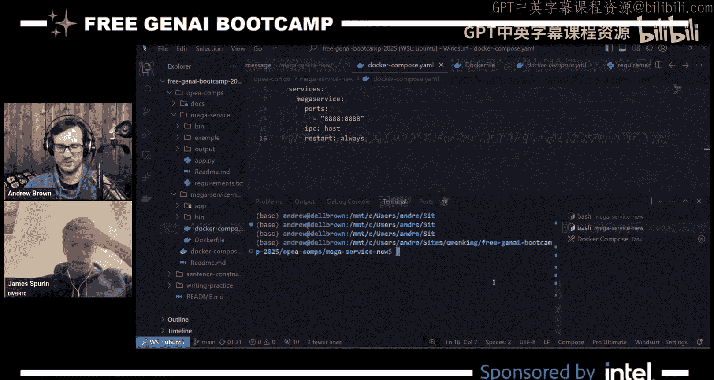

What is the。I wonder if。Or。I believe with this that the compose should manage。

 so possibly you might be able to remove。🤢，The network from there。

And then when you run the compose again， it would be okay。

 but that would be it would be a Docker network subcommand if you were to do Docker network help。

Help which scroll back up which one was it actually saying didn't exist So if you scroll back up what was the it was it was a6 a scroll back down。

A6 a。Would it be in the Docker compose file where it was saying that？No，'m。Yes。

 something isn't right here， it's it's， you can see it's actually creating that。

 but then it's saying。You could try just removing the existing one which exists there so yeah remove that mega service default so Docker network yeah try that that's my guess I remember Docker being very pretty standardized for their API。

I know if we do the LS， okay， and now if we try it again。We'll go here to close up。

Still get that error。 It does create it， which is unusual， but then we get a a Damon response error。

 which is unusual。 one other just other side doctor P。 is there anything else running here， No。

 nothing's running。But James， we are out of time。Just as sorry we started getting the meet。

 James is like。Like for those who don't know， like Jays will just keep going and going like he'll。

 he'll give me， he'll give me u like super production like it if if we had more time。

 we'd have like the most super production thing， I think in an hour or two。

I've been sneaking off camera a couple of times to tweet eat the sandwich， but yeah。

 I keep going oh you're like me see like， see what I do is like five or 10 minutes in between takes I will I shove my mouth full of food with you literally during things you just pause go shove food and I give you that's dedication folks。

 we have office hours Q and A or start it。After class after class。

 I said office hours after class Q and A in the Discord for those who want to come over there and join us in the afterclass afterclass Discord and ask questions。

 you absolutely can James， if you want to come on over， you can as well if you want to go eat。

 you can go eat too as well and let's see the rest of your day appreciate appreciate you coming out here and and getting us through some of this container stuff。

 I ate up all the time with my my big my big diagram unfortunately。

 Well we can we can sync up as well and we can actually work on some bits on this offline。

 Oh James I I will take I will take everything and anything Yeah this is really interesting and to be honest。

 I don't think we would have。😊，even with you know half hour or so at this。

 I don't think we would have done it justice， so let's actually do that and let's tune it in。

 comment the actual Docker compose file。And have it there as a reference for everyone。

And you know folks， I actually mostly was chopping wood， but we solved the problem。

 So I have a gas furnace or oil furnace。 and I kept hitting back I was like I'm getting lightheaded because of the the fumes。

 And you said， oh， you know what I can do I can stop  bleeding onto the ground I was like what I justbleed on the ground。

 maybe it's just like picking up and doing that。 So now we put a little drip cup And so I don't have to cut as much wood。

 And I can I don'' there's no chance to be fainting during live stream。 we had a good chat。

 didn't we about the radiiate loops in the UK I that something you know going do I'm thinking about it for those who don't know those that are actually are in the UK。

 I guess they have heated towel racks in in their places。

 but in Canada we don't have such fancy fancy systems right but I know that I know like this video will be dated because I'll mention this。

 but I know that the Ccon London is coming up for those who can't afford ticketscon London ever do like。

Events around the area like do people ever meet up on the outskirts of it Yes so there's's there's there's lots of things that go on so there's there's a very good scholarship program with the cncCf so I recommend。

Many people for any kind of Cecon if you fall into that category do apply because they are very generous。

 you actually get you know you can have accommodation you can have the ticket you can have the travel covered for free outside of that there's various ones probably the biggest one is is an event called rejects when rejects is where essentially if you've submitted to Cubecon and you didn't get into CubBecon you were rejected these were the ones which actually get picked and it's a lovely event you get lots of people event outside of the conference on it yeah it's a preevent it used to be one where you had to buy tickets for it but the tickets were like 50 bucks now it's a free event or it has been the last the last time because of sponsorship so yeah come along to rejects if you're in。

London I'm going to go to reject so we can hang out it'd be good so there you go boot campers if if you print out your CfN CncCf landscapes and James will sign it for you。

you can walk in Rome with a massive。😊，😀Yeah。😊，But yeah， again。

 that's just the way to connect because I know some of our folks here are in London and so that might be an opportunity for them to meet the James Spn。

 but anyway， thank you for helping us out so far boot campers are going go see you in the afterclass Q&A Discord right now and of course it's time to cue the bootc song but we'll see you in class soon。

He's found flu causely fire。Fs of vis and all now pot， he one that I got I。

HeYou leading in France from just song。She us a luck week bro。Aid the hum of the shs。

 the glance swift jewels do so from death thenly cast Mcweidowos a tree floched over favorvolless Entes。

Hely you em that dances like to。Together we sway starss in our eyes across galousice wide。

 not whole skies left echoing the empty Is。😊，A cliped by shed and a million and rye。

 a across aumed the first off sky。🎼Could your sandwich pill sufficed。

To break the be it is now be ice。Once pastize us often buy its smile。

 co we gently ex faint for just the little one and pre dirty lights in this humble place。

How mighty pros and send a time of the space in this lounge， not what was the。

F night we st by st from the young of stars we。🎼Com。🎼You fallen peace with the now the home。

🎼The clips。🎼请讲我阮身。Roster you know entire silk Sky for you with some witch。😊。

Suffies to break the variousies melty eyes。

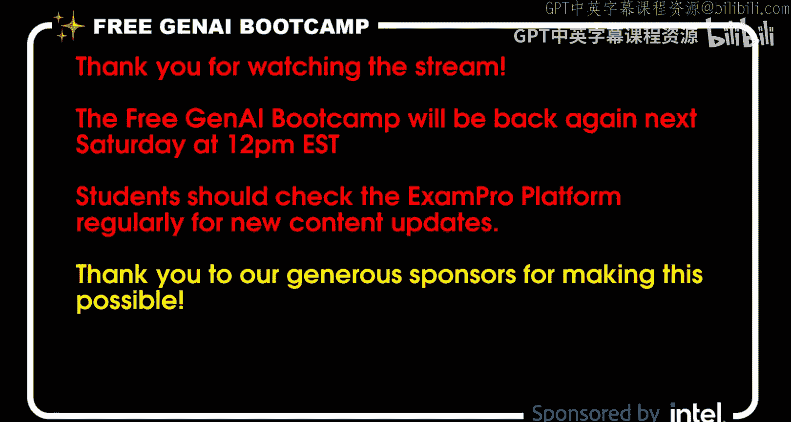