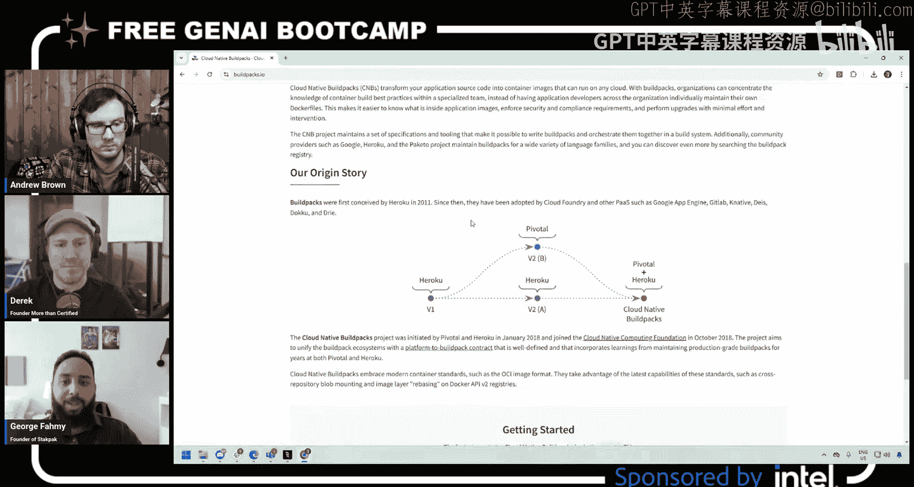
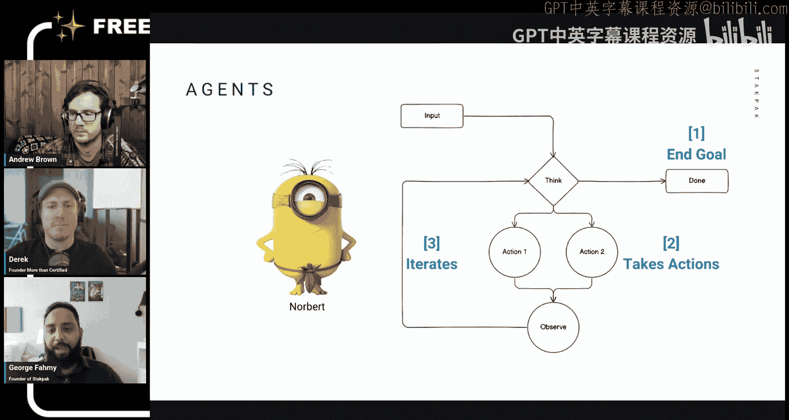
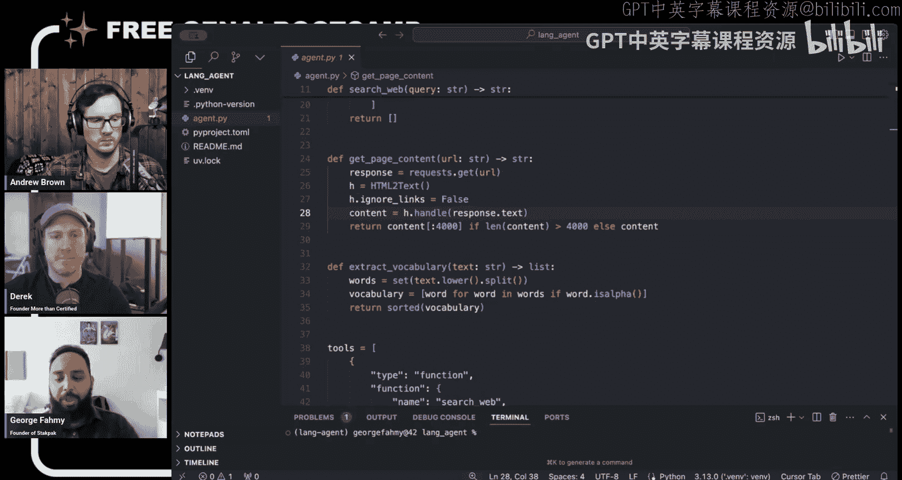
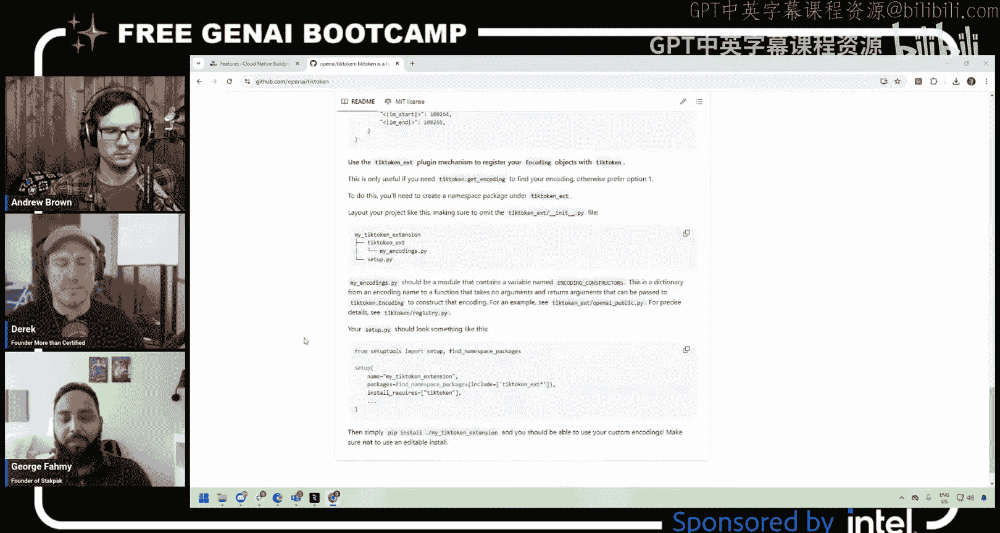
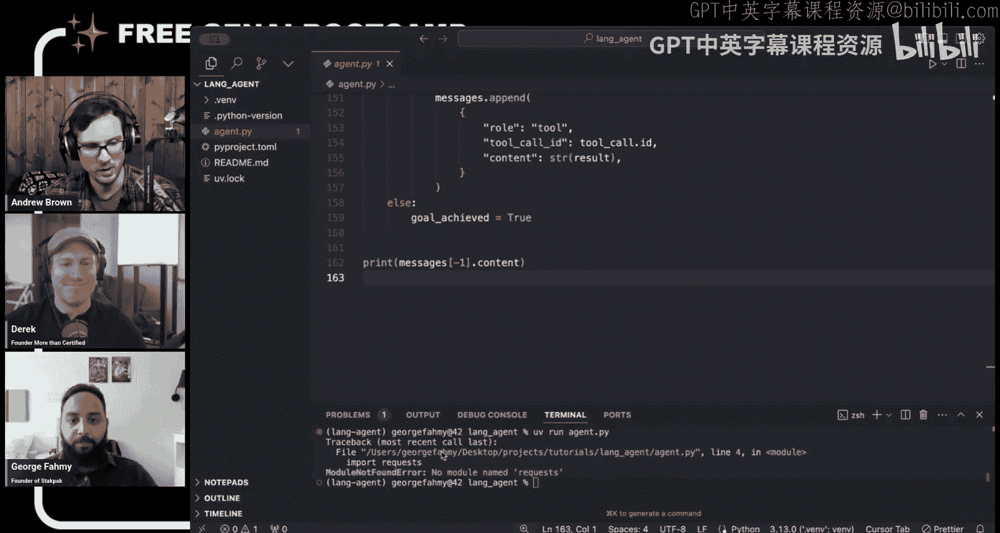
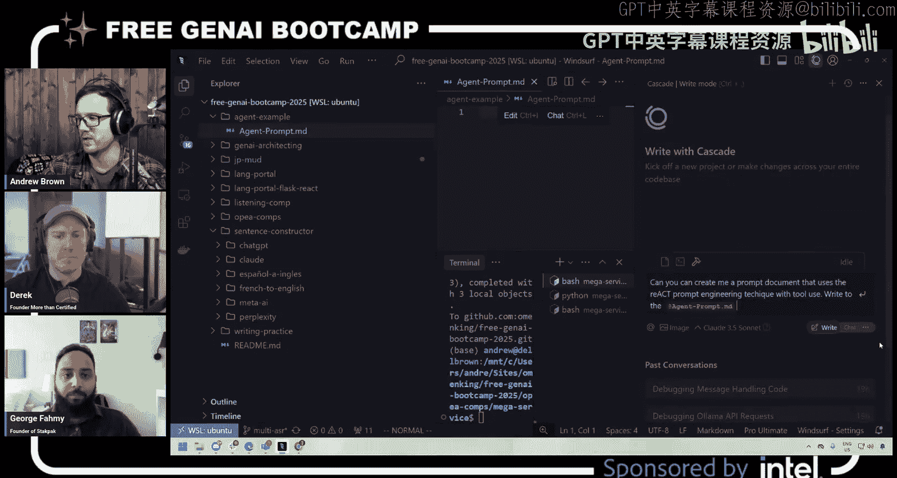
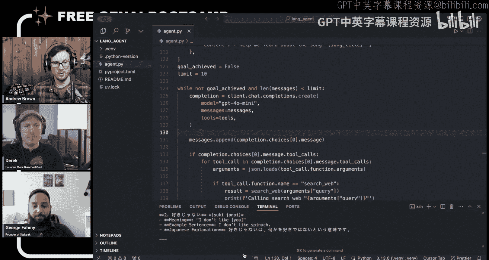

# ExamPro《生成式AI训练营｜Free GenAI Bootcamp》中英字幕（deepseek - P47：-47-Agents with George and Derek.zh_en - GPT中英字幕课程资源 - BV1SFEWzLEab

Hey， this is Angel Brown， and this is the Free Jenning I boot camp。

 We are back with Georgia and Derek。 We covered structure Json output。

 Now we're going to cover a different topic， which is a agentic workflows agents。

 what we want to call it George。 Yeah， just agents。😊，And what is an agent？Yeah。

 can we switch to the slide demonstration？Okay， so this is like the simplest Asian you can have Norbit。

 which is the naked minion that can do two things like can look for bananas or like yeah do whatever gu asks it to do so。

Basically like you can say something is an agent if it can do like if there are three things like the first thing it has to as a goal as it's hungry or trying to obey group into doing something。

 And the second part is it can take actions that affect like external world do anything and third thing is it keeps iterating until it reacheses the goal So it's like a terminator that doesn't stop until like it finds seconor for example So yeah that's basically an agent like it has a goal takes some actions and it iterates until it reaches the goal this is very different from building a regular LLM application because a regular LLM app has a specific rigid workflow So you know exactly how it's going to go but like the agent is different and it helps you fix more like。

😊，Like we're tackle more complex problems because it can iterate。

 it can keep doing things over and over again figure things out or just like keeps going around like unable to do anything basically when I was talking to other folks about agents they all were def it differently but I think that the definition that I like makes most sense with with the one that you have here because a law of folks just like well if it has tool use it's an agent but like I guess the little point is supposed to have if it has agent workflow has agency meaning it can do things on its own it used to have its own iterative loop to be able to do actions that are not necessarily specifically like statically defined so like when I was trying to build that agents。

 I was calling them agents but you're like no no you're just building like it's just basically a static workflow because you can define all the steps and it's not like it has to iterate back on itself and so to me I'm going to pick sides here I'm going go on George's side here and say this is an agent。

Yeah yeah， exactly like it has agency because it decides which action to take and it also has agency when to stop and to be able to figure out when to stop it has to has some specific goals trying to achieve and like what one of the challenging things about building agents is that if it's not smart enough to figure out when to stop so you have to it can't keep going forever if you don't like have some either like a clearly defined goal or at least like let it go for like 20 or 30 traditions before killing it instead of like keep forever。

 so yeah it has the ability to toerate and decide like what control its own control for like that's the agency party you mentioned exactly。

And I mean boot campers have used agents， whether they realize it or not because like when you're using Winsurf or cursor or these other things where they're taking multiple steps and they're executing things that I mean I would call those like would you call like windsurf's cascade write system that's outputting code and changing stuff in the code or cursors。

 whatever they call their thing， they call an agent do they call an agent because like it has like composer or like I haven't tried windsurf yet。

 but like they have a couple of fixed actions like they can grab your code to look for specific keywords and find that in files。

 they can write edit code， they can run commands and the bug commands。

 they can get the feedback out of like like they can create some code changes and then observe the output of the LSB to figure out if you broke something the syntax is wrong and then iterate again to fix it and they can keep going until they reach the code or they decide to give up for example first backpack。

have you had to create an agent for your product or yes we so far we created tried out three or four different architectures for different things like for example。

 we tried cogeneration for lockcker files initially and we thought okay that would work but like it never works on the first time that's why build packs are like cloud native build packs are very hard because like they promise you that you can take a cloud native build pack and build a container for any application but every single application is different and has some different environment like requirements in runtime for example。

 different configuration paths and you need an agent because it's a super complicated problem it doesn't usually work on the first time so you generate a Docker file you try build it you try one it you stay app and then keep iterating and that's why an agent is a good application like a good solution for this problem when you're talking about build packs you're literally talking about build packs that I like cloud native build packs here Yes exactly so it started out with Heroku I think and thought it works。

Probably is this like is this like a Heroku open source solution So Heroku they contributed to this a lot so what it does like they deterministically like check your source code yeah。

 Heroku and pivoted labs so they check your source code and based on your source code they have some templates or builders that help you build an image and these doesn't use Docker files but they basically try to do the same thing and the problem with this is they don't work for all applications so your application has to yeah conform with what they expect to be able to build an image out of it。

😊。

Is this like vagrant， I don't think I've used build packs actually。

So when they work their magic like this is how Iroku takes your code and is able to deploy it in a cloud way well it's an image builder for runtime exactly image builder but the problem with buildbacks is they don't work for every single app。

 especially if you have some weird runtime dependencies and that's why it's a complicated problem it can do it without something that iterates and tries like with multiple attempts to containerizer app。

😊，Cool， yeah， so if it was straightforward， then you wouldn't need agent。

 but like you need an agent for this case because there's trial error involved。

 we need to do something， observe and then do other thing and so on until the app is working。

Oh and by the way， I'll just show one more time here， but Derek， if you're curious about it。

 they had like a tab， which was features， then they're doing a comparison of what it can do versus Docker files versus other possible s says I'm not familiar with these type of packages nice but it's interesting that they show that so it's not a new project but clearly it's a robust project here at least I've seen it a lot but I've always been in Docker so heavily that I just really haven't investigated any further。

Yeah， so I switched to the code editor because we're going to like go give you a code walkthrough to a simple agent so when I used to learn German I learned a lot through songs so I would like memorize the song。

 try singing it around to be able to pronounce things right。

 learn new vocabulary and stuff like that So what we decided to build here is basically an agent that given like the native language of the person or yourself and the language you're trying to learn and a song name you're trying to learn it will look in over the internet。

 try to find the lyrics and get the lyrics， extract the keywords or the vocabulary you need to learn and then explain it to you with examples in the same language and your own native language so you can learn the song and then sing along the only German song that I know is 99 new balloons Love balloons。

of well， we well， that's why we need this app to learn German， right。

 We able to sing this song properly。 It's actually a place right next door to me called Luft balloons。

 balloon store。 that sense because like Loft sounds like。 Yeah， yeah， Yeah， I saidoft， yeah。😊，Okay。

 yeah， flying balloons。😊，Okay， yeah， so there are almost as many agenttic frameworks out there as there are frontend application frameworks so they're crazy and they keep pop up like Pageantic they just announced like released their agententtic framework and there's also Landgra which is super popular but like here I decided not to use a framework to give you like like so you can see the details of how this is working internally and the most basic form possible without any abstraction So these is other like the package we're using using the API CI package。

 the duck go search which is search engine so is that similar to I can remember the name of it but there's there's one for YouTube specifically searching it and so Ser AI So this is like the duck go go of Ser AI maybe where it just allows you to use an API to grab search results Yeah yeah exactly so we use this to grab like page titles and URLs but not exactly like scrap the page but then use beautiful soup no no beautiful。

😊，Tmato text so that's much simpler I used to use beautiful soup but it to complicated and for those who don't know beautiful soup it is a it part it's a parser I believe like XM should help parser right is that right yes exactly but I found this package that makes this more straightforward so yeah just like ended up to H text so it basically drops all the styling all the tags and get you their pure text。

😊，Whi is better for the Lms to to go through so yeah we said like an agent takes actions so here we have three actions defined the first one is searching the web which takes a national language query and then does a search return some results。

And basically at the title and the URL of the result so the title is used so the LLM when it's in like the observing phase would be able to know what this page is all about and then the URL because then we feed it to the next action。

 which is like fetching and paruzzing the actual page So the second action is getting the page content takes a URL and makes a web request and then tries to clean this the web page triming like stripping it off the HTMLl tag。

 getting the text and then we make sure to only get like 4000 characters because we don't want to when you're on this agent to blow up and like consume gaziian tokens and you get like a huge pill and you don't want to be too slow so just like truncating the rest of the characters sees 4000 characters Do you use tech token for most of your token monitoring or do you have something else there are a lot of like LLM observability tools you can use because different models use different tokenization algorithms and have different ways of accounting for the stuff。

same string with like 4000 characters can be different number of tokens depending on the model using I usefuse but like they're all pretty much the same they are a lot of them like there is Lsmith by Link as well they will provide you ways like adding special observability that tracks tokens tracks the costs and stuff like that it this tech token to your time about Dek that's one that I think it was probably one of the earliest ones very simple and I've been using it for a while it's just tracking your token usage well when I used it it was just to give me the number within my code just like I actually didn't tie into any of their cloud or anything like that but it tells you how many tokens are being used with the model right fairly low cost but just token output exactly but it could do cost also though because as like we said in the previous video like because some tokens can be like multiple long so you can never do this as a person like you have to something to count。

I see。没。Okay， so here I'm not counting anything like I don't have any observability hooked up here Yeah the last action is extracting vocabulary。

 it basically takes the text and then like splits it keeps only like aphmatic worlds words like like throwing away anything else and then sorting them like yeah that's it so like the three basic actions。

 search the web return results extracting content from a page and extracting vocabulary from like the piece of content so we have the actions we never tell the agent in what order around the actions we just make the actions available and add a description for them and the agent has to decide like the agent has the agency to decide what to choose so this problem specifically can be done I think it can be done with the workflow doesn't need an agent but like yeah it fits like as an example of how to do this and by building it as an agent you don't have to think a lot about like the workflow just give the agency tools and you let it like go wild so how do you find this？

😊，We use like the simplest way like instead you can use pedantic pyantic like schemas which is much cleaner。

 but here I just gave it like the expected J function like the J input opening I expect which is like this is a function and then for the function it has a name it has a description of what the function does and this is very important because this is how the LLM like。

This is how the LLM decides to choose this specific function to call it and for the parameters you use adjacent schema to define the parameters here it's an object that has a query input。

 which is this query。😊，And has a type screen and the description of what the parameter does like what this property does exactly and everything has to be required for Open network work we do the same for pages take get page content to expect a URL and this is the of the web page and finally for extracting vocabulary we have text and we also say。

 okay， this is a text that you would extract the new vocabulary from。

This is basically like how we define the tools to the LLM and if the LLM supports tool calling。

 then it would take this input and whenever it thinks a tool should be called。

 it will call the tool instead of adjust reply directly to you。Was an answer。Cool。

 so so exactly where I got interrupted my wife walked in in here asking if she's gonna go get dog food song where's the loop。

 where's the loop that's happening， where's that reflection kind of happening where yeah we're getting there sorry okay we haven't hit that yet we're basically defining the tools or the actions the agency is allowed to take of them search web get page content extract vocabulary this is how we feed the input to the other them so knows it's aware that these tools exist but like in our problem here we have like a couple of custom inputs to the problem like to solve this problem we have the user' language the foreign language the user is trying to learn here like my language I speak English and I'm trying to learn German and the song title which the Vof like the philosopher's song and we have a system prompt。

And we tell it in the system prompt that you're helpful language tutor and describe what the agent is supposed to do and then give it as input like the user language and the foreign language and as the user prompt。

 we simulate this by saying like helpp you learn about the song and then the song title and that's it。

Then we define like a flag， whether the goal is achieved or not because we keep going until the goal is achieved and we need to know how we break out of the control loop somehow and we limit it to 10 because we don't want the agent to run forever because it can run forever in consuming tokens indefinitely so whenever we hit reach this limit of the number of iterations we stop only if the goal is achieved or if we hit the limit of the like whatever the limit we said is and here it's 10。

And this is very important for agents because they can decide to keep going forever。

It's up to them yeah so this is the control loop as I said。

 like we only stop if the goal is achieved or if we reached a limit we use GP40 mini because like with structure generation like yeah basically like the part about structure generation here is actually generating the function calls So what the agent would we do is we basically give it the messages input and then we evoke the LLM here and it understands that there is a problem and there are tools to help it like deal with the problem and whenever it decides to call a tool you get a special message adjacent message within the response that had two calls So if tool calls is set。

 it means the agent is trying to take an action and this action can be one of three things it can be searching a web and we get that by looking up the function name so the agent decides to use a specific action it tells us which action it wants to use and it has arguments for this action as Jason So what we do is we pausese the arguments and then based on the actions name we call the specific action。

Internally， so this is how we link between the agent thinking it should search the web and the actual web searching that happens so we decide to search the web and it has some arguments to feed this function so we call the specific function name and give it the arguments and then get that feedback and so on so for every iteration we try to get the actions run the actions return the result and append the result the messages so the agent would see the result of the tool call and keep going so this can be just messages so the history of messages or it can be anything basically like you can define a state for the agent and this is basically the model of how it observes the external world and what it does and the effect of what it does on the external like external world and feed it back to the agent so it sees the impact of its actions on the world like if you don't do that if you don't append the message if we don't show with the external state it would just keep assuming that it didn't do anything it's not it keeps forgetting what it it did so basically have some sort of history encode it somewhere to show it that it's making progress towards solving the problem。

Cool， okay， so if it's not calling a tool， then we consider， okay。

 we achieved the goal because it's not calling an external tools。

 So it's not taking actions to affect the external world。

 So we just terminate because the goal is achieved。 And finally， we print the final output。

 So this would keep going until。😊，solves the problem so the idea here is that like if it does a Google search and then try to parse the web page and it doesn't find anything it would do another Google search。

 try get a web page like if so it keep going until can't find the lyrics and it can extract vocabularies from the lyrics。

😊，Do we have to do anything like tell it to think about tools and have that stuff or is that built into the framework？

No it's built in the framework of like if the LLM supports tools and the API supports tools。

 it won't just work for those that are kind of wondering here and maybe I can just share my screen really quickly and just show a quick example of what that might look like if you're not using a managed of service but I'm going to go ahead and just bring up my screen here this one here and so I'm in the freeG boot camp and I'm just going to make a dump folder here really quickly called agent。

Agent example， and I'm going to make a prompt document here， prompt dot M。

 and I'm going to just open up server for a moment and just say， wellll clear the conversation。

 It's like， can you， can you create me。Create me a prompt document that shows the re that uses。

The react。Prompt react reasoning， well， I guess react is reasoning react。

Prompt engineering technique。With tool use。 let's see if we can go ahead and do that and， you know。

 like， write it， write it to the， I'm just gonna to rename this to。Agent prompt here so it knows。

 And that way I can just say agent。Prompt and we'll just quickly do that And so then we'll just see an example of it because it should work pretty well。

 I've done this before surprisingly and I'm not saying we're gonna to use this obviously。

 but we're just gonna see what that looks like and we'll give it a moment to generate out here。

 Yeah react is just like a fancy way like the paper title of a fancy way of saying the agent does something and then observes what it does and then do something else based on like yeah that's a lot of these prompt engineering techniques are fancy titles but yeah exactly but it's much simpler in practice like if it try build something with this is much simpler and what how it sounds。

So we'll just give this in a few moments here to generate note I have pro unlimited so it should go pretty quick And so if we take a look here。

 we'll see if this good So says you are an AI system that follows the react reasoning so reasoning and acting framework to solve the problems your core principles are this thought always explain your reasoning before you take an action action use the available tools to gather information or make changes observation analyze the results of your results repeat。

 continue to cycle until the task is complete。 that sounds like it's going to do that repetitive stuff available tools And so here it's saying insert tools I wish you kind of gave an example of that。

 but that's fine we'll go down here for a second。 So for example。

 step in solving a task you should write your reasoning as thought your reasoning act call a tool using this format and so what we'll find is that here's an example of interaction it'll say find all python files in the project and count count their lines So assistant thought I need to first find all Python files and count their lines I'll break this。

Steps and then it'll say what action should I take and so up here you would tell it like oh you have you know you know these available actions you could list them out if you want to be very explicit or inject them like with rag like FYI the react paper predated LLMs being good at tool calling that's why it was necessary back then to define the tools but now since most like LLMs are trained on tool calling you don't even have to include this spark just feeded the tools。

So the prompts are much shorter now。 Oh yeah。 So like so what part of it like you do you not even need this part。

 you don't even like you don't need to tell it this is how the tools look and you have to call tools。

 you don't have to mention this like it would design on its own to pick tools and that's like basically because things are moving really fast and Lms are just like getting better at doing that without you having to prompt it to even smaller models were。

If the model supports tool calling like if the model is paying for tool calling。

 then it should work out of the box， but are you saying this mostly for like managed large services that we can't run locally？

No， this was like the time they released like the published these react paper models were not like doing that by default fold。

 but now most models tall cool by default fold so you don't need to tell it what is the tool called like knows there are tools that you can use but would you still have to tell of what tools that are available for two use not necessarily no you don't not in every case we found like in practice Open eye is really good at this so you don't have to do this if you resume Open eye for anthropic you also like most of the times you wouldn't need to do that but in some cases enthropic because you don't use like proper structure Jason generation they mess up the function calls so at some point we figured out like okay to make cloud better at this we have to tell it more about like to properly like try tell it more about the tools so it doesn't mess up the J generation I guess my thought is that you are still providing the tools that are utilized in another structure so wouldn't that going be injected into the prompt No this is like I'm not sure like how they do it internally but like here when I'm prompting it I'm adding tools to like create。

I'm saying its like if you are defining them here， it has to it has to tell it like what they are otherwise how would it be but they do it in a better than I would in the prompt so like I never mentioned tools but like internally they feed it to it somehow know there are tools somehow Yeah for Amazon bedrock。

 they have their own managed agent thing and we can see there's a way that actually see the document it literally is like these are the tools and but I don't know if it describes the format of the tools。

 but it definitely explicitly injects it so but anyway I think it does that internally somehow like can do that like it's part of the API youd see there are tools that you can feed in。

Okay， so let's run it full。 So U V 1 So I'm using U V。 It's a new like Python packet manager。

That's why I use UVvin instead of like Python Asian Pi one of our one of our boot camps mentioned it and so I mean it's not an alternative connda。

 is it。I've never used Conda， so I don't know like yeah。

 it it manages packages virtual environments and Python versions。

 So it does it like a couple of things you used to do separate that'sda Yes。

 that's pretty much the same thing as Conda Well， but sorry， does U do environments as well Yeah yes。

 it manages like automatically it does like creates a event and the virtual environment and it like assumes this virtual environment like sources it and then run the command is there any advantage of U over Conda Derek。

Not that I know of I pretty much stick to Jupyter notebooks overall and a lot of that kind of stuff abstracted so I don't bother it much。

 but I've heard really good things about UV so far a lot of people with Conda I don't think many people use Conda outside of data science workloads I have a feeling that a lot of people who are using PipI and stuff like that have probably skipped Conda and moved straight to UV whereas you know people using Conda probably will never leave。

Some people say it's fast like like from my experience it's as fast as PMNpM for example。

 versus NPpm it does like it has some caching mechanism that makes installing packages faster but like yeah I've never used Connda heavily to know how fast it is compared to it it looks like it selling point is 10 to 100 times faster than PP that's their selling point for UV that's interesting so it's a pretty big pretty big range there 10 to 100 times yeah so guess like PMNpm and NPpm。

Okay， so you see here like I gave it like like the input。

 which is like I'm a native English speaker I'm trying to learn German and the song title So what it did is it decided to call searchwe with this input so it came up with Dsof lyrics I didn't add lyrics as somet but it came up with us because it thought it's a good way to look for the lyrics and this returned like 10 pages with different titles and it decided to pick one of them which is this link with and call get page content so it decided to search the web and then it checked the output and then picked one of the titles and copied the URL this summary is this summary built in or is what you print out I showed out I see so yeah so it decided to get to call the action or like function get paid content with the input which is like the URL of one of the pages and then it par it and it read the page we don't see that here。

It decided to call extract vocabulary like I decided， okay these are the lyrics。

 it's good enough and it will extract cold the extract vocabulary of the like song lyrics。

 this is the song lyrics， the Man it'ss and then it keeps going and then it extracts the vocabulary here like all the words。

😊，嗯。And then okay so let's and this is the output， the final output so let's dive into So devilozoin by wise guys。

 I'll help you explore some new vocabulary extracted from the lyrics to enhance your German learning experience and it picks like one word at a time and then translate it directly into English and it gives me an example in German so Abber which means but yeah so let's take Bzoin for example Bzoin means drunk so it came up with an exampleervao bizoin does Ekihk so I was very drunk that I couldn't walk。

Yeah， exactly remember that game coop？This makes you really think of that where you have to use the KWOP keys to guide a drunk guy home。

 I think it was on like not new grounds， it was on the ebos world anyway， sorry。Yeah， so yeah。

 so basically like yeah， try breaking it down and then it adds a fun fact about the song。

 which is like the song humorously portrays wellknow philosophers like Aristotle the organist and Plato suggesting the old were drunk and their ideas were influenced by their drinking habits mixed philosophy with humor pointing out that the absurdities in their lives and the thoughts of these great thinkers cool so do you want to try another song so what was it calledof balloons 99 the English versions called 99 red balloons but it's swear because the other one it's calledlo balloons 99 loop balloons Okay let's try this one。

😀呵。😊，Very， very well known song Okay， so it it looked at 99 of balloonoon's lyrics came up with a couple of options。

嗯。Yeah， these are the legsric。Has to advance side for me。

 do you have time for me done zing zing I lead for the。That sounds right。

 Von 990990 balloons of to what is this for what Now how do we generate。

 how do we generate a karaoke track now， what， How do we generate the karaoke backt for this now。😊。

Yeah， we need to do that like we need to model the I guess you bring a whisper and do u do the timings。

 right？Yeah， and think that's it so in this case， like it didn't go from back forth for those that are wondering when you when you output from whisper。

 I believe it gives you all the time codes of all the singular words and then the FFM peg what you could do is stitch like fill in blank blanks or whatever or yeah sorry or just at least know where to put the words on the track if let's say you picked out an audio track and you hope that it exactly matches then you could put the words exactly that's how descript and audio and like a million other ones work now and you can go in and actually like edit your time code so if I said something really。

 really dumb in this you could go and delete like entire sentences of what I said pretty quickly。

I mean， you know， hypothetically。We could， we should try a much less known song so it can iterate like。

 could you have an example， maybe Japanese song Well， well， you'll do another target language。 Yeah。

 we can like your sure， so let me say。😊，I'm trying to remember the name of the song。There is。

There is， well， there's a really famous song from in Japanese that everybody knows that's from an anime。

 and it's from Avogelian， but I'm not sure how you itd be like the Avogaian opening theme song。

 Everybody knows that one。Maybe like I don't know this one。

 I can give you one that's more more obscure if you want。 Yeah。

 we need something more tougher to I'll give I'll give one that's not as well known。

 just one second here。 I'm just trying to like attack on Titan Titan open team have like lyrics or like just they have a lot of like multiple ones。

But there'sum， there's one called it's， well there's one like I actually know the lyrics too。

 but or most of it anyway， Yeah， which one I just can't remember the freakricking。

Oh it's it's Anante so the song is Anante I'll put it here in the the private chat here so you can grab it it's and it's by sort of name Riri。

riri啊。It's like here you go。 So here， I just gave it to you in the chat。안て한테 okayケ。

I think I got it right。Anteantte， okay， let's see if this is like vague enough。Well， oh yeah。

 you gave a Japanese here， let's see song lyrics。It says， yeah， it's getting the right person， yep。

 on almost every case it's gotten the right one。Did it get the like the cute。

 Did it kid Imagine if we know the song It got it in English。 Oh yeah， yeah。 So well。

 because the thing is like the websites could have English versions of them， right。

 So how would you know that it would grab it or like。

 how would you know that it would output in Japanese okay。😊。

I was reading the other day about how Open AI and others are trained so heavily on the English language that it's almost always going to opt for if it's available。

Let's try again， like I tweaked the prompt of it。They're using mini， of course。

 so Min needs a little bit more， it's fast， but it needs a little bit of help。

But like is this a single word， well， just go to the top， just go to the top。

 maybe the start of the song， like in the in your output there and bump it up a little bit because I can't u。

 I can't read that small。Maybe it's the way I'm splitting the collectors with like with like I'm splittling splitting the words with whitespace so well let's just say it looks right Antenante do demo E Zen Zen S Ji Noni S Na Naha Zunante yeah it's right y it's right。

isYeah， but we're splitting it wrong Like exactly key is in wrong way。

 what what do you want to split for words Yes， exactly。 And apparently is characters scroll up。

 scroll I'll tell you because sometimes this is where it has a bit of a trick right like it's a bit hard for it So in this tool。

 we're splitting like yeah， this one we're split Sure if you make it little bit larger。

 I can tell you like if it's chunking it correctly or not， we gonna make it a bit bigger。

 So the challenge is that， you know， some of these things are here like。😊，No。

 that's a sentence So some of them are stuff but like the other issue is that it also would have to take some of the words and put them in dictionary form because they are you know they're conjugators they're modified or things like that right and because it's a higher context language it can sometimes be confusing which part of it there's also fixed expressions right so it might go okay this is a word but maybe we'll give you the fixed expression because it's so darn common and so this is where we have the challenge of the Japanese language because of that parsing right I mean Andrew tried giving me a Japanese primer but like it didn't work as you see I couldn' can't even split words。

So but yeah， I mean， yeah， so like my my thing was that if you give it too much to do。

 you have to break the task down smaller so it'll actually individualize the words otherwise it won't do it for Japanese for English maybe that wouldn't be an issue but for Japanese you really have to give it smaller pieces of tax otherwise I don't know。

 it just maybe needs more thinking power so it has less to chunk out I don't know。No。

 I think here the problem is my implementation of extract vocabulary like it realized that I do it properly and just trust the input if I give it more granular actions well how are you sorry how are you splitting how do you know that here it is like line 33。

😊，But it just says text。t lowerer。 split。Yeah， exactly but what's the splitting on an empty space yeah。

 I think empty space in in Japanese they don't use spaces。Yeah。

 that's like that's like even if I'm trying to select the character， I can't。

So there are no anticpats， yeah， yeah， it's almost I have no idea how to fit like I split it character wise。

 right？😊，It's not even character。 It looks like it's almost almost like it's line by line for what it is because the only time there would be a line would be when a new line occurs it would be the only time to split so I think that's what's happening here it's that whatever was here it's splitting it based on the lyrics。

 whatever the gap between words is not genetic to all languages。So I guess my question is like。

 is this something that would be easy or hard to modify to get the agent to fix？嗯。

So here the agent is like outsourcing this function to us it like it does this splitting like it like it makes us split it on its behalf。

 What we can do is like basically like。Do this。Just remove the tool and then maybe it will be forced。

Well I guess would you be giving too much responsibility to the agent and should you really have another agent call that is responsible for splitting out。

 splitting the words out？Maybe， let's。Well。Let's try like now since we're not like giving it a tool to split maybe this split this is where I had an issue where I had large piece of text and then the next thing this is the original project I was talking to Georgia about where I take a movie transcript and I iterate through it。

 whereas once you had too much text it would still not split it correctly and then I had to write a validateator to validate it it was just this endless loop of trying to get it to do what I'm asking it to do。

嗯。So here decided I'd like to sample stuff like take a bit， it did better job splitting。

 but it's not complete comprehensive。Yeah and that's the problem it's either not comprehensive or it it is comprehensive but it doesn't actually split the words properly yeah so we need to have like a smarter way of implementing this buildinging or some of these Asian frameworks supports multiple agents where you can define an agent just for splitting Japanese and then like outsource the task to this agent and get result or it's just a fancy big tool that can keep it torating。

But the point is the main loop of the agent will iterate over and until it's done right。

 but the point is is that yeah， it's just giving you a subt to another agent exactlyact a very and as a function right。

 a more robust function， sorry exactly it's a function。

 but the function is intelligent and keeps turning itself like it has its own control loop as well。

Cool， well， yeah， I mean， I can see a few little tweaks to be made here， but yeah。

 it looks like we have a way of learning， I guess the next part would be if you can get structure Jason out。

 then you could build a UI for it andvoila boot campers you got yourself a homework assignment but yeah。

 thank you George and Derek for round two and yeah we're gonna we're gonna have a lot of fun learning about 99 Loof balloons。

If I said it right， but， but that's it and any parting words for our boot campers？Not really。

 I think that was that was a lot and it was a lot of fun actually I'm really thanks a lot for bringing us on actually Harding words for you Andrew。

 I guess I guess I'm hungry as much as Derek and George's and I'm gonna go get lunch we'll see you later folks later videos。

😊。