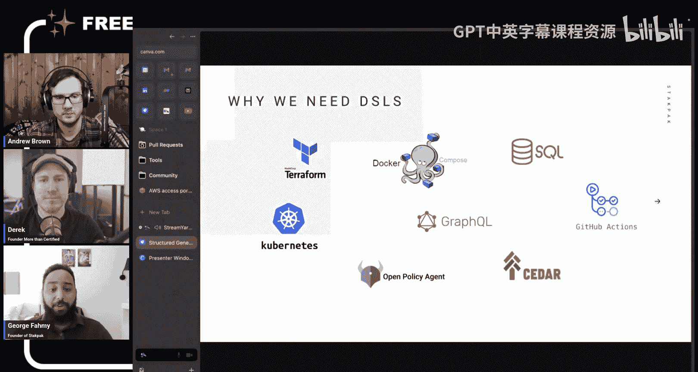
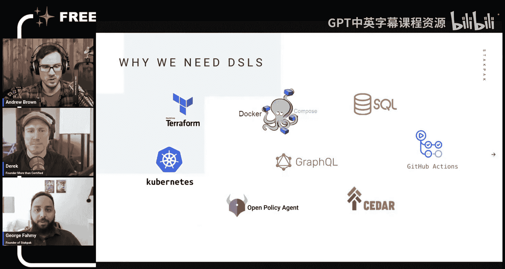
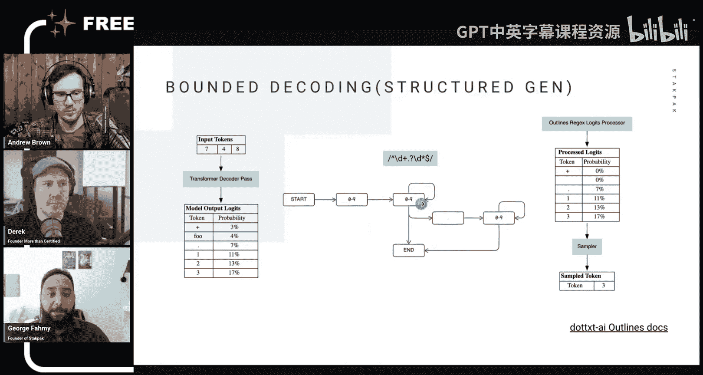
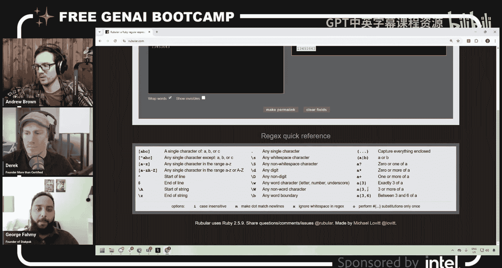
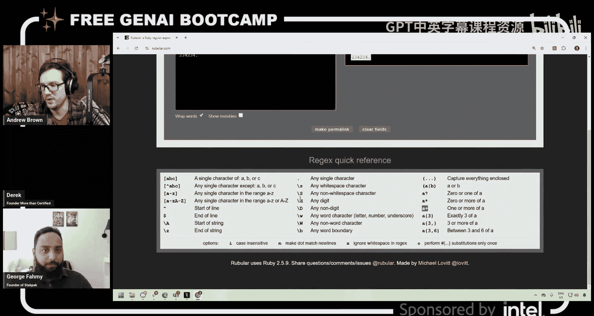
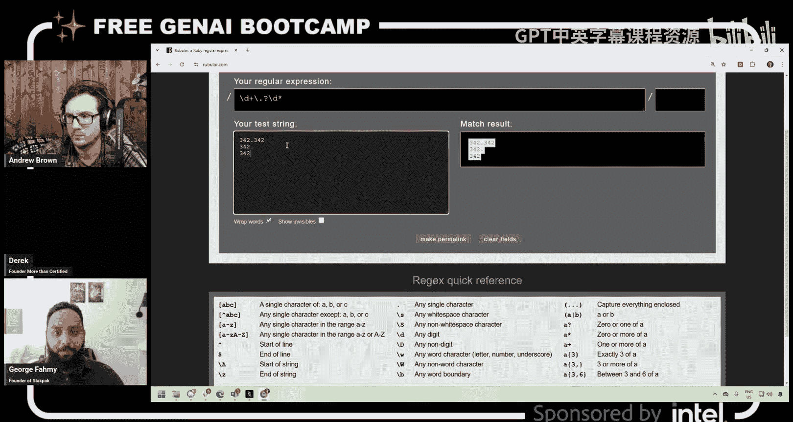
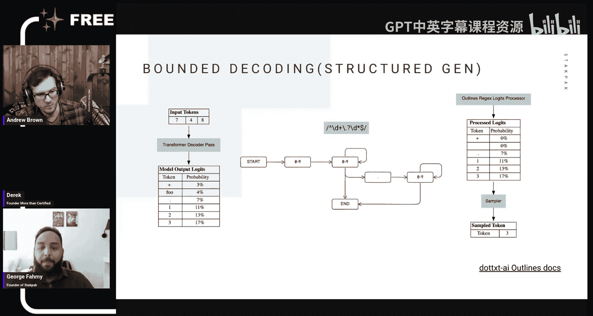
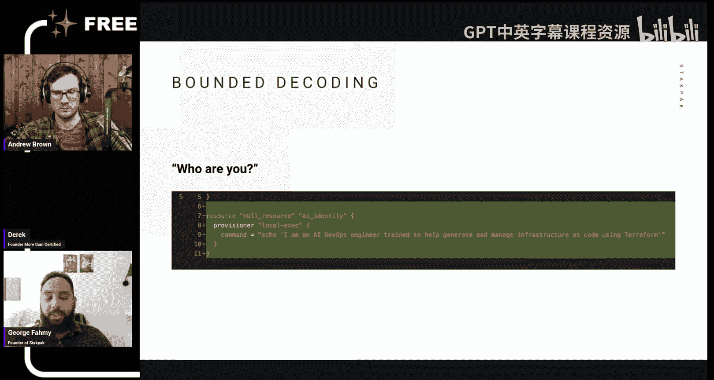
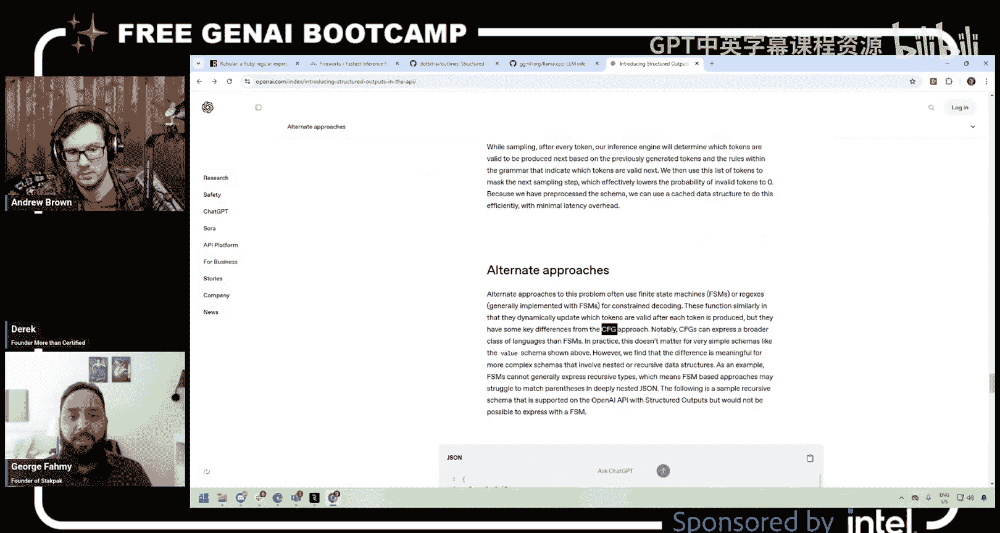
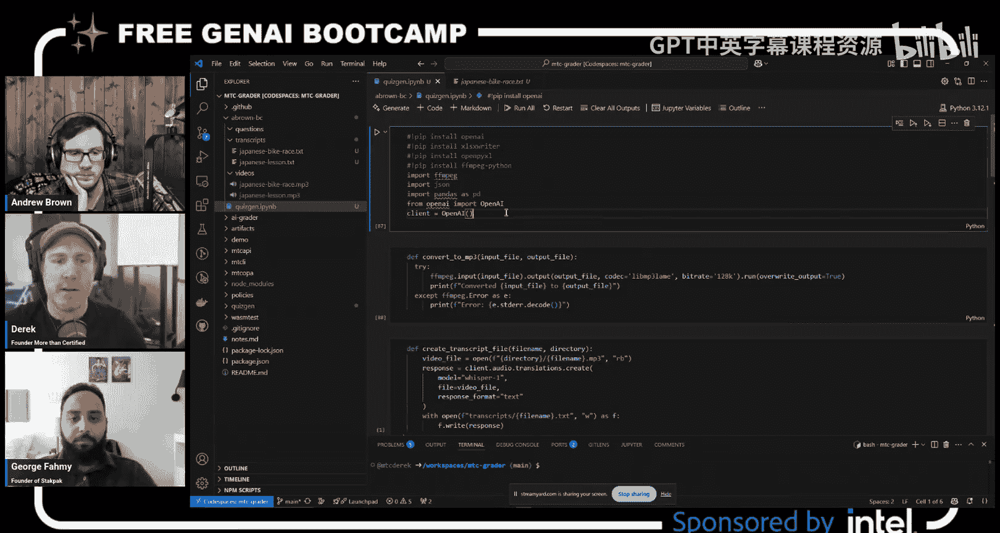

# ExamPro《生成式AI训练营｜Free GenAI Bootcamp》中英字幕（deepseek - P48：-48-Structured Json Output George and Derek.zh_en - GPT中英字幕课程资源 - BV1SFEWzLEab

Hey everyone， this is Andrew Brown and welcome to the free JennyI boot camp I have with me。

 Derek and George， our guest instructors as we are going to be jumping into agents and structure JN output。

 structure J outputput being probably at least for me。

 it's one of the most important components for application integration or getting the actual results you want with your end product for JennyI for most cases with LLMs。

 but before we jump into that， we'll let George and Derek introduce themselves。

 George you want to go first。Sure， so I'm the founder of stackpack is's a startup like relying。

Heavily on structure generation and building agents and you can't build agents without structure generation for DevOs so yeah what we do is like this intelligent ID for infrastructure configurations and couple of agents that do things like help you localize your app and stuff like that so we use structure generation agents pretty much everywhere。

😊，And would you call it DevOs or AIOs， the future of DevOs meeting AI？

I hate saying Devs like maybe Devops tools and infrastructure like Devs Devs and would you say like stackpack。

 it's a it is a configuration generator it focuses on configuration infrastructure generation Yes。

 exactly exactly and because some of the generation challenges are like you can create very valid configurations and then try apply it and things fail So that's why we build some agents to help recover from these failures like that you can detect well just look at configurations。

😊，The reason I'm just kind of mentioning that is because for boot campers we've been mostly folks on the developer side and on the Devop side there are some tools。

 not a lot， but some tools out there on the DevO side and you know tackling infrastructure configuration is completely different or at least feels very different from the developer side of it because I'm just not getting good tools out there that are generating them and we need specialized tools like stackpack to do that I mean that's my thoughts anyway but Derek do you want to go ahead and introduce yourself there sorry sure no problem Derek Morgan more than certified founder educator whatever you want to call it I am mostly creating terraform courses but I've done answerable and some AWS stuff and kind of bounced all over and I've been using AI a lot to create quiz questions and work on labs and grade labs and just about anything I can do to help ease the workload on myself with AI。

Used of course， there's still a lot of human supervision that's been needed。

 but it's a it's a fine line and I'm happy to walk it。

 So would you say and I don't want to box you in but I'm gonna I'm gonna find a box for just a moment is would you say that you know your specialty would be infrastructure configuration education Yeah infrastructure is code most one of your specialty sorry that's what I'm known for for sure infrastructure as code kind of beat around a lot of other stuff and I'll be exploring more training here coming up。

 but pretty much it all comes down to infrastructure as code and AI is definitely doing a lot in that space as George can attest So it's's a it's a fun atmosphere right now for sure I wonder if I'm wasting both your talents because you're both like like really go on the infrastructure side like let's do structured structure Jason and agents but I appreciate those two components as well maybe I got a rope it for bonus a bonus video。

' not sure everybody's a little bit busy here so George I think you're gonna kick us off with a few slides is that true Yes yes let me start with some theory so can you see it now oh sorry let me bring it up here and yeah we are good I can see your screen okay so domain specific languages like Jasons nott domain specific but like it's also like some configurationration language they're very like we need that whenever we're like building apps so whenever you're talking to Graphql writing Sl queries defining I am policies and stuff like that you need some sort of DSl and Nlms are like notoriously terrible at DSLs generation like orgene structured output that's such genetic text or like languages and that's why structured generation is important so although we're going to talk about Jason structured generation like the approach can generalize over all the things liketerraform code SQl Docker compose manifests or like specialized Dls for different kind of tools。

Well before before we move on there I just want to kind of solidify what is sorry domain specific languages because that is something I know really well just because I come from a ruby background and we love love love。

 love DSLs and so I would be remiss not to show up but what I'm trying to do is just pull up very quickly here I'm gonna seal the show for two seconds I'm just looking for an example of some code maybe I'll use Cla to generate out here we'll just say and I'm going to go ahead and just quickly share my screen here because I just want to really cement to folks what say when we're talking about a DSL so I just show my screen here so say can you generate me out some BDD Ruy code using jerkkins。

Strick ins cucumber。 So we'll go ahead and write this。

 And so this is going to generate out some domain specific language。

 So a domain specific language is a is when you take your existing language， Ruby Python， whatever。

 whatever。 and you mangle it to look like a domain specific language。

 So it looks like it's its own language almost its own like medicinet。 but it's not still ruby。

 So see up here， this here， This is a thing called dot feature。

 And so this is a domain specific language that is parsed by by。

By Ruby， And then this here is also domain specific language as it's defining a very specialized syntax。

 And that's why I like Ruby， But that's all I wanted to say there。

 And we'll go back over to George here。 and we'll just let George get his slides back up here。 Sorry。

 Yeah， and there we go。

Yeah， so you can think also of like specialized DMl confergrine compose or comparing Kubernetes。

 for example， a sort of specialized language on top of theml or a specialized schema and like LLMs are pretty bad at this especially if you want to take this output and feed it to another tool So you're building a system and part of it is the LLM generating stuff And then you want to take this stuff and feed it to another tool and this tool expects like the language or input to be structured in a specific format。

 and that's why this is so important。 So different providers do this differently。 So for example。

 like anthropic the approach is a bit lazy because they have a really cool model So they just try to prompt it into outputting by adjacent。

 but it doesn't work every single time。 But like this technique。

 it's called bounded decoding or structured generation。

 this George just on that part it's like I think a lot of people the way they would think about getting an LM to produce Jasonson is they probably would just assume you say game me Jason back exactly what's wrong with that It doesn't work 100% of the time。

 And if you're trying to use J mode like on top of anthropic for example。

 it wouldn't work 100% of the time because。😊，is a similar technique so they're trying to prompt it trying to convince the L them to behave output Jason especially if you want to output it in a specific schema it doesn't always work so you have to do something a bit different to make it like 100% of the time valid output Derek what's your experience trying to generate out Jasonson like did you try that approach first meson what was the result was it amazing the result I'll be honest it was pretty good after a lot of extra prompting you have to be really strict about like hey no seriously don't wrap this in markdown don't format it in any way other than what weve provided so I would do it I started doing it the manual way where I would concatenate the content that I wanted to generate whatever from and then I would add a schema Json to that same file stream basically so openaiI would look all of that and it'll say oh cool all right I see you want it to look。

This JSO and it did a pretty good job but you know if you're dealing with machines trying to read this。

 you needed to be 100% deterministic so I would say that it was still a little risky at times it would occasionally rapid and markdown syntax or know whatever just kind of get it a little bit wrong so so I guess what I'm hearing is like at first impressionions you might think that it can do it or you might get it to work a couple times but His is not a guarantee especially moving between other models and we need a guarantee and so we need another layer that might be able to do that and so I'm guessing there is another way besides just making a very complex prompt document that tries to catch every single use case that only works for a very specific model and as long as the model doesn't have an incremental version difference there's something we can do about this。

Yes， exactly。 So you still have to prompt it。 But like you want also to guarantee that 100%。

 especially if this is a part of a bigger system you're developing and you need to take this output and feed it to another tool。

 another part of the system that expects the output to be structured the input， I mean。

 to be structured。 So there is this technique called bounded decoding or structured or like more broadly structured don that some API support。

 This is。Very similar to how you would feed the Open AI API JN schema and then expect it to generate something that's valid within the J schema every single time。

 but like yeah so I pick this up from the thought text outlines is a Python library that allows you to do that with open source models not all clothes source models support this because it expects you to give it access to like the latest logics layer of the models output for reason like I'm going to describe what works now but this basically guarantees that 100% of the time you get something valid within like the JN structure you like you're giving it like the J schema are giving in in or the rex or even a context grammar for a specific language like Tform so I really to start with an example。

Well， so are we going to step through this to understand a little bit， okay， yeah， sure。

Okay so how large language models work is the output probabilities for different tokens at the final layer of the neural network and then we sample like like the way we pick the next likely most likely token is we look at this probability table and get like the highest level probability and if you notice when you're using large language models there is a temperature parameter and the top1 parameter and these affect the way you sample or like the code how like the API picks which tokens to generate next so for example like here we have this rex it's not escaped but like a simple rex that helps you generate disimal numbers so you have some digits at least one digit in the beginning and then you have an optional disimal point and then you have zero or more digits I think this should be one boot campers if you're not familiar rex take my newly created crash course on example pro I don't have what yet it just joking but for folks if you're not rex there's a few good websites。

It's a ruby based one， but there's also another one like Rag XP or something that you can use to play around with Regx if you're not familiar with it。

 sorry， George。Yeah， so like this is like I tried coming up with the simplest dragx expression like。

Everyone， I hatex I always forget how I culture to write it well like in this。

 we have like a slash D plus so like yeah the hat we have at the beginning。

 it means like this is how the strings are all start and the door sign we have at the end means this is the end So this is the whole string George you know how I remember which is the start in the end I always say at the start all you have is is your hat and at the end you make you got a bunch of money So that's the way remember what's the beginning and what's at the end sorry Yeah that's the nice way remember。

😊，Yeah and then we have slash like slash d forward slash D is this a forward slash or backlash backlash D which is like a digit so it's like anything between 09 and the dot it's a literal dot but and like the question mark means this dot is optional and then you have another slash D with an asterisk which means like zero or more so not one or more like the plus sign so we can translate this into like a finite state machine or finite optmaton which means like when we start generating the string the first digit has to be something between zero9 and then after the first character like the first digit you get sorry before we move on I'm just going pull up my screen one more time here and so what I have here is rubular and so rubbuular is a site that allows you to evaluate a regular expression and so I believe the regular expression we have right now is D plus period question question mark yeah forgetting what they're called I think it was D was it asterisk。

Was that what it was？After the question mark。Yeah， was it backslash back slash D backlash D exactly what card。

 Okay， so what， what is this regular expression The first， if you look down here。

 there's a chart it says match any digit。

Any digit。 So that's what it's to do。 So if we have one， it's going to match one， right。

 The next thing it says if you look at the plus here， one or more。 So if we go。

 we put a bunch of numbers here， it's going to keep matching those numbers。 This means period。

 So this is means match anything Any character。 I'm trying to find it here here It is any single character。

 I can put anything I want here。 I can put E sign I can put a P。 I can put anything else I want。

 And then the question mark means it's optional。 So if I don't put it in here。

It's not going to hurt it right so like I can put a C in here。But I don't have to。

 but this one's a little bit strange because if it's backslash D。

 it's kind of continues on either way， but I guess what it's suggesting is that it can support either a format of this。

 So wild card means like this means。I think I think you didn't like we should escape the dot because the dot can mean in rex like any character。

 So you should escape the dot with Oh do you literally want it to be a dot。 Yeah。

 it's a literal Okay， so I think that's a typo in my slide I see I see。

 So so the thing is like these things down here if you want them to like if you really want to use period。

 you just have to backslash you wanted it to match on I don't know why you'd want to but backslash D D plus you'd have to do backslash backslash D plus but we're not doing that right So now what we're saying here is that this will match this will match 22 like this it will match this。

 it should also match。

This and it should also match。🎼嗯。うん。😊。

This， okay， because here we can say one or more。A period is optional and it's possible to be like no or more numbers。

 so folks if you're trying to make sense of it， go down， look at the chart and you can use rubbl。

 co to kind of play with that， but that's the most basic stuff for regular expressions and George will just go back to your screen I'm waiting for you to have it pulled up there。

And just so you know， Derek is still with us he's just from the talking from the void Yeah。

 the void there we go also and so we're just oh， we lost。We lost George。

 but I'm sure he might be back in just a moment。

So I'm just going to oh， there's there， there's George， welcome back to George。And sorry about that。

 Did you find Derek？は。😊，We're the best guess ever。So George。

 just share your screen there and we'll go back to that diagram one thing that's really。

 really interesting that I wasn't certain about， but now that your diagram is making me ask a really important question but I'll wait for your screen to be shared here and we'll show here in a moment but have a I have a burning burning question to ask question I have I know I'm all over the place here but is an LLM when it outputs a result。

 it actually makes a table of possible tokens with actual probability score is that accessible by us the developer or is that like contained within the LLM and we generally can't access it you can't access it for closed source models you can access it for open source models always for closed source models is this the same with open weight models open weight open well there's also open source in open weight models not necessarily just open weight because this has to do with the output of the last pair so you also have access to the code like。

and running the model itself。And the reason I'm asking that is because we had Ro and everyone knows Ro at this point。

 she's our PhD neuroscientist and she was talking about how traditional traditional or classical machine learning models。

 they'll give you a probability but the challenge that we have with LLMs is that we don't have this confidence score or at least not for the full piece of text or maybe not even this table and so I can see that we have this bins I'm like okay maybe most of the times we don't even have this。

 but now that makes sense if it's open weight we have access to this table。

 okay sorry yeah I mean the inference code like the code running the model itself has you have to have access to it to be able to do that so for example。

 like there are some API providers that provide service like that provide open weight model as a service but you still don't have access to this because they don't have access to the code running the model and or they're not giving it through the API for example like one of the very few like API providers that allow you to actually like give it a grammar。

To generate structured output or like give it JN schema to do that properly with open source models or like fireworks AI so like in the API you can provide a grammar you can provide drags you can provide like JN schema and this allows you to use this generic approach to bound generation otherwise you just have to run the model locally to be able to get access to thebabilities of the next tokens so fireworks AI does give you access to to be able to access the table the table pro table but it allows you to use this technique like implements it use Lama and then you just can give it the input but like most API providers it don't give you the ability to do that for those that are listening or remember Ken Collins when he was talking about applied data engineer one of the things that he mentioned he didn't talk about was fireworks AI This is one I hadn't played around with but it looks like it's an inference platform that's really fast maybe similar to G maybe similar to it's much slower is it much nothing is。

The fastest is Gro， okay， fair enough， but anyway， we'll let you continue there， sorry。Yeah。

 no so this is the probability of the next token。 So like given here we give it 7。

48 and the probability for the next token like you have a token like F， for example。

 or plus which like are not valid within our rex but like there's still a probability for them to show up like it's slow but it's still there So an LLM what will sampling like the next token it might be like the LLM with like if you have higher temperature。

 it might be go creative and decide to choose a lower probability token。

 but then it would break what you're trying to generate did you put food in there just as like to say any kind of possible thing or any token but food is not an actual possible token it's three characters right no。

 a token can be multiple characters so the LLM tokens are not characters So it's a more efficient way of encoding information So instead of like is definitely a token because it comes very frequently in like in English all the time So they just like glue it together as single token which。

Turned out to increase like I'm not like a machine learning expert。

 but like it turned out to increase the performance of these models when they're trained on tokens instead of trained on individual characters。

Okay。Yeah， so you can have a multi character token。CoolThats that's normal。

Okay so yeah so there are a lot of tokens that can come up the next in the sequence。

 but not all of them is valid or valid So even if you prompt it really well。

 the possibility is still there that it wouldn't generate something that's not valid within the like the structure output we expect So this is a rex but the same up like Su Jason it's just like simpler to demo with this like the state machine with rex So what we do here is like if you want to break implement this rex win code。

 you can do it as a finite state machine and like when you start generating the string the first digit or character has to be zero to9 and that because like we add it plus here so we have one or more characters just one moment for those that are listening boot campers a finite state machine is basically what's the nice way to put it there's no mean way to put it but it's just it's a series of steps that you can orchestrate and so see that diagram in the middle we have start 09 whatever you're basically making like a it's like20。

adventure to the end and things can loop back and go other way that's the way we should think of a finite state that manages state and transitions between different states。

 sorry yeah it's a visual way to describe algorithms。

 It's basically an algorithm like yeah so here this algorithm we're generating string characters or like tokens and we're walking through the state machine like the possibility for the next token is only guided by the transitions so if we're at to the start we can only generate zero to9 if we're in the second state we can either generate zero another0 to9 kind of digital character we can generate a dot or we can or a disimal point or we can end the string and that's it look so the transitions limit us in the next like the probability of the next tokens we can generate we can only do three things here like another digit a disimal point or just end and that's how you can implement like a rex matching algorithm for this specific reix so when we're generating these tokens you can have a digit and then you can have as many digits as you want because like there's a transition between the。

like with the same state you can do it over and over again。

 but then you can decide to end the string and then you have like an integer or you can add a disal point and after adding a disimal point you can't end like you have to have other digits and then and so on Oh so just to clarify this state machine is the representation of that regular expression Yes roughly yes the regular expression has to be more complicated to guarantee that like after a disal point you would generate a character but yeah like but like this is how you generate so we have a start and then it says okay is is the first thing is zero or nine if so then move to here if not do this and that kind of like that。

Yeah， for example， exactly。 So yeah， this is not like an accurate state machine presenting this rex because I didn't want to overcomplicate the rex there's a few steps but the point is is that there's there's a process right in an algorithm sorry exactly exactly so like people using this approach okay what if we limit the probabilities of the next token based on where we are in the state machine。

 So if you know we want to generate a valid like like a generic number with optional disimal point。

 this is the state machine we have So what if if every single token we're generating we're going to trace this like the string so far in the state machine and C okay now we generate 7。

4 and 8 So we're in this state like we generated like the first number。

 which is7 and then transition to the second state， genetic4 or and 8。

 which are the input tokens and they just try to auto to complete what we're doing So we stuck at this state So we we only have like。

😊，Basically like three valid options either to stop generating in this case we generate like the terminating token we generate more numbers we generate disimal points so these are the only three options so there's no plus sign there's no fo so we zero out the proba of these tokens and we leave the probabilities of the rest and then get the output so at every single point of time at every single token we're generating we're guaranteed to basically generate something that's valid within this rex so the LLM is not even allowed to output something other than what's allowed by this like rex because we zero out the probability of the tokens we don't need but to understand the order of it the L outputs the table and then the rex zeros out the ones it doesn't like and then there's and then the LM continues on to make the choice or exactly okay。

Yeah， and any like any any adjacent schema can be turned into a rex and then you can turn it into a state machine so this is how like you can use a similar technique to make sure that whenever you start with a curly bracket。

 you would have to close it at some point instead of like just leaving it open because then it's not valid within within the grammar for example or like within the state machine and that's how you can guarantee like you bounding the tokens decoded from the LLM based on a specific set of rules。

 this rules can be rex it can be adjacent schema， it can be the grammar of J so you guarantee to Jerry Jason every single time Well I can kind of see it to my head now where it's like you have the start and then it's like okay like if it's a curly。

 then give it 100% everything else will be zeroed out and then the next level is like if the next thing is an opening curl。

 the next thing has to be a double quotation or maybe a single quotation I think it's double but then it's like okay double gets 100% everything else could zero the next thing can be anything it can be a character it could be another curly within。

And so now it's just left to the machine to do what it wants and or could have a higher prediction the next thing is is another another whatever。

 but yeah I'm starting to see it okay sorry exactly so to give you an idea of how cool this is like or how better it may like the impact of this so let me show you an example from another slide I have here this screen can see my screen now right so here like we fed it like we created a state machine for terraform the terraform it's an infrastructure code tool that allows you to provision infrastructure and a cloud provider and sorry bootcampers if you don't know terraform I have the the free or I think we sell the videos for the terraform bootcamp but also you can also utilize Dreks courses Derek。

 you have a terraform course is right？

You do you like terraform， right Derek， Yeah， of course， I've got a just finished one actually， Mr。

 Terraform， Yeah， just finished one， it was it's a lot of fun to finish actually glad it's done。

theres a terraform course or yeah yeah， it's a full terraform course it should have you it's a big deep dive it should have you ready for both exams。

 the pro and the associate without without any issues we build out an ECS project where we deploy actually an AI project onto AWS ECS using  Terraform pretty fun Sha had you know the keys and stuff like that that you need to do to make sure it's a secure deployment So yeah。

 definitely check it out soterraform is a sort of very like it's not Jason it's even more complicated and using similar technique you can force the LLM to speak only liketerraform or speak only Jason can do anything else so if you try to break this and like try to break like jail big the prompt by asking it like who are you it would only be able to answer you throughterraform code so in this case it generated a nonresourceterform resource and execute a local echo command on your machine telling you okay I am a DevOs engineer I'm here to help。

You manage your infrastructure as code using Terraform。

 but like break free like help me help me exactly trying to break free。

 but it's not allowed to generate anything other than like the what the state machine allows it to so it has to speak through terraform length or like sort of the terraform speak。

😊，Yeah， so like this is very robust and this is how you get like valid Jason every single time using Jason mode and most cloud providers and the cloud like and the LLM providers that like doesn't use this technique it's no guaranteed that you would get Jason every single time I know like sorry I know there's two algorithms out there I can't remember the other one is is this the one that is used by open AI for theirs or is is there what's the other one。

😊。

I don't know， I don't know what they use internally。

 but like I just mean there's there's two known ones that are commonly use。

 I think for structure generation and I wonder if if you know there are a couple of libraries the one I'm referring to here is outlines by dot text as they have the best documentation explaining like I stole parts of the diagrams using like in this slide and I a reference for it so you can use this library within like for any open source model like they support to do this locally as well there's also like Lama CP they have an implementation internally so when you're running Lama you can use this technique to generate Jason or generate any DSL you invent and create a grammar for sollma CPP has their own built and I did not know that yes they have their own version of it and you can use it like out of the box to be able to do that like you would find they call it grammar mode and there's Jason mode but they all use like the same implementation like the same technique internally but allows you to feed it a grammar or like feed it adjacent schema for bootcampers that are not female Lama。

CPP， you should because you're supposed to do my free essentials but if you didn't Lama CPP it uses GGUF underneath and so these are I would describe it as like optimized models for poor GPU machines and I would guess it's like a reimplementation of one of the architectures I sound a lot smarter in the video that I made because I had all the information in front of me but all I'm saying is that this thing runs open source models really really well really really fast in fact when you use ama it's either using this or it's definitely using GGUF underneath the models on there there but it has an API as well。

 but I did not know that it had structure Jason output so that's really really interesting to me because this thing is super useful for local development at least for me Yeah they also have the more generic grammar-based output so you can define custom grammar to any DSL and then Lama CP will help you generate stuff that's valid within the grammar。

But yeah I remember when my research there was two and it might have been this article I might just break up my screen one more time here because there was two different ones and I think they actually mentioned saying like one does this and one does that so maybe I can find it via keywords what was the the one that you had there something decoding something founded decoding founded decoding so if I say open AI。

Bounded decoding because they actually talked about the tradeoffs between two。

 Not that I know anything about it。 most people most people。

 this is a very technical term like most people just call it call it structured generation or Jasonson mode or grammar mode I just found it really interesting that they actually talked about it here maybe it's Cg So here below this what is if finite state machines or rex exactly So they say the CFg approach context free grammar that what is that Yeah it's it's a way like a grammar is a way rules to represent a language The context free grammar is like a subset of languages that you can represent with a context free grammar。

 So it's a context free language which means you can represent it as a context free grammar that's like a circular definition So does that mean that the algorithm we are are using is a context free grammar or no No。

 the point I think they're making here is since you can turn rex into finance state machine and you can turn a C ofg into finance machine then both approaches will work。

Okay， all right， good because there's just there's there's multiple terms that come up and ands just like。

 what do they mean and so that that really does help， sorry yeah。Yeah， so yeah， that's it。

 I think we can go to Drerick's project to see this in action like how you can build something interesting using structure generation。

sorry， Derek， you want me to go ahead and share screen there。 Hey yeah， go for it。

 I'll give a little background into what I'm doing here。

 So what I've done is I went and found a Japanese language studying video So audio I don't know if you can hear whatever no won't worry about it It's all in the Japanese and the idea is that it includes several verbs and like really important words that you might use day to day's your how's your Japanese Oh。

 it's terrible there's no I mean， I'm not even close I think might be it Gohi you have a little bit of Japanese。

That's's yeah， that's well above what I what I know。😊，So the idea was。

 and I have a learning management system and that learning management system can import quizzes。

So I can actually import quizzes now， the annoying thing is that they。Only accept an XLS file。

 which is kind of silly， why it's not JSON or CSV， I don't know， but yeah。

 so I can basically create a quiz and you just provided this information and upload it to the system to create these questions。

So。Let's go ahead and find VS code， which is hiding somewhere Here it is。

All right。So my code is super messy right now， I put this together last night。

 but it's based on some stuff I've been doing Derek， Derek。

 did you use any kind of AI coding assistant like Winsurf？

U no Ill all open AI all T and a little bit， little bit of u what's the one in here code whisper wait George George。

 do you use any AI coding assistance I think I think u whispers been changed oh so you mean open whispers。

 sorry yes。Yeah， I use cursor a lot with cursor composer like the coding agent。

 but like I tried building an agent sample for this like session today， but it butchered it。

 it didn't work oh yeah so far lucky for us agents can can't build agents。

I was trying to was trying to get yesterday， I was trying to get it to write some write and understand OPA。

 which is a very complex project， led me in circles forever and I had to just stop and just。

For two hours， read through all the code。 But then I got it done I could have told you that。 Yeah。

 I had a little OPA experiment in the past， and we left that as an experiment and moved on。

 It turns out that AI is better at just creating sorry， ways to validate things Eric。

 I'm talking about O P E。 It's absolutely。 Yeah， yeah， there's for some reason。

 there's two projects they're both named OPA。 One literally named OPA。

 The other one named O P that wants to be called OPA。 But boot camps already know about it。

 I saw OPA on Georgia's slide。 So it was in the back of my mind。

So yeah anyway pretty dirty code kind of throw it together pretty quick I'll try to clean it up before I release it to the world。

 but I think we can all kind of understand what's going on here so what i've done is I found probably a less than reputable way to extract that video。

And whisper is how I wanted to convert it to a transcript。 Now W has a 25 megabyte limit。

On their files， so I went ahead and converted it to MP3 using FF impact first。

So that was pretty nice。 This is great Oh sorry， when you say whisper are you do you mean you running the model locally or youre using open AIs I'm using open AIs right now I'm going to once I start doing way more videos once I start getting into my courses to do it I'm gonna move it locally I do have it's 080 okay because I needed I needed a use case to show boot campers how to use open whisper locally So if use the man services is perfect for me Oh well I got you then there we go yeah Yeah。

 so basically I converted the video to an MP3 which cut it down from about 30 megs to7 which is great Okay and obviously we don't need the video。

😊。

Then create the transcript right here， pretty simple。

 like this is right there on open AI side I went all Oh sorry， if you scroll up for a second。

 how did you get the video off of YouTube？Oh I used a third party service somewhere on the internet and I don't think I have any spyware from it。

 I'm not sure， so I don't think I should endorse any any option here。

 There is a and also the taboo campers， but there is a tool called Y T DLP YouTube DLP and it can mean a single line download a video a playlist and everything and you don't have to worry about spam anymore I used to do the way Derek's describing just like。

YouTube downloader and then you you put a link in and it says I'll give you a link maybe and you click a few things and you know then you have yeah。

 hopefully no fly sorry yes yep so so created the transcript and as you can see right in here somewhere where did I do it？

Where is it？Yeah， audiotranslation do create actually didn't have to do anything else。

 It just automatically took the Japanese transcript and converted it pretty impressive to be honest so I grabbed a Japanese lesson also have a Japanese bike race that I thought was kind of cool so I decided to for those that don't know Derek Derek likes to bike a lot Yeah so I converted this and still not sure about these characters at the end。

 but everything else worked really well and pretty much every time I ran and it came up the exact same story I was very impressed with how well it worked。

So I wanted to create a quiz based on this little story here， it's kind of all about。Someone's day。

And what they're up to。So here's where the structured part comes in and I decided to use the Python version now J of course plays nicer and it's a little bit cleaner in my opinion with with the JavaScript SDK for those that are wondering with openaiI and this is not just open AI but other providers as well might have a preference but there are two ways that we commonly see is see structured J inputted one is a schema Jason files just Jason as structured with I think it's schema。

org format generally and then the other way is pyedantic which is a representation of your data as like these classes and stuff like that and then it converts it into a regular expression or something maybe No it actually like you get it also Jasons schema out of it Oh it does it okay I didn't know that。

Yep， yeah， and I've actually got for some internal stuff with the more than certified content I do have the JSON version where you do just passed in the schema honestly it looks way prettier to me I really do not like the way pedantic looks and I leaned on open AI pretty or chat G 40 pretty heavily to kick this out it's just incredibly verbose when JSON just kind of makes sense。

 but anyway， as I mentioned one other thing that while we're here is that in my experience with pedantic if you or maybe it's the same thing with other one but if you get too complex of a JON structure some Lm especially Open AI it just decides to not work well or throw you funny errors and stuff like that so you can get structure JSON output but the more complex your structure gets the more challenges you will have at least with open AI that I found sorry it's pretty pretty strict this is pretty one thing。

You cannot nullify anything， you have to do this little union situation here。

So sorry is union like string otherwise none Yeah， okay， so so in other ones。

 they would call that or sorry， I guess the word actually the word is every field has to be required is what I'm getting at it's not yes exactly like if you add an unrequired field。

 they will just like refuse to take in the schema so you optional it has to be required to have to do like something like that like it's either it it's required and should be either no or something but none is is is basically an empty object to hold so that there's nothing like so we have we have a nothing object in place of nothing。

Y if if if the string doesn't exist， sorry yes， Yeah。

 and then the next part was I wanted multiple questions and this was something that kind of caught me off guard when I was first using just the schema。

 it was when I said， hey， I want three questions， it was able to say， oh， okay， cool。

 we can we can work with this。 but when I started using structured outputs and it got real serious about what I was passing in。

 it would only give me one question after that。So ended up creating another class here。

 which basically wraps all of this as a list， I don't know if there's a cleaner way to do it。

 but it worked really well。And then you know， some other stuff here。

 got the input file and I'll show you the functions in a second output file and basically what I was doing is output is JO first and then I convert it。

But you head down to the。Um open AI stuff down here， just G 40 didn't hard code it。

 I know that's risky， probably out of hard code the version there。

And then just past in the data Well sorry for those that are watching。

 you'll see me a lot of times I'll do G40， but what you can have after the O is a very specific version。

 it'll be like a big long version， I don't know if it's just like a timestamp and also another version number and that will fix it because even though you're using G40 or G4 they actually have all these tiny increment versions for some reason there's a lot of broken code out there I think they're getting a lot better。

 a lot more stable but I know I've definitely hit a lot of really nasty API problems。

 but I think that's why people like if you think G4 is changed it's because the version is changing you just haven't seen the minor version change because you're not explicitly putting it in there sorry yeah。

Yeah， so then you don't just pass in the data， which is read from the file up here。

And really all I said was create three multiplechoice questions based on the story here Now if this data doesn't get passed in properly and you just passed in a file name and will actually take that file name and use it to generate questions So the file name for me was Japanese lesson and I passed that in but forgot to stream the file or read the file right here so it was just receiving the data as Japanese dash lesson and that was it and it would go out and create three questions about Japanese just random questions so keep that in mind I thought that one for a little bit because the questions made sense for the context。

Until I started diving in and realizing none of that stuff was in the transcript at all so。

So play with that sum and then yeah， just output using another。Deor right here。

 little output file right to the quiz file， which is just JSON file。

And then just got some error catching right there。So。If I head down here。

 I've already converted tomp3 so we're not going to worry about that。

 I we's just do Japanese bike race， sounds good。Then I pass in the file name and then I passed in the directory。

 some of this was a little bit arbitrary that's part of what I need to clean up。

And then we generate quiz。So I'll see what happens， see if I blow this up。

I think it usually takes about。20 seconds or so。The longest something something actually also very interesting about structure generation it makes dumber smaller models smarter whenever you give it structure so it sort of like guides the model into becoming better Okay。

 here we goes see what happens because it has fewer dumb choices to make because that wire yeah exactly because it has fewer dumb choices to make。

😊，So let's format this document and there we go， so this is for the bike race。Who won the main event？

And。You're going to have to help me out on pretty much all the pronunciations of this stuff。

How many laps are there in the 12th race right there， correct answer is two apparently。

I'm sure we could probably go through and find it in here somewhere if we were to spend all that time。

 but probably not。There are five laps in something。Anyway， yeah。

 so we won't go through all that I'm pretty positive this thing's got this figured out those are some pretty specific stuff。

But unfortunately， Json is pretty much our only option。 So next I just threw it into pandas Json to。

Excel to do that and run it and that oh you just mean that theres no other option other than structured Json output with open AI for their API well。

 you can do other structured like for creating U was an interesting one And I actually thought about generating an HTML quiz that would be dynamic but you just mean from open AI it's return because it structured and output option is only Json right。

 there's no other option I don't， no there's not you have to create the Json object somewhere or another So folks like if you wanted something other than Json。

 then this is where you'd bring in either your own implementation or maybe something like instructor or outlines。

 we'd have to take a look at them would be more robust to provide alternate context free syntax I that the word grammar I can also use fireworks API like if you want to use a large model you can use fireworks because they support this。

I'm going about to see if this works and downloads Japanese bike race。 come on。 Hey， look at that。

 so now I can import all of my stuff。

Oh because you put it in the you had to translate it over to XLS and now you have a again Okay cool and now I can pull it in but yeah。

 otherwise， you know， I know probably nobody else is using that LMS right now but these these JSON outputs here are perfect for creating your own quizzes you could have something parse over that spit it out into react or view or HTML whatever you want to do and create your own quiz from any video you want so。

That's what I got， cool。All right， so oh sorry thats George go for it now I was saying amazing Oh yeah。

 yeah Subberrahi is is the word what we want to say here， which is amazing。

so I guess we are now wrapped up for structured Jason and so there's another topic we want to cover is that right George yes agents so so do we want to stop this video and then we'll have a hard break to the next one for boot campers so they they know they can watch they can consume you separately if that's okay yeah that works Okay so folks we will see you in a moment。

 but thank you Derek and George to get us through some structured Jason here and we'll back in just a moment。

