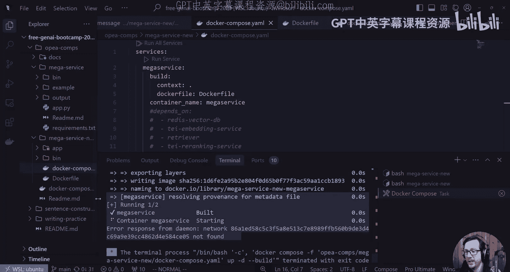
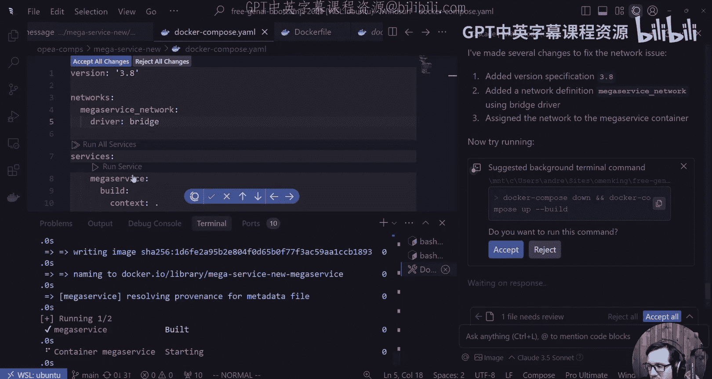
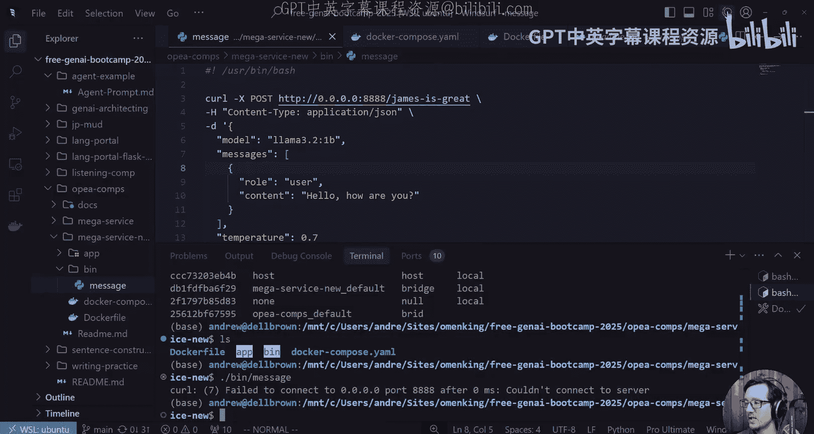
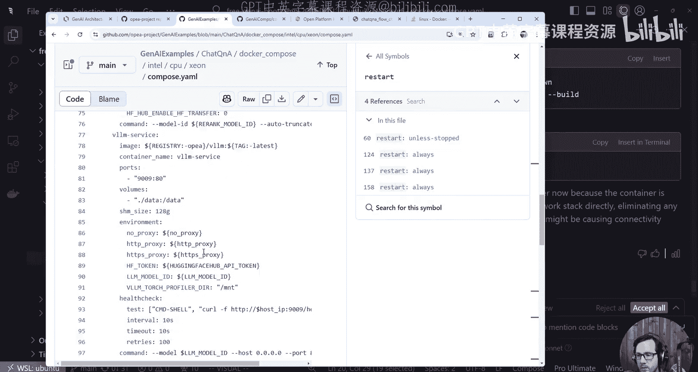
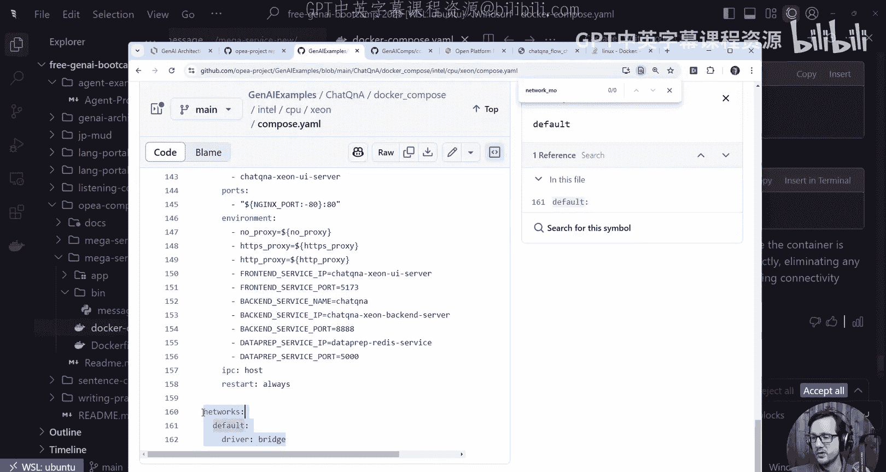
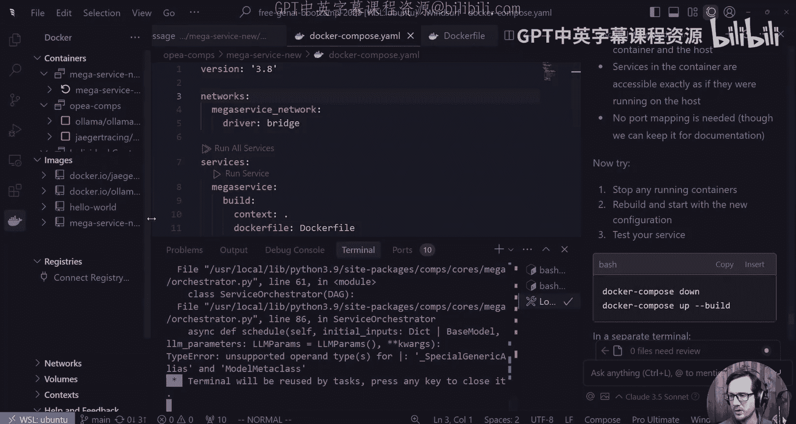
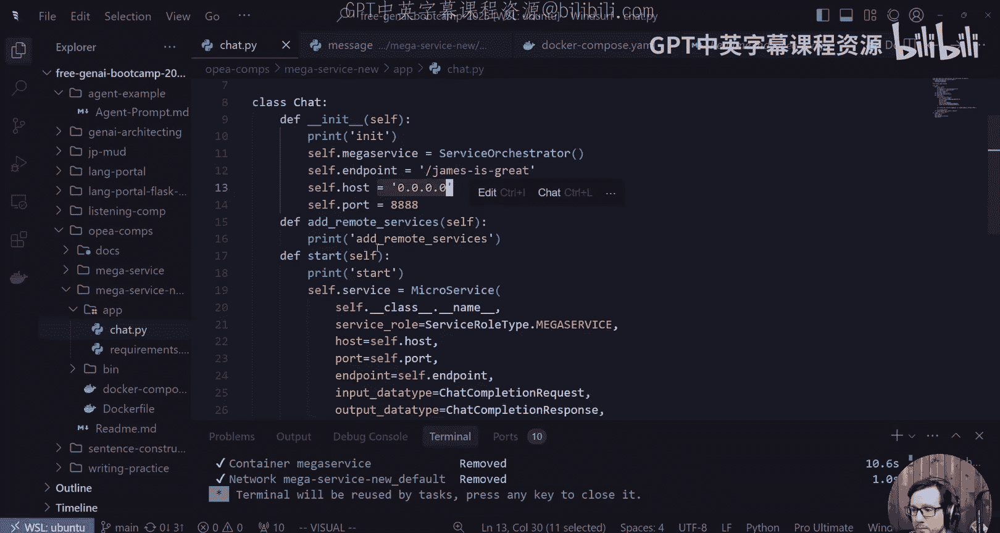
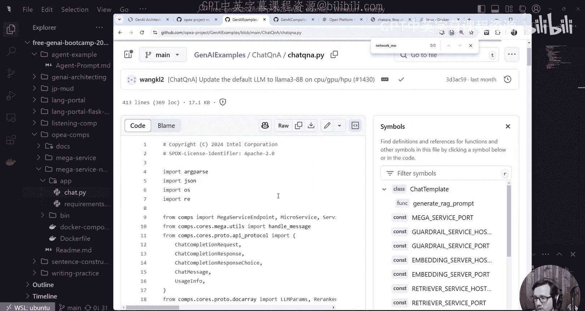
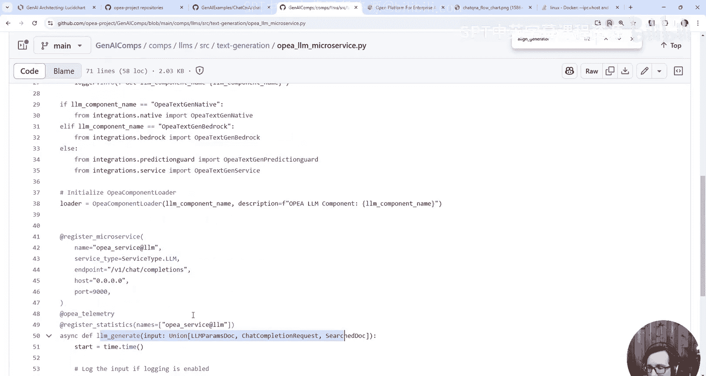

# ExamPro《生成式AI训练营｜Free GenAI Bootcamp》中英字幕（deepseek - P49：-49-OPEA - Continue from Live-Stream Resolve Docker Issues.zh_en - GPT中英字幕课程资源 - BV1SFEWzLEab

Allright， so I'm continuing on where we went from the live stream here now。

I know that we're having some issues with networking here。 And so maybe this is。

The first thing I need to resolve。I'm not sure why it's having such an issue here。

 I don't really remember all this networking stuff。

 but we can see that there is definitely a lot of stuff being created here。

And I'm not sure as to why it is so problematic with the network。 Now。

 I've completely ripped out the network stuff in here。

And I'm going to go and try to do a docker compose up。 It probably will have the same issue。Okay。

 it says air response， no network found。So I'm not sure why that's an issue。

 but we'll gonna to go ahead。

Sorry， and。Let's see if we can get a bit of help from windsurf here。

And see if we can resolve that issue。So I'm going to go ahead and copy it like this。

And I'm just gonna go ahead and do this and see what it says。 because I don't like。

 I don't know what else it could be， right， Like the networks should just work。

And we have been running container stuff here。 So the airctic docker cannot find the network。

 We needed to find a network in the dockcker and compose aml file。Okay， but we already had one。

So it's bringing in the versioning。 it's asking for that to have a very specific thing。

 I guess we can do that。 Mega service network is a little bit silly， but。We can do that， and。

We can go ahead and just stop this and try this again。 So I'm gonna go ahead and do a docker。

 I'm gonna right click on the Docker post and do compose up。 and we'll see what result we get now。

And now it started up。 And I didn't really do anything special。

 just for whatever reason as it worked。 Maybe there was an issue with the dot， the period in there。

 I'm not sure why that would be a problem， but it is running。 And so。I mean， that's good。

 Now that we have the service running， we should go ahead and test our endpoint。 So we did make that。

 Well， we already used it or had it before。But we should really point it to wherever the service is running。

 if it's using bridge mode， I'm not sure if that means it， it's exposed the 888 port as we're not。

Moving it over here。 It is doing 888。 But let's go find out what happens if we try to ping that there。

 so。嗯。It is a little bit confusing because we have this top level。嗯。Docker compose in here。Which has。

Yeager， I'm not sure why this is here。Aama server。And what I'm going to do is drag this in over here so that I'm having less issues trying to determine those two there。

But I'm going to go back over into here。 and so we have our bin。 so this will curl at 88888。

 which is James is great。And what I'm going to do is go ahead and do bin message。

It says connection failed to connect to port 00088888。I mean。

 I used to remember this stuff when I was doing this with James。 But again， it's been。

 it's been a while。 So I'm gonna say， like， you know， my， my curl， curling。

From my or we' just give it the example here。 so we'll go ahead and grab it like this。And say。

 you know， how does my host machine access the。The， the service。Okay。

 so that's the question that we have here。You should use localists or 2701 to modify your script。Oh。

 was it using 0，0，0 before？Would that actually fix the problem？Listen to all available puts。

 But from your host machine， you need to connect on this port， mapping the port over there。

 Why would that fix anything， It's already being mapped。嗯。If we can go ahead and run it again。

 I don't， I don't see why that would make it better。

 but that know why would local hosts fix the connection issues。By the way。被，当事人。

Is it more about the networking mode？In the docker compose。

And it shows the other one because we renamed it。 But this is actually the file。Yeah。

 it did overlook it。 So we needed to handle the networking properly since your WSL。

 let's modify the Docker compose file。 didn't ask it to do that。

And here it's changing the network mode to host。But I'm not sure if I actually want that to be changed like that。

So， or maybe you just overrise it for that one。 So this should work better because the candidate is sharing the host director Ra network isolation。

 Is this how we actually want to work。 So what we'll do is I'll go up here and。I'm gonna go to。

This one， and what I want to see is。Does this appear anywhere， We have this network mode。So， here。

This is IPBC hos。I don't know what。 This one says IP hosts as well。They're all IPC hostsed。

So I don't know what I P， IP PC hostt is。 Let's go take a look what that is。 IP PC host。

So what is IP PCC hostst。Hostted share memory mechanism with the containers。

Removes the layer security and creates a new attack vectors in application doesn't sound great。But。

II don't know， like because when we look at this one here。Right， it doesn't。It's in bridge mode。

But it's on the default bridge mode。I'm not sure if that matters。

But there's no override like this。 And I'm not sure why we would do that。Network mode。🎼M。🎼Yeah， yeah。

 We don't see that there。 So the question is like， how is it getting to this thing when we spin it up。

 we do docker compose up。There's nothing special in here， right。

Let me just read through this and see if I can find anything。

This makes me think that network default lies its connected。 So we'll say network default。Well。

 we can just test it by changing it over to default really quickly here。

 So I'm gonna to go ahead and copy this。 I don't like what it's done here。

 This is completely useless。 So we're gonna to say， reject these changes。

And I'm going to go up to here。And we're gonna to say， we'll paste this in here， whoops。

And we'll bring in this one here。 So my thoughts is that there is a default network。

 and maybe your machine is part of that default network， and that's going to help it work。

I don't know。 I'm just guessing here。 So we'll do a doca composed layout。

And then once that is done here。We will。Terminate that when we get a chance here。

I think it's down now。 and so now we'll do a docker compose up。

And so what I'm looking for to happen here， we have an， Oh know， it's available。 Okay。

 failed to launch Docker composeo yamo build。I mean， that's not good。

 But I'm not really worried about that right now。Let's see validating the compose network services。

 additional  mega services is not allowed。Additional negativega services。

 what were are you talking about？Maybe because it's the it's probably the indentation was messed up here。

 So we we'll do docker compose down。And we'll give it a moment here。

But it's now saying mega service new default。 It's not using the default one。

 It's actually creating a new one。So I'm not sure that probably wouldn't fix our issue， right。

 but it says the ports running 8，8，8，8，8。Which makes us think that we can actually access it。

So the bin message。Okay。If we go to here。Your application is running on port 8888。

 So port 88 is being exposed。Okay。So I thought this would might， might have something else。

 but literally creates a default one with a really funny name。

 And so we might as well have a name that we'd like here。 which kids stop there。

And think it be just a second to figure this out。 Be back in just a moment。Alright。

 so I don't think the issue is with our our host being able to access it。 I think it's the。

 it's restarting constantly because if I go over to Dr。 P。 S， it's saying restarting 11 seconds ago。

 So if we're having issues， what we can do is go and view the logs and maybe this will tell us what's going on with our service。

 So we'll go into here。 And this one and see what's going on。

And so it's clearly having a very specific issue。

Yeah， it is。 And so this is our problem。 This is why it's not working。嗯。

Maybe because it doesn't know what's in here。 So it says， Yeah， yeah， we got it， so。

Unsupported append types for generic models。 I think maybe our Python version could be our issue。

 Now， I never run 3。9。 That's really old。 but that's kind of just what it pulled up。

 So I'd rather pull something here like 3。10 or 3。12。 I'm gonna go with 10， because。

10 is a lot more reliable。 And so I'm gonna go ahead and just do a dockcker compose dig。

And see if that resolves our issue。We do do a Pip install。But let's go ahead and try this。

 So we'll go ahead and。Do a docker compose up。So that's going to rebuild the image， okay。And yeah。

 we really should have just paid attention and made sure the model was， was restarting。 But again。

 I don't。 I'm not working with containers day in and day out like James is。

 but he probably would have gotten this a lot faster。

So we'll let that rebuild and then we will see if it continues to restart。Alright。

 so we did a dark compose up here。 Let's go take a look。 And now it's running。

 So that probably was our issue was that。It was the Python version， like one of our problems， right。

 So we'll go ahead and do this。 And we're getting null based back， which is perfect。

 If we go over to here， you know， so we don't see much here。

 And we would have to go over and inspect our。Our code here。

 like do the logs in order to see the response here。

 And so this is the start of us working with a Docker container now in practicality。

 I probably wouldn't want to do this right away。 So for now what I'm going to do。

 I'm just going to stop the Docker compose file and we are going to just continue on working with our code and we'll use the Docker container when we need to。

But right now， that's not what I want to do。 So let's go back over to our app into our chat dot Pi。

 And so we have started this up。 we have our custom endpoint， our I P， our our I P address，8，88。

8 for our port。

We need to start adding remote services。 Now， if we go back over to this one here。

 which is the chat Q And A over here， that actually has multiple。 So we go to。Where is it。Here。

 and we go into。check your name。And we go into T Q name。

Then we have stuff in here， right， So there's a bunch of stuff。

 I don't know if we need all this stuff。 We have aligned inputs。Which I don't know what it does。

 We have aligned outputs。 I think these are things that we can override。

 because when I was looking at code in the comps。Right， and we go into the cores。

 and we maybe well go into common。 We'll see components。Everything extends from a components。 I'm。

 I'm trying to find if there are any abstract functions we we can override。

 so maybe not that let's go into the mega service， into the microserv。In here。 And again。

 checking for overrides。 Overrides are functions you can override， and they should be。

Tuned in summer。 So I see register microservice。 I don't see anything there。 So I'm gonna to go back。

 and I could have swore。 I saw this somewhere here。Maybe in the mega。

 let's go into the orchestrator really shouldn't be in here， but we'll go take a look anyway。Yeah。

 look here。 We have execute a align inputs to line outputs。

 So it says override this method in in mega service definition。

 So I'm not sure how these get called because I'm， again。

 I'm not super good when it comes to Python Python metcode。

 But you can see here that it has align line inputs of line outputs， a line generator。

 And so these functions over here are getting overwrittend。Right， and these are in the mega service。

But I guess the thing is like these are here in the chat template。 So we have chat template。

 I this this is the level it's at。No， this looks like it's right against the wall。

 So how is this being overridden。 Oh， over here， it's being overridden。 Okay。

 so that's how it's overriding these things。 But why would we need to change these things。

 That's my question。So here it says service type embeddings， input inputs， service type retriever。

 retrieve parameters， none， service type LLM， okay。So， I'm guessing。This is to try to fix the input。

 So like here， it's checking like， what service is it trying to perform an action on or an execution on。

 I think that's what it's doing here。So yeah， like， where did these get called。

They must be called in this file。Here it is pre processing， so。What it calls execute。

 this is your opportunity where you can do some pre processing。 Okay， that makes sense。And so。

This is whatever you want it to do before it goes on further。 So it's inputs current node。

 runtime graph， LM， parameter dictionaries another step。 So what is it doing Well。

 if it's a service embedding， it's literally taking the inputs text and matching it to inputs。

Then if it's a retriever。It is getting the retriever parametersms， and。Doing something here。

 And then if it's the LLM。Convert TGI VLM to unified Open AI version 1 track。 So here。

T G I LM T Unified Open AI track。 So here it's standardizing the inputs。To that format。

 And then it's returning it back。 Then we have out output。 So where is that performing。

 I'm going to assume on its way out。So if we search for that， align outputs。Here。

We can see that this occurs on the execute。 So eventually， on the execute here。It's going to call。

Allign outputs。 So if it has Jason， it's， it's an opportunity to something if you don't do anything。

 I'll just pass it along。 But here we can see。 Yeah， if it's embedding a retriever。

 So this is just like two points that we can kind of modify our code。 Okay。

 so that kind of makes sense。 And we have a line generator， so。

I'm going to assume that happens at some step in the generator。嗯哼。😊。

So we have streaming response alarmme generator。 I is anywhere else。

It's only here in this streaming response object was not necessarily an issue。

This happens in the generate function。So here's the generate function。嗯。Okay。

 so it's doing something， it's grabbing chunks， we're getting metrics。

 and then it does something here and it's media type event stream。I mean， definitely doing something。

 I don't fully understand like it's positioned in here in the code。

 but I understand that we can override that if we want。 If we go back over to here。

 you can see that there is some stuff happening。 So I kind of， that kind of makes sense。 Now。

 this thing's obviously doing in lot。 We have an em better， a retriever， a reraker， L M。

 but we don't have to use the ones that are that are being defined here。

 And the input's outputs can vary based on what it is that we're working with。

 So that is something that we can do。Now， in ours， we're just using the LLM。

 but maybe we should make this a little bit more complex and try to add something here。

 Now there is retriever and reraker， which is kind of interesting。

But I guess what I'm interested in is like the components that it's loading in here because this one's LLM。

 of course， name LLM。And so if we go back over to here to the core components。

 I didn't really touch on this before。But we have over here。These comps。Right。

 and so how does it know。Which one is being chosen when we use it。Right， so like。We're in here。

 right， And if we want to run LLM， which is going to front the LLM。

 how do we know that it's running this And here it's specifically for text generation， right。So。嗯。

Good question。Good， good question。 And so if we look at this one here。

 this has an entry point and it has a docker file。 So these are containers。

And this one's installing Python 11。And it's doing text generation， and has an entry point of S H。

So if we go into here。It's running open Python LLM microservice， So we go over to here OPA。

And so what we can see in here is comps imports。 So it's importing comps。We have a custom logger。

And it's registering a microservice right inside of here。 So there's that E sign Reg microservice。

 So we were saying before we hadn't seen it used。But now it's being utilized here。

 which is interesting。And then we have some open telemetry， and we have L and generaterate。Okay。

嗯。So let me think about this for a second， okay。