# ExamPro《生成式AI训练营｜Free GenAI Bootcamp》中英字幕（deepseek - P50：-50-OPEA Failed Attempt at vLLM.zh_en - GPT中英字幕课程资源 - BV1SFEWzLEab

All right， so I'm back， actually I had some issues with my desk and I had to take it apart and fix it and do some last minuteute soldtery。

 but my standing desk is back in working service and where we were looking or last left off was I had a bit of confusion over this service decorator because when we look at implementation for these services if we go over to the comps directory here。

And let's say I was to look at anything like LLMs， right， So go into here LLMs。 We go into source。

 We have text generation， and we go into the actual code here。

 And when we look here and we scroll on down， we saw that it was registering。

 It should register the microservice here。 And so my confusion is like， okay。

 if we're registering the microservice on this end。And it's good。

Fix my desk there it's do we have to register on the other side because in our mega service。

 we register it， but。I think what's going on here is that these things are actually provided to you as containers。

 And the reason I know this is if we go over to not maybe not say chat Q A。

 but we'll go over to I'm sure they're in chat QA， but we'll go over to one that I know absolutely will make more sense into translation。

 and if we go into this one into Docker compose and into Intel and into Zion and into the composeo animall file。

 you're going to find。This here。 And so this line looks a little bit confusing。

 But what's happening here is that the registry is it will。

 this will default the Docker hub and saying in here， we want to go to Docker hub into OPA。

 So there's hyphen and then OPA。 So if we were to look up OPA。Let's say Do。 Hub。Like this。

 if we go on their Docker hubub profile， then we can see that all these models are here。Right。

 so going back over to here for a moment。This one here， we see LM Tex gen。

 and so we can probably find LM T gen somewhere in here。Right， so we do this。 And there it is。

 And so basically， what it's doing is it's loading this model。

 So the images are already built for us。 we don't have to build them， right。

 And so we can just reference them。But where I was kind of getting confused was the fact that when we look in the chat Q&A。

So let's let's go back to that one for a moment。 So we go here and Cha Qa is like the big deal the big deal one to talk about。

 We go into this one， and we go into Intel CPU， Zion again。

 it doesn't matter that Zion because we can kind of work around those things that are different。

 But if we go here， what I'm looking for is trying to understand， okay， why。

 like why and here does it not use LM service。 So if we go here， we have V LM。

And this one is the same equivalent of  Lama， so it's spinning up that particular service。

 and you can see one that is delivering via here。 but where the confusion is is that if you go over to the components over into here and comps。

 you know， where is VLLM。Right， and so I think if we go to third parties。

This is probably where it would be。 Yeah， V， I mean， so it's actually under here。

 And so if we go into source here， you'll notice that。There's just some basic configuration。

 but it's not really doing a whole lot of code like you can build， obviously from here。

But I'm just saying that it's not wrapping it with a pie file and doing a bunch of layers and stuff like that。

So we can serve up the Lama the  Lama one from O because they probably have a builder。

 I didn't do that before I I did O lama O lama， but it's possible that if we go back here for a moment。

They might have an OPA or they might have an ama specific one。And they do。

 And so we didn't use that one。 It says this image has been deprecated since version released of 1。2。

 which is fine because we don't really need it。 But were go back to V LLM。

 or let's say T G as another example。So this has been deprecated since the release of version 1。2。

 So what version are we using Because clearly some of these are still being utilized。I don't know。

 Let's go here and say VLLM。Okay， so these ones are still around the VLM ones here。

 but let's go back to TGI。This is LVM TGI， not necessarily the same one we're looking for。

So what I'm trying to find here is LMTGI I wonder why it's been deprecated。

Because if we go here into our directory， we can see TgiI is here。 We can see O Laama is here。

 But VL M is still around。 I mean， really， if you're going to be putting things into production。

 probably VLM is the best in terms of the fact that it can be distributed。 So maybe they're saying。

 hey， maybe you shouldn't use these ones for whatever reason。

 I wonder if we can figure out why they're deprecated。

 So if we go over to here on the right hand side because there are different versions of OPA。

And here's actually 1。2。 This was released last month。

 And so I'm just gonna to give this a quick read and see what's going on here that might be different。

 So just reading this here， there's nothing that says why theyre're they're deprecated。

 But my assumption is the reason is that we can simply choose o Olam as you saw and utilize it。

 And again， you really wouldn't want to use it in production anyway。 So， I mean， we are using it。

 But I'm just saying that because it doesn't have the same level of robustness of。

 of what do you call it。Being able to see what you do。 Probably VLM would be the better choice。

 I've always had issues running VLM locally， but if they already have a container working。

 that's probably a better approach for us to try to attempt to put in production。 But you know。

 some of these services are front loadeded with other ones。

 So sometimes we run the other ones in the back and and the other ones there。

 But we'll work through here and we'll figure out what we can get。

 But I think what we should probably do instead of using  laama。 We should use the VLM service。

 And so in the check Q A is this where this is。 we literally should just copy this one out。

 So I'm going to go ahead and copy this completely out of here。

 and I'm going go back over to Winsurf。

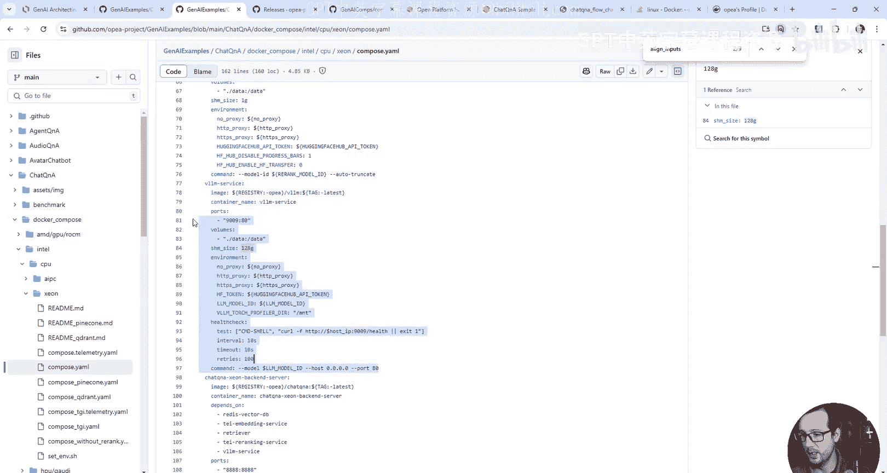

And in here， we're going to go to our Docker compose file。

So obviously we're starting the mega service there， but I'm going to go down。

 I'm just going to paste this in here。Okay， so now we have the V on service。

 and we can literally just put this in here。 and this will be fine。 It says 9，0，0，9。

 mapping to port 80。 So locally， it's running port 80 and has 9，0，0，9。

 It's mapping the volume data to data。 I don't have a data directory here。

 I'm not sure if I even need one， but let's go back over to。Rememberver that was here one second。

 I got a few too many tabs。 Allright， So I just kind of paired it down to here。 But anyway。

 what was that looking for。 So I'm over here。 and I'm actually kind of wondering。

 does Cha Q Q and A have a data directory， is I don't recall that it had one。

 But the reason why that matters is that this is mapping to the data directory。

 So if there is any kind of data it's gonna go there。 but I don't see one here。

 So this might be a nonisue， but I'm just kind of curious as to why that's configured that way。

 But we'll go down here。 And so we have S HM size 120 whatever。

 I don't know what this configuration is。 I'm going assume it's a VLM specific thing。

 It's going to have in VLM。 and we'll take a look at what we have。

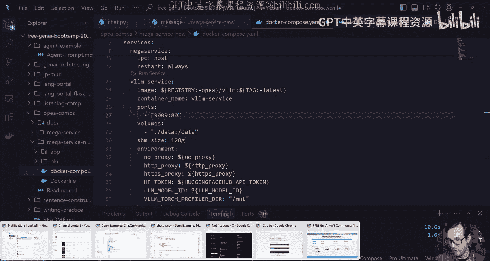

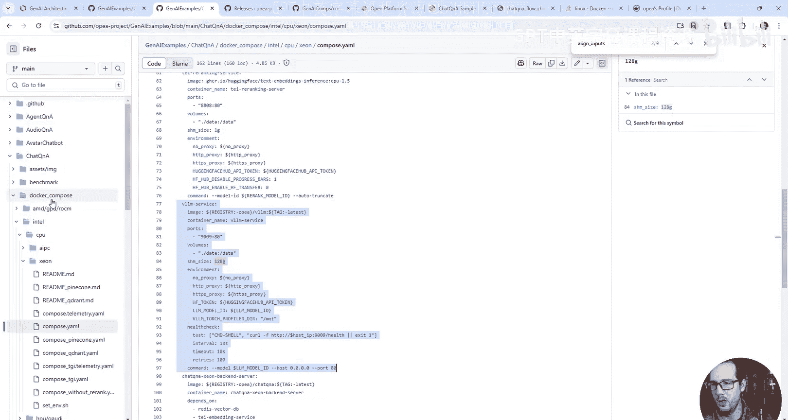

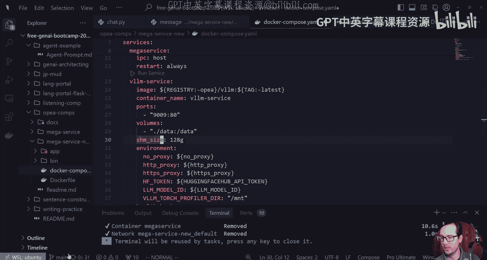

嗯。And we go over to here to the Vllum dos。Oops。So here it is。

 you can either use I host flag or SSH sized flag to allow containers to access the host shared memory。

 Okay， so it's talking about， sorry， I'm just fixing my my map that I stand stand on here， but it's。

 it's talking about something to do with shared memory。

 So that kind of makes sense with that information there。

And I guess it's really just specifying the amount of shared memory it wants to utilize。

I'm not a super expert at the stuff。 So we'll leave it alone as its default settings here。

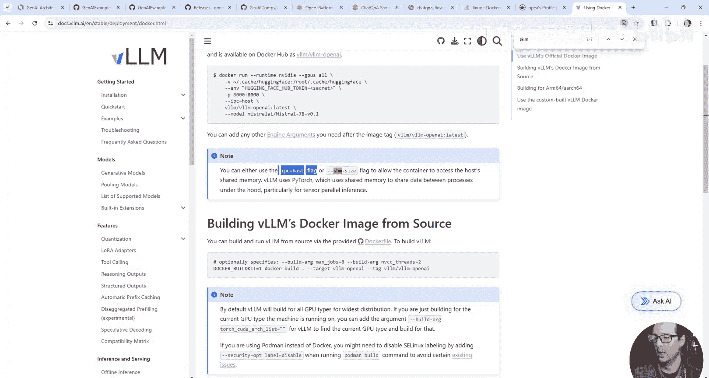

But if we go and look to here， we have no proxy， H TP， HP proxy。

 And these are settings that we kind of expect to see in general。 But I guess my question is， like。

 how does it work with these settings。 So if we go back over to。

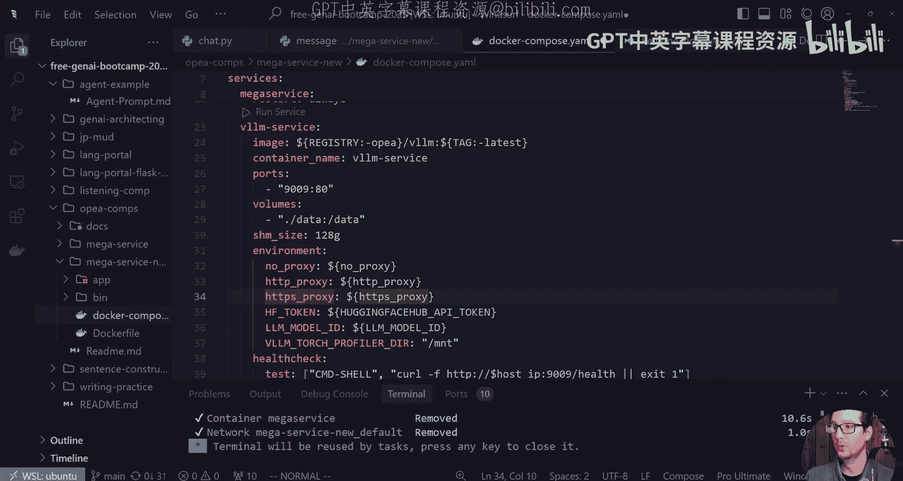

Up over to here。 and we go over to comps。 And we specifically look not in this text generation area。

 but we go down to third parties and we go into the。V LLM here。And we go into the source。

There must be a reason why。Right， so。I'm not seeing anything in particular here that would indicate it。

 So maybe these are settings that V LM needs to use underneath。 So we say no proxy V L M。And。Yeah。

 so I think that these see these settings here。Some more convention than a standard。

 I don't know the original thing for these settings。So there must be some kind of underlying。

Convention， it might not be VLLM specific， but clearly， we don't have to。

 that's not like extra logic that's being implemented。

 And it's just something that you probably would do if you use VLM anyway。

 Here we have the the hugging hugging face token。 The LM model I D。

 So the model that we want to run We have VLM torch profile directory。 If we need to mount that。

 we can do that as well。 if we need to actually do anything there。

 We have a health check to make sure the service is running。

 And we have a command here to say model LM model I D and start on on the host。

 So this is probably this is what it would launch initially。

 So basically if we typed in VLM or whatever the command server。 This is what it's gonna run。

 So it looks pretty good。 I only really want to run this service。 I don't need。

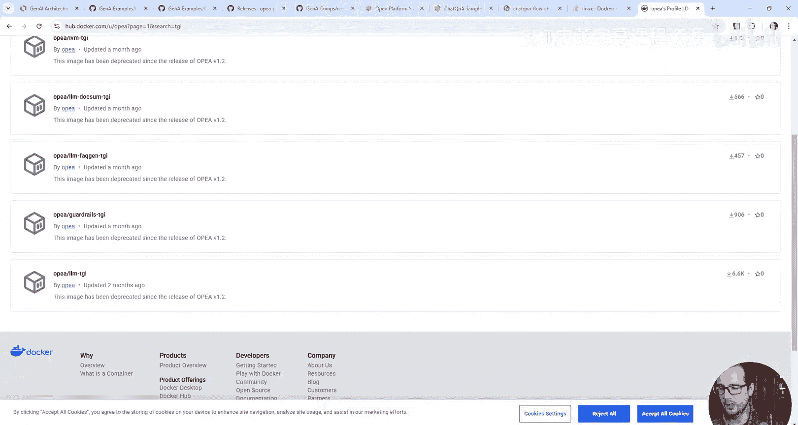

The mega service， I'm going to go ahead and just run this service individually。

And so it's going to go download this one。 And so we're going to go here on the left hand side。

 And I wonder if there's a way that we can make a bin script for this。

 So I'm going to go here and we have this message， which is going and pinging the actual mega service。

So I really want one that's going to test。The LLM test。Right。

 and so the ideas that this one go directly to here， I don't know if we can。

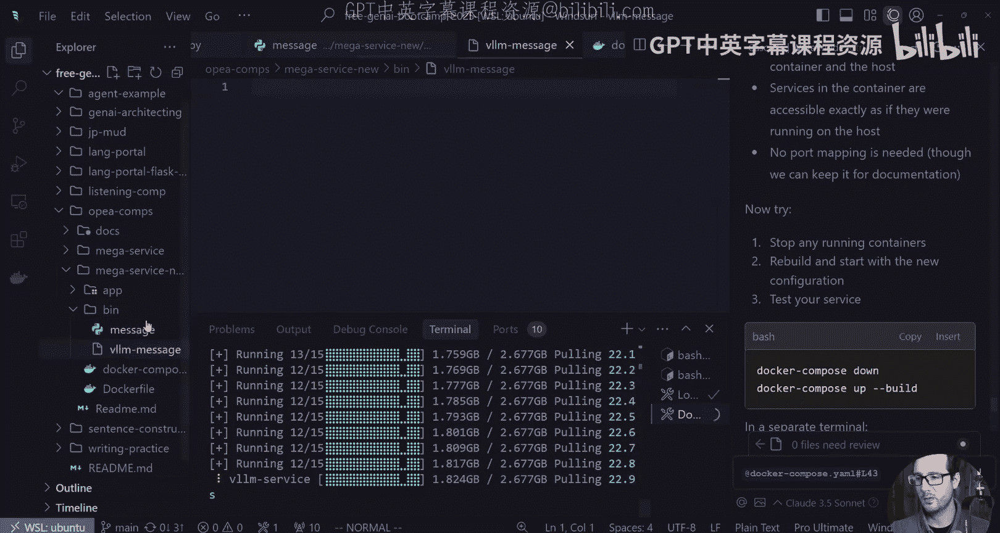

Pass of ELM the that payload there as such。But。We go back over to here。

 We didn't specify any specific kind of。LM that we want to run。So if we go back over to here， right？

We didn't say， I want to run this LM model I D， right， We probably should have done that。

 And we also didn't specify the hugging face API token。嗯。So， I mean， it is pulling the image there。

 so we do have to pull。 it's kind of large， crazy。 that's  three gigy， but maybe that's normal。

What I'm thinking here is。Yeah， so now VLM's running on port 9 and0，0，9。

 But what I'm thinking here is。He need to start up this container with environment variables。Right。

 we can't just do it this way。 So I'm wondering， you know， it's been a while。

 but let's find out as there's a way。 So， you know， is there。Oops， oops， oop， oop， oop， oop， oop。

 oops， that's not what I wanted。 It took me all over the page。

 But I have a feeling that we can't really use this right click Docker wrap Docker down unless there's a way to load environment variables。

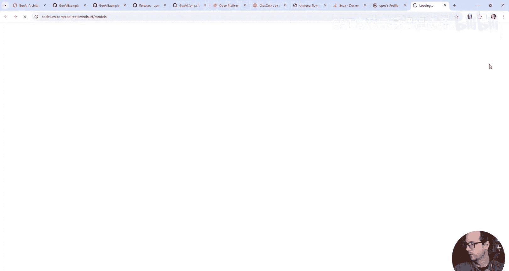

So I'm going to go here， you know， is there a way to load an ENV file when startingcker Docker compose up？

Or a specific service。嗯。Cause before I remember it was a bit tedious to set them。 And so， you know。

 it's been a while。 So I'm wondering if there's just something new。 Yes， there are two ways。

 Docker compose。 Im actually loads the dot and view file in the same directory as your Docker compose file。

 Oh， it does。 Well， then that makes our life super。

 super easy then So we can go ahead here and just make a new file。

 I don't know if it's true just because it says that doesn't mean it's true。

 But we'll go ahead and set this dot and V here。And there's a few things I will want before we do that。

 I'm just going to do a dot get ignore。And we're going to go ahead and just ignore the dot Ev so we don't have any issues here。

 I'm going to go back over to here and what were the things that the Docker compose file wanted。

 We don't need to send no proxy like it will work even if we don't set the default one Im go ahead and copy these here。

 I'm going to paste this in here and what I want to do is bring these to the wall like this。

And we're gonna need to set up these two values。 So I think hugging， like， or sorry。

 the format is like this。 So there's our hugging face token。

 which this doesn't look like the usual hugging face。W of expressing it， but that's totally fine。

 We'll go ahead and do this。 I don't know what we need to do for Lama。 So we say like Lama 3。2。

1 billion。Keeping the model small at this point， we can use other models if we want。

 But I need my hugging face token。 So I'm gonna go over to here， and I'm gonna go to hugging face。

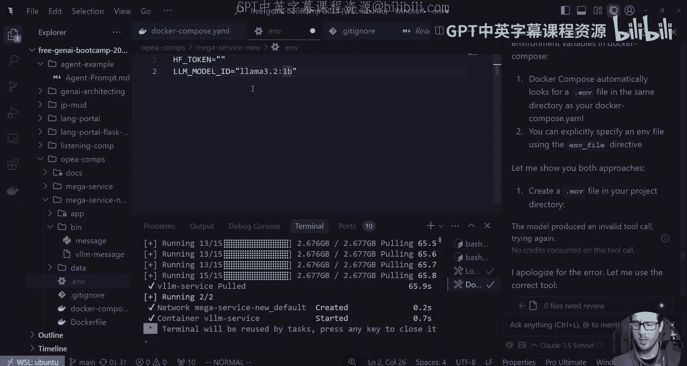

And I'm going go ahead and grab myself a token。 I'm gonna go to here on the right hand side。

 Access tokens。 And I need to put my password。 So give me just a moment。

 So I'm just creating a token。 And I've showed you multiple times how to do that。

 It's an access tokens here。 And I'm going to give it read only access。 It doesn't need right access。

 So I'm not going bother with that today。 I'm going go back over to here and we're gonna go ahead and paste in this。

 Now the question is like， what do we need to provide as to VLM so we can start a model。

 And so I'm going to go over to VlM and see if we can find it through their documentation here。

 or even through an example。 So here's this generating models。

 I don't need to generate a models I just need to use them。

 But here they're specifying the models like this。 So I'm thinking maybe this is a way that we can specify the。

 I mean， these are obviously other ones。 But。

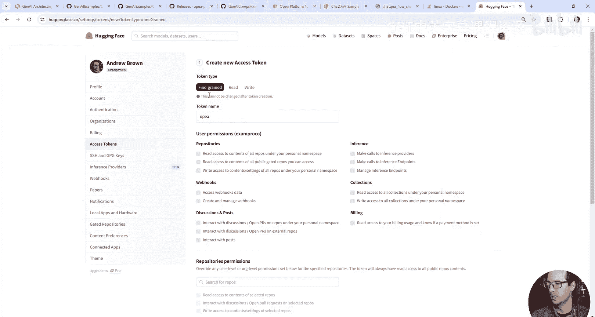

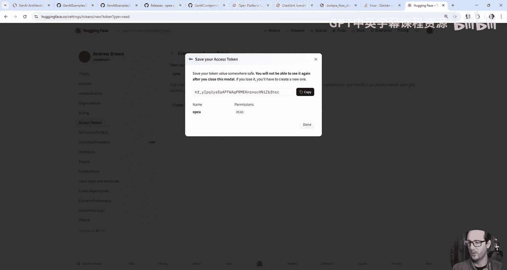

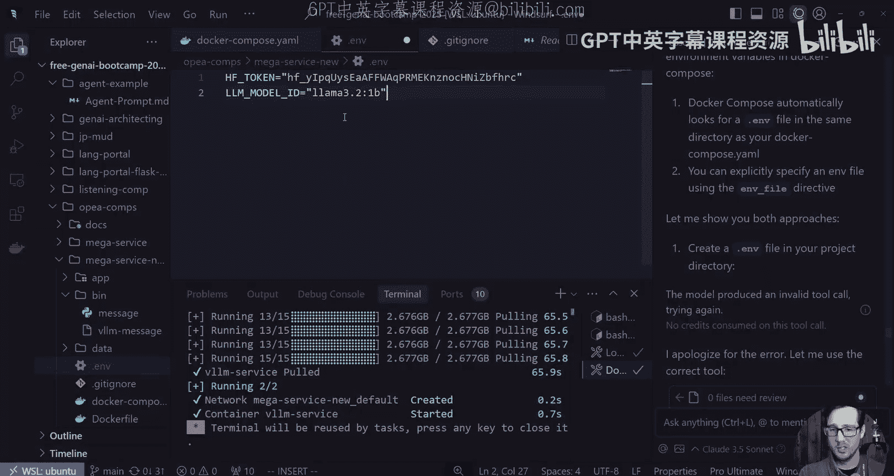

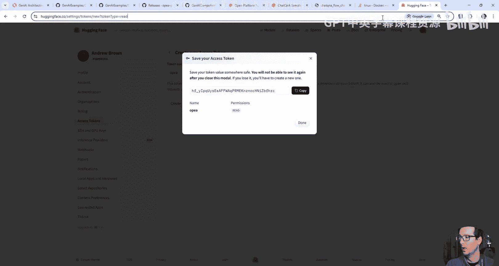

Here， yeah， so this it's kind of like this format here。So that's why it needs the hugging face。

 hugging face end point。 So I'm gonna type in hugging face Lama 3。2。1 billion。

And we'll go over to here。 And so now what I can do is just copy the title up here。

 And this is actually what we're supposed to be providing。

 So if we go back over to our code down below。

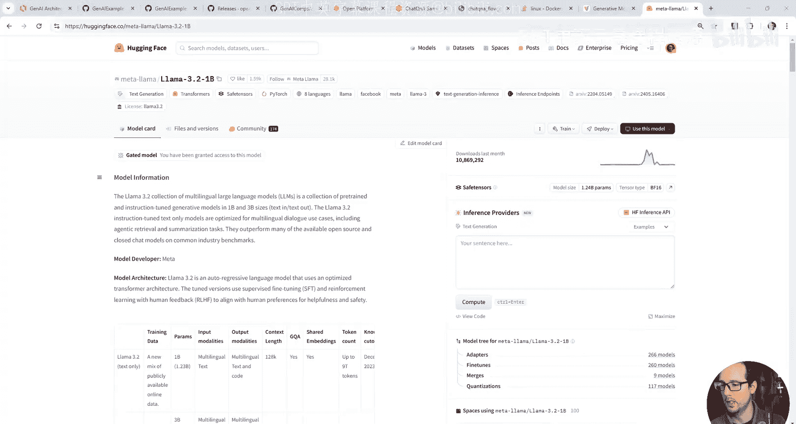

This is what we need to run that model。Okay， so we have those two settings。

 Is there anything else we need to set。 We set the these two most important things。

 And so this should be enough to start it up。 The container is running。Or it was running。

 at least it was trying to terminated will be reuseed as the task。

So I'm gonna go try running that again。 And I'm wondering if it's gonna try to pick up those environment variables。

Because here it's now running on port 900，9， which is really good。 I'm going to go。

 and I'm going to view the logs。 and I want to see if it's trying to pull or do anything。

 so it's invalid credentials in the authorizer。 So even though we had utilized it there。

 I'm not sure if it's actually picking up。That there。 So what I'm going to do。

Because I'm just going to let it stop。 It's probably going to fail on its own or it probably already has。

Terminated will be reused by tasks。 Okay， so for now what I'm going do。

 because I don't know if this is using Docker Docker compose up。

 But I'm just gonna comment out ouromega service for， for now， right。And same thing down here。

So one second。And so here， what I want to do is I want to go back over to here。

 I'm just going to do a docker compose up manually。

Because I'm hoping that it's going to load that dotM V。 Now。

 I don't know if it really is going to load it。 I just I'm kind of skeptical of it。

 but it's saying in valid credentials again。So that makes me think that it's not actually。

It's not actually loading that end bars。So as a sanity check。

 I'm just going to go ahead and drop in the hugging face token right here directly and these values I'm going to hard code them temporarily just for a moment。

Because that way we can rule out if that's our problem or not。And then we can be like， okay， well。

 then what do we do to fix that？I didn't really believe。The LM when it said that it could load those。

 So I'm just not convinced。 So go ahead and we'll do this。And。We do that。 We'll do that。 Obviously。

 you would not want to commit this code。 It' got to be real careful here。

And here I'm going give this is space here。The space there。 so now they're hard coded。

 so we should have a better chance of getting this to run now。So we're starting it up。

And now we are not having an issue。RightAnd it might even attempt to download the model here。

So I'm just kind of watching it when I used to run the chat Q& A。

 I think it used to use TGI and maybe it maybe there still is a TGI variant。

 but what it would do is the TGI service would start up and then it would start downloading the model。

 right？

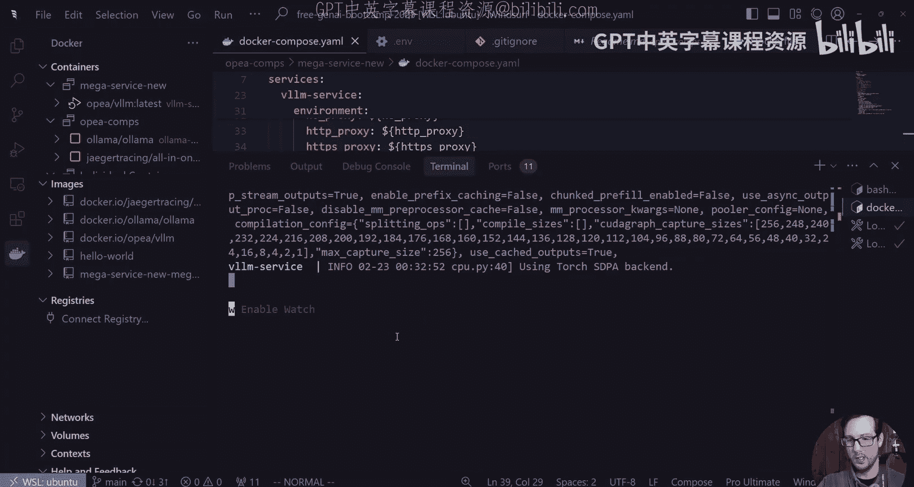

Here we go， we got a runtime issue。What is the issue we're having。啊。

Cutagraph is not supported on CPU。Which is fine。 I don't care。

 I have an okay graphics card or okay CPU here。Trident is not compatible or not compatible with the CPU related stuff Unii is not supported on here Kud is not supported on CPU fallback。

So I'm trying to figure out what its problem is because we did choose that Zion option。

But we aren't bringing in any special。 We're just bringing in V L La， right， we're not。

The other stuff is is not in particularly。Anything。

 so I'm just trying to figure out what is its problem。 Like。

 was that image built specifically for Zion， I don't think so。Like， obviously。

 for X 86 or whatever the。Chhiipet is here。But says Doose。

 the attributee version is obsolete and will be ignored。

 So that was something that James had said earlier。 So we'll go ahead and just take this out。

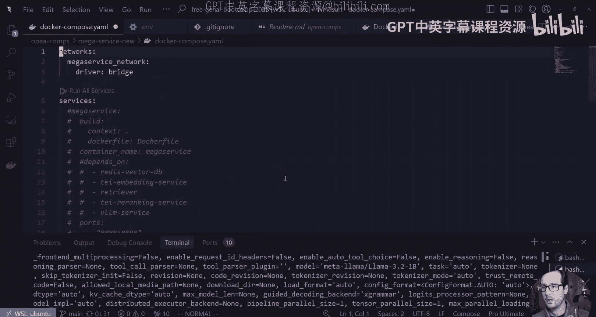

So we don't have to see that error anymore。 But I'm trying to understand what is our issue。

 I'm actually detected a CPU， which is good。 VLM API name say 00，7，3， okay。

And then it goes here starting the process。 Torch profiler is enabled。

 Im actually detected a platform CPU。 That's fine。 The model has a long context。

 This may cause O M errors in the memory initial phase。

 Async output processing is not supported on current platform。 Cutgraph is not supported on。

Supported on CPU， that's totally fine。Ui is not supported on CPU。 That's totally fine。

 I don't care about that。 The model has a long context。 Couttograph is not supported on CPU。

 Trident is not supported or compatible with the functions available。 We'll go down below here。

And so， it saying。I don't know what it's saying。 So we'll go ahead and grab this here。

Andy lastel what do you think the problem is what。Explain。What's see if it can come up with anything。

Is trying to run on CPU mode， but it's designed for GPU acceleration。

 The model has a very long context window。 The model has a long window。

 add GPU support to VLM service container。 Let's modify it。 I never ask it do anything。

 but it's just attempting to do it， which is fine。So in here， I do actually have a GPU。

 and so here it's specifying runtime， I'm not sure how it knows that。

You can check if your system is ready。 I do have GPUs on this。

 Are you sure you can set runtime like that。Is that is that a setting for VLM。

Cause I really don't know。Oh， that's interesting。So here we have ELM service。Deploy resources。

 reservation， devices， N VDA capabilities， GPUs。嗯。Like I don't know。

 I don't know anything about this deploy option， right？

So we'd have to look it up for VLM to actually figure that out。 If you don't have a GP。

 you're not gonna be able to do that， you would just use oma in this case。

 but I'm gonna say VLM Oma or VLM Docker compose GPUs。And I'm just trying to find an example of one。

And here， they're actually doing something like that。

 So maybe this is something that we can do to get this to deploy。

 So I'm going to go back over to my code over here。

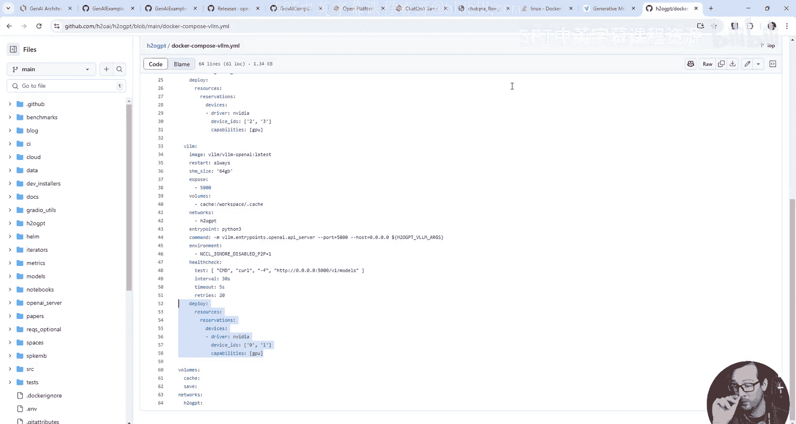

I'm going to go ahead and attempt to try to copy this。

But I do realize that we're kind of going down a route where I was just hoping that it would kind of work a little bit。

 but if it's not， this is gonna to be kind of an issue for some folks that are following along here。

 but I'm just going to try this because I I'm just curious if it can actually launch it up and use my GPUs。

 I do have that Nvidia card， the NviDdia 480 here。 would be interesting It would be to try this on the IntelIC because it has built in my GPUs and so it might be able to handle it。

 but we would have to try that separately to go find out。

And so I'm going to go ahead and just switch this over to here so it now says deploy。BLM。

And I think it's at the same level with everything else。 It is。

 So we're going to go ahead and we are going to stop this。 and we're going to try Docker compose up。

 and'll see what happens this time。 So it says Amon error response from Damon could not select device driver and video with capabilities GPU。

Okay， so maybe the configurations wrong。 we sell another one that used device 0，1。

 That's usually how youd said it。It's not installed， properly configured since you're using WS cell。

 you need to configure it separately。 is it not configured， Are you sure。嗯。Again。

 this is specific to my machine。嗯。I'm very hesitant to run things that are here。

 but I'm going to give it a try。I'm not sure what this is doing。 It's kind of。

 I'm not sure why it's prompting me for password。I'm trying to。Stop it。 What is it doing。To stop。

 There we go。 Close this one。 Close this one out。 Close this one out。 So again， I'm。

 I'm kind of going off the beaten path here， but I'm just trying to find out。When I do this。You know。

 will this？Let me run because I really want to run VL M。

 I keep talking about VLM and how great it is。 But I can never seem get it to run。

 which is kind of frustrating。We'll go ahead and copy this。And so that doesn't work。

We bring this a bit smaller second see what I'm doing here。 type in clear。Okay， so。

I'm going to go to the internet and let's find out what we can do here。

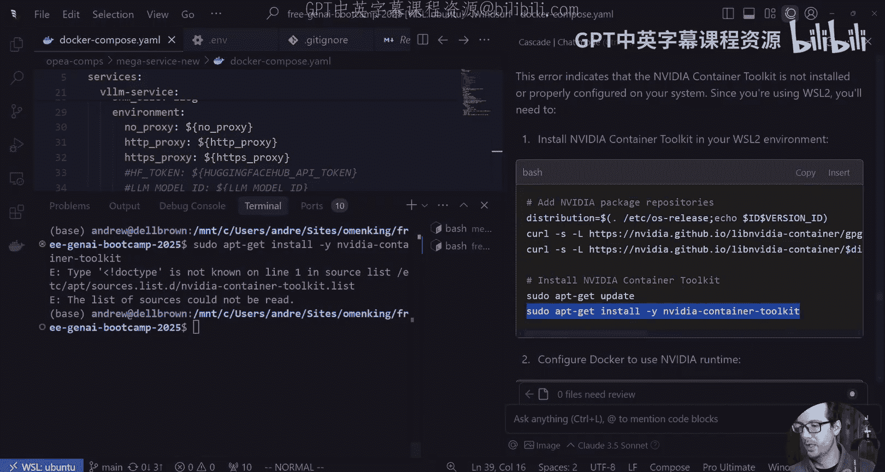

It's saw in the NV toolkit。 don't really want to do that， but it has a bunch of steps steps here。

 So for a Btu。I don't want。 I don't want that one， but we'll go ahead and grab this。

 It's probably the this is that that's wrong by windsurf if it doesn't know what the right one is。

 So we'll go ahead and hit up here。 And so now that should be added。

 I'm gonna go over to our docs over here。 We're gonna go ahead and grab this here。

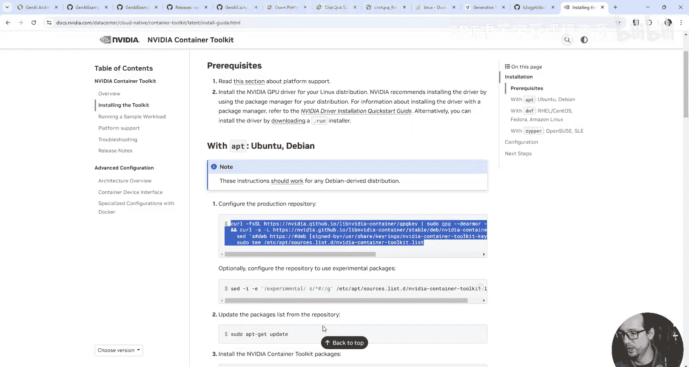

I'm going to go ahead hit enter。You can't locate it。This is kind of annoying。

 Maybe we'll do a pseudo app update for maybe because I didn't do that first。

 I was trying to avoid that。 We really should do those， but I just don't like waiting。

 but that was actually really fast。 So maybe I was complaining about nothing。

 So now it's installing the EnviA toolki。And so now maybe I can interface with V L M here。

 So I'm gonna go back over to here， and I'm gonna go ahead and hit。U。Until I get to。Do。

 I don't have to do。 I just type Docker composeose up。

 And So now what I'm hoping is that it'll spin it up and it'll find it。

I'm not sure why it's saying no configuration file found。Oh， I'm in the wrong directory。 That's why。

 So we'll go ahead here and we'll go into。

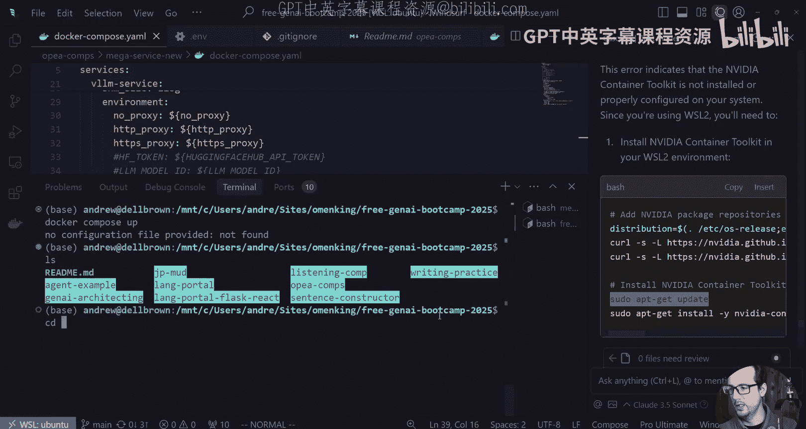

OPA comps。Make a service new。 and I'm gonna go ahead and type in。What I'm gonna type in。

 I'm gonna type in MPM。Docker compose up。And so here it's talking about setting some defaults here。

 could not select the device and video with capabilities GPU。Okay， so。We'll give it there again。

 but I don't think that's the issue。 I mean， it could be。 But over here。

 you can see that it's saying Nvidia and same exactly with devices and capabilities。

 this is a little bit different。

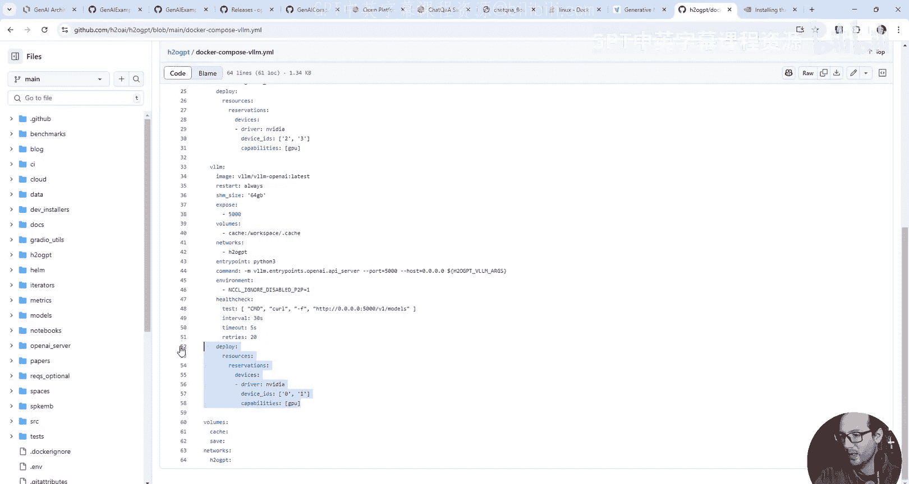

So here it says。You， check， I already know that you can see it from here。

 but we'll go ahead and do that anyway。Sometimes the menu gets messed up after running it。

 So I have to close this tab out， which is kind of annoying。

But we will go ahead and reopen this again。 We'll type an NVdia SMI。

 So this means that I'm getting input back here。Make sure the latest drivers install already do。

 So this is telling me really stupid things After this try running running this and see if it works。

 So it really doesn't know what it's saying。 It's just giving me nonsense back here。

 But if we look here， it says capabilities， GP driver and video count1。

 totally different from this other documentation。 I'm not sure how old this one is。

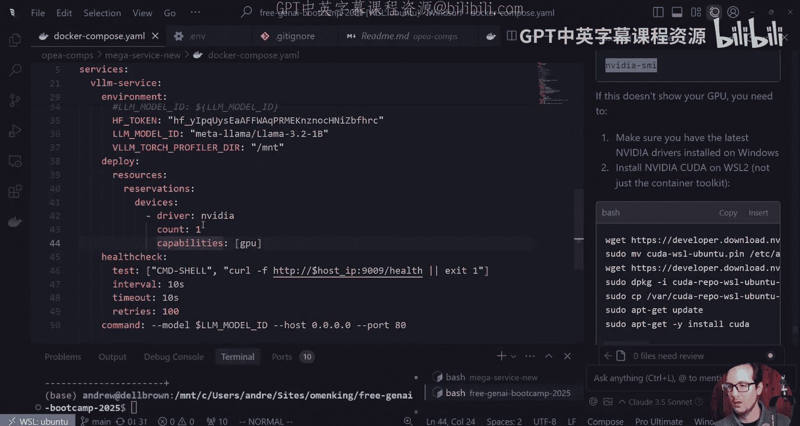

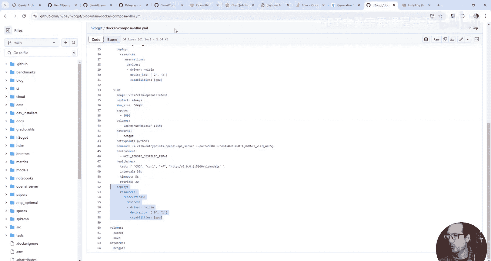

Seven months ago。So we'll go over to here。 I'm going to just try replacing this like this。And so。

 it's similar。It still says capabilities GPU。And I'm going to go ahead and we're going to try this out。

 so let's see Do composeose up。

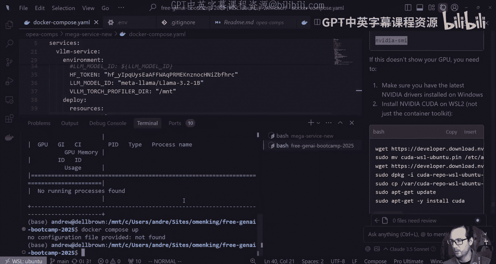

Yeah， I know I gotta go into the right directory。 And so we'll go ahead and we'll go to OPA comps and we'll say mega mega service is new。

 and I'm gonna do Docker compose up。Okay， so I'm doing Docker compose up and。Still。

 we have this issue error respond。 Damon could not select driver and V V capabilities。

 This is really annoying。 So I'm going to go over to here and we'll go ahead and do this。

 Take a look。And we'll take a look at the formsears。And restart the。

 restart the Docker Damon as instructed。 I didn't restart the Docker Damon。

And this one is out of date， which is not great。Restar Docker Damon。Good one too。 So let's try that。

 Maybe it needs to restart that。Service Dr。 Reart。啊。

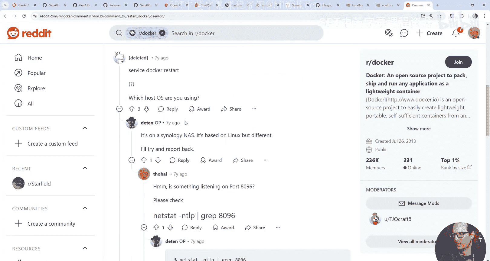

I don't think that's what it is， but I'll try pseudo。Service CT TL。Restar Docker。

Ill put a password in。Sudos service or， or we'll say。Service Doer restart。All right。How do I restart。

Dor。 Damon。On Uuntu。Okay， let's see what it tells me。Sudosystem CT TL what I thought I was doing。

Or using the service command。 I mean， like， yeah， that's， we'll try this again。

 Maybe I just typed it wrong。Cause now it's hanging， right， It's like it's thinking hard。

 That makes me think that it's going to restart it。 And so I think now it's restart it。

 let's go ahead and try a dock and compose up because it's saying that one thing really matters。

 Now we're getting a different error， which is good。

 So we have air response from name and failed to create the task container failed to create the shim task。

 O C I runtime create to fail unable to start the container error during the container。

Other detected mode is legacy。And this might have to do with the fact that I changed some of this stuff here。

 So I'm going to go back and change it over to this。Okay， so maybe this one is a bit newer。

 but we'll go ahead and hit up and see what happens。

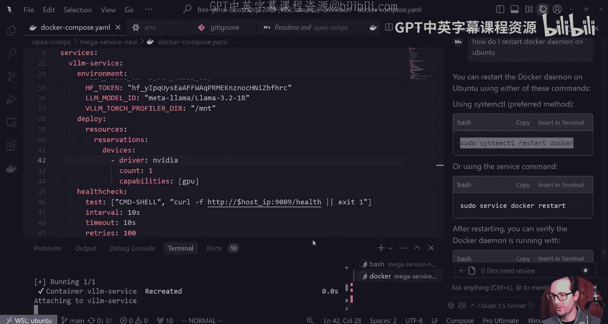

A lot of guests work here。But if I can get it running， I'd be very， very excited because they never。

 ever get VL under work。But it has to do like， you know， the underlying GPUs or what you're using。

 right， Again， I would be interested to find out like。

 what would the the settings on the Intel IP PC if we go over to here and we go into。Into。嗯。

The mega service， we actually might have that， that like knowing how it utilize for the IPC。

 So if we go under compose Iml file here。And we take a look here somewhere in here。

 It might tell us what it's using。 And it's using o laama。 So it's not even trying to。

 So if you're using， I guess it makes sense because it is a CPU。

 So maybe it might be hard to configure VLLM to use the I PCC chips or maybe it can do it。

 you just need to do a little bit more work。 what I find a lot of times。

 it's just like you have to do work to figure it out。

 I know that if I was to take the service and put this on。What you call it AWS。

 it would just work here says model architecture， Lama for casual on fail to fail to inspect it。

 Please check the logs for it。 So I'm getting a little bit farther along here。

 again I just really want this to work。And。Yeah， what is a problem？

faaiil to be inspected please check the logs for more details，What's what's our problem。

 Model architecture failed to be inspected Laama for casual LM。Okay。

 and this might be V L M specific。VLM， the most amazing thing， but you can't ever get to run。

 So we'll go over here yep， VLM。For a specific model， you don't know how to integrate with V LM。Okay。

Maybe it doesn't like the model we chose。Okay， we're on Linux。So I'm gonna go say like V LLM Lama 3。

21 bill。So I'm just going to see maybe there's like a slightly different thing that has to be typed together to work。

Docker compose。Okay。So here we can see highlighted model weights。

 the closest model VLM already supports。What's your difficulty for supporting the model you want。

 This is from 2024。 So there's no way it doesn't doesn't work with that。嗯。😊。

So what I'm just trying to find out is like， what do I set for this。 So here they have one。

They're using here the， I mean，'s it's mounting an existing one that's already there in Podman。

But it makes me think that it should be， Yeah， it should be able， obviously run it。

Here's the Kubernetes deployment。 I wish it had the Docker container1。But I mean。

 I would think the environment variables would be the same。But here what you see。

 they're doing VLLM CPU environment， and then they're saying model Lama 3。21 billion instruct here。

And then they're specifying them here。 I wonder if we go back over to VLM。

Do they have an implementation here if we go to third parties。

 I wonder if they have a GPU1 in particular that we can take a look at， It might not help at all。

 We do have one Intel GPU。This is going to be for arc support。

 but I'm just going to look at here and see what the difference is。

 I'm moral more interested in the Yaml file。I guess that's if it's building it individually。

 So that's not actually gonna to help us。H，m。 what can we do to get this thing to work。

Let's go back and stare at it for a little bit here， so model architecture。

llama for casual LM failed to be inspected。Please check the logs。 This is the logs。

 I don't think there's logs anywhere else。Unsupported architectures。Okay。VLM supported architectures。

So I'm going to go over here and we have a list of supported architectures， Huging phase by default。

 the LM loads and mall from Huging phase。 That's great。Transformers fallback supported models。

 remote code。Model scope， I wish it would just give us an example， right。

 Like if they have gave us an example， it's be so much easier。

 We do have examples over here on the right hand side。If we can get anything work。

 maybe even if it's deepick， I don't care。So maybe what we should do， I just。

 I'm just trying to get a smaller model so we can test this。Here's Google Gema。

We could also just do G T 2。 That'd probably be really， really small。

 if that even is still accessible， Can we use G T2， Is that on a hugging face， Huging face。

 Can we do that。It is here。 There is an open AI 1。 I don't know what it would do。 But right now。

 I just want to see that it works with anything。 I don't care what it works with as long as it works。

 Although I would be curious to use Gema， let's go over here here。

 And what I'm going to do is just replace this quickly like this。

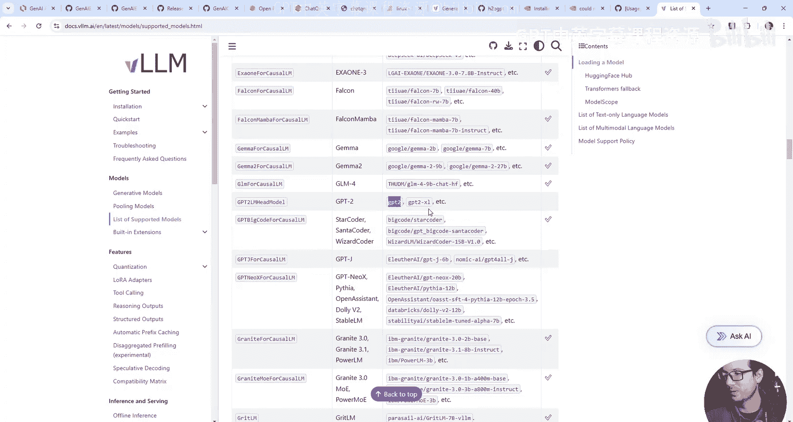

And I'm assuming that it's going to know what this is。Right， if it doesn't， that's totally fine。

But we're going to give this a try。And the reason why I didn't put any backslash there is because I didn't see any in that example。

 right， So here it literally just broke that some of them， and do have the four slashes。

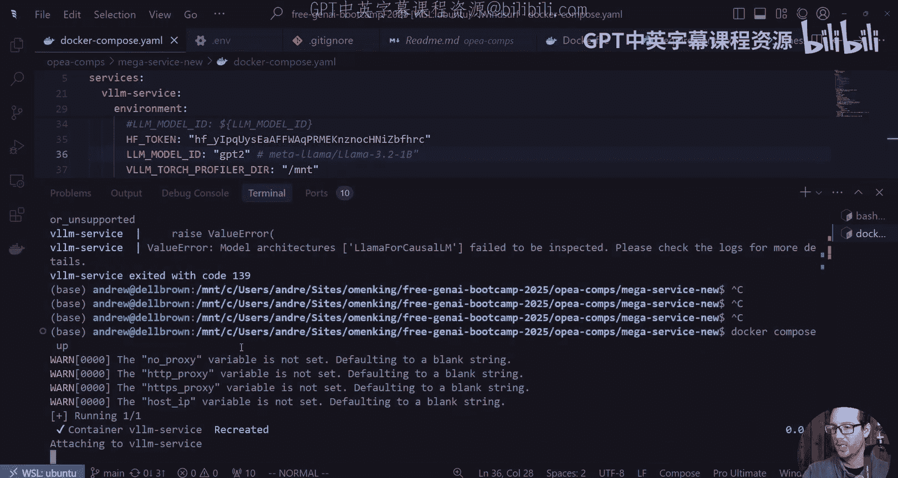

And so I'm thinking that maybe it already knows how to pick these up。Down below here。

 we have the metal ones。So you have Lama 3。1， nothing that says for 3。2。 so maybe you can't do 3。2。

Yeah， so that's probably our problem。 I don't know。 Like， if， yeah， why can't it do 3。211 billion。

 I guess it's not supported。 But here it says Lama 2， Lama 3。1。嗯。Yeah， and this is kind of where。

 you know， certain models support different models。

 And so that's probably we're running into an issue。 I'm gonna go back over to here。

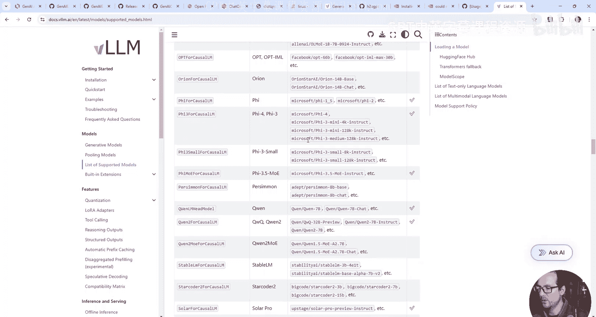

And here's saying Lama for casual LM unsupported。 It really wants to focus on that。

Even though we've overridden it with a very specific one， what we can do is we go back over to here。

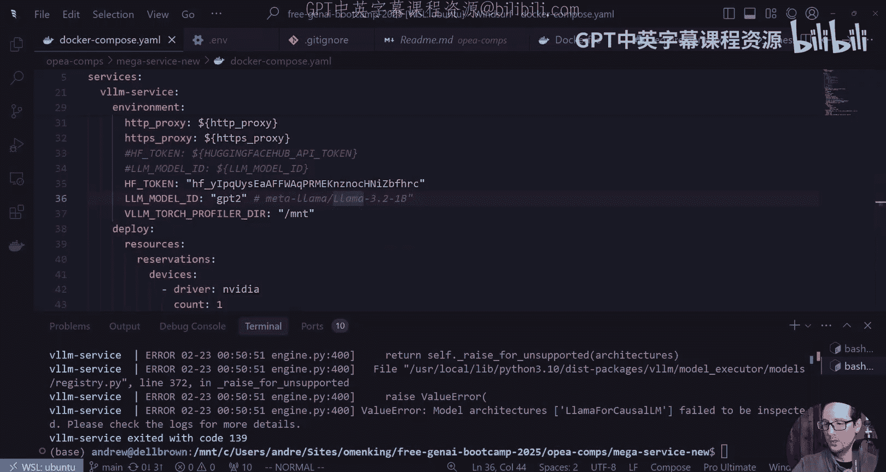

And if it's talking about that casual nonsense， we can go here and just specifically target into that one。

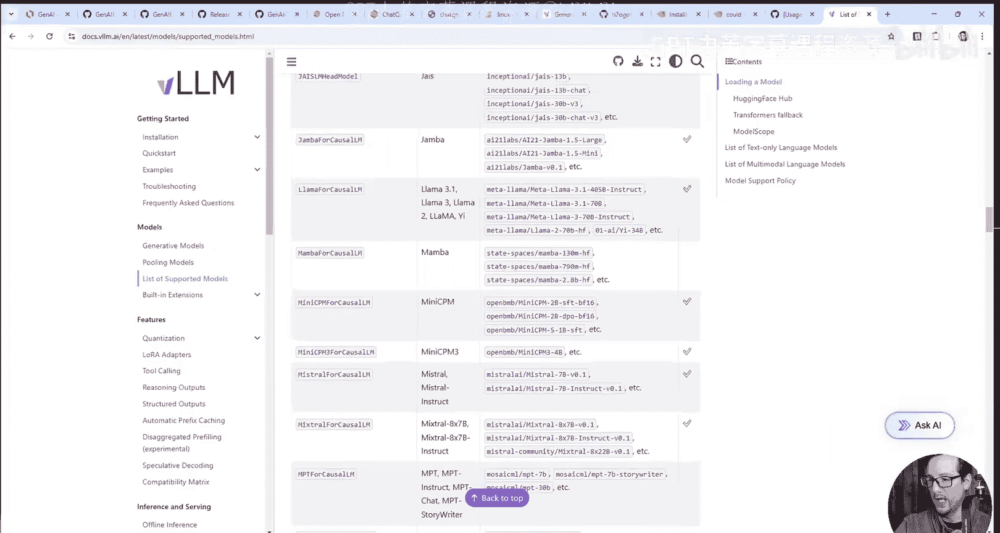

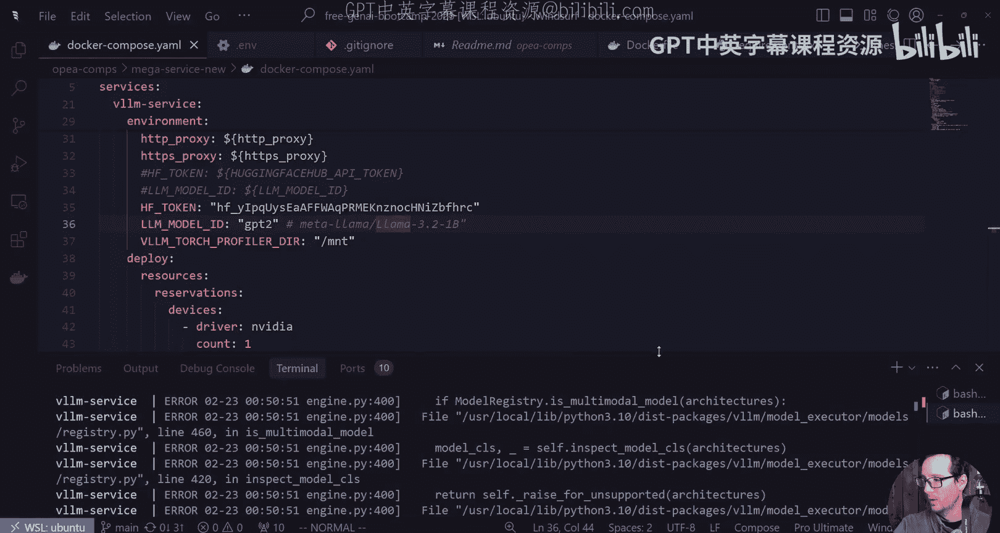

So I'm going to bring this up here for a second。We'll grab lama for casual。

And I'm going to search for that here。 It's right here。 And so we have some， but they're really。

 really big。 I don't want a big mall。 I want a teeny， tiny model to work with。

And that kind of makes it a bit of a challenge。So there must be more options like architecture or something。

So。Yeah， like。VLM configuration， V LM configuration。And。We'll go back here。

AndSo what I want to know is like， what can we set， Are these all the things we can set， Like。

 do we have model in here LL M。Yeah， like I want to go and see if this matches up。 So in here。

 we have。

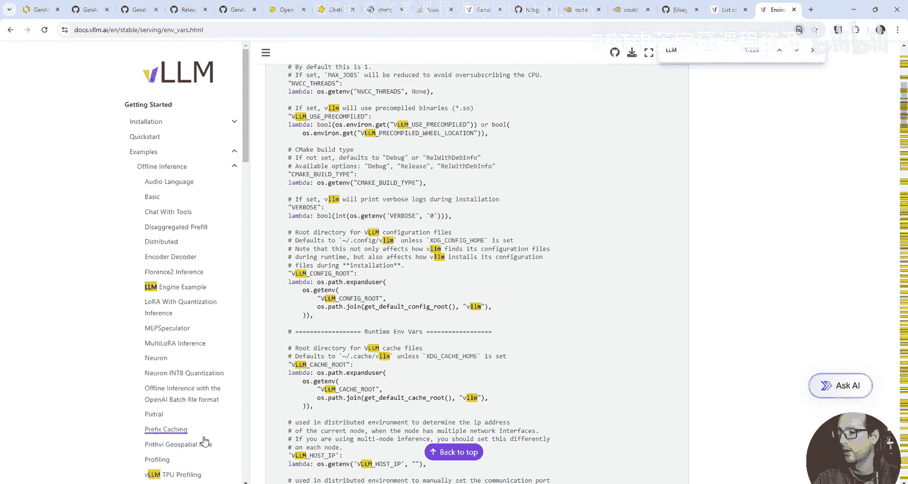

LM model ID， is something that we can plug into here somewhere。

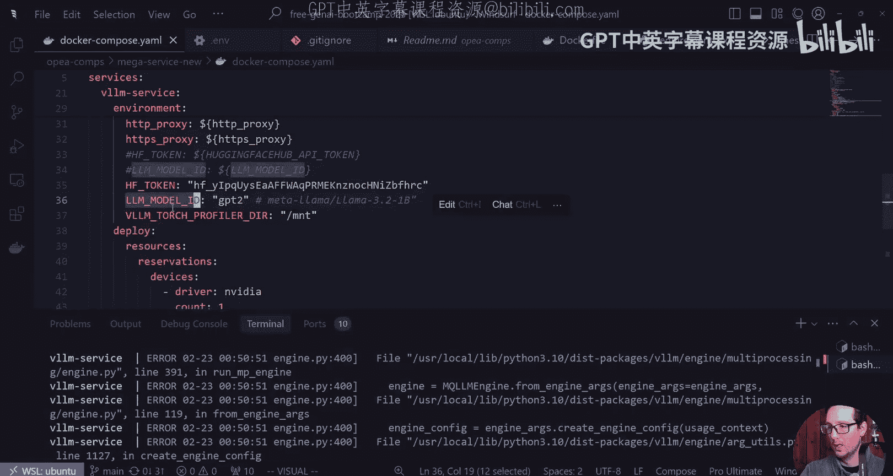

Like like， I don't even see it。 And this is what's frustrating。

 So we'll go here and say LM model I D VL M。Wer pain。

One more thing I want to check is is there any kind of wrapping or extraction that this VLM is doing here？

So we know that if we go here。And downown below。嗯。🎼。

I'm just putting this environment variable here to see if it does anything。

 It doesn't doesn't do anything。So we'll go to this one here。嗯哼嗯。😊。

And so I'm not seeing anything in particular that's changing it。

 But here says default hardware mode is CPU。So it is optimized for CPU to begin with。

When I swear Vlon's really， really hard to get working。 it's unbelievably hard。嗯。

But this is kind of confusing because if TGI is now deprecated version 1。2 since last month。

 because I've been using OPA for multiple bonds。And that doesn't mean that we can't use TGI。

But the question is like， why is it deprecated， and how will thou impact us if we utilize it。

 And we can still use O laama， which is totally fine。But I really， really， really。

 really wanted to use VLM bonus points。 If anyone gets VLM to work。Ha ha。😊。

And documents their challenges here。You know， my computer is not going take it if I try to put one of these larger models in here。

Go here， V M option。Yeah啊。So in here， it says text generation my like， it's over here。

 but this is not the same thing。嗯。What can we do for this。It's a good question。Again。

 we're going to stare at the VLM just a little bit more。 And if it's too hard。

 I'm just gonna to give up on VLM here。VLM is already supported Intel CPUs and ga accelerators。

 That's good。I mean， there's this one here that we can use。 It's a little bit big。

 I wouldn't expect folks to try to download this one， but I can try to try to work with it here。

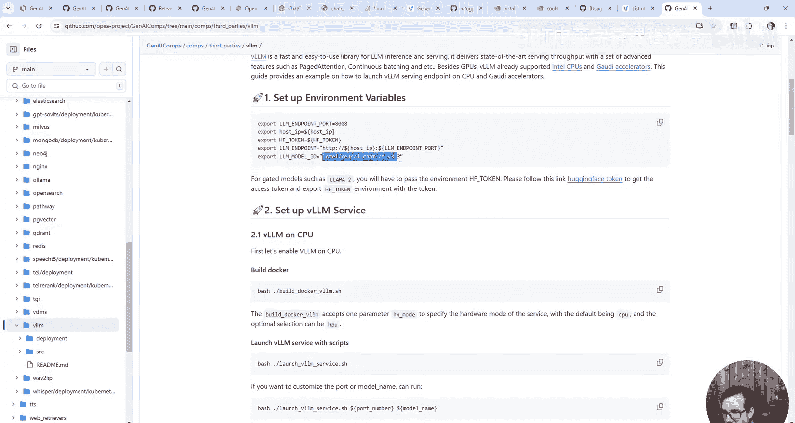

And I'm gonna to see if this will help it at all。 So if I go here。And switch over to well， that。

 but it matters because if that's a C CPU， if it's optimized for CPU。

 might not run on the Well am I run on the GPUs。

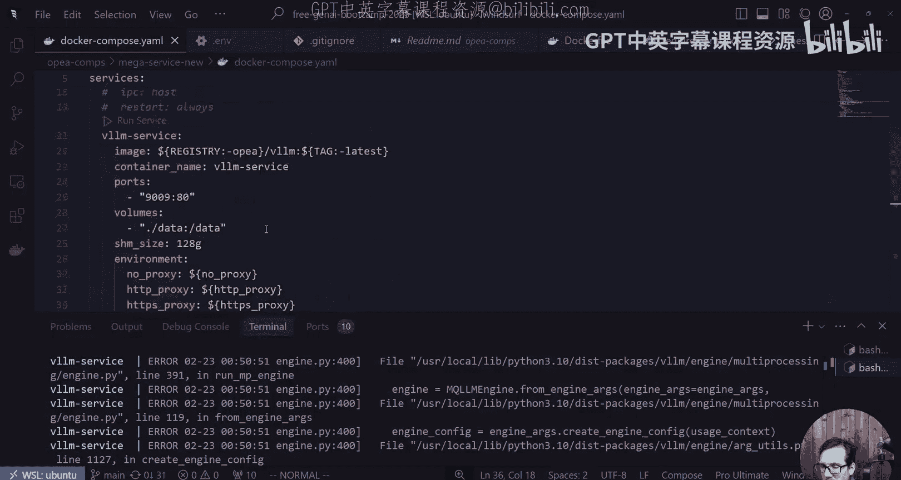

嗯。😊，VL M on CPU。嗯。Lama 3，8 billion struck。It's not as big， but you can't access Lama 3。2 or La 3。

 It's only Lama 3。2 right now， I believe。嗯。Deployment。So the compose file。VLM。

 this is just an example of running one。 So this the VLM server。And。

There's no additional options here that we have to worry about。And here。

What's the entry point for this。But this is using the image called OPA VLM， which is here。Right。

 so it makes me think that there should be a do or falling here somewhere。

But the docker files are here。 So this has to be。Well， there's only actually one docker file in here。

 There's nothing else。It's just the one。Is this what it's actually building here？

And so I'm just carefully looking at this。Uubuntu as dev。I'm just carefully looking here。

 I realize la font's really small。 I apologize。 But what I'm trying to find in this is， where's VL M。

Because up here， we have Uuntu 22 S dev。So it's pulling it from that。V LOM。

 maybe it's installing it manually。So here it's cloning V allM right here and it's cloning a very specific branch of it。

066。Let's go take a look here B。And we'll drop this down and the laser is 0，7，3。

 So it's on this one here。Okay。And so then it says VLM build requirements。

 build LLM with open VO backend。So here it's building with open Vino。Which would mean it's。

 itss CPU optimized making it so that we should be able to run it on CPUs。嗯。But it clearly is， yeah。

 it's， it's building it。 So we have theM。 But I guess what I was looking for was there any kind of magic of it passing anything through to it。

 And it's， it's not。

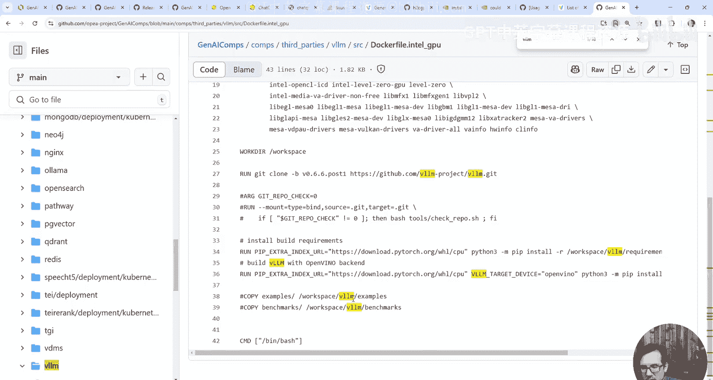

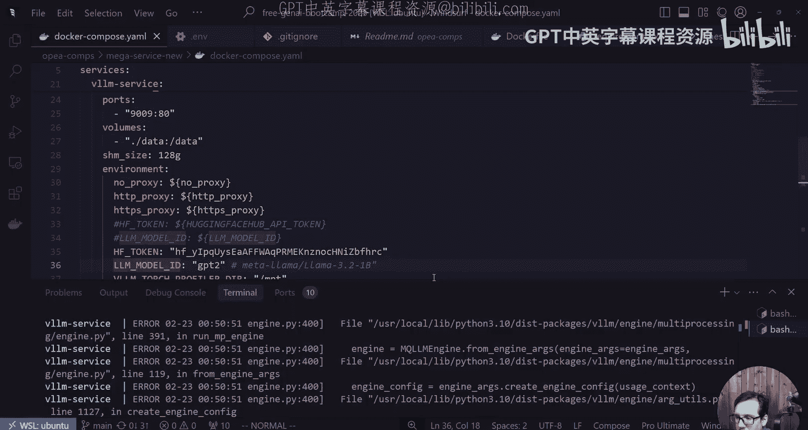

But it's frustrating because I can't find anywhere。This option for。LLM model I D， right， Like。

 if I could find that in the documentation of V L M。🎼Then that would help us out quite a bit。

But even though VLM looks really well documented。 it's like， I can't find basic things。

 We'll go to the Docker file here。嗯哼。😊，You think if I just do this and say， VL lamb。

 we could find something。Let's go over to here。Was Intel setting it， right。Yeah， I。

 I just don't understand， like， where is this， this environment variable coming from。

What if we call it LLM model I D， LLM model I D V LLM， maybe because it's in caps that it's confused。

And so I can't find it。 Let's go ask perplexity。How do I set the model I D。Is there an Nva it takes。

VL uses several environment variables to configure system。

 All environment variables used by VLM has the VLM。Here， but this one has， that's not what we have。

 We just have LM model， I D。Is there none for the model itself。嗯。

Can we get a an example of using VLM as in a docker container。So this is where we again。

 we might just run into a bus。 And to be honest， if we're using local machines。

 we probably should use  laama。And yeah， this is where this is what I was expecting it to be。

And then here， it specifies it as model like this。Okay， but in in a Docker compose file。

And the commands there。Maybe it has it there。 Maybe it just wasn't paying attention。

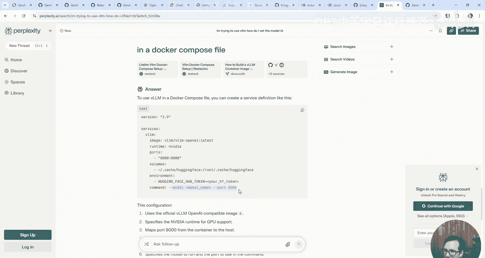

Oh yeah。 sets it right here。Okay。嗯。😊，But I mean， I guess we can set it up here。

I could also just grab it here like this。Paste it in like that。

 But I don't think it supports that model， or at least it says it doesn't。

Sometimes this stuff moves so fast， you can't necessarily trust what it says。

So I know I'm just kind of moving around a little bit， but if we can get it to work。

 that'd be really， really cool。But yeah， now I'm starting to understand that like if it's optimized for open Vino。

 we should be able to use VLM on a CPU， but that error that was telling us was throwing us that problem there。

 which wasn't true。 So it says model architecture， Lama for casual failed to be inspected。

Please check the logs for more details。 I wouldn't know where to go for logs。This is the logs。嗯。Yeah。

 so you know what。 I don't think we're gonna be able to use VLM here。

This is what you should use in production， but it would just take a huge uplifting。

 The only reason why I wanted to use it was because I wanted to use a container from the comps。

 We don't have to use this one。 We obviously know how to work with llama。 So that's totally fine。

 So I'm just gonna go ahead and comment this out。 And we'll just keep it around here。

 maybe at some point， I can ask somebody questions about this。

 This hugging face token doesn't like that doesn't look like it's set right。嗯。Oh， I guess it's here。

 And then it's there， which is fine。 But I'm just gonna take this out of here and we'll take this one out。

And I'll call this for now。If anyone solves it and figures it out， big bonus points。

 if you can get it run on a CPU， huge bonus points。Cause I've been trying to get VLMs to run forever。

 And it's just very finicky based on the configuration。 So if we can't use that  one。

 I'm gonna stop the video here， but we will try something else， okay。

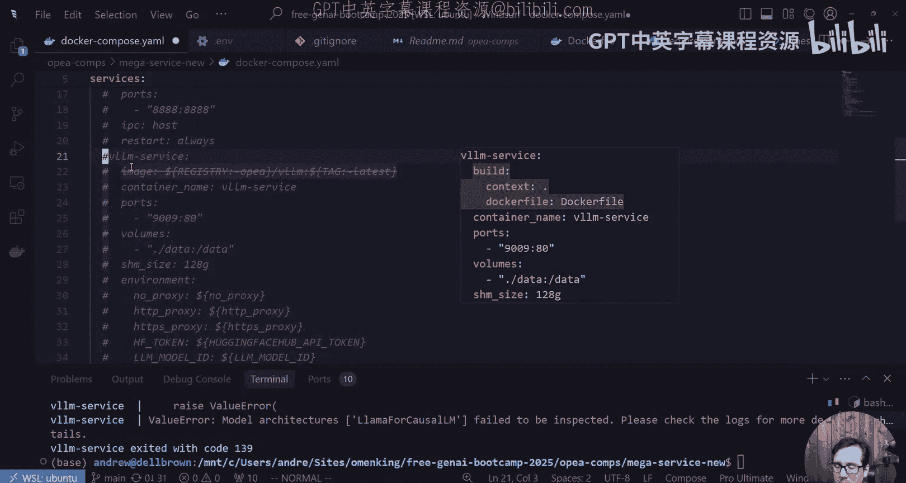