# ExamPro《生成式AI训练营｜Free GenAI Bootcamp》中英字幕（deepseek - P51：-51-OPEA TTS Microservice.zh_en - GPT中英字幕课程资源 - BV1SFEWzLEab

Alright， I'm back， and we're continuing on。 It's really unfortunate that I couldn't get that to work。

 but。We can build whatever we want。 It doesn't have to use a chat V VLM。

 We could probably it bring in TGI。 We could also bring in O Laama。

 We already have the code for that， and it works。嗯。I kind of wanna use an OPA A component， right？

 And so maybe we'll just go to the comps and take a look at what there is there。

 And this is where I want people to be try to be creative。 as there are a bunch of ones in here。

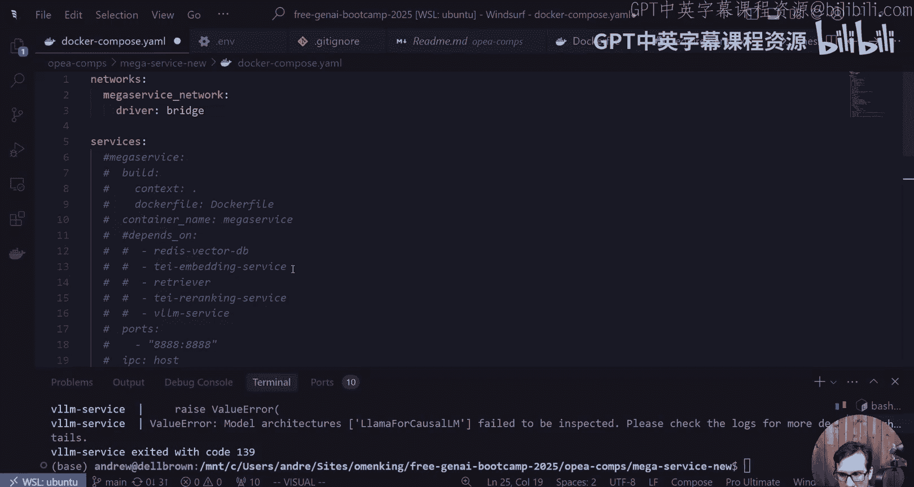

Im thinking， I think there's like a texted speech one， which might be fun to utilize。😊。

And we might have an easier time with this。So we have a Texas Beach one。

Let's take a look at the source。 So this says。Speech T5 service。 I don't know if this is any good。

 There are obviously newer， better ones out right now， But， you know。

 we could probably also make our own implementation if we wanted to。

 I'm just curious what this sounds like I'm just trying to get my。

Your my headphones on here so I can hear some sound。 Just give me a second here。

 I'm gonna untangle some chs。Allright， so。I guess this is a speech to text model。

 I can imagine it's very good， though。Yeah， 2021。But you know what， if we can get it to run。

 then whatever， that's fine， so。I have too many tabs open。 Let's just close a few。

 so I'm less confused。Okay， so。Here's one where we can see how it runs。 Start the TT S service。

 Most's totally fine。Start as a microservice，Doctor composeose。

So we have the examples over here that we can copy into。 So I'm gonna go to Docker compose into here。

 And they already have an example of one we have for general use。Goauy service。GPT over service。

 I'm not I'm not familiar with what that is。Take a look here。

A powerful few shot voice conversation in Texaspeak Web UI。 Oh， that's cool。LetTake a look here。

先地创业未办而中到崩殂，今天下三分一周平的酒。献身的に介護したんですが、なんだか一人にして欲しいとおっしゃるので。😮，Well's interesting。 So， I mean。

 maybe the voice I'm not particularly fond of， but it does Chinese and and Japanese here。

This is GT Cvos Web Ui， powerful few shot voice conversion and text to speech web Ui。

0 shot T T S input5 seconds of vocal sample and experience instant text to speech conversation。

 unseen speaker， few shot fine tune demo for users in China。 You can click here。I mean。

 that kind sounds kind of interesting。 So maybe there's more than one thing in here。

Because when we're over here， there was that， that one there。 Hold on here。呃， is is that。No。

 I don't know if that is。呃，稍 that。We just have too many tabs on them。 Let's close a few。Here we go。

 So we have here。Speech 5。But then they have the GT over service。

 I kind of kind of want that because it sounds really interesting。😊。

But it's not as documented as these other ones。 And then we have。 Well， this one's saying T T S。

 GP T service。 So I'm guessing what you have to do is run this underneath。 and then these other ones。

Map to it。Interesting。Let's go back here and take a look and see what we have as or options。So。

 under here。Spch T5 server。Start microservice for Docker composeose，They show it。

 so they have this one， this one or this one。And so they have an example here of this endpoint。

I guess we'll keep it real simple。 and we'll try to run the the first one here。Okay。

 so'll go back over to here wherever the wherever it was。Oh， boy。Let's bring back our tab here。Sorry。

 I realize I'm all over the place。And。TTS。Yeah， I'm gonna open this tab here， boops。

And I'm going grab in just the， the basic service here。Okay， so we， we copy that。

 We're gonna go back over to here。

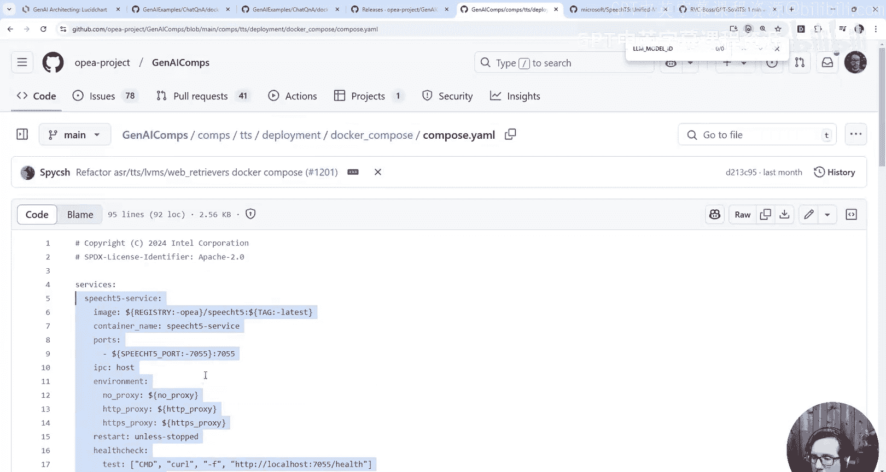

And I'm going to paste this underneath。 again， really shame that we can get VLM to work。

 But I feel like I need someone from VLM to freakricking help me because it's freaking hard to set up。

 And so this one will pull in Sp T5。 I don't know what requirements it needs， but it's not an LLM。

 So L Ms deal a lot of resources。 These things not as much。 It will this run on CPU。 I hope so。

 but I have a。Was it night， I have a， was it 14 generation chip。 So if you have an older computer。

 I'm not sure if this will work for you or maybe will。 And you'll surprise me。

 But now that we have this， let's go ahead and just start it up。 We're not passing anything to it。

 So it makes me think that。The model is built and contained in this。

 Some of these models that aren't LMs。 That's just how they are。 So it actually is。

 it might be actually packaged with it here。 We'll go ahead and hit up and see if we can pull it。

 It says it's running on port 9，0，0，9 is available。I didn't set port 9，0，0，9。

So I'm not sure why it said that port in particular。But what we'll do is we'll bring this up here。

 I want to see if it failed or not。And， I mean， it's still giving us this old air。

 I'm not sure why we're not even running that model anymore。 Oh， you know what。 I didn't save that。

 I didn't save it。There we go。If you don't see it， you're gonna have that problem。

 So now it's pulling this one。 And by the way， we're pulling large images。

 So just remember to clear up your docker Docker images。

 If you go over here and just type in docker images， the stuff can really stack quickly。

 And so we can see that， you know， some are larger than others。 like O Laama VLM is giant。

 Unbelievably giant。 I'm gonna goodbye or goodbye VLM。 I'm unhappy with you today。

 We'll say Docker remove。😊，Image O，PA， A。 I don't know if that's the command。

 I just trying to hear V LOM。嗯。Images。Remove。I say docker images， hyphen， hyphen help。

How do we delete an image， I never remember that in 100 years。How do I delete a docker image。Y。

Doctor RM I， I don't know why they make it that command。I wish they just like。

 it's fine if you want to have that。 But why not have an alternate command that， you know。

 people can just type in and they can guarantee they have a guarantee of doing it。

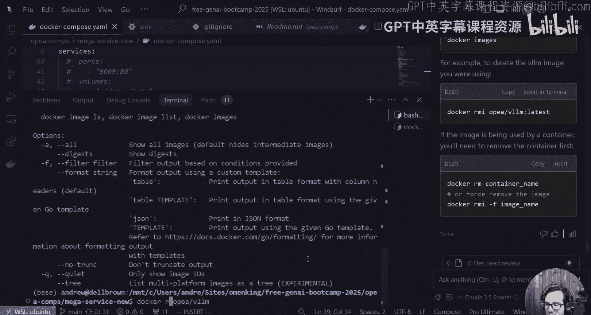

啊，哈。Oh my goodness。 Well， anyway， I'm not gonna clean that up right now， but at some point， I will。

 I' just like to make sure my drive doesn't fill up here。This is running on port 7，0，7，7，5。

 So let's give it a go。They have an example down below here。It's not exactly the same。

 I don't know if this output will work in particular。But here says the default port here is 9，9，9，8。

8 for GT Sovietvis， right， but we're using speech speech T5。I don't know， like， maybe。

Maybe it has a different endpoint。 Let's take a look here。Oh。

 maybe we need the other one to actually have a web U I N endpoint because speech T 5 doesn't have a web UI end point。

 but it would have to because otherwise， how would it communicate with it。嗯嗯。Yeah， I don't know。

 like API。 Let's see。 Does it have an API。

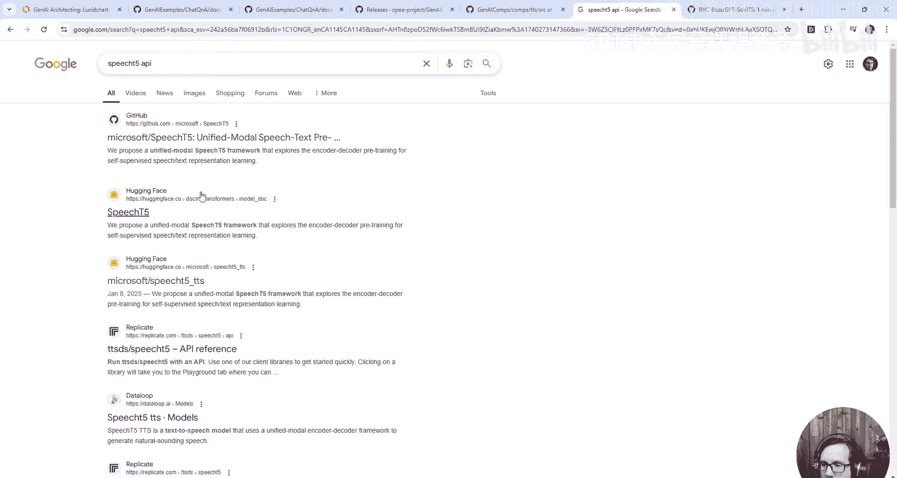

So let's go back over here。 Maybe we actually need the other one because it says it needs a web BI。

 but maybe it maybe it means it needs a web API like like a web server to it will actually access it because it could use a different protocol other than H TP for access。

 could you use G GRPC or something else。So I'm gonna go here and just ask， like。

 I don't think it knows， but we'll ask anyway and try to get a bit of help。

 So I'm gonna go and just grab this。 So it does。Does speech。T5。Have an API endpoint。That we can curl。

To get a T T S。W， you're gonna be like， are you sure it can do this And's like， oh， sorry。

 I just made it up。Okay， so I'm not sure if that's gonna work， but we'll give it a try。

 And then we'll be embarrassed that we ever thought trying that。

 But we'll go ahead and take a look and pacee it in。It says not found。Detail not found。

 But we did get a response back。 That makes me think it actually hit the server。So yeah。

 it says post not found。Are you sure。Again， I think it just made it up。Oh， sorry。 Let me check。Yeah。

 of course， you were wrong。No， no， check the Internet。

Like there's nothing in my code base that will help it。Because it might only use GRPC。

I like I went documentation fast rest APIs if that would help。But is going everywhere。 That's good。

It's probably just your hugging face。 Okay， so that's what I thought， right。

 But here using the hugging face in inference API would be a possible solution。

And this is us loading it。Oh no， this is literally going to hugging phase。 That's so stupid。 So。

 yeah， that's why we need that other one so that we can actually serve it。 That totally makes sense。

 So I' gonna go ahead and close this out。 We'll go and take a look。 We have speech T5 service。

 And I guess we'll go back over to here。

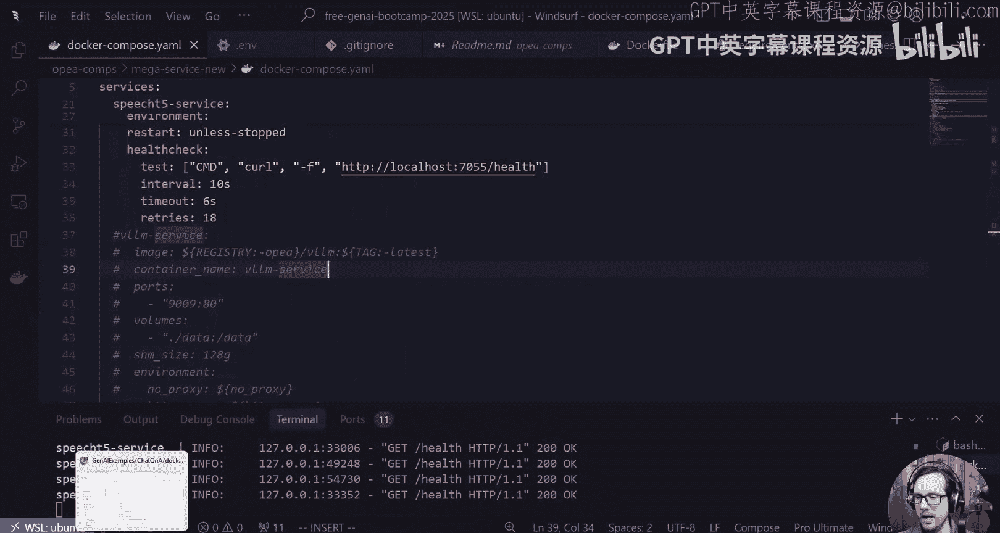

That answers a question about that。 And what I'm looking for is the other stuff to it。 So in here。

 where did it go。I keep losing it every two seconds。 We're in the T T S here。 T T S deployment。

 Docker compose， compose。 And so we need。We need， obviously， this one。 So it was running。

 This is if we want to run it for gaudti。 So it's probably compiled in a particular way for for gaudy。

We have this service here， and then we have T T S。I'm not sure why we have。T Ts。嗯。

And so let's go back here for a second and take a look here。So T TS must be this one here。

 This must be building out T T S。Okay， and so we go over to here。And so this implements an end point。

 It gives us， okay， so basically， yeah， yeah。 So this。This is the interface that we're getting。 Okay。

 so that's what we need。 So we need definitely this one here。Do we need this。

This is what I don't know。 Like， let's go back and take a look at this again。

A powerful few shot voice conversion and text to speech web Ui。Check the demo here。大家好久不见，我也。😡。

Sorry about that。 That was a bit loud。And we're on。Beb， I've never seen this set before。

 but I believe it's a thing。 So I， you know， I don't know if we need that part because it sounds like that's serving up a Web U I。

 But we can put it in thereca if it's a web U I， it's probably really small。So。

 and then we also have this one。 It says like we have T T S。And then we have T T S speech。

 speech 5 service。嗯。And then we have T T， S。 There's so many of them。 It's like。

 which ones do we need。I can't tell。But we know we need this one because this actually is the Sp 5 service。

We might not need this one at all。 starting on port 9，9，98，80， right？And so。

 and then we have this one in this one container name here。 But why do we have this extends T T S。

 Oh， so we have this one and it extends it。 I've actually never used extends before。Extends。

So maybe what it is is that if there's， oh， maybe because， yeah。

 you have a base template and then it extends that one in the case of using another one。

 And so then we have this one that extends it if you want the interface， that makes sense。 Okay。

 so we just want the API right now， It' be cool to see the interface。

 So I'm gonna go ahead and copy this one here。 actually copy these two here。😊。

And we'll go back over to our code here。

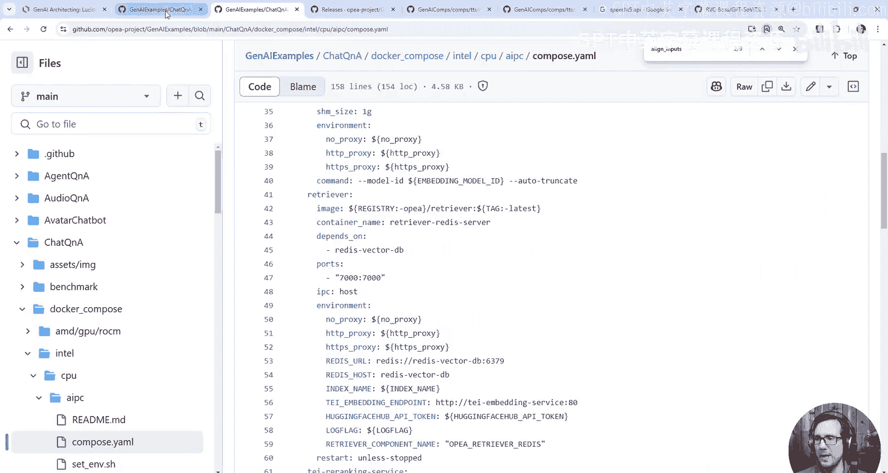

And。We'll go here。And we willll pace this in， right， So now we have T T S and and speech T 5， right。

 So that's pretty cool。😊，But we need to run this to see if it actually works。

 So I'm gonna go ahead and stop this。I'm going to start this back up。And imagine that these one。

 this one's pretty light。 This is just the this is just pulling basically a fast API to interact with whatever protocol this uses。

 Now， I've got to curious like， how does T T S 5 communicate。

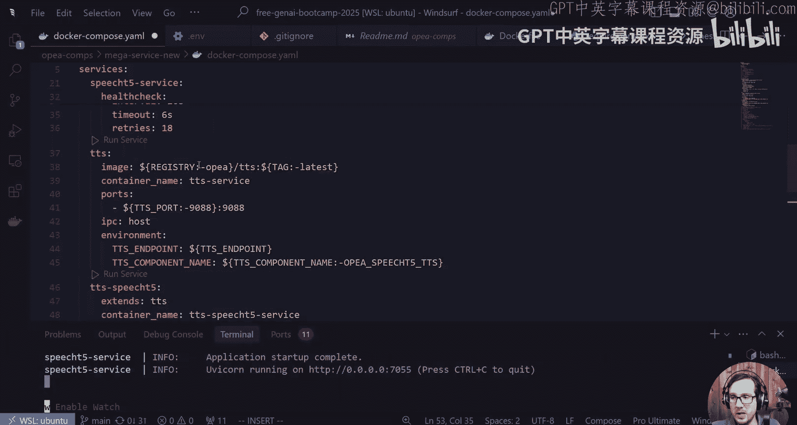

And I wonder if it's actually using hugging face underneath。Because it might。

So if we go back here for a second。Into Do composeo yal。No， not there。 We'll go back to source。

And we'll go into here。And。We have in here。Texas speech。Fast API。Speech 5。

 so's just importing it here。It it must be specifying like an endpoint for it。嗯。Text speech。

Where's the code。There's not a whole lot in here， that's for sure。Oh， it's under integrations。 Okay。

 so we're gonna go back a step in integrations and then into here。 Okay， there it is。 So now we have。

Thats log cool。There see。 So you just specify base URL endpoint。

And how is it communicating with the server。嗯哼。😊，Request dot get。A weight asyio thread request post。

 Oh， it's just doing a request post。 So that's really interesting that hugging or like。

When serf said there was no end point， but there clearly is an end point。 You can see it right here。

 right， Like it's V1 audio speech。 and it's specifically going to this other one。 So， you know。

 if we didn't want to utilize that code， we could skip it。 But here's going on local 77755。

 and it's hard coded for that value。So if we go back over to here into the wrapper。Basically。

 and this is， I think， why we we consider OPA enterprise because it's wrapping with stuff so that we can log and we can track what's going on here because of these services don't have any kind of tracking。

Install， So that kind of makes sense why they're doing that。 I'm going go back over to here。

 and all the services are probably running now。 But what we can do is go back over to here。

And I'll go down to here。 where is it。All the way down the ground。 And so maybe I can run this now。

I'm not sure what voice it would use because I didn't specify anything。

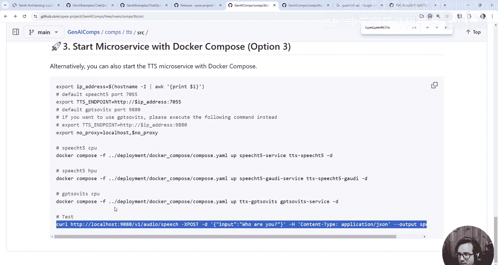

嗯。I guess it must come with some default voices， which is fine。And I'm going to go over to here。

 and we're going to go ahead and hit enter and we'll see what happens。So couldnn't connect a server。

It's running， right， or did it fail to run。Why I mean it's running one of them。

So that makes me think that the other ones failed。So maybe I'm just gonna try to。Expand this a bit。

Where there we go。And so， in here。I didn't save the file。Okay， so we'll go back。 We'll stop this。

 We'll start it back up。And we'll let that。 Now it's down only little one。

 So we'll just wait a little moment for it to completely pull， okay。Alright， so。

Here says port is already allocated。How， how is it already allocated。9，0，9，0，8，8。

Let's take a look at our docker files。 So we have 7，0，5，5。

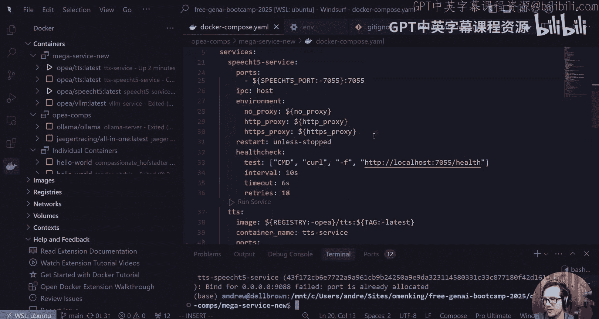

9，0，8，8 for the T T S here。And this one extends it。

I don't know what else could be running on that port。Pt is already allocated。啊。Okay。

I'm gonna see if we can。Like， I just need a way of checking for like。

 maybe there's another external port that's running that I'm not aware of，cause we didn't fully。

We're fully able to kill some of our stuff。 Yeah， there we go。 Thank you。Sometimes， you know。

 the code generated is totally fine。 Let's go ahead and copy this。We' bring this on over here。

 I'm gonna go down to here。 I'm gonna hit enter。 I'm gonna put my password in。And， you know。

 we can see some ports running。I'm gonna go ahead and do a docker compose down on this thing。

 So we'll go back over here。 I'm going to。Wheres it， Where's my docker composed down。

 So I gonna do a docker composed down。And I'm gonna go over to here。

 I want to make sure no's running。 and then we'll run that script again。Right。AndSo if we go here。

 something is clearly running。this port still right。Oh， no， nope， there's nothing now。

So then what was their problem？Tor name。Okay。Maybe I don't understand how extends works。 but I mean。

 I I couldn't swear you just kind of use it， right。

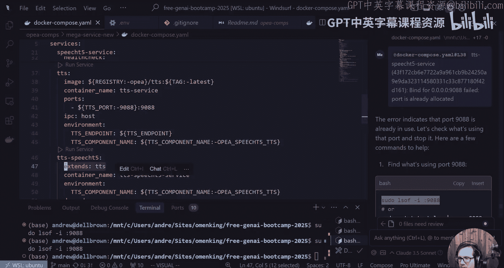

Doctor。I've never used extends before。 Ext your compose file。嗯。Common configuration。

But maybe when we launched it up， we actually have to tell it which one we're using。

That's something I'm not sure about here。嗯嗯嗯。I see。

 so we actually have to specify very specifically what we're using。

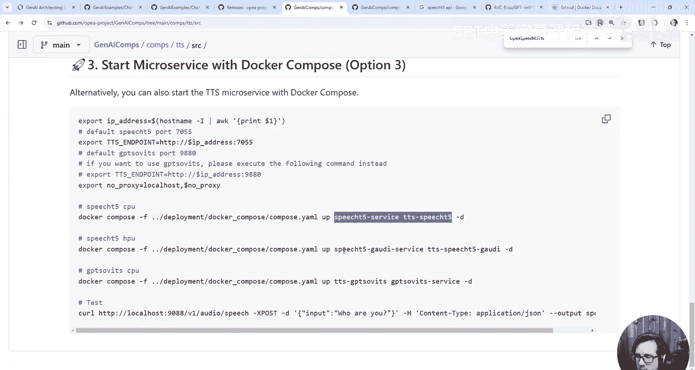

Interesting。I guess my question is， is there a way I could boil it down into a single one。啊。

I don't know。Okay， and because that might， that might reduce our issue。

 And we have to deal with it here。So here it's just going to combine them。And。Over here。

cause I think what I try to do is start both of them at the same time。 And that was the problem。

 right。But we'll keep it simple。 We don't need to extend here。

And we'll go ahead and replace this like this。I'm going go down below here， and we're going go ahead。

 and we'll try to docker compose up now。So say Docker compose up。 I think this。

 this time it's going to work。We'll give it a moment here。And so it should be starting up。

 Let's go over to here see what's going on。 I can't really tell it looks like everything's good。

We'll go here。 We'll hit up。 We'll do our curl。 We actually get something here。

 I'm going over to here。 And what do we get。I mean， that's fine because we。

 we should open it up separately here。 but I'm gonna go and find it in the past。 So open。Open。

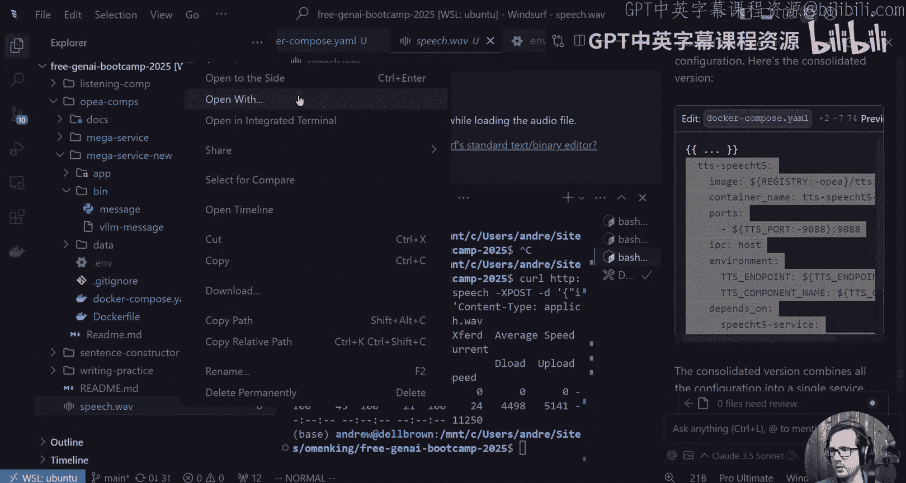

Can I。Open with。Just let me open it。One second here， I'll go find the directory manually。So。

 I'm looking for。This PC， I'm just navigating to it manually。 It's kind of a pain。

And this is in sight。Oman King， Free Jen boot camp。And here we have a text a speech file。

We in VLC here。

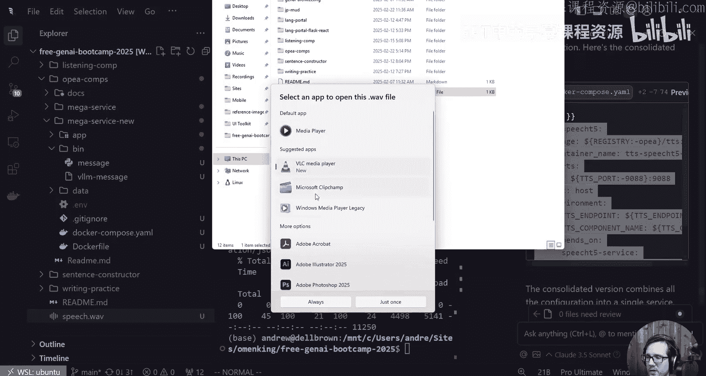

Always feel see。

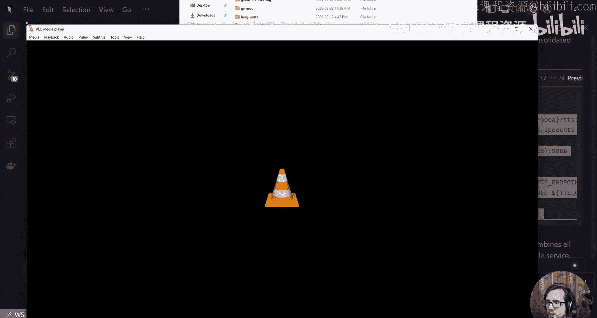

Its a bit smaller here。s display it。

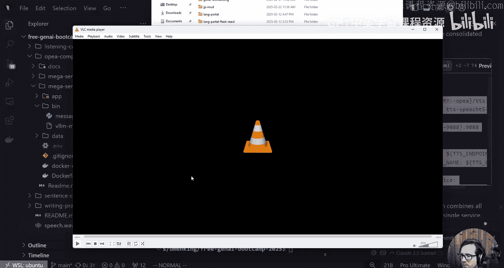

And I do not hear anything。I'm going to try to open it with Media player。

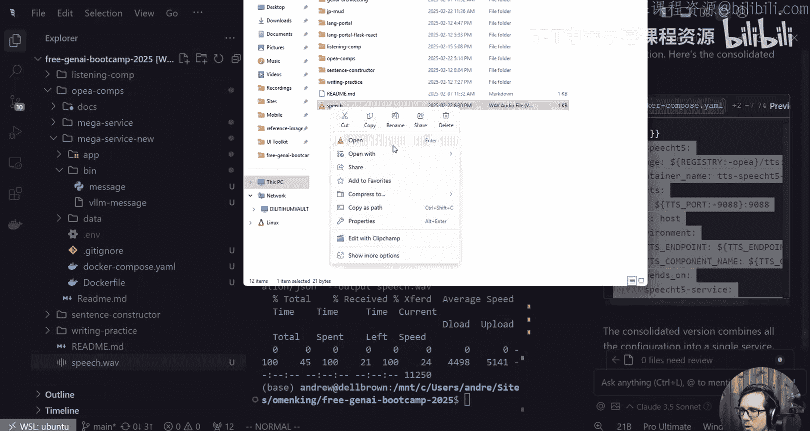

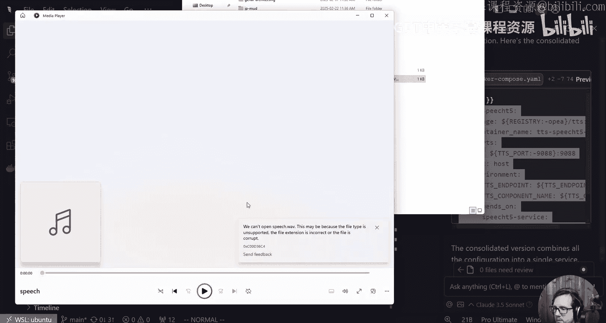

That doesn't work either。嗯。

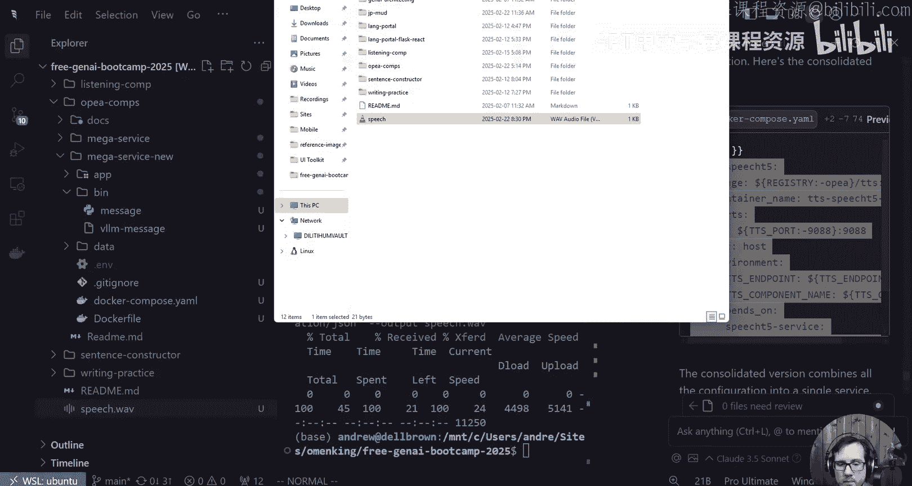

But， I mean， at least it gave back。What we wanted。

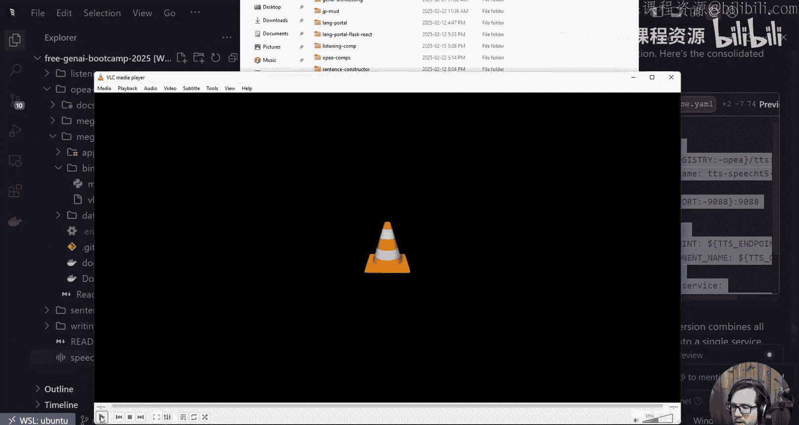

But it doesn't play back。Let's go take a look at the logs here。 Do we have any information， The logs。

 I don't see anything here， but we go over here， and we say。Maybe we need to do the logs here。

We have an error。So it says no sche of supply， perhaps you meant V1 audio speech。Now。

 we're using exactly the code that they have。 So I'm not sure what else it could be。

 So I'll just say T T S here， T T S。

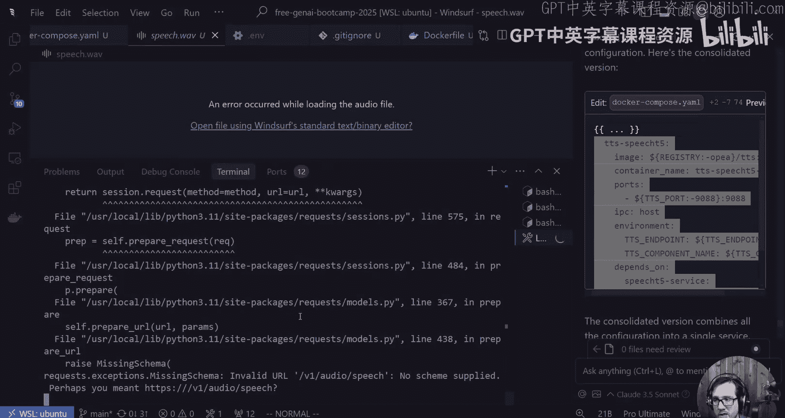

And I want to go back over to here and copy this。

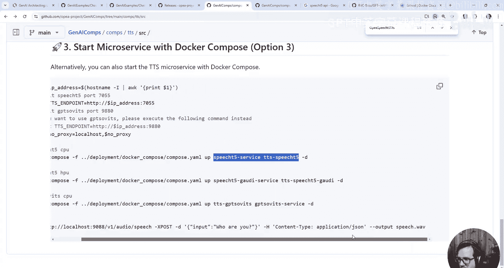

And paste this in here。And I'll just make this a little bit easier to work with。

Maybe it just outputed a file even though it didn't work。

Which is kind of weird that it would do that。We'll go ahead over here and then do this。But， I mean。

 it seems like it made it to here。 So how did it do that， So let's take a look here。

 What's the problem。So definitely received this here。 No scheme supplied。 Perhaps you meant this。

Because it doesn't say like H T TP or anything。嗯。Well。呃。I would think that it would just。

Provide that。

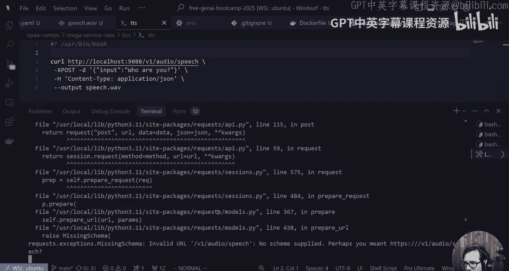

嗯。Okay， let's go back over to here。 So here we have a curl。

 and it actually does have the protocol here， which is fine。

We didn't set these other environment variables。So， that might matter。Yeah， that might。

 that might matter。 So I'm going to go ahead and copy this here。

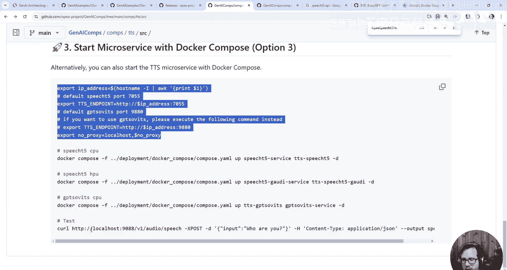

I don't really like using exports directly。嗯。I'm not sure if this would work if we did it like this。

Okay， I don't know if that will work。I'll try this one more time。I'll say Chaad， we'll say C。

What's the directory we want， It is the O comps。And we'll say make a service new。And we'll do chamod。

U plus x。Been。T T S。Ben T T S。I mean， it downloaded something that has been worked。

What we should do is go back over the logs and take a look。It still has this issue here of invalid。

 invalid stuff。嗯哼哼哼。😊，I mean， before we ran it， we never， we never put any of these things in here。

 So maybe these actually need to be set not here， but actually in our Docker Docker compose file。

 So if we go back over to here。嗯。Because I didn't set any of these。Yeah， that's the T TS end point。

So。Isn't there like a way that we can set it up at the top。 I thought I saw that in the chat Q A。

 Let's go back to the chat Q A for a second。

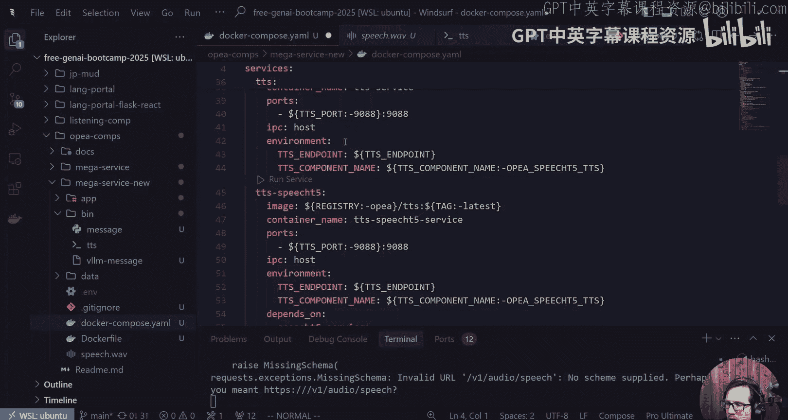

In here。

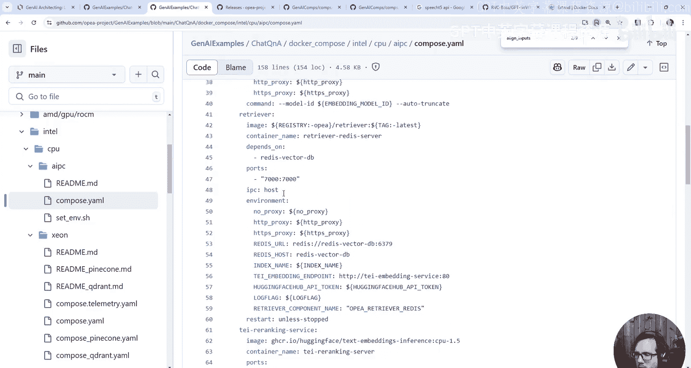

I mean， it says environments like right here。 Is that where it's setting this as well。It is。嗯。

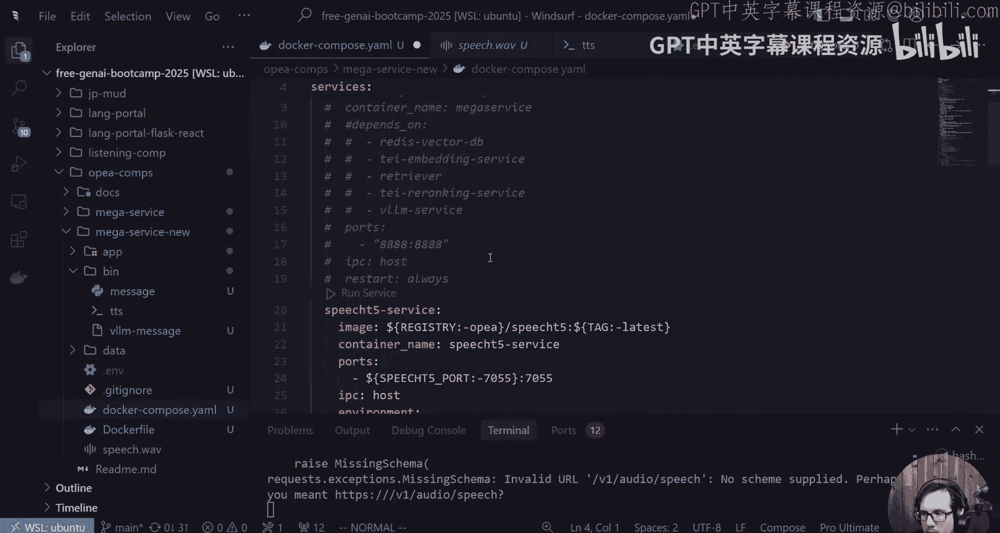

I'm gonna go look this up see if we can set Docker。Does that be really nice。嗯。

So it says using the in lets you use the same file for use by plane。

Dooccker compose run with E N V short or hypheny。 You can set environment variables temporarily。

I mean， it's kind of suggesting that it should pick them up。嗯。

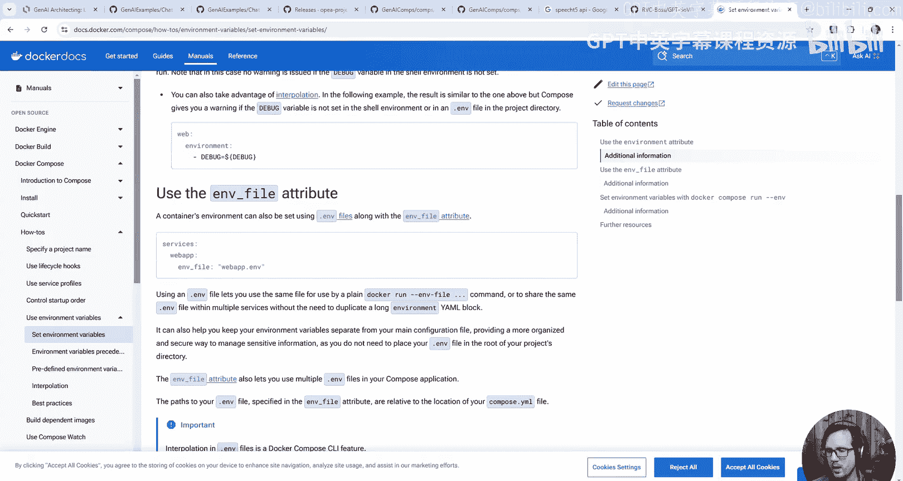

Well， let's go back over to here and let's see if we can set an E And V then。

So grab these and paste these in here。 And so now they're over here， right？And so， we'll go here。

Oh come on and stop doing that please。We'll go here。 and I'm not sure if that's gonna work。

 but I'm gonna go ahead and just try to manually set these。go here and do this。

I'll just take the cell like this。 We don't need that。Like that。

 so I'll go ahead and copy this manually into here。嗯。I think that's what that was。

I'm not sure why it does that column the no proxy， but I'll just do it local host。And then here。

 the IP address is being set this way。I don't think we need to。Set this one。 We could just do this。

 This one probably doesn't have to be set at at all。 Probably just has to be this。

And just to really make sure things work。 I'm just gonna hard code it。 I don't care。

So I'm looking for that TTS endpoint right here。Like that。We can always try to figure this out later。

啊。So those are now set。But there is this T TS component name。I don't。 I don't know what that is。

But we'll go ahead and we'll try to start this back up again。So I' save this file。

 And now these are hard codes。 at the very least， we shouldn't have an issue with that now。

 So we'll go ahead and we'll do a doc compose down。And we'll wait for that to spin down there。

And once it's down， then we'll pull it back up。We'll just give that a moment。Alright， so， yeah。

 remove the containers。 And so I'll just do a docker compose up now。 Docker compose up。

And we'll see what we get now。 We'll go over to here on the， on the left hand side。

 I don't think I had it running。 So it's trying to start up here。We do have a little bit of issue。

 No， no， they're both running。Okay， and we'll go back over to here。

 And I wan to make sure that I save this file here， T T S。

And we'll go ahead and we'll try to run that again。And we'll go back and check the logs。

We'll have to close out these These are not showing us logs。And will go to T T S service。No errors。

 We got a 200。 That， that sounds pretty promising。Who are you。There we go。Who are you， Who are you。

 Who are you， Who are you。Who are you， Is that what it wrote when we had the thing。Who are you。

 Who are you pretty close。 But， you know， I think it says like you can do voicecloing other stuff。

 Obviously， there's that interface that we could upload。

 That'd be kind of interesting to get working。 But right now。

 I would just say that we did accomplish this part of it。 And we technically are。 We not technically。

 We are using a component。So the next step would be like how would we integrate this back into our mega service and then what could we do with it。

 right？

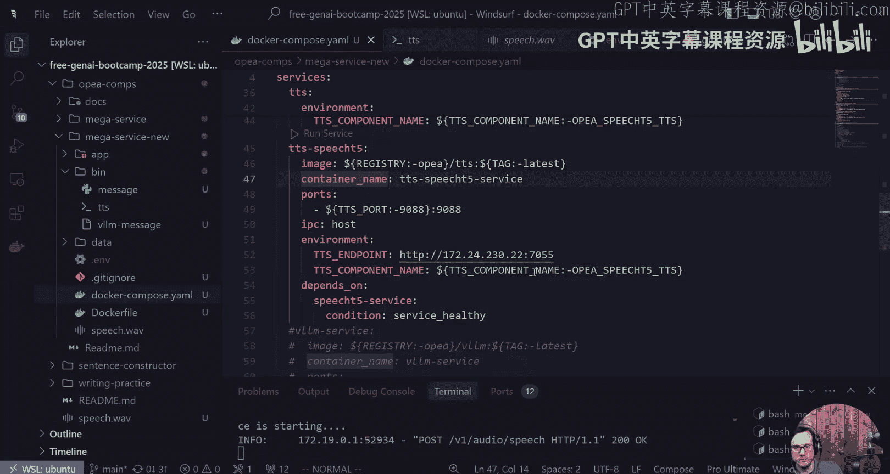

Now， I would just say that it's not obviously Texas speech here is not that impressive in terms of its output its stuff。

 but it was really interesting to see the results。Of this one here。H me back to this one。对我不感兴趣。たるので。

Noを我々を覚えている So， of course， too cutey for me。 But you know。

 if there's some way that we can get a voice generated， that'd be really cool。

 but it sounds like you just give it a small code sample and then it can do it。嗯。But anyway。

 we will see what we can do with it and we'll try to figure out integration。 But you can see， yeah。

 one minute voice data can be used to train a good T T S model。I。

 I'm really tempted to just kind of go a little bit farther here and get the the。

 the interface working as， you know， we did figure this part out。So yeah， I'm tempted。 let's do it。

I might change my mind in two seconds， but we'll try。 So I'm gonna go back over to here， and。We have。

This one， we could run。So we'd have to go back over。 And this one doesn't need anything else。

 that's all it needs。 If you want to use this， please execute the following command instead。

 And here's saying use 9，8，8，0。 So if we go here back over to this one and we。

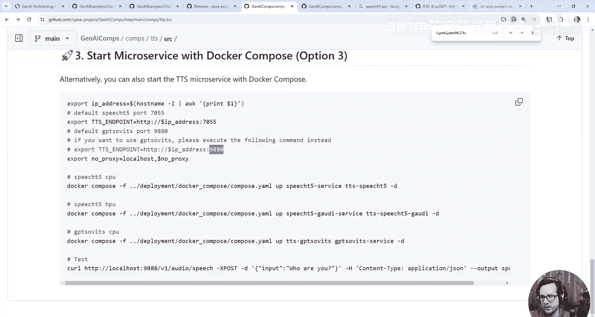

9，8，8，0。 We go to our Docker compose。No， it's here。Oh。

 it the environment variable the environment variable， right。

 So I will go back over to we'll go back a step。

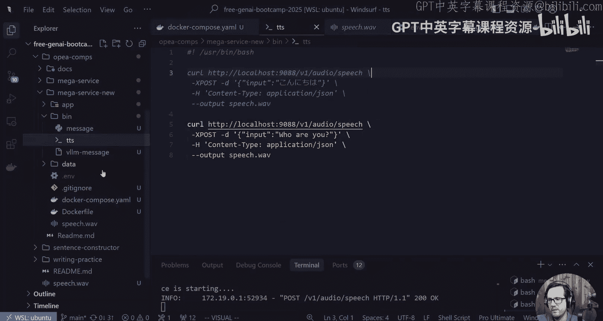

And we'll go into deployment。 and we're going to go into Docker compose。 and we'll go into here。

 And if we want to use this one instead。We still have， we need this， of course。

 that's one thing we have to do。 This is not extending anything。less to see does it。

 But then we need this one to extend it。 So we'll go here。

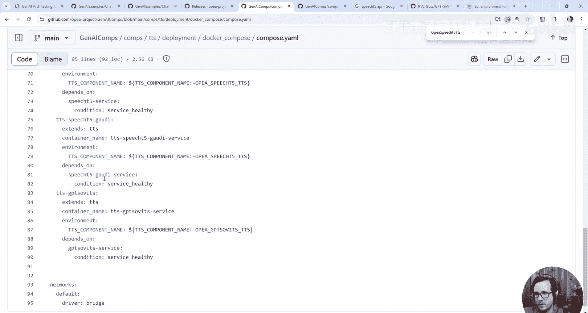

And we will place this in our docker compose file because I have a feeling this is gonna be pretty darn easy。

And。I don't see any Nvas we have to overwrite， so that's good。

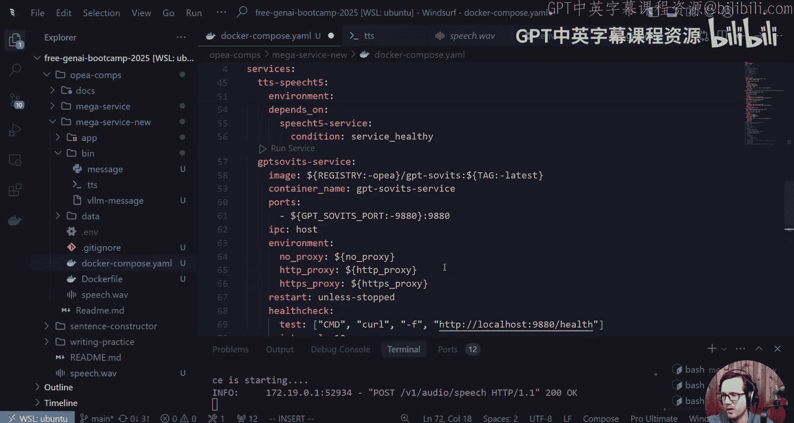

And then if we go back over to here。

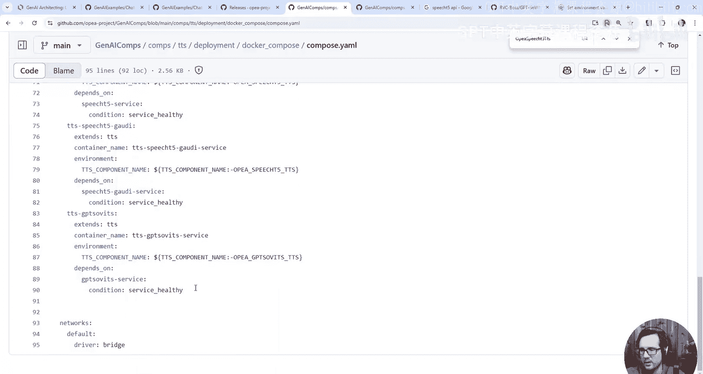

You know， I want to merge this one and this one together。 So Ill go here。 I'll paste this。

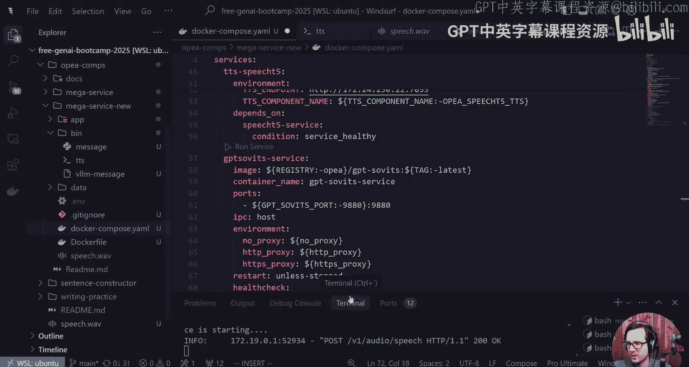

the side here。Can we make this one。Like， we can， obviously， but it'll do the work for us。Oh。

 did we not do this correctly？Oh， sorry。Yeah， this one。

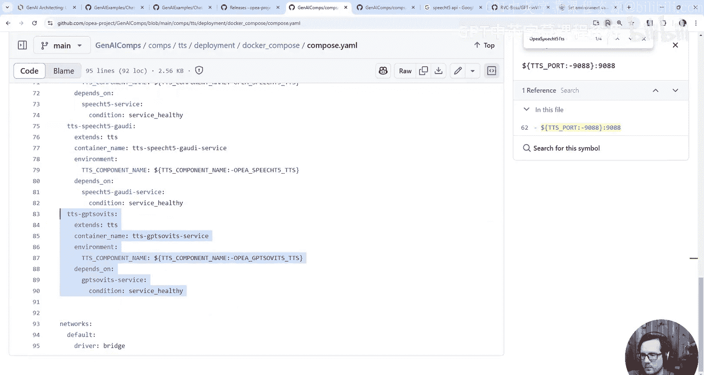

Can we make this one。Like guess I said they do the extends， but I'd rather just not do that。

Sometimes simpler stuff is easier。 We don't always have to factor things。嗯。

Mm so we'll go ahead and copy this。And then we'll go down below here。

I'm gonna to paste this in like that。So now we have this and yeah。

 the indentation is kind of messed up。 but we'll fix that here。So it wants， this is fine。

The only thing that's changed， this is now 9，8，8。This one's fine。Text to speech。This one's fine。T S。

 at some point。I the tab here。 I'm trying to figure out like what we need to replace because this is T T S。

T T S service。Which is pointing to this one here， which runs on that port。

So this doesn't have to be changed。 This is fine。But then we have this one here， which is T T S 5。

 That's fine。And this one's here， I don't think we have to change anything， to be honest。

So we'll go back and we'll try to run this now，ll say compose up。

'll let it pull back in just a moment。By the way， I noticed this's pulling。

 It's pulling like real lot of day。 I don't know。 It's so large。

 but I guess it's doing something special。 But wait a moment for that to finish。

 I wasn't expecting to be so large。All right， so we wait a little bit here。

 It says port is already allocated。 so we do have a port issue， which is not a surprise here。

 What port in particular is it complaining about。 So here we have T T S service， speech5 service。

 healthy G O T service。And then I to try to do the， the T T S one and had an issue。

 So maybe we have to remove one of them outive here。 I'm gonna go here and just。

 what do we have running。I mean， everything that needs to be running seems to be running。But。

This ones 9，8，8。This one's 98 as well。 We can't have both as 98， can we。嗯。Why do we have two。

Because this one here is the underlying service。Then we have T T S。Oh。

 I think we're supposed to remove this one out of here。So。This 1， I don't think needs to be there。

 We just need T T S5， right， And then we have this one here。 So they are both running。

 So I don't think there's an issue。 I don't think there's an issue。

 but we need to go to whatever the port is for this one， which is on 988。 So I want to see now。

 can we access this 988 port anywhere。

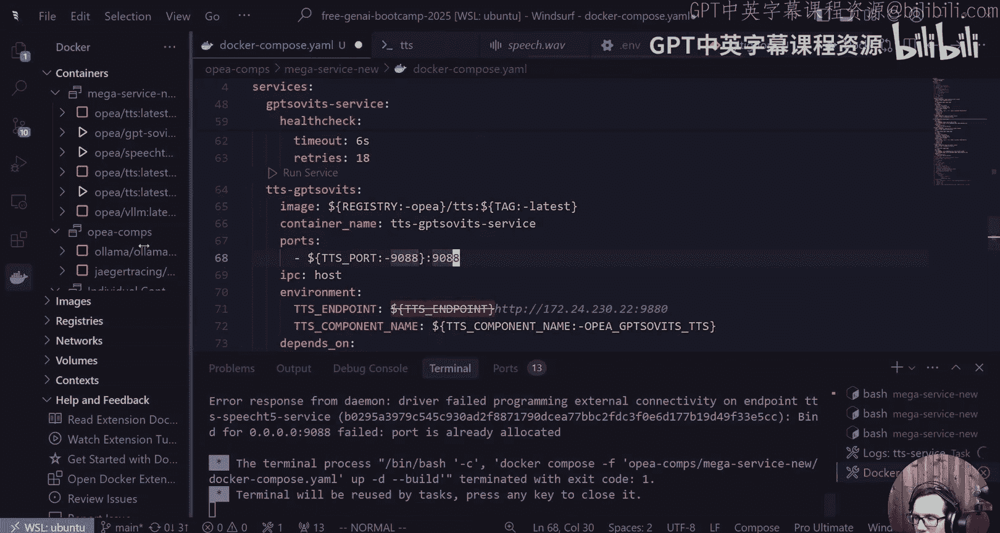

嗯。So we go to my host here， we say。Local host，1988， can we access it， not found。

What I'm looking for here is， well， obviously， the service is running。T T S， well。

 this one extends it。 We don't need to extend it。 Let's go back over to here for a second。

To the source。Start the microservice。9，8，8，0。

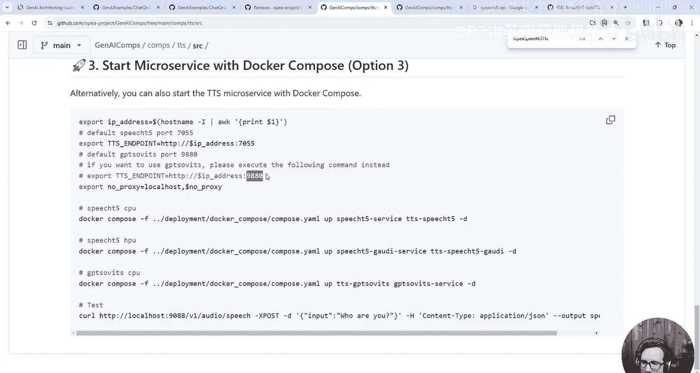

Was one saying。988。Oh， over here。I don't think it be updated this。

So this is what needs to be updated。 T T S N point。Okay， so what we'll do。

I we'll go ahead and stop this。Dooccker composed down。But maybe it's running on 9，8，8，0。

 And then we can utilize this if we can。 that's， that's fine if we can't。

 But it'd be really cool if we cant。I'd love to see if I can clone my voice in one minute of audio。

 would be interesting。So we'll go here， are they all stopped？嗯。Let's trying。Stop。Stop。There we go。

So we'll go back up to here， we'll try to start this back up again， make sure our files are saved。

We'll head up。We have。Both up here。Some Chinese tax， which probably good。 And now it's on 988。 Okay。

 great。 So 9，8，8，0。 Nows， we's say 988 is up。

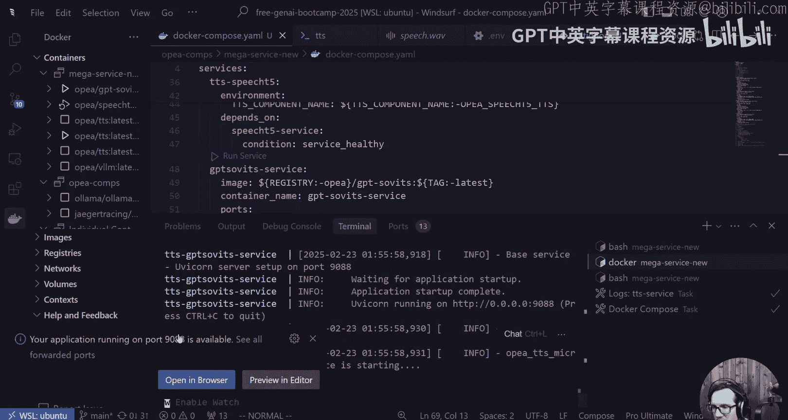

Well， which one is it， Is it 988 or 9，88，0， I guess we'll find out in a second， right。

 So say local host。9ty，88。No， so it's 9， whoops，9，8，8，0。

Intertnal error。We'll go back over to here。嗯。Port is already allocated。嗯。988。7，05。70，5。

 text to speech。Oh， this one here。 Okay， so we'll go ahead and comment this out。That's a problem。

Okay， and so now what I'll do is I'll just do compose down。 I think we got it this time。Okay。

 it'd be really cool to get that interface working。

There's so many cool things that we can do with AI， but it's just getting。

 getting them the run is always a challenge， right。😊，So go here， we' wait for this to stop。

They're all stopped。 We'll go back up here。 No， not there。We'll hit Docker compose up。

So now this is spinning back up。And we will now go take a look here。No error so far。

 We'll give it a moment。9，8，8，0。

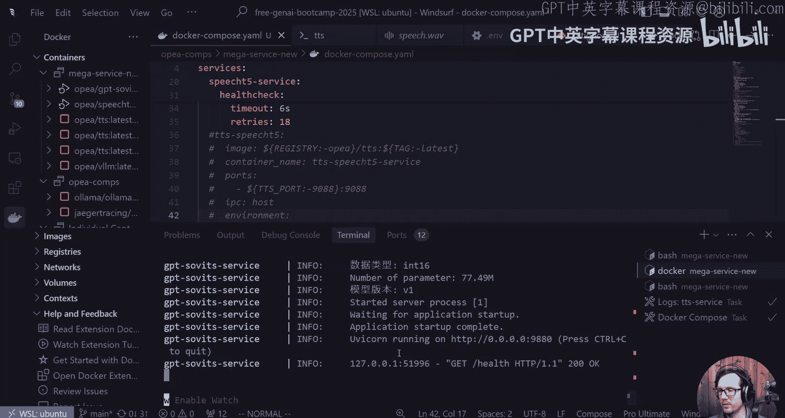

And we have 9088。 So I think it's gonna be 9，9，8，8，0。If it's not， it's 9088。

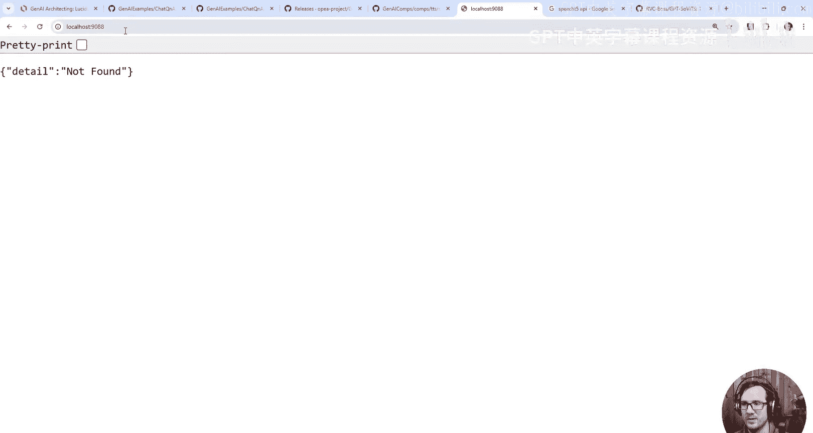

No， it must be 9，8，8，0。 Inter server。 What's a problem。嗯。Well， which one is 9，9，8，8，0 is this one。

 right。9，80。And it maps to 9，898。9，988。But then why is this one 9，8，8，0。And we up here。Oh。

 cause this service is happening Okay， So we have this one here。This one's running 988 service。

 This one is the interface。 And this one here is， no。

 this is actually the service since this is the interface。 man。

 it's a bit confusing to figure this out。 Maybe we're never supposed to actually access the。

 the interface directly。But this one here is on 9，88。Okay。

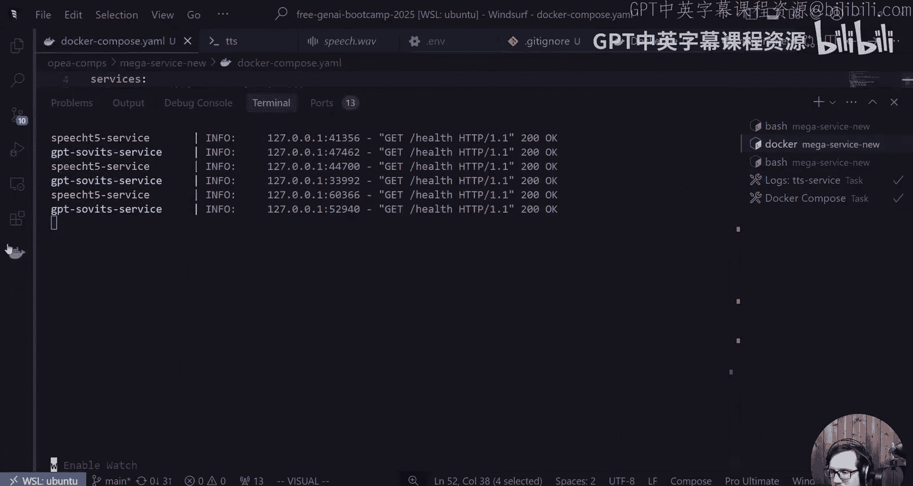

嗯。Argument type is none。Okay， well。I'm not sure how to get that working。Which is totally fine。

 But we'll just call this done。 And， I mean， again， it would be been nice to get that interface。

 but it will require a bit more work。 And I'll see you in the next one， Okay， Co。

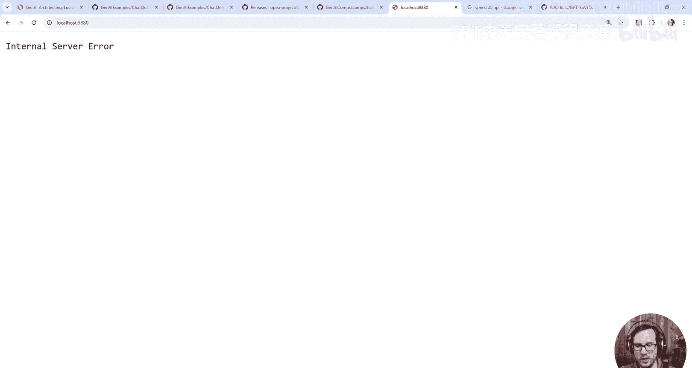