# ExamPro《生成式AI训练营｜Free GenAI Bootcamp》中英字幕（deepseek - P52：-52-OPEA Troubleshoot GPTSoVits.zh_en - GPT中英字幕课程资源 - BV1SFEWzLEab

Hey， this is Andrew and we are back。 We were attempting to get the G Soviet service to work。

 and I mean， I still have it running here。 but the only issue is that we weren't able to connect to the G Soviet server。

Which is on a particular port。 I'm just taking a look here。 We have 9，9，8，80。So。

I guess what we could do。 I mean， that's the TTS end point。But this thing particularly runs on 9088。

 but yeah I I'm not sure if we're gonna to be able to actually access that。

 but we'll take a look and try one more time for fun。

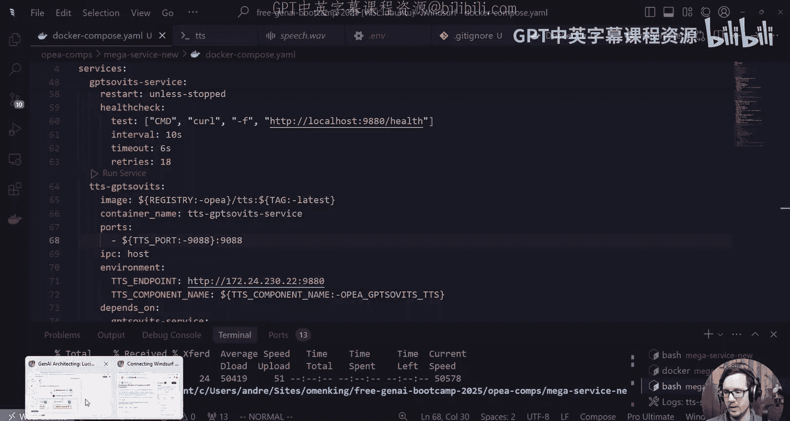

And I'll go ahead and do that。 It says detail， not found。 So unless there's like a route。

 I don't understand。 let's go back and maybe let's just read a little bit about how this thing is supposed to work。

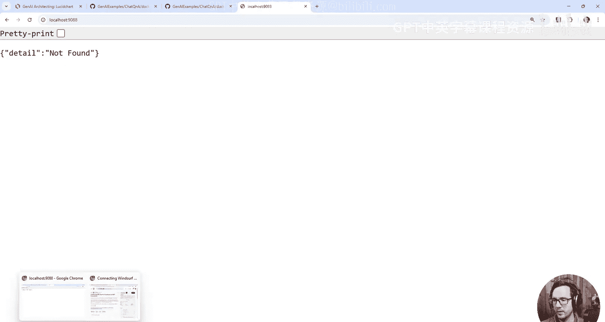

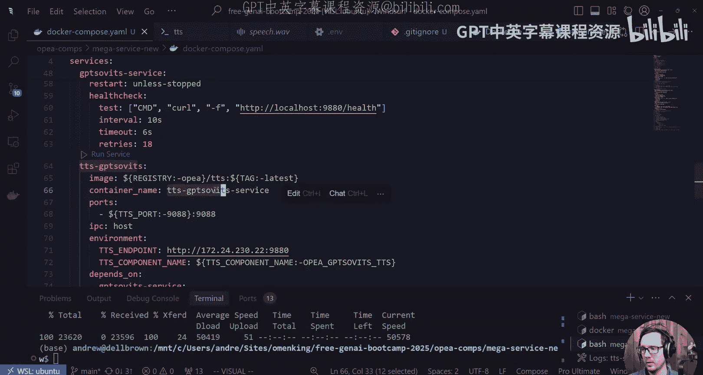

The GT Soviets are how we we supposed to pronounce it。 So we'll go back over to here。

And I'm going to go here and take a look at this library。And maybe there's something it tells us。

 so it says a powerful few shot voice conversation text to speech。The demo is here。 if we go。

 here is it just a video。 Yeah， it's just a video。嗯。

You can use the auto DL cloud Docker to experience the full functionality online。

 I actually never even heard of that。 even know what auto DL is， but sounds like Docker containers。

 maybe in the China region。Specifically again， focus on the China region here， Mac O。

 We have this In X code tool lines， FFMPg。嗯。Users here download this， then do this， run that。 Okay。

 regarding image tags， etc cetera， Docker compose up to start it up， but how do you access it。

As that's what I'm looking for in terms of its information。Double click the bat，m。

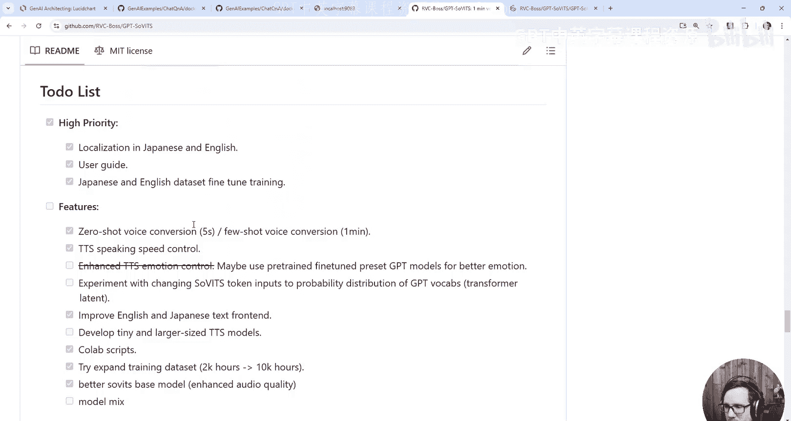

Okay。Again， just looking for。Where it might actually describe， how do you access it。

 Because just because you again a 4，0，4 doesn't mean that it's not necessarily working。

 But I'm gonna go over here on the left hand side。 And I'm gonna open up this one here and go to its specific logs。

 And so here we have a 100。嗯。Here， another thing that we can check。

 And I think we already know what it's running on。 We'll say a Docker， Docker P， S。

And if we do this here， and we bring this on over a little bit。We can see that。

The service is running on the。Up here 9，0，8，8， but we also have it on 9，8，8，0。

 So it seems to me like we should be able to access it on the 9，8，8，0 or even the 9，8，8。

But I'm gonna go back over here on the left hand side。 And let's take a look at。

That was the one we looked at。But also， what if we take a look at this one do logs。AndSo， here。嗯。

Application started running on 9088，404 not found get help。 so it is getting the end point。

 obviously。Here， so that kind of makes sense。 And then we have this one here， is which is that。

So I guess the question is like， why is it when I go to here， I don't see it。 It's binding on 0，0，0。

 So， I mean， that should be sufficient to get it to work。

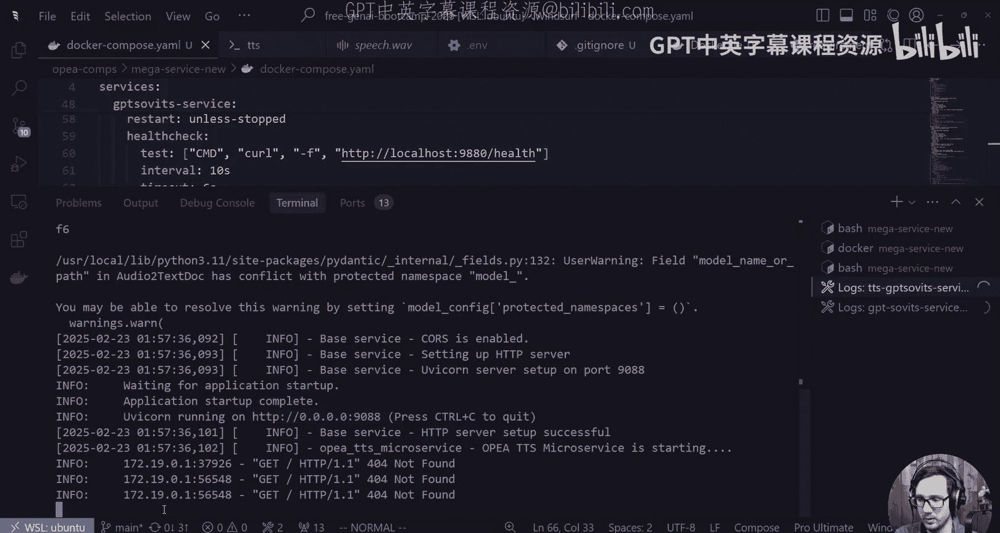

Okay， so go back here。

You're gonna run a few more of those。 Yeah， we're getting 40，4s。Yeah。

 how else could we debug that furthercause we need to understand actually how the service works underneath。

 So maybe we go to the code base， we can take a look and try to make sense of some of it。

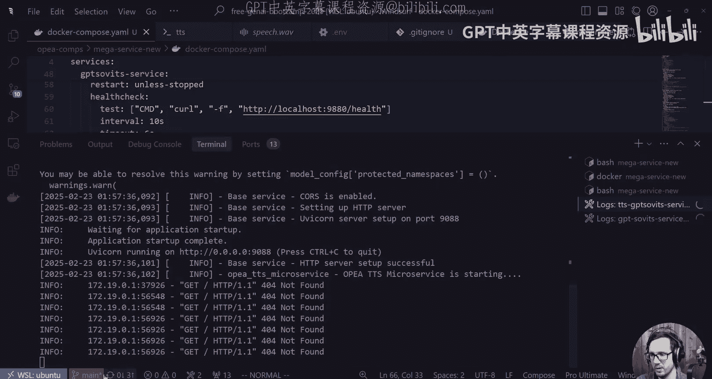

So if we go over to here。And I go to here。 it says it's a Web U I， right。

 So if it's written in a web U I， we should be able to just look at the code and figure that out。

 Hopefully it's in something that's in Python。And so。

There's going to be some kind of entry point into the application。Maybe it's webuit pi。And。I mean。

 we can see some stuff here。It looks like we have a gra interface because we have gra being imported here。

There is a lot of stuff in here。0，0，0， web UI Port Maine， Qui true。Yeah， so it's a radio interface。

 That's what it is。But if it is， then why is it not taking。That input or request， right。

 because it's clearly here。

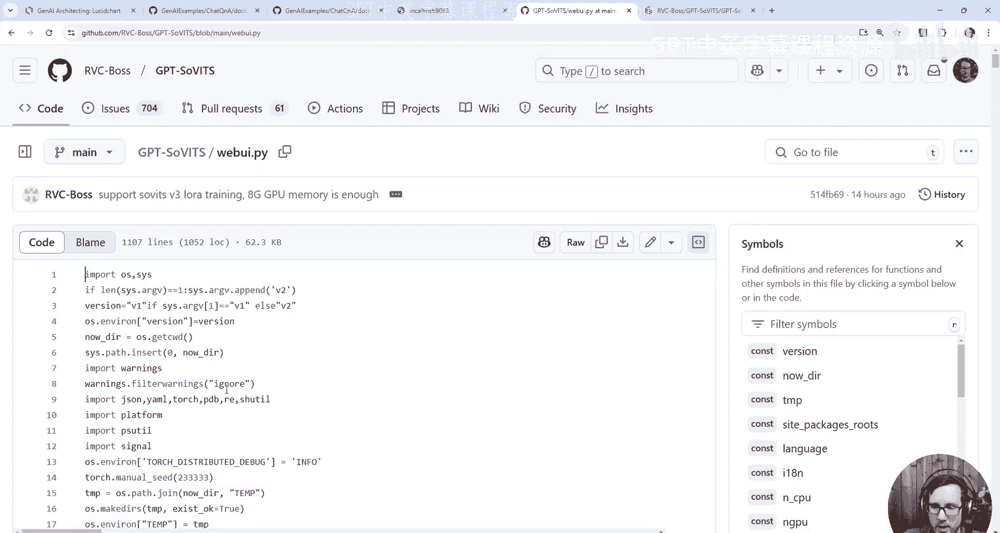

嗯。And this one gives a 40，4。 and this one gives a 200。 This is the underlying service at the。

What ports that one on。The underlying service is on port，9，8，8，0， right， So if we curl that。

 let's say curl。A local host。9，9，8，0，0。 we got an internal error。 Let's go over to here。

 Let's take a look。And so now we' get going an error， which is argument type of non type。

 not iterable。嗯。And so here's this fast API。 So I thought it was usingio unless fast graio uses fast API underneath。

And over here， it says homeus API dot Pi。 So there is a file here that we could take a look at。

So even though it's a little bit weird， I'm gonna go ahead and just， it's not weird。

 but it's gonna be a little bit more work than we should have to figure out here。

 I'm gonna go into that specific service。Which is here。

 And I'm going to go ahead and attach to shell because now we know that there is a file here， right。

 So if I go here and say cat and cat out this file， we can， we can see the code that's here。

What file that Ka was it just API dot pi。 So if I go back over to here to the code here。

 that I imagine there's a API dot pi file in here。

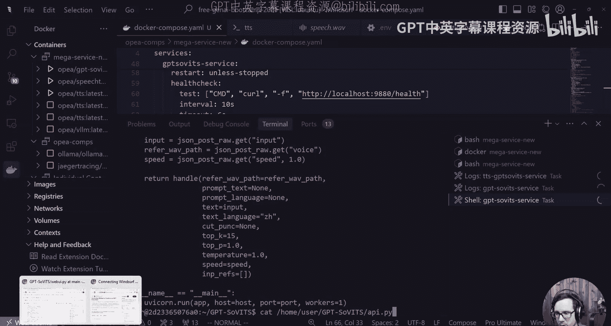

So maybe you can deploy this in an API mode or a web UI mode。Unless it is just the underlying API。

And so this is the file in question that is being triggered。Right。here says TpsS end point。嗯。

So we have this here post。 So it's kind of expecting a post to go here to the default route。

There could be。An API wrapping it。 I'm not sure if there is。Okay。

So we have a bunch different flags here。So I think what's happening here is that when we directly curl。

 it's， it's using the API。 So maybe it's not running in。The Web U I mode。

 but we can still utilize this service。 So have set model， control， change reference。Post endpoint。

 So refer to wave path， et cetera， et cetera。 So I wonder if there's like an example of using this with the API。

 So just say here， it's a API example。嗯哼。😊，Let me take a look here and see what I can find。

I'm just gonna look around， but clearly， it's not launching the Web U I1， at least to me。

 because if we're doing that， it's hitting the API， then that's what's being connected。

 I wonder how we would know whether it's starting the API mode or not。

 So if we go back over to the code that was here under。

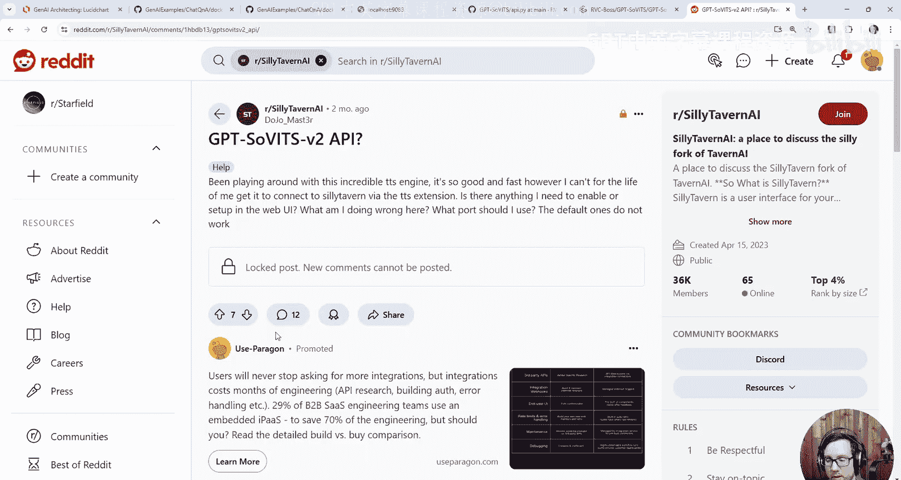

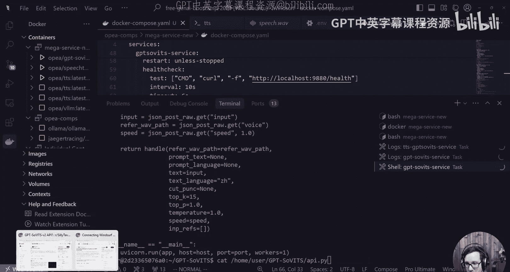

T TS where it is。It is。Where is it。That's not it。 So say Jenny I cops。

And if we go down to TTS here and we go into our sores。There's integrations， right。

 And they have this one for GT V OOS or whatever。 And so the question is， what is it running， right。

嗯。So let's take a careful look at this file。 like this is the integration to it。

 which is which is what the intermediate step is， but maybe you might tell us a bit about it。

So we have model name， the name of the model that is to be used。 Okay， sure， invoke。

Involve the TTS service to generate speech for the input of generation。嗯哼。😊，Okay。

 so it doesn't tell us a whole lot here。 But there there's this file down below here。

 which I think actually is running。 This is actually the service underneath running。

 So maybe this might indicate to what format it's running in here。

It's really interesting is that in the entry point here。 Yeah， it's opening up API dot pi。 Okay。

 so that's what it's doing。 And I guess we're not going to get a web Ui version。

 And that's totally fine。 What I want to know more is like。

 how do I invoke this if I don't know it's API。 I mean， we obviously can see that in the file there。

 But maybe we would have to pull that down to find out。

 So what I're gonna to do is I'm going go ahead。And cloneness repo。So we'll go ahead and。Go here。

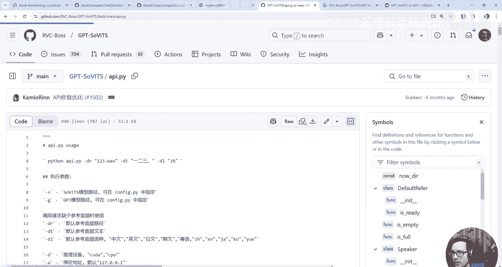

And to clone。Because maybe we're just invoking the API incorrectly。

 It's just a lack of documentation， right。So in here， I'm just going to Cd back a few directories。

I'll do a clone here and then we'll clone this repo。

And so now what I want to do is open this repo here。And so we'll go here into。Free or the。

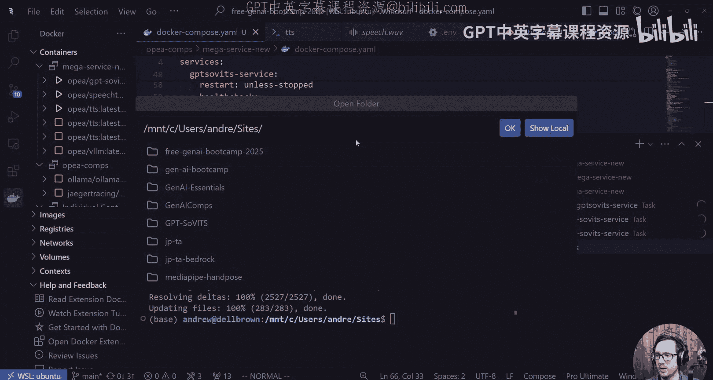

Here。And I hope that kept my old one。 No， and actually closed out my old one。

 That's kind of annoying。

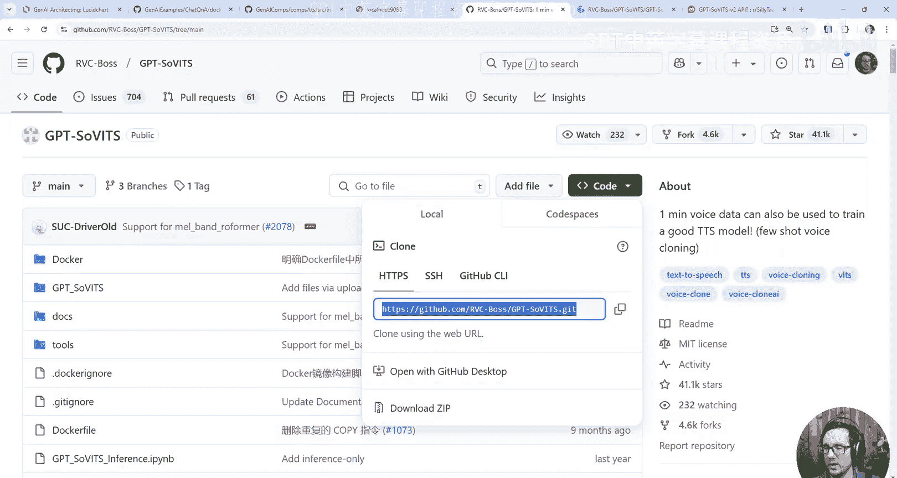

hich is okay。 I mean， like we can easily switch back to the other one。

 but I didn't think that it would completely close out the other one。

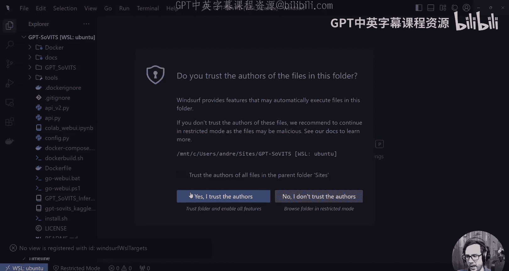

And so。It looks like they have an API version2。Let's focus on one。Right。

 so that's the new N NCP stuff they have here。 But we'll go ahead and say， I see that。I want to。

I want to write a curl to or can you describe to me。

What API is available here to use in the API dot pi。Because there's a lot of stuff here。

 And I I like， I was reading through it a bit， but I don't know if there's like other scope stuff。

 And so let's see if it can uploadlift some stuff up here for us。

I describe the API endpoint and functionality using API do Pi。

 the fast API based service that provides the capabilities。 So the main endpoint。

 that's what we saw support both get end posts I didn't see the get。

 I just suppose converts text to using speech provided parameters， so。The text to convert to speech。

 the language， the reference of the wave path path to reference audio file。 Okay。

 so basically you'll do text to speech， but at the same time。

 we can provide the audio file that we want to it。Prorop language？Interesting， so we have Z H， E， N。

 G A probably for Japanese， K O for Korean Y U E， I'm not sure what that is Z Z H。

 I believe is Mandarin or Chinese。Use to update the default reference audio setting。Control endpoint。

 The API supports different audio files。 Okay， so。So let's say I want to create a text to speech。

For English with my referenced audio file。Okay， so let's go ahead。嗯。I mean， I want a curl， right。

 So I'll just ask it again， like， make it a curl。okay， make it a k batt， okay。

And that kind of looks like what they're talking about here。

 So maybe this is what we need to figure this out。 Now。

 I would have liked this to open in another instance here， but。

This might be what we need to get this working。 So I'm gonna go back over to our other project， open。

Recent here， we'll go back over to here。And I'm gonna go in here and we'll just say。

 what is this service called， something really complicated。嗯。Com name G T， GT so V Vt S， G， so V。G。

 yes， I'm probably going to spell it wrong， but we'll create it here。GP， so vet。S。

And we'll go ahead and paste it in here。Right， I'm going to go to the top here and copy this。

And then it'll go up here。And I'll copy this。 It wants to go to a very specific port。

 I think actually runs on 9，8，8，0。 So that's perfectly fine。

 We need to refer to a very specific voice thing。 We's just say。Hello， my name。Oh， the prompt text。

So we here have hello world， the prompt text。 This is a new sentence I want to convert to speech。

 So I'm assuming that this has to be。Whatever is in this audio file， right？ And so we have here。

 this is a new sentence I want to convert to speech。Yeah， I will leave that alone。 But basically。

 what I need to do is I need to create an audio clip。 And I think that they said。

 like you can make it with like 10 seconds of audio。So what I need is an audio clip。

 So just give me a moment。 I'm just gonna go edit something。 One of my videos， okay。All right。

 I'm back。 And so I've recorded this sample， and I I put the text in here。 We'll play it back。

 so you can hear it。 I will have this in my repo。 So if you want to use the same thing you can。

 because there's so much snow outside， I think I won't go to the office today。

 And what I'll do instead is stay indoors and make myself some hamburgers and pizza。

 Does anyone like that idea。

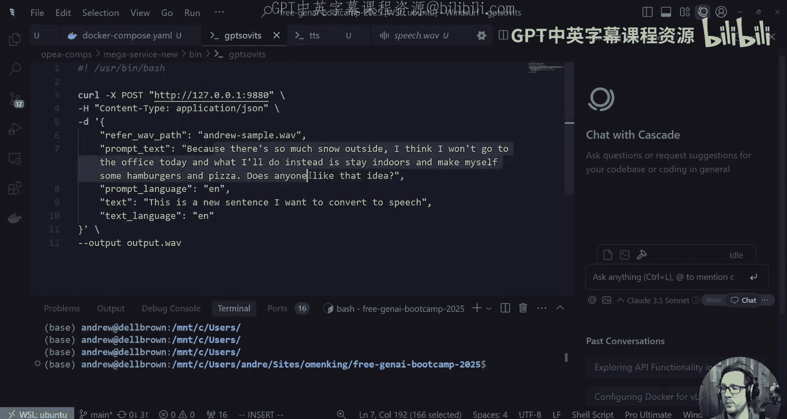

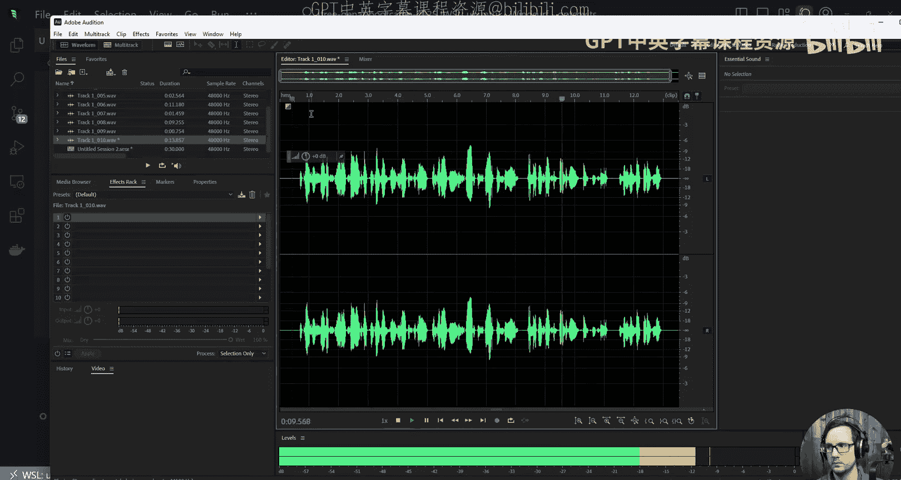

Okay， so now I have， I'm not gonna save that。 I do have it already saved as a wave on my。

 my computer， but I'm gonna drop this into， I guess this level directory。 So just give me a moment。

 I had to actually record it again。 And I change the name a little bit here。

 So we'll go back over to。

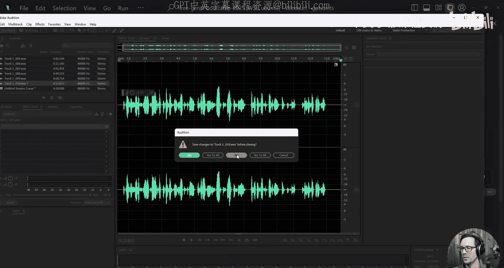

This here， and we will change this to ref。 And so I'm hoping it'll take a wave。

 We can convert it to MP3 if we have to don't autocomp that。 Did' ask to do that。

 But now we have a target sentence。 So this is a new sentence。 I want to convert to speech。

 And so hopefully this actually works。 I believe this is still running。 It is。

 And now that we have an endpoint that it is actually expecting。

 We can skip the OPA1 and go directly and hit the direct service and then work our way backwards from there。

 assuming that it'll even work。 But I'm going to go ahead and see the into the correct directory。

 So that's the mega the OPA comps and then into the mega service new。Okay。嗯。Mega service new。

 we'll clear this out。 And so now what I want to do here is do a chaade U plus X。It will be been。

GPT O this here。 There we go。So go ahead and we will run this now。

And it says there's an issue line expected on the thing for matching thing here。

 so there's some formatting issue。I mean， it looks okay to me。But you know， it probably is。

 could be a comma。I don't think it is。 but this thing starts with the comm here。

 So I think it's because we have to escape all these。These here。 so we have to do this。

And then go to the next one here。And do this。Yeah， and do that。I wonder if that would fix this issue。

No。嗯。And。You know， like how do I， like， how do we fix。How do I fix the will just go。Back to here。

We'll go to right， so。And I'll say G Ovis。 I have an escaping issue。Because of the single quote。Cs。

Let's see if we can solve it for us。That's our problem。I don't know if that's our problem。

It's worth that sometimes like it doesn't doesn't take up， but whatever。Okay， how about。

Reject shut up。 Okay， we'll go over to here， just。Fix。Okay。嗯哼你。We'll give it a moment。Oh。

 that's cool。 There's another way of formatting it。 I didn't know we could do that。

Do we lose our output。We lose our output。嗯嗯。Okay， that might be interesting。

I've never seen that format before， but if it works， I would be quite impressed。Okay。

 so it's just an alternate way of doing it， interesting。We need the EOF on the end here。Yeah。

 like that。 perfect。 Okay， so now we have this。Stranger format。 Let's go see if this actually works。

So do bin whoops clear。Clear， I don't know。 It's acting kind of weird now。Spect normal。Ben GT V O。

Curl transfer code without standing。Does that mean we got an output back， Does't mean it worked。

 but we might have got an output back。Did we get an output back， I don't see one。

Maybe got to refresh this。No， I don't think so。 So Let's go over to Docker here and we'll go into this one here and then view the logs。

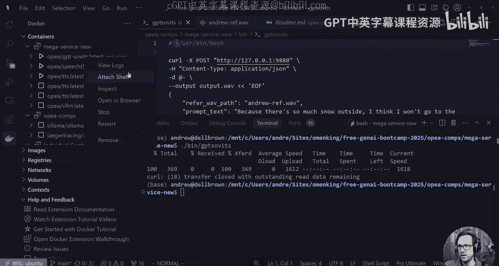

So no such file directory and refft。 wave。I mean， I guess so， but like， how else would it。

Have that path。HI would think that when it starts up that it has to mount to some kind of directory and be shared from there。

 Otherwise， how else would it access it。 So what we'll do is we'll go back over to the code。

 We'll take a look at the Docker implementation。But at least now it's going to a place that looks correct。

 So this is the Docker file that spins up the service， the underlying service。

 And so what I'm looking for here is if there's anything about like mounting or sharing directories。

It wouldn't be in here。 It would be in our， our actual Docker file that we have。

 So if we go back over to here and we take a look at our docker file。

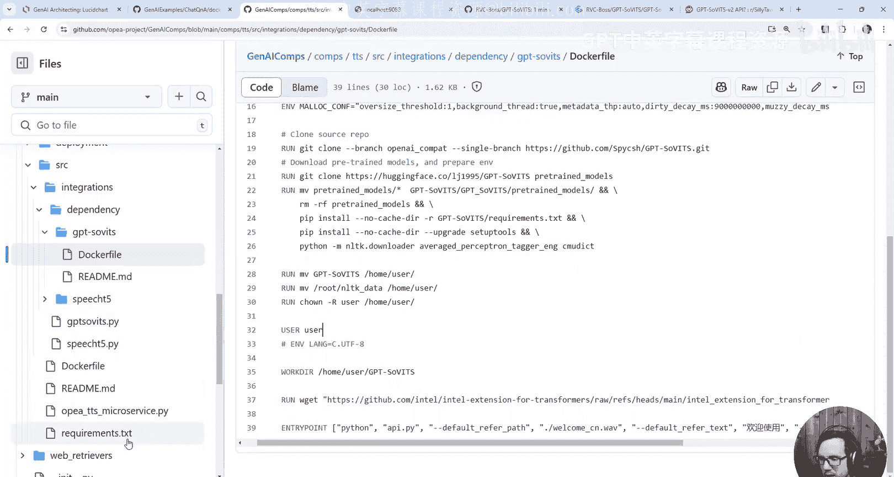

And I'm just going switch to standing。 I've been sitting too long here。

 but we will switch over to this。 And so maybe in here， there's some way that it's being synced。

Right。We'll give her a second to go up here。Okay。And。Let's sure why my heads a bit cut off here。

 but we'll just suggest that a little bit。There we go。Okay， and so。Obviously。

 we're starting to get our curl here。But I'm not sure where it's trying to open this file， right。

 because I thought when we pass it here， we are passing the payload over there。

But maybe what we need to do is we need to provide our sample at the time of when it starts up。

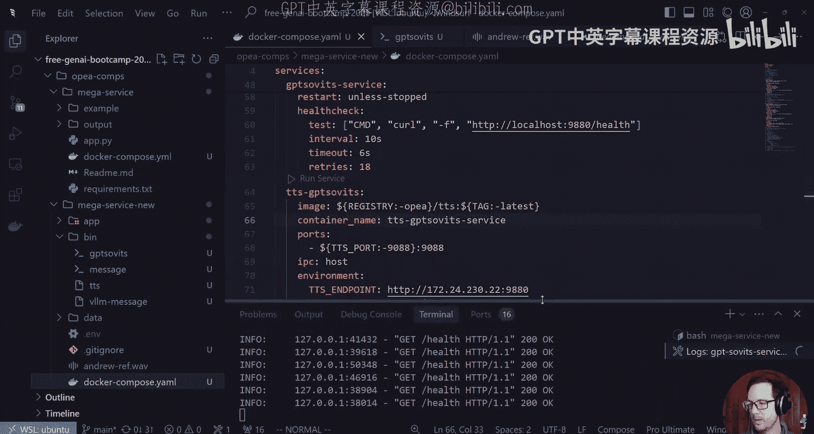

So if we go back over to here to the API call。we can see that says default refer path welcome c n dot wave so where is this file。

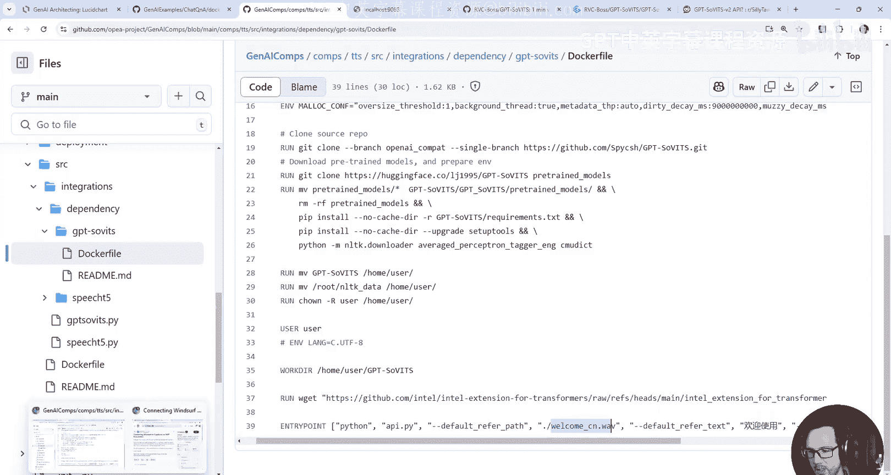

So I'm going to go back over to here。 I'm going to go to Docker。

 I'm going to go ahead and right click， and we're going to go attach cell。And we'll do an LS。

And in here， we can see we have the code and it has one sitting right here。Right。

 so I think that if we want this to work， we're going to have to bring that file over so maybe we can mount a directory。

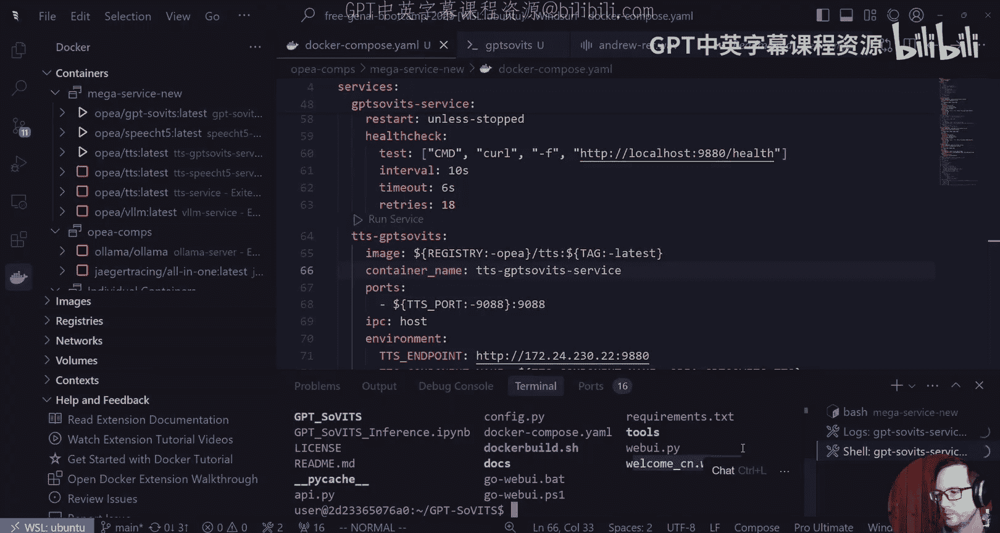

So we'll go here。And I'm going go ahead and ask the chat。嗯。How do I mount a local。Volume。Directory。

To this。To this container。Right。Now are， obviously， volumes。So we'll give it a moment here。

And now we can see that it's mounting a very specific directory。

 So added a volumes mounted directory。嗯哼m。😊，It was really that simple。 That'd be nice。Sorry。

So we have audio app audio， right， So I added a volume section that will mount a local directory。

Relative to your Docker compose file called audio。 Oh， that's really convenient。

 So we have app audio。 If go back over to here。 We have app audio。 So go ahead and make a new file。

I mean， this never really turned out。 So we just kind of ignored that。 But I'm gonna go ahead。

 I'm just gonna make a new oops。A new directory called Audio。We'll go try that again here。

Its I'm not sure why my clicking is all messing up here， but well try this again。

And I'll right click and will'll say new folder。And where's the。New folder。It's acting kind of weird。

 I'll have to make it off screen here。I'm just navigating to the folder manually。

 it's giving us some trouble。And so we'll go into this one， into this one here。And。In here。

 there should be this。And here will make a new folder。Called audio。

And then what I can do is bring in this audio file here。

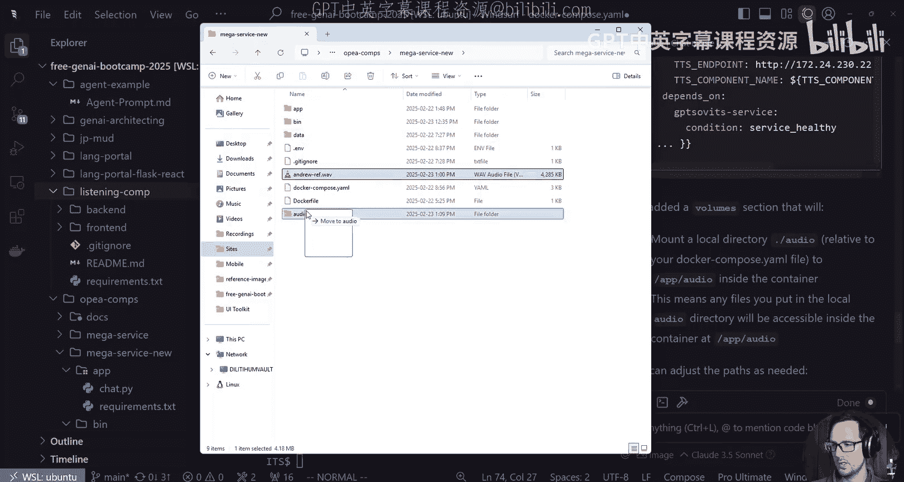

And so now， instead of doing this， I'll just say audio， audio。

So now we have that specific directory right， and so it looks like he's going to map it to a directory that is just like at the base level。

 I think。So what we're going to do now is go over to here and we'll stop our mega service。

It's not really mega Airc because we haven't really orchestrated it。

 but the point is that we're working with this component here。Wait for that to stop to stop。

And once its stopped， then we will start it up again because we've already done a restart。

 but I don't always trust the restart。 so that's why I don't do it that way。

And we'll just open another tab here。We'll close this one out。This one， this logs， this one is。

An old one here， and willll say。Were we going， We're going into。嗯。OPA comps。Make a service new。

 Now we're going to do a。How we going to start this up， It's going to be something， something。

 something。Docker compose up， there we go。 Docker compose up， we're going to up those here。

It's now should be running， assuming we didn't get any errors。

 we'll make sure that it works by going over to here。This means that these are restarting。

 which is not normally a good indicator。 but now they're， they're running。

 So I'm going to mount to the underlying service。Which is here， I believe。And。Now they're in here。

We'll do an L S， Okay， but I want to go here and see if there's now an audio directory。

So I don't see in hear an audio directory。Right， so I'm not sure。Som trying to autocomplete。

 I'm not sure if that actually worked。Because maybe that audio director needs to already exist。Right。

 so maybe there's some other place that we can mount thatm。Particularly sure。

 but we'd have to modify the underlying， the underlying thing before that happens。 I'm gonna go ask。

 like， if。If the directory does not。Exist in the container。Does it have to be created first us？

Or will the volume mounted。Autoomaically。Create that volume。

Doctor will automatically create the mount point and audio inside there。 However， you do need to。

You do need to make sure you have that audio directory。 I mean， we do absolutely have that one。

 This one says absolute path。 and then your app audio， what's the interior。So。

Left side is your local path。Right side is app audio inside there。 Okay， so， I mean。

 if that's the case。You know， that should have， that should have mounted。But we're here。

 and unless I'm in the wrong container， this says T T， Oh I'm in the wrong service。I am。

 So that's my problem。 So we'll go ahead and we'll we'll solve this。 Not a big deal。

So little' hard to see what we're doing， right， So we we'll cut this out。 We'll go to the top。

And then we'll paste it in here instead。 And so now we should actually get amount once it stops and restarts。

I'm going to just turn my light a little bit down。Wing me here today。Here goes's a bit better for me。

And so now that has stopped， we're going to go ahead and make sure this file saved。

I'm going to close out this tab and this tab， we will go and stop this。 We'll hit Doctor compose up。

 And so now it should be mounted to the correct directory。

 So we'll wait for those to get in a running state。And then we'll take a look here。

 I just think it be really cool to be able to clone my voice again， maybe not the best cloner。

 but just being able to do it seems really， really fun。😊，And so now that we have that running。

 let's go ahead into that and we'll say attach shell into。Yeah， this one here。Attached shell。And so。

 we'll do LS。And I want to go to the root。 And now we have the audio directory。 and there it is。

 So now we can reference it。 So if we go back over to here， into our message here。

mAnd it's kind of unusual because you think like。You'd want to be able to reference it。

 but maybe there's another one that actually allow us to upload， I'm not sure。

But I'm gonna go here as long as it works。 So I don't care。 But like， we'll go here and do this。

 And so now。We have a means to reference it。So I'm going to close this out。

And I do want to open up the log specifically for this one as we want to observe what happens。

But I'll go up to our first tab here and we'll do bin。My microphone's little bit down here， bin。

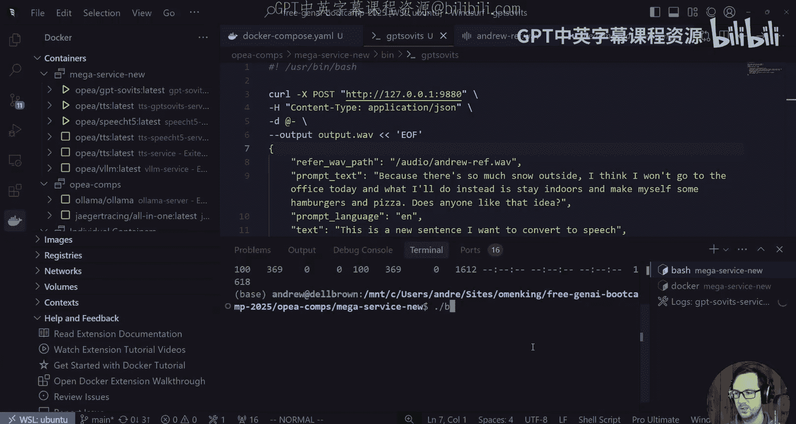

嗯。GPT boss。 And so it looks like it's doing something。

 The fact that it's delayed is a good indicator that might be working。 So it is getting the data。

 It's unziping the average。 it's doing stuff。 Yeah， it must be working。And there it's going。 Now。

 again， I'm not using GPUs。 I'm just using CPUUs for whatever I have。 And so hopefully。

 it is good enough for this to do it。This would be something maybe interesting test on the。DIPC。

 but again， I'm not exactly sure。I think that it got back its response。Did it， It did。So now in here。

 we should have an outputted file。Refresh here。I don't see one。Where is the output。嗯嗯。

Maybe we go over here。 we can find it over here。Here it is。 Where did it go。It went into， oh。

 it's the mega service new， okay？

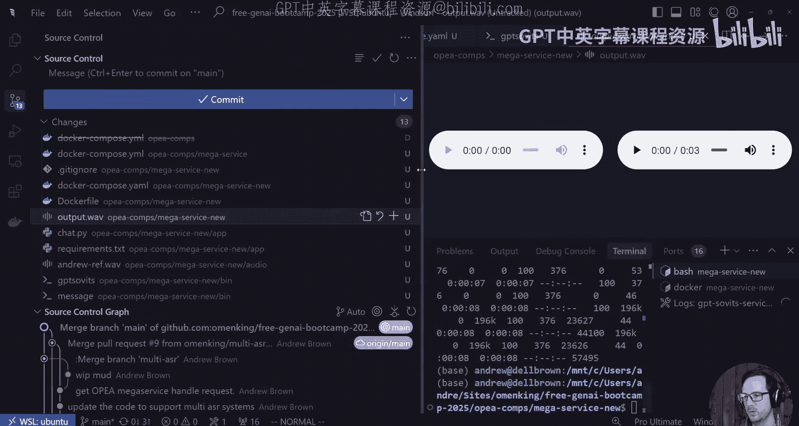

Maybe it's just a bit hard to see because we have so many files there it is right here。

This is a new sentence I want to convert to speech。That's， I mean， it worked。

But why do I sound like a cartoon v， This is a new sentence I want to convert to speech。

This is a new sentence I want to convert to speech。

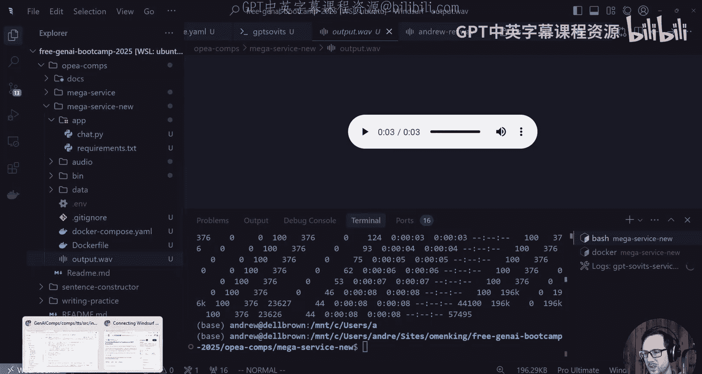

So I would not say that it sounds like me， but at the very least we got it to work。

 and this could be just what like we have to provide as a quality sample。

 So if we go back over to this thing， which is called GPT Vous。Oh， it needs one minute of audio。

I gave it 10 seconds。 I don't know what so it says here input a5 second vocal sample experience instant text speech conversion technically did work。

 fine tune the model with want just one minute of training data to for improve voice similarity in realism。

 Yeah， I think I want something that's a little bit more realistic。 So what I'm going to do。

I I'm going to maybe try one minute audio and then we will see the improvements here。

 but I'll go back over to our code here。

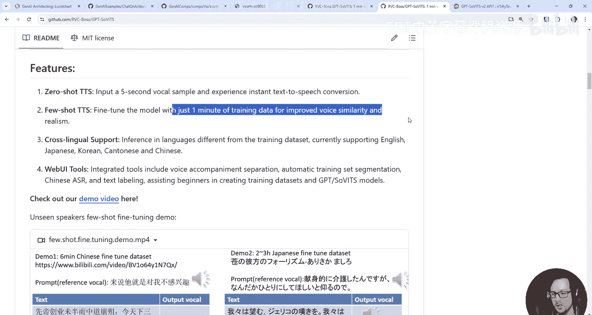

🎼And this one is obviously， I mean， it worked。 Like， you can't say it didn't work。

 but it was a little bit goofy sounding， right， So we'll go here， and this will be 10 seconds。

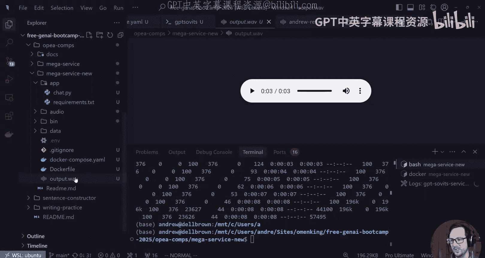

And so now what I'll do is I'll go record， I'll have to write a little script here。

We'll say we'll go over to here to Claude。Write me a audio audio script。That is， you know， 1。

2 minutes long for me to read。So we' go over to here， and I'm just generating this out。And that way。

 I can just exactly read it exactly is the same thing。A， just the script。Just the script。

 Just the words I have to say。I'm really bad at reading things， too。 So it'll sound a bit odd。

 but it'll probably work。 Does't if it sounds a little bit more similar to maybe be interesting。

I guess I'm doing a guided meditation， so I'll be back here and just record my guided meditation。

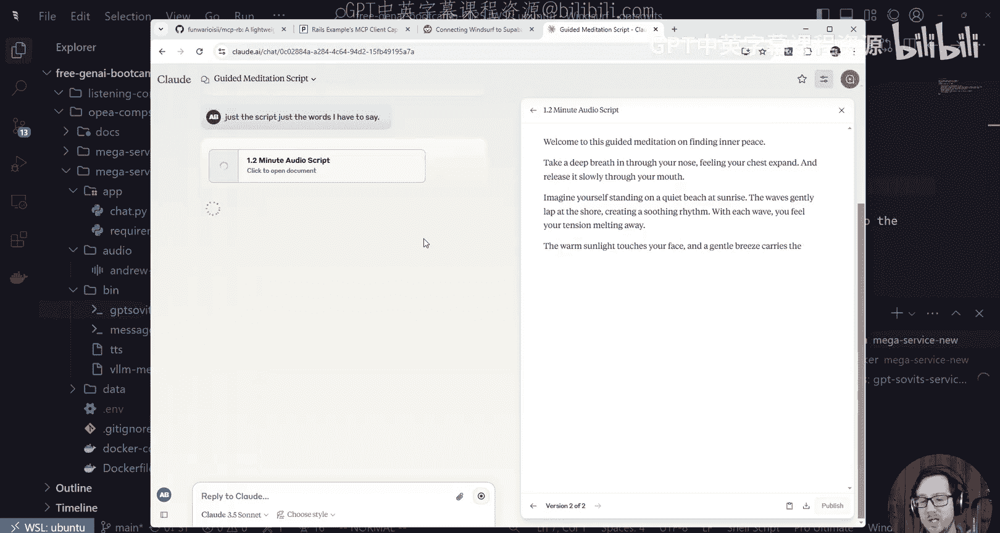

Alright， so I just recorded a one minute。 Wellll just shy of one minute audio recording。

 There was a bit of a little mess up in the middle。 So hopefully that won't affect too much。

 but you really have to get these things really clean to get a good reference。

 But now we're at one minute。 So what I'm going to do is I'm going to go over to here。

 And we're going to swap this out and we'll say。1 M， right。And or one minute，1 minute， right， Okay。

 and so now we can go ahead。 and I think that directory is mounted。

 I'm not sure if that other one would show up still， as we just added the file。

 But we can go take a look if we haven't stopped it。

Let's go into the actual container because then we don't have to restart it and that'd be kind of annoying if we have to。

 but we'll go into our audio directory here。

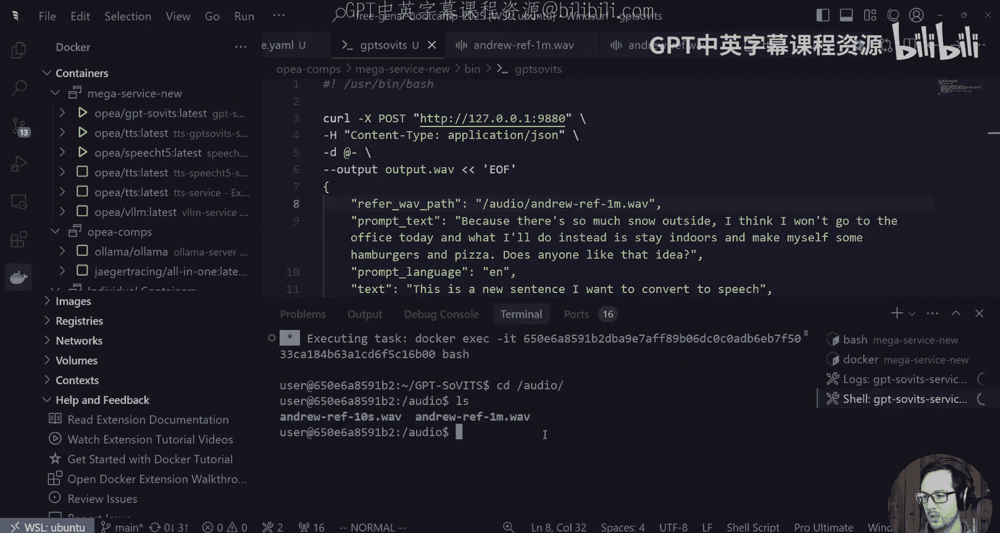

And it is here。 so we can just run it again， perfect。Okay， and so now it's obviously a lot bigger。

 But the only thing I don't have here is the prompt text。 So I'm gonna go back over。 I'll make。

 I'll keep this one here。So we don't have to， you know what。

 what I should do is let's just call this one the one minute。One men。

And then I will copy and paste that。 And so this one will be the 10 second。

Because you probably need the， I don't know if you'd need it， but we'll keep in the prompt text。

 So there's less of an issue。 So this one would be the 10 seconds。Right。

 and so then this one's going to be the one minute。 so I'll go find cloud wherever that is。

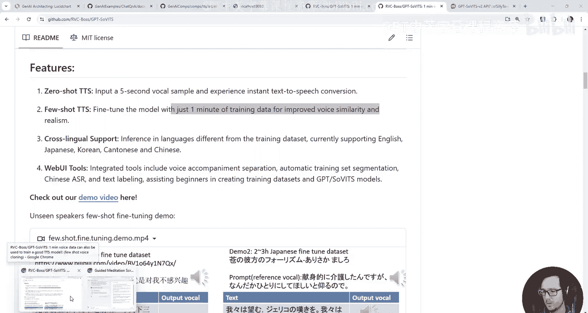

Gouide a meditation。I'm not sure why anyone will want guided meditation for me。

 but it isn' in there if anybody wants it。 So we'll go ahead and just。Modify this。

So pacee this in like this。So here is our text。I am just going to make it all one line。

 So it's a little bit easier here。 That's what it's supposed to be， I think。

There was a hyphen in there， I don't think I's supposed to be there。I don't want it to do anything。

 so I can ignore it for now。And so in here， I think there was like a character that really shouldn't be in there。

 like a hyphen。So I'm going to just make sure I find it。嗯。

Maybe we can wrap this for a second word wrap。Maybe not。 Maybe I just， I thought， oh。

 there is right there。There we go。 So we'll take that out of there。 So now we have our。

 our new prompt。 It is very long， but it's what we need。And we need our closing one here。

 So we'll go here and close it and then do comma。 So hopefully it doesn't mind that we did the whole thing there。

So this is the latest sentence I want to convert to speech。

And so I would expect this would take a little bit longer than the last one。

 but we'll go here and we'll have to traad the other file， maybe。Chad， I'm not sure which one。

 So Ill just trimad the both。U plus x， and we'll say。Ben G。10 seconds。

 And then we have the one minute。 Okay， so now I want to go ahead and run the one minute one。

 And so hopefully that is okay。And if we go to our logs here， we can see that it is processing。

 I think we deleted the other output。 They probably been smart if we kind of named the output here。

 So one is output。Wen。Bin add that the other one here is 10 seconds。

But since I think I delete the other one。I think we'll be less of an issue。

 If it sounds exactly the same， then we know that that the problem is there。

 I think it just finished。 We'll go ahead and give us a refresh。And we have an outputted file。It all。

 again， is an empty breath。So I'm not sure maybe you didn't finish。Because we're not。

Tiling the logs Oh yeah， right here we are。🎼So I'm not sure about that。

 that didn't really work as expected。 I'm gonna to go ahead and delete this one out。

 Let's go back and play this audio file where it was at here in the audio。Here。something's not say。

 but we'll go here and display it。Welcome to this guided meditation on Unfining inner peace。Okay。

 so the audio is definitely there。 We'll go back over to this to the bin file here。And I mean。

 we obviously have a lot of text prompt。But we do have English here。

 and I don't think there's a problem。So what I'm going to do， I'm as a sanity tag。

 I'm just gonna stop compose， and I'm gonna bring it back up。 I mean， it's， it's there。

 It should work。But I'm not sure what we got a blank。

 And it obviously wants us to have one minute of speech。 If all works is the 10 seconds， that's fine。

 But if we can get the one minute to work， that'd be fun。😊，So now that is stopped。

 we'll go over to here。I'll do a docker compose up。 that I'll remount the directory。

 I'm just going to go ahead and kill these two。I'm going to wait for this to get running。

We give us a refresh here until we see it。And I will right click into this one here and we will view the logs。

And so I believe that it is ready。 We'll go to here， and we'll hit up。

So now we should actually get the output of files based on their name。

 So this is the one minute one that we are doing。And it got the post。Okay。

It looks like it produced back results。 It says 1% here。 So I'm assuming like。That is。

 it's progress to Okay， it it says decoding now。I'm not sure how we're supposed to know when it's done based on this。

Maybe it was still going， and we just were impatient。So I do see that output。

I'm going to just wait a little while because I'm not really confident whether it actually finished or not。

 because it might be still dumping it。I can't imagine that it would be that fast。 If it is。

 that'd be really cool， but。You know， I'm curious， like if I go to my sites here。

And they go to Freeje AI， I'm doing this off screen right now。

 and we go to our new mega service here。

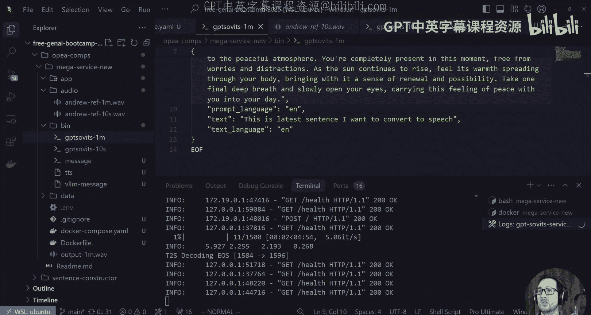

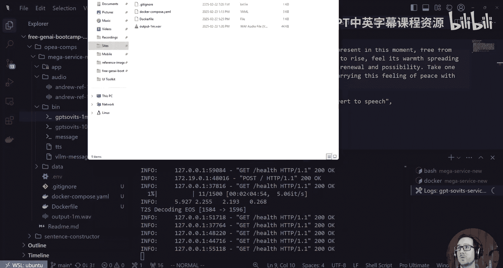

And we look at it。 That just seems too small， right， Like， there's no way that's right。

 Is there like a refresh button on here。

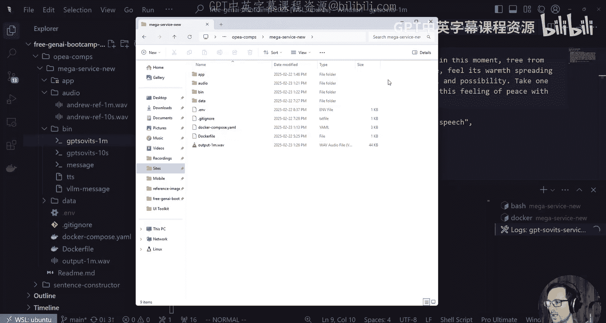

ButHow do we refresh。Is there commander。I it getting any bigger。 No， it's not， so。

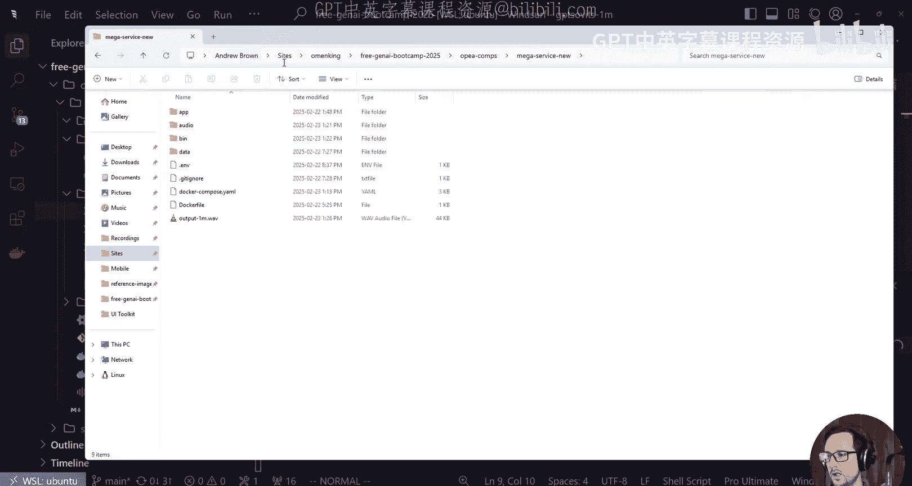

Yeah， I just get a blank one。 That's that's no， that's no good。 What if we tried the old one。

Soll go here， we'll say 10 seconds。Does this one work？This is a new sentence。

 I want to convert to speech。Okay， so it does。So then what's the problem because clearly。

The audio is fine here。Like is it too long and it's not able to handle it because I'm running all my CPUs？

Like， how would I know I， I don't even know how we would know。

 Another thing we could check because it does use T T S underneath。

 Maybe we should be taking a look here and viewing the logs here。嗯。I mean。

 I don't see it doing anything here， so。I'm not really sure if that's the case。

 but give me a moment here。 I'm going to try something out。So now， I think our problem is。

 is that we don't have clear logging to what's happening here。 There's no way for us to test。

 And the only way we could test is if we were to pull the the， the original reos。 So basically。

 any of these things that we use， we really do have to have a better understanding of them。

 So what I'm gonna do is I'm going go ahead and just stop compose stop here。 And I'm going go and。

Well， actually， I think we already have it here， but if we go over to this one here。

We already have this repo clone。 And so I noticed that they had a couple notebooks in here for inference。

 So if we go here， we can actually see that they actually have one for inference。

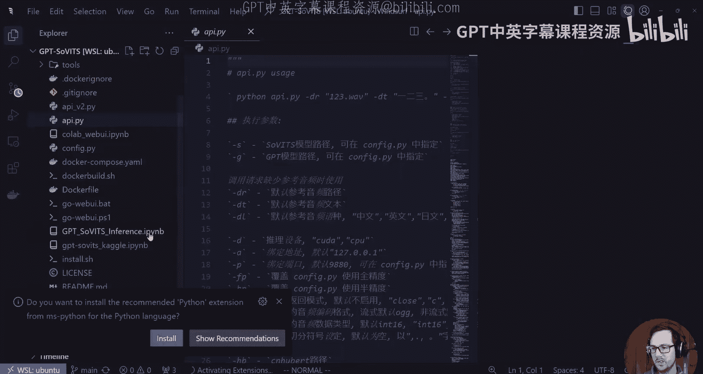

And， you know， my question is like， if I have my audio clip， you know， could I test it here in this。

Way， but let's take a look if this is too complicated。

 So here it talks about all the things that it has to install and the requirements。

 the pre trade models。嗯。It's colon a lot of stuff。 I don't feel like it should need all this stuff。

And then。We're doing this。Yeah， it's not。 that's not the best way for I was hoping to run this。

 Obviously， there's a docker compose file in here， so we could run it this way as well。

But that's not going to help us either。We do have a web UI。

So what could be the problem here is the question， that is what I can't tell。

All I'm thinking is like it's running out of resources when it's running。That's what I'm thinking。

 but。The container itself， we would have to modify it to actually do what we want。

 So if we go back over to our old code base。No， I don't know， like， yeah， we're using the API。

 which is fine。Right， so。Were here。It handles the request here。Return handle。Which is up here。

We have a streaming response， okay。HGood question。 Good， good question。

I think that something's going wrong， right， Like， yeah， this， this code looks pretty meaty。

Get T T S wave。 So maybe somewhere in here。Something's happening， right？

 And that's why it's not working。 There' is a version 2 API。

I kind of just wonder if like if we use the other API。

 if it's more robust and gives us better information back。It's definitely a little bit different。

 which is fine。But I guess I just don't understand why this didn't work。嗯。M， good question。I。

 I guess I'll go look at the form and see what I can find。 But if if we can't get it to work。

 it's fine。 Like， obviously， I got the， the 10 second one to work。 but， you know。

 it might be too hard to debug this。 Like， it's not that I can't debug it。

 It just might take me literally days。 and it might not be worth our time。

 But let me give give me a second， okay。

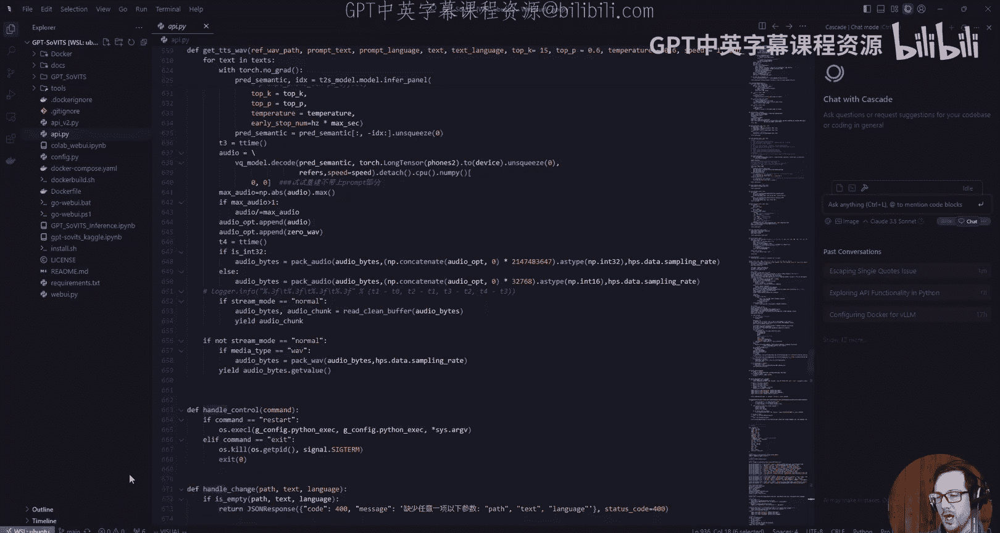

I'm noticing here they saying like testing native English has to be of whatever， whatever。

 So I wonder if there could be like characters that could be messing it up。

 If we go back over to our， our last one that we had。

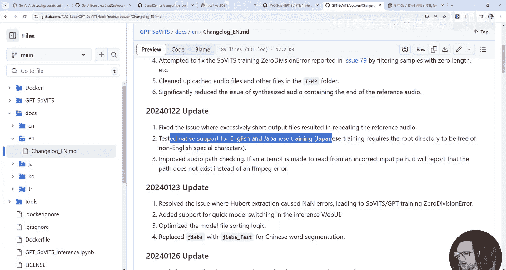

Because it might be the transcript that is causing the issue。 Again， I don't know。

 I'm just kind of guessing here at this point。But if we go back over to here。And。

We take a look at the 10 second one。I mean， it has commas， and it has a question marking period。

So that makes me think that's not probably our problem。I guess the question is like。

 can it work with a longer than one minute？

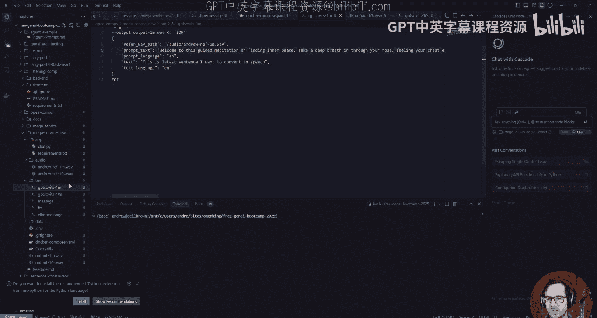

So we go back to here。With just one minute of training， okay。But。

 they've clearly done a lot of work here， but there's just not good debugging or error handling。

 So if something goes wrong， how would you know。And there's no like logging information in this。嗯。

嗯哼哼哼哼。😊，I mean， there's clearly。Other tools that we can use here。But yeah。

 I'm not sure how I'm going to fix this。 Let's go take a look here。

Maybe we can go back here for a second and I can go into our into the forks or stuff because sometimes people will fix these things indirectly。

Attributors， I'm trying to find other branches。 forks， maybe forks。 here we go。

That doesn't really help contributors。Does usually like a network or graph or is this it。

Sos what I'm looking for？Today， Github's really， really slow。 But， you know。

 what I'm looking for is is。A。A graph。Here we go。 Okay， and so we have here。Yeah。

 it's really hard to say what's going on in here。It doesn't help that I do not know Chinese。So， yeah。

 I think。I think this is out of scope。 I would love to get this to work 100%， but。

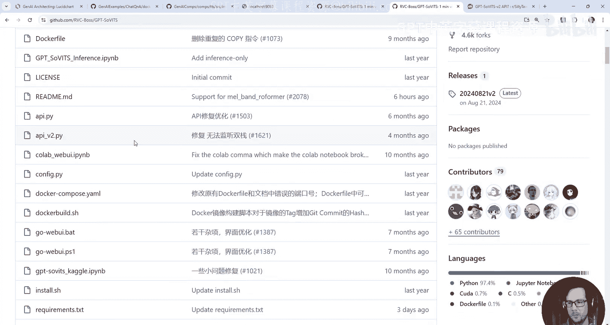

Theal thing that we could also do is just before we move on is let's make sure that this works the 10 second one to the actual endpoint that we want。

Because we're really supposed to be going through the Intel service to access this or the， I'd say。

 Intel service OPA。OPA A service here。 So if I go up to here， we have this end point。

 And so the other ones on， we have 9，8，8，0 and the other one's on 90981， I think。

So we'll go down here and if it still works。 then we're in good shape。

 I'm going to just go ahead and delete this。Outat。But。

We will go over to here to our Doing proposed file。And in here we have。988。

Which is the one that we're proxing through。 So we'll try this。 We'll say 9088。

 I would assume that it would take the same endpoint， right， I could be wrong。 I don't know。

 but we'll go ahead and give this a try。So am I running this right now， I am。

Running only part of it for some reason， so we'll go ahead and whatever is here。

 we'll just say it stop。And I'll go back up to here and we will seed into the OPA comps。

Make a service new。And we will go into。Audio， maybe here。Oh， sorry， no， no no， Docker compose up。

 Let do Docker compose up。 I know the font's small。 I'm just trying to get to work here。

And once that's up， we'll give us a refresh here。And so we'll do LS。OP comps。Make service is new。

 But yeah， none of this stuff is complicated。 It's just that a lot of the code out there is just cobbled together and no one's ever gonna to improve it and make it easier for folks to use。

 And that's usually the challenge with these thirdpart libraries。 But you know again。

 you're seeing what OPA is doing。 it's just providing a layer that wraps it and provides you know additional tracking and things like that。

 But when it comes to that base based service， I can't do that because that has to be integrated into that base service。

But let's go ahead and take a look here。 So we'll type in clear， and I'll say Docker or not Docker。

 but we'll do bin。诶。G p。10， and I think I've changed it out to the 988。 So that's the other one。

 And so if we run that， if it still works， and we're in good shape。We will。Give us a refresh。

 and we still get an audio output。Now， maybe I didn't finish loading that file。嗯。😊，I mean。

 it did create one。So I'm not sure if we go back over to here and we check the actual underlying service。

Did it get a request， It doesn't look like it got one。Do the logs here。We get a 404。

 So maybe what it's doing is it's doing some kind of translation of what the endpoint is。

 So if we go back over to here。 So what I'm gonna do is go and fix this。To whatever it was before。

 we're going to copy this。 I'll make a new one。 This will be called GT Sovis T TS。

And we'll paste it in here。Because this obviously is a little bit different。 And this is on 9088，988。

 And so to understand this， we'd actually have to go and look at the code， right。

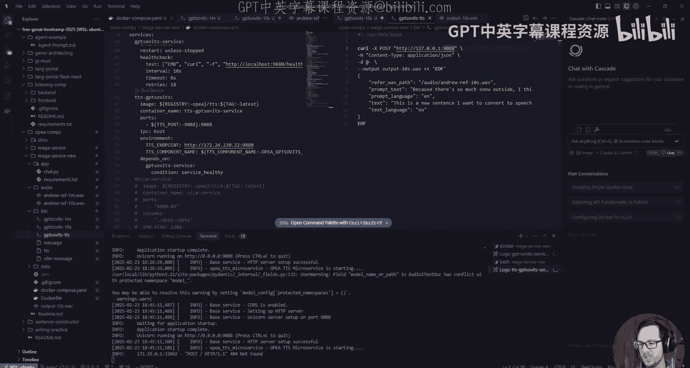

And。We see here。We have to go integrations， I guess， into this。And。

Look for the endpoints that's here。So this one's going 9088， right。嗯嗯嗯。😊，Especially T T， S。 okay。

 that's fine。But what route do we expect it to be， That's the question。So normally。

 what you do is you register a service with its end point。 So we go down to。The main one。

 maybe there's a register in this one。Here it is。 And it's right here。

 So I think what we need to do is actually use this endpoint。 And that's what it actually wants。

 And I guess like if you're using T T S or the one that also kind of normalizes it。

 So now we can go ahead and put this in here now。

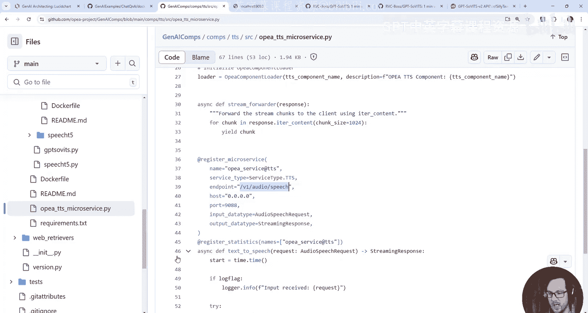

So maybe that is what we need to do。Right， so this one will stay the same from before。

 but this one will actually be that one。 And so now we'll go back over to here。

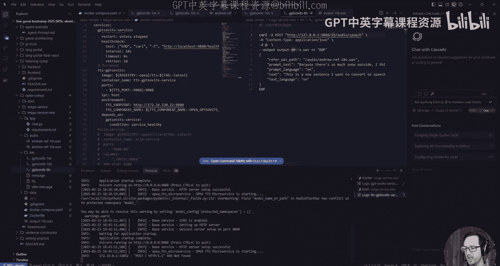

嗯哼。😊。

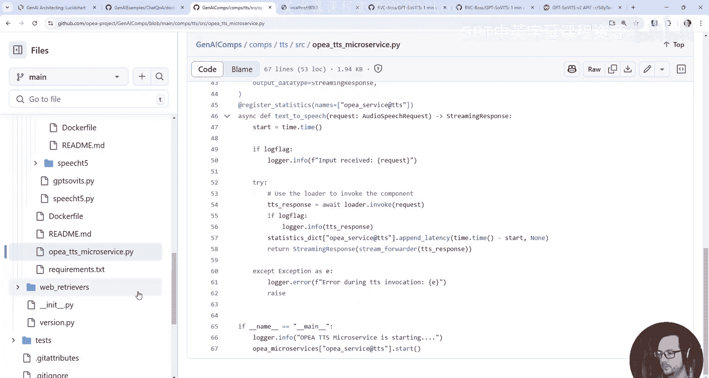

Okay， we'll go ahead。And we will。Stop this。🎼That was the wrong thing。 It's just logs。

 but doesn't matter what the logs here， but we'll go back and we will now delete this。

 This obviously is a junk file。 So we'll go ahead and delete that。 We'll go ahead and hit up。To， oh。

 that's the wrong  one。 That's not what I wanted to do。 I mean。

 it is working'cause it's going to the right end point， but it's not， it's not what we wanted to hit。

 We wanted to hit the other one。Like this is a new set。 Yeah， obviously。

 that's the wrong kind of Andrew。 But we'll go ahead and delete this。 And I'm gonna go Chama。

U plus x。Been。T T， S， right， And so we'll do this instead。Like this。Okay。

 and so now we have that outputted audio there。But really what we want to do is just check the logs here and see if it followed along。

So if we go to here to the view logs here。Unprossible entity。

 So at least they were getting somewhere here。 Now， that's the end point that it's supposed to go to。

 But it's saying it doesn't like it for some reason。 That's totally find。

 Let's continue on and see if it actually made it to the actual service here。And it didn't。

 so did not reach here。So there's something that doesn't like about it。

 maybe because it's a a post instead of a get。Right。

 even though the underlying one takes a post to or， I suppose。

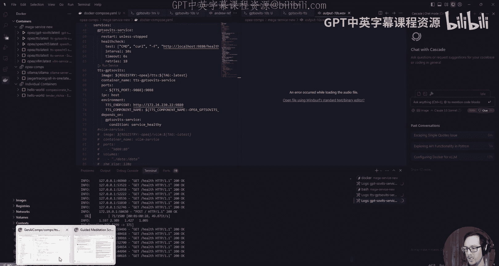

I don't know if it specifies here。 Like what， like。

 is it supposed to be opposed post or is it supposed to be yet， We don't know。

 It's very easy to change this to a ga， I suppose。But how would we know what it's supposed to take here？

Input， speech， audio speech request。It's also like the format of what we're expecting this to be。

So here we have audio speech requests and we have this class over here。AndSo here we see input。

 model， voice， response， format， speed。 This is completely different， right， So obviously。

 that's the format that we have here。We'll go back to this service here。Right。

 but it's expecting that format。So maybe our problem。

 that's why it's saying 422 is because this is not formatted in the format that it wants it to be。

 So if we go back over to here， we see。The model， the voice， the response and the speed。So。

And then we have the input。Hm， well， how would that work because it's not going to have all the fields？

Right。So if it doesn't have the text field， how would it net like the prompt text to know what the transcription is。

 would even be able to produce it， and that's something I don't know。So if we go back over to here。

Yeah， and over here， it seems like they have a reference over here。 was this。Model okay。

 so they're kind of standardizing on that format here。That's fine。

Model input point voice response format。 So yeah， it's not clear how that translation would work。

I mean， we just have to follow through the code to figure it out。So we have text to speech。

 which is fine。Open T T S。 Well， let's go back for a sec。 Open T T S。

 Let's go back to the integrations and see what it does is it's override。M， invoke the model。

Request the voice。啊哈。But to me， it's incomplete。So anyway， I'm gonna to leave it here。

 my point is is that we did get the underlying audio thing to work。

 but you can see like if we just did plain text of speech， this would be pretty simple。

 but since we're trying to not just do that， but trying to do voice replication。

 we have to do a lot more digging to figure out where it is what we can try to get to work is we can try to match exactly the format of that model that we just saw because that's all it's doing there but the issues like I don't know what it's going to use is the text audio and I think basically it's hardcoded to not actually pass a voice along because when we go back over to our actual TTS file here into to our deployment into the Docker compose file into here。

 now I'm not here sorry if we go back we have to go back another step。Back into the T T S。

 and we go into source here， into the。Integrations。Depenencies into here。

 And we look at this Dogger file， we can see。The default referer tax and the stuff like that。嗯。

I know this probably won't fix it， but I wouldn't mind trying one little thing。

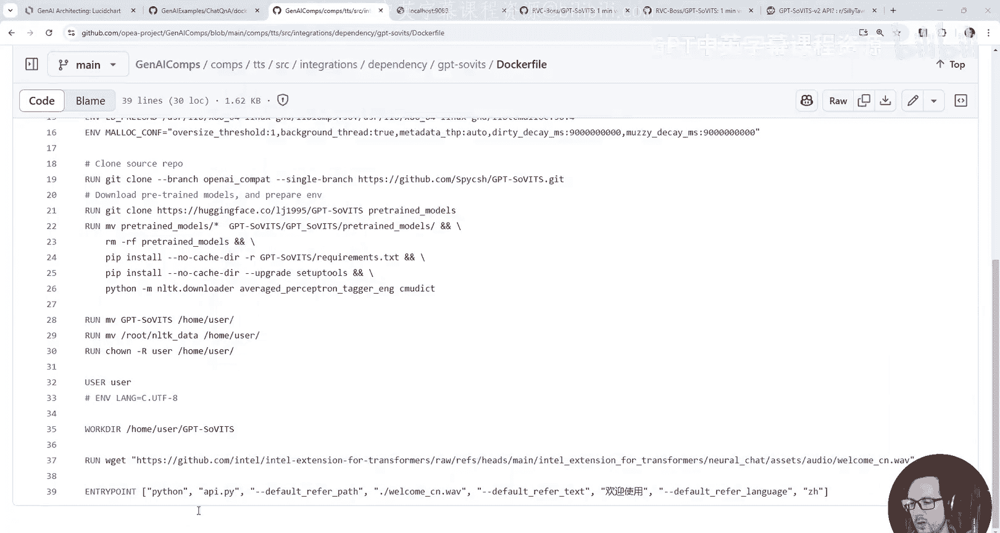

Before we go here as an experiment， it probably won't do anything， But I'm just。

 I just figured I might as well try it。 What if we cut some of the text out for the the long one here。

So you have this like really long text here。I'm just gonna go ahead and chunk it。 like。

 this is not gonna help。 I'm gonna go ahead and just do this for a second。

And we'll go back over to here。And then we'll run the one minute 1。 I mean。

 that's not going to fix our other problem， but I'm just curious。

This one seems to to be doing a lot better。That makes me think that there's an issue with the prompt text。

Maybe there's just so many words in the prompt and that's why it's having an issue。喂。No。

 it's all messed up。 So I'm not exactly sure what the problem is there。

 I'm gonna go undo the the change it just made there。Oops here， whoops。Here。No， here。Un do。Okay。

 so that one's fine。 I'm kind of messing up all my files now。But it was the the one minute1。

 I'm just trying to go back to the one minute one。Here。And we will just put that back in there。 So。

 yeah， not exactly sure what the issue is。 But clearly， the 10 second one works。

 There isn't a deeper issue in the one minute one in order to really test that。

 we'd have to get the the local code working。 That's way too much work。 I could get I get。

 I can do it。 If I have three days。 And I have all the time of the world， I can do it。

 But then when we get that done， then we still have to debug why it's not doing that。

 And so I guess the thought is like with OPA that some or。Oia， opia。

 that's actually how they wanted to be pronounced。 No， it's crazy， but。You know。

 even if you use these components， you still have to understand the underlying stuff and be able tobu and troubleshoot it。

 Otherwise you're not gonna get perfect results。 If the use cases are perfect for you。

 then it's fine。 Obviously， I'm trying to do do very specific custom things。

 At least we have the bones around it。 So we know that once we do have the underlying stuff working。

 we can do that。 But without knowing how to work with the underlying stuff to do that。

 That's always gonna be a roadblock for folks。 Yeah， it just depends on what you're building。

 Obviously， there are managed services that can do this a lot easier。

 but I love the idea of being able to know exactly how these things work and maybe take them further or get exactly the results that you want where managed services might not allow you to do it。

 But you know， you choose your poison when you work on these things。 and we'll call this one done。

 okay。😊。

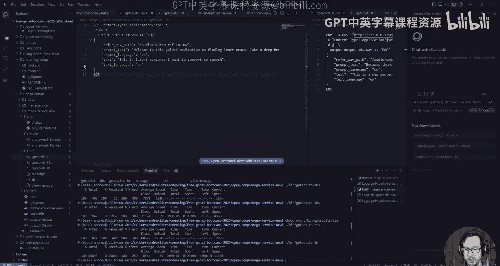