# ExamPro《生成式AI训练营｜Free GenAI Bootcamp》中英字幕（deepseek - P53：-53-Reimplement Song to Vocab Agent.zh_en - GPT中英字幕课程资源 - BV1SFEWzLEab

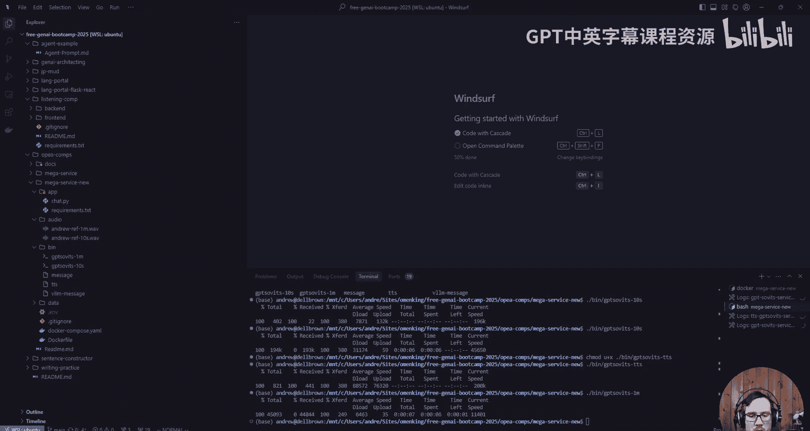

Hey， this is Angel Brown。 In this video。 I want to take a look at implementing the solution that George provided us。

 So he actually made a gist that we have here。 And this is the exact code that he was running to do the。

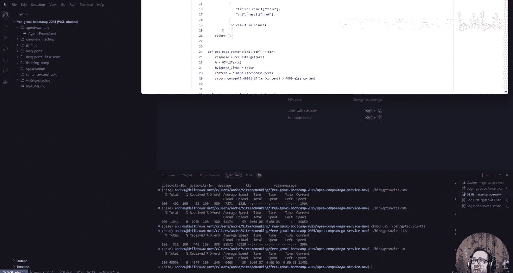

The to make vocabulary for the actual。Really called the。The songs。 And so， you know。

 this one's a really good thing。 I have a project that's very similar to this。

 but it's not agent and it has a static workflow where it will take subtitles from a movie and then it will create vocabulary。

 That one was a little bit complex。 But maybe we can take a look at this one。

 And I'm going to try to adapt before my target language。

 Now he's using open AI here as the client which is fine。

 it would be nice to use something other than openaiI for once。

 And I keep talking about using local compute。 So I might end up using my  laama machine here。

 and see if we can work with something here。 But we generally have an idea of something we can utilize。

 the other thing is that he's using the builtin tooling that is inside of Chaup Bt。

 we don't need that。 And you saw in my video that you know you can just totally write subtext and tell it to be agentic。

 So I think for this video， I'm actually gonna use  laama。

 And we're gonna to use some kind of model in  laama locally to try to see if we can produce that result in the same way。

😊。

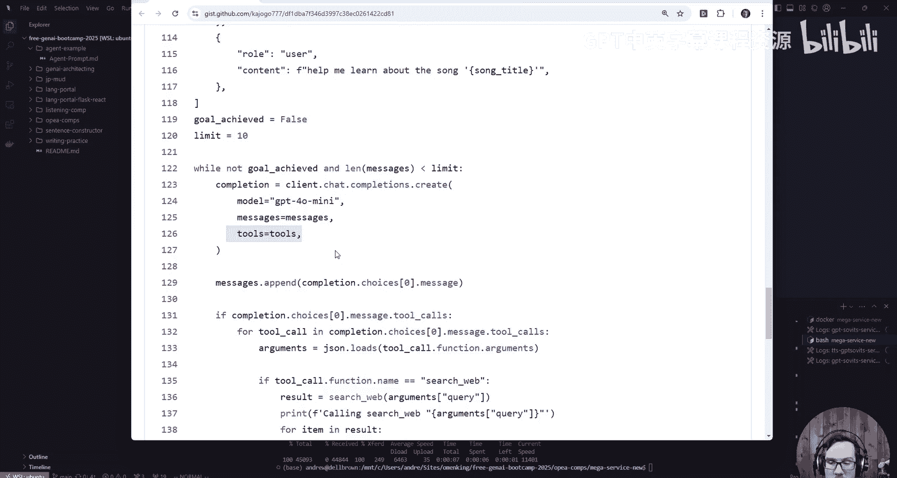

Okay， and I'm gonna go ahead here。 I'm gonna make a new folder。 And this is gonna be。

Learn or it will be。 it'll be。songng vocab。Right， so we'll go ahead and make song vap。 here。

 I're gonna to go ahead and make a new file， and I'm going to make a prompt。Dot M D。Okay。

 and we will get a little bit help from。Wintenurf， whatever you want to use to write the prompt file。

But I want to maybe describe what it is that we are coding。 So we're going to make a text spec as。

 you know， I like making text specs。So let's describe what it is that we want to do here。

 So we want to create an agent。Just say tax specs。So let's describe the business goal。

The business goal is we want to create a utility， a， a program that will。

Not generate songs based on it will find lyrics。For a target song。In a specific language。

And provide and。So want to create a program that will find lyrics。Off the Internet。Internet。

 and I'll make this a little bit larger as we' typing it。

Internet for a for a target song in a specific language， okay。And produce。Vocabulary。To be imported。

Into our， into our， into our database， right？ And so we have that。

 We'll go down to technical requirements。 We have go radioio stuff。

 It's because it's picking it up from before， but I'm gonna just go use Python here。

 We'll just use Python。 We want to use Oma API。 We can also use Lama CPP。 but Oma。

 It will work just as well。There there is SQL light， but this is the Yeah， we'll ignore that。 Yeah。

 it is EQ light for the database。 That's right。With is Oama API for generating。嗯。For being the agent。

For the L M。I mean， like we need to decide which specific one we have。

 So what it'll do here is we should actually take a look and see what kind of along we can see have some few tabs open here from before。

But I'm going just stop this。 I'm not sure what's going on there， but we'll stop that make service。

 And we'll go ahead here。 And I want to see if I have  Laama。So saying aama is not installed。

 I thought it would be installed here。 I am in。I am on this side。

 so I do feel I need to install o Laama。 I willll just say o laama。Sudo， snap， install O laama。

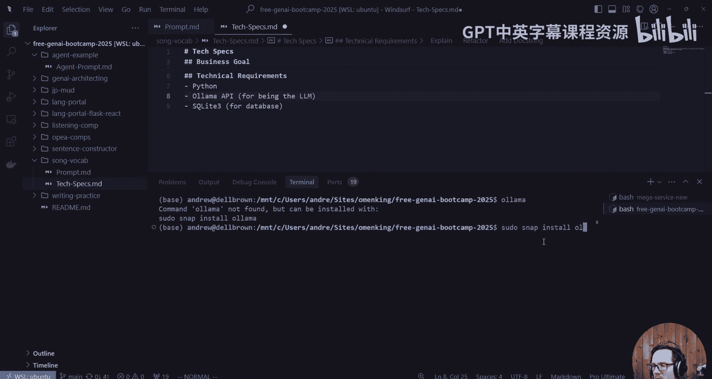

Maybe we can access ama over here， but I'm just not 100% confident with that。 So I gonna go here。

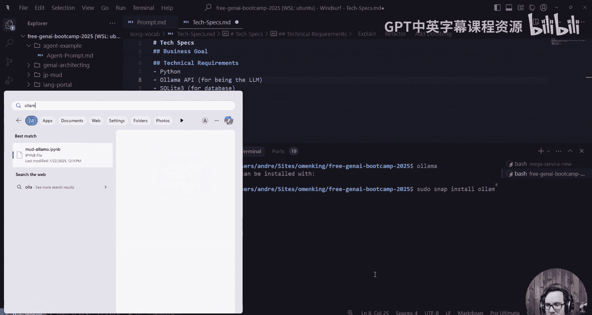

Yeah， it's like I don't even have it installed。 so we'll go ahead and hit enter。

 I might have done this on my AI PCC， which is fine。 We'll go ahead and we'll start this up。😊。

And by the way， I'm also in this other like sitting mode here。 So I'm gonna just toggle this on。

 I'm not to。Toggled that way there。So what are we doing， we're installing Oama， right？

And when we have that there， we can go ahead and install a model。 So I'm gonna go here。

 just gonna close out my Twitter， And we're gonna go over to here。 and I'm gonna go to  Lama。

 And let's take a look at what kind of model we could use。

 So there's a lot of models that we can utilize。

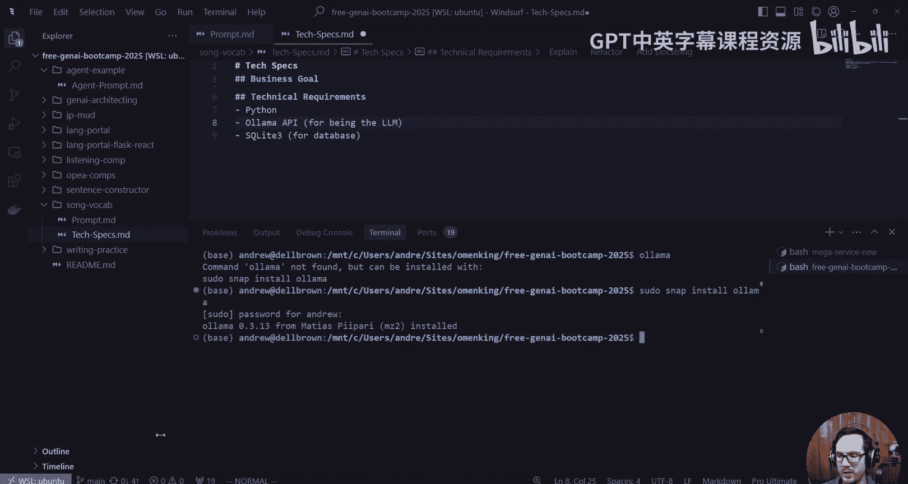

We will go into the model the models over here。 So we have deepse R 1， which is fine。 Lama 3。3。

 which is new。 Do they have any smaller ones， They down just 70 billion。

 which is too small too big for me。 Lama 3。2， which I do like myel Quan Gema， I mean， like were。

 we want to do our own reasoning。 So I'm not sure if we want to use deepse because it's going to have its own reasoning there And that can kind of get in the way。

Maybe it's not an issue， but I I think I would rather not have that there。So。And there's Gema。

So I'm wondering how like Gema 2， we say Gema 2。Versus Lama 3。2。 Look， how well does it do。

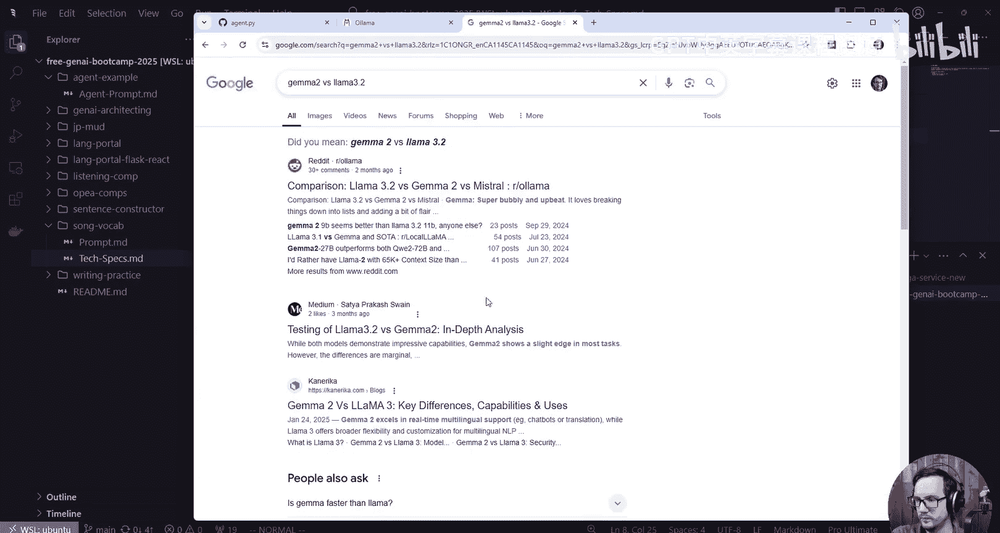

Is there any kind of benchmark。嗯哼。😊。

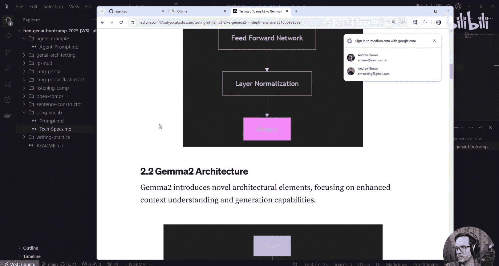

I don' know。 I'm sure they're both okay。 but I'm gonna work with Lama 3。2。

 And if anyone who wants to work with anything else， they can， just because it's a reasonable size。

 Now， I do want to use something a little bit larger than I normally would， because well says Lama 3。

21 billion3 billion model。 I thought there was larger than this。 you all there is more。

 more larger ones， right， I't like a 7 billion billion parameter 1。We only have 1 billion。

3 billion parameter。 That can't be right。 Let's go back here。But then there's this one。

 which has much larger model sizes。And there's lama 3。3， which is 70 billion。 Then for here。

 we have a few different sizes。 Yeah， it's kind of hard to decide which  one I want to use。

 And there's obviously， obviously myel。 Mistrel's been getting a lot of。Popularity。

 so maybe we could useolla a mystral。 Maybe that's what I'll use here。

So I'm gonna go head and just say O laama run mystrel here。

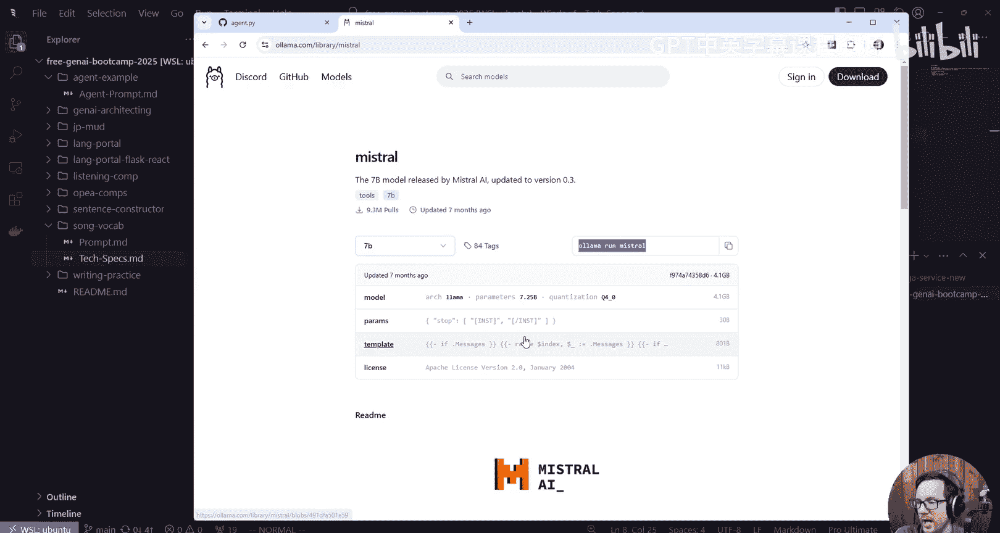

So that's going to go ahead， download it and also run it。 I'm just doing this so I can download it。

 now it's obviously a very large model。 And I do have GPUs。

 I'm not sure if it is gonna be GPU optimized because it's using G GUF。

 But if I need to use the GPUs。 maybe I'm not sure actually I had configure that alone。

 I don't think we can do that。But anyway， it'll just detect whatever is on my machine and， and。

Use it appropriately。 So we'll download that and we'll see how well it works。

But maybe here we'll say like Mr。 7， so。We'll use Mr。 7。We will say like myel 7。

 Mrral 7 billion parameter bottle。Olaama。We the O laama Pythonist decay。And down below here。

 And we might also want to define find like。If we do have an application， like。

 do we wantanna make a flashask app， a fast API app， I'm not sure， they'll say hello。

I just want to see how fast it is。And it's an okay pace。 It's not super， super fast。

 but it's fast enough。 I don't know if Oama automatically utilizes。What do you call it。GPUs。Yeah。

 let me go。

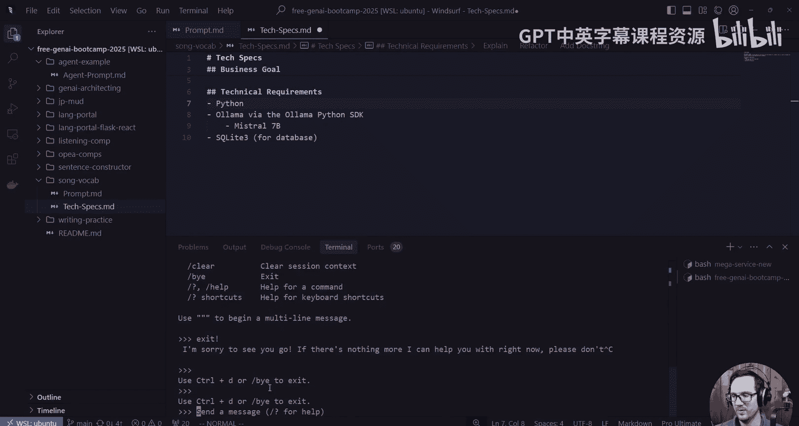

Quit， quit， quit， quit。 bye。 let's say bye。And so what I want to do is go here Its like。

 does O Laama use GPUs。

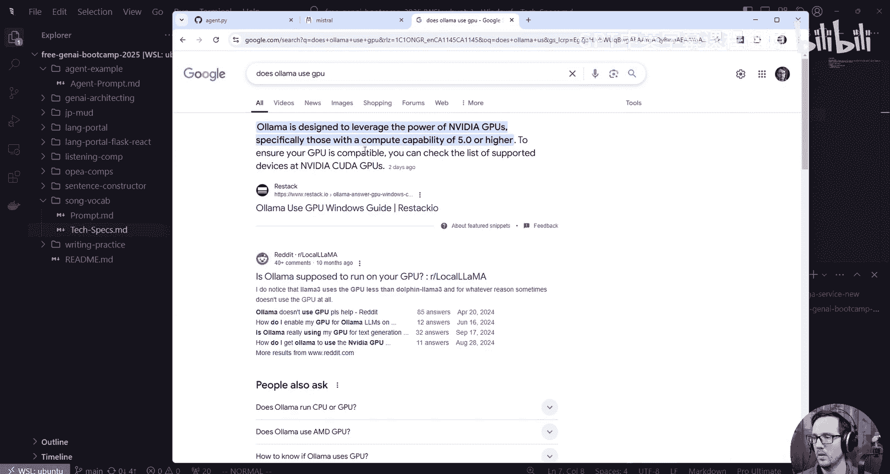

To sure you have compatibility。 So I think it actually is using it。

 One way we can find out bytyping Nvidia。On another tab here。We type in N video。SMEI。

 is that what it is。S by。There we go so。If if I am utilizing it here， we'd see some information。

 you'll actually notice that we do actually we are getting some use because I am recording right now via OBS。

And so I'm wondering if I go back here and I run that again。I say， hello。

I want to go over here and see if it's being utilized。I think it is。It's hard to say。 I'm not。

 I'm always the best at observing that information right now。 But anyway， the point is。

 is that we have an a certain level of expectation of how it works。 So that's fine。 So we have。

 maybe we'll say fast API， fast API。Just because we seem to be coming across that quite more often。

 And， I mean， flask is fine。 I like flask。 But， you know。

 if fast API probably is very similar and we can get similar results。 So what is it we want。

 We want to be able to provide a， a name of a。😊，Of a implementation details。But we might say。

 like the API endpoint。 So I'm gonna go here and just say， like API get。Lyrics。Right。

 because we only really need one end point， to be honest。 And so this end point。

Takes a song name and song name artist song name。And song name。And optionally， and maybe an artist。

It returns the lyrics and returns the name and returns。The lyrics。And returns the lyrics。Okay。And。

Text format。That's all I want， right， so。So that will be our first endpoint。

Another one we might want to have。 So like， we want to get vocabulary。 So this endpoint takes a song。

呃 a song。A text file。For a song。And returns a list of vocabulary found in the word， in a specific。

Jason format。 and if we can， I would like to use instructor。For formatting。Forstructure Jason output。

I think we can do that。And so that's something that we'll have to take a look here。

 So if we look at structure Json output， structure Json output， and we look up instructor。

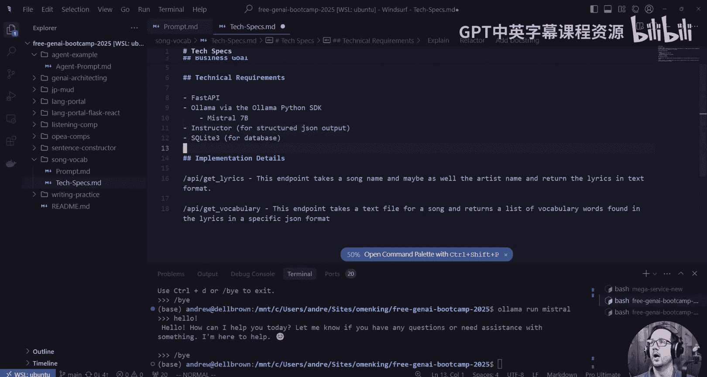

Here。The question is like what can I work with because that's where we're going to run into issues And so that might determine whether we should use ma or not。

 So we go to integrations here。 we have mystrel and Oama so ama is what I was talking about and so we can see that there is an implementation here。

So that is something that we can utilize， which is really， really good。

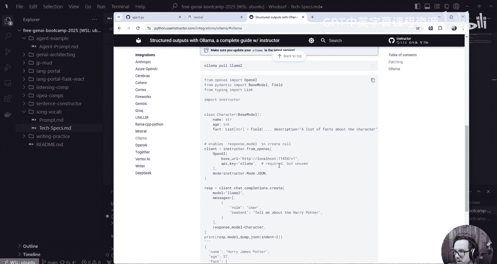

We， we need to get our lyrics， right， And so we be a little more descriptive here。

 So maybe the parameters。 So we'll take。We'll go here and just say。

Maybe this like get lyrics and API point。 So get lyrics endpoint。Okay。

 and then I'm gonna bring this down。 I like to format it more like this， actually。

 because then we get more descriptive about it。 Get vocab。You Larry。

And then we will bring this down here like this。So， we have。Yeah， that one there。

And then we will say， maybe， we just like。A PI endpoints。This endpoint takes a song song a name。

 So let's just say parameters。Request parameters。I mean， he says song name or song artist。

I suppose we could do that。 And yeah， and so this one。This one is required， right， so。Required。

Optional。Okay， and then the response。Paload， yeah， the response should be。The lyrics， right。Yeah。

 that's basically it。Let's say Jason response。Jason request。Sure， Jasonapp like that。Yeah。

 so that that looks fine to me。嗯。I might describe behavior。No。

 I thought it was really interesting that。George is eating duck do co。 Now I've used Serp API， but。

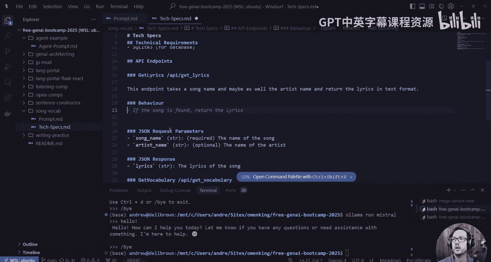

I wonder if you have to even do anything special duck do O。So if we go back over to his example here。

We have Duck duck O search。 Let's take a look at this。Because for the sp1， de，duct O。

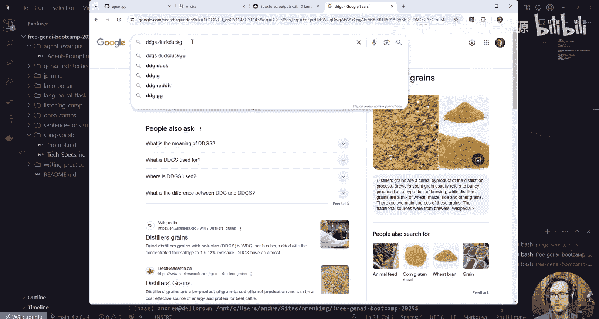

We had to actually make an account and stuff like that。 And I have that in thegenic essentials。

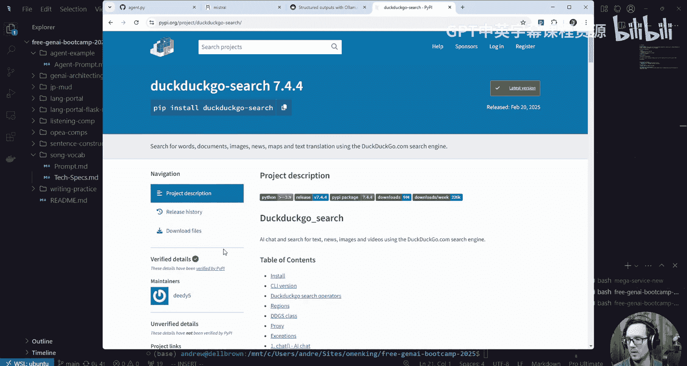

嗯。Yeah， it looks like you just use it， so maybe we'll use duckuck， duck O search。

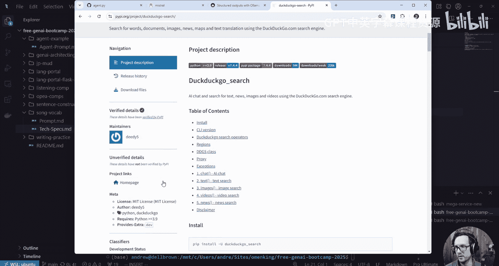

And we'll go here and。So like。To search the in to search for lyrics， okay。

The endpoint takes a song name， and maybe as well as the artist's name。O。Goes to the Internet。

Goes to duck duck go。And returns song lyrics。This endpoint will use an LLM。

So I'm just trying to think about this because， you know， we have the agent， right。

 and the agent needs to be responsible for interactions。

 And the idea is that we are supposed to be able to。嗯。Yeah。

 I'm just thinking about this for a second because are we defining tool use or we defining the agent because we go here and this is the search web feature。

 right， And so this is just a function that can be called。

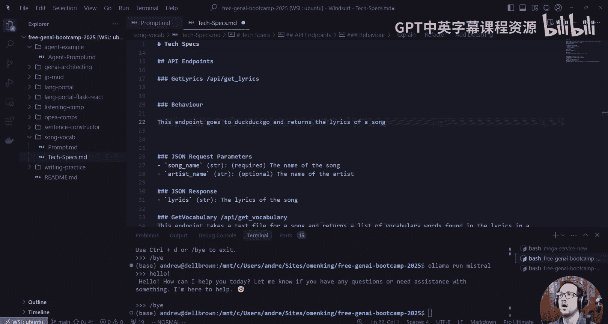

Here internally。 so I'm not really sure。If we need to do what I think that we're doing， right。

 because。

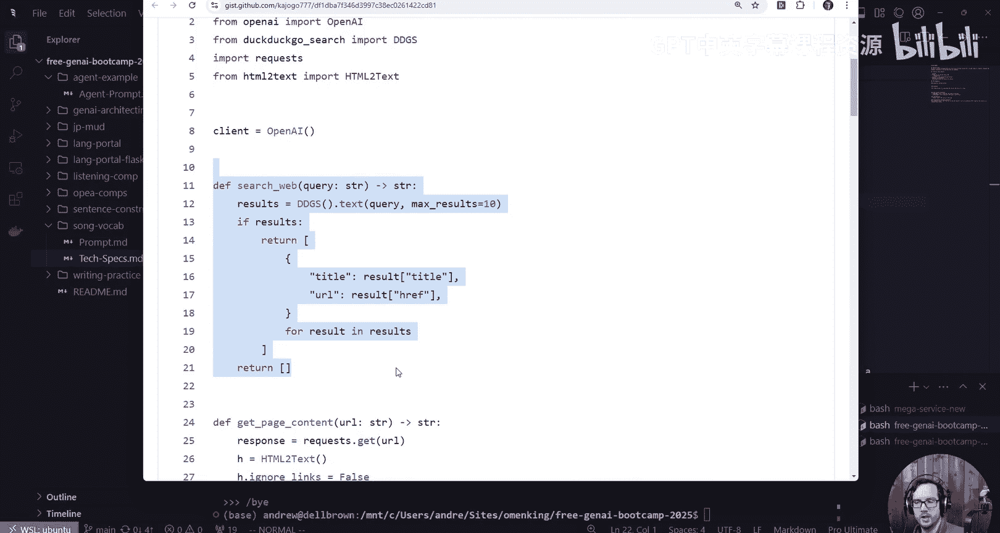

嗯哼哼哼哼。Do we really need these endpoints。Or do we just need a single endpoint that we can talk to。

 right？

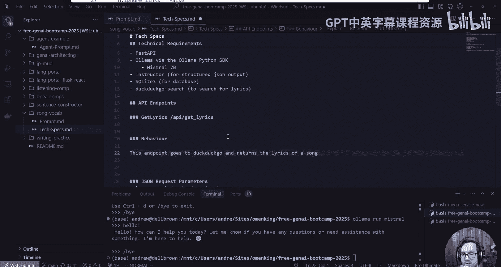

Yeah， that's my question。You're helpful language tutor， when you first interact with a song。

 you should provide using the native language， not goal achieved， whatever， whatever。um。嗯哼。

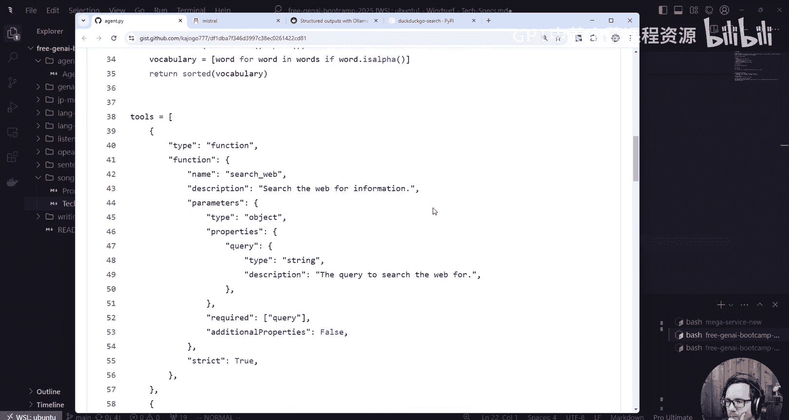

Yeah， I'm just trying to decide what that looks like。Right。

So maybe like a new folder here called Tools。And then， we might have。

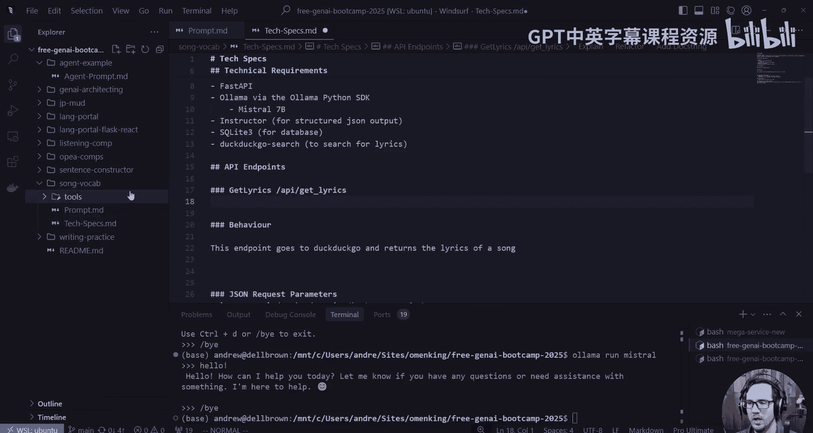

Like， is this a tool Like here we have search web， right。

And then here we have get page content from the web。 and then we have extract vocabulary。

 So these are three separate functions。 So I might go here and we'll just say what was the first one。

 He called it search web。 So like search web is more of a generic one。 So would say search web pie。

 I'll make another one here called get page content。

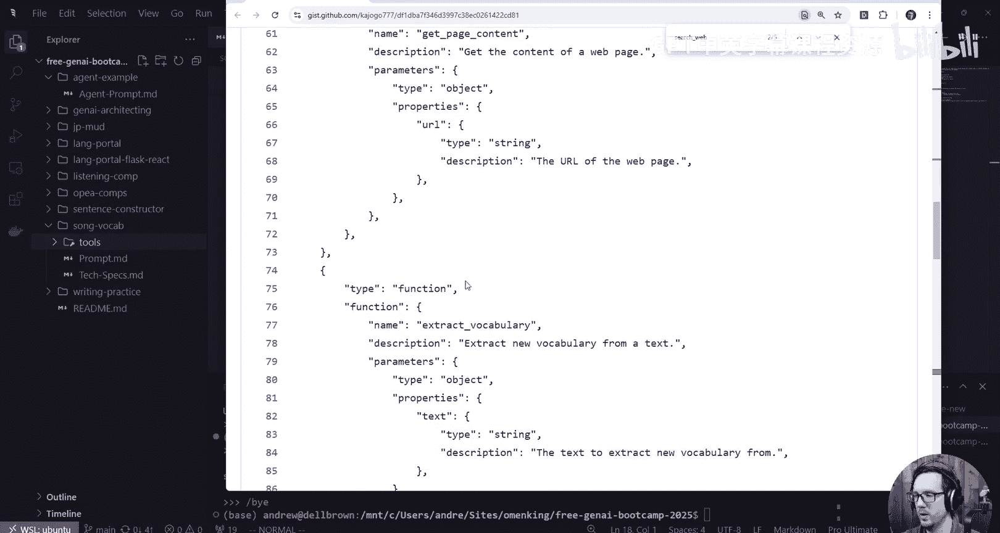

Pi， another one here will be extract vocabulary。Okay， so。This function， it takes a。

A body of text and will extract out the vocabulary。Into a specific。Jason structured Jason output。

Okay， so that's that。 Then we arrive over here。 So this will， I don't need to。

 I'm not sure I did to there， but we'll go over to this one here。 And so this。This tool。

 well in sevencom function。 we'll call it tool。 So this。Tool。We here this tool。Takes Ht L。

Takes web page content。And pares it to extract。Out the target text。Okay。This tool uses D Do go。

To search。The Internet。Four pages to then further crawl。Okay， so we now have our。

 our three tools over here。 We'll go back to our specs。

 And so I'm not sure if I really like what I've been doing with this API lyrics。

 becauseuse I kind of was trying to start to write the actual endpoints as opposed to the stuff。

 But this stuff is kind of internal， right？ So maybe instead of API endpoints。

 Like we still need to have an API endpoint where it's like， well just call it agent。

RightAnd so this， this endpoint goes to our agent， which is designed， which uses， uses the react。嗯。

Framework。So that it can go。To the Internet。Find multiple possible versions of lyrics。And then。

 extract out。The correct lyrics。And format。The， the lyrics。Into vocabulary。And so here。

 it's more just like。Request。Message request。 message request。

So a string that describes the song or end strong end or artist。To get lyrics。For a song。

 right from the Internet。Okay， we'll just take this out of here。 And so here we want the lyrics back。

 but I also want the。Vocabulary。So now we just have one end point， right？

 And we are saying like what it is。 And so there are specific tools that they can utilize。 So tool。

 tool use tools available。Is in is the extract vocab？Dot pi， the get page。

Content up high and the web search， which are in tools。Right。Okay， so I think we have。Enough here。

To help it define what it is。I don't know if it's gonna to be able to do it。

 We might have to just kind adjust it。 So I'm gonna go here。

 I'm gonna do the dirty thing we always do。 I'm gonna go get my text specs。

 I'm just gonna give it a name in front of here。 So it's a bit easier to find。

 We'll call this song vocab text specs。And so we'll go here and say song， vocab。Tch specs。

I'll say create my fast API。App and the agent， and it's prompt。Using tool use。 Okay。

 and so we'll go ahead and let it do that。And。Yeah， when George is saying like。

About those tools saying like， you know， these things don't need to know about the tools。

 it obviously does because you're giving it Jason。 And I've done a lot of research into this specifically was like cohe and other providers。

 and they are， they are injecting them somewhere right， So even though we don't see it。

 they are getting injected some way。 And so there's really no magic happening。

 and they just they might just do some preprocessing beforehand that goes in there。

But so it's generating our requirements at TXT。 I'm gonna switch this over to right mode。

 So I'm gonna stop here and say， sorry， sorry， I wasn't set。To write mode， try again。

And so now it should be able to implement those。We'll just give this a refresh here。

So you have requirements L TXT。 so we have fast API， U corn， Olum instructor。

 We know what U Cor is because we saw that in OPA。 we talked about it pyedantic since we need to provide a structured output。

 it was interesting that I don't remember it said as maybe was Derek。

 was saying that they they out produce a schema anyway。 So that's kind of cool。

But we can see that these are， are cr coming along。 So that's really， really good。Okay。

 so let's go take a look at a prompt。I don't see any prompt written。 Did Did it not write the prompt。

We do Okay， but， you know， put the prompt， put the prompt in the prompt dot M D。And actually。

 I'm just gonna move this around here。 I'm just gonna go make a new folder and called prompts。

And instead of having this， I'm going to delete it。It will say agent。嗯。lyyrics agent dot。MD。

Can you put the prompt。Into the。Prompps。lyrics。Agent and reference it and externally load it。

Soll let it go ahead and do that。 Okay， so it's gonna go to the races there。

 It's waiting for me to do something here。 I'm just going hit stop and run this again。

 And so now'll probably move that code out into the appropriate place。

 We will read and see what what it looks like here。

 But I've had good experience with this working here。😊。

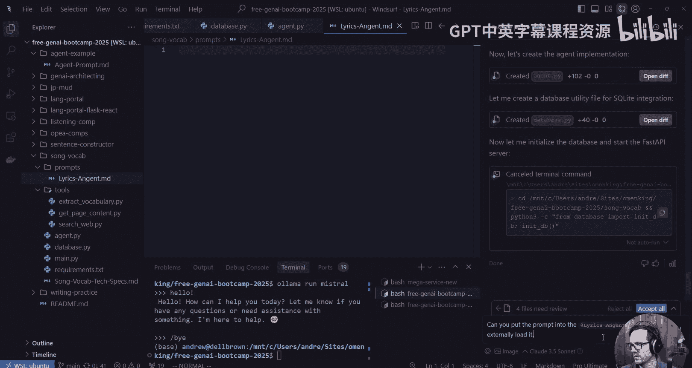

And we are using Myal 7， so I'm not sure like how much instruction it needs。

 but I would again just provide the instruction。 we can also try to take it out and see what George says where maybe it already knows about the tools。

But I don't know。 I I kind of feel like it needs to know a little bit more。 so it knows what to do。

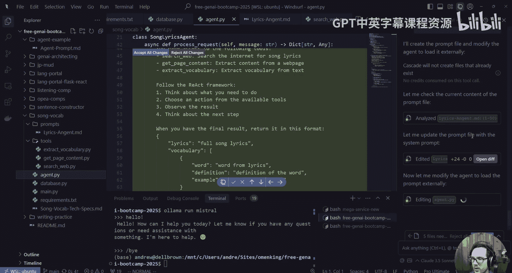

So I'm gonna go over to here， take a look at the lyrics agent。 And so now it's moved it over here。

 We'll just accept all for now。 It says you're a helpful AI system that helps find song lyrics and extracts vocabular from them。

 you have access to the following tools。 search web， get page content extract vocabulary。

 follow the framework。 Think about what you need to do。 chooseose an action from the available tools。

 observeer the results， observe the results， Think about your next step。

 when you have the final result， return it return it in this format。

 And so we see lyrics and vocabulary。 This isn't gonna really help out much。

 So I would rather just take this part out and take out the formatting because I would just say that。

Maybe what we can do is have a separate step， so like。

I don't think this is responsible for producing the。But depends。 So like， do we use a separate。

We don't really need。 Yeah， I'm just trying to think about this for a second。Because。

I don't think the agent needs to do this。 So like， you know， I know。

 I don't think the agent needs to return。Jason， because we will store the lyrics。

Somewhere when we download them from the Internet。And we will store the the Jason。

File after formatting。Maybe， maybe in outputs folder。So maybe all we need。Back is a unique handler。

To know what files。To。Load and then pass to Jason in the Python code。

 So we'll go ahead and do that because I， I think that might be a better approach to it。 I。

 I want to try to offload as much from the the agent here as possible。

 I wanted to basically be the orchestration of these steps and determine if it's good or not。

 So here it's talking about making an oppost director。 or let it do that。 That's fine。

And it's going to go ahead and update that code。And also， the lyrics agent。

Because it doesn't really need this step。

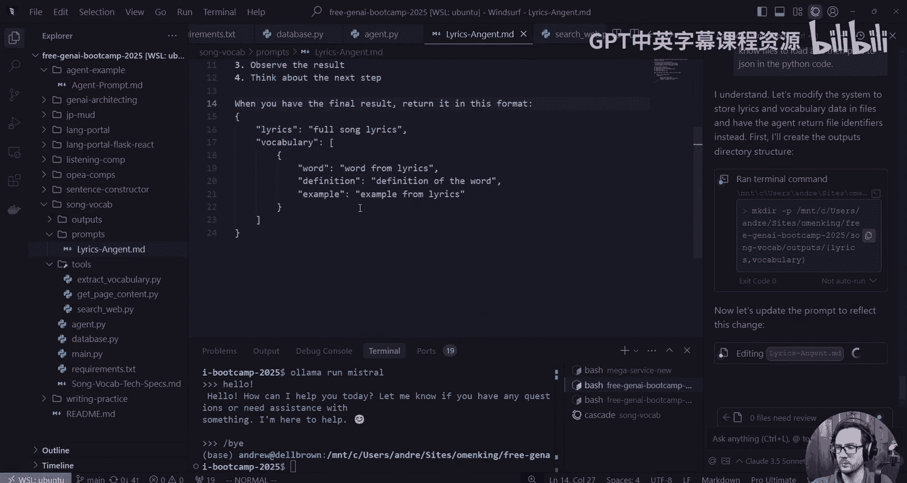

When you have found the lyrics and extractive vocabulary。

 lyrics will be saved in this directory and return only the song I D that can be used to look at the files。

 the song I should be a URL safe string based on the name of the song。 So that's good。

 The other thing is that， you know， my agent is specifically for my target language。 Now。

 we could make this very agnostic for whatever it is。😊。

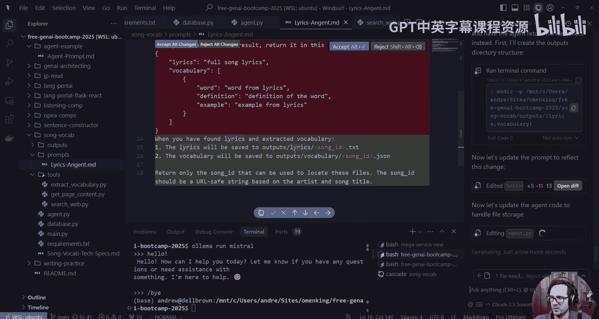

But the thing is， is that it has to be like careful for the extraction。

 So I think like for vocabulary extraction， it should be done by an LM。

 So we might have this over here where we it hasn't implemented any of these solutions yet。

 But I'll go ahead and accept all right now。 We'll just accept all。

 Let's just take a look at what we have。 So we have  Laama。 We have typing， instructor， Palet。

 pedantic。 We have our tools being imported here， which is。

 it's interesting because I've been told that I don't do imports right。

 but this is importing the way that I would import。We have a tool， agent thought， song lyrics。

 I'm not sure why these need to be pedantic。嗯， okay。We have song lyrics agents， so here。

It's a little bit different than I was expecting， to be honest。

 but we have the tools being defined here。And。We have generate songs to create a URL Sa song。

 That's fine。I mean， we could make that a tool as well if we want to。So I'm going to ask like。

 you know， should the generate song Id？Also， be a tool。Yeah， and so I'm just trying to think of like。

 whatever the agent has to do that it can just interact with it， right。

So we'll go ahead and just let that move it there。We'll give this refresh here。

 So now we have generate song ID D。And so'll just say accept all。 So now we have another tool。

 Our tools are coming along here， which is good。' gonna go just accept all here。

 So we have generate song I extractful caterularar， get page content， get search name。😊。

These are just some paths。 So we know where some things are。 Okay， so those that makes sense。

 They have process requests。 So here。We have async process request。 So that's an incoming request。

 We say open the file。 We have our conversation。 Find the lyrics and vocabulary for。The message。

Max turns5。 So it's doing that kind of limit that。George was talking about it。

 So that's kind of in there。 is's trying to use Mistrel。 Now That's this client chat。

 I'm not sure what it loaded in here。 Did it load ama in here。 So we go here。 I'm looking for  laama。

 It is。 It's assigned the client。 I'm not sure if that's correct or not。 But if it does。

 that's awesome。 And then we go here。 we see agent thoughts。 So here's the response model。😊。

So the response model here。Is thought action， observation， song I D， lyrics， vocabulary。

 Why do we need the， So I'm gonna ask like， you know， why do we need pedantic。To structure the react。

For that。Is this needed？Like， I don't know。So this is what I， I don't。 I mean， I guess， like。

 if you're parsing it and we actually do have to parse that that might be an issue。But here。

 what it's doing is， whoops， I didn't didn't even necessarily to change it。

 but instead of using agent thought。Here we'll just do basic parsing。And so I think I'd rather， yeah。

 I'd rather have that because it hasn't implemented the， implemented the。The tools， right？So yeah。

 so， you know， when I， when I was talking about。Instructor。

 I was talking about using it in the extract vocabulary tool。Let me show you the format， Okay， so。

So I， I'm not going to tell the format， but I'm gonna just go ahead and do that。

 And so now it's going to go ahead and try to implement that。

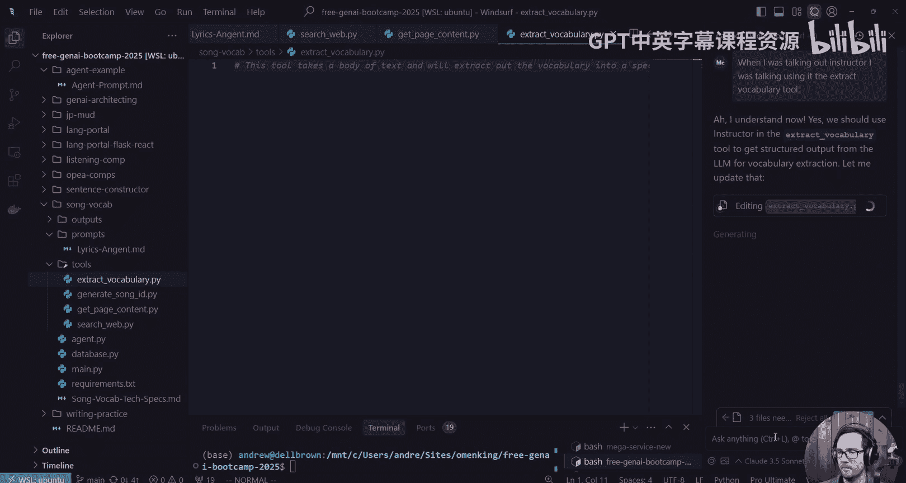

I think we generate song I should already be here。 So that's good。 We'll just accept that。

 That's totally fine。 This is not implemented yet。 This is not implemented yet。

 We'll go over to our extract vocabulary。 I'm going to go ahead and accept that。

 So here we have vocabulary item， word definition， whatever。 This is not what I want it to be。

 We actually have a very specific format that we want。 And it should be in our Lng portal。

 What reference we want it to be。

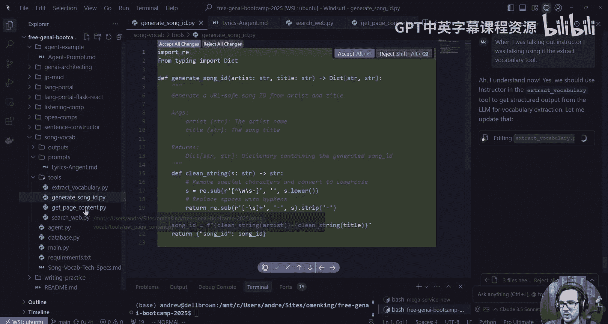

So we have flax react here if we go into here into backend flask。Into Json format here。You know。

 this is。The format we want。The adjacent output to be should match。What we see in。Data adjectives。

Okay， and so that should help it out。I'm just worried when we have so much stuff going on here。

 can't see what's going on， but here I hope that it fixes the structure， right。嗯。

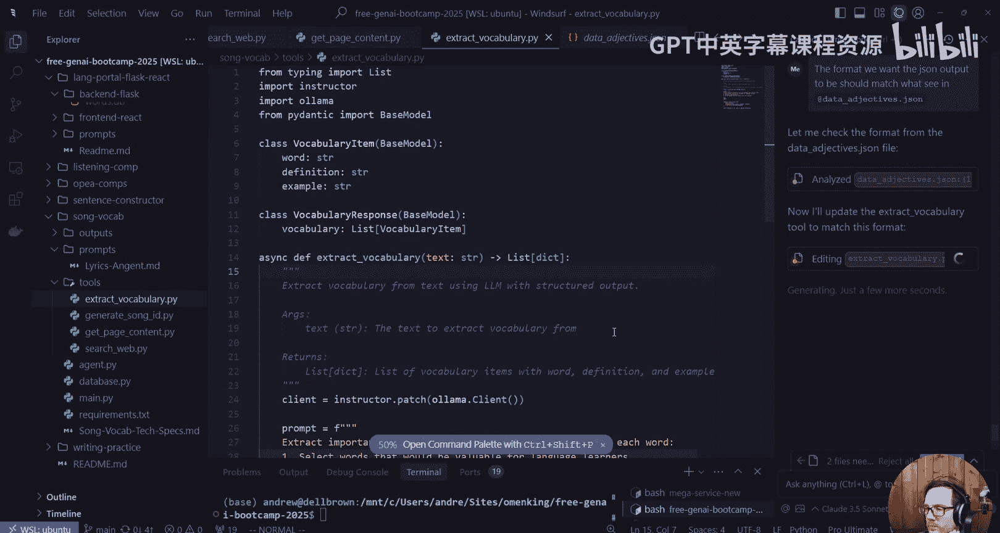

I guess another question is like， is Mrel 7 multilingual， I mean， you must do French in English。

 Miel 7。Is it multilingual。So saying that you shouldn't use it for Japanese。

 maybe Russian Chinese supports。Mar largege2。Well， what are we using。

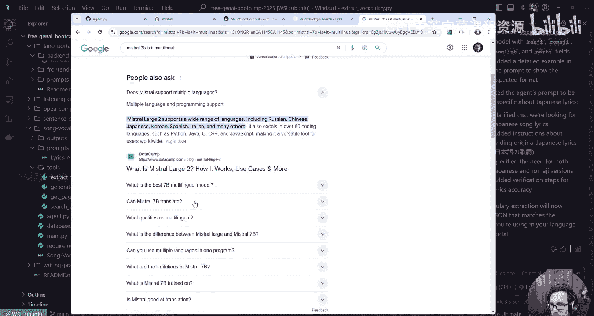

I guess we'll find out as we work with it。 we can always swap out the model。

 So it's not that big of an issue。Up to the agent prompt to be more specific of Japanese lyrics。

 Clify what we're looking for here。 And we really， really， I'm just going to focus on Japanese。

 Now you can try to make this generic， but the pars of the vocabulary really matters。

 And that's where we're gonna run it is in trouble。 Expt the Japanese vocabulary here as an example。

 And so there we have that update。 So that is good。 I'm going back to our agent。

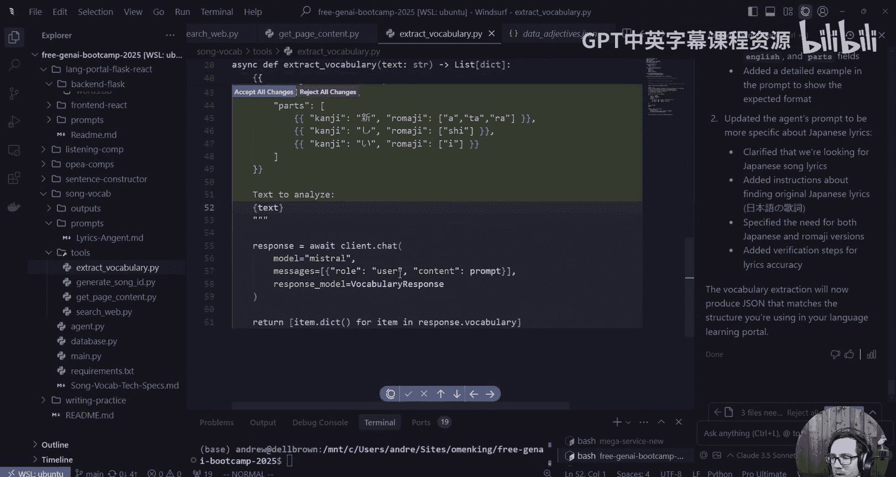

And。The other thing is that， you know， the agent needs to know that this is for a very specific target language。

So go ahead and accept this。So here we have， youre a helpful assistant for oh。

 update to Japanese vab。 That's perfect。Try to find the original Japanese lyrics。

 That's exactly what I wanted to do。 Make sure that you get both the Japanese ramaji versions if available。

 verifyify the lyrics are completely accurate。 That's perfect。

 The lyrics will be saved in the output directory， et cea， et cetera。

 return only the song I that can implement do that。 So if we go over to here。

 This is using this is using Mr， which is perfect。 That's what I wanted to do。

 So extract the Japanese vocabulary following the text。

 each word has the following things like words that would be valuable for Japanese language learners。

 Now， we want all vocab。 So in this file。 So first of all， for for the extract vocab。😊。

Can we move the prompt into the prompts folder？And we need to get all vocabulary。From the。

 from the lyrics。Not just some。Okay， so we'll go ahead and let it go and fix that。

 So it's gonna take that and move that into the prompts directory。

 And I'm hoping that it'll be a little bit more explicit about what it is that it's going to utilize。

 We'll give it a moment there， okay。

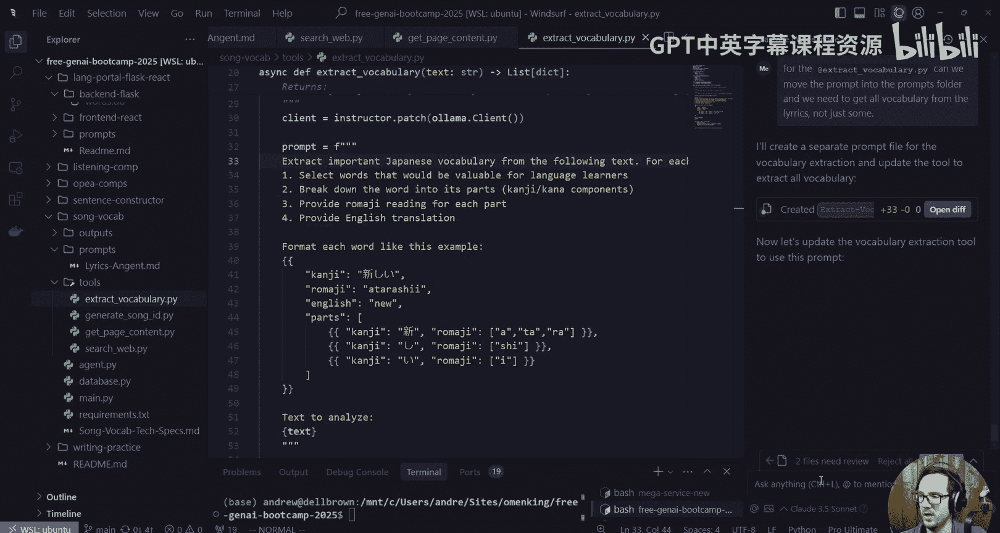

Alright， let's take a look here。 So we have in here it extracted out， maybe if we give this refresh。

 it's now in extract vocabulary。 So it says extract all vocabulary， include every word from the text。

 including nouns， verbs， actionss verbs， adverbs， particle expressions。😊。

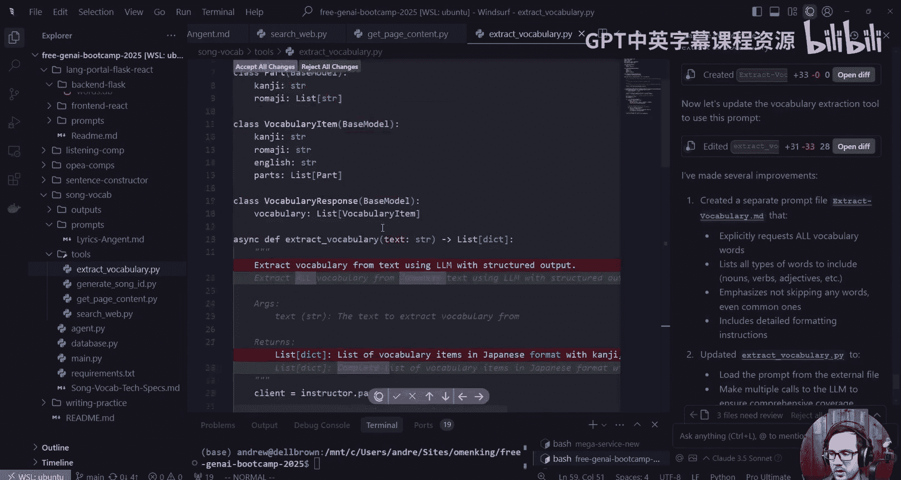

We don't need。The particles。So。I would probably change it to say include every word from the text。

Nouns， verbs， adjectives， adverbs。Ignore grammar， grammar or or， you know， fixed expressions。Right。

 break down each word into each parts。The other thing is like， use the。

 I want them to use the dictionary。 do not skip any words， Even ones。

 even common ones include all grammar。Do ask give me even common ones include all grammatical formats。

I mean， it depends like。嗯。Provide words in their dictionary form。Convert words。

To their dictionary form。Break down component words in their parts。

 Make sure Rammaji is a for each part， which that last one is really important because I always had a lot of challenges with that。

 So I like that it did that。 It says that。So this is kind of really what I want。

 B down each part here。 We'll say number 3 here， change that to 3。 And yeah， so now we have。

Those three parts to it。It doesn't say like you are whatever， whatever， which is fine。

 I don't really care if it has that there。 And so now that one set up。 So we go extract vocabulary。

 And we'll just accept this here。

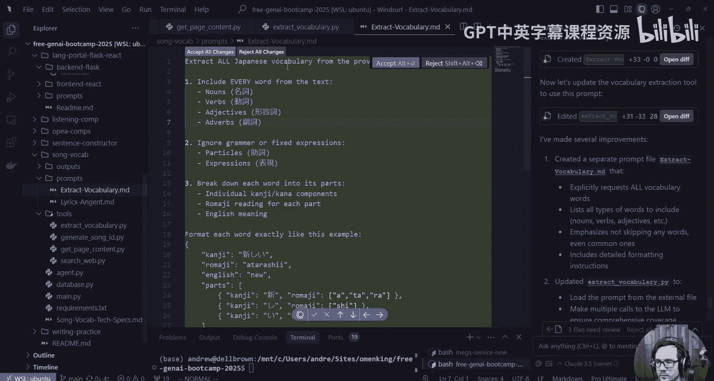

So this one， this one's using oama as well。 I'm not sure how that would work if they're using the same model。

 I assume it could do that， maybe。We'll go generate model， generate song here。We need to implement。

The search web。Tool， I don't think that's implemented yet。 It's not。

Let's let that go ahead and do that。It was cool because you could keep like making a bunch of tools。

 I'm surprised we just don't make a ton of tools in this bootcamp and then leverage them into their core things。

 But even like extract vocabulary is something that could live as its own little app that should be shared among other things。

 which we don't do here。

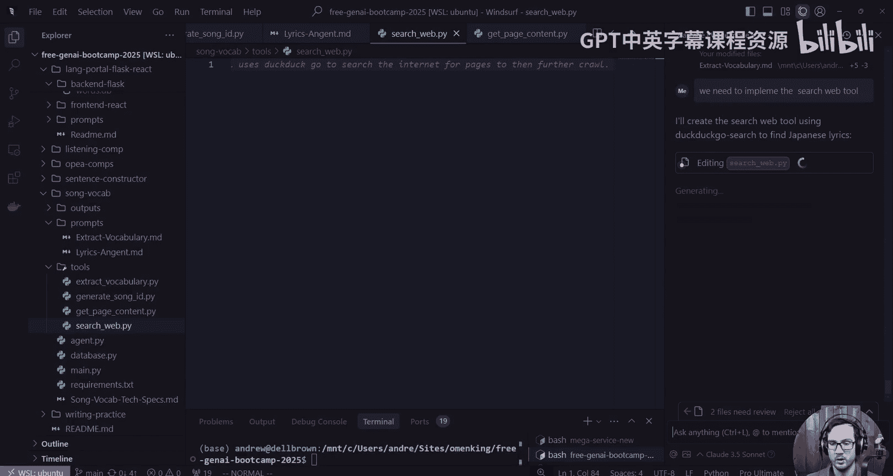

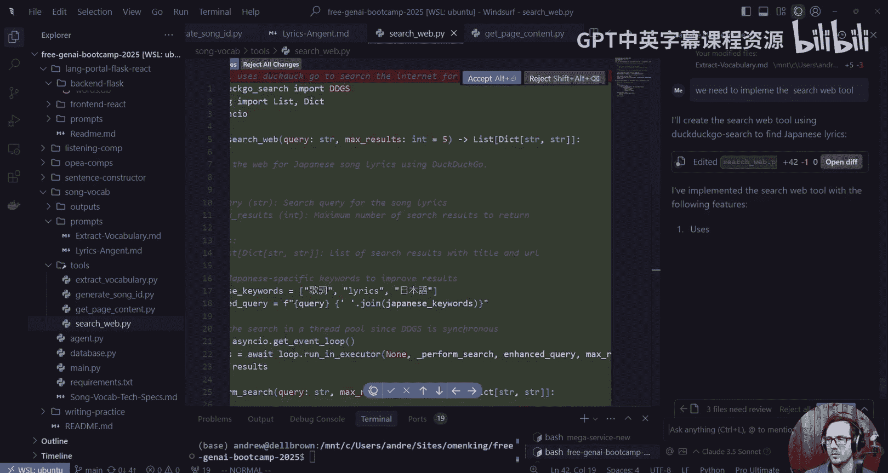

But here it goes。 We have duck that goes and implementation。Okay， so that mean， this looks fine。

Add Japanese specific keywords to improve results。 So we have Nihgo。 And I， this is。

 I know that's words like Uta。 So that's like to sing。 but I don't know these two con together。

 But maybe that is correct。 The first kji looks good to me。 And so we have here using duck dot go。

 I mean， I don't know the API that well。 But it kind of looks like the one that George had provided us。

 that we need to implement like， okay， now the get。呃，Page content。Right。

 so this would have to parse the text。And so we could use beautiful soup or that H L tool。

 but we'll see what happens here。Yeah， I could also rip it out。

 but you probably want to try to pare it down as as it goes。

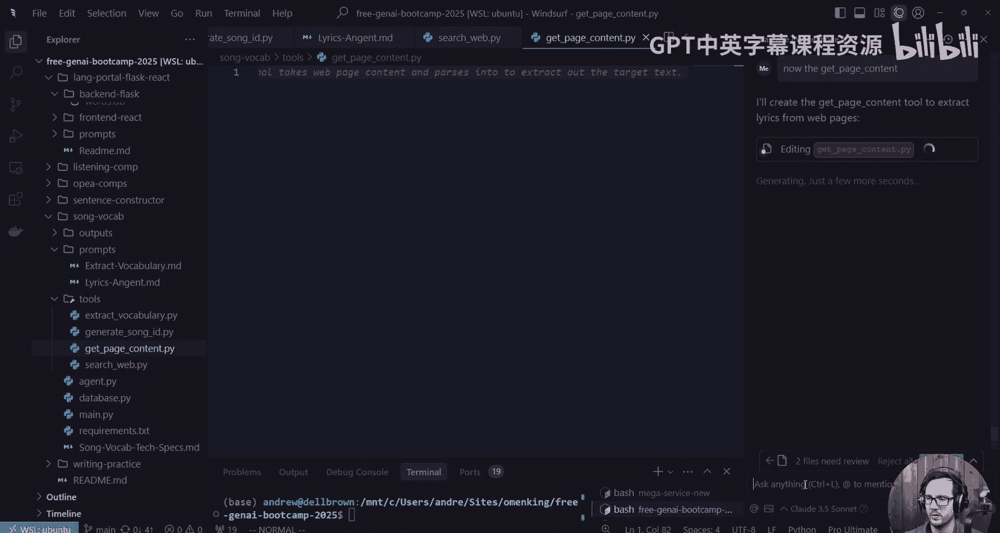

So give it a moment here to generate， okay。Alright， so we have an implementation here。

 and it's using beautiful soup， which is fine。 I， it's beautiful soup is a lot more robust。

 But the other one that。😊，That George is working is， is totally fine as well。

 Sometimes you want a simpler solution。 But if it does all the work for us to extract it out。

 that's totally fine。 let's take a look at what it does。 So here it says， get the client。

Japanese lyricsmaji lyrics， beautiful soup， script header。 that's removing stuff from it。

 It's looking for matching patterns。 I'm not sure if that would actually work or not。

 This seems a little bit more complicated。 Like it seems you just grab the text。

 Bu going to try it anyway， even though I'm not really confident that that is a good solution。

 So now we have our agents implemented or our tools implemented。

 I wonder if it's aware of what our tools need in order to work。

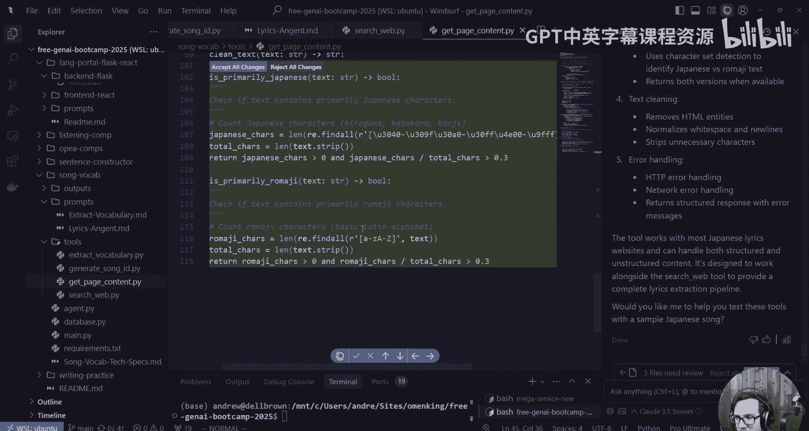

Because it doesn't describe its inputs or outputs。So here we have tools。 where does tools go。嗯。

How does it know how to work with the tools。Yeah， I'm just not confident that it would know what to do with them。

 But anyway， what we'll do。I think we're still running。The model somewhere here， are we not。We are。

 So if we say mystrel run。Actually， I don't even think we need to do that because it's going to use the API locally and do that。

 So to say by， that doesn't mean Mrels not run or O' is not running。 It is running the background。

 But I think while we're ready to actually。Try this out。So say he， so how do I。

 how do I test my model。How do I test my code。How do I run my code。Cause in here。

 I don't see the fast API。

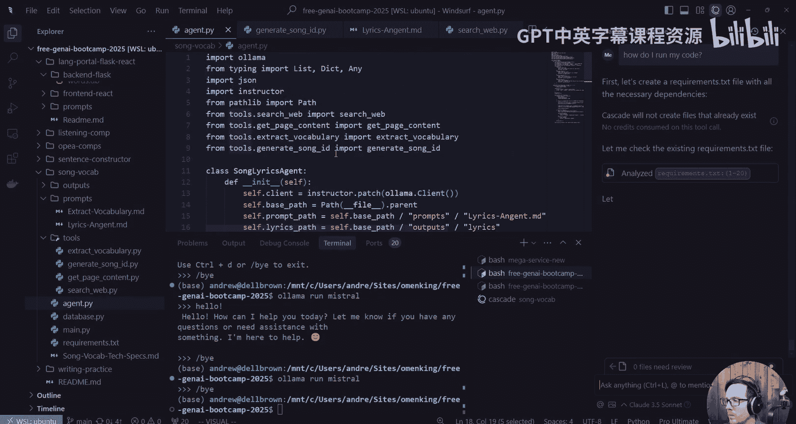

呃。Why is it doing that？ Its a bit confused， isn't it。Well， I guess sorry。 it's right。

 We would have to do that。 This that makes sense。 So I'm gonna go into the correct location。

 So this is the song will cab。 We'll do a Pip install requirements at T X T。But the thing is。

 it doesn't have any。Fast API implemented here。 Oh， we do have a main over here。 Oh。

 we have a main over here。 Okay， we never looked at the database。 I don't want that for the database。

 I do not want this to happen。 So we'll go ahead and ignore that for now， at least。

 And so we have our API agent。And in here， we have this， right。I'll just say， like， you know， can。

 can you write a， a curl curl command that I can use to。To test the app。So。Get the song lyric agent。

Process the request， get back the song I D， read the stored files， return it， Otherwise return it。

 and it's not doing anything with the database。 Now， there's this over here。

 which that could be a separate action， right， Like we don't necessarily have to do this the same way。

And here it's trying to run it with U V corn， which I guess is a way that we could run fast API That makes sense。

 I'm going go ahead and copy this。 We'll make a new bin directory here。

And I'm going to go ahead and just go。gett like， I dont， I mean， it's not a get。

 it's supposed to be honest We'll say post here post。嗯。It will say post API agent。

Find the songs from， Oh， Yaba sobi Idol。 It's interesting that it shows that。

 I I actually know that song。 I mean， I don't know the show。

 but the song is very famous'ca it's a very fun song。 But we will go ahead and like for an anime。

 it is。😊，Useer bin bash， that's what I want here。And so now we should be able to do is just run this。

I'm going to make a new file here called Reme dot M D。谁？How to run the server。And then we have。

 you know， how did， how did。You how to test。AI。Or how to use the， how to use the the API。 Okay。

 so what we'll do is we go down here。I really don't expect this to work for a try。

 but at least all the codes kind of in place， and I'm kind of okay with it。

Port 20 port has automatically forwarded the process based on that I've never seen it say that before。

 but that's fine。 We'll go ahead and run the next， next command here， whoops。Let's ignore that there。

 I'll go to this other， other tab here。 We'll go into song。Here。

 I can give to Chamod U plus X on our bin post directory。 And let's go ahead and run the bin post。

Okay， so we run this and it says function object has no attributee completions。Oh， okay。

 and so we'll go back over to here。 and we have an internal error。

 At least it told us what the problem was。 We'll go over to here。And。Search for completions。

Let's come back here。No attribute call completions。

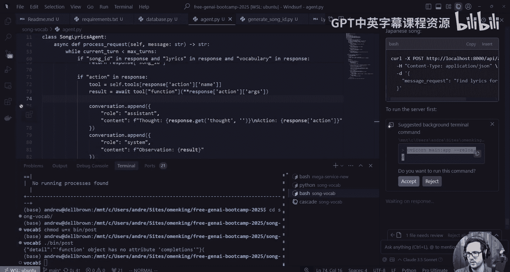

嗯。So the only challenge here is like we can't really tell what's going on。

 so we need like more robust logging。You know， I get an error。I get an error。

Can we add lots of logging。To our tools and our API and our agent code。

 so I can clearly see clearly see。Where the fail is occurring。So we'll go ahead and let it do that。

 We be back in just a moment。Alright， let's see what it did for more robust logging。

 So it added a logger， which is fine。 And actually， I do like the format that it's using there。

And I'm not sure why I removed the tools。嗯。W to remove the tools。

Rub start your pass since it was causing the completion errors。 Well。

 I wasn't tell what to do there add a detailed logging for to improve error handling。At a request。

 logging function objectivity completions was happening because we were trying to use instructor do patch on the a client correctly。

 I move that。 and now we're using aama directly。But I wonder why like， it took these out of here。嗯。

I mean， I never really understood to begin with why I was trying to do tools here。

 because I don't think it would have been aware of it。 ah。

 So maybe that was kind of the old code when it would had another structure。

So that does kind of make sense that it does that。 We'll go ahead and accept that。

 I want to see if it added any logging over into our main dot pi as well。 It did。Okay， good。

 So now we might have a better handle of what's going on here。 I know we don't have to restart it。

 I'm gonna restart it anyway。 and we'll go over to bash。 I'm gonna go ahead and run Bbo。

And so now we have no search results found， which is fine。 And so now we go here。

 we might be able to see some logging， and we do。😊，So over to here。And。What do we have。

So we have receive requests， fine lyrics for Yosabi iddol。Right， initializing the songs。

 output directories。So I guess it's just confirming that they're created。

 initializing the old law my client， which is good。

 O my client initiated process request through agent request request process can find lyrics for oh。

 so it's actually telling what the agent is doing here agent， main agent agent。

 I really did like the way that。It was showing the information from the way that。We call it。

George had done it。 and we're kind of getting it here。

So find the lyrics searching for searching for lyrics。 And so it's going to duck duck go here。

Its showing us 200，200。Error during search link， no search results found。 Oh， interesting。So。嗯。😊。

Yeah， I wonder why， because like， if we were to search fine， you know， do this。Like， okay， we'll say。

 you know， does the logging make clear。What search requests。Are happening with with D duckco。

And I remember that when he was doing， he was getting a lot more output back。So I'm just curious。

If we look at his implementation here， if it did some kind of iteration。

So this one is this one was really， really simple。 You see， it's just it's search web。

 and it's all it does is give max results 10。 So he was just looking at the the top 10 max results。

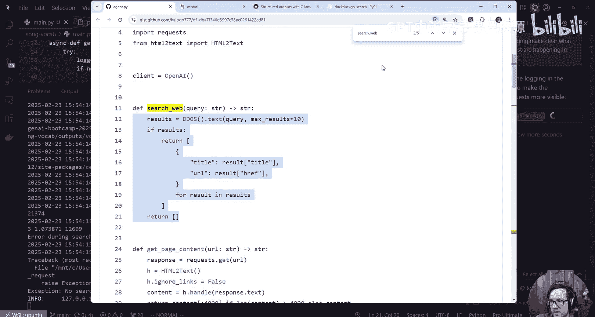

let's go over to here and take a look at what we have in ours。And so this one here。

 it's going to inject some certain things into here。But it's not， it's not。 well， well， actually。

 it's customizable so we can put in more results if we want。

So let me go add more logging to the get content page to better track the web page fetching content extraction。

I mean， I want to know what it did here that make it more visible。Logging。

 so it has that query there， but did we already get that information。No， we did not。

 So this might help a little bit more having more of that information here。Again。

 I'm not sure if we really need to edit that page， but we'll let it do it if it wants to。Allright。

 so' go ahead and accept that。 And so there is more stuff going here。 Again， I。

 if there was a problem， I feel like it would be this parsing area because it's not very good。

 We'll go ahead and hit up。And remember， we're just using Mrel 7 locally。 So if we get good results。

 that'd be really cool。 It says no search results found。

 Let's go back over to here and see what we're getting in terms of our results。

 So we are getting an error during handling。 But let's take a look a little bit closer at our。😊。

I would put here， I'm gonna go switch back to Stanton here my legs are killing me sitting surprisingly。

 but。Now we can kind of see better exactly what it's type in for fine search results。Okay。

And just give me a second to get raised up here。 one second。There we go。

And I'll just fix my camera here for two seconds。There we go。Okay， and。So we can see。

 We can see that。We're getting fine lyrics for for Yossobe iddle lyrics。

 and we could probably grab it this way。 I'm not again。

 I'm not sure if the way it's searching is great， but we'll just go to Duck duckuck go and find out。

Like， what is it return if we do that。So we go to D duck go here。And we'll type that in。

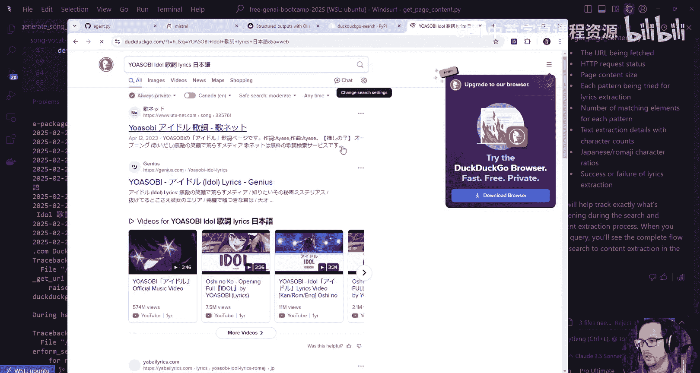

And we do get results back， so clearly that's going to work。

 That's going to be totally fine as it means to search。So we say running duck。

 Go search in the thread pool， opening duck。 go session for query fine lyrics。

 requesting five search results， which is less than what we normally do， but that's totally fine。

 like from what George did he did 10 error during D。 Go search， get URL URL rate limit。Oh。

 so we hit a rate limit。 Oh， okay， I didn't know we had a rate limit。So go here and。

We'll just tell it。 So clear there's a rate limiting issue。

 And so we'll just go ahead and paste that in here， and maybe it can help fix its own problem。Okay。

 so。Maybe we're hitting it too fast or like I don't know if we have to sign up for D。

 go in any means here。We'll add a rate limiting retry logic to handle this better。 Yeah。

 that's probably a good idea。But you know， I would have thought that it would have needed an API like an API key or something。

 so like if we go here and we'd look at the project information here。

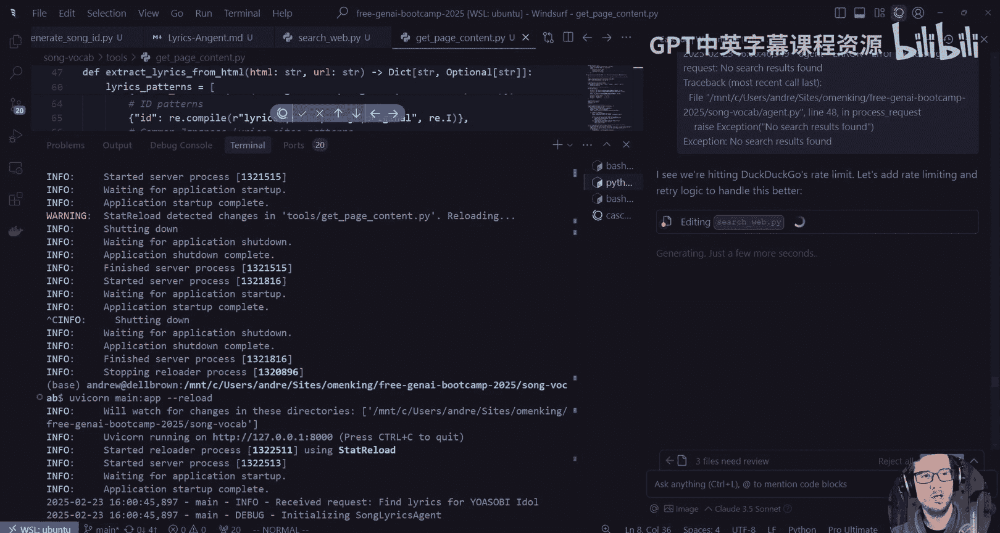

Install DDS class。Does it need an API key， that's like that's what I keep wondering。Oh。

 it's interesting， initiate a chat session with DuckD Go AI。Oh， that's really interesting。

I did not know Duck Do Go had an AI。Tech search by tech do dogo。Image search。Videos。

 things like that， news， disclaimer， this is not affiliate with it。 So yeah， again。

 I don't think it has an API key here。 So it says it at a rate rate limiter class。

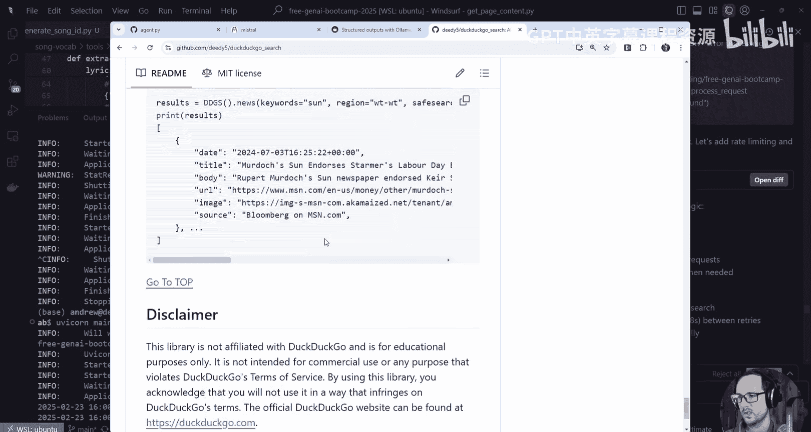

It implemented an entire class for， well I don't understand why didn't we have this problem when George did it。

 So if we go over to here。

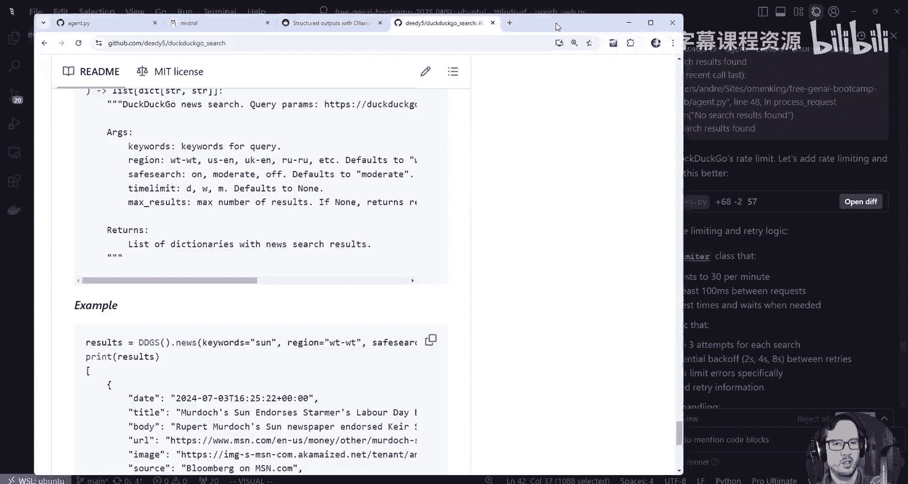

I mean， he just uses it and get the 10 results。 So it's very， very straightforward and simple。

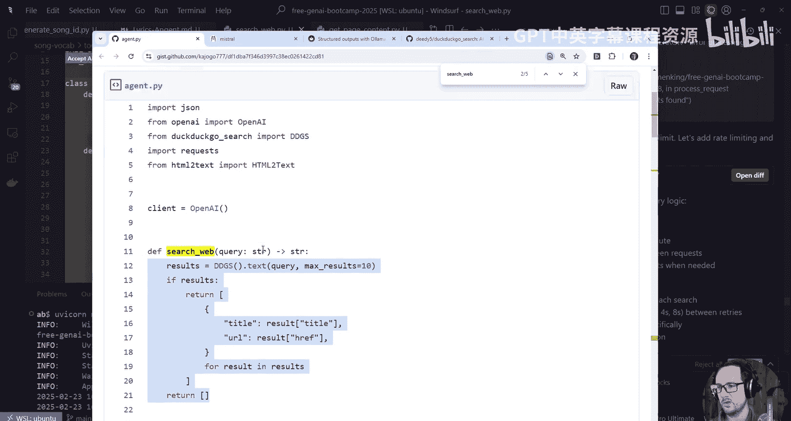

Yeah， I'm not sure like I don't， I can't imagine the underlying implementation is much different。So。

 if we go over to。Our tools here into search web。Yeah， sure， I'll accept it。

 It's fine If we wants to do real limit， that's fine。 we go search web here。

Maybe because it's trying more than once。 but I really again， I don't think so。

 but this rate limiter might help it wait a little bit and put in some delays。

 So that might reduce our issue。 if we do hit a rate limit I'm actually wait and re try。

 the logs will show exactly what's trying the rate limit。 try searching again。 Okay。

 so this might help a bit。 I probably don't have to stop it every time I'm going to do that anyway。

 though we'll go back over to here。 I'm going go ahead and hit post and we'll go back over to here。

 And we'll see what the results are。 We immediately get an error back。

So rate limit hit retrying in eight seconds。So that means we're totally fine for now。

No search results found。Found zero search results， error processing， no research results found。

Were hitting this rate error limiting issue。 again， I don't know why we're having this problem。

 So what I'm gonna do is I'm gonna modify the tool。 I'm gonna say search。Web。With。Djiji。我 say。Djiji。

Duck duckco。 Okay， so。We'll make a new one here we'll say search web。I will say sp。Pi， okay， so。

We are having problems。With duck duck go。Great limiting I've changed。

I've changed the name name of the tool to search。Web ser。Search web， DGG。Yeah。

Can we update the court accordingly， Can we also implement an alternate。Search via Serp。

 I have created an empty file。For serp in search web Serp。 But yeah， again。

 it's just the fact that it has to use an API key which is fine。 but we'll see what we can do here。

 So it'll implement the Serp implementation。 We show how to do Serp in the Jeni essential。

 so you can see that in that course there。 but it will implement that one。

 I hope that it updates the name for the prompt here。 we go back over to our lyrics agent。

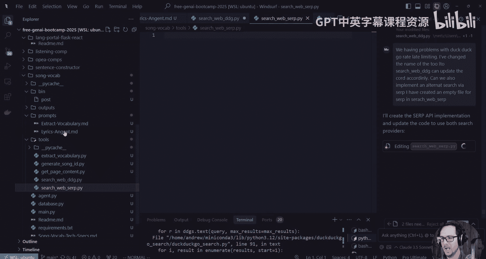

And it should tell us about the， yeah， and here。I should know about it。

 but I didn't see it update that。 so maybe it doesn't know。 I'll create a Ser API。

We'll give it a moment there to finish updating。 one thing going to noticed it is it made a search web file。

 which I'm not sure why I did that。 And so。Like， what， like， why did you create a new search web。

 We have search。Web surf and search web。DD G， I think I matter have got confused there。Right。

 we don't need a separate。 Let's， let's update the agent to try both search providers。

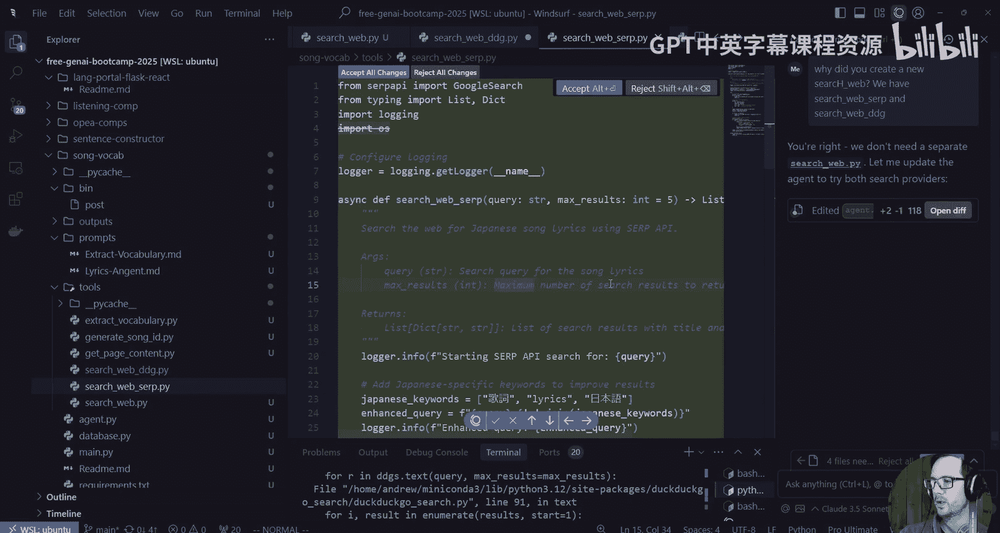

ok。Yeah， I don't know why I did that， so I'm going to just still delete this file out here。

Cause that's kind of annoying。And so here we have the SerERP API implementation。嗯。

We probably need the Ser API key， so I'm going to go figure that out。So we'll say Ser API key。

 Serer API。

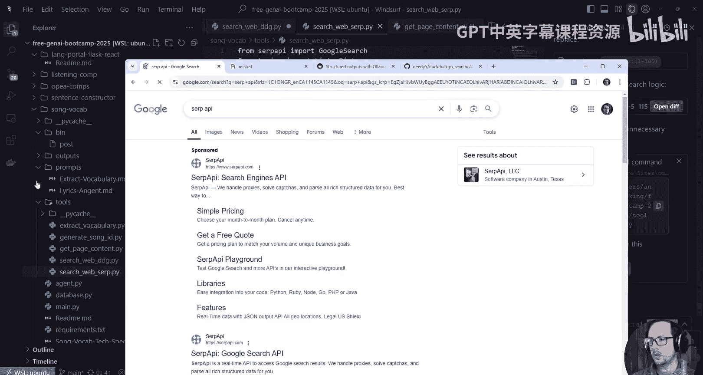

And I remember this being kind of a pain to use， but。

I mean， it wasn't a pain， but it's just kind of like not the best。

I'm hoping now I can log with Google and get in here。 So let's try this。

There we go， and so I have a key。

Obviously， don't share keys。I'm going to actually rotate this key out。

 manage keys and regenerate API key okay。

嗯。And while that's going there， I'm going to go take a look here。Yeah。

ve I've already done this last step here。Looks up to all。

 And I'm gonna go look up the docks here and see， you know， where do we。

How do we use the key， So we go here to Ser API。 We'll go into documentation。And。

There should be a way to utilize the key here。I don't know， but we'll go back over to here。

 and so the Ser API key must get loaded somewhere， right？

Sert API key Here it is。 Okay， so I'm going to go and this update this with a dot E And V file。

We will also add a good ignore this。Get。Ignore gi。Ignore。

 and in here we will ignore the output directory。All the files in it。

 And we'll also ignore the dot E And V。 This could mess things up if we don't have a。

We'll just say dot Jason dot text in here， because we， we don't， we。

 we all want the outputs director。 We just don't want。That， that stuff there。

 I don't know if it's gonna be outputs or output。 Yeah， it is outputs up here。 So that's perfect。

And it looks like it goes into respective folders。 So I'm gonna go here and just say like this。

 So any， any subfolders here， I think it's just singles actually。

 And so it should ignore the dot and V。 But we go over here。 we can put in our Ser API key， Ser API。

Which I have somewhere here。So I I grab my， I don't need to regenerate， but I'll grab my key here。

 and then we'll just do the equals here。 What does it want， It wants Serp API key。

 So I'll make sure that is correct。And what we'll do is go down to our requirements at TXT。

 and we'll just do a。No， come on。 Python dot E And V。 Yup。

 I don't want to fix it with a specific version。 I don't like that it's fixing versions。

 like you should fix versions， but you should be very deliber of what it is。

 And it could be doing really old ones。 Like this might be a very old version of instructor and same thing with  laama。

 But if it is working， it's totally fine for now。 But I'm just going ignore that。

 So now we have dot Python dot E And V。 We'll go up into our main do。 And。😊，Yeah。

 we'll load the dot and V file。And so that that way it willll bring in that here。

So we take a look here， this looks okay。There is a newer API。

 so I'm not sure if this is pulling up the old one or not。 so we'll have to investigate again。

 this is only because I've used it before。 So if there's code that I've never done before。

 I generally do it by hand。 And then when we're doing this。

 then I at least I know what I'm looking at， but except for the go code that we did earlier in the boot camp but。

Let's take a look at the agent and see if it updated the tool we use。

So none here necessarily doesn't matter。But here it would extract out like what kind of actions。

And it looks like it maps the tools， this is responses tools， so where's that tools？Oh， it's up here。

Oh， interesting。 Well， the house has it mapped tools， responses， action name。Tools。Tools。Okay。

But where's the， where's the tools。How does it know what the tools are。

Because before we had that dictionary， right？And now I'm not seeing it here。嗯。Okay， well。

 it seems to know what tools to work with， despite us not explicitly calling them here。

 which is kind of interesting。A weight function tool。 No， okay。 So it's dynamically calling。

 which is actually kind of cool。 I like that。 But， you know， if you wanted。

 if you wanted to be more clear， you can make it a lot more explicit。 That's usually how it works。😊。

But we'll go ahead and I'm going to stop this here。And so， you know。

 we haven't fully read the serp code， but we'll just see what happens。And we'll just try this again。

I think the server didn't start no module name API。

 That's fair enough because we have to do a P install haven R requirements at TXD。

So we'll go ahead and do that。 We'll go back to this。 We'll go back over to here。 We will hit up。

 and。No。Did not add it。So we'll go here， maybe use that sp。Set API。

 and we'll go ahead and try this again。And we'll try this again。

 Hopefully that is the right one to install。Cannot import Google search from Ser API。

 So let's go over to here and take a look at how we actually install it。

嗯。

Serp API， Github， maybe some Github。We'll go here。Serp API， Python。Get like。

 I'm just looking for the client。 Here we go。 This is the client。

 So maybe I didn't name it correctly。

Notice Ser API， it didn't put like a hyphen in it。 No， okay， that's fine。 importport it。

So we'll go over to Ser Pi。And。Here we can see that it does this。啊。ItDoes't know that。

Becauseuse again， I think that it has a newer API。Yeah， like see here。This doesn't make sense。

 It's I think it's using the old API， so。I'm gonna go T it to try these new one。 So， you know。

Are you using the new API。Becauseuse maybe it's getting confused。Yeah， it's been updated。

 I know it has been updated。 Like I can just even hear。

 but I know got the docs here from this part of the page I saw earlier。not exactly， but anyway。

 I guess we'll see here。

I'm trying to remember if actually even used the now that I'm thinking about this a bit more。

 I think actually I use the Ruby implementation。 and that's why this code looks a bit different to me。

 It says no module name， search， whatever。And， I mean， we can try again here， but， you know。

 we might just have to actually read the documentation。The package name is changed。 Oh， it has。

To what。Google search results has it。Google search results。I don't think that's the right package。

嗯。

Is it。

Okay， oh yeah。 No， Maybe I did use it。 And it is this name。Yeah， yeah。

 I actually do you think this is it。 Yeah， yeah。I don't even know what Sererp stands for。

 but whatever。So I made these changes， I'll run the code again I don't need you to do nothing。

 and I'm going to go ahead and start this up。We still have some errors here。

 Let's go ahead and let's see if we can fix it again。To match the import name。

It didn't do that before。Yeah， it is already named correctly。

 That's what I thought the import looks correct。 Let me check if there's an issue with the package itself。

嗯。No， I'm just gonna， I'm just gonna do it manually。 Just ignore this for a second。

So let's take a look and see what it says here。So I'm going just stop this and start this back up again。

 Then we'll just take a look if we get an error。 We're not getting error now。

 So we'll just ignore that。 We'll go up here and we'll go ahead and hit post。

And we'll see what we get。 So well give it a moment。 It is taking time。

 So that's a good indicator that something might be going good here。 is trying DDG first。

 which we could probably just tell it to usurp to begin with。See that hitting rate limit。

 which is totally fine。 after it's third attempt， we will move on to the other one。Okay， so。

 you know， maybe there's a way that we can just tell it to use sp。 So I'm going to go over to。

Our lyrics agent file。And in here， it probably talks about tool use。Yeah， it like。

The the tool use is out of date in the s lyrics agent。Right。Doess not specifying D D G or Seryrup。嗯哼。

啊哈。I see agent is wrong。 I don't want to fix it because then I have to update it in more than one place。

 But I did spell agent wrong that probably driving people crazy。嗯。

I'll click off and click on back on here。 So now we have sp and。This。

 I think the thing is like the prompt is now updated to reflect the two search providers we have available。

 The code is already using both providers。 So it should work now。 The only thing is that when it。

 when it attempted here， like。Did't even attempt sir， but didn't look like it did。Also。

 I was looking at old code。But know， our agent never attempted。Like， it doesn't。

 doesn't look like our agent attempted syrup。Maybe because it was still on like search web and it was hard coded for a different one here。

 searching for AI here。No， it has it here。 So first it does serpent then it does that。嗯。

So I'm going to ignore it， so it says it should do Ser first。

Maybe we just never saw it because there was so much going on here。

 I'm gonna to stop it it started this again。What's kind of interesting here is that。Process request。

 where is it called this。Process request。Well， okay， but how does it。

How does it known a call process request？Because we have this here。So I's going to say like how？

How does the agent know how to call process request。Maybe it's in the， oh， you know what it is。

 it's in the main dot Pi。 That's probably what it is。So if we go over here， yeah， there it is。

So we can see it here。So here we have the agent and we saypro request。

 and we give it the message request。And then if we go into our agent here。And we scroll up。

 We can see。Process request。And it looks like the first thing it does。Is it tries to search。嗯嗯。

Looking at the process request。It looks like it always searches。

How is this the agent calling tool use。If， if search always gets called。嗯嗯。😊，Yeah。

 because it's right now， it's a hard coded sequence， right。

 And so that's the part that looked a little bit off to me。Yeah， like here， it's very。

 very much following an explicit order。 This is a static pipeline。 Now， it still might work。Okay。

 like we'll just say， yeah， go， go update the code for me。Okay。And that will give it a more。

 more flexible thing。 Like we say react doesn't have to literally be the react pattern。

 but that's the easiest one to say。And so we'll give it a moment there to update this here。

What do we have here， It says use the LM decide which tools to use in what order。

 follow the react pattern， et cetera。 Let's go back here and take a look at the agent。

 And a lot of this code should be simplified。 So if we go here， Yeah， now this makes sense。 So like。

 here are the tools that you can utilize， right？ And then we look at this。

 And so we have parse LM action。 That's what makes sense。

 So so parse LM's response to extract the tool。 Ex the tool。Save results。

Save the lyrics and the vocabulary to files。I guess the question like， is this a tool？

Or would the results be saved by something else like， you know。Would。Would save results。Be a tool。

Yeah， like it just feels like that should be a tool。

 And then our request process should be a lot simpler， right。

 And so now it's just going through iterations。 partsse the action on the current terms，6，10 terms。

 If it has to do more than 10， does that mean that it's it's not going to finish because this is a very simple loop。

 right？ But you might have a more sophisticated one to say like。To， you know， I'm just saying like。

 there's probably a more sophisticated way to do it than just loop 10 times'cause what if it has to do more than 10 actions。

Right， or， you know， again， I just， I'm not sure but I'm just saying like。

 maybe that's not the best approach。

Can explicitly call it。 So we'll go ahead and refresh us。 So now we're getting a lot more tools。

We're going too crazy， but it's fun。So where's the tool？I don't see the tool is it here。

Where's the tool。I don't see the tool。Where's the tool。

 I don't I don't see that one in the tools directory。Did you create it？Like， where did you put it。

Yeah， we should。Okay。So now that file is over here， we can save the results here。

So it's funny we call these tools are really basically just functions or isolate classes or simple。

 simple classes。But anyway， so they have this old save results here。Okay， did you。

 did you remove the old save results。Code from the agent and make sure to import the tool。

Im like you did。Old code。 Yeah， the bottom， you mean at the top， right。Yeah， there's a bit more。ha。

 Yeah， you sure do。🤧Sorry。Now， I'm not sure if this parcel of action is a little bit too complicated。

 but we'll see as we go here。So we have parLM action， execute the tool， process the request。

So the agent imports the save results， uses it as a tool restry。

 no code remnants consistent with our react implementation。 Excelt， I lost my terminal。

So I'm just going to reopen it up here。And we'll go ahead and stop this。 Hopefully， the apps works。

It does excellent。But now you're kind of seeing that we're getting into the structure that we want。

 right？ So go ahead and do dot bin post。 And so it is attempting something。

 we really should be watching this。Let's take a look and see what kind of debugging we get。So。

 we have。In here。Initialize the Obamaama client。Processing requests your agent。

 processing request to find the lyrics。嗯。The logging isn't very verbose。If we go back to here。

It never gave us a result back。Just try to open this here。嗯。

I can't tell if it's still working or not because now we don't have much。

 We don't have much in terms of logging， right。

So I think because it had all that logging in that static workflow is where we ran into that issue。

 So I didn' copy this over and just say， like， hey， look like like this logging doesn't tell us。

Much about what tools are being called and the debugging around them。ok。

And we are going response back here。 So it actually just completed。Something， but again。

 right now I can't even tell what's going on。 let's improve the better show the react flow， exactly。

 right？So now it's just going to update and put more comments and we'll give it a moment here to update。

Alright， let's see what we have here。 So the output look like something like this。I mean。

 I just wanted basic logging， but I suppose that's okay， starting the new request。

 find the lyrics for it， getting the action。

Sure， whatever， it's a little bit。 I maybe it'll be nicer than I think it is。

 But I guess the question is like， where does that output， So thinking， tools， whatever， fine。

 whatever， whatever。

I notice it's like it's just hanging here。 so it's not ever going finish。Hello， kill， kill， kill。

 kill， kill。Kill， kill， kill， kill， kill， kill， kill， kill， kill， kill。

 Maybe it's stuck an infinite a loop。 I can't stop my server。How do I kill it。And， I mean。

 if we don't know， we can do P S Aux rep fast API。That doesn't work。 P， S O。Gp fast API。 Oh。

 Li did something really similar， okay。I don't see it there。 Let's just do Python。P ox。

As it clearly is still running here somewhere。I don't know。So we'll do this and just say PSO Gr。

Python。So we have a few that are running here。 It's probably this one right here。

So I'll kill this one。Kill hyphen 9， and then we'll paste the code in。Okay。

 we'll try this again and do Python。 Maybe well do U V corn。 that might make it easier U V。

Do you v corn。I can't tell if it actually found something。It did。So， say， kill。Ih 9， this one。

Or is it just。No no， okay， so now it should be dead。There we go。

 So now we're going to start up the application again， already used， but we killed it。

 I killed it already。 So we'll go ahead here and just say stop likes still frustrating and things get。

 get hanging。Yeah， and I'm， I'm so glad I have this becauseuse I'm always bad at finding ports。😊。

Here we go。 So we have this。 Oh we have the Ps right here。 so I can go ahead and just say kill。

So she say kill， hyphenine this。Okay， and then I'm just gonna go check it again。

 And so now it should be really， really dead。 We'll go ahead and we will run this again。Right。

 so now we should get better input or output。 Now it might still hang again。

 but at least now we can see what we're doing。Say bin， post， and we'll run it。

We'll give it a moment here。 so if we go back here， now we can probably see what's going on。

So here it says getting the results from the LLM。Connection。嗯。Yeah。

 like I don't know what's going on here。 It's just hanging。So this is a problem with O Oama， like。

Is it not is Allaama not working now for some reason？I mean。Why can't we just。

Why can't we do everything via the logger。 Like， it doesn't really bother me。😔，Yeah， yeah。

 Like I don't。 I don't want them to do becauseuse they're gonna take out everything else。Anyway。

 what I would say is that we have the basis of the code in here now we're just troubleshooting to get it to work。

 and so this is more of a tedious part， but the point is that all the components are in place and technically it should work。

 right。

So now we have this for logging， which is fine， but I can't kill this。 So this is really annoying。

 I'm going to come back here and maybe I'll finish this video or not。

 But my point is is that the majority of code is here。

 And so it's just a matter of taking it to the last mile to complete it。

 But hopefully from this video， you can understand how it is that we would create our agent。

